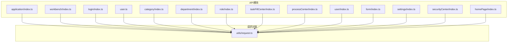
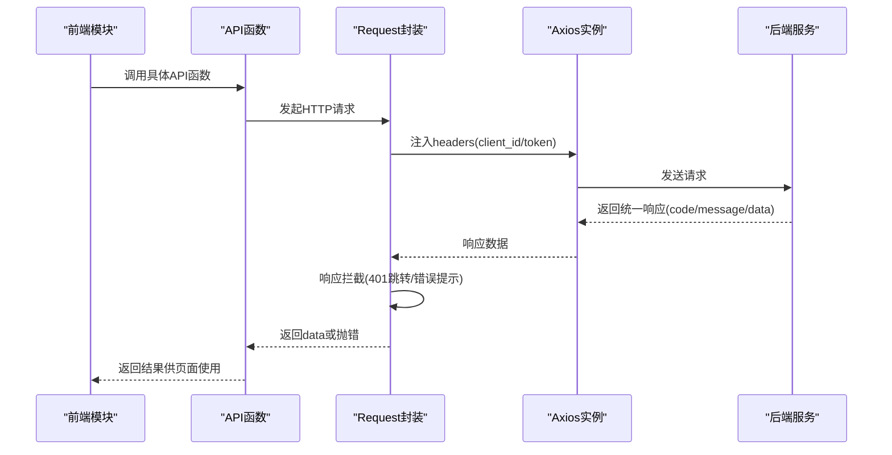
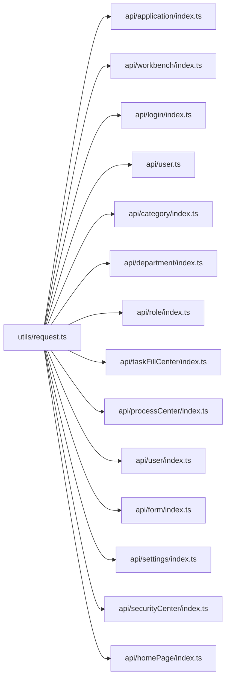

# API接口文档

<cite>
**本文引用的文件**
- [src/utils/request.ts](file://src/utils/request.ts)
- [src/api/application/index.ts](file://src/api/application/index.ts)
- [src/api/workbench/index.ts](file://src/api/workbench/index.ts)
- [src/api/login/index.ts](file://src/api/login/index.ts)
- [src/api/user.ts](file://src/api/user.ts)
- [src/api/category/index.ts](file://src/api/category/index.ts)
- [src/api/department/index.ts](file://src/api/department/index.ts)
- [src/api/role/index.ts](file://src/api/role/index.ts)
- [src/api/taskFillCenter/index.ts](file://src/api/taskFillCenter/index.ts)
- [src/api/processCenter/index.ts](file://src/api/processCenter/index.ts)
- [src/api/user/index.ts](file://src/api/user/index.ts)
- [src/api/form/index.ts](file://src/api/form/index.ts)
- [src/api/settings/index.ts](file://src/api/settings/index.ts)
- [src/api/securityCenter/index.ts](file://src/api/securityCenter/index.ts)
- [src/api/homePage/index.ts](file://src/api/homePage/index.ts)
</cite>

## 目录
1. [简介](#简介)
2. [项目结构](#项目结构)
3. [核心组件](#核心组件)
4. [架构总览](#架构总览)
5. [详细组件分析](#详细组件分析)
6. [依赖关系分析](#依赖关系分析)
7. [性能考虑](#性能考虑)
8. [故障排除指南](#故障排除指南)
9. [结论](#结论)
10. [附录](#附录)

## 简介
本文件为新工作台项目的完整API接口文档，覆盖RESTful接口的HTTP方法、URL模式、请求参数、响应格式与错误码；说明认证授权机制、请求头设置与数据验证规则；提供接口使用示例、参数说明与返回值解析；解释API设计规范、版本管理与向后兼容性；并给出接口测试指南与常见问题解决方案。

## 项目结构
前端采用模块化API目录组织方式，按业务域划分（如应用、工作台、用户、流程中心等），统一通过封装的请求工具类发送HTTP请求，并在拦截器中注入通用头部与鉴权信息。

图表来源
- [src/api/application/index.ts:1-78](file://src/api/application/index.ts#L1-L78)
- [src/api/workbench/index.ts:1-139](file://src/api/workbench/index.ts#L1-L139)
- [src/api/login/index.ts:1-61](file://src/api/login/index.ts#L1-L61)
- [src/api/user.ts:1-16](file://src/api/user.ts#L1-L16)
- [src/api/category/index.ts:1-19](file://src/api/category/index.ts#L1-L19)
- [src/api/department/index.ts:1-23](file://src/api/department/index.ts#L1-L23)
- [src/api/role/index.ts:1-25](file://src/api/role/index.ts#L1-L25)
- [src/api/taskFillCenter/index.ts:1-38](file://src/api/taskFillCenter/index.ts#L1-L38)
- [src/api/processCenter/index.ts:1-47](file://src/api/processCenter/index.ts#L1-L47)
- [src/api/user/index.ts:1-63](file://src/api/user/index.ts#L1-L63)
- [src/api/form/index.ts:1-31](file://src/api/form/index.ts#L1-L31)
- [src/api/settings/index.ts:1-19](file://src/api/settings/index.ts#L1-L19)
- [src/api/securityCenter/index.ts:1-90](file://src/api/securityCenter/index.ts#L1-L90)
- [src/api/homePage/index.ts:1-94](file://src/api/homePage/index.ts#L1-L94)
- [src/utils/request.ts:1-159](file://src/utils/request.ts#L1-L159)

章节来源
- [src/utils/request.ts:1-159](file://src/utils/request.ts#L1-L159)
- [src/api/application/index.ts:1-78](file://src/api/application/index.ts#L1-L78)
- [src/api/workbench/index.ts:1-139](file://src/api/workbench/index.ts#L1-L139)
- [src/api/login/index.ts:1-61](file://src/api/login/index.ts#L1-L61)
- [src/api/user.ts:1-16](file://src/api/user.ts#L1-L16)
- [src/api/category/index.ts:1-19](file://src/api/category/index.ts#L1-L19)
- [src/api/department/index.ts:1-23](file://src/api/department/index.ts#L1-L23)
- [src/api/role/index.ts:1-25](file://src/api/role/index.ts#L1-L25)
- [src/api/taskFillCenter/index.ts:1-38](file://src/api/taskFillCenter/index.ts#L1-L38)
- [src/api/processCenter/index.ts:1-47](file://src/api/processCenter/index.ts#L1-L47)
- [src/api/user/index.ts:1-63](file://src/api/user/index.ts#L1-L63)
- [src/api/form/index.ts:1-31](file://src/api/form/index.ts#L1-L31)
- [src/api/settings/index.ts:1-19](file://src/api/settings/index.ts#L1-L19)
- [src/api/securityCenter/index.ts:1-90](file://src/api/securityCenter/index.ts#L1-L90)
- [src/api/homePage/index.ts:1-94](file://src/api/homePage/index.ts#L1-L94)

## 核心组件
- 请求封装与拦截器
  - 基础配置：baseURL="/api"，超时60秒
  - 请求拦截：自动注入client_id与token（白名单例外）
  - 响应拦截：统一处理401跳转、错误消息提示、非成功状态抛错
  - 支持下载场景：对blob/arraybuffer类型直接透传原始数据
- 统一响应结构
  - 字段：code、message、data
  - 成功条件：后端返回success或code非401且业务校验通过
- 认证与授权
  - 令牌来源：localStorage中的wornbench_token
  - 白名单：部分无需鉴权的内部配置接口
  - 全局头部：client_id固定注入，token按需注入

章节来源
- [src/utils/request.ts:1-159](file://src/utils/request.ts#L1-L159)

## 架构总览
以下序列图展示典型API调用链路：前端模块调用API函数 -> 请求封装注入头部 -> 后端路由处理 -> 返回统一结构。

图表来源
- [src/utils/request.ts:26-113](file://src/utils/request.ts#L26-L113)
- [src/api/application/index.ts:1-78](file://src/api/application/index.ts#L1-L78)
- [src/api/workbench/index.ts:1-139](file://src/api/workbench/index.ts#L1-L139)
- [src/api/login/index.ts:1-61](file://src/api/login/index.ts#L1-L61)

## 详细组件分析

### 应用与模块管理
- 接口概览
  - 获取应用详情：GET /business/v1/app/{id}
  - 模块树：GET /business/v1/module/{id}
  - 已授权模块：GET /business/v1/module/authorized/{id}
  - 待办计数：GET /business/v1/app_backlog/count/work_number
  - 新增模块：POST /business/v1/module/addModule
  - 修改模块：PUT /business/v1/module/modifyModule/{id}
  - 新增目录：POST /business/v1/module/addDirectory
  - 删除模块：DELETE /business/v1/module/deleteModule/{id}
  - 复制表单模块：POST /business/v1/module/copyFormModule
  - 复制报表模块：PUT /business/v1/module/copyReportModule/{id}
  - 查询系统表单：GET /business/v1/datasource/query_system_form/{id}
  - 查询模块详情：GET /business/v1/module/query_module/{id}
  - 移动父目录：POST /business/v1/module/modifyParentDirectory
  - 模块排序：POST /business/v1/module/sort
  - 表单编码：GET /business/v1/form/form_code
  - 回收站列表：GET /business/v1/recycle/{type}
  - 回收站恢复：PUT /business/v1/recycle/recover/{id}
  - 回收站删除：DELETE /business/v1/recycle/{id}
  - 回收站清空：DELETE /business/v1/recycle/deleteAll/{id}
  - 上传附件：POST /business/v1/file/uploadATTACH
  - 打印模板-新增：POST /internal/business/print/v1/{appid}
  - 打印模板-查询：GET /internal/business/print/v1/{appid}
  - 打印模板-更新：PUT /internal/business/print/v1/{id}
- 请求头
  - 自动注入client_id与token（白名单除外）
- 参数与返回
  - 参数多为路径参数或查询参数，部分接口携带请求体
  - 统一响应结构：code、message、data
- 错误码
  - 401：未授权，触发跳转至登录页
  - 非2xx或业务失败：弹窗提示message并抛错
- 使用示例
  - 获取应用详情：GET /business/v1/app/123
  - 新增模块：POST /business/v1/module/addModule {name:"模块名",parentId:1}
  - 删除模块：DELETE /business/v1/module/deleteModule/456
  - 查询回收站：GET /business/v1/recycle/list?page=1&size=20

章节来源
- [src/api/application/index.ts:1-78](file://src/api/application/index.ts#L1-L78)
- [src/utils/request.ts:26-113](file://src/utils/request.ts#L26-L113)

### 工作台与流程待办
- 接口概览
  - 待办计数：GET /internal/business/workbench/v1/count
  - 待办应用列表：GET /internal/business/workbench/pending/v1/apps
  - 待办分页：GET /internal/business/workbench/pending/v1/record
  - 任务转交：POST /internal/business/workbench/pending/v1/delegate
  - 填写完成：POST /internal/business/workbench/pending/v1/inputComplete
  - 审批通过：POST /internal/business/workbench/pending/v1/approvePass
  - 审批拒绝：POST /internal/business/workbench/pending/v1/approveReject
  - 审批退回：POST /internal/business/workbench/pending/v1/approveBack
  - 申请应用列表：GET /internal/business/workbench/apply/v1/apps
  - 申请分页：GET /internal/business/workbench/apply/v1/record
  - 撤回申请：POST /internal/business/workbench/apply/v1/revoke?processInstanceId={id}
  - 终止申请：POST /internal/business/workbench/apply/v1/terminate
  - 加急处理：POST /internal/business/workbench/apply/v1/urgent?processInstanceId={id}
  - 已办应用列表：GET /internal/business/workbench/handler/v1/apps
  - 已办分页：GET /internal/business/workbench/handler/v1/record
  - 抄送应用列表：GET /internal/business/workbench/notice/v1/apps
  - 抄送分页：GET /internal/business/workbench/notice/v1/record
  - 抄送已读：POST /internal/business/workbench/notice/v1/read/{noticeId}
  - 流程日志：GET /internal/business/process/v1/log/{processInstanceId}
  - 流程详情-待办：GET /internal/business/workbench/pending/v1/{taskId}
  - 流程详情-申请：GET /internal/business/workbench/apply/v1/{processInstanceId}
  - 流程详情-已办：GET /internal/business/workbench/handler/v1/{taskId}
  - 流程详情-抄送：GET /internal/business/workbench/notice/v1/{executionId}
  - 流程候选人-流程：GET /internal/business/processCenter/processCandidates/{processInstanceId}
  - 流程候选人-节点：GET /internal/business/processCenter/executionCandidates/{processInstanceId}/{executionId}
  - 打印-工作台：POST /internal/business/fill/common/v1/workbench/export/{type}（responseType: blob）
  - 打印-表单：GET /internal/business/print/v1/form/{formId}
- 请求头
  - 自动注入client_id与token（白名单除外）
- 参数与返回
  - 分页接口通常携带查询参数page、size等
  - 导出接口设置responseType为blob
  - 统一响应结构：code、message、data
- 错误码
  - 401：未授权，触发跳转至登录页
  - 非2xx或业务失败：弹窗提示message并抛错
- 使用示例
  - 获取待办分页：GET /internal/business/workbench/pending/v1/record?page=1&size=20
  - 抄送已读：POST /internal/business/workbench/notice/v1/read/789
  - 导出工作台数据：POST /internal/business/fill/common/v1/workbench/export/xlsx {filters}

章节来源
- [src/api/workbench/index.ts:1-139](file://src/api/workbench/index.ts#L1-L139)
- [src/utils/request.ts:26-113](file://src/utils/request.ts#L26-L113)

### 登录与用户信息
- 接口概览
  - 检查用户：GET /business/v1/system/checkUser
  - OAuth用户信息：GET /authentication/oauth2/userinfo
  - 是否管理员：GET /business/v1/admin
  - 表单登录：POST /internal/business/form/login
  - 服务中台登录：POST /internal/business/servicePlatform/login
  - 社交账号状态码：POST /internal/business/socialState/{socialType}
  - 微信公众号登录：POST /internal/business/wechatOfficial/login
  - 微信开放平台登录：POST /internal/business/wechatOpenPlatform/login
  - 当前用户信息：GET /internal/business/userinfo
  - 用户角色：GET /internal/business/func/v1/getUserRole
  - 用户部门：GET /internal/business/func/v1/getUserDept
  - 用户职位：GET /internal/business/func/v1/getUserPost
  - 用户部门负责人：GET /internal/business/func/v1/getUserDeptLeader
- 请求头
  - 自动注入client_id与token（白名单除外）
- 参数与返回
  - 登录接口携带用户名/密码等凭据
  - 角色/部门/职位等接口返回用户相关属性
  - 统一响应结构：code、message、data
- 错误码
  - 401：未授权，触发跳转至登录页
  - 非2xx或业务失败：弹窗提示message并抛错
- 使用示例
  - 表单登录：POST /internal/business/form/login {username,password}
  - 获取当前用户信息：GET /internal/business/userinfo

章节来源
- [src/api/login/index.ts:1-61](file://src/api/login/index.ts#L1-L61)
- [src/utils/request.ts:26-113](file://src/utils/request.ts#L26-L113)

### 文件上传与下载
- 接口概览
  - 下载：GET /internal/business/file/v1/download（responseType: blob）
  - 单文件上传：POST /internal/business/file/v1/upload
  - 批量上传：POST /internal/business/file/v1/batchUpload
- 请求头
  - 自动注入client_id与token（白名单除外）
- 参数与返回
  - 下载接口设置responseType为blob
  - 上传接口携带文件二进制或multipart
  - 统一响应结构：code、message、data
- 错误码
  - 401：未授权，触发跳转至登录页
  - 非2xx或业务失败：弹窗提示message并抛错
- 使用示例
  - 下载文件：GET /internal/business/file/v1/download?fileId=xxx
  - 单文件上传：POST /internal/business/file/v1/upload {file: Blob}

章节来源
- [src/api/user.ts:1-16](file://src/api/user.ts#L1-L16)
- [src/utils/request.ts:26-113](file://src/utils/request.ts#L26-L113)

### 应用分类管理
- 接口概览
  - 新增分类：POST /internal/business/app/category/v1
  - 修改分类：PUT /internal/business/app/category/v1/{id}
  - 删除分类：DELETE /internal/business/app/category/v1/{id}
  - 分类列表：GET /internal/business/app/category/v1
- 请求头
  - 自动注入client_id与token（白名单除外）
- 参数与返回
  - 列表接口支持分页查询参数
  - 统一响应结构：code、message、data
- 错误码
  - 401：未授权，触发跳转至登录页
  - 非2xx或业务失败：弹窗提示message并抛错
- 使用示例
  - 新增分类：POST /internal/business/app/category/v1 {name:"分类名"}

章节来源
- [src/api/category/index.ts:1-19](file://src/api/category/index.ts#L1-L19)
- [src/utils/request.ts:26-113](file://src/utils/request.ts#L26-L113)

### 部门管理
- 接口概览
  - 新增部门：POST /internal/business/dept/v1
  - 删除部门：DELETE /internal/business/dept/v1/{id}
  - 修改部门：PUT /internal/business/dept/v1/{id}
  - 部门树：GET /internal/business/dept/v1/tree
  - 导入部门：POST /internal/business/dept/v1/import
- 请求头
  - 自动注入client_id与token（白名单除外）
- 参数与返回
  - 部门树接口返回层级结构
  - 导入接口支持批量数据
  - 统一响应结构：code、message、data
- 错误码
  - 401：未授权，触发跳转至登录页
  - 非2xx或业务失败：弹窗提示message并抛错
- 使用示例
  - 获取部门树：GET /internal/business/dept/v1/tree

章节来源
- [src/api/department/index.ts:1-23](file://src/api/department/index.ts#L1-L23)
- [src/utils/request.ts:26-113](file://src/utils/request.ts#L26-L113)

### 角色管理
- 接口概览
  - 新增角色：POST /internal/business/role/v1
  - 删除角色：DELETE /internal/business/role/v1/{id}
  - 修改角色：PUT /internal/business/role/v1/{id}
  - 分页查询角色列表：GET /internal/business/role/v1/pageRecord
  - 角色列表：GET /internal/business/role/v1
- 请求头
  - 自动注入client_id与token（白名单除外）
- 参数与返回
  - 分页查询支持page、size等参数
  - 统一响应结构：code、message、data
- 错误码
  - 401：未授权，触发跳转至登录页
  - 非2xx或业务失败：弹窗提示message并抛错
- 使用示例
  - 分页查询：GET /internal/business/role/v1/pageRecord?page=1&size=20

章节来源
- [src/api/role/index.ts:1-25](file://src/api/role/index.ts#L1-L25)
- [src/utils/request.ts:26-113](file://src/utils/request.ts#L26-L113)

### 填报中心
- 接口概览
  - 填报数据：POST /internal/business/fill/object/v1
  - 填报批次分页：GET /internal/business/fill/object/v1/fillBatchTaskPage
  - 查看填报详情：GET /internal/business/fill/common/v1/getFillBatchTask/{objectId}
  - 数据纠错记录-对象：GET /internal/business/fill/fix/v1/object/recordPage/{objectId}
  - 审批进度：GET /internal/business/fill/common/v1/getApprovalProgress/{processInstanceId}
  - 导出填报数据：POST /internal/business/fill/common/v1/export/{type}（responseType: blob）
- 请求头
  - 自动注入client_id与token（白名单除外）
- 参数与返回
  - 导出接口设置responseType为blob
  - 统一响应结构：code、message、data
- 错误码
  - 401：未授权，触发跳转至登录页
  - 非2xx或业务失败：弹窗提示message并抛错
- 使用示例
  - 填报数据：POST /internal/business/fill/object/v1 {formData}

章节来源
- [src/api/taskFillCenter/index.ts:1-38](file://src/api/taskFillCenter/index.ts#L1-L38)
- [src/utils/request.ts:26-113](file://src/utils/request.ts#L26-L113)

### 流程中心
- 接口概览
  - 流程统计：GET /internal/business/processCenter/v1/processTotal
  - 应用流程列表：GET /internal/business/processCenter/v1/appList
  - 流程记录列表：POST /internal/business/processCenter/v1/record
  - 催办：POST /internal/business/processCenter/urgent/{processInstanceId}
  - 填写：POST /internal/business/processCenter/input/
  - 填写任务转交：POST /internal/business/processCenter/inputAssign
  - 审批通过：POST /internal/business/processCenter/approvePass
  - 审批拒绝：POST /internal/business/processCenter/approveRefuse
  - 审批转交：POST /internal/business/processCenter/approveAssign
  - 审批退回：POST /internal/business/processCenter/approveBack
  - 终止流程：GET /internal/business/processCenter/stop/{id}
- 请求头
  - 自动注入client_id与token（白名单除外）
- 参数与返回
  - 统一响应结构：code、message、data
- 错误码
  - 401：未授权，触发跳转至登录页
  - 非2xx或业务失败：弹窗提示message并抛错
- 使用示例
  - 催办：POST /internal/business/processCenter/urgent/abc123

章节来源
- [src/api/processCenter/index.ts:1-47](file://src/api/processCenter/index.ts#L1-L47)
- [src/utils/request.ts:26-113](file://src/utils/request.ts#L26-L113)

### 用户管理
- 接口概览
  - 新增用户：POST /internal/business/user/v1
  - 删除用户：DELETE /internal/business/user/v1/{id}
  - 修改用户：PUT /internal/business/user/v1/{id}
  - 分页查询用户：GET /internal/business/user/v1/pageRecord
  - 修改在职状态：POST /internal/business/user/v1/changeActive
  - 修改登录状态：POST /internal/business/user/v1/changeState
  - 重置密码：POST /internal/business/user/v1/resetPassword
  - 修改身份信息：POST /internal/business/user/v1/changeIdentity
  - 添加兼任部门：POST /internal/business/user/v1/addPartTimeDept
  - 免去兼任部门职位：POST /internal/business/user/v1/dismissPartTimeDept
  - 设置部门负责人：POST /internal/business/user/v1/setupDeptLeader
  - 批量离职：POST /internal/business/user/v1/batchLeave
  - 在职无部门人数：GET /internal/business/user/v1/getNoDeptNum
  - 更新角色：POST /internal/business/user/v1/updateRole
  - 更新部门：POST /internal/business/user/v1/updateDept
- 请求头
  - 自动注入client_id与token（白名单除外）
- 参数与返回
  - 分页查询支持page、size等参数
  - 统一响应结构：code、message、data
- 错误码
  - 401：未授权，触发跳转至登录页
  - 非2xx或业务失败：弹窗提示message并抛错
- 使用示例
  - 分页查询：GET /internal/business/user/v1/pageRecord?page=1&size=20

章节来源
- [src/api/user/index.ts:1-63](file://src/api/user/index.ts#L1-L63)
- [src/utils/request.ts:26-113](file://src/utils/request.ts#L26-L113)

### 表单与提交
- 接口概览
  - 应用设计：PUT /internal/business/app/v1/design/{appId}
  - 保存表单设计：PUT /internal/business/app/v1/formDesign/{appId}
  - 我创建的表单设计：GET /internal/business/app/creator/v1/design/{appId}
  - 我管理的表单设计：GET /internal/business/app/manager/v1/design/{appId}
  - 可访问的表单设计：GET /internal/business/app/visitor/v1/preview/{appId}
  - 表单提交数据：POST /internal/business/submit/form/v1/{appId}
  - 获取应用流程历史：GET /internal/business/app/v1/processHistory/{appId}
- 请求头
  - 自动注入client_id与token（白名单除外）
- 参数与返回
  - 提交数据接口携带表单JSON
  - 统一响应结构：code、message、data
- 错误码
  - 401：未授权，触发跳转至登录页
  - 非2xx或业务失败：弹窗提示message并抛错
- 使用示例
  - 提交表单：POST /internal/business/submit/form/v1/123 {fields}

章节来源
- [src/api/form/index.ts:1-31](file://src/api/form/index.ts#L1-L31)
- [src/utils/request.ts:26-113](file://src/utils/request.ts#L26-L113)

### 系统配置
- 接口概览
  - 使用配置：GET /internal/business/config/apply/v1/{configCode}
  - 获取配置：GET /internal/business/config/v1/{configCode}
  - 修改配置：PUT /internal/business/config/v1/{id}
- 请求头
  - 自动注入client_id与token（白名单除外）
- 参数与返回
  - 统一响应结构：code、message、data
- 错误码
  - 401：未授权，触发跳转至登录页
  - 非2xx或业务失败：弹窗提示message并抛错
- 使用示例
  - 获取配置：GET /internal/business/config/v1/CONFIG_CODE

章节来源
- [src/api/settings/index.ts:1-19](file://src/api/settings/index.ts#L1-L19)
- [src/utils/request.ts:26-113](file://src/utils/request.ts#L26-L113)

### 安全中心
- 接口概览
  - 新增安全组：POST /internal/business/security/group/v1
  - 修改安全组：PUT /internal/business/security/group/v1/{id}
  - 删除安全组：DELETE /internal/business/security/group/v1/{id}
  - 列表查询：GET /internal/business/security/group/v1/listRecord
  - 获取应用：GET /internal/business/app/v1/allApp
  - 菜单树：GET /internal/business/menu/v1/tree
  - 菜单授权：POST /internal/business/security/group/v1/menu/grant/{id}
  - 授权菜单ids查询：GET /internal/business/security/group/v1/menu/grantIds/{groupId}
  - 新增安全组用户：POST /internal/business/security/group/v1/user/grant/{groupId}
  - 移除安全组用户：DELETE /internal/business/security/group/v1/user/grant/{id}
  - 授权用户查询：GET /internal/business/security/group/v1/user/grantUsers/{id}
  - 未授权用户查询：GET /internal/business/security/group/v1/user/unGrantUsers/{id}
  - 新增应用授权：POST /internal/business/security/group/v1/app/grant/{id}
  - 移除应用授权：DELETE /internal/business/security/group/v1/app/grant/{id}
  - 授权应用查询：GET /internal/business/security/group/v1/app/grantApps/{id}
- 请求头
  - 自动注入client_id与token（白名单除外）
- 参数与返回
  - 统一响应结构：code、message、data
- 错误码
  - 401：未授权，触发跳转至登录页
  - 非2xx或业务失败：弹窗提示message并抛错
- 使用示例
  - 新增安全组：POST /internal/business/security/group/v1 {name:"安全部"}

章节来源
- [src/api/securityCenter/index.ts:1-90](file://src/api/securityCenter/index.ts#L1-L90)
- [src/utils/request.ts:26-113](file://src/utils/request.ts#L26-L113)

### 首页与应用管理
- 接口概览
  - 首页统计：GET /business/v1/workbench/home_count
  - 字典项：GET /system/v1/dict/getDictItem/FOOTER_PLATFORM
  - 我的应用：GET /business/v1/app/myApp
  - 应用广场：GET /business/v1/app/application_square
  - 我管理的应用：GET /business/v1/group/manage/app
  - 是否管理员：GET /business/v1/admin
  - 新增应用：POST /internal/business/app/v1
  - 修改应用：PUT /internal/business/app/v1/{id}
  - 销毁应用：DELETE /internal/business/app/v1/{id}
  - 数据清理：POST /internal/business/app/v1/dataClear/{id}
  - 应用转让：POST /internal/business/app/v1/transfer/{id}
  - 创建者应用列表：GET /internal/business/app/creator/v1
  - 访问对象配置：POST /internal/business/app/v1/access/{appId}
  - 获取访问对象：GET /internal/business/app/v1/access/{appId}
  - webhook配置：POST /internal/business/app/v1/webhook/{appId}
  - 获取webhook配置：GET /internal/business/app/v1/webhook/{appId}
  - 获取应用详情-创建者：GET /internal/business/app/creator/v1/{appId}
  - 访问者分类应用列表：GET /internal/business/app/visitor/v1
  - 获取应用详情-访问者：GET /internal/business/app/visitor/v1/{appId}
  - 应用分享配置：POST /internal/business/app/v1/openNetwork/{appId}
  - 获取应用分享：GET /internal/business/app/v1/openNetwork/{appId}
  - 是否为默认组用户：GET /internal/business/security/group/v1/user/appTabPermission
  - 管理员应用列表：GET /internal/business/app/manager/v1
  - 获取应用详情-管理员：GET /internal/business/app/manager/v1/{appId}
- 请求头
  - 自动注入client_id与token（白名单除外）
- 参数与返回
  - 统一响应结构：code、message、data
- 错误码
  - 401：未授权，触发跳转至登录页
  - 非2xx或业务失败：弹窗提示message并抛错
- 使用示例
  - 新增应用：POST /internal/business/app/v1 {name:"新应用"}

章节来源
- [src/api/homePage/index.ts:1-94](file://src/api/homePage/index.ts#L1-L94)
- [src/utils/request.ts:26-113](file://src/utils/request.ts#L26-L113)

## 依赖关系分析
- 模块耦合
  - 所有API模块均依赖utils/request.ts提供的Request类与拦截器
  - 低耦合高内聚：每个业务域独立维护自身API文件
- 外部依赖
  - axios作为HTTP客户端
  - @arco-design/web-vue用于全局消息提示
- 潜在循环依赖
  - 无直接循环依赖，API模块仅向下依赖请求封装

图表来源
- [src/utils/request.ts:1-159](file://src/utils/request.ts#L1-L159)
- [src/api/application/index.ts:1-78](file://src/api/application/index.ts#L1-L78)
- [src/api/workbench/index.ts:1-139](file://src/api/workbench/index.ts#L1-L139)
- [src/api/login/index.ts:1-61](file://src/api/login/index.ts#L1-L61)
- [src/api/user.ts:1-16](file://src/api/user.ts#L1-L16)
- [src/api/category/index.ts:1-19](file://src/api/category/index.ts#L1-L19)
- [src/api/department/index.ts:1-23](file://src/api/department/index.ts#L1-L23)
- [src/api/role/index.ts:1-25](file://src/api/role/index.ts#L1-L25)
- [src/api/taskFillCenter/index.ts:1-38](file://src/api/taskFillCenter/index.ts#L1-L38)
- [src/api/processCenter/index.ts:1-47](file://src/api/processCenter/index.ts#L1-L47)
- [src/api/user/index.ts:1-63](file://src/api/user/index.ts#L1-L63)
- [src/api/form/index.ts:1-31](file://src/api/form/index.ts#L1-L31)
- [src/api/settings/index.ts:1-19](file://src/api/settings/index.ts#L1-L19)
- [src/api/securityCenter/index.ts:1-90](file://src/api/securityCenter/index.ts#L1-L90)
- [src/api/homePage/index.ts:1-94](file://src/api/homePage/index.ts#L1-L94)

## 性能考虑
- 超时控制：默认60秒，避免长时间阻塞
- 下载优化：对blob/arraybuffer类型直接透传，减少中间处理
- 分页查询：建议前端合理设置page/size，避免一次性拉取过多数据
- 白名单策略：对无需鉴权的内部配置接口放行，减少不必要的token校验

## 故障排除指南
- 401未授权
  - 现象：自动跳转至登录页
  - 处理：检查本地存储wornbench_token是否存在且有效
- 403拒绝访问
  - 现象：弹窗提示拒绝访问
  - 处理：确认用户角色与资源权限
- 404请求出错
  - 现象：弹窗提示请求出错
  - 处理：核对URL路径与版本号
- 500/502/503/504
  - 现象：对应服务异常或网络超时
  - 处理：重试或联系后端排查
- 业务失败
  - 现象：弹窗提示message并抛错
  - 处理：根据message定位问题并修正参数

章节来源
- [src/utils/request.ts:67-112](file://src/utils/request.ts#L67-L112)

## 结论
本API文档基于前端请求封装与各业务域API文件整理而成，统一了请求头注入、响应结构与错误处理策略。开发者可据此快速理解接口行为、正确构造请求与解析响应，并结合测试指南与故障排除方案高效集成。

## 附录
- 版本管理与向后兼容
  - 版本前缀：/business/v1、/internal/business/.../v1
  - 建议：新增接口遵循现有命名与响应结构，避免破坏既有契约
- 数据验证规则
  - 建议：前端对必填字段与格式进行基础校验，后端返回明确错误信息
- 接口测试指南
  - 基础步骤：准备测试账号与必要参数，使用curl或Postman逐项验证
  - 关键点：关注401/403/404/5xx等状态码与message提示
  - 下载导出：验证responseType与文件内容完整性