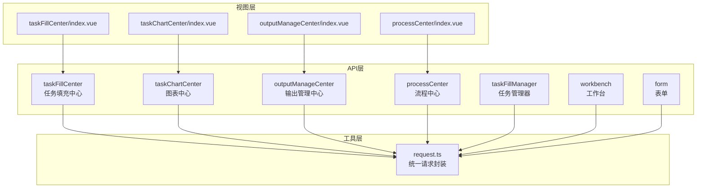
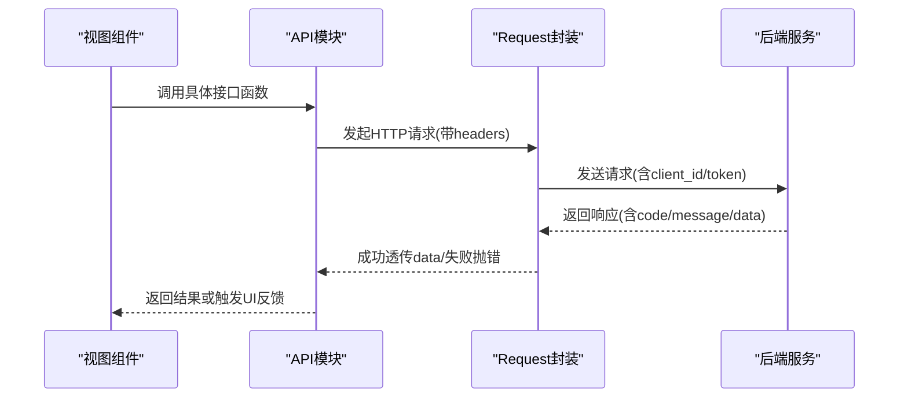
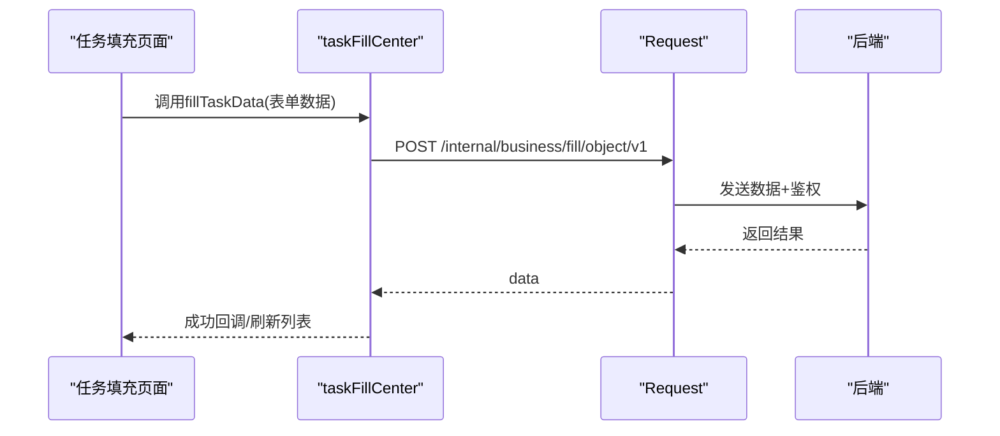
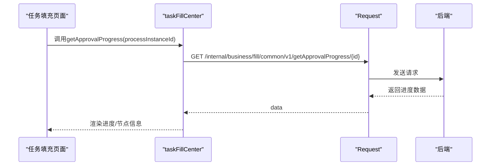
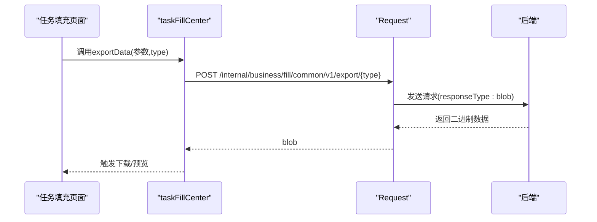
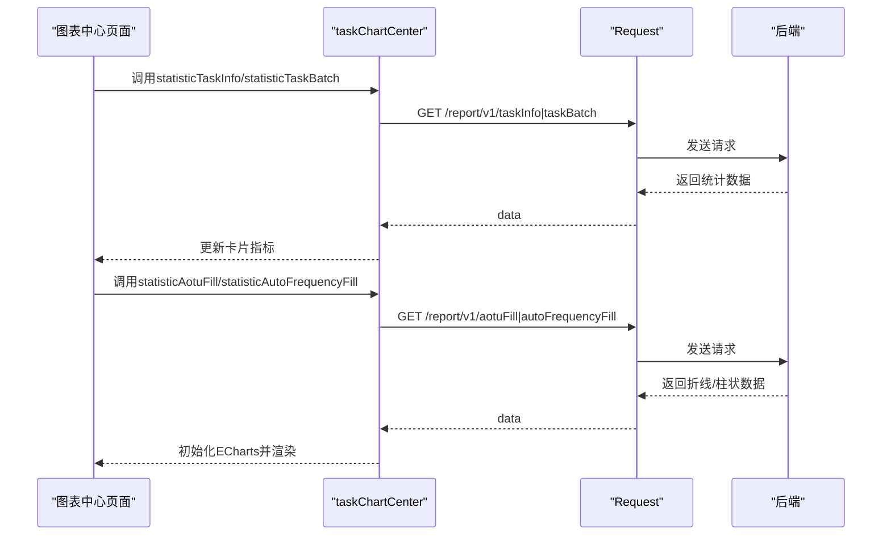
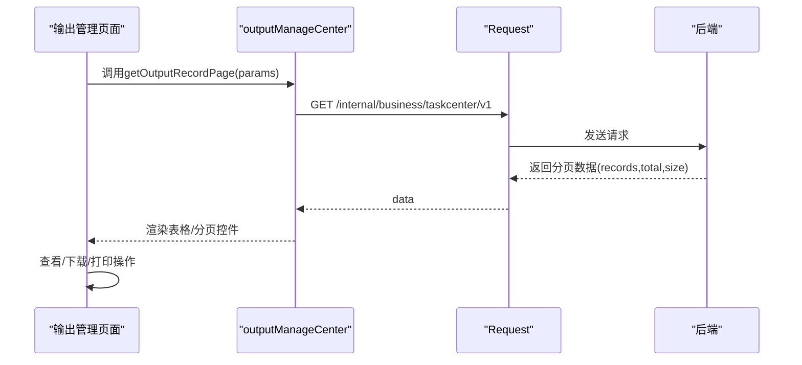
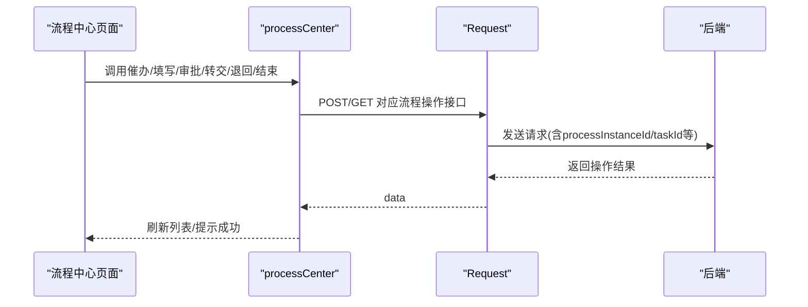
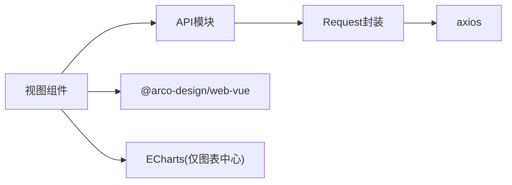

# 工作流API

<cite>
**本文档引用的文件**
- [src/api/taskFillCenter/index.ts](file://src/api/taskFillCenter/index.ts)
- [src/api/taskChartCenter/index.ts](file://src/api/taskChartCenter/index.ts)
- [src/api/outputManageCenter/index.ts](file://src/api/outputManageCenter/index.ts)
- [src/api/processCenter/index.ts](file://src/api/processCenter/index.ts)
- [src/api/taskFillManager/index.ts](file://src/api/taskFillManager/index.ts)
- [src/api/workbench/index.ts](file://src/api/workbench/index.ts)
- [src/api/form/index.ts](file://src/api/form/index.ts)
- [src/utils/request.ts](file://src/utils/request.ts)
- [src/views/taskFillCenter/index.vue](file://src/views/taskFillCenter/index.vue)
- [src/views/taskChartCenter/index.vue](file://src/views/taskChartCenter/index.vue)
- [src/views/outputManageCenter/index.vue](file://src/views/outputManageCenter/index.vue)
- [src/views/processCenter/index.vue](file://src/views/processCenter/index.vue)
</cite>

## 目录
1. [简介](#简介)
2. [项目结构](#项目结构)
3. [核心组件](#核心组件)
4. [架构总览](#架构总览)
5. [详细组件分析](#详细组件分析)
6. [依赖分析](#依赖分析)
7. [性能考虑](#性能考虑)
8. [故障排查指南](#故障排查指南)
9. [结论](#结论)
10. [附录](#附录)

## 简介
本文件面向“工作流API”的使用者与维护者，系统性梳理任务填充中心、图表中心、输出管理中心以及流程中心的接口规范与前端调用方式。文档覆盖以下主题：
- 任务流转与节点操作：流程中心的催办、填写、审批、转交、退回、结束流程等
- 数据填充与校验：任务填充中心的数据提交、批次查询、审批进度查询、导出
- 图表生成与展示：任务统计、批次统计、近七日填报人次、当日填报频次
- 输出管理：输出记录分页、下载与打印
- 状态查询与进度跟踪：工作台待办/已办/抄送、流程日志、节点候选人
- 异常处理与鉴权：统一请求封装、Token注入、错误提示与跳转
- 数据持久化与缓存策略：基于后端接口的分页与筛选，前端按需加载与本地状态管理

## 项目结构
工作流相关API主要位于 src/api 下的各中心模块，并由 src/utils/request.ts 提供统一的请求封装；前端页面位于 src/views 下对应模块。

**图表来源**
- [src/api/taskFillCenter/index.ts:1-38](file://src/api/taskFillCenter/index.ts#L1-L38)
- [src/api/taskChartCenter/index.ts:1-24](file://src/api/taskChartCenter/index.ts#L1-L24)
- [src/api/outputManageCenter/index.ts:1-9](file://src/api/outputManageCenter/index.ts#L1-L9)
- [src/api/processCenter/index.ts:1-47](file://src/api/processCenter/index.ts#L1-L47)
- [src/api/taskFillManager/index.ts:1-109](file://src/api/taskFillManager/index.ts#L1-L109)
- [src/api/workbench/index.ts:1-139](file://src/api/workbench/index.ts#L1-L139)
- [src/api/form/index.ts:1-31](file://src/api/form/index.ts#L1-L31)
- [src/utils/request.ts:1-159](file://src/utils/request.ts#L1-L159)
- [src/views/taskFillCenter/index.vue:1-482](file://src/views/taskFillCenter/index.vue#L1-L482)
- [src/views/taskChartCenter/index.vue:1-462](file://src/views/taskChartCenter/index.vue#L1-L462)
- [src/views/outputManageCenter/index.vue:1-365](file://src/views/outputManageCenter/index.vue#L1-L365)
- [src/views/processCenter/index.vue:1-892](file://src/views/processCenter/index.vue#L1-L892)

**章节来源**
- [src/api/taskFillCenter/index.ts:1-38](file://src/api/taskFillCenter/index.ts#L1-L38)
- [src/api/taskChartCenter/index.ts:1-24](file://src/api/taskChartCenter/index.ts#L1-L24)
- [src/api/outputManageCenter/index.ts:1-9](file://src/api/outputManageCenter/index.ts#L1-L9)
- [src/api/processCenter/index.ts:1-47](file://src/api/processCenter/index.ts#L1-L47)
- [src/api/taskFillManager/index.ts:1-109](file://src/api/taskFillManager/index.ts#L1-L109)
- [src/api/workbench/index.ts:1-139](file://src/api/workbench/index.ts#L1-L139)
- [src/api/form/index.ts:1-31](file://src/api/form/index.ts#L1-L31)
- [src/utils/request.ts:1-159](file://src/utils/request.ts#L1-L159)
- [src/views/taskFillCenter/index.vue:1-482](file://src/views/taskFillCenter/index.vue#L1-L482)
- [src/views/taskChartCenter/index.vue:1-462](file://src/views/taskChartCenter/index.vue#L1-L462)
- [src/views/outputManageCenter/index.vue:1-365](file://src/views/outputManageCenter/index.vue#L1-L365)
- [src/views/processCenter/index.vue:1-892](file://src/views/processCenter/index.vue#L1-L892)

## 核心组件
- 统一请求封装：在 src/utils/request.ts 中定义 Request 类，负责 baseURL、超时、请求头注入（client_id、token）、响应拦截（统一错误提示、401跳转）与Blob/ArrayBuffer透传。
- 任务填充中心：提供数据提交、批次任务分页、审批进度查询、导出等能力。
- 图表中心：提供任务统计、批次统计、近七日填报人次、当日填报频次等报表接口。
- 输出管理中心：提供输出记录分页查询与下载/打印入口。
- 流程中心：提供流程统计、应用列表、记录列表、催办、填写、审批、转交、退回、结束流程等。
- 工作台：提供待办/已办/抄送、流程日志、节点候选人、打印与导出等。
- 表单：提供应用设计、表单设计、提交数据、流程历史等。

**章节来源**
- [src/utils/request.ts:1-159](file://src/utils/request.ts#L1-L159)
- [src/api/taskFillCenter/index.ts:1-38](file://src/api/taskFillCenter/index.ts#L1-L38)
- [src/api/taskChartCenter/index.ts:1-24](file://src/api/taskChartCenter/index.ts#L1-L24)
- [src/api/outputManageCenter/index.ts:1-9](file://src/api/outputManageCenter/index.ts#L1-L9)
- [src/api/processCenter/index.ts:1-47](file://src/api/processCenter/index.ts#L1-L47)
- [src/api/workbench/index.ts:1-139](file://src/api/workbench/index.ts#L1-L139)
- [src/api/form/index.ts:1-31](file://src/api/form/index.ts#L1-L31)

## 架构总览
前端通过各中心API模块调用后端接口，统一经 request.ts 的拦截器处理鉴权与错误。视图层组件负责业务交互与数据展示。

**图表来源**
- [src/utils/request.ts:26-113](file://src/utils/request.ts#L26-L113)
- [src/api/taskFillCenter/index.ts:6-8](file://src/api/taskFillCenter/index.ts#L6-L8)
- [src/api/processCenter/index.ts:17-18](file://src/api/processCenter/index.ts#L17-L18)

## 详细组件分析

### 任务填充中心（taskFillCenter）
- 接口清单
  - 填报数据提交：POST /internal/business/fill/object/v1
  - 查询填报批次任务：GET /internal/business/fill/object/v1/fillBatchTaskPage
  - 查看填报详情：GET /internal/business/fill/common/v1/getFillBatchTask/{objectId}
  - 数据纠错记录-填报对象：GET /internal/business/fill/fix/v1/object/recordPage/{objectId}
  - 查询审批进度：GET /internal/business/fill/common/v1/getApprovalProgress/{processInstanceId}
  - 导出填报数据：POST /internal/business/fill/common/v1/export/{type}（responseType: blob）

- 关键流程（数据提交）

**图表来源**
- [src/api/taskFillCenter/index.ts:6-8](file://src/api/taskFillCenter/index.ts#L6-L8)
- [src/views/taskFillCenter/index.vue:140-175](file://src/views/taskFillCenter/index.vue#L140-L175)

- 关键流程（审批进度）

**图表来源**
- [src/api/taskFillCenter/index.ts:29-32](file://src/api/taskFillCenter/index.ts#L29-L32)
- [src/views/taskFillCenter/index.vue:135-138](file://src/views/taskFillCenter/index.vue#L135-L138)

- 关键流程（导出）

**图表来源**
- [src/api/taskFillCenter/index.ts:34-37](file://src/api/taskFillCenter/index.ts#L34-L37)

- 前端实现要点
  - 分页加载：fillBatchTaskPage 支持分页参数，结合视图组件的分页与加载状态控制。
  - 详情查看：getFillBatchTask 用于打开抽屉或弹窗展示批次详情。
  - 纠错记录：fixRecordObjectPage 用于展示与管理纠错记录。
  - 审批进度：getApprovalProgress 用于展示流程节点与审批状态。

**章节来源**
- [src/api/taskFillCenter/index.ts:1-38](file://src/api/taskFillCenter/index.ts#L1-L38)
- [src/views/taskFillCenter/index.vue:140-207](file://src/views/taskFillCenter/index.vue#L140-L207)

### 图表中心（taskChartCenter）
- 接口清单
  - 填报任务统计：GET /internal/business/fill/report/v1/taskInfo
  - 填报批次统计：GET /internal/business/fill/report/v1/taskBatch
  - 近七日填报任务人次：GET /internal/business/fill/report/v1/aotuFill
  - 当天填报统计：GET /internal/business/fill/report/v1/autoFrequencyFill

- 关键流程（图表渲染）

**图表来源**
- [src/api/taskChartCenter/index.ts:6-23](file://src/api/taskChartCenter/index.ts#L6-L23)
- [src/views/taskChartCenter/index.vue:190-255](file://src/views/taskChartCenter/index.vue#L190-L255)

- 前端实现要点
  - 日期范围选择：支持最近一周/月/季度快捷项，自动计算startDate/endDate。
  - 图表初始化：折线图展示近七日填报数、应用数量、填报人数；柱状图展示当日任务频次。
  - 响应式适配：窗口resize时重绘图表。

**章节来源**
- [src/api/taskChartCenter/index.ts:1-24](file://src/api/taskChartCenter/index.ts#L1-L24)
- [src/views/taskChartCenter/index.vue:180-371](file://src/views/taskChartCenter/index.vue#L180-L371)

### 输出管理中心（outputManageCenter）
- 接口清单
  - 获取输出记录分页：GET /internal/business/taskcenter/v1

- 关键流程（输出记录管理）

**图表来源**
- [src/api/outputManageCenter/index.ts:6-8](file://src/api/outputManageCenter/index.ts#L6-L8)
- [src/views/outputManageCenter/index.vue:213-230](file://src/views/outputManageCenter/index.vue#L213-L230)

- 前端实现要点
  - 支持按文件名与状态筛选，分页加载。
  - 下载与打印：根据文件类型设置Blob类型并触发下载或打印。
  - 抽屉详情：展示失败原因、文件ID、操作人与时间等。

**章节来源**
- [src/api/outputManageCenter/index.ts:1-9](file://src/api/outputManageCenter/index.ts#L1-L9)
- [src/views/outputManageCenter/index.vue:98-317](file://src/views/outputManageCenter/index.vue#L98-L317)

### 流程中心（processCenter）
- 接口清单
  - 流程统计：GET /internal/business/processCenter/v1/processTotal
  - 应用流程列表：GET /internal/business/processCenter/v1/appList
  - 流程记录列表：POST /internal/business/processCenter/v1/record
  - 催办：POST /internal/business/processCenter/urgent/{processInstanceId}
  - 填写：POST /internal/business/processCenter/input/
  - 填写任务转交：POST /internal/business/processCenter/inputAssign
  - 流程审批通过：POST /internal/business/processCenter/approvePass
  - 流程审批拒绝：POST /internal/business/processCenter/approveRefuse
  - 流程审批转交：POST /internal/business/processCenter/approveAssign
  - 流程审批退回：POST /internal/business/processCenter/approveBack
  - 结束流程：GET /internal/business/processCenter/stop/{id}

- 关键流程（流程操作）

**图表来源**
- [src/api/processCenter/index.ts:5-47](file://src/api/processCenter/index.ts#L5-L47)
- [src/views/processCenter/index.vue:403-610](file://src/views/processCenter/index.vue#L403-L610)

- 前端实现要点
  - 应用筛选与分页：支持按应用名称筛选、切换“流程中/已完成”标签。
  - 节点候选人：executionCandidates 获取当前节点可执行人列表，用于下拉选择。
  - 操作确认：对敏感操作（催办、审批、转交、结束）采用二次确认。
  - 流程图查看：提供流程图弹窗入口（upDateData）。

**章节来源**
- [src/api/processCenter/index.ts:1-47](file://src/api/processCenter/index.ts#L1-L47)
- [src/views/processCenter/index.vue:258-610](file://src/views/processCenter/index.vue#L258-L610)

### 工作台（workbench）
- 接口清单
  - 待办计数：GET /internal/business/workbench/v1/count
  - 待办应用列表：GET /internal/business/workbench/pending/v1/apps
  - 待办分页：GET /internal/business/workbench/pending/v1/record
  - 任务转交：POST /internal/business/workbench/pending/v1/delegate
  - 填写完成：POST /internal/business/workbench/pending/v1/inputComplete
  - 审批通过/拒绝/退回：POST /internal/business/workbench/pending/v1/approvePass|approveReject|approveBack
  - 申请记录：GET /internal/business/workbench/apply/v1/apps|record
  - 撤回/终止/加急：POST /internal/business/workbench/apply/v1/revoke|terminate|urgent
  - 已办记录：GET /internal/business/workbench/handler/v1/apps|record
  - 抄送记录：GET /internal/business/workbench/notice/v1/apps|record
  - 抄送已读：POST /internal/business/workbench/notice/v1/read/{noticeId}
  - 流程日志：GET /internal/business/process/v1/log/{processInstanceId}
  - 流程详情：pending/apply/handler/notice 各自详情接口
  - 流程节点候选人：GET /internal/business/processCenter/processCandidates/{processInstanceId}
  - 节点执行候选人：GET /internal/business/processCenter/executionCandidates/{processInstanceId}/{executionId}
  - 工作台导出：POST /internal/business/fill/common/v1/workbench/export/{type}（responseType: blob）
  - 打印表单：GET /internal/business/print/v1/form/{formId}

- 前端实现要点
  - 多维度工作台：待办/已办/抄送三类记录分别加载与展示。
  - 流程日志与详情：支持查看流程执行日志与各阶段详情。
  - 节点候选人：用于审批/转交时的人选选择。
  - 导出与打印：支持PDF/Word/Excel等格式导出与打印。

**章节来源**
- [src/api/workbench/index.ts:1-139](file://src/api/workbench/index.ts#L1-L139)
- [src/views/processCenter/index.vue:239-253](file://src/views/processCenter/index.vue#L239-L253)

### 表单（form）
- 接口清单
  - 应用设计：PUT /internal/business/app/v1/design/{appId}
  - 保存表单设计：PUT /internal/business/app/v1/formDesign/{appId}
  - 我创建的表单设计：GET /internal/business/app/creator/v1/design/{appId}
  - 我管理的表单设计：GET /internal/business/app/manager/v1/design/{appId}
  - 可访问的表单设计：GET /internal/business/app/visitor/v1/preview/{appId}
  - 表单提交数据：POST /internal/business/submit/form/v1/{appId}
  - 应用流程历史：GET /internal/business/app/v1/processHistory/{appId}

- 前端实现要点
  - 设计与预览：提供设计、保存、预览与流程历史查询。
  - 提交流程：提交表单数据至指定应用ID。

**章节来源**
- [src/api/form/index.ts:1-31](file://src/api/form/index.ts#L1-L31)

### 任务管理器（taskFillManager）
- 接口清单
  - 最近一次任务时间：POST /internal/business/fill/manager/v1/getRecentlyTaskDate
  - 创建填报任务：POST /internal/business/fill/manager/v1
  - 应用分类下拉框：GET /internal/business/fill/manager/v1/getCategoryList
  - 获取任务列表：GET /internal/business/fill/manager/v1/getFillTaskList
  - 获取任务批次列表：GET /internal/business/fill/manager/v1/{taskId}/batchList
  - 获取批次下填报对象分页：GET /internal/business/fill/manager/v1/objectList
  - 获取待纠错数量：GET /internal/business/fill/fix/v1/recordCount/{batchId}
  - 数据纠错：POST /internal/business/fill/fix/v1
  - 发起填报催办：POST /internal/business/fill/manager/v1/urging
  - 发起重新填报：POST /internal/business/fill/manager/v1/launchReset
  - 修改任务状态：POST /internal/business/fill/manager/v1/modifyTaskStatus
  - 恢复填报任务：POST /internal/business/fill/manager/v1/continueTask/{taskId}
  - 注销任务：POST /internal/business/fill/manager/v1/revokeTask/{taskId}
  - 修改任务名称：POST /internal/business/fill/manager/v1/modifyTaskName
  - 修改任务发布部门：POST /internal/business/fill/manager/v1/modifyTaskPublisher
  - 修改任务监督人：POST /internal/business/fill/manager/v1/modifyTaskSupervisor
  - 修改任务周期：POST /internal/business/fill/manager/v1/modifyTaskPeriod
  - 纠错记录：GET /internal/business/fill/fix/v1/recordPage
  - 数据纠错审核：POST /internal/business/fill/fix/v1/audit
  - 导出excel/pdf/word：POST /internal/business/fill/manager/v1/printList/{type}
  - 获取详情：GET /internal/business/fill/common/v1/getFillBatchTask/{objectId}

- 前端实现要点
  - 任务生命周期管理：创建、暂停/恢复、注销、修改属性等。
  - 纠错闭环：记录、审核、再填报。
  - 批次与对象管理：分页查询、批量操作。

**章节来源**
- [src/api/taskFillManager/index.ts:1-109](file://src/api/taskFillManager/index.ts#L1-L109)

## 依赖分析
- 组件耦合
  - 视图组件仅依赖对应API模块，API模块依赖统一请求封装。
  - 流程中心与工作台共享“节点候选人”与“流程日志”等通用能力。
- 外部依赖
  - axios：HTTP客户端
  - @arco-design/web-vue：UI组件库（消息提示、表格、分页、模态框等）
  - echarts：图表渲染（仅图表中心）

**图表来源**
- [src/utils/request.ts:2-4](file://src/utils/request.ts#L2-L4)
- [src/views/taskChartCenter/index.vue:84-84](file://src/views/taskChartCenter/index.vue#L84-L84)

**章节来源**
- [src/utils/request.ts:1-159](file://src/utils/request.ts#L1-L159)
- [src/views/taskChartCenter/index.vue:82-84](file://src/views/taskChartCenter/index.vue#L82-L84)

## 性能考虑
- 分页与懒加载：任务填充中心与输出管理中心均采用分页加载，避免一次性传输大量数据。
- 图表按需渲染：图表中心在mounted时初始化，resize时重绘，减少不必要的渲染。
- 请求超时与拦截：统一超时时间与错误拦截，降低无效请求对用户体验的影响。
- Blob/ArrayBuffer透传：导出接口设置 responseType: blob，避免额外序列化开销。

[本节为通用建议，不直接分析具体文件]

## 故障排查指南
- 鉴权失败（401）
  - 现象：出现跳转或提示未授权
  - 排查：确认本地token是否存在且未过期；检查白名单路径是否命中
  - 参考
    - [src/utils/request.ts:26-44](file://src/utils/request.ts#L26-L44)
    - [src/utils/request.ts:56-58](file://src/utils/request.ts#L56-L58)
- 网络错误与HTTP状态码
  - 现象：Message提示对应错误
  - 排查：根据响应码定位问题（400/403/404/500等），必要时查看后端日志
  - 参考
    - [src/utils/request.ts:67-112](file://src/utils/request.ts#L67-L112)
- 导出失败
  - 现象：导出接口返回非预期数据
  - 排查：确认 responseType: blob 设置；检查后端返回的文件类型与内容
  - 参考
    - [src/api/taskFillCenter/index.ts:34-37](file://src/api/taskFillCenter/index.ts#L34-L37)
    - [src/views/outputManageCenter/index.vue:252-301](file://src/views/outputManageCenter/index.vue#L252-L301)
- 图表不显示或空白
  - 现象：ECharts初始化失败或无数据
  - 排查：确认数据结构与option配置；检查resize事件绑定与销毁
  - 参考
    - [src/views/taskChartCenter/index.vue:257-371](file://src/views/taskChartCenter/index.vue#L257-L371)

**章节来源**
- [src/utils/request.ts:47-112](file://src/utils/request.ts#L47-L112)
- [src/views/outputManageCenter/index.vue:252-301](file://src/views/outputManageCenter/index.vue#L252-L301)
- [src/views/taskChartCenter/index.vue:257-371](file://src/views/taskChartCenter/index.vue#L257-L371)

## 结论
本文档从接口规范、前端调用、流程图解与故障排查四个维度，完整呈现了任务填充中心、图表中心、输出管理中心与流程中心的工作流API。通过统一的请求封装与清晰的视图-接口映射，实现了任务流转、数据填充、图表生成与输出管理的闭环。建议在实际集成中：
- 严格遵循接口参数与返回结构
- 使用分页与筛选优化大数据量场景
- 在导出与图表渲染处关注性能与兼容性
- 建立完善的错误监控与用户提示机制

[本节为总结性内容，不直接分析具体文件]

## 附录
- 统一请求封装关键点
  - baseURL: /api
  - 超时: 60000ms
  - 请求头: client_id 固定值；token 来自localStorage
  - 响应拦截: 非success时提示错误并reject；401跳转；Blob/ArrayBuffer透传
  - 参考
    - [src/utils/request.ts:20-113](file://src/utils/request.ts#L20-L113)

**章节来源**
- [src/utils/request.ts:1-159](file://src/utils/request.ts#L1-L159)