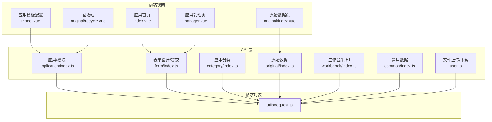
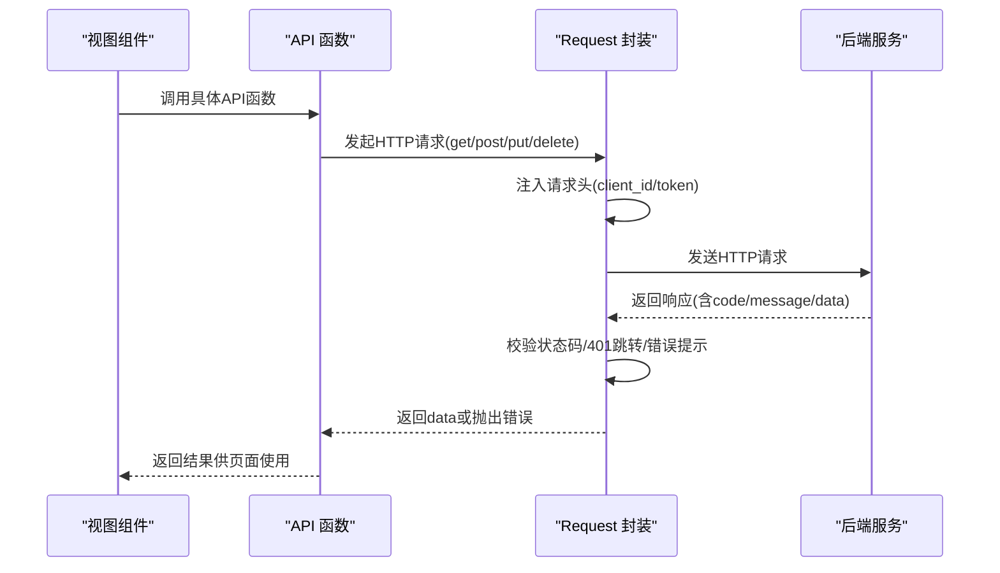
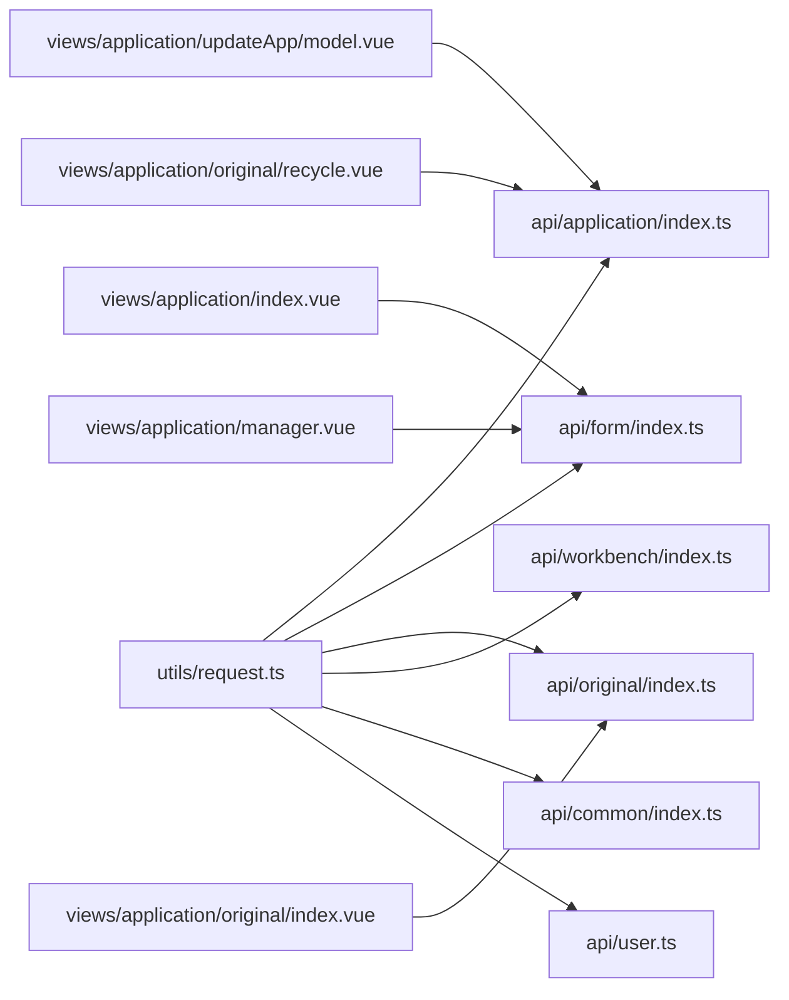

# 应用管理API

<cite>
**本文档引用的文件**
- [application/index.ts](file://src/api/application/index.ts)
- [form/index.ts](file://src/api/form/index.ts)
- [category/index.ts](file://src/api/category/index.ts)
- [original/index.ts](file://src/api/original/index.ts)
- [workbench/index.ts](file://src/api/workbench/index.ts)
- [common/index.ts](file://src/api/common/index.ts)
- [user.ts](file://src/api/user.ts)
- [request.ts](file://src/utils/request.ts)
- [index.vue（应用首页）](file://src/views/application/index.vue)
- [manager.vue（应用管理页）](file://src/views/application/manager.vue)
- [model.vue（应用模板配置）](file://src/views/application/updateApp/model.vue)
- [index.vue（原始数据）](file://src/views/application/original/index.vue)
- [recycle.vue（回收站）](file://src/views/application/original/recycle.vue)
</cite>

## 目录
1. [简介](#简介)
2. [项目结构](#项目结构)
3. [核心组件](#核心组件)
4. [架构总览](#架构总览)
5. [详细组件分析](#详细组件分析)
6. [依赖关系分析](#依赖关系分析)
7. [性能考虑](#性能考虑)
8. [故障排查指南](#故障排查指南)
9. [结论](#结论)
10. [附录](#附录)

## 简介
本文件系统化梳理应用管理相关API，覆盖应用查询、模块管理、表单操作、回收站管理、应用模板配置与打印数据接口，并结合前端视图层使用示例，提供接口调用规范、参数说明、响应格式、错误处理与最佳实践。

## 项目结构
应用管理API主要分布在以下模块：
- 应用与模块：application/index.ts
- 表单设计与提交：form/index.ts
- 应用分类：category/index.ts
- 原始数据与生命周期：original/index.ts
- 工作台与打印：workbench/index.ts
- 通用基础数据：common/index.ts
- 文件上传下载：user.ts
- 请求封装：utils/request.ts

图表来源
- [application/index.ts:1-78](file://src/api/application/index.ts#L1-L78)
- [form/index.ts:1-31](file://src/api/form/index.ts#L1-L31)
- [category/index.ts:1-19](file://src/api/category/index.ts#L1-L19)
- [original/index.ts:1-44](file://src/api/original/index.ts#L1-L44)
- [workbench/index.ts:1-139](file://src/api/workbench/index.ts#L1-L139)
- [common/index.ts:1-68](file://src/api/common/index.ts#L1-L68)
- [user.ts:1-16](file://src/api/user.ts#L1-L16)
- [request.ts:1-159](file://src/utils/request.ts#L1-L159)
- [index.vue（应用首页）:1-194](file://src/views/application/index.vue#L1-L194)
- [manager.vue（应用管理页）:1-195](file://src/views/application/manager.vue#L1-L195)
- [model.vue（应用模板配置）:1-318](file://src/views/application/updateApp/model.vue#L1-L318)
- [index.vue（原始数据）:1-200](file://src/views/application/original/index.vue#L1-L200)
- [recycle.vue（回收站）:1-26](file://src/views/application/original/recycle.vue#L1-L26)

章节来源
- [application/index.ts:1-78](file://src/api/application/index.ts#L1-L78)
- [form/index.ts:1-31](file://src/api/form/index.ts#L1-L31)
- [category/index.ts:1-19](file://src/api/category/index.ts#L1-L19)
- [original/index.ts:1-44](file://src/api/original/index.ts#L1-L44)
- [workbench/index.ts:1-139](file://src/api/workbench/index.ts#L1-L139)
- [common/index.ts:1-68](file://src/api/common/index.ts#L1-L68)
- [user.ts:1-16](file://src/api/user.ts#L1-L16)
- [request.ts:1-159](file://src/utils/request.ts#L1-L159)

## 核心组件
- 请求封装Request类：统一设置baseURL、超时、请求头、拦截器与错误处理。
- 应用与模块API：提供应用查询、模块树、模块增删改查、排序、复制、表单编码、回收站、文件上传、打印模板配置与查询等。
- 表单API：应用设计、表单设计、访问预览、提交数据、流程历史。
- 原始数据API：分页查询、按ID查询、更新、删除、批量删除、数据生命周期查询。
- 工作台API：待办/申请/已办/抄送应用列表与记录、委托、审批、导出、打印。
- 通用API：部门树、角色、职位、用户、字典、应用分类缓存、权限菜单、关联组件数据等。
- 文件API：下载、上传、批量上传。

章节来源
- [request.ts:1-159](file://src/utils/request.ts#L1-L159)
- [application/index.ts:1-78](file://src/api/application/index.ts#L1-L78)
- [form/index.ts:1-31](file://src/api/form/index.ts#L1-L31)
- [original/index.ts:1-44](file://src/api/original/index.ts#L1-L44)
- [workbench/index.ts:1-139](file://src/api/workbench/index.ts#L1-L139)
- [common/index.ts:1-68](file://src/api/common/index.ts#L1-L68)
- [user.ts:1-16](file://src/api/user.ts#L1-L16)

## 架构总览
前端通过Request类封装Axios，自动注入client_id与token（白名单例外），统一对响应进行校验与错误提示；各功能模块在src/api下以函数形式暴露REST接口，视图层在src/views中调用这些API完成业务流程。

图表来源
- [request.ts:26-113](file://src/utils/request.ts#L26-L113)
- [application/index.ts:5-78](file://src/api/application/index.ts#L5-L78)
- [form/index.ts:5-31](file://src/api/form/index.ts#L5-L31)
- [original/index.ts:5-44](file://src/api/original/index.ts#L5-L44)
- [workbench/index.ts:6-139](file://src/api/workbench/index.ts#L6-L139)
- [common/index.ts:5-68](file://src/api/common/index.ts#L5-L68)
- [user.ts:5-16](file://src/api/user.ts#L5-L16)

## 详细组件分析

### 应用与模块管理API
- 应用查询
  - 方法：GET
  - 路径：/business/v1/app/{id}
  - 参数：路径参数id
  - 响应：应用详情
- 模块树
  - 方法：GET
  - 路径：/business/v1/module/{params}
  - 参数：查询参数params
  - 响应：模块树结构
- 授权模块树
  - 方法：GET
  - 路径：/business/v1/module/authorized/{params}
  - 参数：查询参数params
  - 响应：授权模块树
- 待办计数
  - 方法：GET
  - 路径：/business/v1/app_backlog/count/work_number
  - 参数：查询参数params
  - 响应：待办数量
- 模块新增
  - 方法：POST
  - 路径：/business/v1/module/addModule
  - 参数：请求体data
  - 响应：新建模块信息
- 模块修改
  - 方法：PUT
  - 路径：/business/v1/module/modifyModule/{id}
  - 参数：路径参数id，请求体data
  - 响应：更新后的模块信息
- 目录新增
  - 方法：POST
  - 路径：/business/v1/module/addDirectory
  - 参数：请求体data
  - 响应：新建目录信息
- 模块删除
  - 方法：DELETE
  - 路径：/business/v1/module/deleteModule/{id}
  - 参数：路径参数id
  - 响应：删除结果
- 表单模块复制
  - 方法：POST
  - 路径：/business/v1/module/copyFormModule
  - 参数：请求体data
  - 响应：复制结果
- 报表模块复制
  - 方法：PUT
  - 路径：/business/v1/module/copyReportModule/{moduleId}
  - 参数：路径参数moduleId
  - 响应：复制结果
- 查询系统表单
  - 方法：GET
  - 路径：/business/v1/datasource/query_system_form/{id}
  - 参数：路径参数id
  - 响应：系统表单信息
- 查询模块详情
  - 方法：GET
  - 路径：/business/v1/module/query_module/{id}
  - 参数：路径参数id
  - 响应：模块详情
- 修改父目录
  - 方法：POST
  - 路径：/business/v1/module/modifyParentDirectory
  - 参数：请求体data
  - 响应：修改结果
- 模块排序
  - 方法：POST
  - 路径：/business/v1/module/sort
  - 参数：请求体data
  - 响应：排序结果
- 表单编码
  - 方法：GET
  - 路径：/business/v1/form/form_code
  - 参数：无
  - 响应：表单编码
- 回收站列表
  - 方法：GET
  - 路径：/business/v1/recycle/{val}
  - 参数：查询参数params，路径参数val
  - 响应：回收站数据列表
- 恢复
  - 方法：PUT
  - 路径：/business/v1/recycle/recover/{id}
  - 参数：路径参数id
  - 响应：恢复结果
- 删除回收站条目
  - 方法：DELETE
  - 路径：/business/v1/recycle/{id}
  - 参数：路径参数id
  - 响应：删除结果
- 清空回收站
  - 方法：DELETE
  - 路径：/business/v1/recycle/deleteAll/{ids}
  - 参数：路径参数ids
  - 响应：清空结果
- 附件上传
  - 方法：POST
  - 路径：/business/v1/file/uploadATTACH
  - 参数：请求体data
  - 响应：上传结果
- 应用模板配置
  - 方法：POST
  - 路径：/internal/business/print/v1/{appid}
  - 参数：路径参数appid，请求体data
  - 响应：模板配置结果
- 获取应用模板
  - 方法：GET
  - 路径：/internal/business/print/v1/{appid}
  - 参数：路径参数appid
  - 响应：模板列表
- 修改应用模板
  - 方法：PUT
  - 路径：/internal/business/print/v1/{id}
  - 参数：路径参数id，请求体data
  - 响应：修改结果

章节来源
- [application/index.ts:5-78](file://src/api/application/index.ts#L5-L78)

### 表单设计与提交API
- 应用设计
  - 方法：PUT
  - 路径：/internal/business/app/v1/design/{appId}
  - 参数：路径参数appId，请求体data
  - 响应：设计结果
- 保存表单设计
  - 方法：PUT
  - 路径：/internal/business/app/v1/formDesign/{appId}
  - 参数：路径参数appId，请求体data
  - 响应：保存结果
- 我创建的表单设计
  - 方法：GET
  - 路径：/internal/business/app/creator/v1/design/{appId}
  - 参数：路径参数appId
  - 响应：设计详情
- 我管理的表单设计
  - 方法：GET
  - 路径：/internal/business/app/manager/v1/design/{appId}
  - 参数：路径参数appId
  - 响应：设计详情
- 可访问的表单设计
  - 方法：GET
  - 路径：/internal/business/app/visitor/v1/preview/{appId}
  - 参数：路径参数appId
  - 响应：预览详情
- 提交表单数据
  - 方法：POST
  - 路径：/internal/business/submit/form/v1/{appId}
  - 参数：路径参数appId，请求体data
  - 响应：提交结果
- 获取应用流程历史
  - 方法：GET
  - 路径：/internal/business/app/v1/processHistory/{appId}
  - 参数：路径参数appId
  - 响应：流程历史

章节来源
- [form/index.ts:5-31](file://src/api/form/index.ts#L5-L31)

### 原始数据与生命周期API
- 分页记录
  - 方法：POST
  - 路径：/internal/business/original/v1/record
  - 参数：请求体params
  - 响应：分页数据
- 按ID查询
  - 方法：GET
  - 路径：/internal/business/original/v1/{formId}/{dataId}
  - 参数：路径参数formId、dataId
  - 响应：原始数据详情
- 更新
  - 方法：POST
  - 路径：/internal/business/original/v1/{formId}/{dataId}
  - 参数：路径参数formId、dataId，请求体params
  - 响应：更新结果
- 删除
  - 方法：DELETE
  - 路径：/internal/business/original/v1/{formId}/{dataId}
  - 参数：路径参数formId、dataId
  - 响应：删除结果
- 批量删除
  - 方法：POST
  - 路径：/internal/business/original/v1/{formId}/batchDelete
  - 参数：路径参数formId，请求体params
  - 响应：批量删除结果
- 数据生命周期记录
  - 方法：GET
  - 路径：/internal/business/dataLifecycle/v1/record
  - 参数：查询参数params
  - 响应：生命周期记录
- 数据生命周期详情
  - 方法：GET
  - 路径：/internal/business/dataLifecycle/v1/{id}
  - 参数：路径参数id
  - 响应：生命周期详情

章节来源
- [original/index.ts:5-44](file://src/api/original/index.ts#L5-L44)

### 工作台与打印API
- 待办计数
  - 方法：GET
  - 路径：/internal/business/workbench/v1/count
  - 参数：查询参数params
  - 响应：计数
- 待办应用列表
  - 方法：GET
  - 路径：/internal/business/workbench/pending/v1/apps
  - 参数：无
  - 响应：应用列表
- 待办分页记录
  - 方法：GET
  - 路径：/internal/business/workbench/pending/v1/record
  - 参数：查询参数params
  - 响应：分页记录
- 任务转交
  - 方法：POST
  - 路径：/internal/business/workbench/pending/v1/delegate
  - 参数：请求体data
  - 响应：转交结果
- 填写完成
  - 方法：POST
  - 路径：/internal/business/workbench/pending/v1/inputComplete
  - 参数：请求体data
  - 响应：完成结果
- 审批通过
  - 方法：POST
  - 路径：/internal/business/workbench/pending/v1/approvePass
  - 参数：请求体data
  - 响应：通过结果
- 审批拒绝
  - 方法：POST
  - 路径：/internal/business/workbench/pending/v1/approveReject
  - 参数：请求体data
  - 响应：拒绝结果
- 审批退回
  - 方法：POST
  - 路径：/internal/business/workbench/pending/v1/approveBack
  - 参数：请求体data
  - 响应：退回结果
- 申请应用列表
  - 方法：GET
  - 路径：/internal/business/workbench/apply/v1/apps
  - 参数：无
  - 响应：应用列表
- 申请分页记录
  - 方法：GET
  - 路径：/internal/business/workbench/apply/v1/record
  - 参数：查询参数params
  - 响应：分页记录
- 撤回申请
  - 方法：POST
  - 路径：/internal/business/workbench/apply/v1/revoke?processInstanceId={id}
  - 参数：查询参数processInstanceId
  - 响应：撤回结果
- 终止申请
  - 方法：POST
  - 路径：/internal/business/workbench/apply/v1/terminate
  - 参数：请求体data
  - 响应：终止结果
- 加急处理
  - 方法：POST
  - 路径：/internal/business/workbench/apply/v1/urgent?processInstanceId={id}
  - 参数：查询参数processInstanceId
  - 响应：加急结果
- 已办应用列表
  - 方法：GET
  - 路径：/internal/business/workbench/handler/v1/apps
  - 参数：无
  - 响应：应用列表
- 已办分页记录
  - 方法：GET
  - 路径：/internal/business/workbench/handler/v1/record
  - 参数：查询参数params
  - 响应：分页记录
- 抄送应用列表
  - 方法：GET
  - 路径：/internal/business/workbench/notice/v1/apps
  - 参数：无
  - 响应：应用列表
- 抄送分页记录
  - 方法：GET
  - 路径：/internal/business/workbench/notice/v1/record
  - 参数：查询参数params
  - 响应：分页记录
- 抄送已读
  - 方法：POST
  - 路径：/internal/business/workbench/notice/v1/read/{noticeId}
  - 参数：路径参数noticeId
  - 响应：已读结果
- 流程日志
  - 方法：GET
  - 路径：/internal/business/process/v1/log/{processInstanceId}
  - 参数：路径参数processInstanceId
  - 响应：日志
- 流程详情—待办
  - 方法：GET
  - 路径：/internal/business/workbench/pending/v1/{taskId}
  - 参数：路径参数taskId
  - 响应：详情
- 流程详情—发起
  - 方法：GET
  - 路径：/internal/business/workbench/apply/v1/{processInstanceId}
  - 参数：路径参数processInstanceId
  - 响应：详情
- 流程详情—已办
  - 方法：GET
  - 路径：/internal/business/workbench/handler/v1/{taskId}
  - 参数：路径参数taskId
  - 响应：详情
- 流程详情—抄送
  - 方法：GET
  - 路径：/internal/business/workbench/notice/v1/{executionId}
  - 参数：路径参数executionId
  - 响应：详情
- 流程候选人
  - 方法：GET
  - 路径：/internal/business/processCenter/processCandidates/{processInstanceId}
  - 参数：路径参数processInstanceId
  - 响应：候选人
- 节点候选人
  - 方法：GET
  - 路径：/internal/business/processCenter/executionCandidates/{processInstanceId}/{executionId}
  - 参数：路径参数processInstanceId、executionId
  - 响应：候选人
- 工作台导出
  - 方法：POST
  - 路径：/internal/business/fill/common/v1/workbench/export/{type}
  - 参数：路径参数type，请求体data
  - 响应：二进制流(blob)
- 表单打印
  - 方法：GET
  - 路径：/internal/business/print/v1/form/{formId}
  - 参数：路径参数formId
  - 响应：打印模板

章节来源
- [workbench/index.ts:6-139](file://src/api/workbench/index.ts#L6-L139)

### 通用数据API
- 部门树
  - 方法：GET
  - 路径：/internal/business/common/v1/deptTree
  - 参数：无
  - 响应：部门树
- 角色列表
  - 方法：GET
  - 路径：/internal/business/common/v1/roleList
  - 参数：无
  - 响应：角色列表
- 职位列表
  - 方法：GET
  - 路径：/internal/business/common/v1/postList
  - 参数：无
  - 响应：职位列表
- 用户列表
  - 方法：GET
  - 路径：/internal/business/common/v1/userList
  - 参数：查询参数params
  - 响应：用户列表
- 用户字典目录
  - 方法：GET
  - 路径：/internal/business/dict/cache/v1/userCatalogues
  - 参数：无
  - 响应：目录列表
- 目录字典项
  - 方法：GET
  - 路径：/internal/business/dict/cache/v1/{catalogueCode}
  - 参数：路径参数catalogueCode
  - 响应：字典项
- 应用分类列表
  - 方法：GET
  - 路径：/internal/business/app/category/v1/list
  - 参数：无
  - 响应：分类列表
- 批量获取开发者
  - 方法：GET
  - 路径：/internal/business/develper/cache/v1/batch
  - 参数：无
  - 响应：开发者列表
- 授权菜单
  - 方法：GET
  - 路径：/internal/business/security/group/v1/user/menus
  - 参数：无
  - 响应：菜单树
- 用户组件列表
  - 方法：GET
  - 路径：/internal/business/user/v1/userComponentList
  - 参数：查询参数params
  - 响应：用户列表
- 按ID查询用户
  - 方法：POST
  - 路径：/internal/business/user/v1/getUsersByIds
  - 参数：请求体data
  - 响应：用户列表
- 按ID查询部门
  - 方法：POST
  - 路径：/internal/business/dept/v1/getDeptsByIds
  - 参数：请求体data
  - 响应：部门列表
- 当前用户部门
  - 方法：GET
  - 路径：/internal/business/dept/v1/getDeptByUser
  - 参数：查询参数params
  - 响应：部门信息
- 管理应用下拉
  - 方法：GET
  - 路径：/internal/business/fill/manager/v1/getAppList
  - 参数：无
  - 响应：应用列表
- 获取应用表单设计
  - 方法：GET
  - 路径：/internal/business/app/manager/v1/form/{id}
  - 参数：路径参数id
  - 响应：表单设计
- 关联组件数据
  - 方法：POST
  - 路径：/internal/business/original/v1/relationComponentData
  - 参数：请求体data
  - 响应：关联数据

章节来源
- [common/index.ts:5-68](file://src/api/common/index.ts#L5-L68)

### 文件上传下载API
- 下载
  - 方法：GET
  - 路径：/internal/business/file/v1/download
  - 参数：查询参数params
  - 响应：二进制流(blob)
- 上传
  - 方法：POST
  - 路径：/internal/business/file/v1/upload
  - 参数：请求体data
  - 响应：上传结果
- 批量上传
  - 方法：POST
  - 路径：/internal/business/file/v1/batchUpload
  - 参数：请求体data
  - 响应：上传结果

章节来源
- [user.ts:5-16](file://src/api/user.ts#L5-L16)

### 应用模板配置与打印数据接口
- 配置应用模板
  - 方法：POST
  - 路径：/internal/business/print/v1/{appid}
  - 参数：路径参数appid，请求体data
  - 响应：模板配置结果
- 获取应用模板
  - 方法：GET
  - 路径：/internal/business/print/v1/{appid}
  - 参数：路径参数appid
  - 响应：模板列表
- 修改应用模板
  - 方法：PUT
  - 路径：/internal/business/print/v1/{id}
  - 参数：路径参数id，请求体data
  - 响应：修改结果
- 打印数据
  - 方法：POST
  - 路径：/internal/business/print/v1/{appid}
  - 参数：路径参数appid，请求体data
  - 响应：打印结果

章节来源
- [application/index.ts:66-77](file://src/api/application/index.ts#L66-L77)
- [model.vue（应用模板配置）:171-268](file://src/views/application/updateApp/model.vue#L171-L268)

### 使用示例与最佳实践

#### 应用首页提交表单
- 步骤
  - 获取应用详情与表单设计
  - 校验表单并收集formData
  - 调用提交接口
  - 成功后重置表单并刷新
- 关键调用
  - 获取应用详情：/internal/business/app/creator/v1/{id}
  - 获取表单设计：/internal/business/app/creator/v1/design/{id}
  - 提交数据：/internal/business/submit/form/v1/{id}
- 错误处理
  - 前端捕获异常并提示
  - 后端返回非success时统一提示

章节来源
- [index.vue（应用首页）:90-127](file://src/views/application/index.vue#L90-L127)
- [form/index.ts:13-26](file://src/api/form/index.ts#L13-L26)

#### 应用管理页提交表单
- 步骤
  - 获取应用详情与表单设计
  - 校验表单并收集formData
  - 调用提交接口
  - 成功后刷新表单
- 关键调用
  - 获取应用详情：/internal/business/app/manager/v1/{id}
  - 获取表单设计：/internal/business/app/manager/v1/design/{id}
  - 提交数据：/internal/business/submit/form/v1/{id}
- 错误处理
  - 前端捕获异常并提示

章节来源
- [manager.vue（应用管理页）:92-129](file://src/views/application/manager.vue#L92-L129)
- [form/index.ts:17-26](file://src/api/form/index.ts#L17-L26)

#### 应用模板配置
- 步骤
  - 获取模板列表：/internal/business/print/v1/{appid}
  - 上传模板或修改模板
  - 刷新列表
- 关键调用
  - 获取模板：/internal/business/print/v1/{appid}
  - 配置模板：/internal/business/print/v1/{appid}
  - 修改模板：/internal/business/print/v1/{id}
- 错误处理
  - 失败时提示并保留原数据

章节来源
- [model.vue（应用模板配置）:171-268](file://src/views/application/updateApp/model.vue#L171-L268)
- [application/index.ts:66-77](file://src/api/application/index.ts#L66-L77)

#### 原始数据与回收站
- 步骤
  - 分页查询原始数据
  - 单条/批量删除
  - 查看生命周期
  - 进入回收站恢复/清空
- 关键调用
  - 分页记录：/internal/business/original/v1/record
  - 删除：/internal/business/original/v1/{formId}/{dataId}
  - 批量删除：/internal/business/original/v1/{formId}/batchDelete
  - 生命周期：/internal/business/dataLifecycle/v1/record
  - 回收站列表：/business/v1/recycle/{val}
  - 恢复：/business/v1/recycle/recover/{id}
  - 清空：/business/v1/recycle/deleteAll/{ids}

章节来源
- [index.vue（原始数据）:107-121](file://src/views/application/original/index.vue#L107-L121)
- [original/index.ts:5-44](file://src/api/original/index.ts#L5-L44)
- [application/index.ts:51-62](file://src/api/application/index.ts#L51-L62)

## 依赖关系分析

图表来源
- [request.ts:1-159](file://src/utils/request.ts#L1-L159)
- [application/index.ts:1-78](file://src/api/application/index.ts#L1-L78)
- [form/index.ts:1-31](file://src/api/form/index.ts#L1-L31)
- [original/index.ts:1-44](file://src/api/original/index.ts#L1-L44)
- [workbench/index.ts:1-139](file://src/api/workbench/index.ts#L1-L139)
- [common/index.ts:1-68](file://src/api/common/index.ts#L1-L68)
- [user.ts:1-16](file://src/api/user.ts#L1-L16)
- [index.vue（应用首页）:1-194](file://src/views/application/index.vue#L1-L194)
- [manager.vue（应用管理页）:1-195](file://src/views/application/manager.vue#L1-L195)
- [model.vue（应用模板配置）:1-318](file://src/views/application/updateApp/model.vue#L1-L318)
- [index.vue（原始数据）:1-200](file://src/views/application/original/index.vue#L1-L200)
- [recycle.vue（回收站）:1-26](file://src/views/application/original/recycle.vue#L1-L26)

## 性能考虑
- 请求超时：默认60秒，可根据接口复杂度调整。
- 响应类型：对blob类型直接透传，避免额外解析。
- 批量操作：优先使用批量接口减少请求次数。
- 分页查询：合理设置pageSize，避免一次性加载过多数据。
- 缓存策略：通用数据接口多为缓存接口，建议前端做本地缓存与去重。

## 故障排查指南
- 401未授权
  - 现象：自动跳转至登录页
  - 处理：检查token是否过期或缺失
- 403拒绝访问
  - 现象：提示拒绝访问
  - 处理：检查权限与菜单授权
- 404请求出错
  - 现象：接口不存在或路径错误
  - 处理：核对URL与参数
- 500服务器错误
  - 现象：服务异常
  - 处理：查看后端日志并重试
- 通用错误提示
  - 现象：Message.error显示message
  - 处理：根据message定位问题并重试

章节来源
- [request.ts:47-113](file://src/utils/request.ts#L47-L113)

## 结论
本文档系统梳理了应用管理相关API，明确了接口规范、参数与响应格式，并结合前端视图层使用示例给出调用路径与错误处理建议。建议在实际开发中遵循统一的请求封装与错误处理机制，确保接口调用稳定可靠。

## 附录
- 常用路径前缀
  - /business/v1：业务通用接口
  - /internal/business：内部业务接口
  - /api：请求baseURL
- 请求头
  - client_id：固定值
  - token：可选，白名单接口除外