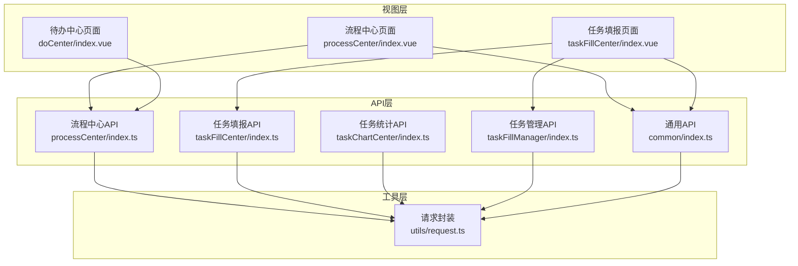
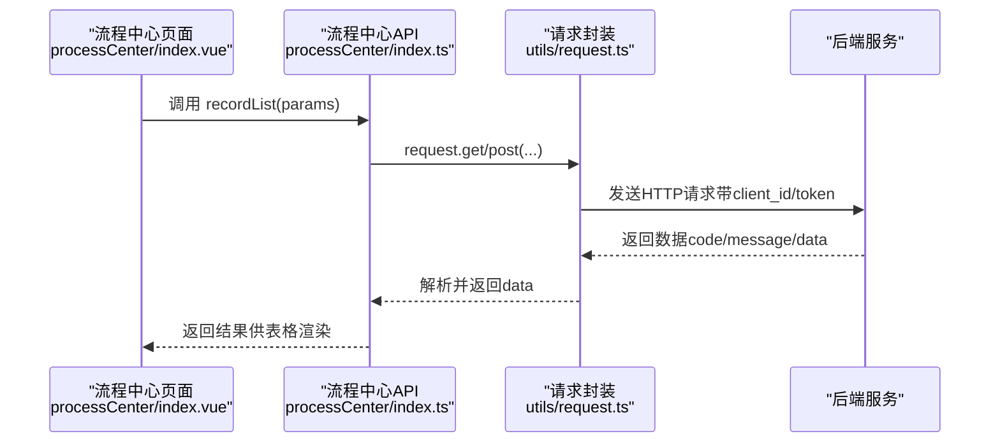
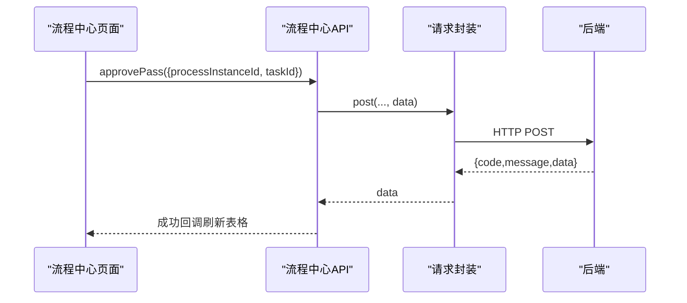
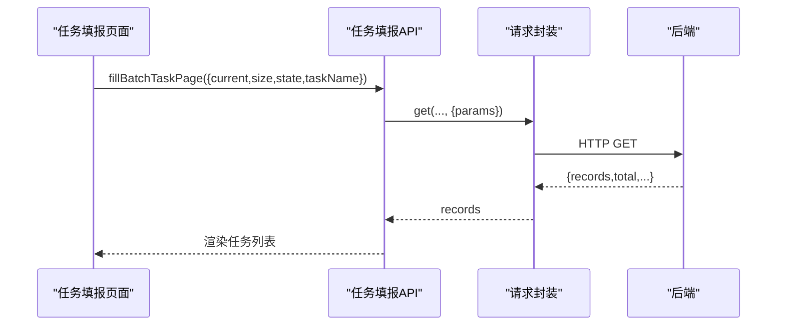
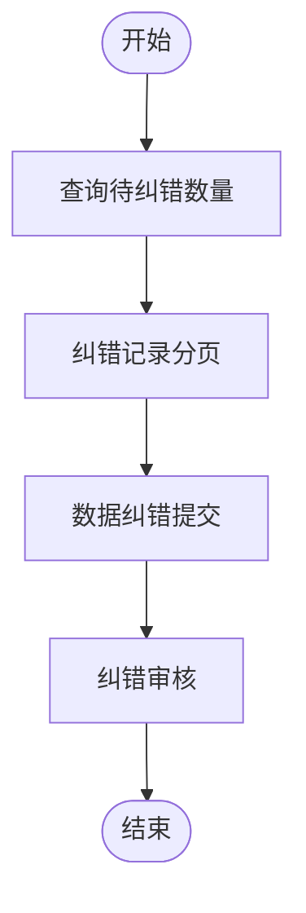
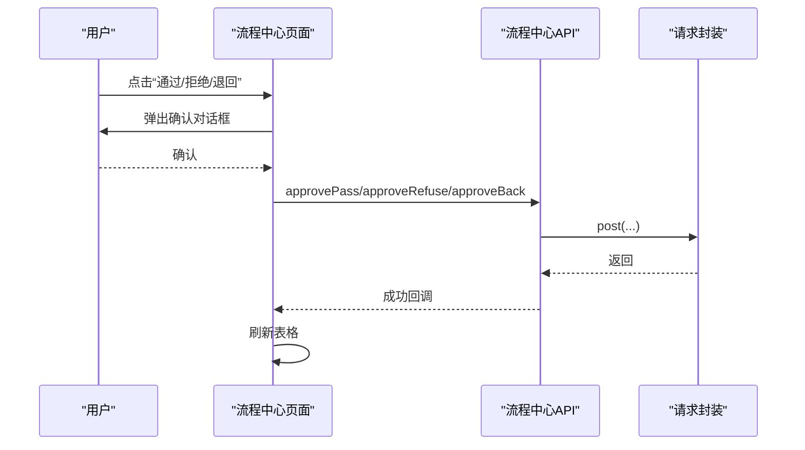
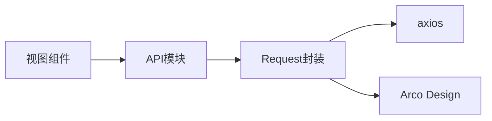

# 流程中心API

<cite>
**本文引用的文件**
- [processCenter/index.ts](file://src/api/processCenter/index.ts)
- [taskFillCenter/index.ts](file://src/api/taskFillCenter/index.ts)
- [taskChartCenter/index.ts](file://src/api/taskChartCenter/index.ts)
- [taskFillManager/index.ts](file://src/api/taskFillManager/index.ts)
- [common/index.ts](file://src/api/common/index.ts)
- [request.ts](file://src/utils/request.ts)
- [processCenter/index.vue](file://src/views/processCenter/index.vue)
- [taskFillCenter/index.vue](file://src/views/taskFillCenter/index.vue)
- [doCenter/index.vue](file://src/views/doCenter/index.vue)
- [router/index.ts](file://src/router/index.ts)
</cite>

## 目录
1. [简介](#简介)
2. [项目结构](#项目结构)
3. [核心组件](#核心组件)
4. [架构总览](#架构总览)
5. [详细组件分析](#详细组件分析)
6. [依赖关系分析](#依赖关系分析)
7. [性能考虑](#性能考虑)
8. [故障排查指南](#故障排查指南)
9. [结论](#结论)
10. [附录](#附录)

## 简介
本文件系统性梳理“流程中心API”的能力边界与使用方式，覆盖流程实例查询、任务处理、流程监控、流程状态管理、任务分配与进度跟踪、流程统计分析、历史记录查询与报表生成、流程引擎集成、节点操作与权限控制等主题，并给出缓存策略与性能优化建议。读者可据此快速理解前端如何调用后端接口以支撑流程中心与任务填报两大业务域。

## 项目结构
- API层：按功能域拆分为 processCenter、taskFillCenter、taskChartCenter、taskFillManager、common 等模块，统一通过封装的 Request 类发起请求。
- 视图层：流程中心、任务填报、待办中心等页面组件在各自 index.vue 中组织交互逻辑，调用对应 API。
- 路由层：router/index.ts 定义页面路由，承载导航与页面入口。

图表来源
- [processCenter/index.vue:198-616](file://src/views/processCenter/index.vue#L198-L616)
- [taskFillCenter/index.vue:95-208](file://src/views/taskFillCenter/index.vue#L95-L208)
- [doCenter/index.vue:158-294](file://src/views/doCenter/index.vue#L158-L294)
- [processCenter/index.ts:1-47](file://src/api/processCenter/index.ts#L1-L47)
- [taskFillCenter/index.ts:1-38](file://src/api/taskFillCenter/index.ts#L1-L38)
- [taskChartCenter/index.ts:1-24](file://src/api/taskChartCenter/index.ts#L1-L24)
- [taskFillManager/index.ts:1-109](file://src/api/taskFillManager/index.ts#L1-L109)
- [common/index.ts:1-68](file://src/api/common/index.ts#L1-L68)
- [request.ts:1-159](file://src/utils/request.ts#L1-L159)

章节来源
- [router/index.ts:1-189](file://src/router/index.ts#L1-L189)

## 核心组件
- 请求封装 Request：统一设置基础 baseURL、超时、请求头（client_id、token）、响应拦截与错误提示。
- 流程中心API：流程统计、应用流程列表、流程记录分页、催办、填写、转交、审批通过/拒绝/退回、终止流程。
- 任务填报API：填报数据提交、批次任务分页、填报详情、纠错记录、审批进度、数据导出。
- 任务统计API：任务信息统计、批次统计、近七日与当日填报统计。
- 任务管理API：最近一次任务时间、创建任务、应用分类、任务列表、批次列表、对象分页、待纠错数量、数据纠错、催办、重新填报、修改任务状态/名称/发布部门/监督人/周期、纠错审核、打印导出、详情查询。
- 通用API：部门树、角色列表、职位列表、用户列表、字典缓存、应用列表、应用表单设计、关联组件数据等。

章节来源
- [request.ts:1-159](file://src/utils/request.ts#L1-L159)
- [processCenter/index.ts:1-47](file://src/api/processCenter/index.ts#L1-L47)
- [taskFillCenter/index.ts:1-38](file://src/api/taskFillCenter/index.ts#L1-L38)
- [taskChartCenter/index.ts:1-24](file://src/api/taskChartCenter/index.ts#L1-L24)
- [taskFillManager/index.ts:1-109](file://src/api/taskFillManager/index.ts#L1-L109)
- [common/index.ts:1-68](file://src/api/common/index.ts#L1-L68)

## 架构总览
流程中心API围绕“流程实例”和“任务批次”两条主线展开，前端通过视图组件驱动，调用API模块，最终经由 Request 封装统一发送 HTTP 请求至后端服务。

图表来源
- [processCenter/index.vue:344-366](file://src/views/processCenter/index.vue#L344-L366)
- [processCenter/index.ts:12-15](file://src/api/processCenter/index.ts#L12-L15)
- [request.ts:117-154](file://src/utils/request.ts#L117-L154)

## 详细组件分析

### 流程中心API（流程实例查询与处理）
- 接口清单
  - 流程统计：processTotal
  - 应用流程列表：appList(params)
  - 流程记录列表：recordList(params)
  - 催办：urgent(processInstanceId)
  - 填写：input(data)
  - 填写任务转交：inputAssign(data)
  - 审批通过：approvePass(data)
  - 审批拒绝：approveRefuse(data)
  - 审批转交：approveAssign(data)
  - 审批退回：approveBack(data)
  - 终止流程：stopProcessCenter(id)

- 关键流程说明
  - 应用筛选与分页：根据 processFinish、appName、匹配模式与条件过滤，分页参数 page/pageSize。
  - 节点操作：根据 currentRuntimes 的节点类型区分 INPUT/APPROVE，分别提供填写、转交、审批通过/拒绝/退回等动作。
  - 催办与终止：对进行中的流程实例执行催办或强制终止。

图表来源
- [processCenter/index.vue:469-556](file://src/views/processCenter/index.vue#L469-L556)
- [processCenter/index.ts:28-31](file://src/api/processCenter/index.ts#L28-L31)
- [request.ts:125-131](file://src/utils/request.ts#L125-L131)

章节来源
- [processCenter/index.ts:1-47](file://src/api/processCenter/index.ts#L1-L47)
- [processCenter/index.vue:198-616](file://src/views/processCenter/index.vue#L198-L616)

### 任务填报API（任务与数据）
- 接口清单
  - 填报数据提交：fillTaskData(data)
  - 查询填报批次任务：fillBatchTaskPage(params)
  - 查看填报详情：getFillBatchTask(objectId)
  - 对象纠错记录分页：fixRecordObjectPage(objectId, params)
  - 查询审批进度：getApprovalProgress(processInstanceId)
  - 导出填报数据：exportData(data, type)（responseType: blob）

- 页面联动
  - 任务列表分页加载，支持状态切换（进行中/已结束）与关键词搜索。
  - 选择任务后渲染表单并支持查看审批进度、打开纠错记录抽屉。

图表来源
- [taskFillCenter/index.vue:140-175](file://src/views/taskFillCenter/index.vue#L140-L175)
- [taskFillCenter/index.ts:10-15](file://src/api/taskFillCenter/index.ts#L10-L15)
- [request.ts:121-123](file://src/utils/request.ts#L121-L123)

章节来源
- [taskFillCenter/index.ts:1-38](file://src/api/taskFillCenter/index.ts#L1-L38)
- [taskFillCenter/index.vue:95-208](file://src/views/taskFillCenter/index.vue#L95-L208)

### 任务统计API（报表与分析）
- 接口清单
  - 填报任务统计：statisticTaskInfo()
  - 填报批次统计：statisticTaskBatch()
  - 近七日填报任务人次：statisticAotuFill(params)
  - 当天填报统计：statisticAutoFrequencyFill(params)

- 使用场景
  - 为任务图表中心提供数据源，支撑可视化展示。

章节来源
- [taskChartCenter/index.ts:1-24](file://src/api/taskChartCenter/index.ts#L1-L24)

### 任务管理API（任务生命周期与纠错）
- 接口清单
  - 最近一次任务时间：getRecentlyTaskDate(data)
  - 创建任务：createFillTask(data)
  - 应用分类下拉：getCategoryList()
  - 任务列表：getFillTaskList(params)
  - 批次列表：getTaskBatchList(taskId, params)
  - 批次对象分页：getTaskBatchObjectList(params)
  - 待纠错数量：getFixRecordCount(batchId)
  - 数据纠错：fillObjectDataFix(data)
  - 发起催办：fillObjectUrge(data)
  - 重新填报：fillObjectLaunchReset(data)
  - 修改任务状态/名称/发布部门/监督人/周期：modifyTaskStatus/modifyTaskName/modifyTaskPublisher/modifyTaskSupervisor/modifyTaskPeriod(data)
  - 纠错记录分页：fixRecordPage(data)
  - 纠错审核：fixAudit(data)
  - 打印导出：printList(data, type)
  - 详情查询：getFillBatchTask(objectId)

- 关键流程
  - 任务创建与状态变更贯穿任务全生命周期。
  - 纠错链路：查询待纠错数量 -> 纠错记录分页 -> 纠错数据提交 -> 纠错审核。

图表来源
- [taskFillManager/index.ts:35-99](file://src/api/taskFillManager/index.ts#L35-L99)

章节来源
- [taskFillManager/index.ts:1-109](file://src/api/taskFillManager/index.ts#L1-L109)

### 通用API（字典与基础数据）
- 接口清单
  - 部门树：getDeptTree()
  - 角色列表：getRoleList()
  - 职位列表：getPostList()
  - 用户列表：getUserList(params)
  - 字典缓存：userCatalogues(), getCacheList(catalogueCode), getCategoryCache()
  - 开发者批量：getDevelper()
  - 授权菜单：getMenus()
  - 组件数据：userComponentList(params), getUsersByIds(data), getDeptsByIds(data)
  - 应用列表：getAppList()
  - 应用表单设计：getAppForm(id)
  - 关联组件数据：relationComponentData(data)

- 用途
  - 为流程中心与任务管理提供下拉选择、权限校验与基础数据支撑。

章节来源
- [common/index.ts:1-68](file://src/api/common/index.ts#L1-L68)

### 视图与API联动（流程中心）
- 页面职责
  - 左侧应用列表与筛选、右侧流程记录表格、节点执行候选人悬浮查看、节点管理操作（催办、填写、转交、审批、终止）、流程图查看。
- 关键交互
  - 分页与筛选：page/pageSize、match/conditions、processFinish。
  - 操作确认：通过 Modal 弹窗确认后调用对应 API。
  - 统计与刷新：顶部进行中/已完成计数，支持手动刷新。

图表来源
- [processCenter/index.vue:469-556](file://src/views/processCenter/index.vue#L469-L556)
- [processCenter/index.ts:28-43](file://src/api/processCenter/index.ts#L28-L43)
- [request.ts:125-131](file://src/utils/request.ts#L125-L131)

章节来源
- [processCenter/index.vue:198-616](file://src/views/processCenter/index.vue#L198-L616)

### 视图与API联动（任务填报）
- 页面职责
  - 任务列表分页、任务详情、审批进度、纠错记录抽屉。
- 关键交互
  - 列表分页加载、状态切换、关键词搜索。
  - 通过 refFillContent 获取节点配置，打开审批进度抽屉。

章节来源
- [taskFillCenter/index.vue:95-208](file://src/views/taskFillCenter/index.vue#L95-L208)

### 视图与API联动（待办中心）
- 页面职责
  - 四大标签页：我的待办、我发起的、我处理的、抄送我的。
  - 节点执行候选人悬浮查看。
- 关键交互
  - 各标签页初始化加载不同应用与记录数据。
  - 本地存储记录当前激活标签页。

章节来源
- [doCenter/index.vue:158-294](file://src/views/doCenter/index.vue#L158-L294)

## 依赖关系分析
- 组件耦合
  - 视图组件仅依赖对应 API 模块，API 模块依赖 Request 封装，降低跨层耦合。
- 外部依赖
  - axios 作为 HTTP 客户端；Arco Design 提供 UI 与消息提示。
- 权限与鉴权
  - 请求头携带 client_id 与 token；白名单接口放行；401 统一跳转登录。

图表来源
- [request.ts:2-114](file://src/utils/request.ts#L2-L114)
- [processCenter/index.ts:1-3](file://src/api/processCenter/index.ts#L1-L3)
- [taskFillCenter/index.ts:1-3](file://src/api/taskFillCenter/index.ts#L1-L3)

章节来源
- [request.ts:1-159](file://src/utils/request.ts#L1-L159)

## 性能考虑
- 请求缓存
  - 对高频只读数据（如部门树、角色列表、字典缓存）可在前端进行内存缓存，减少重复请求。
- 分页与懒加载
  - 任务列表与纠错记录采用分页加载，避免一次性传输大量数据。
- 图片与资源
  - 应用图标拼接 token 参数，建议结合 CDN 与缓存策略提升加载速度。
- 错误与重试
  - 全局错误提示与 401 跳转，避免阻塞用户操作；必要时对关键接口增加轻量重试。
- 导出与大文件
  - 导出接口设置 responseType 为 blob，避免阻塞主线程；建议在后台异步生成并提供下载链接。

## 故障排查指南
- 常见问题
  - 401 未授权：检查 token 是否存在且有效；确认白名单接口是否正确放行。
  - 请求失败：查看响应拦截器中的错误提示，定位具体错误码。
  - 数据为空：确认分页参数、筛选条件与应用选择是否正确。
- 建议排查步骤
  - 打开浏览器 Network 面板，观察请求头（client_id/token）、状态码与响应体。
  - 在视图组件中加入必要的 loading 与错误提示，便于用户反馈。
  - 对关键接口（如 recordList、fillBatchTaskPage）增加兜底逻辑与重试机制。

章节来源
- [request.ts:47-113](file://src/utils/request.ts#L47-L113)

## 结论
流程中心API以清晰的功能域划分与统一的请求封装为基础，配合视图层的交互编排，实现了从流程实例查询、任务处理、流程监控到统计分析与报表导出的完整闭环。通过合理的缓存与分页策略，以及完善的错误处理机制，能够满足生产环境下的稳定性与性能要求。

## 附录
- 路由入口
  - 流程中心：/processCenter
  - 任务填报：/taskFillCenter
  - 待办中心：/toDoCenter
  - 任务管理中心：/taskManageCenter
  - 任务图表中心：/taskChartCenter

章节来源
- [router/index.ts:19-174](file://src/router/index.ts#L19-L174)