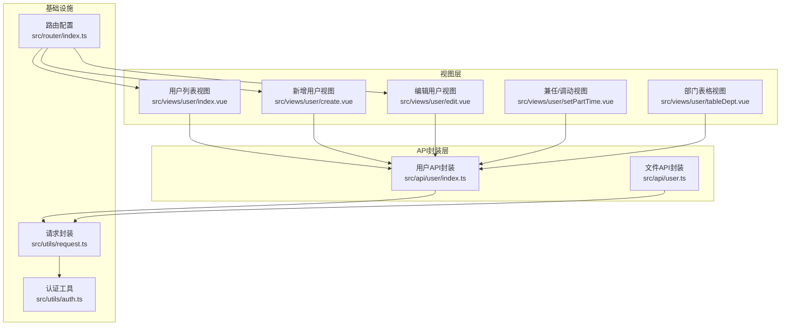
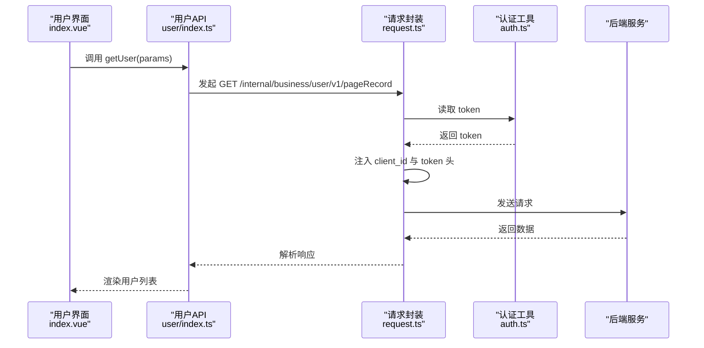
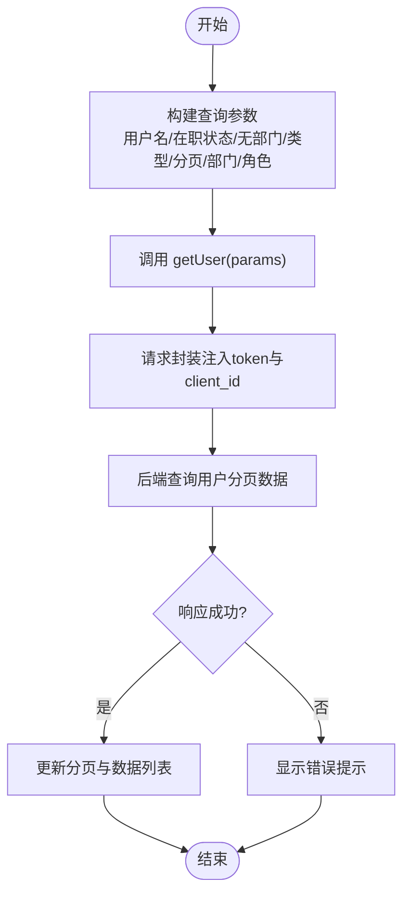
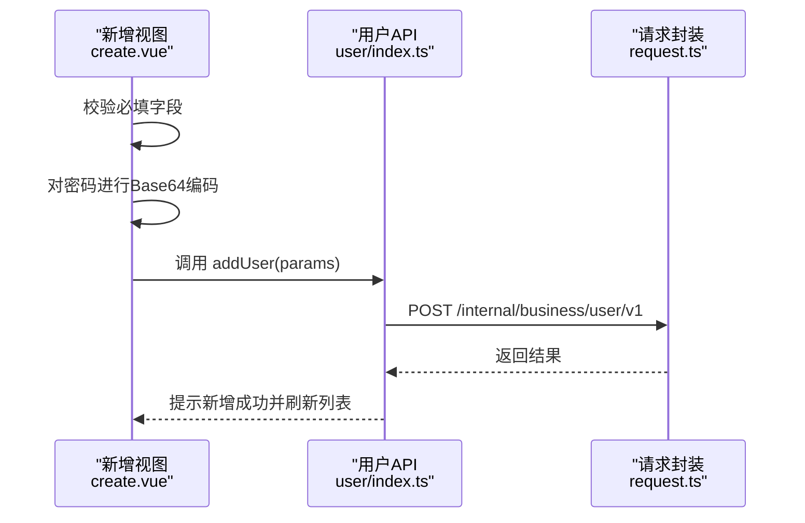
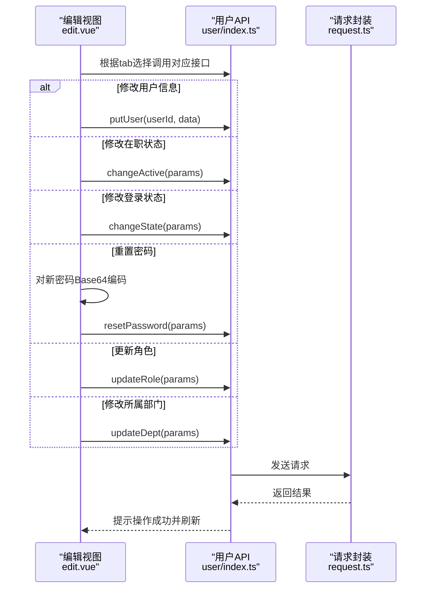
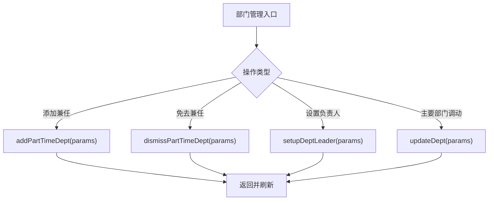
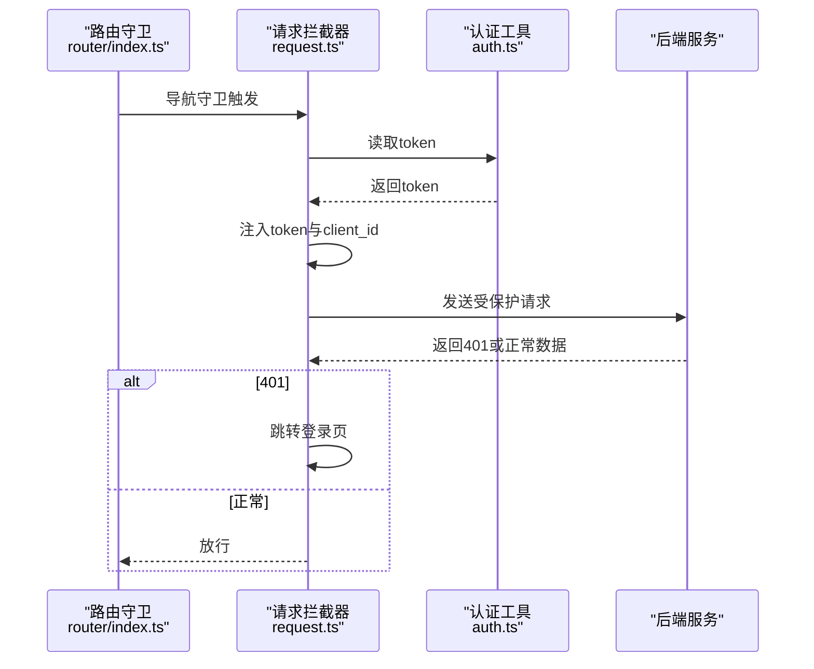
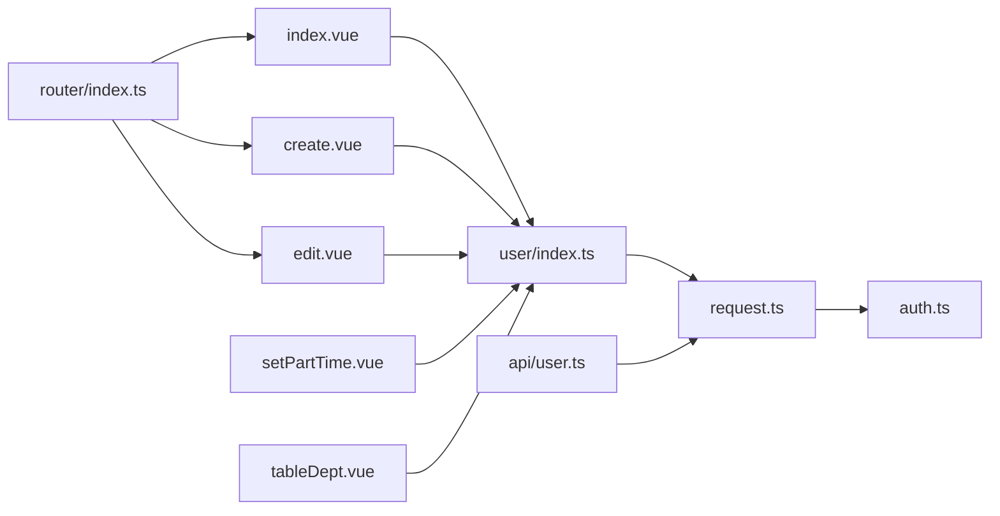

# 用户管理API

<cite>
**本文档引用的文件**
- [src/api/user/index.ts](file://src/api/user/index.ts)
- [src/views/user/index.vue](file://src/views/user/index.vue)
- [src/views/user/create.vue](file://src/views/user/create.vue)
- [src/views/user/edit.vue](file://src/views/user/edit.vue)
- [src/views/user/setPartTime.vue](file://src/views/user/setPartTime.vue)
- [src/views/user/tableDept.vue](file://src/views/user/tableDept.vue)
- [src/utils/request.ts](file://src/utils/request.ts)
- [src/utils/auth.ts](file://src/utils/auth.ts)
- [src/router/index.ts](file://src/router/index.ts)
- [src/api/user.ts](file://src/api/user.ts)
</cite>

## 目录
1. [简介](#简介)
2. [项目结构](#项目结构)
3. [核心组件](#核心组件)
4. [架构总览](#架构总览)
5. [详细组件分析](#详细组件分析)
6. [依赖关系分析](#依赖关系分析)
7. [性能考虑](#性能考虑)
8. [故障排除指南](#故障排除指南)
9. [结论](#结论)

## 简介
本文件为用户管理API的详细技术文档，覆盖用户查询、创建、修改、删除等基础操作；用户登录认证、权限验证与会话管理机制；用户信息获取、部门关联、角色分配等功能接口；以及用户状态管理、密码重置与账户锁定等安全相关接口的使用说明，并解释用户数据的权限控制与访问限制策略。

## 项目结构
用户管理功能由前端页面与API封装共同组成：
- API封装层：位于 `src/api/user/index.ts`，提供用户相关REST接口的统一封装。
- 视图层：位于 `src/views/user/` 下的多个Vue组件，负责用户列表展示、新增、编辑、部门与角色管理、状态变更等交互。
- 请求与认证：通过 `src/utils/request.ts` 统一发起HTTP请求并注入token；通过 `src/utils/auth.ts` 管理本地token存储。
- 路由：在 `src/router/index.ts` 中定义用户管理相关页面路由。

图表来源
- [src/views/user/index.vue:1-679](file://src/views/user/index.vue#L1-L679)
- [src/views/user/create.vue:1-296](file://src/views/user/create.vue#L1-L296)
- [src/views/user/edit.vue:1-428](file://src/views/user/edit.vue#L1-L428)
- [src/views/user/setPartTime.vue:1-141](file://src/views/user/setPartTime.vue#L1-L141)
- [src/views/user/tableDept.vue:1-153](file://src/views/user/tableDept.vue#L1-L153)
- [src/api/user/index.ts:1-63](file://src/api/user/index.ts#L1-L63)
- [src/api/user.ts:1-16](file://src/api/user.ts#L1-L16)
- [src/utils/request.ts:1-159](file://src/utils/request.ts#L1-L159)
- [src/utils/auth.ts:1-20](file://src/utils/auth.ts#L1-L20)
- [src/router/index.ts:1-189](file://src/router/index.ts#L1-L189)

章节来源
- [src/api/user/index.ts:1-63](file://src/api/user/index.ts#L1-L63)
- [src/views/user/index.vue:1-679](file://src/views/user/index.vue#L1-L679)
- [src/utils/request.ts:1-159](file://src/utils/request.ts#L1-L159)
- [src/utils/auth.ts:1-20](file://src/utils/auth.ts#L1-L20)
- [src/router/index.ts:1-189](file://src/router/index.ts#L1-L189)

## 核心组件
- 用户API封装（src/api/user/index.ts）
  - 新增用户：addUser(params)
  - 删除用户：deleteUser(userId)
  - 修改用户：putUser(userId, data)
  - 分页查询用户：getUser(params)
  - 修改用户在职状态：changeActive(params)
  - 修改用户登录状态：changeState(params)
  - 重置用户登录密码：resetPassword(params)
  - 修改用户身份信息：changeIdentity(params)
  - 添加用户兼任部门：addPartTimeDept(params)
  - 免去兼任部门职位：dismissPartTimeDept(params)
  - 设置部门负责人：setupDeptLeader(params)
  - 批量离职：batchLeave(params)
  - 获取在职无部门人数：getNoDeptNum()
  - 更新角色：updateRole(data)
  - 修改所属部门：updateDept(data)

- 文件API封装（src/api/user.ts）
  - 下载文件：dowload(params)
  - 上传文件：upload(data)
  - 批量上传文件：batchUpload(data)

- 认证与会话（src/utils/auth.ts）
  - isLogin(): 判断是否已登录
  - getToken(): 获取token
  - setToken(token): 设置token
  - clearToken(): 清除token

- 请求拦截器（src/utils/request.ts）
  - 自动注入client_id与token头
  - 统一处理401跳转与错误消息提示
  - 支持Blob下载响应

章节来源
- [src/api/user/index.ts:1-63](file://src/api/user/index.ts#L1-L63)
- [src/api/user.ts:1-16](file://src/api/user.ts#L1-L16)
- [src/utils/auth.ts:1-20](file://src/utils/auth.ts#L1-L20)
- [src/utils/request.ts:1-159](file://src/utils/request.ts#L1-L159)

## 架构总览
用户管理从前端视图出发，调用API封装层，经由请求封装统一注入认证信息并转发至后端服务。后端返回数据后，前端进行渲染或状态更新。

图表来源
- [src/views/user/index.vue:486-501](file://src/views/user/index.vue#L486-L501)
- [src/api/user/index.ts:17-18](file://src/api/user/index.ts#L17-L18)
- [src/utils/request.ts:26-45](file://src/utils/request.ts#L26-L45)
- [src/utils/auth.ts:7-9](file://src/utils/auth.ts#L7-L9)

## 详细组件分析

### 用户查询与分页
- 接口：GET /internal/business/user/v1/pageRecord
- 参数：用户名、在职状态、是否无部门、人员类型、当前页、每页大小、部门ID集合、角色ID集合
- 行为：根据筛选条件分页返回用户列表与总数

图表来源
- [src/views/user/index.vue:486-501](file://src/views/user/index.vue#L486-L501)
- [src/api/user/index.ts:17-18](file://src/api/user/index.ts#L17-L18)
- [src/utils/request.ts:26-45](file://src/utils/request.ts#L26-L45)

章节来源
- [src/views/user/index.vue:486-501](file://src/views/user/index.vue#L486-L501)
- [src/api/user/index.ts:17-18](file://src/api/user/index.ts#L17-L18)

### 用户新增
- 接口：POST /internal/business/user/v1
- 行为：表单校验通过后提交用户基本信息，密码进行Base64编码传输
- 关联：主要部门通过级联选择器选择，最终取末级部门ID

图表来源
- [src/views/user/create.vue:265-285](file://src/views/user/create.vue#L265-L285)
- [src/api/user/index.ts:5-7](file://src/api/user/index.ts#L5-L7)
- [src/utils/request.ts:125-131](file://src/utils/request.ts#L125-L131)

章节来源
- [src/views/user/create.vue:1-296](file://src/views/user/create.vue#L1-L296)
- [src/api/user/index.ts:5-7](file://src/api/user/index.ts#L5-L7)

### 用户修改与状态管理
- 接口：
  - PUT /internal/business/user/v1/{userId}（修改用户信息）
  - POST /internal/business/user/v1/changeActive（修改在职状态）
  - POST /internal/business/user/v1/changeState（修改登录状态）
  - POST /internal/business/user/v1/resetPassword（重置密码）
  - POST /internal/business/user/v1/updateRole（更新角色）
  - POST /internal/business/user/v1/updateDept（修改所属部门）
- 行为：根据标签页切换执行不同操作；密码重置前对新密码进行Base64编码

图表来源
- [src/views/user/edit.vue:339-412](file://src/views/user/edit.vue#L339-L412)
- [src/api/user/index.ts:13-14](file://src/api/user/index.ts#L13-L14)
- [src/api/user/index.ts:21-27](file://src/api/user/index.ts#L21-L27)
- [src/api/user/index.ts:29-31](file://src/api/user/index.ts#L29-L31)
- [src/api/user/index.ts:57-59](file://src/api/user/index.ts#L57-L59)
- [src/api/user/index.ts:61-63](file://src/api/user/index.ts#L61-L63)
- [src/utils/request.ts:125-131](file://src/utils/request.ts#L125-L131)

章节来源
- [src/views/user/edit.vue:1-428](file://src/views/user/edit.vue#L1-L428)
- [src/api/user/index.ts:13-63](file://src/api/user/index.ts#L13-L63)

### 部门与角色管理
- 部门管理：
  - 添加兼任部门：POST /internal/business/user/v1/addPartTimeDept
  - 免去兼任：POST /internal/business/user/v1/dismissPartTimeDept
  - 设置/取消部门负责人：POST /internal/business/user/v1/setupDeptLeader
  - 主要部门调动：POST /internal/business/user/v1/updateDept
- 角色管理：POST /internal/business/user/v1/updateRole

图表来源
- [src/views/user/setPartTime.vue:103-131](file://src/views/user/setPartTime.vue#L103-L131)
- [src/views/user/tableDept.vue:89-143](file://src/views/user/tableDept.vue#L89-L143)
- [src/api/user/index.ts:37-43](file://src/api/user/index.ts#L37-L43)
- [src/api/user/index.ts:45-47](file://src/api/user/index.ts#L45-L47)
- [src/api/user/index.ts:61-63](file://src/api/user/index.ts#L61-L63)

章节来源
- [src/views/user/setPartTime.vue:1-141](file://src/views/user/setPartTime.vue#L1-L141)
- [src/views/user/tableDept.vue:1-153](file://src/views/user/tableDept.vue#L1-L153)
- [src/api/user/index.ts:37-63](file://src/api/user/index.ts#L37-L63)

### 登录认证、权限验证与会话管理
- 认证方式：前端通过localStorage存储token键值，请求拦截器自动注入token与client_id。
- 会话管理：统一在请求拦截器中处理401跳转与错误提示；路由守卫预留鉴权钩子。
- 权限验证：后端基于token进行权限校验，前端不直接参与业务权限判断。

图表来源
- [src/router/index.ts:182-186](file://src/router/index.ts#L182-L186)
- [src/utils/request.ts:26-45](file://src/utils/request.ts#L26-L45)
- [src/utils/request.ts:47-66](file://src/utils/request.ts#L47-L66)
- [src/utils/auth.ts:7-9](file://src/utils/auth.ts#L7-L9)

章节来源
- [src/router/index.ts:1-189](file://src/router/index.ts#L1-L189)
- [src/utils/request.ts:1-159](file://src/utils/request.ts#L1-L159)
- [src/utils/auth.ts:1-20](file://src/utils/auth.ts#L1-L20)

### 安全相关接口与权限控制
- 登录锁定/解除锁定：POST /internal/business/user/v1/changeState
- 批量离职：POST /internal/business/user/v1/batchLeave
- 在职无部门人数统计：GET /internal/business/user/v1/getNoDeptNum
- 密码重置：POST /internal/business/user/v1/resetPassword（需提供userId与新密码）

权限控制要点：
- 前端仅负责调用接口与UI交互，不包含业务权限判断逻辑。
- 后端应基于token与用户角色进行细粒度权限校验（如仅管理员可批量离职）。

章节来源
- [src/views/user/index.vue:408-435](file://src/views/user/index.vue#L408-L435)
- [src/views/user/index.vue:383-407](file://src/views/user/index.vue#L383-L407)
- [src/views/user/index.vue:52-54](file://src/views/user/index.vue#L52-L54)
- [src/api/user/index.ts:25-27](file://src/api/user/index.ts#L25-L27)
- [src/api/user/index.ts:49-50](file://src/api/user/index.ts#L49-L50)
- [src/api/user/index.ts:53-54](file://src/api/user/index.ts#L53-L54)
- [src/api/user/index.ts:29-31](file://src/api/user/index.ts#L29-L31)

## 依赖关系分析
- 视图组件依赖API封装层，API封装层依赖请求封装与认证工具。
- 路由守卫与请求拦截器共同构成前端安全与会话控制的基础。
- 文件上传/下载通过独立API封装，避免与用户管理API耦合。

图表来源
- [src/views/user/index.vue:1-679](file://src/views/user/index.vue#L1-L679)
- [src/views/user/create.vue:1-296](file://src/views/user/create.vue#L1-L296)
- [src/views/user/edit.vue:1-428](file://src/views/user/edit.vue#L1-L428)
- [src/views/user/setPartTime.vue:1-141](file://src/views/user/setPartTime.vue#L1-L141)
- [src/views/user/tableDept.vue:1-153](file://src/views/user/tableDept.vue#L1-L153)
- [src/api/user/index.ts:1-63](file://src/api/user/index.ts#L1-L63)
- [src/api/user.ts:1-16](file://src/api/user.ts#L1-L16)
- [src/utils/request.ts:1-159](file://src/utils/request.ts#L1-L159)
- [src/utils/auth.ts:1-20](file://src/utils/auth.ts#L1-L20)
- [src/router/index.ts:1-189](file://src/router/index.ts#L1-L189)

章节来源
- [src/views/user/index.vue:1-679](file://src/views/user/index.vue#L1-L679)
- [src/api/user/index.ts:1-63](file://src/api/user/index.ts#L1-L63)
- [src/utils/request.ts:1-159](file://src/utils/request.ts#L1-L159)
- [src/utils/auth.ts:1-20](file://src/utils/auth.ts#L1-L20)
- [src/router/index.ts:1-189](file://src/router/index.ts#L1-L189)

## 性能考虑
- 列表加载：采用分页查询，减少一次性数据量；建议结合虚拟滚动优化长列表渲染。
- 并发请求：用户列表初始化时并发获取部门、角色、岗位与无部门人数，提升首屏速度。
- 缓存策略：前端可对静态字典（如证件类型）进行缓存，避免重复请求。
- 图片/文件：文件下载使用Blob响应，注意内存占用与清理。

## 故障排除指南
- 401未授权
  - 现象：出现未授权提示并跳转登录页
  - 排查：检查localStorage中的token是否存在且有效；确认请求头是否正确注入token与client_id
- 请求失败
  - 现象：弹出错误提示
  - 排查：查看网络面板与后端日志；确认接口路径与参数格式
- 密码重置无效
  - 现象：重置后仍无法登录
  - 排查：确认新密码是否按要求进行Base64编码；检查后端密码加密策略
- 部门/角色变更未生效
  - 现象：界面显示异常或后端未更新
  - 排查：确认传入的deptId与roleIds格式；检查后端权限校验逻辑

章节来源
- [src/utils/request.ts:47-66](file://src/utils/request.ts#L47-L66)
- [src/utils/request.ts:67-113](file://src/utils/request.ts#L67-L113)
- [src/views/user/edit.vue:375-385](file://src/views/user/edit.vue#L375-L385)
- [src/views/user/setPartTime.vue:103-131](file://src/views/user/setPartTime.vue#L103-L131)

## 结论
用户管理API以清晰的模块化设计实现了用户生命周期管理、部门与角色关联、状态与安全控制等核心能力。前端通过统一的请求封装与认证工具保障了安全性与一致性，同时配合视图层的交互逻辑提供了良好的用户体验。建议后续在权限模型细化、接口文档标准化与前端缓存策略方面持续优化。