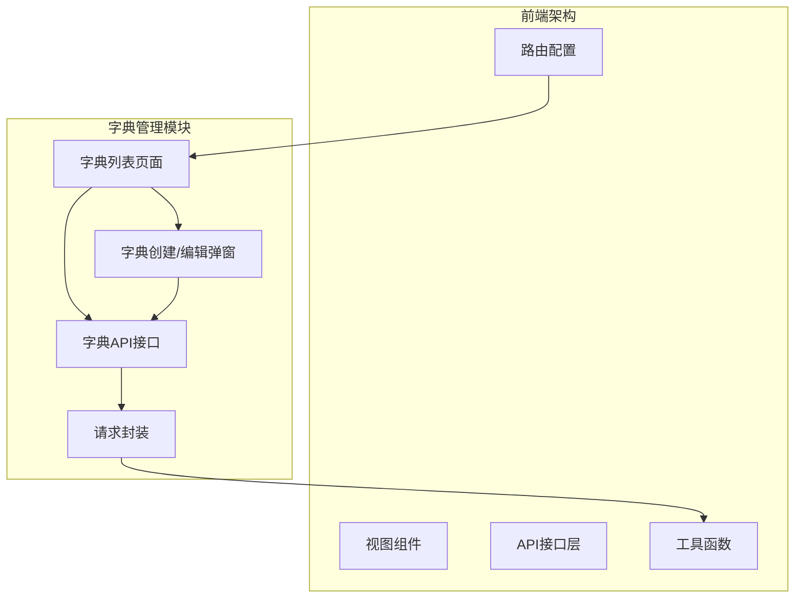
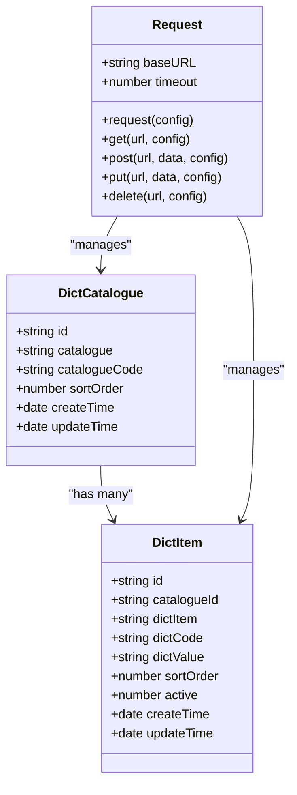
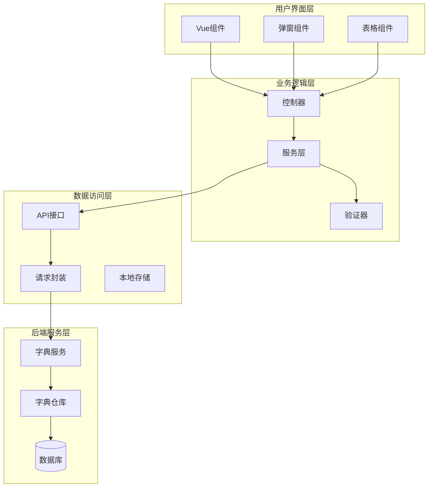
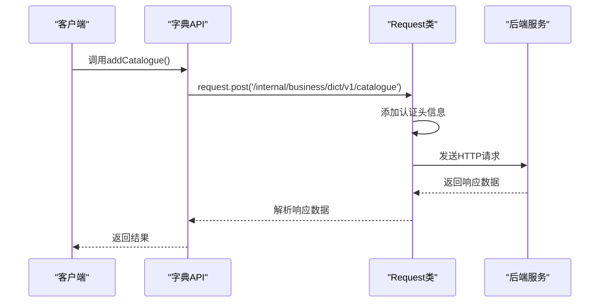
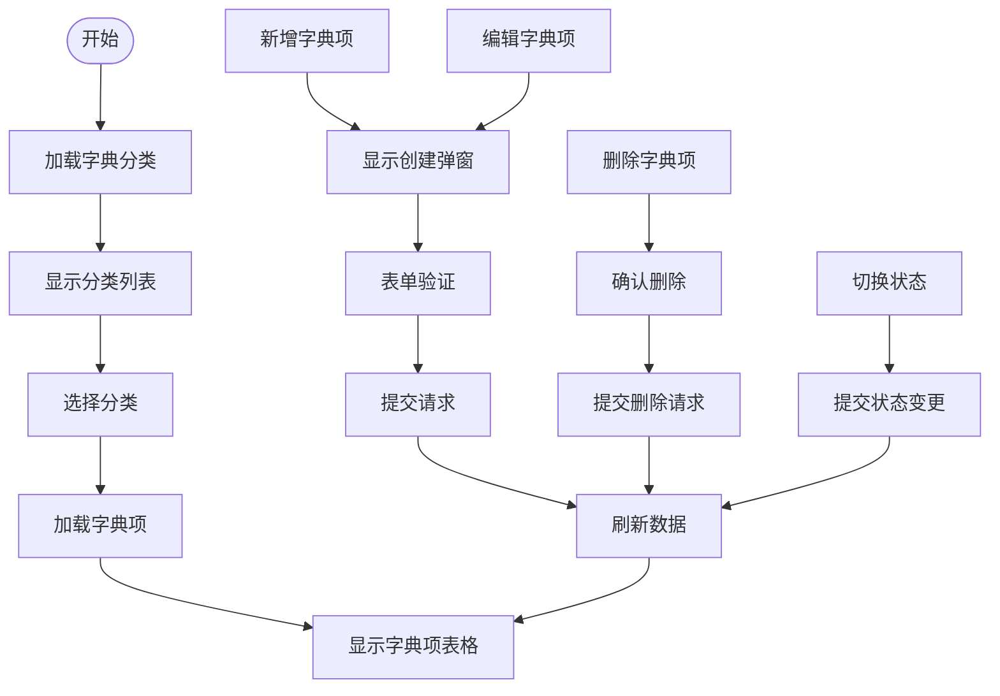
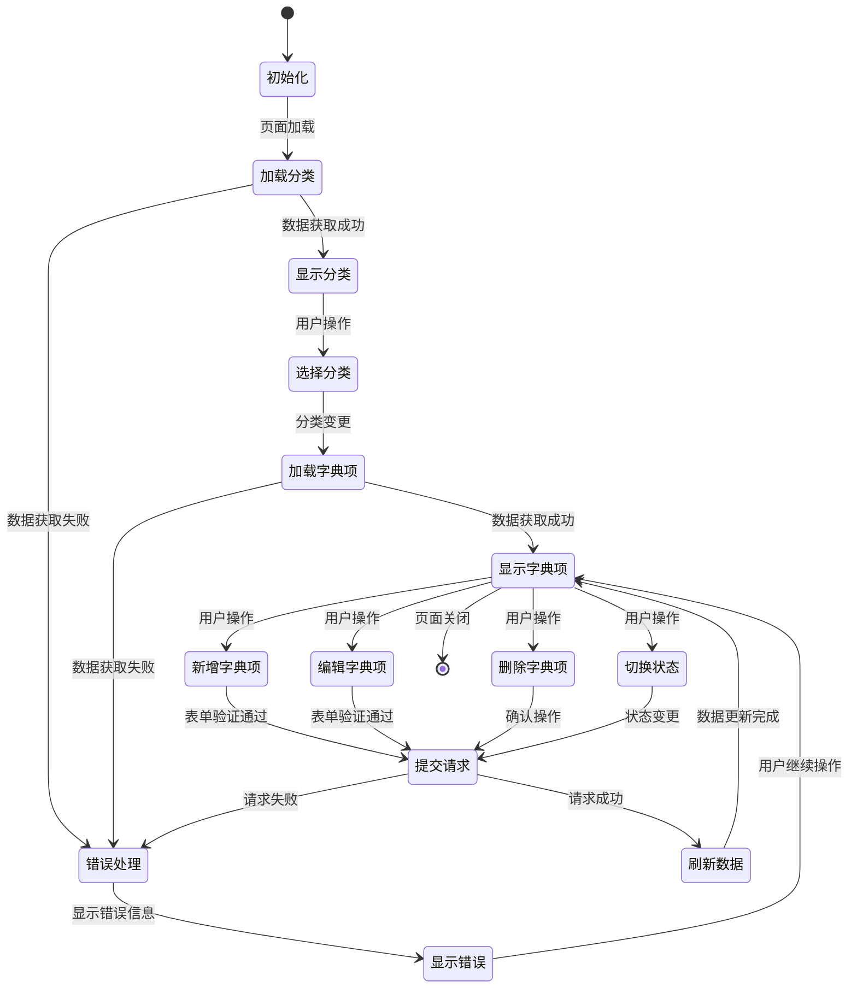
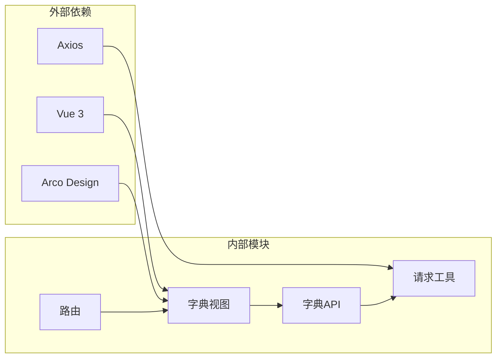

# 字典管理API

<cite>
**本文档引用的文件**
- [src/api/dictionaryList/index.ts](file://src/api/dictionaryList/index.ts)
- [src/views/dictionaryList/index.vue](file://src/views/dictionaryList/index.vue)
- [src/views/dictionaryList/create.vue](file://src/views/dictionaryList/create.vue)
- [src/utils/request.ts](file://src/utils/request.ts)
- [src/router/index.ts](file://src/router/index.ts)
</cite>

## 目录
1. [简介](#简介)
2. [项目结构](#项目结构)
3. [核心组件](#核心组件)
4. [架构概览](#架构概览)
5. [详细组件分析](#详细组件分析)
6. [依赖关系分析](#依赖关系分析)
7. [性能考虑](#性能考虑)
8. [故障排除指南](#故障排除指南)
9. [结论](#结论)

## 简介

字典管理API是企业管理系统中的核心数据管理模块，负责维护系统的基础数据字典。该模块提供了完整的字典分类管理和字典项维护功能，支持字典数据的增删改查操作、状态管理、以及用户界面的交互体验。

本API实现了以下核心功能：
- 字典分类（目录）的增删改查管理
- 字典项的创建、编辑、删除和状态切换
- 字典数据的查询和展示
- 用户友好的表单验证和错误处理
- 响应式数据绑定和实时更新

## 项目结构

字典管理功能在项目中的组织结构如下：

**图表来源**
- [src/router/index.ts:70-73](file://src/router/index.ts#L70-L73)
- [src/views/dictionaryList/index.vue:1-60](file://src/views/dictionaryList/index.vue#L1-L60)
- [src/api/dictionaryList/index.ts:1-31](file://src/api/dictionaryList/index.ts#L1-L31)

**章节来源**
- [src/router/index.ts:1-189](file://src/router/index.ts#L1-L189)
- [src/views/dictionaryList/index.vue:1-303](file://src/views/dictionaryList/index.vue#L1-L303)

## 核心组件

### API接口层

字典管理API接口层提供了完整的RESTful接口，包含以下主要功能：

#### 字典分类管理接口
- `addCatalogue(params: any)`: 新增字典分类
- `putCatalogue(params: any, data: any)`: 修改字典分类
- `getCatalogue(params: any)`: 获取字典分类列表

#### 字典项管理接口
- `addDict(params: any)`: 新增字典项
- `putDict(params: any, data: any)`: 修改字典项
- `getDict(params: any)`: 获取字典项列表
- `changeItemActive(params: any)`: 切换字典项状态

#### 数据模型定义

**图表来源**
- [src/api/dictionaryList/index.ts:5-31](file://src/api/dictionaryList/index.ts#L5-L31)
- [src/utils/request.ts:15-159](file://src/utils/request.ts#L15-L159)

**章节来源**
- [src/api/dictionaryList/index.ts:1-31](file://src/api/dictionaryList/index.ts#L1-L31)

### 视图组件层

#### 字典列表页面 (index.vue)

字典列表页面提供了完整的字典管理界面，包含左侧分类树和右侧字典项表格的功能布局。

**主要特性：**
- 左侧垂直分类选择器
- 右侧字典项表格展示
- 实时数据刷新机制
- 批量操作支持

#### 字典创建/编辑弹窗 (create.vue)

字典创建弹窗支持两种模式的表单显示：
- 模式1：字典分类表单
- 模式2：字典项表单

**表单验证规则：**
- 必填字段验证
- 长度限制验证
- 数值范围验证

**章节来源**
- [src/views/dictionaryList/index.vue:1-303](file://src/views/dictionaryList/index.vue#L1-L303)
- [src/views/dictionaryList/create.vue:1-297](file://src/views/dictionaryList/create.vue#L1-L297)

## 架构概览

字典管理API采用分层架构设计，确保了良好的可维护性和扩展性：

**图表来源**
- [src/views/dictionaryList/index.vue:61-162](file://src/views/dictionaryList/index.vue#L61-L162)
- [src/views/dictionaryList/create.vue:96-295](file://src/views/dictionaryList/create.vue#L96-L295)
- [src/api/dictionaryList/index.ts:1-31](file://src/api/dictionaryList/index.ts#L1-L31)

## 详细组件分析

### API接口实现分析

#### 请求封装机制

字典管理API使用统一的请求封装机制，通过`Request`类提供标准化的HTTP请求处理：

**图表来源**
- [src/api/dictionaryList/index.ts:5-7](file://src/api/dictionaryList/index.ts#L5-L7)
- [src/utils/request.ts:26-66](file://src/utils/request.ts#L26-L66)

#### 错误处理机制

API实现了完善的错误处理机制，包括：

**请求拦截器错误处理：**
- Token验证和自动添加
- 白名单URL处理
- 请求超时处理

**响应拦截器错误处理：**
- HTTP状态码错误处理
- 业务逻辑错误处理
- 统一消息提示

**章节来源**
- [src/utils/request.ts:26-113](file://src/utils/request.ts#L26-L113)

### 视图组件交互流程

#### 字典分类管理流程

**图表来源**
- [src/views/dictionaryList/index.vue:126-159](file://src/views/dictionaryList/index.vue#L126-L159)
- [src/views/dictionaryList/create.vue:241-291](file://src/views/dictionaryList/create.vue#L241-L291)

#### 表单验证流程

字典管理表单实现了多层次的验证机制：

**前端验证：**
- 必填字段检查
- 数据类型验证
- 长度限制验证
- 数值范围验证

**后端验证：**
- 业务规则验证
- 数据完整性检查
- 唯一性约束验证

**章节来源**
- [src/views/dictionaryList/create.vue:185-228](file://src/views/dictionaryList/create.vue#L185-L228)

### 数据流分析

#### 字典数据生命周期

**图表来源**
- [src/views/dictionaryList/index.vue:132-159](file://src/views/dictionaryList/index.vue#L132-L159)
- [src/views/dictionaryList/create.vue:241-291](file://src/views/dictionaryList/create.vue#L241-L291)

**章节来源**
- [src/views/dictionaryList/index.vue:61-162](file://src/views/dictionaryList/index.vue#L61-L162)

## 依赖关系分析

### 组件间依赖关系

**图表来源**
- [src/views/dictionaryList/index.vue:62-66](file://src/views/dictionaryList/index.vue#L62-L66)
- [src/api/dictionaryList/index.ts:1](file://src/api/dictionaryList/index.ts#L1)

### 关键依赖分析

**技术栈依赖：**
- Vue 3 Composition API：提供响应式数据绑定
- Arco Design：提供UI组件库
- Axios：提供HTTP客户端功能
- TypeScript：提供类型安全保障

**模块耦合度：**
- API层与视图层松耦合
- 组件间通过事件通信
- 数据流向单向化

**章节来源**
- [src/views/dictionaryList/index.vue:62-66](file://src/views/dictionaryList/index.vue#L62-L66)
- [src/api/dictionaryList/index.ts:1](file://src/api/dictionaryList/index.ts#L1)

## 性能考虑

### 数据加载优化

**懒加载策略：**
- 分类列表按需加载
- 字典项分页加载
- 图片资源延迟加载

**缓存机制：**
- 浏览器缓存策略
- 本地存储优化
- 请求去重机制

### 用户体验优化

**响应式设计：**
- 自适应布局
- 移动端适配
- 触摸友好交互

**加载状态管理：**
- 加载指示器
- 空状态处理
- 错误状态恢复

## 故障排除指南

### 常见问题及解决方案

**1. API请求失败**
- 检查网络连接状态
- 验证Token有效性
- 查看后端服务状态

**2. 数据加载异常**
- 清除浏览器缓存
- 检查数据格式
- 验证权限配置

**3. 表单验证错误**
- 检查必填字段
- 验证数据类型
- 查看错误提示信息

**章节来源**
- [src/utils/request.ts:67-112](file://src/utils/request.ts#L67-L112)

### 调试技巧

**开发环境调试：**
- 使用浏览器开发者工具
- 启用Vue DevTools
- 监控网络请求

**生产环境监控：**
- 错误日志收集
- 性能指标监控
- 用户行为分析

## 结论

字典管理API是一个功能完整、架构清晰的企业级数据管理模块。通过合理的分层设计和组件化实现，该模块提供了良好的可维护性和扩展性。

**主要优势：**
- 完整的CRUD操作支持
- 用户友好的界面设计
- 健壮的错误处理机制
- 良好的性能表现

**未来改进方向：**
- 增加批量操作功能
- 优化数据缓存策略
- 扩展多语言支持
- 增强数据导入导出功能

该模块为企业管理系统提供了稳定可靠的数据字典管理能力，为业务系统的正常运行奠定了坚实基础。