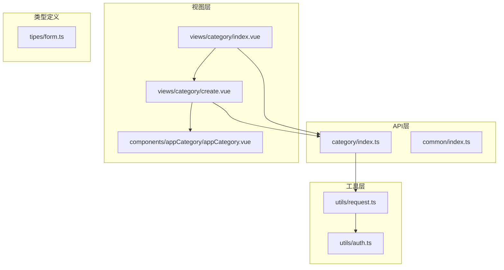
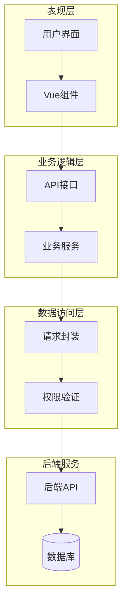
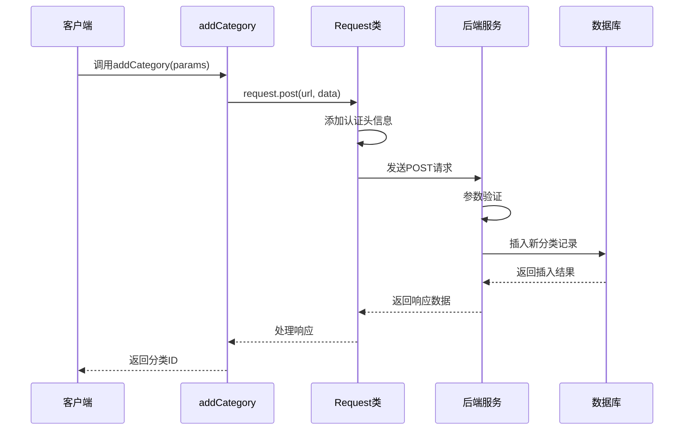
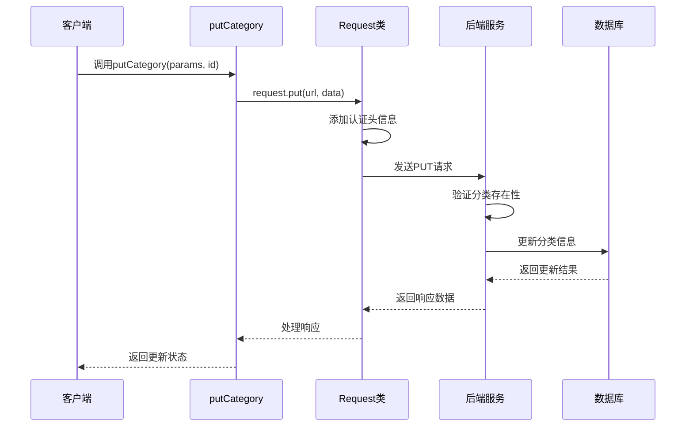
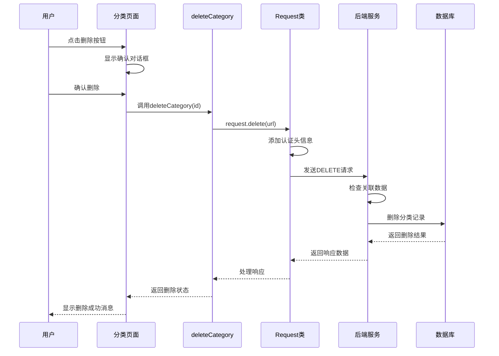
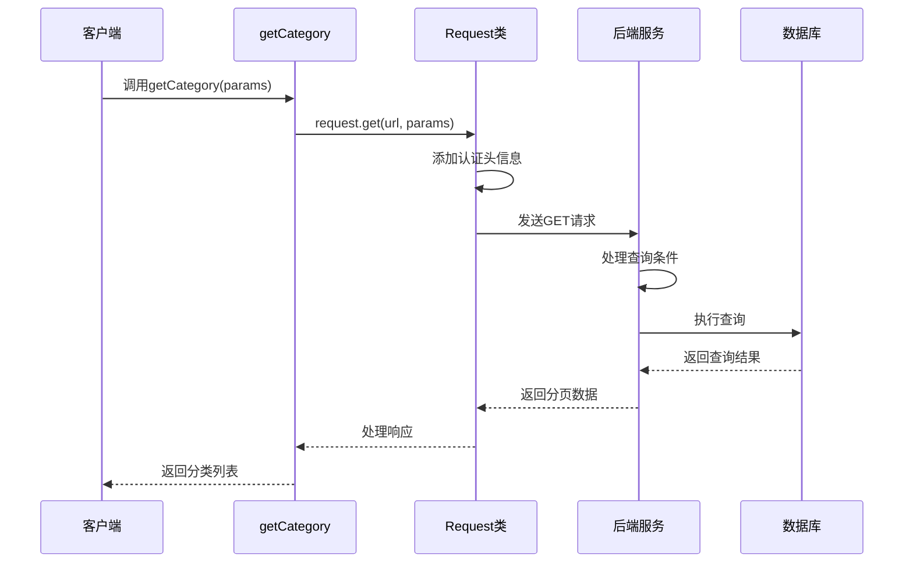
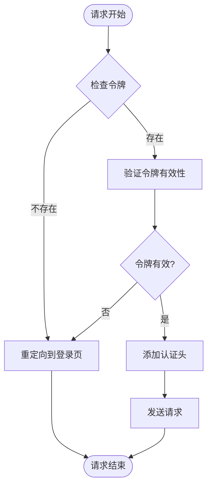
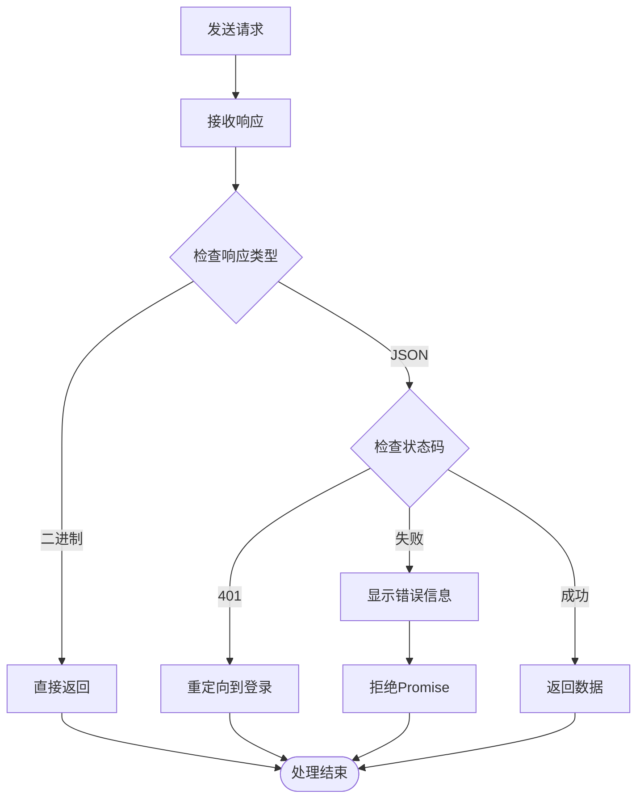
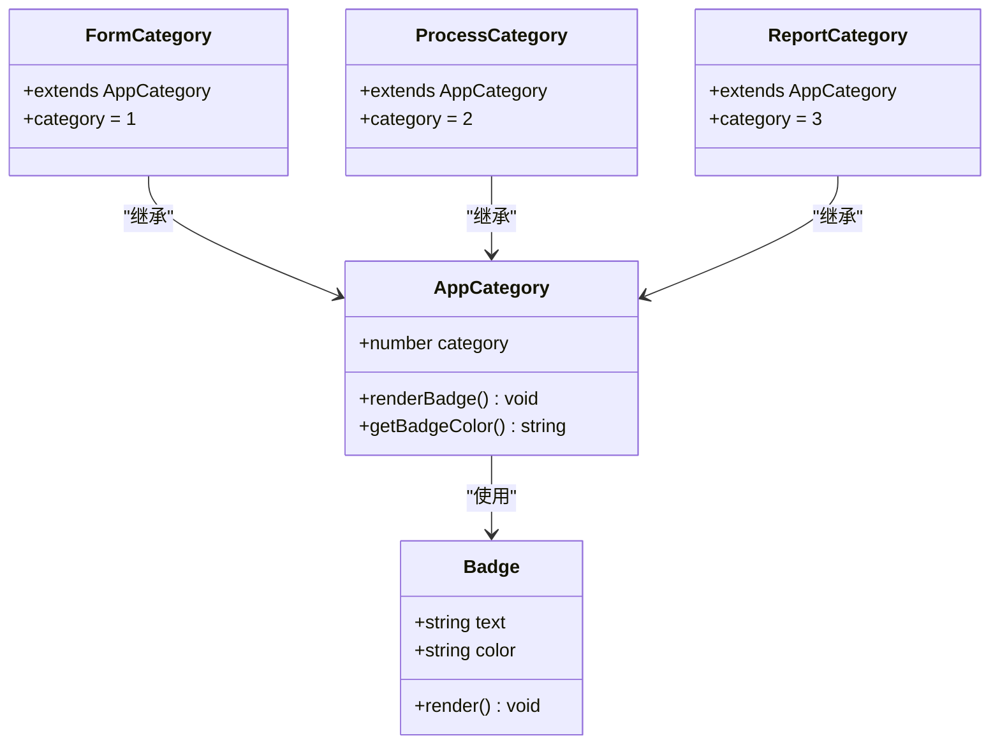
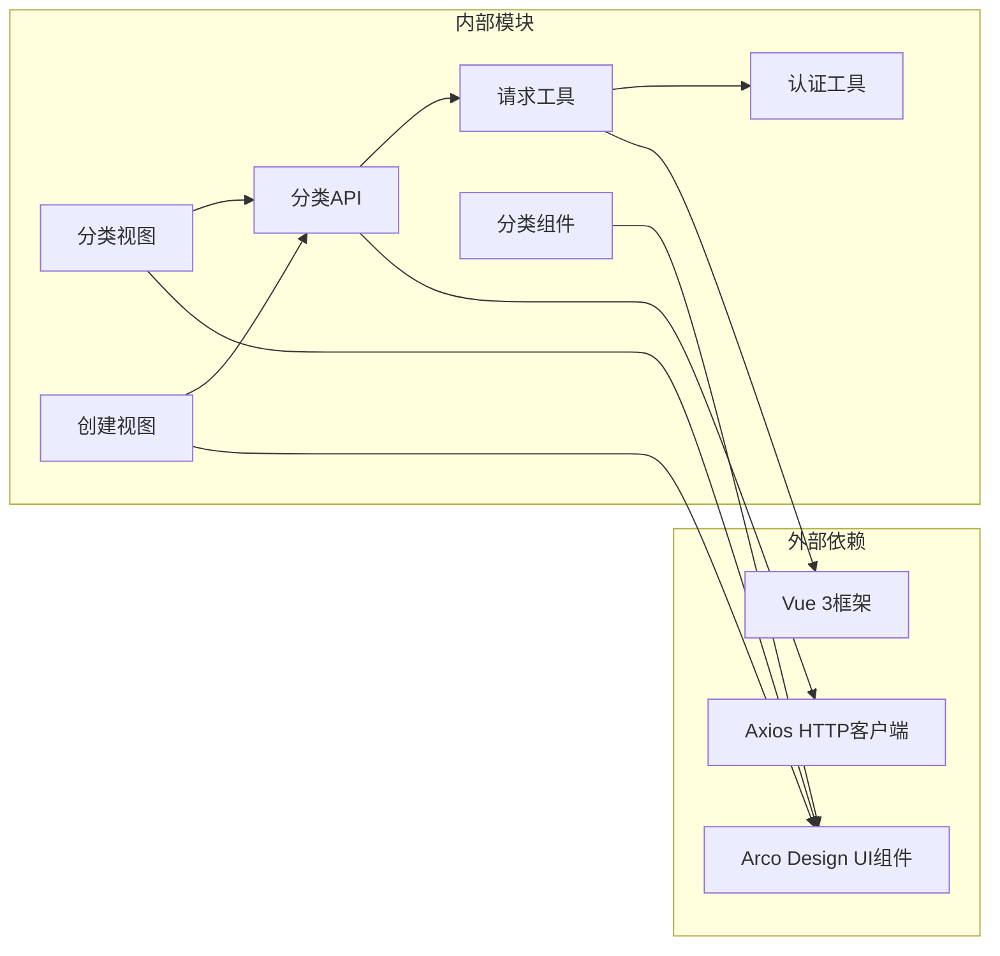

# 应用分类管理API

<cite>
**本文档引用的文件**
- [src/api/category/index.ts](file://src/api/category/index.ts)
- [src/utils/request.ts](file://src/utils/request.ts)
- [src/views/category/index.vue](file://src/views/category/index.vue)
- [src/views/category/create.vue](file://src/views/category/create.vue)
- [src/components/appCategory/appCategory.vue](file://src/components/appCategory/appCategory.vue)
- [src/utils/auth.ts](file://src/utils/auth.ts)
</cite>

## 目录
1. [简介](#简介)
2. [项目结构](#项目结构)
3. [核心组件](#核心组件)
4. [架构概览](#架构概览)
5. [详细组件分析](#详细组件分析)
6. [依赖关系分析](#依赖关系分析)
7. [性能考虑](#性能考虑)
8. [故障排除指南](#故障排除指南)
9. [结论](#结论)

## 简介

应用分类管理API是系统中用于管理应用程序分类的核心功能模块。该模块提供了完整的增删改查接口，支持应用分类的层级管理和批量操作。通过统一的API接口，用户可以对应用分类进行创建、更新、删除和查询操作，同时具备完善的权限控制和错误处理机制。

本API采用前后端分离架构，前端使用Vue 3框架，后端通过RESTful API提供服务。所有接口都经过统一的请求封装和响应处理，确保了系统的安全性和稳定性。

## 项目结构

应用分类管理功能在项目中的组织结构如下：

**图表来源**
- [src/api/category/index.ts:1-19](file://src/api/category/index.ts#L1-L19)
- [src/views/category/index.vue:1-180](file://src/views/category/index.vue#L1-L180)
- [src/views/category/create.vue:1-145](file://src/views/category/create.vue#L1-L145)

**章节来源**
- [src/api/category/index.ts:1-19](file://src/api/category/index.ts#L1-L19)
- [src/views/category/index.vue:1-180](file://src/views/category/index.vue#L1-L180)
- [src/views/category/create.vue:1-145](file://src/views/category/create.vue#L1-L145)

## 核心组件

### API接口层

应用分类管理API提供了四个核心接口，分别对应不同的业务操作：

#### 接口定义

| 方法 | HTTP方法 | 路径 | 功能描述 |
|------|----------|------|----------|
| addCategory | POST | `/internal/business/app/category/v1` | 新增应用分类 |
| putCategory | PUT | `/internal/business/app/category/v1/{id}` | 更新应用分类 |
| deleteCategory | DELETE | `/internal/business/app/category/v1/{id}` | 删除应用分类 |
| getCategory | GET | `/internal/business/app/category/v1` | 获取应用分类列表 |

#### 数据结构

应用分类的数据模型包含以下字段：

| 字段名 | 类型 | 必填 | 描述 | 长度限制 |
|--------|------|------|------|----------|
| id | string | 否 | 分类唯一标识符 | - |
| category | string | 是 | 分类名称 | 最大20字符 |
| intro | string | 否 | 分类描述 | 最大100字符 |
| sortOrder | number | 是 | 排序号 | 0-1000 |
| current | number | 否 | 当前页码 | - |
| size | number | 否 | 每页大小 | - |

**章节来源**
- [src/api/category/index.ts:5-19](file://src/api/category/index.ts#L5-L19)
- [src/views/category/create.vue:57-68](file://src/views/category/create.vue#L57-L68)

### 视图组件层

#### 分类管理页面

主分类管理页面提供了完整的分类管理界面，包含表格展示、分页功能和操作按钮。

#### 创建/编辑模态框

专门用于分类信息的创建和编辑，包含表单验证和提交逻辑。

**章节来源**
- [src/views/category/index.vue:14-180](file://src/views/category/index.vue#L14-L180)
- [src/views/category/create.vue:1-145](file://src/views/category/create.vue#L1-L145)

## 架构概览

应用分类管理API采用分层架构设计，确保了代码的可维护性和扩展性：

**图表来源**
- [src/utils/request.ts:15-159](file://src/utils/request.ts#L15-L159)
- [src/api/category/index.ts:1-19](file://src/api/category/index.ts#L1-L19)

## 详细组件分析

### API接口实现

#### 添加分类接口 (addCategory)

添加分类接口负责创建新的应用分类，具有完整的参数验证和错误处理机制。

**图表来源**
- [src/api/category/index.ts:5-7](file://src/api/category/index.ts#L5-L7)
- [src/utils/request.ts:121-131](file://src/utils/request.ts#L121-L131)

#### 更新分类接口 (putCategory)

更新分类接口支持对现有分类信息的修改，包括分类名称、描述和排序号的更新。

**图表来源**
- [src/api/category/index.ts:9-11](file://src/api/category/index.ts#L9-L11)
- [src/utils/request.ts:133-139](file://src/utils/request.ts#L133-L139)

#### 删除分类接口 (deleteCategory)

删除分类接口提供安全的分类删除功能，包含确认对话框和级联删除处理。

**图表来源**
- [src/api/category/index.ts:13-15](file://src/api/category/index.ts#L13-L15)
- [src/utils/request.ts:149-154](file://src/utils/request.ts#L149-L154)

#### 查询分类接口 (getCategory)

查询分类接口支持分页查询和条件筛选，返回完整的分类列表数据。

**图表来源**
- [src/api/category/index.ts:17-19](file://src/api/category/index.ts#L17-L19)
- [src/utils/request.ts:121-123](file://src/utils/request.ts#L121-L123)

### 权限控制机制

系统采用基于令牌的权限控制机制，确保只有授权用户才能访问分类管理功能。

**图表来源**
- [src/utils/request.ts:26-45](file://src/utils/request.ts#L26-L45)
- [src/utils/auth.ts:1-20](file://src/utils/auth.ts#L1-L20)

### 错误处理策略

系统实现了多层次的错误处理机制，包括网络错误、业务错误和用户交互错误。

#### 响应处理流程

**图表来源**
- [src/utils/request.ts:47-114](file://src/utils/request.ts#L47-L114)

**章节来源**
- [src/utils/request.ts:1-159](file://src/utils/request.ts#L1-L159)
- [src/utils/auth.ts:1-20](file://src/utils/auth.ts#L1-L20)

### 表单验证机制

分类管理表单采用了严格的前端验证机制，确保数据的完整性和正确性。

#### 验证规则

| 字段名 | 验证规则 | 错误消息 | 验证时机 |
|--------|----------|----------|----------|
| category | 必填 | 请输入分类名称 | 提交时 |
| sortOrder | 必填 | 请输入排序号 | 提交时 |
| category | 长度限制20字符 | - | 输入时 |
| sortOrder | 数值范围0-1000 | - | 输入时 |

**章节来源**
- [src/views/category/create.vue:93-106](file://src/views/category/create.vue#L93-L106)

### 组件集成

#### 分类徽章组件

应用分类徽章组件提供了视觉化的分类标识，支持三种分类类型的显示。

**图表来源**
- [src/components/appCategory/appCategory.vue:12-51](file://src/components/appCategory/appCategory.vue#L12-L51)

**章节来源**
- [src/components/appCategory/appCategory.vue:1-51](file://src/components/appCategory/appCategory.vue#L1-L51)

## 依赖关系分析

应用分类管理API的依赖关系体现了清晰的分层架构设计：

**图表来源**
- [src/api/category/index.ts:1](file://src/api/category/index.ts#L1)
- [src/utils/request.ts:2](file://src/utils/request.ts#L2)
- [src/views/category/index.vue:62](file://src/views/category/index.vue#L62)

### 外部依赖

系统主要依赖以下外部库：

- **Axios**: HTTP客户端库，用于API请求的发送和响应处理
- **Arco Design**: 前端UI组件库，提供丰富的界面组件
- **Vue 3**: 渐进式JavaScript框架，用于构建用户界面

### 内部依赖

各模块之间的依赖关系清晰明确：

- API层依赖请求封装工具
- 视图层依赖API层和UI组件库
- 工具层为整个系统提供基础功能支持

**章节来源**
- [src/api/category/index.ts:1-19](file://src/api/category/index.ts#L1-L19)
- [src/utils/request.ts:1-159](file://src/utils/request.ts#L1-L159)

## 性能考虑

应用分类管理API在设计时充分考虑了性能优化：

### 缓存策略
- 使用浏览器本地存储缓存认证令牌
- 合理的请求频率控制，避免频繁的API调用

### 响应优化
- 支持分页查询，减少单次响应数据量
- 二进制响应直接传输，提高下载效率

### 错误恢复
- 自动重定向到登录页处理认证失败
- 友好的错误提示，提升用户体验

## 故障排除指南

### 常见问题及解决方案

#### 认证失败
**问题**: 用户无法访问分类管理功能
**原因**: 令牌过期或无效
**解决方案**: 
1. 检查本地存储中的令牌是否存在
2. 重新登录获取新的令牌
3. 确认服务器时间同步

#### 网络请求错误
**问题**: API请求超时或失败
**原因**: 网络连接问题或服务器异常
**解决方案**:
1. 检查网络连接状态
2. 查看浏览器开发者工具中的请求详情
3. 确认API服务正常运行

#### 数据验证错误
**问题**: 表单提交失败
**原因**: 输入数据不符合验证规则
**解决方案**:
1. 检查必填字段是否完整
2. 确认数据格式符合要求
3. 查看具体的错误提示信息

**章节来源**
- [src/utils/request.ts:67-114](file://src/utils/request.ts#L67-L114)
- [src/views/category/create.vue:113-139](file://src/views/category/create.vue#L113-L139)

## 结论

应用分类管理API是一个功能完善、架构清晰的管理系统。通过四个核心接口，用户可以轻松地管理应用分类，包括创建、更新、删除和查询操作。

系统的主要优势包括：

1. **完整的功能覆盖**: 提供了分类管理的所有必要功能
2. **安全的权限控制**: 基于令牌的认证机制确保系统安全
3. **友好的用户界面**: 基于Vue 3和Arco Design的现代化界面
4. **健壮的错误处理**: 多层次的错误处理机制提升系统稳定性
5. **良好的扩展性**: 清晰的分层架构便于功能扩展和维护

该API为应用分类管理提供了坚实的技术基础，能够满足各种复杂的业务需求，并为未来的功能扩展奠定了良好的技术基础。