# 系统管理API

<cite>
**本文引用的文件**
- [src/api/category/index.ts](file://src/api/category/index.ts)
- [src/api/department/index.ts](file://src/api/department/index.ts)
- [src/api/role/index.ts](file://src/api/role/index.ts)
- [src/api/settings/index.ts](file://src/api/settings/index.ts)
- [src/api/dictionaryList/index.ts](file://src/api/dictionaryList/index.ts)
- [src/api/user/index.ts](file://src/api/user/index.ts)
- [src/api/securityCenter/index.ts](file://src/api/securityCenter/index.ts)
- [src/api/developer/index.ts](file://src/api/developer/index.ts)
- [src/utils/request.ts](file://src/utils/request.ts)
- [src/api/webHook/index.ts](file://src/api/webHook/index.ts)
- [src/api/workbench/index.ts](file://src/api/workbench/index.ts)
- [src/api/form/index.ts](file://src/api/form/index.ts)
- [src/api/processCenter/index.ts](file://src/api/processCenter/index.ts)
- [src/api/taskFillCenter/index.ts](file://src/api/taskFillCenter/index.ts)
- [src/api/homePage/index.ts](file://src/api/homePage/index.ts)
</cite>

## 目录
1. [简介](#简介)
2. [项目结构](#项目结构)
3. [核心组件](#核心组件)
4. [架构总览](#架构总览)
5. [详细组件分析](#详细组件分析)
6. [依赖关系分析](#依赖关系分析)
7. [性能考虑](#性能考虑)
8. [故障排查指南](#故障排查指南)
9. [结论](#结论)
10. [附录](#附录)

## 简介
本文件面向系统管理与后台运营场景，系统性梳理并说明以下能力的API实现与使用方式：
- 分类管理：应用分类的增删改查
- 部门管理：组织架构的增删改查、导入、树形结构
- 角色权限：角色的增删改查、分页查询、角色与菜单/应用/用户的授权关联
- 系统设置：系统配置项的获取、应用与更新
- 字典管理：字典目录与字典项的增删改查、状态变更
- 用户管理：用户基础信息、状态变更、角色与部门调整、身份信息变更
- 开发者与订阅：开发者账号、密钥、订阅管理
- 工作台与流程：待办/已办/抄送、审批操作、流程日志与导出
- Webhook与日志：应用Webhook日志查询、重推、开发者配置
- 监控与首页：首页统计、应用管理入口、访问对象配置

上述能力均基于统一的请求封装层，采用统一的鉴权头与响应处理策略。

## 项目结构
前端以“按功能域划分”的模块化组织API文件，每个域一个独立的API目录，便于职责清晰与扩展维护。

```mermaid
graph TB
subgraph "系统管理API域"
CAT["分类管理<br/>src/api/category/index.ts"]
DEPT["部门管理<br/>src/api/department/index.ts"]
ROLE["角色管理<br/>src/api/role/index.ts"]
USER["用户管理<br/>src/api/user/index.ts"]
SEC["安全中心<br/>src/api/securityCenter/index.ts"]
SET["系统设置<br/>src/api/settings/index.ts"]
DICT["字典管理<br/>src/api/dictionaryList/index.ts"]
DEV["开发者与订阅<br/>src/api/developer/index.ts"]
end
subgraph "工作流与表单"
WB["工作台<br/>src/api/workbench/index.ts"]
PROC["流程中心<br/>src/api/processCenter/index.ts"]
FILL["填报中心<br/>src/api/taskFillCenter/index.ts"]
FORM["表单设计<br/>src/api/form/index.ts"]
end
subgraph "监控与集成"
WEBHOOK["Webhook与日志<br/>src/api/webHook/index.ts"]
HOME["首页与应用<br/>src/api/homePage/index.ts"]
end
REQ["请求封装<br/>src/utils/request.ts"]
CAT --> REQ
DEPT --> REQ
ROLE --> REQ
USER --> REQ
SEC --> REQ
SET --> REQ
DICT --> REQ
DEV --> REQ
WB --> REQ
PROC --> REQ
FILL --> REQ
FORM --> REQ
WEBHOOK --> REQ
HOME --> REQ
```

图表来源
- [src/api/category/index.ts:1-19](file://src/api/category/index.ts#L1-L19)
- [src/api/department/index.ts:1-23](file://src/api/department/index.ts#L1-L23)
- [src/api/role/index.ts:1-25](file://src/api/role/index.ts#L1-L25)
- [src/api/user/index.ts:1-63](file://src/api/user/index.ts#L1-L63)
- [src/api/securityCenter/index.ts:1-90](file://src/api/securityCenter/index.ts#L1-L90)
- [src/api/settings/index.ts:1-19](file://src/api/settings/index.ts#L1-L19)
- [src/api/dictionaryList/index.ts:1-31](file://src/api/dictionaryList/index.ts#L1-L31)
- [src/api/developer/index.ts:1-65](file://src/api/developer/index.ts#L1-L65)
- [src/api/workbench/index.ts:1-139](file://src/api/workbench/index.ts#L1-L139)
- [src/api/processCenter/index.ts:1-47](file://src/api/processCenter/index.ts#L1-L47)
- [src/api/taskFillCenter/index.ts:1-38](file://src/api/taskFillCenter/index.ts#L1-L38)
- [src/api/form/index.ts:1-31](file://src/api/form/index.ts#L1-L31)
- [src/api/webHook/index.ts:1-31](file://src/api/webHook/index.ts#L1-L31)
- [src/api/homePage/index.ts:1-94](file://src/api/homePage/index.ts#L1-L94)
- [src/utils/request.ts:1-159](file://src/utils/request.ts#L1-L159)

章节来源
- [src/api/category/index.ts:1-19](file://src/api/category/index.ts#L1-L19)
- [src/api/department/index.ts:1-23](file://src/api/department/index.ts#L1-L23)
- [src/api/role/index.ts:1-25](file://src/api/role/index.ts#L1-L25)
- [src/api/user/index.ts:1-63](file://src/api/user/index.ts#L1-L63)
- [src/api/securityCenter/index.ts:1-90](file://src/api/securityCenter/index.ts#L1-L90)
- [src/api/settings/index.ts:1-19](file://src/api/settings/index.ts#L1-L19)
- [src/api/dictionaryList/index.ts:1-31](file://src/api/dictionaryList/index.ts#L1-L31)
- [src/api/developer/index.ts:1-65](file://src/api/developer/index.ts#L1-L65)
- [src/api/workbench/index.ts:1-139](file://src/api/workbench/index.ts#L1-L139)
- [src/api/processCenter/index.ts:1-47](file://src/api/processCenter/index.ts#L1-L47)
- [src/api/taskFillCenter/index.ts:1-38](file://src/api/taskFillCenter/index.ts#L1-L38)
- [src/api/form/index.ts:1-31](file://src/api/form/index.ts#L1-L31)
- [src/api/webHook/index.ts:1-31](file://src/api/webHook/index.ts#L1-L31)
- [src/api/homePage/index.ts:1-94](file://src/api/homePage/index.ts#L1-L94)
- [src/utils/request.ts:1-159](file://src/utils/request.ts#L1-L159)

## 核心组件
- 统一请求封装：提供HTTP客户端实例、请求/响应拦截器、鉴权头注入、错误处理与消息提示。
- 功能域API：围绕用户、角色、部门、分类、字典、系统配置、安全组、开发者与订阅、工作台与流程、Webhook与日志等模块提供标准化接口。

章节来源
- [src/utils/request.ts:1-159](file://src/utils/request.ts#L1-L159)

## 架构总览
系统管理API通过统一的请求封装层与后端内部接口对接，遵循REST风格命名与路径规范，支持分页、树形结构、授权关联等典型管理场景。

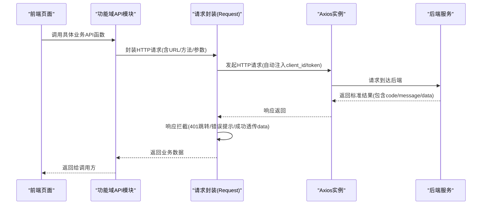

图表来源
- [src/utils/request.ts:26-113](file://src/utils/request.ts#L26-L113)
- [src/api/securityCenter/index.ts:1-90](file://src/api/securityCenter/index.ts#L1-L90)
- [src/api/user/index.ts:1-63](file://src/api/user/index.ts#L1-L63)

## 详细组件分析

### 分类管理（应用分类）
- 接口能力
  - 新增应用分类
  - 修改应用分类
  - 删除应用分类
  - 查询应用分类列表
- 关键点
  - 使用统一请求封装，路径前缀为内部业务域
  - 支持分页查询与条件过滤
- 典型调用链路

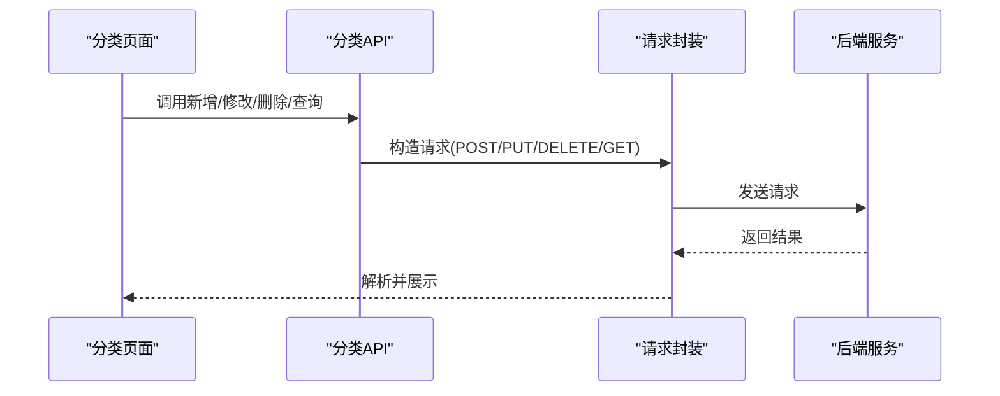

图表来源
- [src/api/category/index.ts:1-19](file://src/api/category/index.ts#L1-L19)
- [src/utils/request.ts:117-154](file://src/utils/request.ts#L117-L154)

章节来源
- [src/api/category/index.ts:1-19](file://src/api/category/index.ts#L1-L19)

### 部门管理（组织架构）
- 接口能力
  - 新增部门
  - 删除部门
  - 修改部门
  - 获取部门树
  - 导入部门
- 关键点
  - 树形结构用于层级展示与选择
  - 导入接口支持批量数据写入
- 典型调用链路

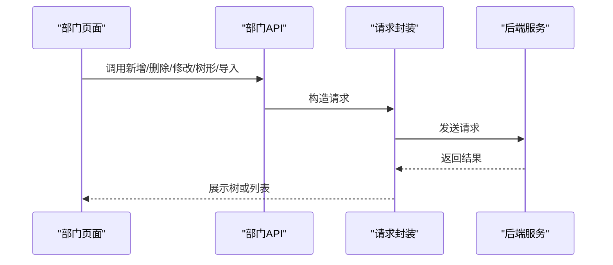

图表来源
- [src/api/department/index.ts:1-23](file://src/api/department/index.ts#L1-L23)
- [src/utils/request.ts:117-154](file://src/utils/request.ts#L117-L154)

章节来源
- [src/api/department/index.ts:1-23](file://src/api/department/index.ts#L1-L23)

### 角色权限（RBAC）
- 接口能力
  - 新增角色
  - 删除角色
  - 修改角色
  - 分页查询角色列表
  - 获取角色列表
- RBAC授权关联（安全中心）
  - 安全组管理：新增/修改/删除/列表
  - 应用授权：授权/取消/查询
  - 菜单授权：授权/查询授权菜单ID
  - 用户授权：授权/取消/查询授权/未授权用户
- 关键点
  - 通过安全组作为权限聚合载体，与菜单、应用、用户建立多对多关系
  - 授权查询支持“已授权/未授权”两类视图，便于界面交互
- 典型调用链路

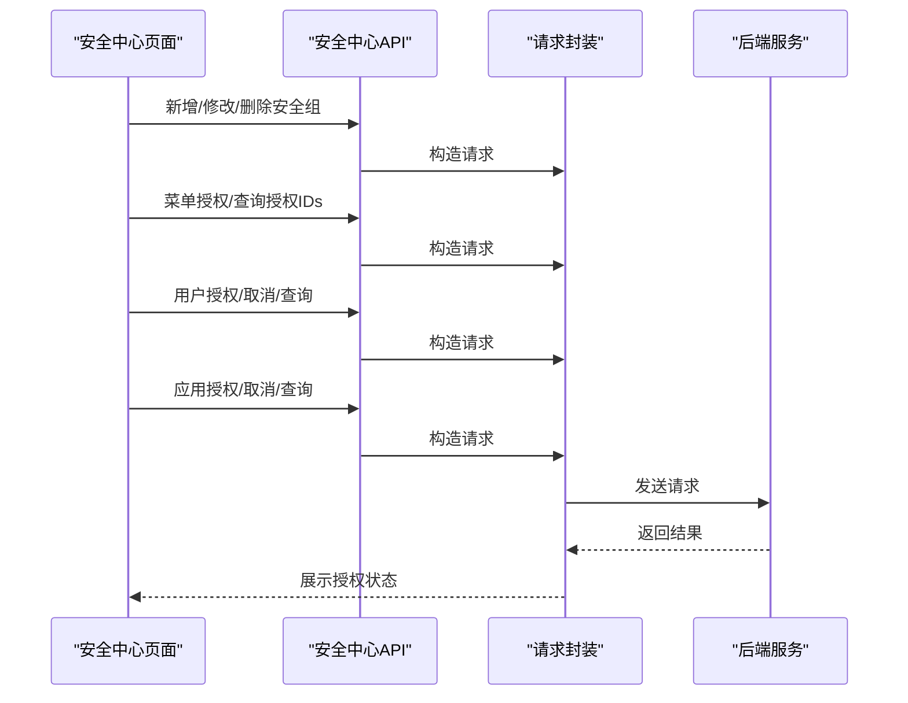

图表来源
- [src/api/securityCenter/index.ts:1-90](file://src/api/securityCenter/index.ts#L1-L90)
- [src/utils/request.ts:117-154](file://src/utils/request.ts#L117-L154)

章节来源
- [src/api/role/index.ts:1-25](file://src/api/role/index.ts#L1-L25)
- [src/api/securityCenter/index.ts:1-90](file://src/api/securityCenter/index.ts#L1-L90)

### 系统设置（配置项）
- 接口能力
  - 应用配置：根据配置编码应用到系统
  - 获取配置：根据配置编码获取当前值
  - 更新配置：根据配置ID更新配置
- 关键点
  - 配置项以“编码/ID”区分，支持快速应用与精准更新
- 典型调用链路

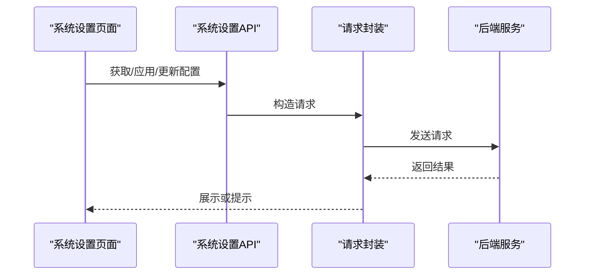

图表来源
- [src/api/settings/index.ts:1-19](file://src/api/settings/index.ts#L1-L19)
- [src/utils/request.ts:117-154](file://src/utils/request.ts#L117-L154)

章节来源
- [src/api/settings/index.ts:1-19](file://src/api/settings/index.ts#L1-L19)

### 字典管理（字典目录与字典项）
- 接口能力
  - 字典目录：新增/修改/查询目录列表
  - 字典项：新增/修改/查询字典项列表/按状态变更
- 关键点
  - 字典目录用于分组管理，字典项承载具体键值对
  - 支持状态切换，便于启用/停用字典项
- 典型调用链路

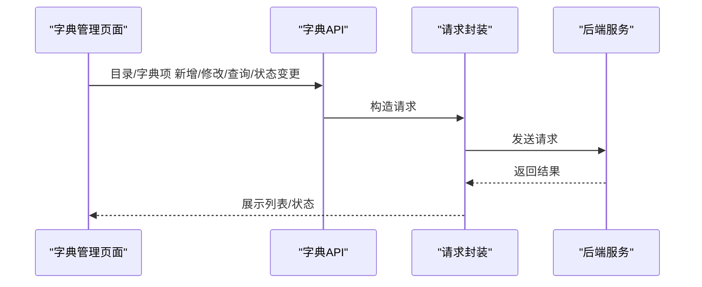

图表来源
- [src/api/dictionaryList/index.ts:1-31](file://src/api/dictionaryList/index.ts#L1-L31)
- [src/utils/request.ts:117-154](file://src/utils/request.ts#L117-L154)

章节来源
- [src/api/dictionaryList/index.ts:1-31](file://src/api/dictionaryList/index.ts#L1-L31)

### 用户管理（用户基础与状态）
- 接口能力
  - 新增/删除/修改用户
  - 分页查询用户
  - 在职状态变更、登录状态变更、重置密码
  - 身份信息变更、兼任部门管理、部门负责人设置
  - 批量离职、无部门人数统计
  - 用户角色更新、所属部门更新
- 关键点
  - 提供丰富的状态与身份变更接口，满足人事与权限管理需求
  - 支持多部门与负责人设置，配合部门树使用
- 典型调用链路

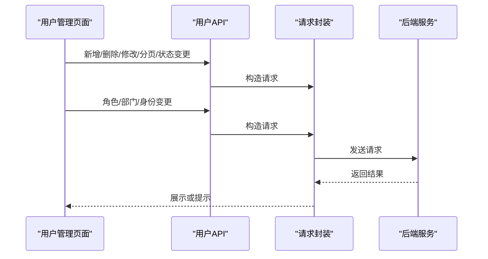

图表来源
- [src/api/user/index.ts:1-63](file://src/api/user/index.ts#L1-L63)
- [src/utils/request.ts:117-154](file://src/utils/request.ts#L117-L154)

章节来源
- [src/api/user/index.ts:1-63](file://src/api/user/index.ts#L1-L63)

### 开发者与订阅（开发者账号与订阅）
- 接口能力
  - 开发者：新增/删除/修改、分页查询、重置密钥、详情、禁用/启用
  - 订阅：分页记录、订阅/取消订阅、修改订阅、禁用/启用、未订阅应用下拉
- 关键点
  - 开发者密钥重置与状态控制，保障集成安全
  - 订阅管理支持灵活的授权与状态控制
- 典型调用链路

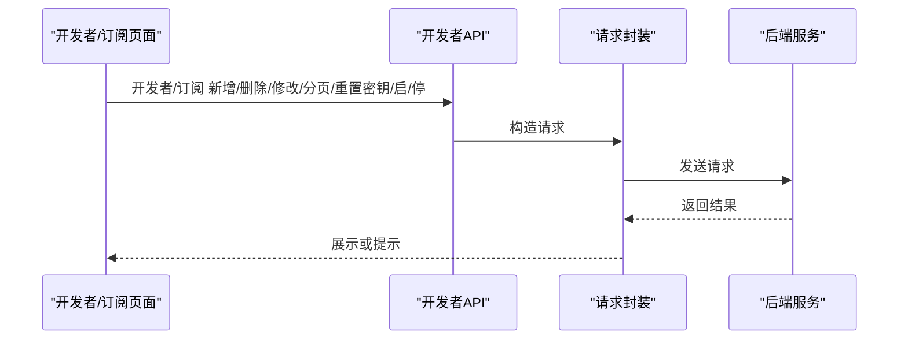

图表来源
- [src/api/developer/index.ts:1-65](file://src/api/developer/index.ts#L1-L65)
- [src/utils/request.ts:117-154](file://src/utils/request.ts#L117-L154)

章节来源
- [src/api/developer/index.ts:1-65](file://src/api/developer/index.ts#L1-L65)

### 工作台与流程（待办/已办/抄送与审批）
- 接口能力
  - 待办：应用列表、分页记录、任务转交、填写完成、审批通过/拒绝/退回
  - 申请：应用列表、分页记录、撤回/终止/加急
  - 已办/抄送：应用列表、分页记录、已读
  - 流程详情：待办/申请/已办/抄送详情
  - 流程日志：审批日志查询
  - 导出与打印：工作表导出、表单打印
- 关键点
  - 多维度工作流视图，覆盖“经手/发起/抄送”等角色
  - 支持流程候选人查询与节点级候选人查询
- 典型调用链路

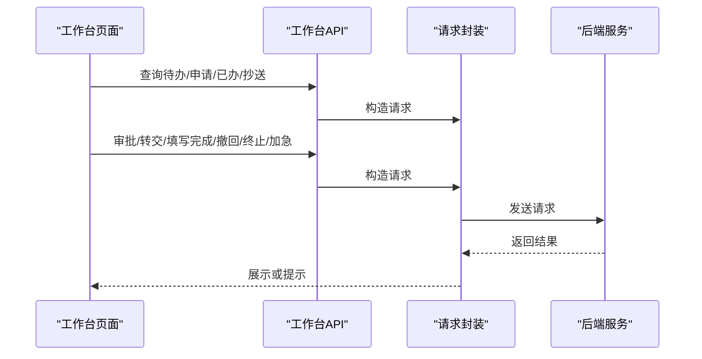

图表来源
- [src/api/workbench/index.ts:1-139](file://src/api/workbench/index.ts#L1-L139)
- [src/utils/request.ts:117-154](file://src/utils/request.ts#L117-L154)

章节来源
- [src/api/workbench/index.ts:1-139](file://src/api/workbench/index.ts#L1-L139)

### 表单与流程中心
- 表单设计
  - 应用设计、表单设计保存、创建者/管理者/访问者视角
  - 表单提交数据、应用流程历史
- 流程中心
  - 流程统计、应用流程列表、流程记录列表
  - 催办、填写、审批通过/拒绝/转交/退回、停止流程
- 关键点
  - 设计与运行分离，支持不同角色的表单生命周期管理
  - 流程中心提供完整的流程编排与治理能力
- 典型调用链路

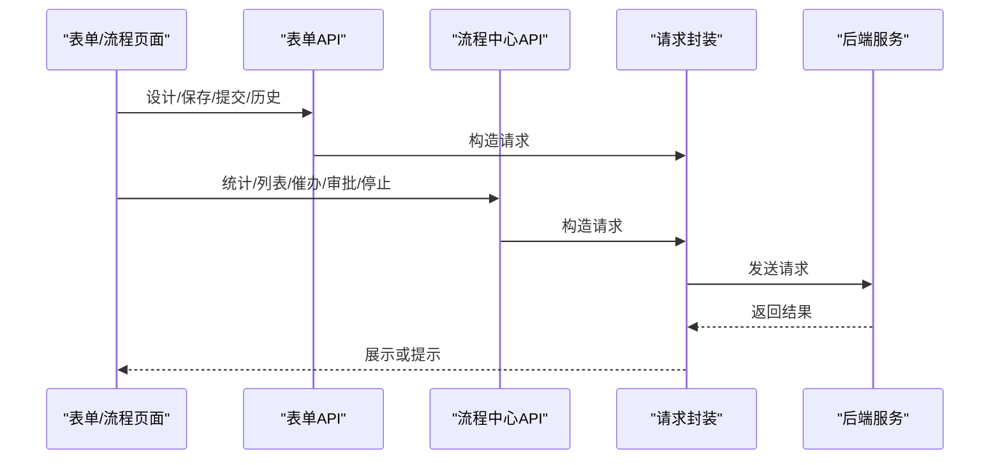

图表来源
- [src/api/form/index.ts:1-31](file://src/api/form/index.ts#L1-L31)
- [src/api/processCenter/index.ts:1-47](file://src/api/processCenter/index.ts#L1-L47)
- [src/utils/request.ts:117-154](file://src/utils/request.ts#L117-L154)

章节来源
- [src/api/form/index.ts:1-31](file://src/api/form/index.ts#L1-L31)
- [src/api/processCenter/index.ts:1-47](file://src/api/processCenter/index.ts#L1-L47)

### 填报中心
- 接口能力
  - 填报数据提交
  - 填报批次任务分页查询
  - 填报详情查看
  - 数据纠错记录分页
  - 审批进度查询
  - 填报数据导出
- 关键点
  - 支持批量任务与纠错闭环
  - 导出接口支持Blob响应类型
- 典型调用链路

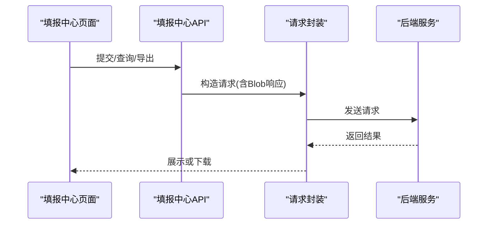

图表来源
- [src/api/taskFillCenter/index.ts:1-38](file://src/api/taskFillCenter/index.ts#L1-L38)
- [src/utils/request.ts:117-154](file://src/utils/request.ts#L117-L154)

章节来源
- [src/api/taskFillCenter/index.ts:1-38](file://src/api/taskFillCenter/index.ts#L1-L38)

### Webhook与日志
- 接口能力
  - 应用Webhook日志：应用列表、分页记录、详情
  - 重推Webhook日志
  - 开发者配置修改、密钥获取
  - 开发者下拉框
- 关键点
  - 支持日志重推，便于问题复现与修复
  - 开发者配置与密钥管理，保障集成安全
- 典型调用链路

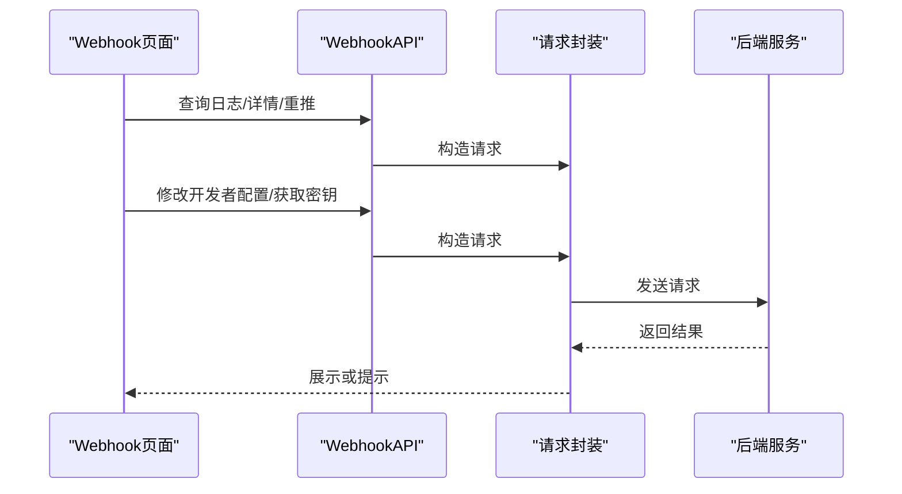

图表来源
- [src/api/webHook/index.ts:1-31](file://src/api/webHook/index.ts#L1-L31)
- [src/utils/request.ts:117-154](file://src/utils/request.ts#L117-L154)

章节来源
- [src/api/webHook/index.ts:1-31](file://src/api/webHook/index.ts#L1-L31)

### 首页与应用管理
- 接口能力
  - 首页统计、字典项获取、我的应用、应用广场、我管理的应用
  - 应用新增/修改/删除/销毁/转让
  - 访问对象配置、Webhook配置、分享配置
  - 应用详情、访问者/创建者/管理者视角
  - 安全组应用标签权限查询
- 关键点
  - 多视角应用管理，覆盖创建者、管理者、访问者
  - 支持访问对象与分享配置，满足开放与隔离场景
- 典型调用链路

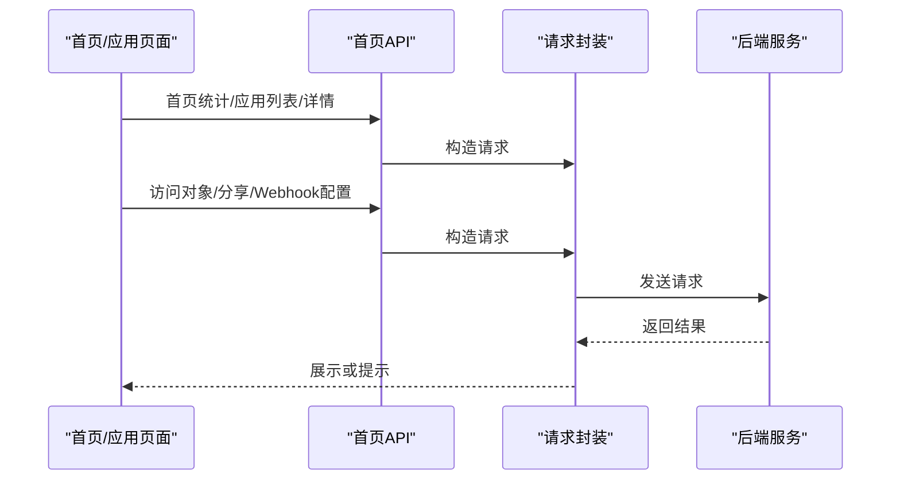

图表来源
- [src/api/homePage/index.ts:1-94](file://src/api/homePage/index.ts#L1-L94)
- [src/utils/request.ts:117-154](file://src/utils/request.ts#L117-L154)

章节来源
- [src/api/homePage/index.ts:1-94](file://src/api/homePage/index.ts#L1-L94)

## 依赖关系分析
- 组件耦合
  - 各功能域API均依赖统一请求封装，确保一致的鉴权与错误处理
  - 安全中心与用户/角色/部门存在强关联：用户角色更新、部门调整、菜单/应用授权
- 外部依赖
  - Axios作为HTTP客户端
  - Arco Design的消息提示组件用于错误反馈
- 潜在循环依赖
  - API模块之间无直接相互依赖，通过请求封装与后端接口耦合，避免循环依赖

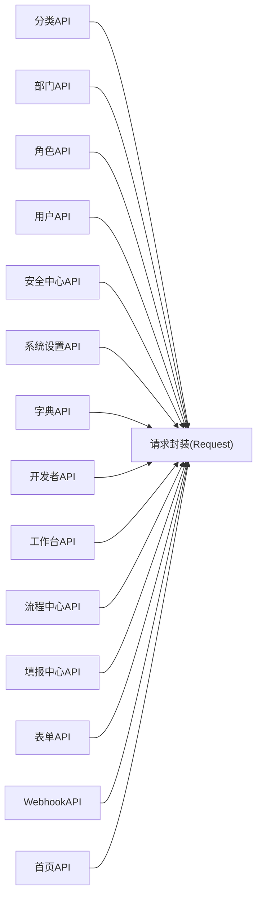

图表来源
- [src/utils/request.ts:1-159](file://src/utils/request.ts#L1-L159)
- [src/api/category/index.ts:1-19](file://src/api/category/index.ts#L1-L19)
- [src/api/department/index.ts:1-23](file://src/api/department/index.ts#L1-L23)
- [src/api/role/index.ts:1-25](file://src/api/role/index.ts#L1-L25)
- [src/api/user/index.ts:1-63](file://src/api/user/index.ts#L1-L63)
- [src/api/securityCenter/index.ts:1-90](file://src/api/securityCenter/index.ts#L1-L90)
- [src/api/settings/index.ts:1-19](file://src/api/settings/index.ts#L1-L19)
- [src/api/dictionaryList/index.ts:1-31](file://src/api/dictionaryList/index.ts#L1-L31)
- [src/api/developer/index.ts:1-65](file://src/api/developer/index.ts#L1-L65)
- [src/api/workbench/index.ts:1-139](file://src/api/workbench/index.ts#L1-L139)
- [src/api/processCenter/index.ts:1-47](file://src/api/processCenter/index.ts#L1-L47)
- [src/api/taskFillCenter/index.ts:1-38](file://src/api/taskFillCenter/index.ts#L1-L38)
- [src/api/form/index.ts:1-31](file://src/api/form/index.ts#L1-L31)
- [src/api/webHook/index.ts:1-31](file://src/api/webHook/index.ts#L1-L31)
- [src/api/homePage/index.ts:1-94](file://src/api/homePage/index.ts#L1-L94)

章节来源
- [src/utils/request.ts:1-159](file://src/utils/request.ts#L1-L159)

## 性能考虑
- 请求超时与并发
  - 统一超时配置，建议在高并发场景下合理控制并发数，避免阻塞
- 响应处理
  - 对于大文件导出（如报表、填报导出）使用Blob响应，避免内存峰值
- 错误处理
  - 全局错误提示与401跳转，减少重复错误处理逻辑
- 分页查询
  - 列表查询统一走分页接口，避免一次性加载过多数据

## 故障排查指南
- 常见错误码与处理
  - 401未授权：检查本地token与白名单放行规则
  - 403拒绝访问：确认安全组授权与角色权限
  - 404请求出错：核对后端接口路径与版本号
  - 500/502/503：后端服务异常，关注日志与限流
- 建议排查步骤
  - 确认请求头中client_id与token是否正确
  - 使用浏览器开发者工具查看网络请求与响应
  - 核对后端接口文档与版本路径
  - 对于导出类接口，确认响应类型为Blob且浏览器支持下载

章节来源
- [src/utils/request.ts:47-113](file://src/utils/request.ts#L47-L113)

## 结论
本系统管理API以统一请求封装为基础，围绕用户、角色、部门、分类、字典、配置、安全组、开发者与订阅、工作台与流程、Webhook与日志等模块提供了完整的能力矩阵。RBAC权限体系通过安全组聚合菜单、应用与用户授权，形成清晰的权限治理闭环；工作流与表单能力覆盖从设计到运行的全生命周期。建议在实际接入时严格遵循接口规范与鉴权策略，并结合分页与导出等性能优化手段提升用户体验。

## 附录
- 接口调用最佳实践
  - 统一通过各功能域API模块调用，避免直接拼接URL
  - 对于需要鉴权的接口，确保本地token有效
  - 对于大文件导出，使用Blob响应并处理下载事件
  - 对于授权类接口，优先使用“已授权/未授权”查询辅助界面交互
- 安全建议
  - 开发者密钥定期轮换
  - 安全组授权最小化原则
  - 审批流程与日志留痕，便于审计