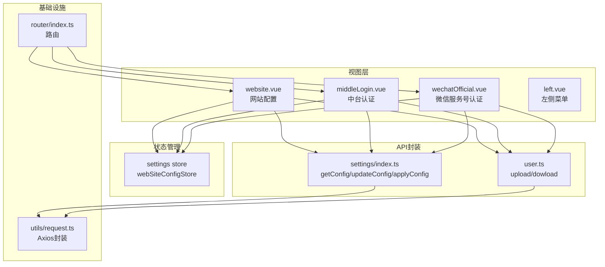
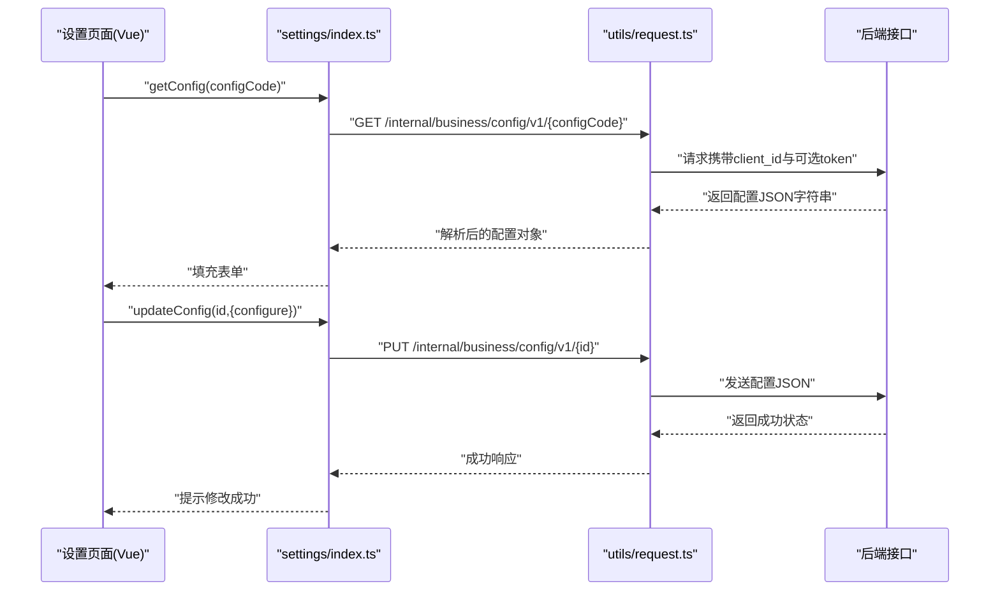
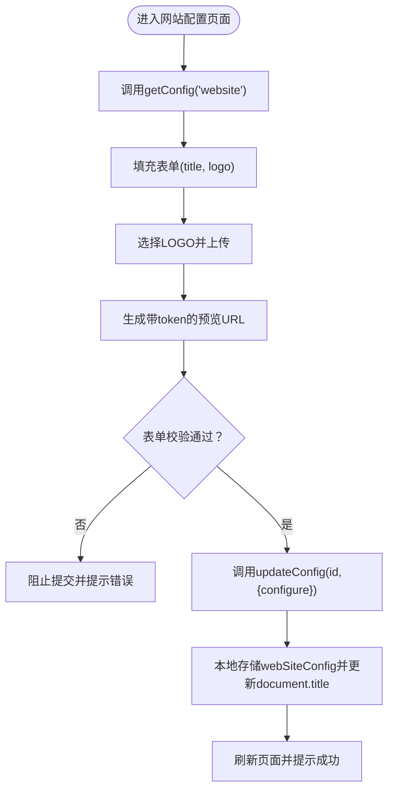
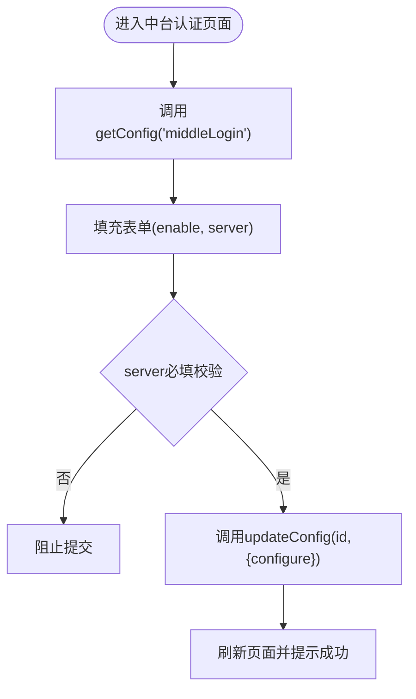
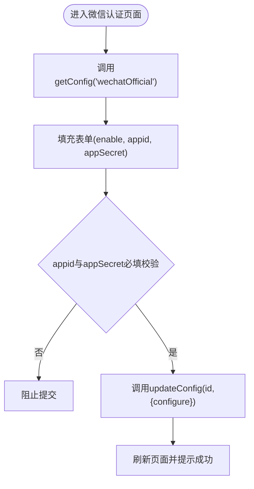
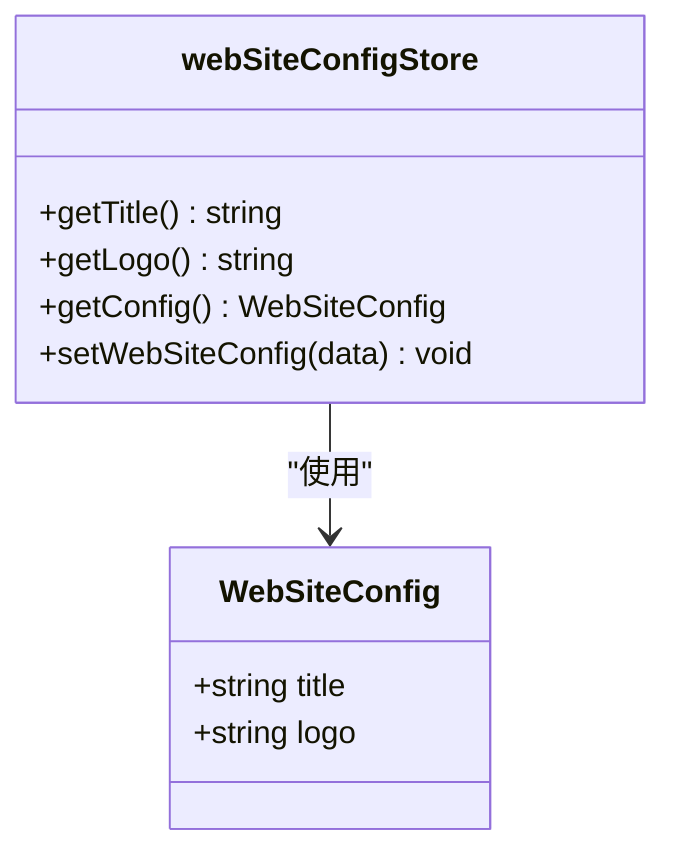
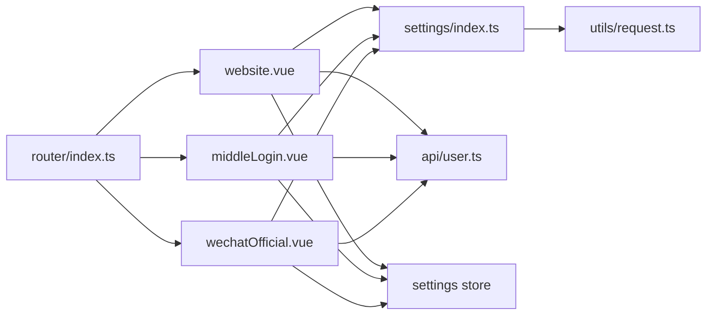

# 系统设置API

<cite>
**本文档引用的文件**
- [src/api/settings/index.ts](file://src/api/settings/index.ts)
- [src/views/settings/website.vue](file://src/views/settings/website.vue)
- [src/views/settings/middleLogin.vue](file://src/views/settings/middleLogin.vue)
- [src/views/settings/wechatOfficial.vue](file://src/views/settings/wechatOfficial.vue)
- [src/views/settings/left.vue](file://src/views/settings/left.vue)
- [src/store/modules/settings/index.ts](file://src/store/modules/settings/index.ts)
- [src/store/modules/settings/types.ts](file://src/store/modules/settings/types.ts)
- [src/utils/request.ts](file://src/utils/request.ts)
- [src/api/user.ts](file://src/api/user.ts)
- [src/router/index.ts](file://src/router/index.ts)
</cite>

## 目录
1. [简介](#简介)
2. [项目结构](#项目结构)
3. [核心组件](#核心组件)
4. [架构总览](#架构总览)
5. [详细组件分析](#详细组件分析)
6. [依赖关系分析](#依赖关系分析)
7. [性能考虑](#性能考虑)
8. [故障排查指南](#故障排查指南)
9. [结论](#结论)

## 简介
本文件为系统设置API的综合技术文档，覆盖网站配置、系统参数、安全设置与监控配置的管理接口。内容包括：
- 配置项数据结构与默认值
- 配置验证规则与前端校验流程
- 后端接口调用链路与热更新机制（基于本地存储）
- 性能配置建议、日志级别设置、备份策略与故障恢复相关API说明

## 项目结构
系统设置模块采用“视图层 + API封装 + 状态管理 + 路由”的分层组织方式：
- 视图层：网站配置、中台认证、微信服务号认证三个页面
- API封装：统一通过settings模块暴露配置读取、修改与应用接口
- 状态管理：Pinia Store负责网站标题与Logo的本地持久化与展示
- 路由：系统设置入口及子页面路由配置

**图表来源**
- [src/views/settings/website.vue:1-249](file://src/views/settings/website.vue#L1-L249)
- [src/views/settings/middleLogin.vue:1-189](file://src/views/settings/middleLogin.vue#L1-L189)
- [src/views/settings/wechatOfficial.vue:1-195](file://src/views/settings/wechatOfficial.vue#L1-L195)
- [src/views/settings/left.vue:1-68](file://src/views/settings/left.vue#L1-L68)
- [src/api/settings/index.ts:1-19](file://src/api/settings/index.ts#L1-L19)
- [src/api/user.ts:1-16](file://src/api/user.ts#L1-L16)
- [src/store/modules/settings/index.ts:1-53](file://src/store/modules/settings/index.ts#L1-L53)
- [src/router/index.ts:105-119](file://src/router/index.ts#L105-L119)
- [src/utils/request.ts:1-159](file://src/utils/request.ts#L1-L159)

**章节来源**
- [src/views/settings/website.vue:1-249](file://src/views/settings/website.vue#L1-L249)
- [src/views/settings/middleLogin.vue:1-189](file://src/views/settings/middleLogin.vue#L1-L189)
- [src/views/settings/wechatOfficial.vue:1-195](file://src/views/settings/wechatOfficial.vue#L1-L195)
- [src/views/settings/left.vue:1-68](file://src/views/settings/left.vue#L1-L68)
- [src/api/settings/index.ts:1-19](file://src/api/settings/index.ts#L1-L19)
- [src/api/user.ts:1-16](file://src/api/user.ts#L1-L16)
- [src/store/modules/settings/index.ts:1-53](file://src/store/modules/settings/index.ts#L1-L53)
- [src/router/index.ts:105-119](file://src/router/index.ts#L105-L119)
- [src/utils/request.ts:1-159](file://src/utils/request.ts#L1-L159)

## 核心组件
- 配置API封装
  - 获取配置：根据配置编码获取当前配置
  - 修改配置：根据配置ID更新配置内容
  - 应用配置：按配置编码触发配置生效（如需后端热更新）
- 网站配置视图
  - 支持网站名称与LOGO的编辑、上传与预览
  - 表单校验规则：网站名称必填；LOGO上传通过文件直传接口完成
- 中台认证视图
  - 开启/关闭认证开关与认证地址输入
  - 认证地址必填校验
- 微信服务号认证视图
  - 开启/关闭认证开关与AppID、AppSecret输入
  - AppID与AppSecret必填校验
- 状态管理
  - 网站标题与LOGO的本地持久化与Getter计算
  - 自动同步document.title与本地存储
- 路由
  - 系统设置主入口与子页面路由映射

**章节来源**
- [src/api/settings/index.ts:1-19](file://src/api/settings/index.ts#L1-L19)
- [src/views/settings/website.vue:76-172](file://src/views/settings/website.vue#L76-L172)
- [src/views/settings/middleLogin.vue:50-112](file://src/views/settings/middleLogin.vue#L50-L112)
- [src/views/settings/wechatOfficial.vue:43-116](file://src/views/settings/wechatOfficial.vue#L43-L116)
- [src/store/modules/settings/index.ts:1-53](file://src/store/modules/settings/index.ts#L1-L53)
- [src/router/index.ts:105-119](file://src/router/index.ts#L105-L119)

## 架构总览
系统设置API的调用链路如下：

**图表来源**
- [src/api/settings/index.ts:10-18](file://src/api/settings/index.ts#L10-L18)
- [src/utils/request.ts:26-66](file://src/utils/request.ts#L26-L66)

**章节来源**
- [src/api/settings/index.ts:1-19](file://src/api/settings/index.ts#L1-L19)
- [src/utils/request.ts:1-159](file://src/utils/request.ts#L1-L159)

## 详细组件分析

### 网站配置组件
- 数据结构
  - 标题：字符串，最大长度限制
  - LOGO：字符串，文件路径标识
- 默认值
  - 初始为空字符串，页面加载时从后端拉取真实值
- 验证规则
  - 标题必填
- 上传流程
  - 通过文件上传接口完成图片上传，返回文件路径
  - 预览URL拼接下载地址与token
- 热更新机制
  - 更新成功后，同时写入本地存储，并同步document.title

**图表来源**
- [src/views/settings/website.vue:109-169](file://src/views/settings/website.vue#L109-L169)
- [src/api/settings/index.ts:10-18](file://src/api/settings/index.ts#L10-L18)
- [src/store/modules/settings/index.ts:42-49](file://src/store/modules/settings/index.ts#L42-L49)

**章节来源**
- [src/views/settings/website.vue:76-172](file://src/views/settings/website.vue#L76-L172)
- [src/store/modules/settings/index.ts:1-53](file://src/store/modules/settings/index.ts#L1-L53)

### 中台认证组件
- 数据结构
  - enable：布尔值，控制是否启用中台认证
  - server：字符串，认证服务地址
- 默认值
  - enable为false，server为空字符串
- 验证规则
  - server必填
- 热更新机制
  - 更新成功后立即刷新配置，无需额外本地存储

**图表来源**
- [src/views/settings/middleLogin.vue:77-109](file://src/views/settings/middleLogin.vue#L77-L109)
- [src/api/settings/index.ts:10-18](file://src/api/settings/index.ts#L10-L18)

**章节来源**
- [src/views/settings/middleLogin.vue:50-112](file://src/views/settings/middleLogin.vue#L50-L112)

### 微信服务号认证组件
- 数据结构
  - enable：布尔值，控制是否启用微信认证
  - appid：字符串，应用标识
  - appSecret：字符串，应用密钥
- 默认值
  - enable为false，其余为空字符串
- 验证规则
  - appid与appSecret必填
- 热更新机制
  - 更新成功后立即刷新配置

**图表来源**
- [src/views/settings/wechatOfficial.vue:78-113](file://src/views/settings/wechatOfficial.vue#L78-L113)
- [src/api/settings/index.ts:10-18](file://src/api/settings/index.ts#L10-L18)

**章节来源**
- [src/views/settings/wechatOfficial.vue:43-116](file://src/views/settings/wechatOfficial.vue#L43-L116)

### 状态管理（网站配置）
- 数据模型
  - title：网站标题
  - logo：LOGO文件路径
- 计算属性
  - getTitle：优先使用内存中的title，否则回退到本地存储中的配置
  - getLogo：优先使用内存中的logo，否则回退到本地存储；若存在则拼接下载URL与token
  - getConfig：从localStorage读取webSiteConfig并解析
- 动作
  - setWebSiteConfig：更新内存状态、document.title，并持久化到localStorage

**图表来源**
- [src/store/modules/settings/types.ts:1-5](file://src/store/modules/settings/types.ts#L1-L5)
- [src/store/modules/settings/index.ts:4-49](file://src/store/modules/settings/index.ts#L4-L49)

**章节来源**
- [src/store/modules/settings/types.ts:1-5](file://src/store/modules/settings/types.ts#L1-L5)
- [src/store/modules/settings/index.ts:1-53](file://src/store/modules/settings/index.ts#L1-L53)

### 左侧菜单与路由
- 左侧菜单包含“网站配置”、“服务中台认证”、“微信服务号认证”
- 路由将上述页面映射到对应路径，支持通过query参数传递menuCode

**章节来源**
- [src/views/settings/left.vue:19-30](file://src/views/settings/left.vue#L19-L30)
- [src/router/index.ts:105-119](file://src/router/index.ts#L105-L119)

## 依赖关系分析
- 视图层依赖API封装与状态管理
- API封装依赖Axios封装以统一处理请求头、鉴权与错误
- 文件上传依赖独立的用户API模块
- 路由驱动视图导航

**图表来源**
- [src/views/settings/website.vue:78-81](file://src/views/settings/website.vue#L78-L81)
- [src/views/settings/middleLogin.vue:53-55](file://src/views/settings/middleLogin.vue#L53-L55)
- [src/views/settings/wechatOfficial.vue:46-47](file://src/views/settings/wechatOfficial.vue#L46-L47)
- [src/api/settings/index.ts:1-19](file://src/api/settings/index.ts#L1-L19)
- [src/api/user.ts:1-16](file://src/api/user.ts#L1-L16)
- [src/store/modules/settings/index.ts:1-53](file://src/store/modules/settings/index.ts#L1-L53)
- [src/router/index.ts:105-119](file://src/router/index.ts#L105-L119)
- [src/utils/request.ts:1-159](file://src/utils/request.ts#L1-L159)

**章节来源**
- [src/views/settings/website.vue:76-81](file://src/views/settings/website.vue#L76-L81)
- [src/views/settings/middleLogin.vue:50-55](file://src/views/settings/middleLogin.vue#L50-L55)
- [src/views/settings/wechatOfficial.vue:43-47](file://src/views/settings/wechatOfficial.vue#L43-L47)
- [src/api/settings/index.ts:1-19](file://src/api/settings/index.ts#L1-L19)
- [src/api/user.ts:1-16](file://src/api/user.ts#L1-L16)
- [src/store/modules/settings/index.ts:1-53](file://src/store/modules/settings/index.ts#L1-L53)
- [src/router/index.ts:105-119](file://src/router/index.ts#L105-L119)
- [src/utils/request.ts:1-159](file://src/utils/request.ts#L1-L159)

## 性能考虑
- 请求头注入
  - 固定client_id与可选token，减少重复鉴权逻辑
- 超时与重试
  - 全局超时设置为60秒，避免长时间阻塞
- 错误处理
  - 统一拦截器处理401跳转与业务错误提示，降低页面异常传播
- 本地缓存
  - 网站配置在localStorage中持久化，减少重复请求
- 图片预览
  - 通过下载URL拼接token，避免跨域问题与重复鉴权

**章节来源**
- [src/utils/request.ts:20-45](file://src/utils/request.ts#L20-L45)
- [src/store/modules/settings/index.ts:37-49](file://src/store/modules/settings/index.ts#L37-L49)

## 故障排查指南
- 无法获取配置
  - 检查路由是否正确指向设置页面
  - 确认后端接口返回的配置JSON格式是否正确
- 修改失败
  - 查看后端返回的业务错误码与消息
  - 确认表单校验是否通过
- 上传LOGO失败
  - 检查文件上传接口返回值与权限
  - 确认下载URL拼接与token有效性
- 页面不刷新或显示旧值
  - 确认updateConfig调用后是否调用了刷新逻辑
  - 检查本地存储是否正确写入

**章节来源**
- [src/views/settings/website.vue:109-169](file://src/views/settings/website.vue#L109-L169)
- [src/views/settings/middleLogin.vue:77-109](file://src/views/settings/middleLogin.vue#L77-L109)
- [src/views/settings/wechatOfficial.vue:78-113](file://src/views/settings/wechatOfficial.vue#L78-L113)
- [src/utils/request.ts:47-113](file://src/utils/request.ts#L47-L113)

## 结论
系统设置API通过统一的配置读取与修改接口，结合视图层的表单校验与状态管理，实现了网站配置、中台认证与微信认证的完整闭环。前端采用本地存储实现轻量级热更新，后端接口负责持久化与生效控制。建议后续扩展：
- 增加配置版本与变更历史
- 引入配置校验与灰度发布机制
- 提供配置导出/导入能力以支撑备份与迁移