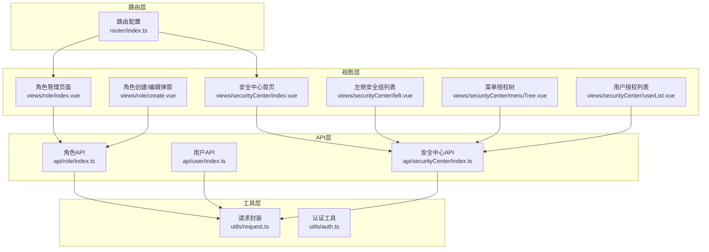
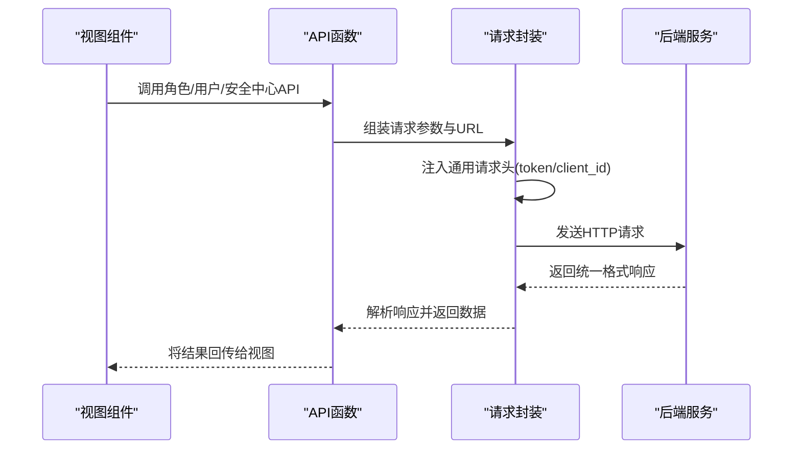
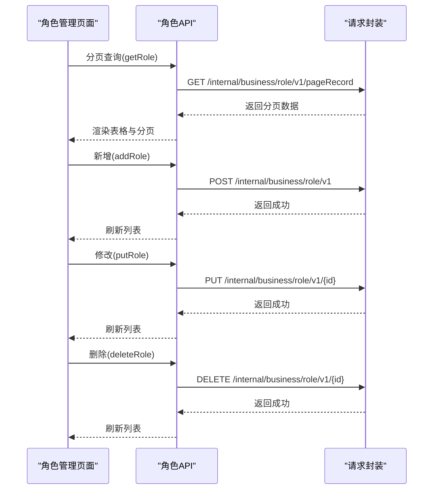
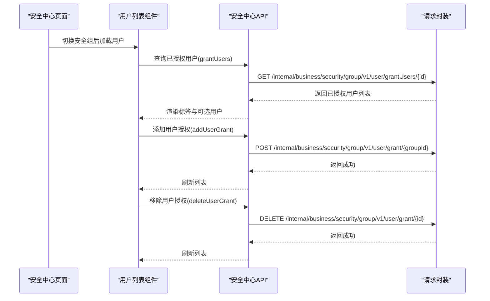
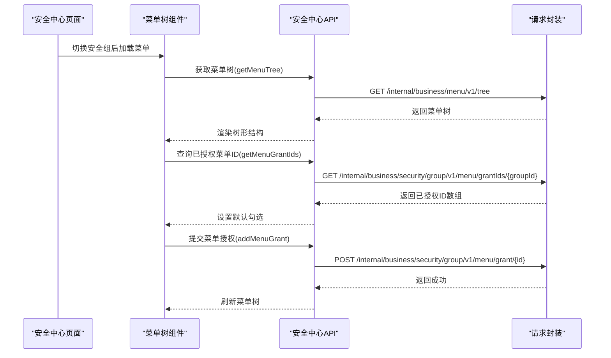
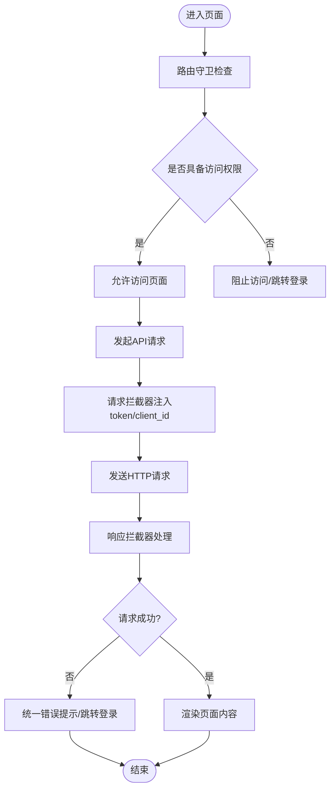
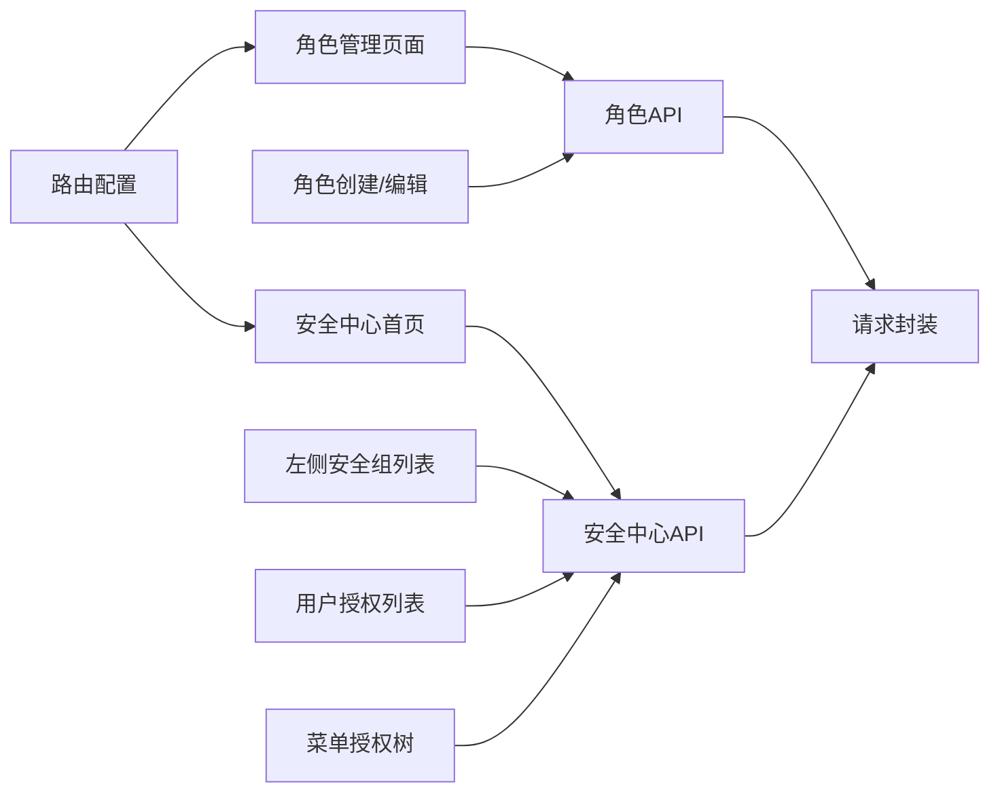

# 角色权限管理API

<cite>
**本文档引用的文件**
- [src/api/role/index.ts](file://src/api/role/index.ts)
- [src/api/user/index.ts](file://src/api/user/index.ts)
- [src/api/securityCenter/index.ts](file://src/api/securityCenter/index.ts)
- [src/views/role/index.vue](file://src/views/role/index.vue)
- [src/views/role/create.vue](file://src/views/role/create.vue)
- [src/views/securityCenter/index.vue](file://src/views/securityCenter/index.vue)
- [src/views/securityCenter/left.vue](file://src/views/securityCenter/left.vue)
- [src/views/securityCenter/menuTree.vue](file://src/views/securityCenter/menuTree.vue)
- [src/views/securityCenter/userList.vue](file://src/views/securityCenter/userList.vue)
- [src/utils/request.ts](file://src/utils/request.ts)
- [src/utils/auth.ts](file://src/utils/auth.ts)
- [src/router/index.ts](file://src/router/index.ts)
</cite>

## 目录
1. [简介](#简介)
2. [项目结构](#项目结构)
3. [核心组件](#核心组件)
4. [架构总览](#架构总览)
5. [详细组件分析](#详细组件分析)
6. [依赖分析](#依赖分析)
7. [性能考虑](#性能考虑)
8. [故障排除指南](#故障排除指南)
9. [结论](#结论)

## 简介
本文件面向角色权限管理API的实现与使用，围绕RBAC（基于角色的访问控制）体系，系统性梳理角色创建与维护、用户与角色关联、菜单权限绑定、应用授权、以及动态权限验证等能力。同时提供权限继承、权限覆盖与权限缓存的配置建议，帮助开发者在前端侧高效集成与扩展。

## 项目结构
本项目采用前后端分离的前端工程化组织，权限相关功能主要分布在以下模块：
- API层：封装内部业务接口，统一请求与响应处理
- 视图层：角色管理页面、安全中心页面（用户授权、菜单授权、应用授权）
- 工具层：请求封装、认证令牌管理
- 路由层：页面级路由与导航

**图表来源**
- [src/views/role/index.vue:1-236](file://src/views/role/index.vue#L1-L236)
- [src/views/role/create.vue:1-109](file://src/views/role/create.vue#L1-L109)
- [src/views/securityCenter/index.vue:1-125](file://src/views/securityCenter/index.vue#L1-L125)
- [src/views/securityCenter/left.vue:1-154](file://src/views/securityCenter/left.vue#L1-L154)
- [src/views/securityCenter/menuTree.vue:1-139](file://src/views/securityCenter/menuTree.vue#L1-L139)
- [src/views/securityCenter/userList.vue:1-218](file://src/views/securityCenter/userList.vue#L1-L218)
- [src/api/role/index.ts:1-25](file://src/api/role/index.ts#L1-L25)
- [src/api/user/index.ts:1-63](file://src/api/user/index.ts#L1-L63)
- [src/api/securityCenter/index.ts:1-120](file://src/api/securityCenter/index.ts#L1-L120)
- [src/utils/request.ts:1-159](file://src/utils/request.ts#L1-L159)
- [src/router/index.ts:1-189](file://src/router/index.ts#L1-L189)

**章节来源**
- [src/views/role/index.vue:1-236](file://src/views/role/index.vue#L1-L236)
- [src/views/securityCenter/index.vue:1-125](file://src/views/securityCenter/index.vue#L1-L125)
- [src/api/role/index.ts:1-25](file://src/api/role/index.ts#L1-L25)
- [src/api/securityCenter/index.ts:1-120](file://src/api/securityCenter/index.ts#L1-L120)
- [src/utils/request.ts:1-159](file://src/utils/request.ts#L1-L159)
- [src/router/index.ts:1-189](file://src/router/index.ts#L1-L189)

## 核心组件
- 角色管理API：提供角色的新增、删除、修改、分页查询与列表查询能力，支撑角色维度的权限主体管理。
- 用户管理API：提供用户信息维护、状态变更、重置密码、部门调整、角色更新等能力，支撑用户与角色的关联关系维护。
- 安全中心API：提供菜单授权树、菜单授权、授权菜单ID查询、用户授权、未授权用户查询、应用授权等能力，支撑RBAC中“权限”与“主体”的绑定。
- 视图组件：角色管理页面负责角色的CRUD；安全中心页面负责安全组的用户授权、菜单授权与应用授权；左侧面板负责安全组的切换与加载；菜单树负责菜单授权的勾选与提交；用户列表负责用户授权的增删。

**章节来源**
- [src/api/role/index.ts:1-25](file://src/api/role/index.ts#L1-L25)
- [src/api/user/index.ts:1-63](file://src/api/user/index.ts#L1-L63)
- [src/api/securityCenter/index.ts:1-120](file://src/api/securityCenter/index.ts#L1-L120)
- [src/views/role/index.vue:1-236](file://src/views/role/index.vue#L1-L236)
- [src/views/securityCenter/index.vue:1-125](file://src/views/securityCenter/index.vue#L1-L125)

## 架构总览
下图展示从视图到API再到请求封装的整体调用链路，以及路由对页面的引导作用。

**图表来源**
- [src/views/role/index.vue:117-134](file://src/views/role/index.vue#L117-L134)
- [src/views/securityCenter/menuTree.vue:52-60](file://src/views/securityCenter/menuTree.vue#L52-L60)
- [src/views/securityCenter/userList.vue:166-179](file://src/views/securityCenter/userList.vue#L166-L179)
- [src/api/role/index.ts:5-24](file://src/api/role/index.ts#L5-L24)
- [src/api/securityCenter/index.ts:27-89](file://src/api/securityCenter/index.ts#L27-L89)
- [src/utils/request.ts:26-45](file://src/utils/request.ts#L26-L45)

**章节来源**
- [src/utils/request.ts:1-159](file://src/utils/request.ts#L1-L159)
- [src/router/index.ts:120-124](file://src/router/index.ts#L120-L124)

## 详细组件分析

### 角色管理API与页面
- 角色API提供新增、删除、修改、分页查询与列表查询接口，满足角色的全生命周期管理。
- 角色页面通过分页查询加载角色列表，并提供新增、修改、删除操作入口；创建/编辑弹窗负责表单校验与提交。

**图表来源**
- [src/views/role/index.vue:117-134](file://src/views/role/index.vue#L117-L134)
- [src/views/role/create.vue:77-103](file://src/views/role/create.vue#L77-L103)
- [src/api/role/index.ts:5-24](file://src/api/role/index.ts#L5-L24)

**章节来源**
- [src/views/role/index.vue:1-236](file://src/views/role/index.vue#L1-L236)
- [src/views/role/create.vue:1-109](file://src/views/role/create.vue#L1-L109)
- [src/api/role/index.ts:1-25](file://src/api/role/index.ts#L1-L25)

### 用户与角色关联
- 用户API提供用户信息维护、状态变更、重置密码、部门调整、角色更新等能力，支撑用户与角色的绑定关系。
- 安全中心的用户列表组件负责加载已授权用户与未授权用户，并支持添加与移除授权。

**图表来源**
- [src/views/securityCenter/userList.vue:118-126](file://src/views/securityCenter/userList.vue#L118-L126)
- [src/views/securityCenter/userList.vue:166-179](file://src/views/securityCenter/userList.vue#L166-L179)
- [src/views/securityCenter/userList.vue:181-197](file://src/views/securityCenter/userList.vue#L181-L197)
- [src/api/securityCenter/index.ts:44-69](file://src/api/securityCenter/index.ts#L44-L69)

**章节来源**
- [src/views/securityCenter/userList.vue:1-218](file://src/views/securityCenter/userList.vue#L1-L218)
- [src/api/securityCenter/index.ts:1-120](file://src/api/securityCenter/index.ts#L1-L120)

### 菜单权限绑定机制
- 安全中心菜单树组件加载菜单树并支持多选，提交时将勾选的菜单ID集合发送至后端进行授权。
- 授权流程包含：加载菜单树、查询已授权ID、提交授权、刷新界面。

**图表来源**
- [src/views/securityCenter/menuTree.vue:38-60](file://src/views/securityCenter/menuTree.vue#L38-L60)
- [src/views/securityCenter/index.vue:44-49](file://src/views/securityCenter/index.vue#L44-L49)
- [src/api/securityCenter/index.ts:27-43](file://src/api/securityCenter/index.ts#L27-L43)

**章节来源**
- [src/views/securityCenter/menuTree.vue:1-139](file://src/views/securityCenter/menuTree.vue#L1-L139)
- [src/views/securityCenter/index.vue:1-125](file://src/views/securityCenter/index.vue#L1-L125)
- [src/api/securityCenter/index.ts:1-120](file://src/api/securityCenter/index.ts#L1-L120)

### 动态权限验证与路由守卫
- 路由层提供页面级导航与守卫钩子，可在守卫中注入动态权限校验逻辑，结合后端返回的菜单/应用/按钮级权限，控制页面渲染与访问。
- 请求封装在请求拦截器中自动注入token与client_id，确保接口访问的安全性；在响应拦截器中统一处理401等异常场景。

**图表来源**
- [src/router/index.ts:182-186](file://src/router/index.ts#L182-L186)
- [src/utils/request.ts:26-45](file://src/utils/request.ts#L26-L45)
- [src/utils/request.ts:47-113](file://src/utils/request.ts#L47-L113)

**章节来源**
- [src/router/index.ts:1-189](file://src/router/index.ts#L1-L189)
- [src/utils/request.ts:1-159](file://src/utils/request.ts#L1-L159)

### 权限继承、覆盖与缓存配置建议
- 权限继承：建议在后端设计层级化的安全组与角色结构，使子组/子角色自动继承父组/父角色的权限集合，减少重复配置。
- 权限覆盖：当用户同时属于多个安全组/角色时，应明确“优先级”规则（如按组/角色权重排序），以保证高优先级权限覆盖低优先级权限。
- 权限缓存：前端可对菜单树、用户授权结果、应用授权结果进行本地缓存，结合路由切换与用户登录状态变化进行失效与更新，降低重复请求开销。

[本节为通用实践建议，不直接分析具体文件]

## 依赖分析
- 视图组件依赖对应的API函数，API函数依赖请求封装进行HTTP通信。
- 安全中心页面通过事件驱动的方式协调左侧安全组列表、用户列表与菜单树组件的数据联动。
- 路由层为页面提供导航与守卫，保障访问控制策略的落地。

**图表来源**
- [src/views/role/index.vue:1-236](file://src/views/role/index.vue#L1-L236)
- [src/views/securityCenter/index.vue:1-125](file://src/views/securityCenter/index.vue#L1-L125)
- [src/api/role/index.ts:1-25](file://src/api/role/index.ts#L1-L25)
- [src/api/securityCenter/index.ts:1-120](file://src/api/securityCenter/index.ts#L1-L120)
- [src/utils/request.ts:1-159](file://src/utils/request.ts#L1-L159)
- [src/router/index.ts:120-124](file://src/router/index.ts#L120-L124)

**章节来源**
- [src/views/role/index.vue:1-236](file://src/views/role/index.vue#L1-L236)
- [src/views/securityCenter/index.vue:1-125](file://src/views/securityCenter/index.vue#L1-L125)
- [src/api/role/index.ts:1-25](file://src/api/role/index.ts#L1-L25)
- [src/api/securityCenter/index.ts:1-120](file://src/api/securityCenter/index.ts#L1-L120)
- [src/utils/request.ts:1-159](file://src/utils/request.ts#L1-L159)
- [src/router/index.ts:1-189](file://src/router/index.ts#L1-L189)

## 性能考虑
- 请求合并与防抖：在高频交互（如搜索、分页切换）时，建议对请求进行防抖或合并，避免频繁网络请求。
- 数据懒加载：菜单树与用户列表建议采用懒加载策略，仅在展开或切换安全组时加载数据。
- 缓存策略：对菜单树、用户授权结果、应用授权结果进行本地缓存，结合用户登录状态与路由切换进行失效与更新。
- 分页优化：角色与用户列表采用分页查询，合理设置每页大小，避免一次性加载过多数据。

[本节为通用性能建议，不直接分析具体文件]

## 故障排除指南
- 登录态异常：若出现401错误，请求封装会在响应拦截器中触发跳转登录逻辑。请检查本地存储中的token是否有效，以及请求头是否正确注入。
- 请求失败：响应拦截器会对常见HTTP错误进行统一提示，可根据提示定位问题（如403拒绝访问、404请求路径错误等）。
- 权限未生效：确认安全中心的菜单授权与用户授权是否正确提交，以及后端是否已下发最新权限清单。

**章节来源**
- [src/utils/request.ts:47-113](file://src/utils/request.ts#L47-L113)
- [src/utils/request.ts:56-58](file://src/utils/request.ts#L56-L58)

## 结论
本项目围绕RBAC权限体系提供了完整的角色管理、用户授权、菜单授权与应用授权能力。通过清晰的视图-接口-请求封装分层，配合路由守卫与统一错误处理，能够有效支撑企业级权限管理需求。建议在实际部署中结合业务场景完善权限继承、覆盖与缓存策略，持续优化用户体验与系统性能。