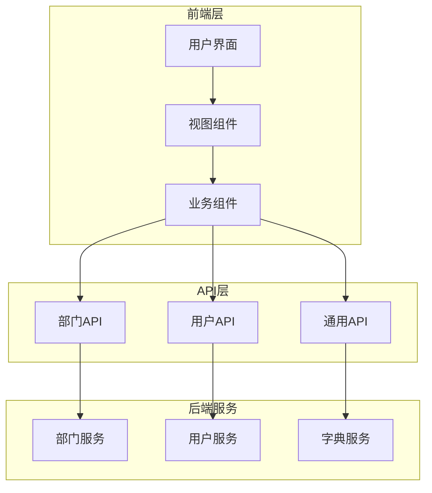
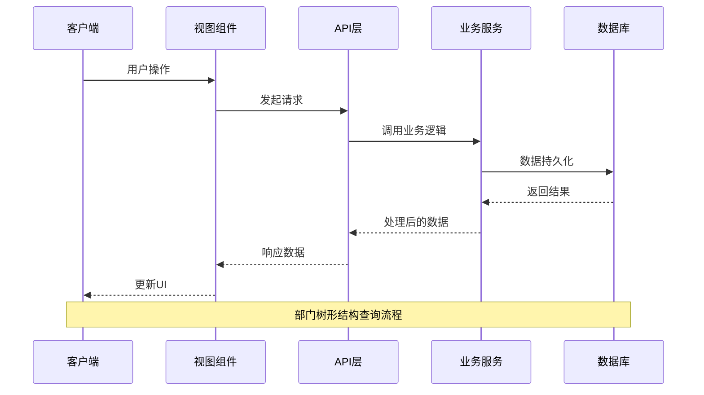
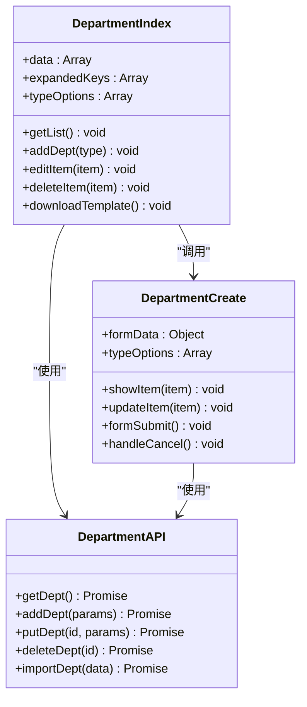
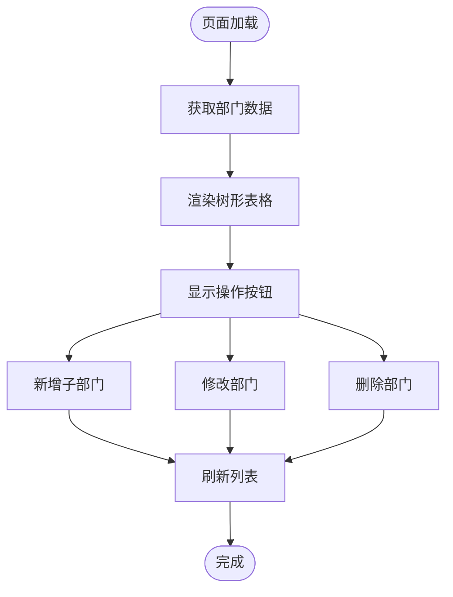
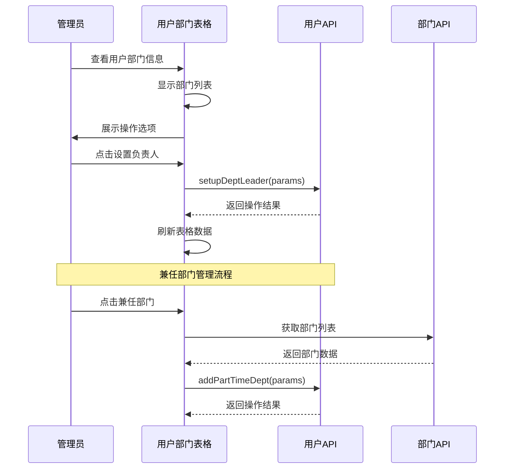
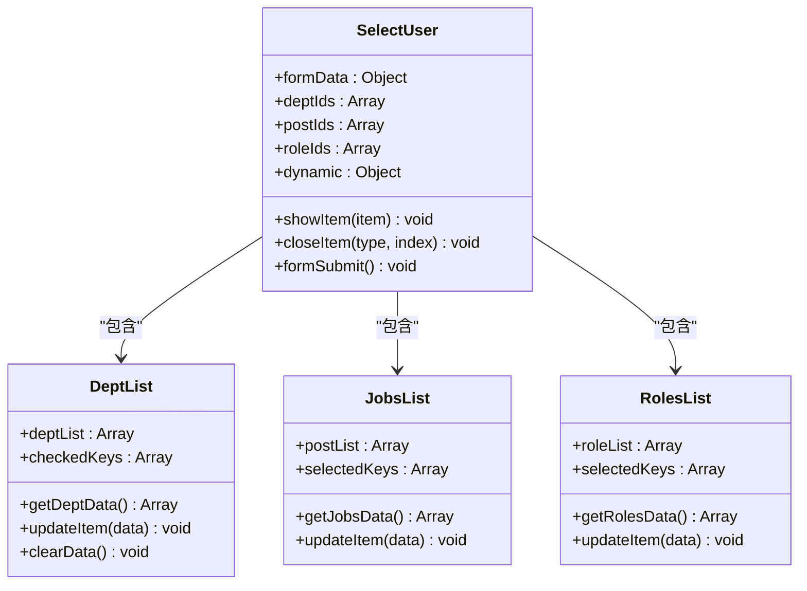
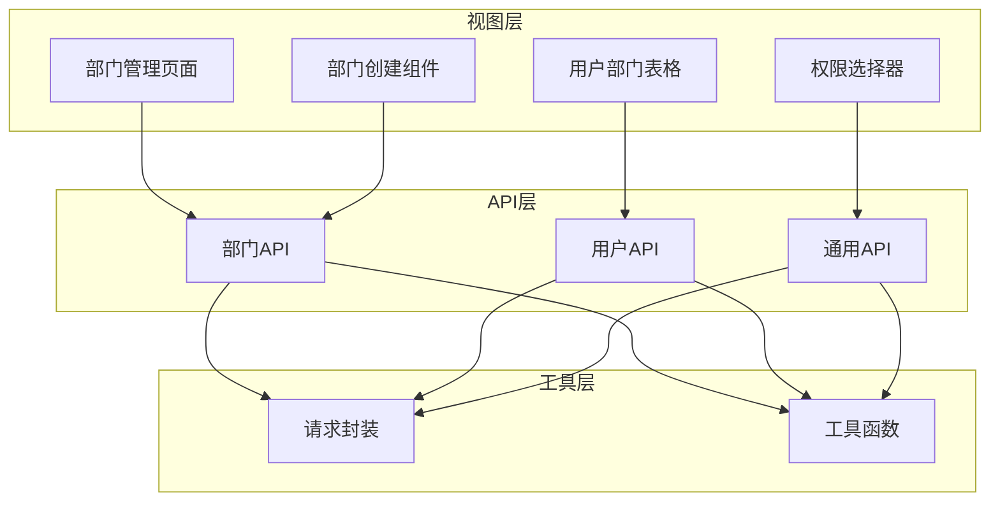

# 部门管理API

<cite>
**本文档引用的文件**
- [src/api/department/index.ts](file://src/api/department/index.ts)
- [src/views/department/index.vue](file://src/views/department/index.vue)
- [src/views/department/create.vue](file://src/views/department/create.vue)
- [src/api/common/index.ts](file://src/api/common/index.ts)
- [src/api/user/index.ts](file://src/api/user/index.ts)
- [src/views/user/tableDept.vue](file://src/views/user/tableDept.vue)
- [src/components/selectPerson/components/selectUser.vue](file://src/components/selectPerson/components/selectUser.vue)
- [src/components/selectPerson/components/deptList.vue](file://src/components/selectPerson/components/deptList.vue)
- [src/components/selectPerson/components/deptListCheck.vue](file://src/components/selectPerson/components/deptListCheck.vue)
- [src/router/index.ts](file://src/router/index.ts)
</cite>

## 目录
1. [简介](#简介)
2. [项目结构](#项目结构)
3. [核心组件](#核心组件)
4. [架构概览](#架构概览)
5. [详细组件分析](#详细组件分析)
6. [依赖分析](#依赖分析)
7. [性能考虑](#性能考虑)
8. [故障排除指南](#故障排除指南)
9. [最佳实践](#最佳实践)
10. [结论](#结论)

## 简介

本文件为部门管理API的综合技术文档，详细说明了部门信息的增删改查接口、部门树形结构查询、部门成员管理、部门权限分配等功能。文档涵盖了部门层级关系的维护机制、部门与用户的关联关系以及数据同步策略，并提供了部门组织架构管理的最佳实践和常见问题解决方案。

该系统基于Vue.js前端框架构建，采用模块化设计，通过RESTful API与后端服务进行交互。系统支持完整的部门生命周期管理，包括部门创建、编辑、删除、树形展示和批量导入功能。

## 项目结构

部门管理系统主要由以下层次组成：

**图表来源**
- [src/views/department/index.vue:1-262](file://src/views/department/index.vue#L1-L262)
- [src/api/department/index.ts:1-23](file://src/api/department/index.ts#L1-L23)

**章节来源**
- [src/views/department/index.vue:1-262](file://src/views/department/index.vue#L1-L262)
- [src/api/department/index.ts:1-23](file://src/api/department/index.ts#L1-L23)

## 核心组件

### 部门管理核心API

系统提供完整的部门管理API接口，包括基础CRUD操作和高级功能：

| 接口类型 | 方法 | 路径 | 功能描述 |
|---------|------|------|----------|
| GET | getDept | `/internal/business/dept/v1/tree` | 获取部门树形结构 |
| POST | addDept | `/internal/business/dept/v1` | 新增部门 |
| PUT | putDept | `/internal/business/dept/v1/{id}` | 修改部门 |
| DELETE | deleteDept | `/internal/business/dept/v1/{id}` | 删除部门 |
| POST | importDept | `/internal/business/dept/v1/import` | 批量导入部门 |

### 用户部门关联API

用户与部门的关联管理通过专门的API实现：

| 接口类型 | 方法 | 路径 | 功能描述 |
|---------|------|------|----------|
| POST | addPartTimeDept | `/internal/business/user/v1/addPartTimeDept` | 添加用户兼任部门 |
| POST | dismissPartTimeDept | `/internal/business/user/v1/dismissPartTimeDept` | 免去用户兼任部门 |
| POST | setupDeptLeader | `/internal/business/user/v1/setupDeptLeader` | 设置部门负责人 |
| POST | updateDept | `/internal/business/user/v1/updateDept` | 修改用户所属部门 |

**章节来源**
- [src/api/department/index.ts:1-23](file://src/api/department/index.ts#L1-L23)
- [src/api/user/index.ts:1-63](file://src/api/user/index.ts#L1-L63)

## 架构概览

系统采用前后端分离架构，前端使用Vue.js + TypeScript，后端提供RESTful API服务。

**图表来源**
- [src/views/department/index.vue:96-101](file://src/views/department/index.vue#L96-L101)
- [src/api/department/index.ts:17-18](file://src/api/department/index.ts#L17-L18)

**章节来源**
- [src/views/department/index.vue:59-101](file://src/views/department/index.vue#L59-L101)
- [src/api/department/index.ts:1-23](file://src/api/department/index.ts#L1-L23)

## 详细组件分析

### 部门管理视图组件

部门管理页面提供完整的部门操作界面，包括树形表格展示、批量操作和导入功能。

**图表来源**
- [src/views/department/index.vue:59-178](file://src/views/department/index.vue#L59-L178)
- [src/views/department/create.vue:63-196](file://src/views/department/create.vue#L63-L196)
- [src/api/department/index.ts:1-23](file://src/api/department/index.ts#L1-L23)

#### 部门树形结构展示

系统支持树形表格展示部门层级关系，具备展开/折叠功能和丰富的操作选项。

**图表来源**
- [src/views/department/index.vue:25-49](file://src/views/department/index.vue#L25-L49)
- [src/views/department/create.vue:97-126](file://src/views/department/create.vue#L97-L126)

**章节来源**
- [src/views/department/index.vue:1-262](file://src/views/department/index.vue#L1-L262)
- [src/views/department/create.vue:1-196](file://src/views/department/create.vue#L1-L196)

### 用户部门管理组件

用户部门管理功能允许管理员对用户的部门归属进行精细化管理。

**图表来源**
- [src/views/user/tableDept.vue:86-143](file://src/views/user/tableDept.vue#L86-L143)
- [src/api/user/index.ts:37-47](file://src/api/user/index.ts#L37-L47)

**章节来源**
- [src/views/user/tableDept.vue:1-153](file://src/views/user/tableDept.vue#L1-L153)
- [src/api/user/index.ts:1-63](file://src/api/user/index.ts#L1-L63)

### 权限分配组件

系统提供灵活的权限分配机制，支持多种权限组合方式。

**图表来源**
- [src/components/selectPerson/components/selectUser.vue:173-322](file://src/components/selectPerson/components/selectUser.vue#L173-L322)
- [src/components/selectPerson/components/deptList.vue:1-52](file://src/components/selectPerson/components/deptList.vue#L1-L52)

**章节来源**
- [src/components/selectPerson/components/selectUser.vue:1-369](file://src/components/selectPerson/components/selectUser.vue#L1-L369)
- [src/components/selectPerson/components/deptList.vue:1-52](file://src/components/selectPerson/components/deptList.vue#L1-L52)

## 依赖分析

系统各组件之间的依赖关系如下：

**图表来源**
- [src/views/department/index.vue:61-61](file://src/views/department/index.vue#L61-L61)
- [src/api/department/index.ts:1-3](file://src/api/department/index.ts#L1-L3)

**章节来源**
- [src/router/index.ts:50-53](file://src/router/index.ts#L50-L53)

### 数据流分析

部门管理的数据流遵循标准的MVC模式：

1. **视图层**：负责用户交互和数据展示
2. **API层**：封装HTTP请求和响应处理
3. **业务逻辑**：处理数据验证和业务规则
4. **数据持久化**：与后端服务进行数据交换

**章节来源**
- [src/api/common/index.ts:1-68](file://src/api/common/index.ts#L1-L68)

## 性能考虑

### 缓存策略

系统采用多层缓存机制优化性能：

- **字典缓存**：部门类型等静态数据缓存
- **部门树缓存**：树形结构数据缓存
- **用户数据缓存**：常用查询结果缓存

### 异步加载

- 部门树形结构采用异步加载，避免一次性加载大量数据
- 用户列表支持分页查询，减少内存占用
- 图片和模板文件按需加载

### 并发控制

- 防止重复提交，确保操作的原子性
- 合理的错误处理和重试机制
- 数据一致性保证

## 故障排除指南

### 常见问题及解决方案

#### 部门树形结构异常

**问题现象**：部门树显示不完整或出现循环引用

**解决步骤**：
1. 检查部门层级关系是否正确
2. 验证父子部门ID关联
3. 确认数据库约束条件

#### 用户部门关联失败

**问题现象**：用户无法正确添加到部门或权限不生效

**解决步骤**：
1. 验证用户是否存在且状态正常
2. 检查部门权限配置
3. 确认用户角色权限范围

#### 批量导入失败

**问题现象**：Excel导入过程中出现错误

**解决步骤**：
1. 检查Excel模板格式
2. 验证必填字段完整性
3. 查看错误日志文件

**章节来源**
- [src/views/department/index.vue:160-177](file://src/views/department/index.vue#L160-L177)
- [src/views/user/tableDept.vue:89-115](file://src/views/user/tableDept.vue#L89-L115)

## 最佳实践

### 部门层级设计

1. **合理规划层级深度**：建议不超过4-5层
2. **避免过度细分**：每个层级的部门数量要适中
3. **建立清晰的命名规范**：便于理解和维护

### 数据同步策略

1. **实时同步**：关键操作立即同步到数据库
2. **批量更新**：大批量操作采用事务处理
3. **冲突处理**：并发操作时的冲突检测和解决

### 权限管理

1. **最小权限原则**：用户只拥有必要的权限
2. **职责分离**：不同角色的权限要明确分离
3. **定期审计**：定期检查权限分配的合理性

### 用户体验优化

1. **响应式设计**：适配不同屏幕尺寸
2. **操作反馈**：及时的操作结果反馈
3. **错误提示**：友好的错误信息提示

## 结论

部门管理API系统提供了完整的组织架构管理解决方案，具有以下特点：

1. **功能完整**：涵盖部门管理的所有核心功能
2. **扩展性强**：模块化设计便于功能扩展
3. **用户体验好**：直观的操作界面和良好的交互体验
4. **性能可靠**：合理的架构设计和优化策略

系统通过标准化的API接口和清晰的业务逻辑，为企业组织管理提供了高效的技术支撑。建议在实际部署中结合具体业务需求进行定制化开发，并建立完善的运维监控体系。