# 请求拦截器

<cite>
**本文档引用的文件**
- [request.ts](file://src/utils/request.ts)
- [auth.ts](file://src/utils/auth.ts)
- [login/index.ts](file://src/api/login/index.ts)
- [user.ts](file://src/api/user.ts)
- [index.vue](file://src/views/login/index.vue)
- [index.ts](file://src/router/index.ts)
- [config.js](file://public/config.js)
- [package.json](file://package.json)
</cite>

## 目录
1. [简介](#简介)
2. [项目结构](#项目结构)
3. [核心组件](#核心组件)
4. [架构概览](#架构概览)
5. [详细组件分析](#详细组件分析)
6. [依赖关系分析](#依赖关系分析)
7. [性能考虑](#性能考虑)
8. [故障排除指南](#故障排除指南)
9. [结论](#结论)

## 简介

本文档详细介绍了新工坊项目中的请求拦截器系统。该系统基于Axios构建，提供了完整的HTTP请求封装、认证令牌处理、错误处理机制和响应拦截功能。系统采用拦截器模式，在请求发送前自动添加认证信息，在响应接收后统一处理业务逻辑和错误状态。

## 项目结构

新工坊项目采用模块化架构，请求拦截器位于utils目录下，通过API层进行调用。项目主要包含以下关键组件：

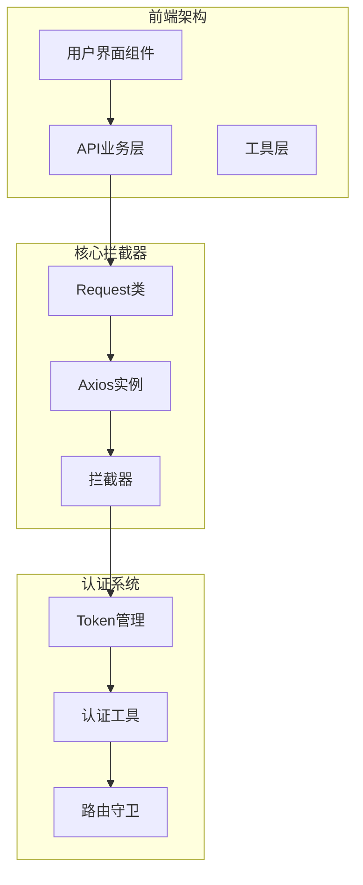

**图表来源**
- [request.ts:15-24](file://src/utils/request.ts#L15-L24)
- [login/index.ts:1-61](file://src/api/login/index.ts#L1-L61)

**章节来源**
- [request.ts:1-159](file://src/utils/request.ts#L1-L159)
- [package.json:13-44](file://package.json#L13-L44)

## 核心组件

### Request类设计

Request类是整个拦截器系统的核心，它继承了Axios的所有功能并扩展了自定义的拦截器逻辑。

#### 主要特性

1. **HTTP请求封装**：提供GET、POST、PUT、PATCH、DELETE等标准HTTP方法
2. **认证令牌处理**：自动在请求头中添加认证信息
3. **响应数据处理**：统一处理响应格式和业务状态
4. **错误处理机制**：集中处理网络异常和服务器错误
5. **白名单机制**：对特定URL免认证处理

#### 数据结构

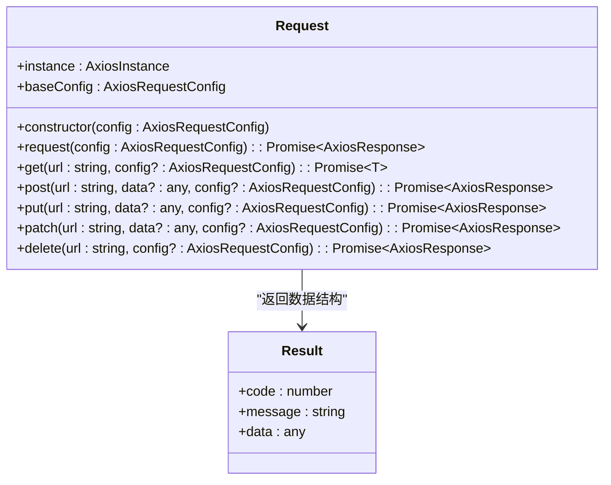

**图表来源**
- [request.ts:15-155](file://src/utils/request.ts#L15-L155)

**章节来源**
- [request.ts:15-155](file://src/utils/request.ts#L15-L155)

## 架构概览

### 整体架构流程

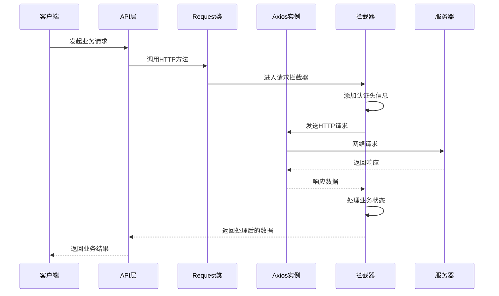

**图表来源**
- [request.ts:26-45](file://src/utils/request.ts#L26-L45)
- [request.ts:47-113](file://src/utils/request.ts#L47-L113)

### 认证流程

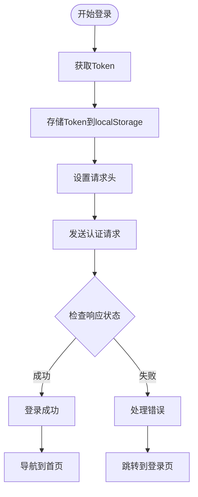

**图表来源**
- [index.vue:142-161](file://src/views/login/index.vue#L142-L161)
- [request.ts:29-37](file://src/utils/request.ts#L29-L37)

## 详细组件分析

### 请求拦截器实现

#### 认证令牌处理

请求拦截器在每次HTTP请求发送前自动处理认证信息：

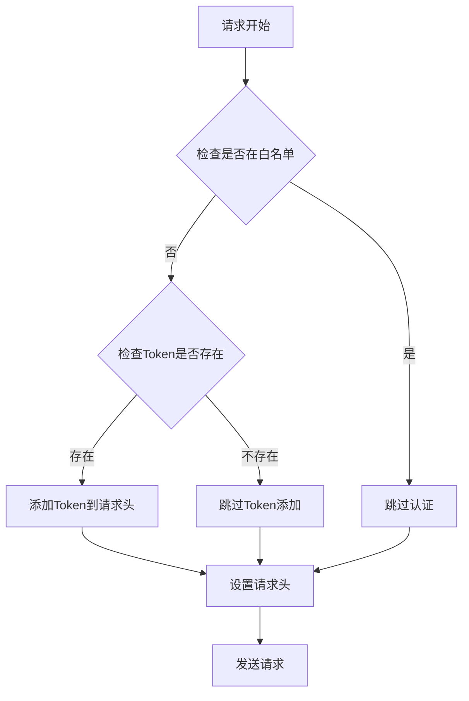

**图表来源**
- [request.ts:26-45](file://src/utils/request.ts#L26-L45)

#### 请求头设置机制

系统自动为每个请求添加必要的头部信息：

| 头部字段 | 值 | 用途 |
|---------|----|-----|
| client_id | 固定值 | 客户端标识符 |
| token | 动态值 | 用户认证令牌 |

**章节来源**
- [request.ts:29-37](file://src/utils/request.ts#L29-L37)

### 响应拦截器实现

#### 响应数据处理

响应拦截器负责统一处理服务器返回的数据：

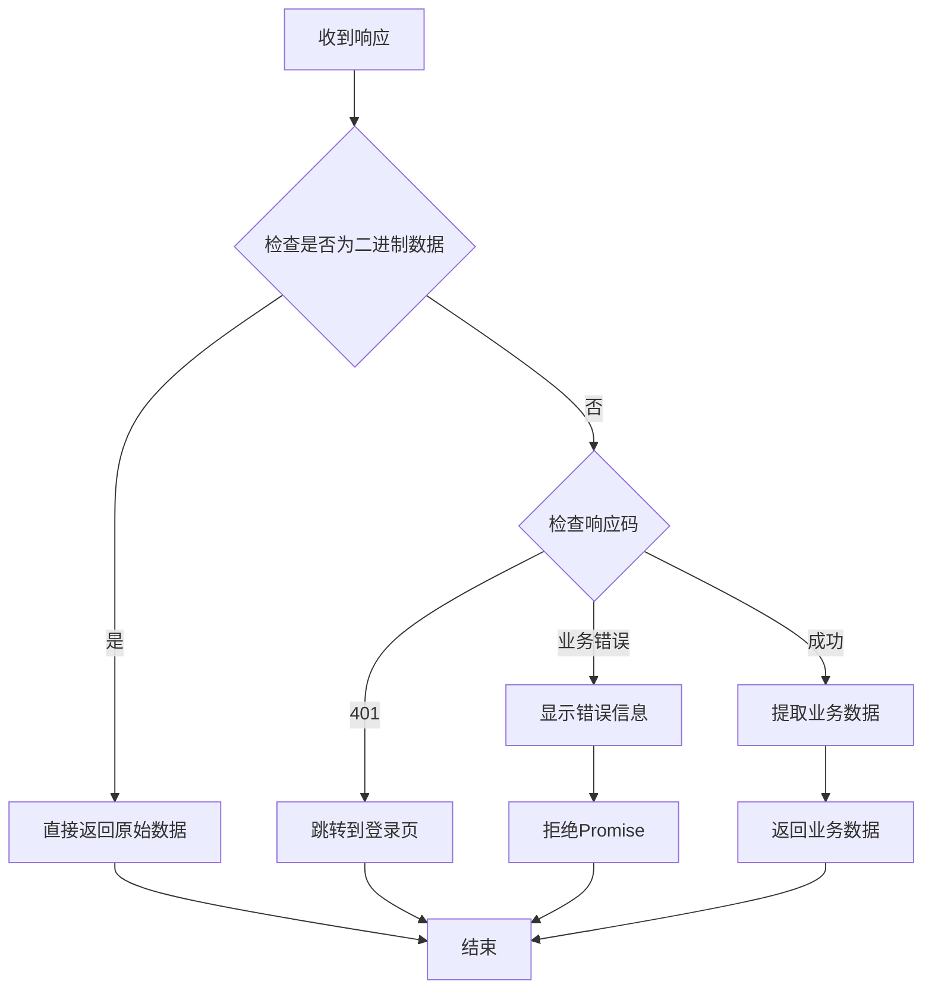

**图表来源**
- [request.ts:47-113](file://src/utils/request.ts#L47-L113)

#### 错误处理机制

系统提供全面的错误处理机制：

| HTTP状态码 | 错误类型 | 处理方式 |
|-----------|----------|----------|
| 400 | 请求错误 | 跳转到登录页，显示错误信息 |
| 401 | 未授权 | 清空存储，跳转到登录页 |
| 403 | 拒绝访问 | 显示权限错误信息 |
| 404 | 请求出错 | 显示资源不存在信息 |
| 408 | 请求超时 | 显示超时错误信息 |
| 500 | 服务器错误 | 显示服务器内部错误 |
| 502 | 网络错误 | 显示网络连接错误 |
| 503 | 服务不可用 | 显示服务暂时不可用 |
| 504 | 网络超时 | 显示网络超时错误 |

**章节来源**
- [request.ts:67-112](file://src/utils/request.ts#L67-L112)

### Token管理机制

#### Token存储和获取

系统使用localStorage进行Token管理：

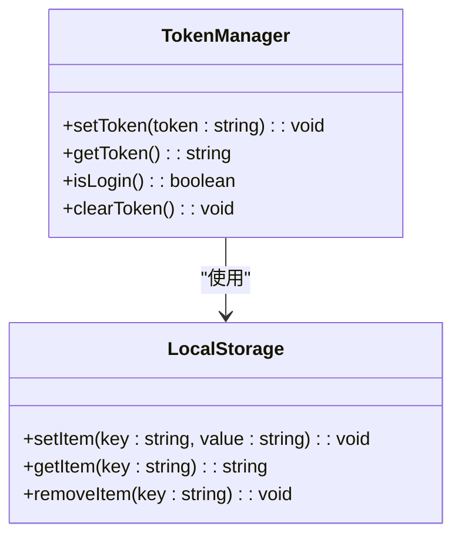

**图表来源**
- [auth.ts:1-19](file://src/utils/auth.ts#L1-L19)

#### Token生命周期

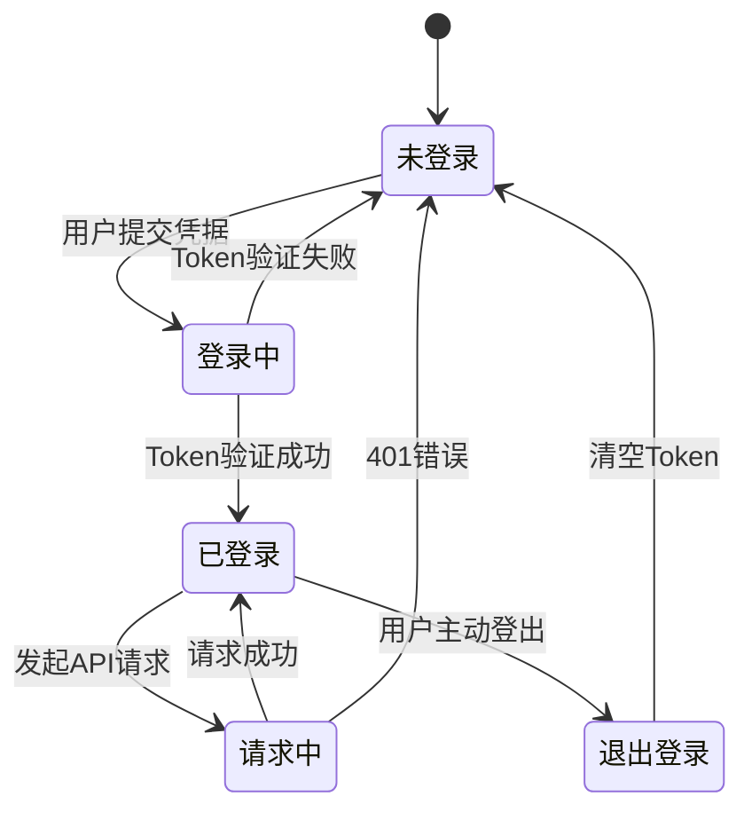

**图表来源**
- [auth.ts:3-17](file://src/utils/auth.ts#L3-L17)

**章节来源**
- [auth.ts:1-19](file://src/utils/auth.ts#L1-L19)

### API集成示例

#### 登录API使用

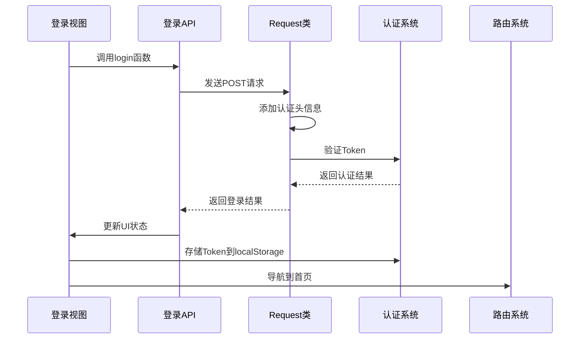

**图表来源**
- [login/index.ts:15-17](file://src/api/login/index.ts#L15-L17)
- [index.vue:142-161](file://src/views/login/index.vue#L142-L161)

**章节来源**
- [login/index.ts:15-17](file://src/api/login/index.ts#L15-L17)
- [index.vue:142-161](file://src/views/login/index.vue#L142-L161)

## 依赖关系分析

### 外部依赖

系统依赖以下关键外部库：

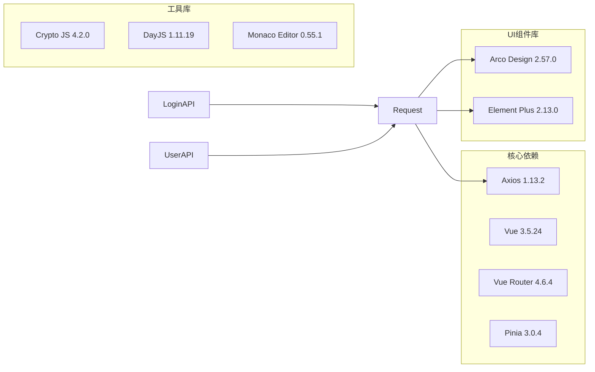

**图表来源**
- [package.json:21](file://package.json#L21)
- [package.json:37](file://package.json#L37)

**章节来源**
- [package.json:13-44](file://package.json#L13-L44)

### 内部依赖关系

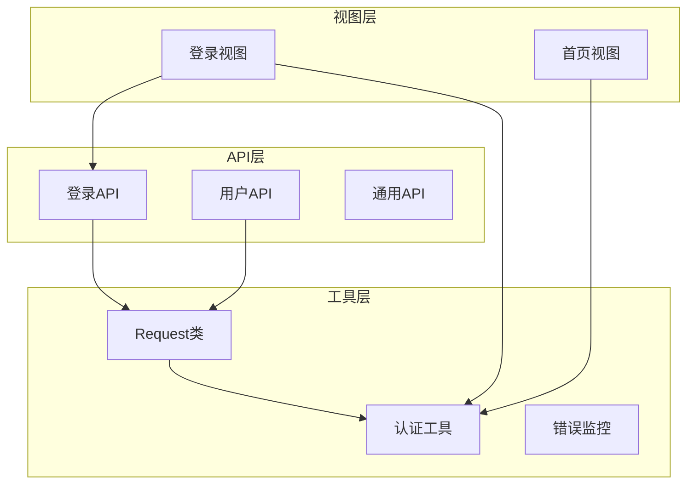

**图表来源**
- [login/index.ts:1-61](file://src/api/login/index.ts#L1-L61)
- [user.ts:1-16](file://src/api/user.ts#L1-L16)

**章节来源**
- [login/index.ts:1-61](file://src/api/login/index.ts#L1-L61)
- [user.ts:1-16](file://src/api/user.ts#L1-L16)

## 性能考虑

### 请求优化策略

1. **超时配置**：默认超时时间为60秒，可根据网络环境调整
2. **缓存策略**：对于静态资源可考虑浏览器缓存机制
3. **并发控制**：避免同时发起过多请求导致服务器压力
4. **错误重试**：系统提供基础的错误处理，但未实现自动重试机制

### 内存管理

- Token存储在localStorage中，不会占用内存空间
- 响应数据按需处理，避免不必要的数据复制
- 组件卸载时及时清理事件监听器

## 故障排除指南

### 常见问题及解决方案

#### 认证失败问题

**问题症状**：
- 401未授权错误
- 自动跳转到登录页
- 页面循环重定向

**排查步骤**：
1. 检查localStorage中是否存在wornbench_token
2. 验证Token格式和有效期
3. 确认服务器端Token验证逻辑

**解决方案**：
```typescript
// 检查Token状态
const token = localStorage.getItem('wornbench_token');
if (!token) {
    // 清理无效状态并重定向
    localStorage.clear();
    window.location.href = window.api.apiURL;
}
```

#### 网络请求异常

**问题症状**：
- 请求超时
- 网络连接失败
- 服务器无响应

**排查步骤**：
1. 检查网络连接状态
2. 验证服务器地址配置
3. 查看浏览器开发者工具中的网络面板

**解决方案**：
```typescript
// 增加重试机制
const retryRequest = async (fn, maxRetries = 3) => {
    for (let i = 0; i < maxRetries; i++) {
        try {
            return await fn();
        } catch (error) {
            if (i === maxRetries - 1) throw error;
            await new Promise(resolve => setTimeout(resolve, 1000 * (i + 1)));
        }
    }
};
```

#### 响应数据格式问题

**问题症状**：
- 业务数据解析失败
- 响应格式不符合预期

**排查步骤**：
1. 检查服务器响应格式
2. 验证Result接口定义
3. 确认数据转换逻辑

**解决方案**：
```typescript
// 安全的数据解析
const safeParseResponse = (response) => {
    if (!response || !response.data) {
        throw new Error('Invalid response format');
    }
    return response.data;
};
```

**章节来源**
- [request.ts:67-112](file://src/utils/request.ts#L67-L112)
- [index.vue:142-161](file://src/views/login/index.vue#L142-L161)

## 结论

新工坊项目的请求拦截器系统提供了完整而灵活的HTTP请求处理机制。通过拦截器模式，系统实现了认证令牌的自动化处理、统一的错误处理和响应数据格式化。该系统具有以下特点：

1. **模块化设计**：Request类独立封装，便于维护和扩展
2. **自动认证**：无需手动添加Token，提升开发效率
3. **统一错误处理**：集中处理各种异常情况
4. **灵活配置**：支持自定义拦截器行为和配置选项

未来可以考虑的改进方向：
- 实现Token自动刷新机制
- 添加请求重试策略
- 增强错误监控和日志记录
- 优化并发请求管理

该系统为新工坊项目提供了稳定可靠的网络通信基础，支持各种业务场景下的数据交互需求。