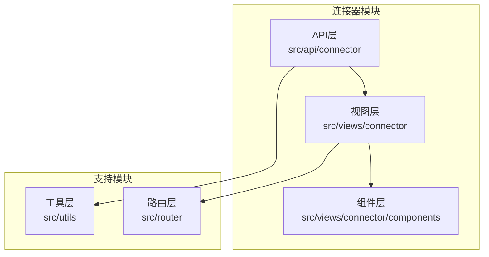
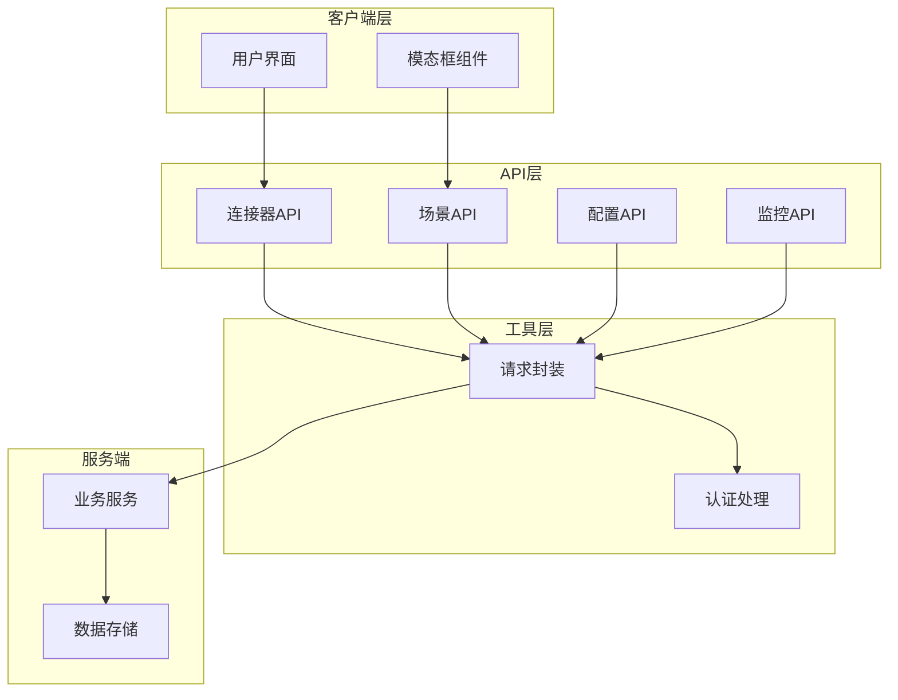
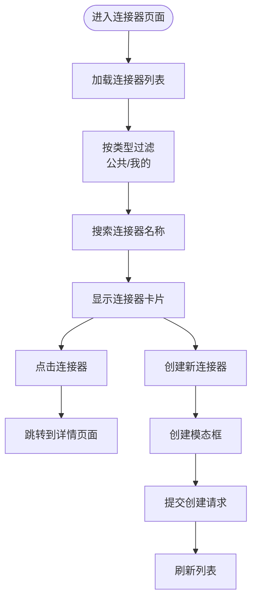
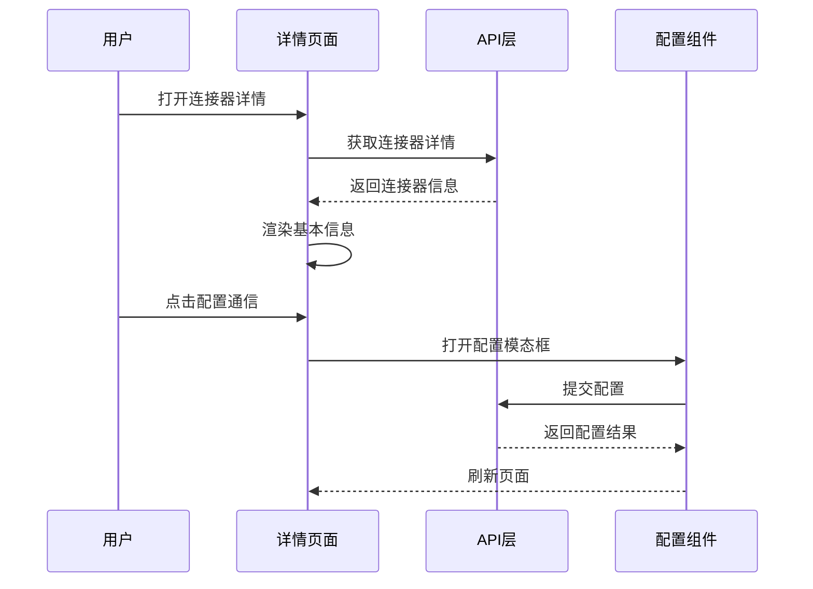
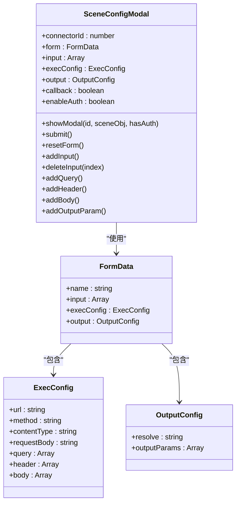
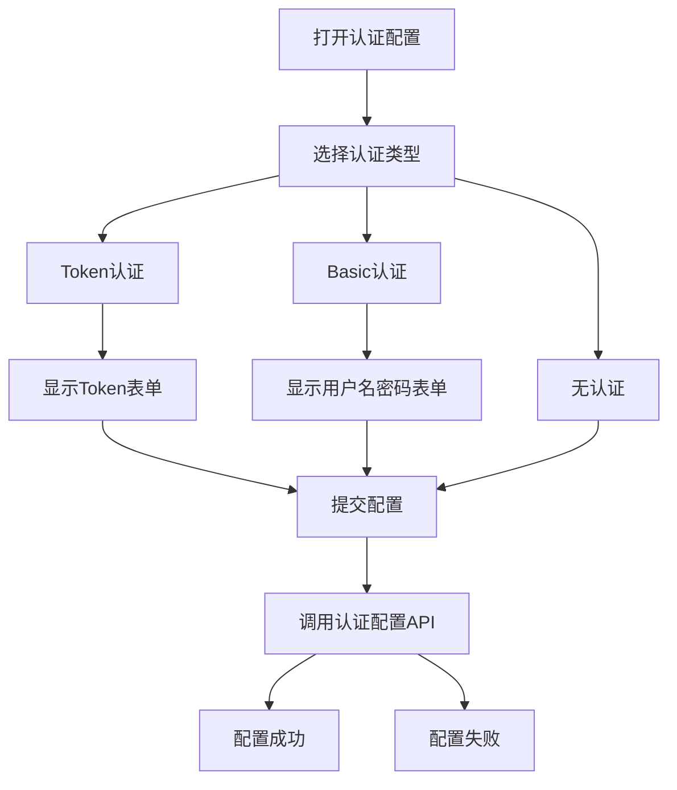
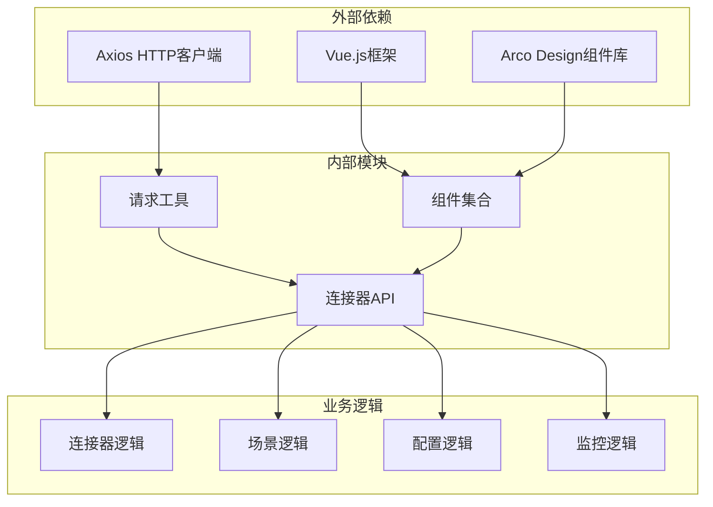

# 连接器API

<cite>
**本文档引用的文件**
- [src/api/connector/index.ts](file://src/api/connector/index.ts)
- [src/views/connector/index.vue](file://src/views/connector/index.vue)
- [src/views/connector/detail.vue](file://src/views/connector/detail.vue)
- [src/views/connector/components/configModel.vue](file://src/views/connector/components/configModel.vue)
- [src/views/connector/components/authConfigDrawer.vue](file://src/views/connector/components/authConfigDrawer.vue)
- [src/views/connector/components/sceneConfigModal.vue](file://src/views/connector/components/sceneConfigModal.vue)
- [src/views/connector/components/sceneDebugModal.vue](file://src/views/connector/components/sceneDebugModal.vue)
- [src/views/connector/components/sceneLogModal.vue](file://src/views/connector/components/sceneLogModal.vue)
- [src/views/connector/components/createModal.vue](file://src/views/connector/components/createModal.vue)
- [src/utils/request.ts](file://src/utils/request.ts)
- [src/router/index.ts](file://src/router/index.ts)
</cite>

## 目录
1. [简介](#简介)
2. [项目结构](#项目结构)
3. [核心组件](#核心组件)
4. [架构概览](#架构概览)
5. [详细组件分析](#详细组件分析)
6. [依赖关系分析](#依赖关系分析)
7. [性能考虑](#性能考虑)
8. [故障排除指南](#故障排除指南)
9. [结论](#结论)

## 简介

连接器API是工作台系统中用于管理和配置外部服务集成的核心模块。该系统允许用户通过简单的图形界面配置各种外部服务的连接，包括HTTP/HTTPS协议、认证方式、数据源连接和场景配置等。连接器API提供了完整的生命周期管理，从创建、配置到测试和监控的全流程支持。

## 项目结构

连接器功能主要分布在以下目录结构中：

**图表来源**
- [src/api/connector/index.ts:1-104](file://src/api/connector/index.ts#L1-L104)
- [src/views/connector/index.vue:1-334](file://src/views/connector/index.vue#L1-L334)
- [src/utils/request.ts:1-159](file://src/utils/request.ts#L1-L159)

**章节来源**
- [src/api/connector/index.ts:1-104](file://src/api/connector/index.ts#L1-L104)
- [src/views/connector/index.vue:1-334](file://src/views/connector/index.vue#L1-L334)
- [src/router/index.ts:155-164](file://src/router/index.ts#L155-L164)

## 核心组件

连接器API由多个核心组件构成，每个组件负责特定的功能领域：

### API层组件
- **连接器管理API**: 负责连接器的创建、修改、删除和查询
- **场景管理API**: 管理连接器中的具体执行场景
- **配置管理API**: 处理通信配置和认证配置
- **监控API**: 提供日志查询和调试功能

### 视图层组件
- **连接器列表页面**: 展示所有可用的连接器
- **连接器详情页面**: 提供连接器的详细信息和配置入口
- **场景配置页面**: 管理具体的执行场景

### 组件层组件
- **配置模态框**: 用于设置连接器的通信参数
- **认证配置抽屉**: 配置各种认证方式
- **场景配置模态框**: 完整的场景配置界面
- **调试模态框**: 场景调试和测试功能
- **日志模态框**: 场景执行日志查看

**章节来源**
- [src/views/connector/detail.vue:1-589](file://src/views/connector/detail.vue#L1-L589)
- [src/views/connector/components/sceneConfigModal.vue:1-848](file://src/views/connector/components/sceneConfigModal.vue#L1-L848)

## 架构概览

连接器API采用分层架构设计，确保了良好的可维护性和扩展性：

**图表来源**
- [src/api/connector/index.ts:1-104](file://src/api/connector/index.ts#L1-L104)
- [src/utils/request.ts:1-159](file://src/utils/request.ts#L1-L159)

## 详细组件分析

### 连接器管理API

连接器管理API提供了完整的连接器生命周期管理功能：

#### 连接器列表管理
- **获取连接器列表**: 支持按名称和类型过滤
- **创建连接器**: 新建连接器的基本信息
- **修改连接器**: 更新连接器的名称和描述
- **删除连接器**: 彻底移除连接器及其所有场景

#### 连接器详情管理
- **获取连接器详情**: 包含配置信息和场景数量
- **场景分页查询**: 支持分页获取连接器下的所有场景

**章节来源**
- [src/api/connector/index.ts:5-28](file://src/api/connector/index.ts#L5-L28)

### 场景管理API

场景是连接器的具体执行单元，每个连接器可以包含多个场景：

#### 场景配置管理
- **场景详情查询**: 获取单个场景的完整配置
- **场景创建/修改**: 完整的场景配置提交
- **场景删除**: 移除指定场景

#### 场景状态管理
- **启用/禁用鉴权**: 控制场景的认证要求
- **启用/禁用回调**: 控制场景的回调功能
- **上架/下架**: 控制场景的可用状态
- **同步/异步**: 设置请求的执行模式

**章节来源**
- [src/api/connector/index.ts:30-83](file://src/api/connector/index.ts#L30-L83)

### 配置管理API

配置管理API处理连接器的各种配置需求：

#### 通信配置
- **协议设置**: 支持HTTP和HTTPS协议
- **主机配置**: 域名或IP地址设置
- **端口配置**: 端口号设置
- **公共路径**: 公共API路径设置

#### 认证配置
- **认证类型**: 支持none、token、Basic Auth三种类型
- **Token配置**: JWT或其他令牌配置
- **用户名密码**: Basic Auth认证配置

**章节来源**
- [src/api/connector/index.ts:35-43](file://src/api/connector/index.ts#L35-L43)

### 监控和调试API

监控和调试功能确保连接器的正常运行：

#### 日志管理
- **日志分页查询**: 支持按时间范围、流程和状态筛选
- **流程下拉选择**: 获取可用的流程选项
- **状态统计**: 成功/失败状态的统计

#### 调试功能
- **场景调试**: 实时测试场景配置
- **参数输入**: 动态输入调试参数
- **响应查看**: 实时查看API响应

**章节来源**
- [src/api/connector/index.ts:85-102](file://src/api/connector/index.ts#L85-L102)

### 视图组件分析

#### 连接器列表页面
连接器列表页面提供了直观的连接器管理界面：

**图表来源**
- [src/views/connector/index.vue:104-127](file://src/views/connector/index.vue#L104-L127)

#### 连接器详情页面
详情页面提供了连接器的完整信息和操作入口：

**图表来源**
- [src/views/connector/detail.vue:271-281](file://src/views/connector/detail.vue#L271-L281)

**章节来源**
- [src/views/connector/index.vue:1-334](file://src/views/connector/index.vue#L1-L334)
- [src/views/connector/detail.vue:1-589](file://src/views/connector/detail.vue#L1-L589)

### 组件交互分析

#### 场景配置组件
场景配置组件提供了完整的场景配置界面：

**图表来源**
- [src/views/connector/components/sceneConfigModal.vue:364-385](file://src/views/connector/components/sceneConfigModal.vue#L364-L385)

**章节来源**
- [src/views/connector/components/sceneConfigModal.vue:1-848](file://src/views/connector/components/sceneConfigModal.vue#L1-L848)

### 认证配置组件
认证配置抽屉提供了灵活的认证方式配置：

**图表来源**
- [src/views/connector/components/authConfigDrawer.vue:166-184](file://src/views/connector/components/authConfigDrawer.vue#L166-L184)

**章节来源**
- [src/views/connector/components/authConfigDrawer.vue:1-326](file://src/views/connector/components/authConfigDrawer.vue#L1-L326)

## 依赖关系分析

连接器API的依赖关系体现了清晰的分层架构：

**图表来源**
- [src/utils/request.ts:1-159](file://src/utils/request.ts#L1-L159)
- [src/api/connector/index.ts:1-104](file://src/api/connector/index.ts#L1-L104)

### 核心依赖关系

1. **HTTP客户端依赖**: 使用Axios作为HTTP请求的基础
2. **UI框架依赖**: 基于Vue.js和Arco Design构建用户界面
3. **路由依赖**: 通过Vue Router实现页面导航
4. **状态管理**: 使用Vue的响应式系统管理组件状态

**章节来源**
- [src/utils/request.ts:1-159](file://src/utils/request.ts#L1-L159)
- [src/router/index.ts:1-189](file://src/router/index.ts#L1-L189)

## 性能考虑

连接器API在设计时充分考虑了性能优化：

### 请求优化
- **超时配置**: 默认60秒超时，平衡响应时间和稳定性
- **白名单机制**: 特定接口绕过认证检查，减少不必要的请求
- **批量操作**: 支持分页查询，避免大量数据一次性传输

### 缓存策略
- **组件缓存**: Vue组件的响应式缓存机制
- **状态缓存**: 连接器状态的本地缓存
- **配置缓存**: 常用配置的内存缓存

### 错误处理
- **统一错误处理**: 通过拦截器统一处理HTTP错误
- **用户友好提示**: 详细的错误信息反馈
- **自动重定向**: 401错误时自动跳转到登录页面

## 故障排除指南

### 常见问题诊断

#### 连接器创建失败
1. **检查网络连接**: 确保能够访问后端服务
2. **验证权限**: 确认用户具有创建连接器的权限
3. **检查必填字段**: 确认连接器名称等必填字段已填写

#### 场景配置错误
1. **验证URL格式**: 确保场景URL格式正确
2. **检查参数类型**: 确认入参变量的数据类型匹配
3. **验证认证配置**: 确认认证信息正确无误

#### 调试功能异常
1. **检查网络状态**: 确保目标服务可达
2. **验证请求参数**: 确认调试参数正确设置
3. **查看响应状态**: 分析API响应的状态码和消息

### 日志分析
- **日志级别**: 区分不同级别的日志信息
- **时间范围**: 支持按时间范围筛选日志
- **状态过滤**: 按成功/失败状态过滤日志

**章节来源**
- [src/views/connector/components/sceneLogModal.vue:125-145](file://src/views/connector/components/sceneLogModal.vue#L125-L145)

### 调试技巧
1. **逐步验证**: 从基本配置开始，逐步增加复杂度
2. **对比测试**: 对比不同配置下的行为差异
3. **参数验证**: 确保所有输入参数符合预期格式

## 结论

连接器API为工作台系统提供了完整的外部服务集成解决方案。通过清晰的分层架构、完善的组件设计和丰富的功能特性，该系统能够满足各种复杂的集成需求。

### 主要优势
- **易用性**: 直观的图形界面和向导式配置
- **灵活性**: 支持多种认证方式和配置选项
- **可扩展性**: 模块化的架构设计便于功能扩展
- **可靠性**: 完善的错误处理和监控机制

### 发展方向
- **性能优化**: 进一步优化大数据量场景的处理能力
- **安全增强**: 加强认证和授权机制
- **功能扩展**: 支持更多类型的外部服务集成
- **用户体验**: 持续改进用户界面和交互体验

连接器API的设计充分体现了现代前端开发的最佳实践，为后续的功能扩展和维护奠定了坚实的基础。