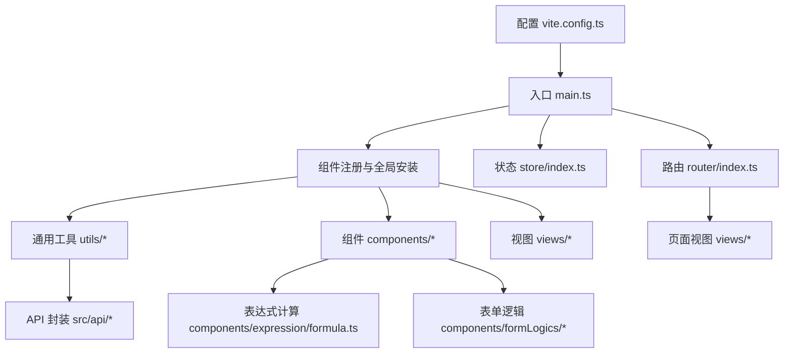
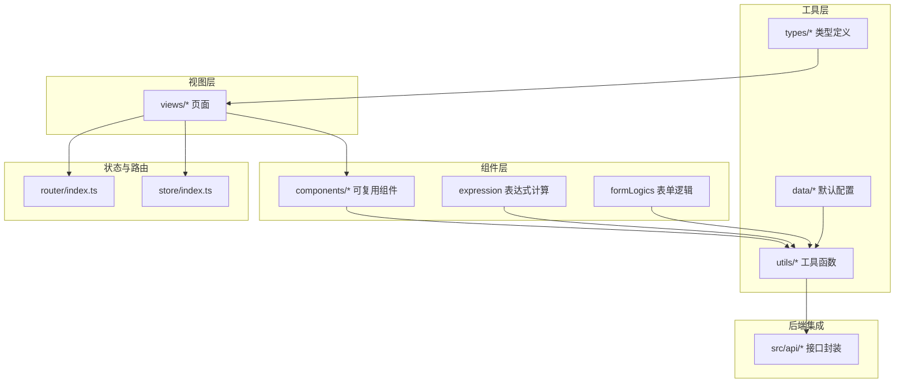
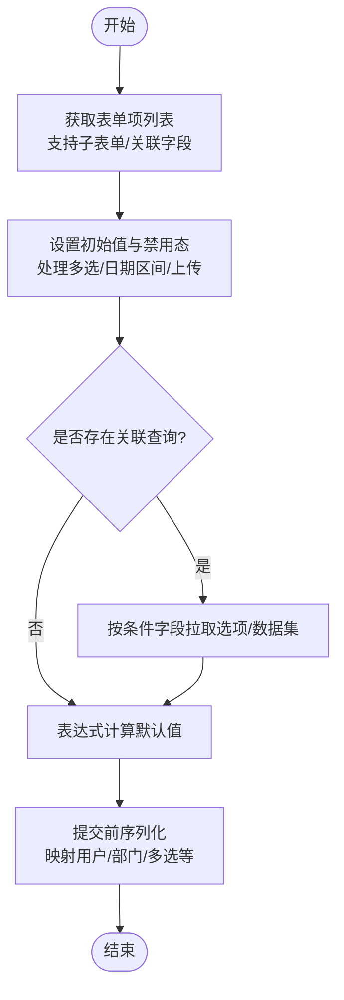
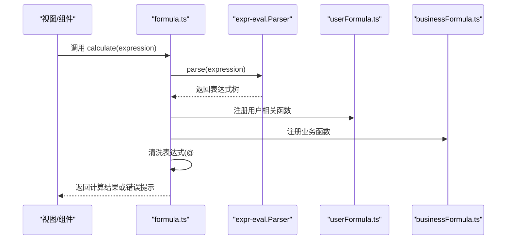
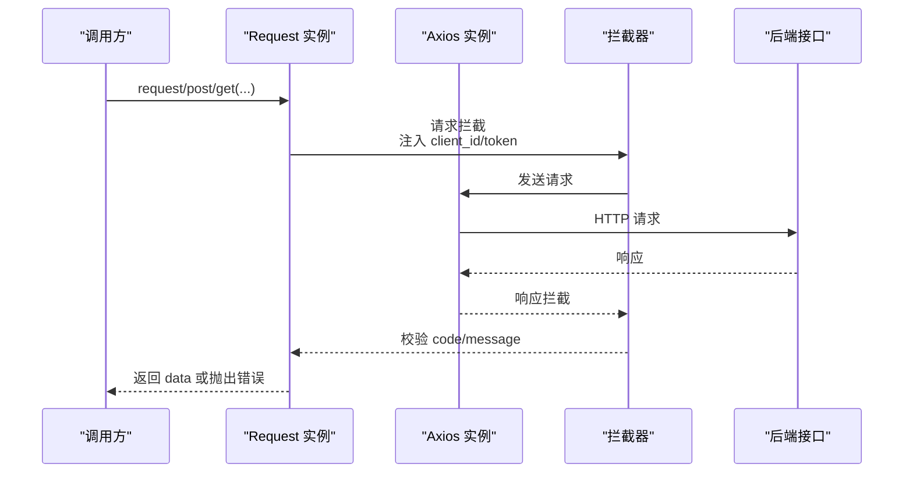
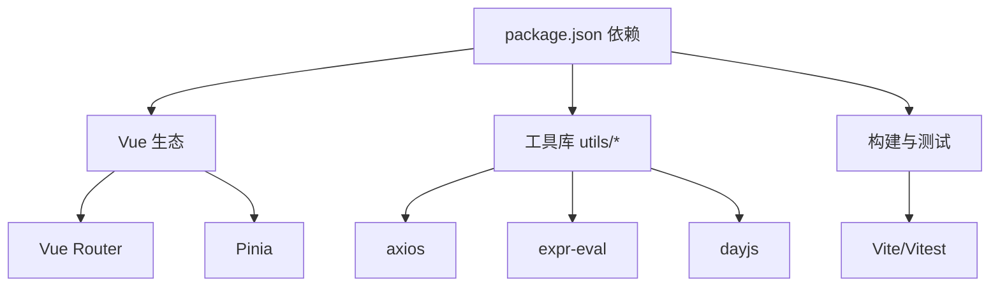

# 开发指南

<cite>
**本文引用的文件**   
- [README.md](file://README.md)
- [package.json](file://package.json)
- [src/main.ts](file://src/main.ts)
- [src/router/index.ts](file://src/router/index.ts)
- [src/store/index.ts](file://src/store/index.ts)
- [src/utils/index.ts](file://src/utils/index.ts)
- [src/utils/math.ts](file://src/utils/math.ts)
- [src/utils/form.ts](file://src/utils/form.ts)
- [src/utils/request.ts](file://src/utils/request.ts)
- [src/components/expression/formula.ts](file://src/components/expression/formula.ts)
- [src/components/expression/formula/userFormula.ts](file://src/components/expression/formula/userFormula.ts)
- [src/components/expression/formula/businessFormula.ts](file://src/components/expression/formula/businessFormula.ts)
- [src/data/form.js](file://src/data/form.js)
- [src/types/form.ts](file://src/types/form.ts)
- [vite.config.ts](file://vite.config.ts)
</cite>

## 目录
1. [简介](#简介)
2. [项目结构](#项目结构)
3. [核心组件](#核心组件)
4. [架构总览](#架构总览)
5. [详细组件分析](#详细组件分析)
6. [依赖分析](#依赖分析)
7. [性能考虑](#性能考虑)
8. [故障排除指南](#故障排除指南)
9. [结论](#结论)
10. [附录](#附录)

## 简介
本指南面向新加入的开发者，帮助快速理解与参与“新工作台”项目的开发。内容覆盖开发规范、代码组织原则、最佳实践、工具函数库设计理念、业务逻辑封装、通用功能实现（表单渲染、工作流序列化、数学计算工具）、注释与测试策略、性能优化与调试技巧。

## 项目结构
项目采用 Vue 3 + TypeScript + Vite 技术栈，结合 Pinia 状态管理与 Vue Router 路由体系，围绕“表单设计器与流程编排”为核心能力构建。核心目录与职责概览如下：
- src/api：后端接口封装（按业务模块划分）
- src/components：可复用组件（含表达式计算、表单逻辑、选择器、编辑器等）
- src/utils：通用工具函数（请求、表单处理、数学运算、环境变量等）
- src/views：页面视图（按功能模块划分）
- src/router：前端路由配置
- src/store：状态管理（Pinia）
- src/data：表单配置与默认数据
- src/types：类型定义
- public：公共资源与配置

图表来源
- [src/main.ts:1-40](file://src/main.ts#L1-L40)
- [src/router/index.ts:1-189](file://src/router/index.ts#L1-L189)
- [src/store/index.ts:1-9](file://src/store/index.ts#L1-L9)
- [vite.config.ts:1-37](file://vite.config.ts#L1-L37)

章节来源
- [README.md:1-6](file://README.md#L1-L6)
- [package.json:1-62](file://package.json#L1-L62)
- [src/main.ts:1-40](file://src/main.ts#L1-L40)
- [src/router/index.ts:1-189](file://src/router/index.ts#L1-L189)
- [src/store/index.ts:1-9](file://src/store/index.ts#L1-L9)
- [vite.config.ts:1-37](file://vite.config.ts#L1-L37)

## 核心组件
- 应用启动与全局安装
  - 在应用入口完成组件自动注册、插件安装与挂载，确保全局可用性与一致性。
- 路由系统
  - 采用 Vue Router 的历史模式，集中管理页面级路由，支持鉴权守卫扩展。
- 状态管理
  - 使用 Pinia 创建全局状态仓库，集中管理网站配置等状态。
- 工具函数库
  - 提供请求封装、表单渲染与序列化、表达式计算、常用数学运算等通用能力。
- 组件生态
  - 包含表单渲染组件、表达式函数库、流程节点组件、选择器组件等。

章节来源
- [src/main.ts:1-40](file://src/main.ts#L1-L40)
- [src/router/index.ts:1-189](file://src/router/index.ts#L1-L189)
- [src/store/index.ts:1-9](file://src/store/index.ts#L1-L9)
- [src/utils/index.ts:1-26](file://src/utils/index.ts#L1-L26)
- [src/utils/form.ts:1-800](file://src/utils/form.ts#L1-L800)
- [src/utils/request.ts:1-159](file://src/utils/request.ts#L1-L159)

## 架构总览
整体架构以“视图层-组件层-工具层-API 层”分层设计，配合路由与状态管理形成清晰的控制流与数据流。

图表来源
- [src/router/index.ts:1-189](file://src/router/index.ts#L1-L189)
- [src/store/index.ts:1-9](file://src/store/index.ts#L1-L9)
- [src/utils/form.ts:1-800](file://src/utils/form.ts#L1-L800)
- [src/components/expression/formula.ts:1-96](file://src/components/expression/formula.ts#L1-L96)
- [src/data/form.js:1-800](file://src/data/form.js#L1-L800)
- [src/types/form.ts:1-45](file://src/types/form.ts#L1-L45)

## 详细组件分析

### 表单渲染与序列化（utils/form.ts）
- 设计理念
  - 通过统一的数据结构与递归遍历，实现复杂表单的动态渲染、值绑定、联动与序列化。
  - 支持子表单、关联数据/查询、上传组件、人员/部门等复杂字段类型的统一处理。
- 关键流程
  - 获取表单项列表（支持展开/折叠子表单）。
  - 设置表单初始值与禁用态，处理多选、日期区间、上传文件等特殊类型。
  - 关联查询：根据条件字段变化，动态拉取选项或数据集。
  - 表达式计算：在组件上挂载函数，支持实时计算默认值。
  - 提交序列化：将表单值转换为后端期望格式，处理多选、用户/部门 ID 等映射。
- 数据模型
  - 表单配置来源于 data/form.js，默认配置包含表单尺寸、按钮位置、标签对齐等。
  - 类型定义位于 types/form.ts，约束应用描述、表单配置、流程信息等结构。

图表来源
- [src/utils/form.ts:1-800](file://src/utils/form.ts#L1-L800)
- [src/data/form.js:1-800](file://src/data/form.js#L1-L800)
- [src/types/form.ts:1-45](file://src/types/form.ts#L1-L45)

章节来源
- [src/utils/form.ts:1-800](file://src/utils/form.ts#L1-L800)
- [src/data/form.js:1-800](file://src/data/form.js#L1-L800)
- [src/types/form.ts:1-45](file://src/types/form.ts#L1-L45)

### 表达式计算工具（components/expression/formula.ts）
- 设计理念
  - 基于 expr-eval 解析器，扩展内置函数与变量，支持用户、日期、随机数、字符串、数组、金额、业务函数等。
  - 通过注册机制将函数注入解析器，暴露给表单表达式使用。
- 关键流程
  - 注册各类公式库（用户、日期、随机、通用、字符串、数组、金额、业务）。
  - 暴露 getFormValue/getSubFormValue 等函数，从表单配置中读取字段值。
  - 计算入口 calculate，对表达式进行清洗与求值，并处理异常提示。

图表来源
- [src/components/expression/formula.ts:1-96](file://src/components/expression/formula.ts#L1-L96)
- [src/components/expression/formula/userFormula.ts:1-411](file://src/components/expression/formula/userFormula.ts#L1-L411)
- [src/components/expression/formula/businessFormula.ts:1-52](file://src/components/expression/formula/businessFormula.ts#L1-L52)

章节来源
- [src/components/expression/formula.ts:1-96](file://src/components/expression/formula.ts#L1-L96)
- [src/components/expression/formula/userFormula.ts:1-411](file://src/components/expression/formula/userFormula.ts#L1-L411)
- [src/components/expression/formula/businessFormula.ts:1-52](file://src/components/expression/formula/businessFormula.ts#L1-L52)

### 数学计算工具（utils/math.ts）
- 设计理念
  - 提供最小可用的数学运算能力，便于在表达式或业务逻辑中直接调用。
- 使用建议
  - 保持纯函数特性，避免副作用；参数与返回值明确类型。

章节来源
- [src/utils/math.ts:1-4](file://src/utils/math.ts#L1-L4)

### 请求封装（utils/request.ts）
- 设计理念
  - 基于 axios 封装统一请求类，集中处理请求头、白名单、响应拦截与错误提示。
  - 对 ArrayBuffer/Blob 响应类型进行特殊处理，支持下载场景。
- 关键点
  - 自动注入 client_id 与 token（白名单除外）。
  - 统一错误提示与 401 跳转逻辑。
  - 提供 GET/POST/PUT/PATCH/DELETE 方法。

图表来源
- [src/utils/request.ts:1-159](file://src/utils/request.ts#L1-L159)

章节来源
- [src/utils/request.ts:1-159](file://src/utils/request.ts#L1-L159)

### 路由与状态管理（router/index.ts, store/index.ts）
- 路由
  - 集中式路由配置，支持嵌套路由与懒加载页面。
  - 提供全局前置守卫，便于扩展鉴权逻辑。
- 状态
  - 使用 Pinia 创建全局状态仓库，集中管理网站配置等。

章节来源
- [src/router/index.ts:1-189](file://src/router/index.ts#L1-L189)
- [src/store/index.ts:1-9](file://src/store/index.ts#L1-L9)

## 依赖分析
- 前端框架与生态
  - Vue 3、Vue Router、Pinia、Element Plus、ArcoVue、ECharts、Monaco Editor、WangWang Editor 等。
- 工具库
  - expr-eval（表达式解析）、axios（HTTP）、dayjs（日期）、xlsx（表格）、crypto-js（加密）、uuid/nanoid（ID）、formulajs（公式）等。
- 构建与开发
  - Vite（rolldown-vite），Sass、SVG Loader、TypeScript、Vitest 测试。

图表来源
- [package.json:1-62](file://package.json#L1-L62)

章节来源
- [package.json:1-62](file://package.json#L1-L62)

## 性能考虑
- 组件懒加载与按需注册
  - 路由采用异步导入页面组件，减少首屏体积。
  - 入口处批量注册组件，避免重复注册与遗漏。
- 请求缓存与节流
  - 对高频请求进行去重与节流，避免重复触发。
- 表单渲染优化
  - 子表单与关联查询采用延迟计算与防抖，避免频繁拉取数据。
- 图片与资源
  - SVG 使用 vite-svg-loader，XLSX 资源单独处理，减少无关资源打包。

章节来源
- [src/router/index.ts:1-189](file://src/router/index.ts#L1-L189)
- [src/main.ts:1-40](file://src/main.ts#L1-L40)
- [vite.config.ts:1-37](file://vite.config.ts#L1-L37)

## 故障排除指南
- 登录态失效
  - 当响应 code 为 401 或出现未授权提示时，自动跳转至登录页。检查本地 token 是否存在且有效。
- 请求失败
  - 查看响应拦截器中的错误分类与提示，确认网络连通性与后端地址配置。
- 表单值不更新
  - 检查关联查询条件字段是否正确，确认 getQuery/setUpDateData 的调用时机与参数顺序。
- 表达式解析错误
  - 确认表达式语法与变量/函数是否已注册，查看控制台错误提示。
- 跨域问题
  - 检查 vite 代理配置与后端目标地址，确保 changeOrigin 与路径匹配。

章节来源
- [src/utils/request.ts:1-159](file://src/utils/request.ts#L1-L159)
- [src/utils/form.ts:1-800](file://src/utils/form.ts#L1-L800)
- [src/components/expression/formula.ts:1-96](file://src/components/expression/formula.ts#L1-L96)
- [vite.config.ts:1-37](file://vite.config.ts#L1-L37)

## 结论
本项目以“表单与流程”为核心，围绕统一的工具函数库与组件生态构建，具备良好的扩展性与可维护性。建议新开发者遵循本文档的开发规范与最佳实践，从路由与状态管理入手，逐步掌握表单渲染与表达式计算的关键流程，结合性能与故障排除建议，高效推进功能迭代。

## 附录

### 开发规范与最佳实践
- 目录与命名
  - 按功能模块划分目录（如 api、components、views），组件与文件采用语义化命名。
- 组件开发
  - 单一职责、可复用优先；对外暴露稳定 API，内部状态尽量收敛。
- 工具函数
  - 纯函数优先，参数与返回值明确类型；错误处理与边界条件清晰。
- 表单逻辑
  - 使用 data/form.js 中的默认配置作为基线，避免硬编码；复杂联动通过 utils/form.ts 统一封装。
- 表达式
  - 仅在必要时引入外部库；函数命名语义化，避免副作用。
- 路由与状态
  - 路由守卫集中处理鉴权；状态粒度适中，避免过度分散。

### 代码注释规范
- 函数/类/模块
  - 使用简洁明了的中文注释说明用途、入参、返回值与注意事项。
- 复杂逻辑
  - 关键步骤添加行内注释，必要时提供流程图或时序图辅助说明。
- 异常处理
  - 明确错误来源与恢复策略，避免吞掉异常。

### 测试策略
- 单元测试
  - 对工具函数（如 utils/form.ts、utils/math.ts）编写针对性用例，覆盖正常与异常分支。
- 集成测试
  - 使用 Vitest 模拟 API 响应，验证表单渲染、表达式计算与提交序列化流程。
- 端到端测试
  - 使用 Vitest 或 Playwright（如启用）覆盖关键用户路径，确保交互一致性。

### 调试技巧
- 控制台日志
  - 在关键节点输出上下文信息，定位数据流转问题。
- 断点调试
  - 利用浏览器断点观察表单值变化与表达式求值过程。
- 网络抓包
  - 检查请求头与响应体，确认 token、client_id 与后端返回结构。