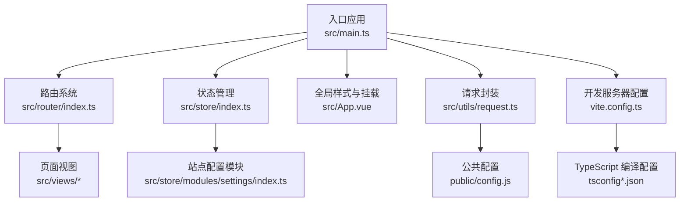
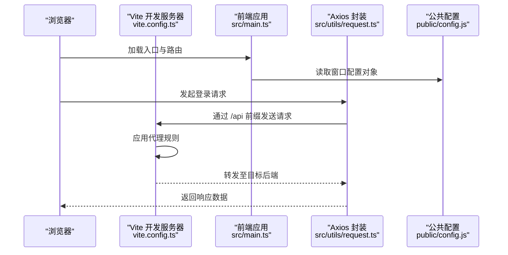
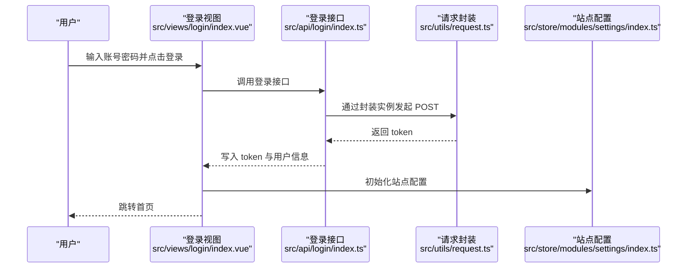
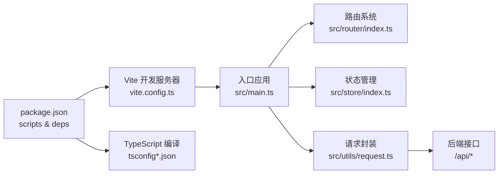

# 快速开始

<cite>
**本文引用的文件**
- [package.json](file://package.json)
- [README.md](file://README.md)
- [vite.config.ts](file://vite.config.ts)
- [tsconfig.json](file://tsconfig.json)
- [tsconfig.app.json](file://tsconfig.app.json)
- [tsconfig.node.json](file://tsconfig.node.json)
- [src/main.ts](file://src/main.ts)
- [src/router/index.ts](file://src/router/index.ts)
- [src/store/index.ts](file://src/store/index.ts)
- [src/utils/env.ts](file://src/utils/env.ts)
- [src/utils/request.ts](file://src/utils/request.ts)
- [src/views/login/index.vue](file://src/views/login/index.vue)
- [src/store/modules/settings/index.ts](file://src/store/modules/settings/index.ts)
- [src/App.vue](file://src/App.vue)
- [public/config.js](file://public/config.js)
</cite>

## 目录
1. [简介](#简介)
2. [项目结构](#项目结构)
3. [核心组件](#核心组件)
4. [架构总览](#架构总览)
5. [详细组件分析](#详细组件分析)
6. [依赖分析](#依赖分析)
7. [性能考虑](#性能考虑)
8. [故障排除指南](#故障排除指南)
9. [结论](#结论)
10. [附录](#附录)

## 简介
本指南面向新加入的开发者，帮助你在最短时间内完成开发环境准备、依赖安装与本地启动，理解项目的基本功能与关键配置。项目基于 Vue 3 + TypeScript + Vite 技术栈，采用 Pinia 状态管理、Arco Design 组件库与 Axios 封装的请求层，通过 Vite 提供开发服务器与构建能力。

## 项目结构
项目采用“按功能域分层 + 模块化组织”的方式，前端入口为 src/main.ts，路由集中于 src/router/index.ts，状态管理位于 src/store，通用工具在 src/utils，页面视图集中在 src/views 下，公共资源在 public 中。

图表来源
- [src/main.ts:1-40](file://src/main.ts#L1-L40)
- [src/router/index.ts:1-189](file://src/router/index.ts#L1-L189)
- [src/store/index.ts:1-9](file://src/store/index.ts#L1-L9)
- [src/App.vue:1-52](file://src/App.vue#L1-L52)
- [src/utils/request.ts:1-159](file://src/utils/request.ts#L1-L159)
- [public/config.js:1-11](file://public/config.js#L1-L11)
- [vite.config.ts:1-37](file://vite.config.ts#L1-L37)
- [tsconfig.json:1-8](file://tsconfig.json#L1-L8)

章节来源
- [README.md:1-6](file://README.md#L1-L6)
- [src/main.ts:1-40](file://src/main.ts#L1-L40)
- [src/router/index.ts:1-189](file://src/router/index.ts#L1-L189)
- [src/store/index.ts:1-9](file://src/store/index.ts#L1-L9)
- [src/App.vue:1-52](file://src/App.vue#L1-L52)
- [src/utils/request.ts:1-159](file://src/utils/request.ts#L1-L159)
- [public/config.js:1-11](file://public/config.js#L1-L11)
- [vite.config.ts:1-37](file://vite.config.ts#L1-L37)
- [tsconfig.json:1-8](file://tsconfig.json#L1-L8)

## 核心组件
- 应用入口与插件注册：在入口文件中完成 Vue 实例创建、组件自动注册、Pinia、路由与 Arco Design 的安装与挂载。
- 路由系统：集中定义页面路由与历史模式，提供基础鉴权钩子占位。
- 状态管理：以 Pinia 为核心，站点配置模块负责标题、Logo 等站点信息的读取与缓存。
- 请求封装：统一设置 baseURL、headers、拦截器与错误处理，支持多种请求方法。
- 开发服务器：Vite 配置了本地服务端口、跨域代理、静态资源与路径别名。

章节来源
- [src/main.ts:1-40](file://src/main.ts#L1-L40)
- [src/router/index.ts:177-189](file://src/router/index.ts#L177-L189)
- [src/store/modules/settings/index.ts:1-53](file://src/store/modules/settings/index.ts#L1-L53)
- [src/utils/request.ts:15-159](file://src/utils/request.ts#L15-L159)
- [vite.config.ts:7-36](file://vite.config.ts#L7-L36)

## 架构总览
下图展示了从浏览器发起登录请求到后端接口的完整链路，以及本地开发服务器如何通过代理转发请求。

图表来源
- [vite.config.ts:12-20](file://vite.config.ts#L12-L20)
- [src/utils/request.ts:20](file://src/utils/request.ts#L20)
- [public/config.js:1-11](file://public/config.js#L1-L11)

章节来源
- [vite.config.ts:7-36](file://vite.config.ts#L7-L36)
- [src/utils/request.ts:15-159](file://src/utils/request.ts#L15-L159)
- [public/config.js:1-11](file://public/config.js#L1-L11)

## 详细组件分析

### 登录流程与鉴权要点
- 登录页面负责收集账号密码，对密码进行编码后提交登录接口。
- 成功登录后写入 token 与用户信息到本地存储，并跳转首页。
- 请求层在非白名单接口上自动附加 token 与 client_id 头部；401 时重定向至认证地址。

图表来源
- [src/views/login/index.vue:142-161](file://src/views/login/index.vue#L142-L161)
- [src/api/login/index.ts:14-40](file://src/api/login/index.ts#L14-L40)
- [src/utils/request.ts:26-45](file://src/utils/request.ts#L26-L45)
- [src/store/modules/settings/index.ts:42-49](file://src/store/modules/settings/index.ts#L42-L49)

章节来源
- [src/views/login/index.vue:106-200](file://src/views/login/index.vue#L106-L200)
- [src/api/login/index.ts:1-61](file://src/api/login/index.ts#L1-L61)
- [src/utils/request.ts:15-159](file://src/utils/request.ts#L15-L159)
- [src/store/modules/settings/index.ts:1-53](file://src/store/modules/settings/index.ts#L1-L53)

### 路由与页面导航
- 路由采用 HTML5 History 模式，基础路径为 “/wornbench”，所有页面按功能域划分在 views 下。
- 提供全局前置守卫占位，便于后续接入权限控制。

章节来源
- [src/router/index.ts:177-189](file://src/router/index.ts#L177-L189)

### 状态管理与站点配置
- 站点配置模块负责读取本地存储中的站点配置，计算 Logo 的下载链接并设置文档标题。
- 应用入口在挂载前拉取站点配置并写入状态。

章节来源
- [src/store/modules/settings/index.ts:1-53](file://src/store/modules/settings/index.ts#L1-L53)
- [src/App.vue:10-15](file://src/App.vue#L10-L15)

### 请求封装与跨域代理
- 请求封装统一设置 baseURL 为 “/api”，并在请求头中注入 client_id 与 token（白名单除外）。
- Vite 代理将 “/api” 前缀转发到后端地址，解决本地开发跨域问题。

章节来源
- [src/utils/request.ts:15-159](file://src/utils/request.ts#L15-L159)
- [vite.config.ts:12-20](file://vite.config.ts#L12-L20)

## 依赖分析
- 包管理器：使用 npm（package.json 中定义了脚本与依赖）。
- 运行时依赖：Vue 3、Vue Router、Pinia、Element Plus、Arco Design、Axios、ECharts、Monaco Editor 等。
- 开发依赖：Vite（使用 rolldown-vite）、TypeScript、Vue TS 配置、Sass、Vitest 等。
- TypeScript 配置：多 tsconfig 文件分别约束应用与 Node 环境编译选项与路径别名。

图表来源
- [package.json:1-62](file://package.json#L1-L62)
- [vite.config.ts:1-37](file://vite.config.ts#L1-L37)
- [tsconfig.json:1-8](file://tsconfig.json#L1-L8)
- [tsconfig.app.json:1-20](file://tsconfig.app.json#L1-L20)
- [tsconfig.node.json:1-27](file://tsconfig.node.json#L1-L27)

章节来源
- [package.json:1-62](file://package.json#L1-L62)
- [tsconfig.json:1-8](file://tsconfig.json#L1-L8)
- [tsconfig.app.json:1-20](file://tsconfig.app.json#L1-L20)
- [tsconfig.node.json:1-27](file://tsconfig.node.json#L1-L27)

## 性能考虑
- 本地开发建议使用 Vite 的热更新能力，避免频繁重启。
- 合理拆分路由懒加载组件，减少首屏体积。
- 对大文件下载与图片资源使用 CDN 或后端直链，前端仅做轻量处理。
- 在生产构建时开启压缩与 Tree Shaking，减少打包体积。

## 故障排除指南
- 无法访问后端接口或出现跨域错误
  - 检查 Vite 代理是否正确配置，确认 baseURL 与代理前缀一致。
  - 确认请求头中是否正确注入 token 与 client_id。
  - 参考：[vite.config.ts:12-20](file://vite.config.ts#L12-L20)，[src/utils/request.ts:26-45](file://src/utils/request.ts#L26-L45)
- 登录后 401 或被重定向
  - 检查 token 是否写入本地存储，确认白名单是否覆盖该接口。
  - 参考：[src/utils/request.ts:56-58](file://src/utils/request.ts#L56-L58)，[src/views/login/index.vue:148-158](file://src/views/login/index.vue#L148-L158)
- 页面空白或组件未注册
  - 确认入口文件是否正确注册组件与插件，检查路径别名配置。
  - 参考：[src/main.ts:1-40](file://src/main.ts#L1-L40)，[vite.config.ts:28-35](file://vite.config.ts#L28-L35)
- 路由跳转异常
  - 检查路由 history 基础路径与实际部署路径是否一致。
  - 参考：[src/router/index.ts:177-179](file://src/router/index.ts#L177-L179)
- 站点配置不生效
  - 确认应用入口已拉取站点配置并写入状态。
  - 参考：[src/App.vue:10-15](file://src/App.vue#L10-L15)，[src/store/modules/settings/index.ts:42-49](file://src/store/modules/settings/index.ts#L42-L49)

章节来源
- [vite.config.ts:12-20](file://vite.config.ts#L12-L20)
- [src/utils/request.ts:26-45](file://src/utils/request.ts#L26-L45)
- [src/views/login/index.vue:148-158](file://src/views/login/index.vue#L148-L158)
- [src/main.ts:1-40](file://src/main.ts#L1-L40)
- [src/router/index.ts:177-179](file://src/router/index.ts#L177-L179)
- [src/App.vue:10-15](file://src/App.vue#L10-L15)
- [src/store/modules/settings/index.ts:42-49](file://src/store/modules/settings/index.ts#L42-L49)

## 结论
通过本指南，你可以完成开发环境准备、安装依赖、启动本地开发服务器，并理解项目的核心架构与关键配置。建议在首次运行后，结合登录流程与站点配置模块进一步探索页面与状态管理的工作机制。

## 附录

### 开发环境要求
- Node.js 版本：建议使用 LTS 版本（如 18.x 或 20.x），具体以项目使用的 TypeScript 与 Vite 版本兼容为准。
- 包管理器：推荐使用 npm（项目脚本基于 npm）。
- 文档参考：[README.md:1-6](file://README.md#L1-L6)

章节来源
- [README.md:1-6](file://README.md#L1-L6)

### 安装与启动步骤
- 安装依赖
  - 使用 npm 安装项目依赖。
  - 参考脚本：[package.json:6-12](file://package.json#L6-L12)
- 启动开发服务器
  - 执行 dev 脚本启动 Vite 开发服务器，默认监听端口见配置。
  - 参考：[vite.config.ts:8-11](file://vite.config.ts#L8-L11)，[package.json:7](file://package.json#L7)
- 访问应用
  - 浏览器打开 http://localhost:端口（根据配置调整），若启用自动打开则直接打开。
  - 参考：[vite.config.ts:9](file://vite.config.ts#L9)

章节来源
- [package.json:6-12](file://package.json#L6-L12)
- [vite.config.ts:8-11](file://vite.config.ts#L8-L11)

### 关键配置文件说明
- package.json：定义脚本、依赖与版本信息。
- vite.config.ts：本地开发服务器、代理、路径别名与插件配置。
- tsconfig*.json：应用与 Node 环境的 TypeScript 编译配置与路径映射。
- public/config.js：浏览器端窗口配置对象，包含后端地址与下载地址等。

章节来源
- [package.json:1-62](file://package.json#L1-L62)
- [vite.config.ts:1-37](file://vite.config.ts#L1-L37)
- [tsconfig.json:1-8](file://tsconfig.json#L1-L8)
- [tsconfig.app.json:1-20](file://tsconfig.app.json#L1-L20)
- [tsconfig.node.json:1-27](file://tsconfig.node.json#L1-L27)
- [public/config.js:1-11](file://public/config.js#L1-L11)