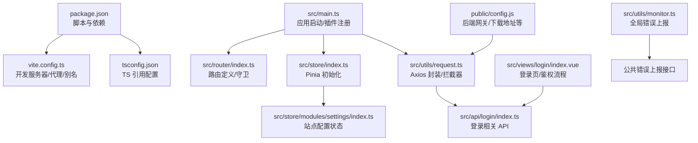
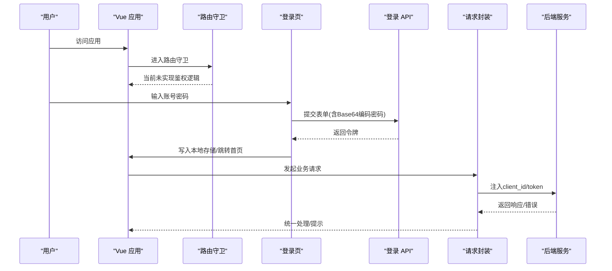
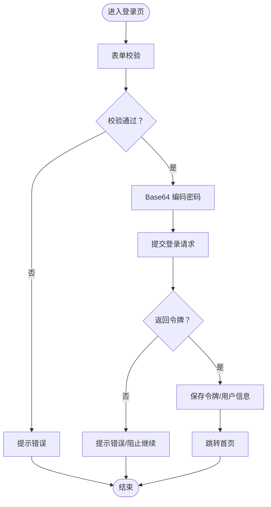
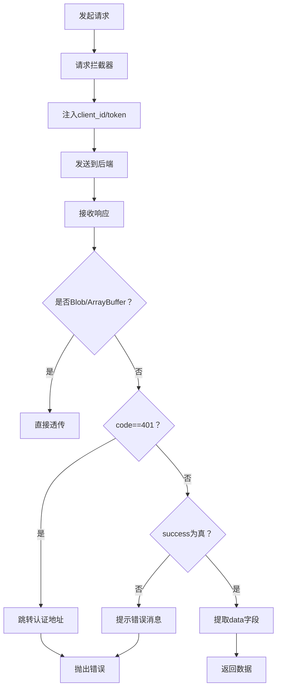
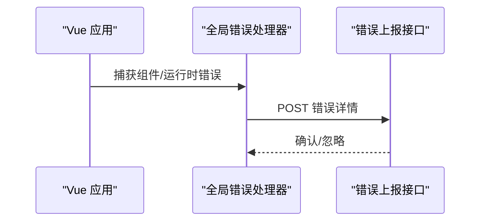
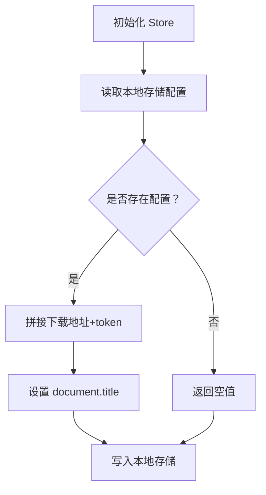
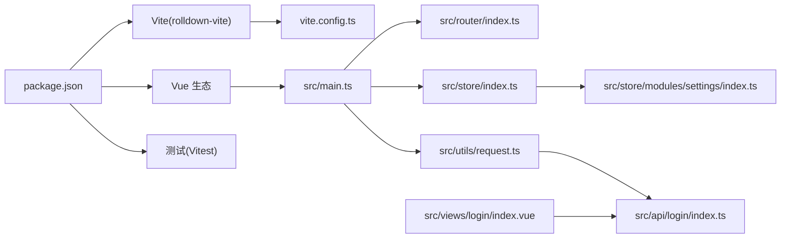

# 故障排除

<cite>
**本文引用的文件**
- [package.json](file://package.json)
- [README.md](file://README.md)
- [ISSUES_REPORT.md](file://ISSUES_REPORT.md)
- [vite.config.ts](file://vite.config.ts)
- [src/main.ts](file://src/main.ts)
- [src/router/index.ts](file://src/router/index.ts)
- [src/store/index.ts](file://src/store/index.ts)
- [src/store/modules/settings/index.ts](file://src/store/modules/settings/index.ts)
- [src/utils/request.ts](file://src/utils/request.ts)
- [src/utils/monitor.ts](file://src/utils/monitor.ts)
- [src/utils/env.ts](file://src/utils/env.ts)
- [src/utils/auth.ts](file://src/utils/auth.ts)
- [src/api/login/index.ts](file://src/api/login/index.ts)
- [src/views/login/index.vue](file://src/views/login/index.vue)
- [public/config.js](file://public/config.js)
- [tsconfig.json](file://tsconfig.json)
- [vitest.config.ts](file://vitest.config.ts)
</cite>

## 目录
1. [简介](#简介)
2. [项目结构](#项目结构)
3. [核心组件](#核心组件)
4. [架构总览](#架构总览)
5. [详细组件分析](#详细组件分析)
6. [依赖关系分析](#依赖关系分析)
7. [性能考虑](#性能考虑)
8. [故障排除指南](#故障排除指南)
9. [结论](#结论)
10. [附录](#附录)

## 简介
本指南面向新工作台项目的开发者与运维人员，聚焦开发环境问题、运行时错误、性能问题与兼容性问题，提供系统化的排查步骤、调试技巧、日志分析方法、性能诊断工具使用建议、监控与告警配置、问题上报流程与社区支持渠道，以及版本升级注意事项与回滚策略。文档基于仓库现有源码与问题报告进行梳理，确保可操作性强，便于快速定位与解决问题。

## 项目结构
项目采用 Vue 3 + TypeScript + Vite 技术栈，前端模块化组织清晰，API 层、工具层、路由与状态管理相对独立。关键目录与职责概览如下：
- 根配置：package.json、vite.config.ts、tsconfig.json、vitest.config.ts
- 应用入口：src/main.ts
- 路由与导航：src/router/index.ts
- 状态管理：src/store 与 src/store/modules/settings
- 网络与拦截：src/utils/request.ts
- 登录与鉴权：src/views/login/index.vue、src/utils/auth.ts、src/api/login/index.ts
- 监控与错误上报：src/utils/monitor.ts
- 公共配置：public/config.js
- 问题分析报告：ISSUES_REPORT.md

图表来源
- [package.json:1-62](file://package.json#L1-L62)
- [vite.config.ts:1-37](file://vite.config.ts#L1-L37)
- [src/main.ts:1-40](file://src/main.ts#L1-L40)
- [src/router/index.ts:1-189](file://src/router/index.ts#L1-L189)
- [src/store/index.ts:1-9](file://src/store/index.ts#L1-L9)
- [src/store/modules/settings/index.ts:1-53](file://src/store/modules/settings/index.ts#L1-L53)
- [src/utils/request.ts:1-159](file://src/utils/request.ts#L1-L159)
- [src/api/login/index.ts:1-61](file://src/api/login/index.ts#L1-L61)
- [src/views/login/index.vue:80-279](file://src/views/login/index.vue#L80-L279)
- [src/utils/monitor.ts:1-29](file://src/utils/monitor.ts#L1-L29)
- [public/config.js:1-11](file://public/config.js#L1-L11)

章节来源
- [package.json:1-62](file://package.json#L1-L62)
- [vite.config.ts:1-37](file://vite.config.ts#L1-L37)
- [src/main.ts:1-40](file://src/main.ts#L1-L40)
- [src/router/index.ts:1-189](file://src/router/index.ts#L1-L189)
- [src/store/index.ts:1-9](file://src/store/index.ts#L1-L9)
- [src/store/modules/settings/index.ts:1-53](file://src/store/modules/settings/index.ts#L1-L53)
- [src/utils/request.ts:1-159](file://src/utils/request.ts#L1-L159)
- [src/api/login/index.ts:1-61](file://src/api/login/index.ts#L1-L61)
- [src/views/login/index.vue:80-279](file://src/views/login/index.vue#L80-L279)
- [src/utils/monitor.ts:1-29](file://src/utils/monitor.ts#L1-L29)
- [public/config.js:1-11](file://public/config.js#L1-L11)

## 核心组件
- 开发服务器与代理：Vite 开发服务器配置，端口、代理目标、静态资源与路径别名。
- 应用启动：注册全局组件、插件、路由与状态管理，挂载根组件。
- 路由与守卫：定义页面路由与前置守卫占位，当前未实现鉴权逻辑。
- 状态管理：Pinia 初始化与站点配置模块，负责标题、Logo 等配置读取与持久化。
- 网络层：Axios 封装，统一请求头注入、白名单放行、响应拦截与错误提示。
- 登录与鉴权：登录页实现、Base64 密码编码（存在安全风险）、令牌存取工具。
- 监控与错误上报：全局错误处理器与上报接口封装。
- 公共配置：后端网关、下载地址、分享地址等常量集中配置。

章节来源
- [vite.config.ts:1-37](file://vite.config.ts#L1-L37)
- [src/main.ts:1-40](file://src/main.ts#L1-L40)
- [src/router/index.ts:177-186](file://src/router/index.ts#L177-L186)
- [src/store/index.ts:1-9](file://src/store/index.ts#L1-L9)
- [src/store/modules/settings/index.ts:1-53](file://src/store/modules/settings/index.ts#L1-L53)
- [src/utils/request.ts:1-159](file://src/utils/request.ts#L1-L159)
- [src/views/login/index.vue:106-161](file://src/views/login/index.vue#L106-L161)
- [src/utils/auth.ts:1-20](file://src/utils/auth.ts#L1-L20)
- [src/utils/monitor.ts:1-29](file://src/utils/monitor.ts#L1-L29)
- [public/config.js:1-11](file://public/config.js#L1-L11)

## 架构总览
下图展示从浏览器到后端的关键交互链路，包括登录、鉴权、请求拦截与错误处理。

图表来源
- [src/router/index.ts:177-186](file://src/router/index.ts#L177-L186)
- [src/views/login/index.vue:106-161](file://src/views/login/index.vue#L106-L161)
- [src/api/login/index.ts:14-40](file://src/api/login/index.ts#L14-L40)
- [src/utils/request.ts:26-113](file://src/utils/request.ts#L26-L113)

## 详细组件分析

### 组件 A：登录与鉴权流程
- 登录页实现：表单校验、Base64 密码编码、提交登录、写入令牌与用户信息、跳转首页。
- 鉴权现状：路由守卫仅占位，未实现鉴权逻辑；令牌存取通过工具函数与本地存储。
- 安全风险：Base64 非加密，易被解码；登录页存在硬编码 client_id（已在请求封装中体现）。

图表来源
- [src/views/login/index.vue:106-161](file://src/views/login/index.vue#L106-L161)
- [src/api/login/index.ts:14-40](file://src/api/login/index.ts#L14-L40)
- [src/utils/auth.ts:1-20](file://src/utils/auth.ts#L1-L20)
- [src/router/index.ts:177-186](file://src/router/index.ts#L177-L186)

章节来源
- [src/views/login/index.vue:106-161](file://src/views/login/index.vue#L106-L161)
- [src/api/login/index.ts:14-40](file://src/api/login/index.ts#L14-L40)
- [src/utils/auth.ts:1-20](file://src/utils/auth.ts#L1-L20)
- [src/router/index.ts:177-186](file://src/router/index.ts#L177-L186)

### 组件 B：请求封装与拦截器
- 功能：统一 baseURL、超时、请求头注入（client_id、token）、白名单放行、响应拦截（401 跳转、错误提示、统一数据提取）。
- 风险点：硬编码 client_id；未对响应体进行严格类型约束；错误处理依赖全局消息组件。

图表来源
- [src/utils/request.ts:15-155](file://src/utils/request.ts#L15-L155)

章节来源
- [src/utils/request.ts:15-155](file://src/utils/request.ts#L15-L155)

### 组件 C：监控与错误上报
- 功能：注册全局错误处理器，将错误信息上报至指定接口。
- 建议：完善上报字段（location、message、stack、浏览器信息、用户信息、DOM 信息、URL 信息等），并增加重试与降级策略。

图表来源
- [src/utils/monitor.ts:4-28](file://src/utils/monitor.ts#L4-L28)

章节来源
- [src/utils/monitor.ts:4-28](file://src/utils/monitor.ts#L4-L28)

### 组件 D：站点配置与状态管理
- 功能：Pinia Store 管理站点标题与 Logo，支持从本地存储读取与持久化；Logo 拼接下载地址与令牌参数。
- 风险点：直接 JSON.parse localStorage，未做容错；Logo 拼接依赖全局 window.api。

图表来源
- [src/store/modules/settings/index.ts:37-49](file://src/store/modules/settings/index.ts#L37-L49)

章节来源
- [src/store/modules/settings/index.ts:1-53](file://src/store/modules/settings/index.ts#L1-L53)

## 依赖关系分析
- 开发与构建：Vite 以 rolldown-vite@7.2.5 作为核心，启用 Vue 插件、SVG 加载器与路径别名。
- 运行时依赖：Vue 3、Vue Router、Pinia、Element Plus、ECharts、Monaco Editor、WangEditor 等。
- 测试：Vitest 配置包含测试文件匹配规则。

图表来源
- [package.json:13-57](file://package.json#L13-L57)
- [vite.config.ts:1-37](file://vite.config.ts#L1-L37)
- [src/main.ts:1-40](file://src/main.ts#L1-L40)
- [src/router/index.ts:1-189](file://src/router/index.ts#L1-L189)
- [src/store/index.ts:1-9](file://src/store/index.ts#L1-L9)
- [src/store/modules/settings/index.ts:1-53](file://src/store/modules/settings/index.ts#L1-L53)
- [src/utils/request.ts:1-159](file://src/utils/request.ts#L1-L159)
- [src/api/login/index.ts:1-61](file://src/api/login/index.ts#L1-L61)
- [src/views/login/index.vue:80-279](file://src/views/login/index.vue#L80-L279)

章节来源
- [package.json:13-57](file://package.json#L13-L57)
- [vite.config.ts:1-37](file://vite.config.ts#L1-L37)
- [src/main.ts:1-40](file://src/main.ts#L1-L40)
- [src/router/index.ts:1-189](file://src/router/index.ts#L1-L189)
- [src/store/index.ts:1-9](file://src/store/index.ts#L1-L9)
- [src/store/modules/settings/index.ts:1-53](file://src/store/modules/settings/index.ts#L1-L53)
- [src/utils/request.ts:1-159](file://src/utils/request.ts#L1-L159)
- [src/api/login/index.ts:1-61](file://src/api/login/index.ts#L1-L61)
- [src/views/login/index.vue:80-279](file://src/views/login/index.vue#L80-L279)

## 性能考虑
- 深拷贝：过度使用 JSON.parse(JSON.stringify()) 性能差且会丢失函数、undefined、Symbol 等，建议使用 structuredClone 或 lodash.cloneDeep。
- localStorage：同步操作阻塞主线程、容量限制、无过期机制、敏感数据暴露，建议封装统一存储工具并增加过期控制。
- JSON.parse：多处未做错误处理，建议封装安全解析函数，避免应用崩溃。
- 控制台日志：生产环境残留 console.* 会影响性能与用户体验，建议构建时移除或统一日志工具。

章节来源
- [ISSUES_REPORT.md:296-391](file://ISSUES_REPORT.md#L296-L391)
- [ISSUES_REPORT.md:508-527](file://ISSUES_REPORT.md#L508-L527)

## 故障排除指南

### 一、开发环境问题
- 无法启动开发服务器
  - 检查端口占用与 host 设置，确认代理目标可达。
  - 关注路径别名与静态资源加载。
  - 参考：[vite.config.ts:8-24](file://vite.config.ts#L8-L24)、[vite.config.ts:25-35](file://vite.config.ts#L25-L35)
- 依赖安装与版本冲突
  - 使用包管理器安装依赖，注意 overrides 中的 rolldown-vite 版本。
  - 参考：[package.json:58-60](file://package.json#L58-L60)
- TypeScript 配置
  - 确认 tsconfig 引用指向 app 与 node 配置。
  - 参考：[tsconfig.json:1-8](file://tsconfig.json#L1-L8)

章节来源
- [vite.config.ts:1-37](file://vite.config.ts#L1-L37)
- [package.json:58-60](file://package.json#L58-L60)
- [tsconfig.json:1-8](file://tsconfig.json#L1-L8)

### 二、运行时错误
- 登录失败或跳转异常
  - 检查登录页 Base64 密码编码与后端登录接口约定。
  - 确认路由守卫占位已被替换为实际鉴权逻辑。
  - 参考：[src/views/login/index.vue:106-161](file://src/views/login/index.vue#L106-L161)、[src/router/index.ts:177-186](file://src/router/index.ts#L177-L186)
- 401 未授权
  - 请求拦截器检测到 401 会跳转认证地址，检查 window.api 配置与 token 存取。
  - 参考：[src/utils/request.ts:47-66](file://src/utils/request.ts#L47-L66)、[public/config.js:1-11](file://public/config.js#L1-L11)
- 响应错误提示
  - 响应拦截器根据状态码弹出错误消息，检查 Message 组件可用性与网络连通性。
  - 参考：[src/utils/request.ts:67-113](file://src/utils/request.ts#L67-L113)
- 全局错误上报
  - 若未配置错误上报接口或未调用监控初始化，需补充 handleError 并传入上报地址。
  - 参考：[src/utils/monitor.ts:4-28](file://src/utils/monitor.ts#L4-L28)

章节来源
- [src/views/login/index.vue:106-161](file://src/views/login/index.vue#L106-L161)
- [src/router/index.ts:177-186](file://src/router/index.ts#L177-L186)
- [src/utils/request.ts:47-113](file://src/utils/request.ts#L47-L113)
- [public/config.js:1-11](file://public/config.js#L1-L11)
- [src/utils/monitor.ts:4-28](file://src/utils/monitor.ts#L4-L28)

### 三、性能问题
- 深拷贝性能差
  - 替换为 structuredClone 或 cloneDeep，避免丢失函数与特殊类型。
  - 参考：[ISSUES_REPORT.md:298-323](file://ISSUES_REPORT.md#L298-L323)
- localStorage 同步阻塞与容量限制
  - 封装统一存储工具，增加过期控制与异步化策略。
  - 参考：[ISSUES_REPORT.md:327-362](file://ISSUES_REPORT.md#L327-L362)
- JSON.parse 未处理异常
  - 使用安全解析函数，避免应用崩溃。
  - 参考：[ISSUES_REPORT.md:366-390](file://ISSUES_REPORT.md#L366-L390)
- 生产环境控制台日志
  - 构建时移除 console.* 或统一日志工具。
  - 参考：[ISSUES_REPORT.md:237-263](file://ISSUES_REPORT.md#L237-L263)

章节来源
- [ISSUES_REPORT.md:298-390](file://ISSUES_REPORT.md#L298-L390)
- [ISSUES_REPORT.md:237-263](file://ISSUES_REPORT.md#L237-L263)

### 四、兼容性问题
- 浏览器差异
  - structuredClone 在部分旧版浏览器不可用，需提供 polyfill 或降级方案。
  - 参考：[ISSUES_REPORT.md:312-323](file://ISSUES_REPORT.md#L312-L323)
- SVG 与第三方组件
  - 确保 svg-loader 配置正确，避免资源加载失败。
  - 参考：[vite.config.ts:26-27](file://vite.config.ts#L26-L27)

章节来源
- [ISSUES_REPORT.md:312-323](file://ISSUES_REPORT.md#L312-L323)
- [vite.config.ts:26-27](file://vite.config.ts#L26-L27)

### 五、调试技巧与日志分析
- 浏览器开发者工具
  - Network 面板观察请求头（client_id、token）、响应状态与数据结构。
  - Console 面板查看错误堆栈与全局消息提示。
- 日志与错误上报
  - 在开发阶段开启详细日志，生产阶段统一收敛。
  - 参考：[src/utils/monitor.ts:4-28](file://src/utils/monitor.ts#L4-L28)
- 环境变量与调试模式
  - 使用 import.meta.env.MODE 判断调试模式，按需输出调试信息。
  - 参考：[src/utils/env.ts:1-4](file://src/utils/env.ts#L1-L4)

章节来源
- [src/utils/monitor.ts:4-28](file://src/utils/monitor.ts#L4-L28)
- [src/utils/env.ts:1-4](file://src/utils/env.ts#L1-L4)

### 六、监控系统配置与告警机制
- 全局错误上报
  - 初始化 handleError 并传入上报接口地址，完善上报字段（location、message、stack、浏览器信息、用户信息、DOM 信息、URL 信息等）。
  - 参考：[src/utils/monitor.ts:4-28](file://src/utils/monitor.ts#L4-L28)
- 建议
  - 增加重试与降级策略，避免上报风暴。
  - 结合后端日志与前端埋点，建立端到端追踪。

章节来源
- [src/utils/monitor.ts:4-28](file://src/utils/monitor.ts#L4-L28)

### 七、问题上报流程与社区支持
- 问题上报
  - 参考项目内置问题分析报告，按严重级别优先修复。
  - 参考：[ISSUES_REPORT.md:1-685](file://ISSUES_REPORT.md#L1-L685)
- 社区支持
  - 基于仓库 README 的 Vue 3 + TypeScript + Vite 推荐实践与 IDE 支持链接。
  - 参考：[README.md:1-6](file://README.md#L1-L6)

章节来源
- [ISSUES_REPORT.md:1-685](file://ISSUES_REPORT.md#L1-L685)
- [README.md:1-6](file://README.md#L1-L6)

### 八、版本升级注意事项与回滚策略
- 升级策略
  - 优先升级 Vite 与 rolldown-vite，确保与 Vue 3 生态兼容。
  - 更新依赖版本时，先在 dev 分支验证，再合并到主分支。
  - 参考：[package.json:53-60](file://package.json#L53-L60)
- 回滚策略
  - 保留上一版本的 package-lock.json 或 yarn.lock，必要时回退到稳定版本。
  - 使用 Git 标签与分支管理，确保可追溯回滚。
- 测试与验证
  - 升级后运行测试套件，确保功能与兼容性。
  - 参考：[vitest.config.ts:1-8](file://vitest.config.ts#L1-L8)

章节来源
- [package.json:53-60](file://package.json#L53-L60)
- [vitest.config.ts:1-8](file://vitest.config.ts#L1-L8)

## 结论
本指南围绕新工作台项目的核心模块与常见问题，提供了从开发环境到运行时、从性能到兼容性的系统化故障排除方法。建议优先解决安全与鉴权问题（eval、XSS、硬编码 client_id、路由守卫），随后优化性能与稳定性（深拷贝、localStorage、JSON.parse 错误处理），最后完善监控与测试体系。通过规范的升级与回滚流程，保障项目持续演进与稳定交付。

## 附录
- 快速检查清单
  - 路由守卫：已实现鉴权逻辑并覆盖白名单。
  - 安全：移除 eval、对 v-html 使用 DOMPurify、环境变量替代硬编码 client_id。
  - 性能：替换深拷贝方案、封装统一存储工具、处理 JSON.parse 异常。
  - 监控：初始化全局错误上报，完善上报字段与重试策略。
  - 测试：补齐单元测试，启用 Vitest。