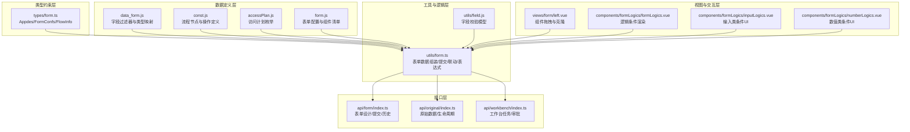
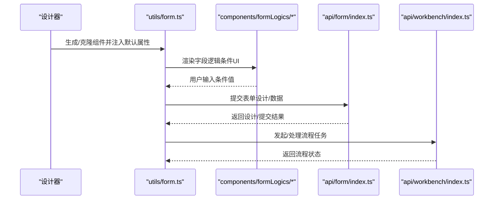
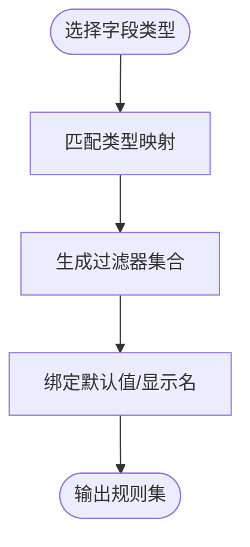
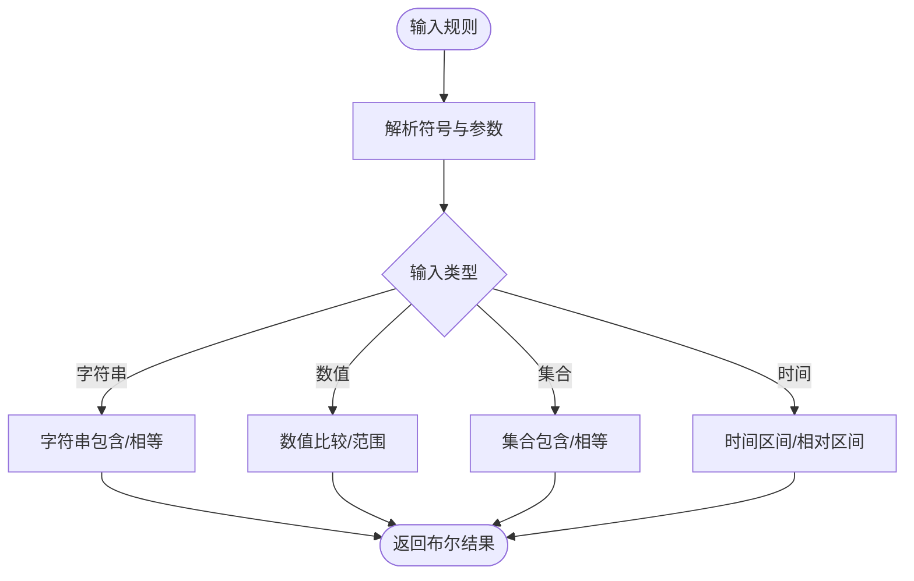
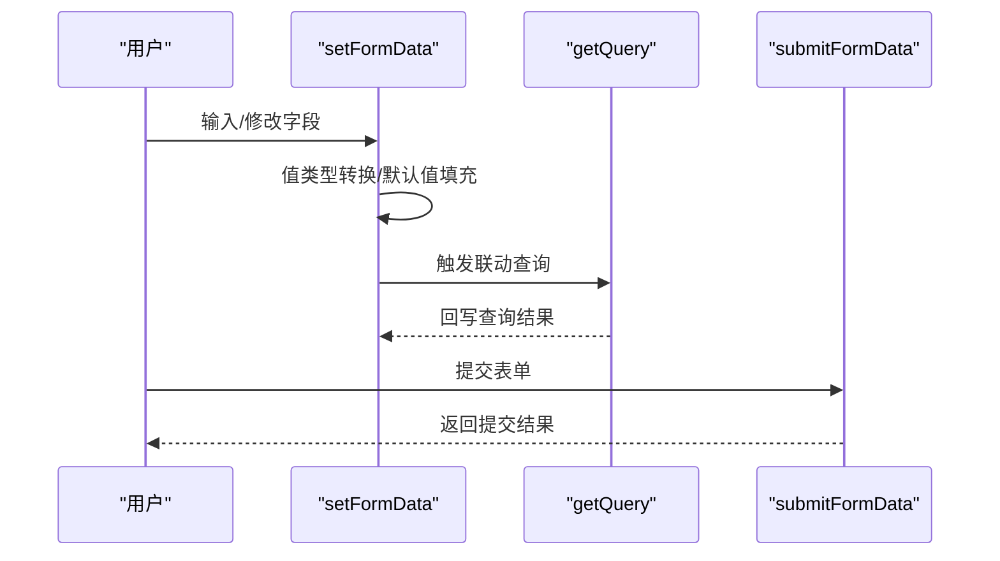
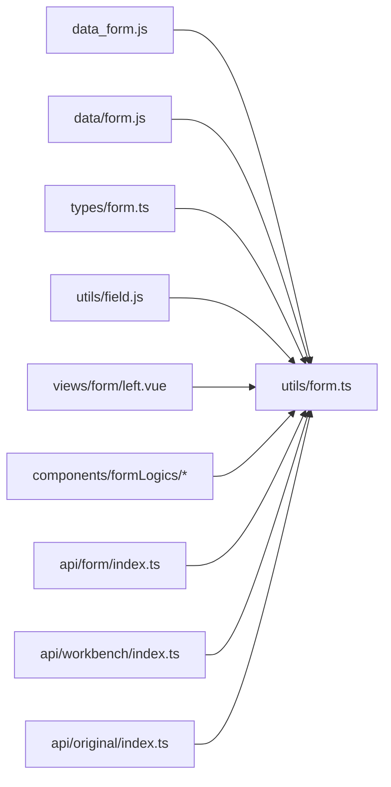

# 数据模型

<cite>
**本文引用的文件**
- [src/data/data_form.js](file://src/data/data_form.js)
- [src/data/form.js](file://src/data/form.js)
- [src/types/form.ts](file://src/types/form.ts)
- [src/utils/form.ts](file://src/utils/form.ts)
- [src/utils/field.js](file://src/utils/field.js)
- [src/data/const.js](file://src/data/const.js)
- [src/data/accessPlan.js](file://src/data/accessPlan.js)
- [src/api/form/index.ts](file://src/api/form/index.ts)
- [src/api/workbench/index.ts](file://src/api/workbench/index.ts)
- [src/views/form/left.vue](file://src/views/form/left.vue)
- [src/components/formLogics/formLogics.vue](file://src/components/formLogics/formLogics.vue)
- [src/components/formLogics/inputLogics.vue](file://src/components/formLogics/inputLogics.vue)
- [src/components/formLogics/numberLogics.vue](file://src/components/formLogics/numberLogics.vue)
- [src/views/application/original/lifeCycle.vue](file://src/views/application/original/lifeCycle.vue)
- [src/views/doCenterDes/lifeCycle.vue](file://src/views/doCenterDes/lifeCycle.vue)
- [src/api/original/index.ts](file://src/api/original/index.ts)
</cite>

## 目录
1. [简介](#简介)
2. [项目结构](#项目结构)
3. [核心数据实体](#核心数据实体)
4. [架构总览](#架构总览)
5. [详细组件分析](#详细组件分析)
6. [依赖关系分析](#依赖关系分析)
7. [性能与缓存策略](#性能与缓存策略)
8. [故障排查指南](#故障排查指南)
9. [结论](#结论)
10. [附录：使用示例与转换逻辑](#附录使用示例与转换逻辑)

## 简介
本文件系统性梳理新工作台项目的数据模型，覆盖表单配置、流程信息、应用描述、字段校验与转换逻辑、生命周期管理与性能优化等方面。目标是帮助开发者快速理解数据结构、业务规则与处理机制，并提供可操作的使用示例与优化建议。

## 项目结构
围绕“表单设计—表单渲染—数据提交—流程执行—生命周期”的主路径，项目采用“数据定义 + 工具方法 + 类型约束 + 视图组件 + API 接口”的分层组织方式。

图表来源
- [src/data/data_form.js:1-840](file://src/data/data_form.js#L1-L840)
- [src/data/form.js:1-2657](file://src/data/form.js#L1-L2657)
- [src/types/form.ts:1-45](file://src/types/form.ts#L1-L45)
- [src/utils/form.ts:1-1341](file://src/utils/form.ts#L1-L1341)
- [src/utils/field.js:1-207](file://src/utils/field.js#L1-L207)
- [src/data/const.js:1-475](file://src/data/const.js#L1-L475)
- [src/data/accessPlan.js:1-160](file://src/data/accessPlan.js#L1-L160)
- [src/views/form/left.vue:1-106](file://src/views/form/left.vue#L1-L106)
- [src/components/formLogics/formLogics.vue:1-35](file://src/components/formLogics/formLogics.vue#L1-L35)
- [src/components/formLogics/inputLogics.vue:1-28](file://src/components/formLogics/inputLogics.vue#L1-L28)
- [src/components/formLogics/numberLogics.vue:1-50](file://src/components/formLogics/numberLogics.vue#L1-L50)
- [src/api/form/index.ts:1-31](file://src/api/form/index.ts#L1-L31)
- [src/api/workbench/index.ts:1-85](file://src/api/workbench/index.ts#L1-L85)
- [src/api/original/index.ts:1-44](file://src/api/original/index.ts#L1-L44)

章节来源
- [src/data/data_form.js:1-840](file://src/data/data_form.js#L1-L840)
- [src/data/form.js:1-2657](file://src/data/form.js#L1-L2657)
- [src/types/form.ts:1-45](file://src/types/form.ts#L1-L45)
- [src/utils/form.ts:1-1341](file://src/utils/form.ts#L1-L1341)
- [src/utils/field.js:1-207](file://src/utils/field.js#L1-L207)
- [src/data/const.js:1-475](file://src/data/const.js#L1-L475)
- [src/data/accessPlan.js:1-160](file://src/data/accessPlan.js#L1-L160)
- [src/views/form/left.vue:1-106](file://src/views/form/left.vue#L1-L106)
- [src/components/formLogics/formLogics.vue:1-35](file://src/components/formLogics/formLogics.vue#L1-L35)
- [src/components/formLogics/inputLogics.vue:1-28](file://src/components/formLogics/inputLogics.vue#L1-L28)
- [src/components/formLogics/numberLogics.vue:1-50](file://src/components/formLogics/numberLogics.vue#L1-L50)
- [src/api/form/index.ts:1-31](file://src/api/form/index.ts#L1-L31)
- [src/api/workbench/index.ts:1-85](file://src/api/workbench/index.ts#L1-L85)
- [src/api/original/index.ts:1-44](file://src/api/original/index.ts#L1-L44)

## 核心数据实体
- 应用描述(Appdes)
  - 字段：showPart、showIcon、icon、id、appName、category、formId 等
  - 用途：承载应用展示与关联表单的基础信息
  - 章节来源
    - [src/types/form.ts:1-10](file://src/types/form.ts#L1-L10)

- 表单配置(FormConfs)
  - 字段：id、name、category、formList、formLogics、widthType、width、titleStyle、draftBox、subText 等
  - 用途：定义表单整体布局、样式与行为
  - 章节来源
    - [src/types/form.ts:12-24](file://src/types/form.ts#L12-L24)
    - [src/data/form.js:2-21](file://src/data/form.js#L2-L21)

- 流程信息(FlowInfo)
  - 字段：pass、refuse、delegate、back 及扩展键
  - 用途：描述流程节点的操作标签与行为
  - 章节来源
    - [src/types/form.ts:26-44](file://src/types/form.ts#L26-L44)

- 字段过滤器与类型映射
  - 数据来源：按组件类型与格式返回对应的过滤器集合与默认规则
  - 用途：驱动表单字段的条件筛选与校验
  - 章节来源
    - [src/data/data_form.js:1-840](file://src/data/data_form.js#L1-L840)

- 表单组件与属性
  - 数据来源：inputComponents 定义各组件的属性、默认值、联动与校验
  - 用途：设计器渲染与运行时行为控制
  - 章节来源
    - [src/data/form.js:23-800](file://src/data/form.js#L23-L800)

- 流程节点与操作
  - 数据来源：Components、nodeData 定义流程节点类型、候选者、按钮等
  - 用途：流程定义与执行控制
  - 章节来源
    - [src/data/const.js:20-475](file://src/data/const.js#L20-L475)

- 访问计划枚举
  - 数据来源：week、mouth、mouths
  - 用途：周期性访问计划的可视化与选择
  - 章节来源
    - [src/data/accessPlan.js:1-160](file://src/data/accessPlan.js#L1-L160)

## 架构总览
从“表单设计”到“数据提交与流程执行”，再到“生命周期与审计”，形成闭环的数据流。

图表来源
- [src/views/form/left.vue:35-55](file://src/views/form/left.vue#L35-L55)
- [src/utils/form.ts:578-601](file://src/utils/form.ts#L578-L601)
- [src/components/formLogics/formLogics.vue:1-35](file://src/components/formLogics/formLogics.vue#L1-L35)
- [src/api/form/index.ts:5-31](file://src/api/form/index.ts#L5-L31)
- [src/api/workbench/index.ts:6-85](file://src/api/workbench/index.ts#L6-L85)

## 详细组件分析

### 表单字段过滤器与类型映射
- 设计要点
  - 每个字段类型对应一组过滤器（如 EQ/NE/LIKE/BETWEEN/IS_NULL 等），并提供默认值与显示名称
  - 支持字符串、数值、日期、时间、子表单、地址等类型的差异化规则
- 关键能力
  - 条件构建：根据字段类型与格式选择合适的过滤器集合
  - 规则落地：将过滤器映射为后端可用的条件表达式
- 章节来源
  - [src/data/data_form.js:1-840](file://src/data/data_form.js#L1-L840)

图表来源
- [src/data/data_form.js:740-800](file://src/data/data_form.js#L740-L800)

### 字段校验模型
- 设计要点
  - 支持比较运算（>, <, >=, <=, ==, !=）、范围判断、空值判断、字符串包含/不包含、集合包含/相等、时间区间与相对区间等
  - 对象/数值/字符串等不同输入进行适配判断
- 关键能力
  - 规则解析：将前端条件转换为可执行的校验函数
  - 时间区间：支持跨日切换的区间判断
- 章节来源
  - [src/utils/field.js:3-185](file://src/utils/field.js#L3-L185)

图表来源
- [src/utils/field.js:1-207](file://src/utils/field.js#L1-L207)

### 表单数据组装与提交
- 设计要点
  - 组件值映射：针对上传、用户/部门、多选、子表单等特殊类型进行值转换
  - 联动与查询：基于关系组件的条件联动与远程查询
  - 表达式计算：对函数类字段进行表达式求值
- 关键能力
  - setFormData/setUpDateData：初始化/更新表单值
  - submitFormData：标准化提交数据结构
  - getQuery：关系字段联动查询
  - setExpressionValue：表达式字段求值
- 章节来源
  - [src/utils/form.ts:62-577](file://src/utils/form.ts#L62-L577)

图表来源
- [src/utils/form.ts:346-577](file://src/utils/form.ts#L346-L577)

### 表单逻辑条件渲染
- 设计要点
  - 根据字段类型动态渲染不同的条件输入控件（输入框、选择器、数值范围等）
  - 与字段过滤器联动，确保条件输入与规则一致
- 章节来源
  - [src/components/formLogics/formLogics.vue:1-35](file://src/components/formLogics/formLogics.vue#L1-L35)
  - [src/components/formLogics/inputLogics.vue:1-28](file://src/components/formLogics/inputLogics.vue#L1-L28)
  - [src/components/formLogics/numberLogics.vue:1-50](file://src/components/formLogics/numberLogics.vue#L1-L50)

### 表单组件清单与拖拽
- 设计要点
  - 组件清单定义了所有可拖拽组件的属性、默认值与行为
  - 克隆组件时生成唯一ID并注入默认字段
- 章节来源
  - [src/views/form/left.vue:35-55](file://src/views/form/left.vue#L35-L55)
  - [src/data/form.js:23-800](file://src/data/form.js#L23-L800)

### 流程节点与操作
- 设计要点
  - 定义流程节点类型（开始/结束/填写/审批/抄送/分支/连接器）及其属性
  - 节点操作（通过/拒绝/转交/退回）与候选者配置
- 章节来源
  - [src/data/const.js:20-475](file://src/data/const.js#L20-L475)

## 依赖关系分析
- 数据定义层
  - data_form.js 与 data/form.js 为工具层提供字段与组件元数据
  - types/form.ts 为 TypeScript 层提供强类型约束
- 工具与逻辑层
  - utils/form.ts 依赖 data_form.js 与 data/form.js，结合 utils/field.js 实现字段校验与数据转换
- 视图与交互层
  - views/form/left.vue 与 components/formLogics/* 依赖 data/form.js 与 utils/form.ts
- 接口层
  - api/form/index.ts 与 api/workbench/index.ts 作为数据流转的边界

图表来源
- [src/data/data_form.js:1-840](file://src/data/data_form.js#L1-L840)
- [src/data/form.js:1-2657](file://src/data/form.js#L1-L2657)
- [src/types/form.ts:1-45](file://src/types/form.ts#L1-L45)
- [src/utils/form.ts:1-1341](file://src/utils/form.ts#L1-L1341)
- [src/utils/field.js:1-207](file://src/utils/field.js#L1-L207)
- [src/views/form/left.vue:1-106](file://src/views/form/left.vue#L1-L106)
- [src/components/formLogics/formLogics.vue:1-35](file://src/components/formLogics/formLogics.vue#L1-L35)
- [src/api/form/index.ts:1-31](file://src/api/form/index.ts#L1-L31)
- [src/api/workbench/index.ts:1-85](file://src/api/workbench/index.ts#L1-L85)
- [src/api/original/index.ts:1-44](file://src/api/original/index.ts#L1-L44)

## 性能与缓存策略
- 深拷贝与内存占用
  - 现状：多处使用 JSON.parse(JSON.stringify()) 进行深拷贝，存在性能与数据丢失风险
  - 建议：优先使用 structuredClone；或引入 lodash.cloneDeep/flatted 等替代方案
  - 章节来源
    - [ISSUES_REPORT.md:302-323](file://ISSUES_REPORT.md#L302-L323)

- 本地存储滥用
  - 现状：localStorage 滥用导致同步阻塞、容量限制与安全问题
  - 建议：统一封装带过期机制的存储管理器，限定前缀与命名空间
  - 章节来源
    - [ISSUES_REPORT.md:327-380](file://ISSUES_REPORT.md#L327-L380)

- 关系字段联动与查询
  - 建议：对频繁触发的联动请求增加防抖/节流与本地缓存，避免重复网络请求
  - 章节来源
    - [src/utils/form.ts:602-722](file://src/utils/form.ts#L602-L722)

- 表单渲染与表达式计算
  - 建议：对复杂表达式计算进行缓存与增量更新，减少不必要的重算
  - 章节来源
    - [src/utils/form.ts:723-807](file://src/utils/form.ts#L723-L807)

## 故障排查指南
- 字段值未正确回显
  - 检查 setFormData/setUpDateData 的值映射逻辑，确认上传、用户/部门、多选、子表单等类型的转换是否生效
  - 章节来源
    - [src/utils/form.ts:346-501](file://src/utils/form.ts#L346-L501)

- 关系字段未联动
  - 检查 getQuery 的条件列表与字段映射，确认联动触发字段与目标字段一致
  - 章节来源
    - [src/utils/form.ts:602-722](file://src/utils/form.ts#L602-L722)

- 表达式字段未更新
  - 检查 setExpressionValue 的触发时机与计算结果回写
  - 章节来源
    - [src/utils/form.ts:723-807](file://src/utils/form.ts#L723-L807)

- 生命周期记录无法查看
  - 检查 dataLifecycleDes 与 dataLifecycleRecord 的调用参数与分页配置
  - 章节来源
    - [src/views/application/original/lifeCycle.vue:118-138](file://src/views/application/original/lifeCycle.vue#L118-L138)
    - [src/views/doCenterDes/lifeCycle.vue:118-138](file://src/views/doCenterDes/lifeCycle.vue#L118-L138)
    - [src/api/original/index.ts:32-44](file://src/api/original/index.ts#L32-L44)

## 结论
本项目以“类型约束 + 字段过滤器 + 组件清单 + 工具方法 + 视图组件 + 接口”为主线，构建了完整的表单与流程数据模型。通过明确的数据结构、严格的类型约束与完善的工具链，实现了从设计到执行再到审计的闭环。建议在后续迭代中重点优化深拷贝与本地存储策略，提升性能与安全性。

## 附录：使用示例与转换逻辑
- 表单设计与提交
  - 设计阶段：使用 inputComponents 与 formConf 定义表单结构与默认行为
  - 提交阶段：通过 submitData 将表单数据标准化后提交
  - 章节来源
    - [src/data/form.js:2-21](file://src/data/form.js#L2-L21)
    - [src/api/form/index.ts:5-31](file://src/api/form/index.ts#L5-L31)

- 字段条件构建
  - 根据字段类型调用 getDataForm 获取过滤器集合，再由表单逻辑组件渲染对应 UI
  - 章节来源
    - [src/data/data_form.js:740-800](file://src/data/data_form.js#L740-L800)
    - [src/components/formLogics/formLogics.vue:1-35](file://src/components/formLogics/formLogics.vue#L1-L35)

- 值转换与回显
  - setFormData/setUpDateData 负责将后端数据转换为组件可识别的值，并处理上传、用户/部门、多选、子表单等类型
  - 章节来源
    - [src/utils/form.ts:346-501](file://src/utils/form.ts#L346-L501)

- 表达式与联动
  - setExpressionValue 计算表达式值并回写；getQuery 基于条件列表触发远程查询
  - 章节来源
    - [src/utils/form.ts:723-807](file://src/utils/form.ts#L723-L807)
    - [src/utils/form.ts:602-722](file://src/utils/form.ts#L602-L722)

- 生命周期查看
  - 通过 dataLifecycleRecord 分页获取记录，dataLifecycleDes 获取详情并回显
  - 章节来源
    - [src/api/original/index.ts:32-44](file://src/api/original/index.ts#L32-L44)
    - [src/views/application/original/lifeCycle.vue:118-138](file://src/views/application/original/lifeCycle.vue#L118-L138)
    - [src/views/doCenterDes/lifeCycle.vue:118-138](file://src/views/doCenterDes/lifeCycle.vue#L118-L138)