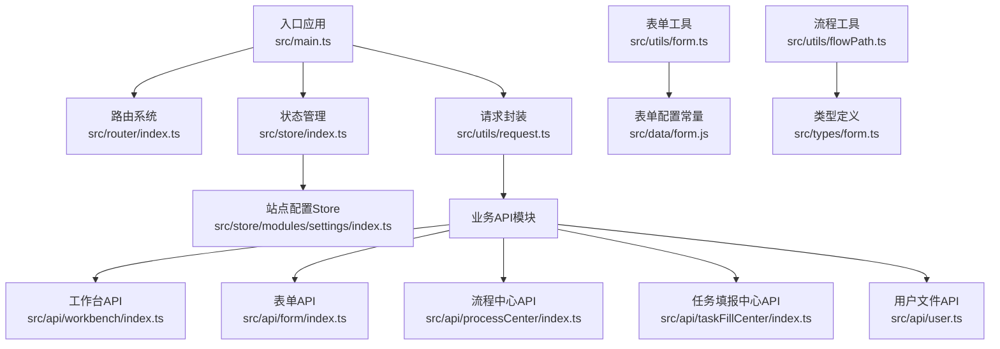
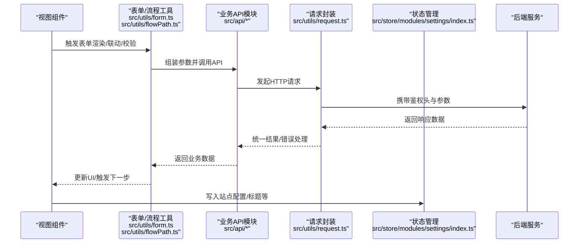
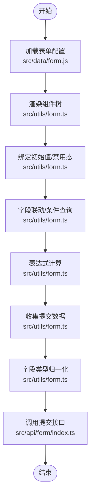
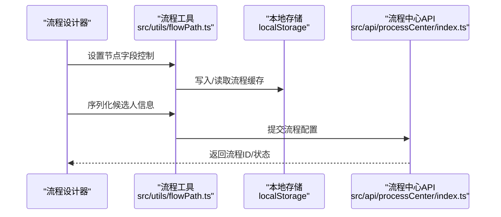
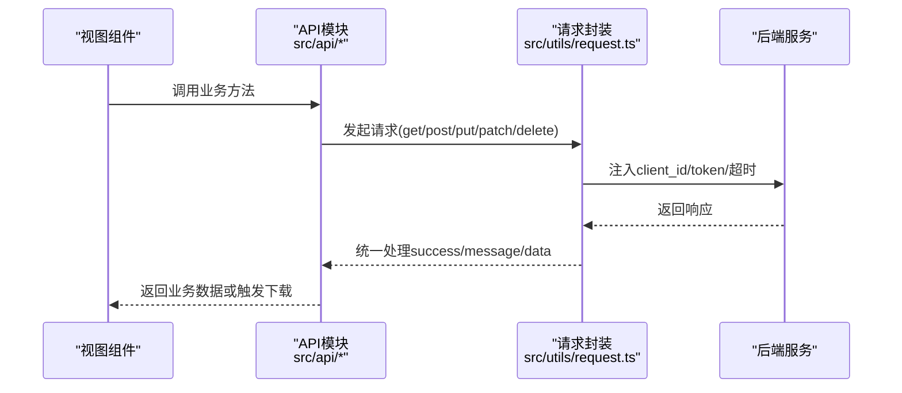
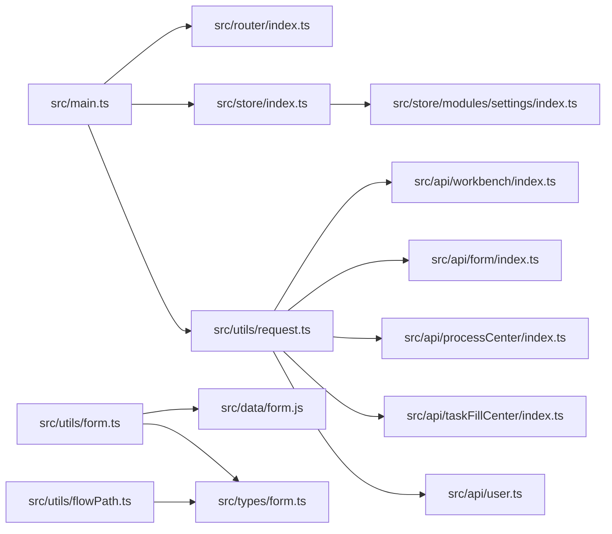

# 数据流设计

<cite>
**本文引用的文件**
- [src/main.ts](file://src/main.ts)
- [src/router/index.ts](file://src/router/index.ts)
- [src/store/index.ts](file://src/store/index.ts)
- [src/store/modules/settings/index.ts](file://src/store/modules/settings/index.ts)
- [src/utils/request.ts](file://src/utils/request.ts)
- [src/utils/form.ts](file://src/utils/form.ts)
- [src/utils/flowPath.ts](file://src/utils/flowPath.ts)
- [src/data/form.js](file://src/data/form.js)
- [src/types/form.ts](file://src/types/form.ts)
- [src/api/workbench/index.ts](file://src/api/workbench/index.ts)
- [src/api/form/index.ts](file://src/api/form/index.ts)
- [src/api/processCenter/index.ts](file://src/api/processCenter/index.ts)
- [src/api/taskFillCenter/index.ts](file://src/api/taskFillCenter/index.ts)
- [src/api/user.ts](file://src/api/user.ts)
</cite>

## 目录
1. [引言](#引言)
2. [项目结构](#项目结构)
3. [核心组件](#核心组件)
4. [架构总览](#架构总览)
5. [详细组件分析](#详细组件分析)
6. [依赖关系分析](#依赖关系分析)
7. [性能考量](#性能考量)
8. [故障排查指南](#故障排查指南)
9. [结论](#结论)
10. [附录](#附录)

## 引言
本文件面向新工作台项目，系统性梳理应用内的数据流设计，覆盖表单数据流、工作流数据流与API数据流。重点阐述数据的获取、转换、验证与持久化路径，明确缓存策略、同步机制与错误处理流程，并给出性能优化建议与一致性保障措施，辅以可视化图示与调试方法，帮助开发者快速理解与维护数据通路。

## 项目结构
前端采用 Vue 3 + Pinia + Vue Router 架构，API 层通过统一请求封装与模块化 API 文件组织，数据层由表单与流程配置常量、工具函数与本地存储共同构成。

图表来源
- [src/main.ts:1-40](file://src/main.ts#L1-L40)
- [src/router/index.ts:1-189](file://src/router/index.ts#L1-L189)
- [src/store/index.ts:1-9](file://src/store/index.ts#L1-L9)
- [src/store/modules/settings/index.ts:1-53](file://src/store/modules/settings/index.ts#L1-L53)
- [src/utils/request.ts:1-159](file://src/utils/request.ts#L1-L159)
- [src/api/workbench/index.ts:1-139](file://src/api/workbench/index.ts#L1-L139)
- [src/api/form/index.ts:1-31](file://src/api/form/index.ts#L1-L31)
- [src/api/processCenter/index.ts:1-47](file://src/api/processCenter/index.ts#L1-L47)
- [src/api/taskFillCenter/index.ts:1-38](file://src/api/taskFillCenter/index.ts#L1-L38)
- [src/api/user.ts:1-16](file://src/api/user.ts#L1-L16)
- [src/utils/form.ts:1-800](file://src/utils/form.ts#L1-L800)
- [src/data/form.js:1-800](file://src/data/form.js#L1-L800)
- [src/utils/flowPath.ts:1-322](file://src/utils/flowPath.ts#L1-L322)
- [src/types/form.ts:1-45](file://src/types/form.ts#L1-L45)

章节来源
- [src/main.ts:1-40](file://src/main.ts#L1-L40)
- [src/router/index.ts:1-189](file://src/router/index.ts#L1-L189)
- [src/store/index.ts:1-9](file://src/store/index.ts#L1-L9)
- [src/store/modules/settings/index.ts:1-53](file://src/store/modules/settings/index.ts#L1-L53)
- [src/utils/request.ts:1-159](file://src/utils/request.ts#L1-L159)

## 核心组件
- 应用入口与全局注册：初始化应用、注册全局组件、挂载路由与状态管理。
- 路由系统：集中声明页面路由，提供导航与守卫。
- 状态管理：Pinia Store 提供站点配置等全局状态。
- 请求封装：统一封装 Axios，内置拦截器、鉴权头注入与错误提示。
- 表单工具：负责表单渲染、数据映射、联动计算、提交归一化。
- 流程工具：负责流程节点字段控制、候选人序列化、本地缓存。
- API 模块：按业务域拆分，统一使用请求封装调用后端接口。
- 类型定义：约束表单与流程数据结构，提升开发体验与可维护性。

章节来源
- [src/main.ts:1-40](file://src/main.ts#L1-L40)
- [src/router/index.ts:1-189](file://src/router/index.ts#L1-L189)
- [src/store/index.ts:1-9](file://src/store/index.ts#L1-L9)
- [src/store/modules/settings/index.ts:1-53](file://src/store/modules/settings/index.ts#L1-L53)
- [src/utils/request.ts:1-159](file://src/utils/request.ts#L1-L159)
- [src/utils/form.ts:1-800](file://src/utils/form.ts#L1-L800)
- [src/utils/flowPath.ts:1-322](file://src/utils/flowPath.ts#L1-L322)
- [src/types/form.ts:1-45](file://src/types/form.ts#L1-L45)

## 架构总览
整体数据流遵循“视图 -> 工具函数/Store -> API -> 后端”的链路，结合本地缓存与状态持久化，确保在复杂表单与流程场景下的稳定运行。

图表来源
- [src/utils/form.ts:1-800](file://src/utils/form.ts#L1-L800)
- [src/utils/flowPath.ts:1-322](file://src/utils/flowPath.ts#L1-L322)
- [src/api/workbench/index.ts:1-139](file://src/api/workbench/index.ts#L1-L139)
- [src/api/form/index.ts:1-31](file://src/api/form/index.ts#L1-L31)
- [src/api/processCenter/index.ts:1-47](file://src/api/processCenter/index.ts#L1-L47)
- [src/api/taskFillCenter/index.ts:1-38](file://src/api/taskFillCenter/index.ts#L1-L38)
- [src/utils/request.ts:1-159](file://src/utils/request.ts#L1-L159)
- [src/store/modules/settings/index.ts:1-53](file://src/store/modules/settings/index.ts#L1-L53)

## 详细组件分析

### 表单数据流
表单数据流贯穿“渲染 -> 映射 -> 联动 -> 计算 -> 提交 -> 归一化”全流程，工具函数对多类型字段、关联数据、子表单等进行统一处理。

图表来源
- [src/data/form.js:1-800](file://src/data/form.js#L1-L800)
- [src/utils/form.ts:1-800](file://src/utils/form.ts#L1-L800)
- [src/api/form/index.ts:1-31](file://src/api/form/index.ts#L1-L31)

章节来源
- [src/data/form.js:1-800](file://src/data/form.js#L1-L800)
- [src/utils/form.ts:1-800](file://src/utils/form.ts#L1-L800)
- [src/api/form/index.ts:1-31](file://src/api/form/index.ts#L1-L31)

### 工作流数据流
工作流数据流围绕“节点字段控制 -> 候选人序列化 -> 本地缓存 -> 流程树构建”展开，确保流程设计器与运行时的一致性。

图表来源
- [src/utils/flowPath.ts:1-322](file://src/utils/flowPath.ts#L1-L322)
- [src/api/processCenter/index.ts:1-47](file://src/api/processCenter/index.ts#L1-L47)

章节来源
- [src/utils/flowPath.ts:1-322](file://src/utils/flowPath.ts#L1-L322)
- [src/api/processCenter/index.ts:1-47](file://src/api/processCenter/index.ts#L1-L47)

### API 数据流
API 层按业务域拆分，统一通过请求封装发送 HTTP 请求，支持 Blob 下载、鉴权头注入与全局错误提示。

图表来源
- [src/api/workbench/index.ts:1-139](file://src/api/workbench/index.ts#L1-L139)
- [src/api/form/index.ts:1-31](file://src/api/form/index.ts#L1-L31)
- [src/api/processCenter/index.ts:1-47](file://src/api/processCenter/index.ts#L1-L47)
- [src/api/taskFillCenter/index.ts:1-38](file://src/api/taskFillCenter/index.ts#L1-L38)
- [src/api/user.ts:1-16](file://src/api/user.ts#L1-L16)
- [src/utils/request.ts:1-159](file://src/utils/request.ts#L1-L159)

章节来源
- [src/api/workbench/index.ts:1-139](file://src/api/workbench/index.ts#L1-L139)
- [src/api/form/index.ts:1-31](file://src/api/form/index.ts#L1-L31)
- [src/api/processCenter/index.ts:1-47](file://src/api/processCenter/index.ts#L1-L47)
- [src/api/taskFillCenter/index.ts:1-38](file://src/api/taskFillCenter/index.ts#L1-L38)
- [src/api/user.ts:1-16](file://src/api/user.ts#L1-L16)
- [src/utils/request.ts:1-159](file://src/utils/request.ts#L1-L159)

## 依赖关系分析
- 入口应用依赖路由与状态管理；状态管理依赖站点配置模块；请求封装被所有 API 模块复用。
- 表单工具依赖表单配置常量、通用 API（如人员/部门查询）、表达式计算模块。
- 流程工具依赖表单配置与类型定义，同时与流程中心 API 交互。
- API 模块依赖请求封装，按业务域划分，避免耦合扩散。

图表来源
- [src/main.ts:1-40](file://src/main.ts#L1-L40)
- [src/router/index.ts:1-189](file://src/router/index.ts#L1-L189)
- [src/store/index.ts:1-9](file://src/store/index.ts#L1-L9)
- [src/store/modules/settings/index.ts:1-53](file://src/store/modules/settings/index.ts#L1-L53)
- [src/utils/request.ts:1-159](file://src/utils/request.ts#L1-L159)
- [src/utils/form.ts:1-800](file://src/utils/form.ts#L1-L800)
- [src/utils/flowPath.ts:1-322](file://src/utils/flowPath.ts#L1-L322)
- [src/data/form.js:1-800](file://src/data/form.js#L1-L800)
- [src/types/form.ts:1-45](file://src/types/form.ts#L1-L45)
- [src/api/workbench/index.ts:1-139](file://src/api/workbench/index.ts#L1-L139)
- [src/api/form/index.ts:1-31](file://src/api/form/index.ts#L1-L31)
- [src/api/processCenter/index.ts:1-47](file://src/api/processCenter/index.ts#L1-L47)
- [src/api/taskFillCenter/index.ts:1-38](file://src/api/taskFillCenter/index.ts#L1-L38)
- [src/api/user.ts:1-16](file://src/api/user.ts#L1-L16)

章节来源
- [src/main.ts:1-40](file://src/main.ts#L1-L40)
- [src/router/index.ts:1-189](file://src/router/index.ts#L1-L189)
- [src/store/index.ts:1-9](file://src/store/index.ts#L1-L9)
- [src/store/modules/settings/index.ts:1-53](file://src/store/modules/settings/index.ts#L1-L53)
- [src/utils/request.ts:1-159](file://src/utils/request.ts#L1-L159)
- [src/utils/form.ts:1-800](file://src/utils/form.ts#L1-L800)
- [src/utils/flowPath.ts:1-322](file://src/utils/flowPath.ts#L1-L322)
- [src/data/form.js:1-800](file://src/data/form.js#L1-L800)
- [src/types/form.ts:1-45](file://src/types/form.ts#L1-L45)
- [src/api/workbench/index.ts:1-139](file://src/api/workbench/index.ts#L1-L139)
- [src/api/form/index.ts:1-31](file://src/api/form/index.ts#L1-L31)
- [src/api/processCenter/index.ts:1-47](file://src/api/processCenter/index.ts#L1-L47)
- [src/api/taskFillCenter/index.ts:1-38](file://src/api/taskFillCenter/index.ts#L1-L38)
- [src/api/user.ts:1-16](file://src/api/user.ts#L1-L16)

## 性能考量
- 请求并发与节流
  - 对高频联动/查询场景，建议在工具函数中引入防抖/节流，减少不必要的请求。
  - 批量操作（如批量上传、批量查询）优先使用后端提供的批量接口，降低往返次数。
- 缓存与懒加载
  - 利用流程工具的本地缓存能力，避免重复序列化与网络请求。
  - 对静态配置（如表单组件元数据）采用按需加载与内存缓存，减少首屏压力。
- 渲染优化
  - 子表单与复杂联动场景，采用虚拟滚动与延迟渲染，仅在可视区域生成节点。
  - 表达式计算结果缓存，避免重复计算。
- 错误与重试
  - 在请求封装中增加幂等与指数退避重试策略，针对 5xx/网络波动场景提升成功率。
  - 对于 Blob 下载与大文件上传，提供进度反馈与断点续传能力（需后端配合）。

## 故障排查指南
- 鉴权失败
  - 现象：返回 401 或自动跳转登录。
  - 排查：确认本地 token 是否存在且未过期；检查请求拦截器是否正确注入 token 与 client_id。
- 请求超时/网络异常
  - 现象：全局提示“请求超时/网络错误”。
  - 排查：检查 baseURL 与超时配置；确认后端服务可用性与跨域设置。
- 数据不一致
  - 现象：联动/计算结果与预期不符。
  - 排查：核对字段映射与归一化逻辑；检查表达式计算与异步赋值时机（如 setTimeout 的时序）。
- 流程缓存异常
  - 现象：流程编辑后刷新丢失或显示异常。
  - 排查：确认本地缓存键与写入时机；必要时清理缓存并重新加载。

章节来源
- [src/utils/request.ts:1-159](file://src/utils/request.ts#L1-L159)
- [src/utils/form.ts:1-800](file://src/utils/form.ts#L1-L800)
- [src/utils/flowPath.ts:1-322](file://src/utils/flowPath.ts#L1-L322)

## 结论
本项目通过统一的请求封装与模块化 API 设计，结合表单与流程工具的强数据处理能力，形成了清晰、可扩展的数据流体系。借助本地缓存与状态持久化，兼顾了用户体验与系统稳定性。后续可在并发控制、缓存命中率与错误恢复方面持续优化，进一步提升复杂场景下的性能与可靠性。

## 附录
- 数据流示例（调试方法）
  - 表单提交：在提交前打印 formData 收集结果，确认字段类型归一化是否符合预期。
  - 联动查询：在条件变更处打点，观察查询触发与选项更新时序。
  - 流程序列化：在写入本地缓存前后对比流程对象，确保候选人与字段控制正确落盘。
  - API 调用：在请求封装中增加日志输出，记录请求 URL、参数与响应状态码，便于定位问题。