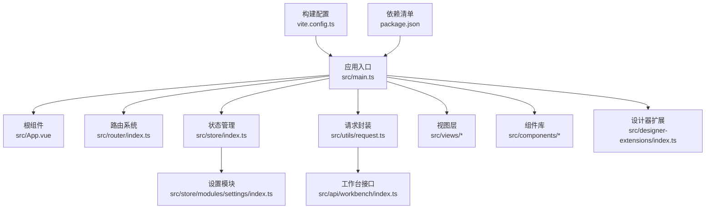
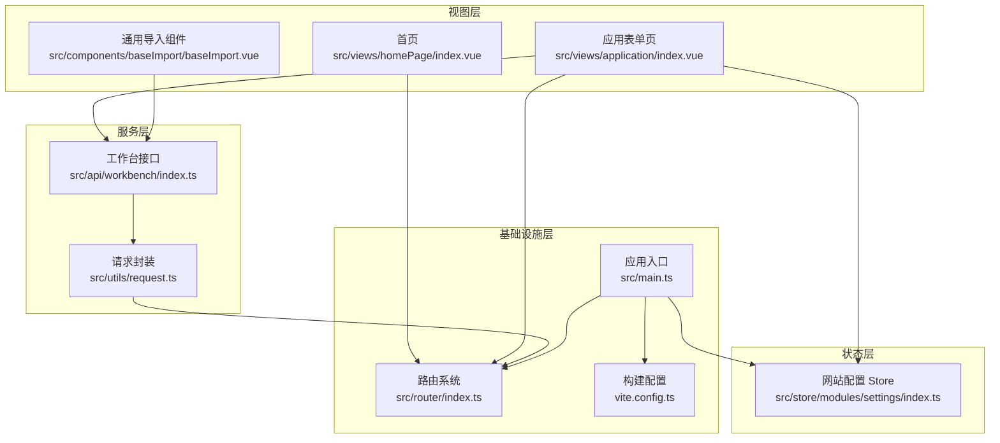
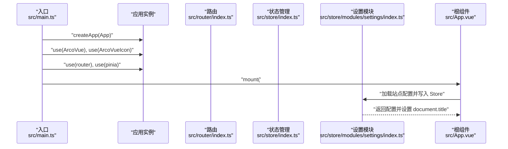
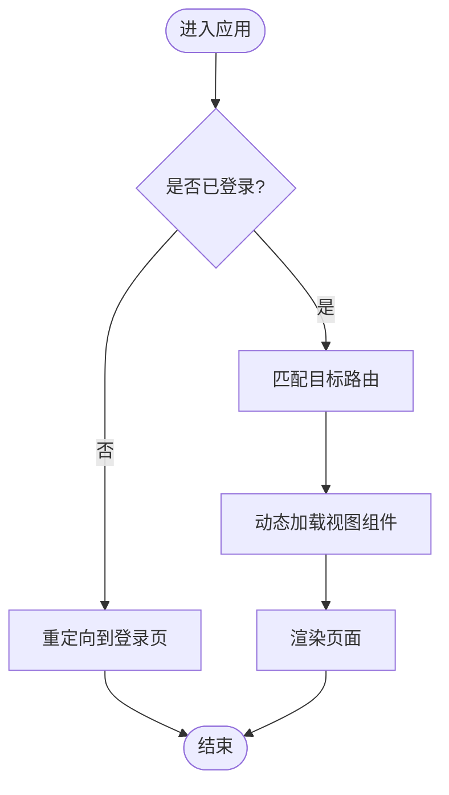
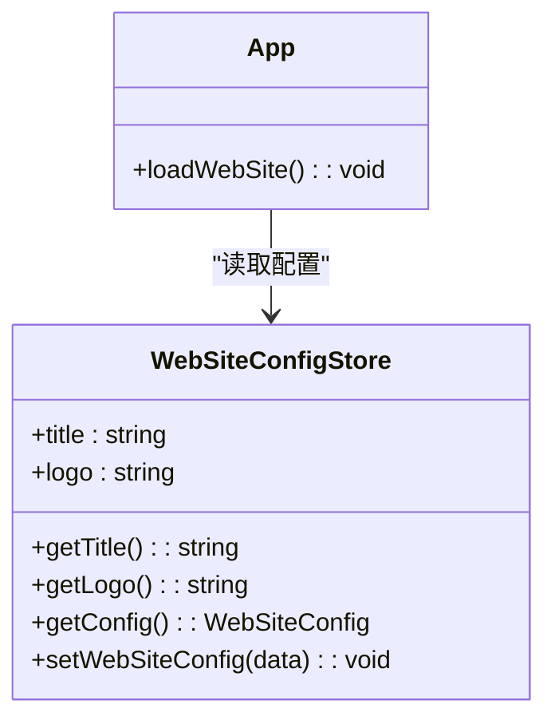
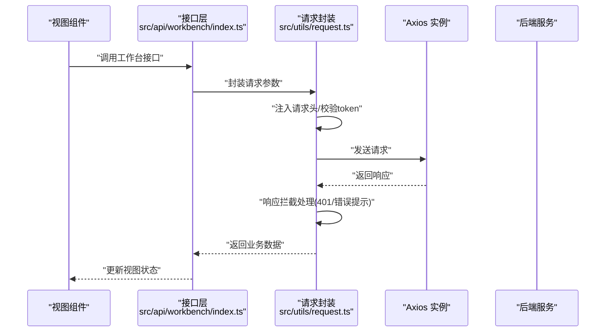
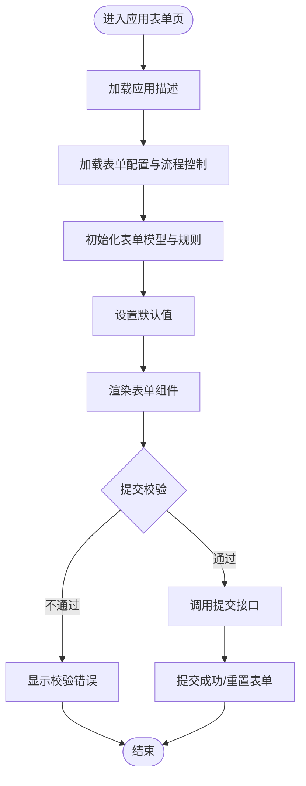
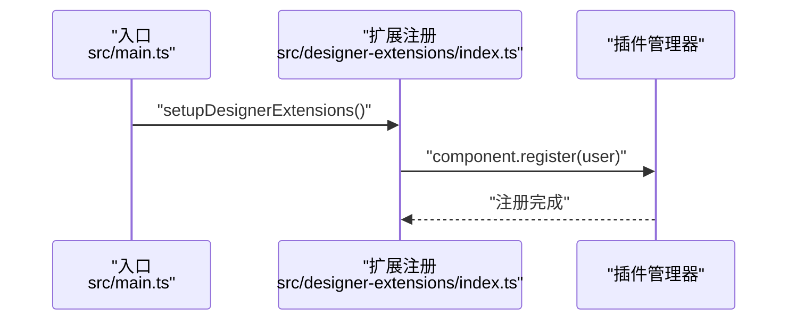
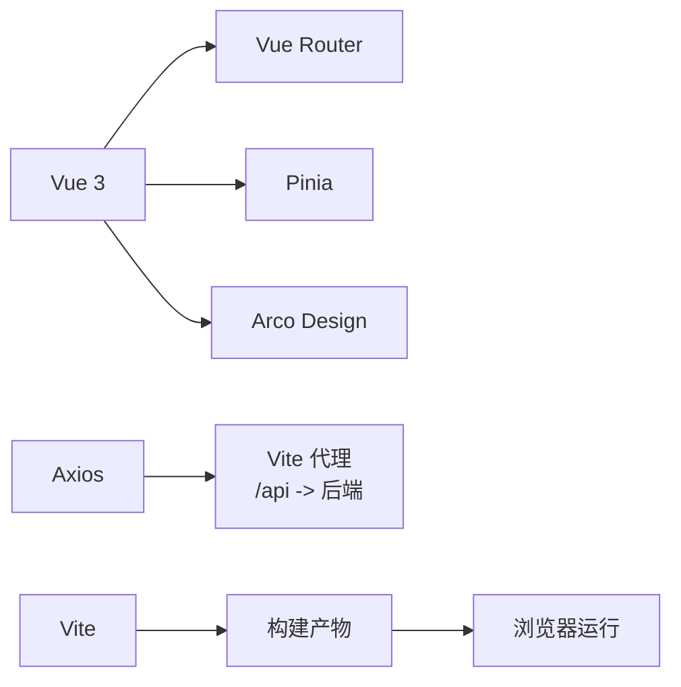

# 整体架构

<cite>
**本文引用的文件**
- [src/main.ts](file://src/main.ts)
- [src/App.vue](file://src/App.vue)
- [src/router/index.ts](file://src/router/index.ts)
- [src/store/index.ts](file://src/store/index.ts)
- [src/store/modules/settings/index.ts](file://src/store/modules/settings/index.ts)
- [src/utils/request.ts](file://src/utils/request.ts)
- [src/api/workbench/index.ts](file://src/api/workbench/index.ts)
- [src/views/homePage/index.vue](file://src/views/homePage/index.vue)
- [src/views/application/index.vue](file://src/views/application/index.vue)
- [src/components/baseImport/baseImport.vue](file://src/components/baseImport/baseImport.vue)
- [src/designer-extensions/index.ts](file://src/designer-extensions/index.ts)
- [package.json](file://package.json)
- [vite.config.ts](file://vite.config.ts)
- [README.md](file://README.md)
</cite>

## 目录
1. [引言](#引言)
2. [项目结构](#项目结构)
3. [核心组件](#核心组件)
4. [架构总览](#架构总览)
5. [详细组件分析](#详细组件分析)
6. [依赖分析](#依赖分析)
7. [性能考虑](#性能考虑)
8. [故障排查指南](#故障排查指南)
9. [结论](#结论)
10. [附录](#附录)

## 引言
本项目为基于 Vue 3 的企业级工作台（工作流管理）系统，采用 MVVM 模式与模块化、分层设计，结合 Pinia 状态管理、Vue Router 路由体系、Axios 封装的请求层以及 Arco Design 组件库，构建高内聚、低耦合的前端架构。项目强调可扩展性与可维护性，围绕“视图层-状态层-服务层-基础设施层”的分层原则组织代码，并通过插件化机制扩展设计器能力。

## 项目结构
项目采用按功能域划分的模块化组织方式，核心目录与职责如下：
- src/main.ts：应用入口，负责应用实例创建、全局插件注册、组件自动注册、路由与状态管理挂载。
- src/App.vue：根组件，负责站点配置加载与全局样式初始化。
- src/router/index.ts：路由定义与守卫，统一管理页面导航。
- src/store：状态管理层，使用 Pinia，包含网站配置等全局状态。
- src/utils/request.ts：HTTP 请求封装，统一处理请求头、鉴权、响应拦截与错误提示。
- src/api：业务接口层，按领域拆分，如工作台、应用、流程中心等。
- src/views：页面视图层，承载具体业务页面与交互。
- src/components：通用组件库，提供可复用的 UI 与业务组件。
- src/designer-extensions：设计器扩展插件，通过插件管理器注册自定义组件。
- vite.config.ts：Vite 构建与开发服务器配置，含代理、路径别名与资源处理。
- package.json：依赖与脚本管理。

**图表来源**
- [src/main.ts:1-40](file://src/main.ts#L1-L40)
- [src/App.vue:1-52](file://src/App.vue#L1-L52)
- [src/router/index.ts:1-189](file://src/router/index.ts#L1-L189)
- [src/store/index.ts:1-9](file://src/store/index.ts#L1-L9)
- [src/store/modules/settings/index.ts:1-53](file://src/store/modules/settings/index.ts#L1-L53)
- [src/utils/request.ts:1-159](file://src/utils/request.ts#L1-L159)
- [src/api/workbench/index.ts:1-139](file://src/api/workbench/index.ts#L1-L139)
- [src/designer-extensions/index.ts:1-9](file://src/designer-extensions/index.ts#L1-L9)
- [vite.config.ts:1-37](file://vite.config.ts#L1-L37)
- [package.json:1-62](file://package.json#L1-L62)

**章节来源**
- [src/main.ts:1-40](file://src/main.ts#L1-L40)
- [src/App.vue:1-52](file://src/App.vue#L1-L52)
- [src/router/index.ts:1-189](file://src/router/index.ts#L1-L189)
- [src/store/index.ts:1-9](file://src/store/index.ts#L1-L9)
- [src/store/modules/settings/index.ts:1-53](file://src/store/modules/settings/index.ts#L1-L53)
- [src/utils/request.ts:1-159](file://src/utils/request.ts#L1-L159)
- [src/api/workbench/index.ts:1-139](file://src/api/workbench/index.ts#L1-L139)
- [src/designer-extensions/index.ts:1-9](file://src/designer-extensions/index.ts#L1-L9)
- [vite.config.ts:1-37](file://vite.config.ts#L1-L37)
- [package.json:1-62](file://package.json#L1-L62)

## 核心组件
- 应用初始化与插件系统
  - 在入口中创建应用实例，注册 Arco Design 组件库与图标插件，挂载路由与状态管理；同时通过 glob 自动注册组件，提升可维护性与一致性。
  - 设计器扩展通过插件管理器注册自定义组件，便于在表单设计器场景下扩展能力。
- 根组件与全局配置
  - 根组件在启动时拉取站点配置并写入 Pinia，随后在 getter 中拼接带 token 的图片地址，确保全局标题与配置一致。
- 路由与页面导航
  - 路由采用按需加载与命名路由，覆盖工作台、应用、流程、人员、权限、设置、安全中心、任务中心等模块。
- 状态管理
  - 使用 Pinia 定义网站配置 Store，提供标题、Logo 获取与本地持久化能力，getter 中对 Logo 进行动态拼接，减少重复计算。
- 请求封装与接口层
  - 基于 Axios 封装 Request 类，统一设置 baseURL、超时、请求头注入（client_id、token）、白名单放行、响应拦截与错误提示；接口层按领域拆分，清晰隔离业务边界。

**章节来源**
- [src/main.ts:1-40](file://src/main.ts#L1-L40)
- [src/App.vue:6-16](file://src/App.vue#L6-L16)
- [src/store/modules/settings/index.ts:10-49](file://src/store/modules/settings/index.ts#L10-L49)
- [src/router/index.ts:4-189](file://src/router/index.ts#L4-L189)
- [src/utils/request.ts:15-159](file://src/utils/request.ts#L15-L159)
- [src/api/workbench/index.ts:1-139](file://src/api/workbench/index.ts#L1-L139)

## 架构总览
本项目采用“视图层-状态层-服务层-基础设施层”的分层设计：
- 视图层（Views）：页面组件，负责用户交互与视图渲染。
- 状态层（Store/Pinia）：集中管理全局状态与派生状态（getters），降低组件间通信成本。
- 服务层（API/Utils）：封装业务接口与通用工具，提供稳定的数据访问与处理能力。
- 基础设施层（Router/Plugins/Vite）：提供路由导航、插件系统、构建与开发环境支持。

**图表来源**
- [src/views/homePage/index.vue:1-102](file://src/views/homePage/index.vue#L1-L102)
- [src/views/application/index.vue:1-194](file://src/views/application/index.vue#L1-L194)
- [src/components/baseImport/baseImport.vue:1-172](file://src/components/baseImport/baseImport.vue#L1-L172)
- [src/store/modules/settings/index.ts:1-53](file://src/store/modules/settings/index.ts#L1-L53)
- [src/utils/request.ts:1-159](file://src/utils/request.ts#L1-L159)
- [src/api/workbench/index.ts:1-139](file://src/api/workbench/index.ts#L1-L139)
- [src/router/index.ts:1-189](file://src/router/index.ts#L1-L189)
- [src/main.ts:1-40](file://src/main.ts#L1-L40)
- [vite.config.ts:1-37](file://vite.config.ts#L1-L37)

## 详细组件分析

### 应用初始化与插件系统
- 初始化流程
  - 创建 Vue 应用实例，注册 Arco Design 及图标插件，挂载路由与 Pinia。
  - 通过 glob 扫描并注册组件，避免手动逐个注册，提升可维护性。
  - 注册设计器扩展插件，向插件管理器注册自定义组件，增强表单设计器能力。
- 全局配置管理
  - 在根组件启动时拉取站点配置，写入 Store 并持久化至本地存储，供全局使用。
  - Getter 对 Logo 进行动态拼接，统一注入 token，减少重复逻辑。

**图表来源**
- [src/main.ts:1-40](file://src/main.ts#L1-L40)
- [src/App.vue:6-16](file://src/App.vue#L6-L16)
- [src/store/modules/settings/index.ts:42-49](file://src/store/modules/settings/index.ts#L42-L49)

**章节来源**
- [src/main.ts:1-40](file://src/main.ts#L1-L40)
- [src/App.vue:6-16](file://src/App.vue#L6-L16)
- [src/store/modules/settings/index.ts:1-53](file://src/store/modules/settings/index.ts#L1-L53)

### 路由与页面导航
- 路由定义
  - 包含登录、首页、流程中心、应用、表单、流程路径、部门、岗位、角色、用户、字典、领导、分类、访客、管理员、开发者、图标库、设置、安全中心、待办中心、任务中心、连接器、输出中心、报表等路由。
  - 使用按需加载与命名路由，提升首屏性能与可维护性。
- 路由守卫
  - 提供 beforeEach 钩子，可用于鉴权与全局逻辑处理。

**图表来源**
- [src/router/index.ts:182-188](file://src/router/index.ts#L182-L188)

**章节来源**
- [src/router/index.ts:1-189](file://src/router/index.ts#L1-L189)

### 状态管理（Pinia）
- Store 设计
  - 定义网站配置 Store，包含 title、logo 等字段，提供 getters 计算标题与带 token 的 Logo 地址，actions 写入配置并设置 document.title。
  - 通过本地存储持久化配置，避免每次刷新丢失。
- 与根组件协作
  - 根组件在启动时调用接口获取配置，写入 Store，随后在视图层通过 getter 获取标题与 Logo。

**图表来源**
- [src/store/modules/settings/index.ts:1-53](file://src/store/modules/settings/index.ts#L1-L53)
- [src/App.vue:6-16](file://src/App.vue#L6-L16)

**章节来源**
- [src/store/modules/settings/index.ts:1-53](file://src/store/modules/settings/index.ts#L1-L53)
- [src/App.vue:6-16](file://src/App.vue#L6-L16)

### 请求封装与接口层
- Request 类
  - 统一 baseURL、超时时间；请求拦截注入 client_id 与 token（白名单放行）；响应拦截处理 401 跳转、错误消息提示与数据解包。
- 接口层
  - 工作台接口示例：待办/已办/抄送/申请等分页查询、审批操作、流程日志、导出与打印等，均通过统一的 Request 实例调用。

**图表来源**
- [src/api/workbench/index.ts:1-139](file://src/api/workbench/index.ts#L1-L139)
- [src/utils/request.ts:15-159](file://src/utils/request.ts#L15-L159)

**章节来源**
- [src/utils/request.ts:15-159](file://src/utils/request.ts#L15-L159)
- [src/api/workbench/index.ts:1-139](file://src/api/workbench/index.ts#L1-L139)

### 视图层与业务组件
- 首页视图
  - 组织 Banner、Top、MyApp 等子组件，负责页面布局与基础交互。
- 应用表单页
  - 加载应用描述与表单配置，结合流程控制、默认值、表达式与字段控制，提供完整的表单渲染与提交流程。
  - 通过 provide/inject 向子组件注入上下文，简化跨层级通信。
- 通用导入组件
  - 支持模板下载、文件上传、错误提示与失败数据回传下载，统一处理导入流程。

**图表来源**
- [src/views/application/index.vue:61-157](file://src/views/application/index.vue#L61-L157)

**章节来源**
- [src/views/homePage/index.vue:1-102](file://src/views/homePage/index.vue#L1-L102)
- [src/views/application/index.vue:1-194](file://src/views/application/index.vue#L1-L194)
- [src/components/baseImport/baseImport.vue:1-172](file://src/components/baseImport/baseImport.vue#L1-L172)

### 设计器扩展与插件系统
- 扩展注册
  - 通过插件管理器注册自定义组件，便于在表单设计器中扩展能力，提升可扩展性与复用性。

**图表来源**
- [src/main.ts:1-40](file://src/main.ts#L1-L40)
- [src/designer-extensions/index.ts:1-9](file://src/designer-extensions/index.ts#L1-L9)

**章节来源**
- [src/designer-extensions/index.ts:1-9](file://src/designer-extensions/index.ts#L1-L9)
- [src/main.ts:1-40](file://src/main.ts#L1-L40)

## 依赖分析
- 技术栈与选型
  - 前端框架：Vue 3 + TypeScript，提供类型安全与现代化开发体验。
  - 状态管理：Pinia，轻量且易于组合，适合复杂应用的状态管理。
  - 路由：Vue Router，支持命名路由与懒加载，满足多页面导航需求。
  - UI 组件库：Arco Design，提供丰富的业务组件与主题定制能力。
  - HTTP：Axios + 封装，统一处理鉴权、错误与响应数据结构。
  - 构建：Vite，快速冷启与热更新，配合 svg-loader、路径别名与代理。
- 外部依赖与集成点
  - 通过代理将 /api 前缀转发至后端服务，支持跨域调试。
  - 本地存储用于站点配置与 token 管理，提升用户体验与安全性。

**图表来源**
- [package.json:13-43](file://package.json#L13-L43)
- [vite.config.ts:8-24](file://vite.config.ts#L8-L24)
- [src/utils/request.ts:20](file://src/utils/request.ts#L20)

**章节来源**
- [package.json:1-62](file://package.json#L1-L62)
- [vite.config.ts:1-37](file://vite.config.ts#L1-L37)
- [src/utils/request.ts:15-159](file://src/utils/request.ts#L15-L159)

## 性能考虑
- 路由与组件加载
  - 使用按需加载与命名路由，减少首屏体积与初次渲染压力。
- 组件注册
  - 通过 glob 自动注册组件，避免重复注册与遗漏，提升维护效率。
- 请求与缓存
  - 统一请求头注入与白名单放行，减少无效请求；响应拦截统一处理错误，避免异常传播。
- 构建优化
  - Vite 快速构建与热更新，路径别名与资源处理提升开发体验。
- 可扩展性
  - 插件化扩展设计器能力，便于后续新增组件与功能模块。

[本节为通用指导，无需特定文件引用]

## 故障排查指南
- 登录态与鉴权
  - 若出现 401，请求拦截会跳转至登录页；检查本地 token 是否存在与有效。
- 接口错误
  - 响应拦截会根据状态码弹出错误提示；若无提示，检查响应结构与业务 code 字段。
- 跨域问题
  - 开发环境下通过 Vite 代理 /api 前缀，确认代理配置与后端地址一致。
- 配置加载
  - 根组件启动时拉取站点配置，若标题或 Logo 异常，检查接口返回与本地存储内容。

**章节来源**
- [src/utils/request.ts:47-113](file://src/utils/request.ts#L47-L113)
- [src/App.vue:10-14](file://src/App.vue#L10-L14)
- [vite.config.ts:12-20](file://vite.config.ts#L12-L20)

## 结论
本项目以 MVVM 为核心，结合模块化与分层设计，构建了面向企业级工作流管理的前端架构。通过 Pinia 管理全局状态、Vue Router 提供导航能力、Axios 封装统一请求、Arco Design 提供丰富组件，辅以插件化扩展与 Vite 构建工具链，形成高内聚、低耦合、易扩展的系统。建议在后续迭代中持续完善接口契约、引入单元测试与性能监控，进一步提升系统的稳定性与可观测性。

[本节为总结性内容，无需特定文件引用]

## 附录
- 项目初始化与开发
  - 使用 Vite 启动开发服务器，默认监听端口，可通过代理访问后端服务。
  - 依赖通过 package.json 管理，包含 Vue 3、TypeScript、Arco Design、Axios、Pinia、Vue Router 等核心依赖。

**章节来源**
- [README.md:1-6](file://README.md#L1-L6)
- [vite.config.ts:8-24](file://vite.config.ts#L8-L24)
- [package.json:13-43](file://package.json#L13-L43)