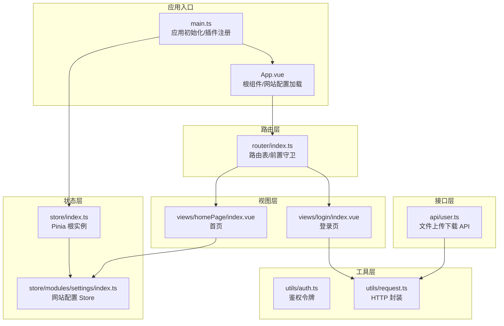
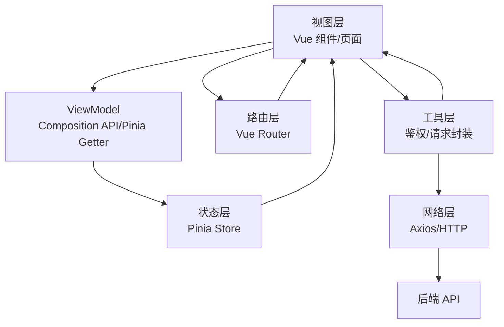
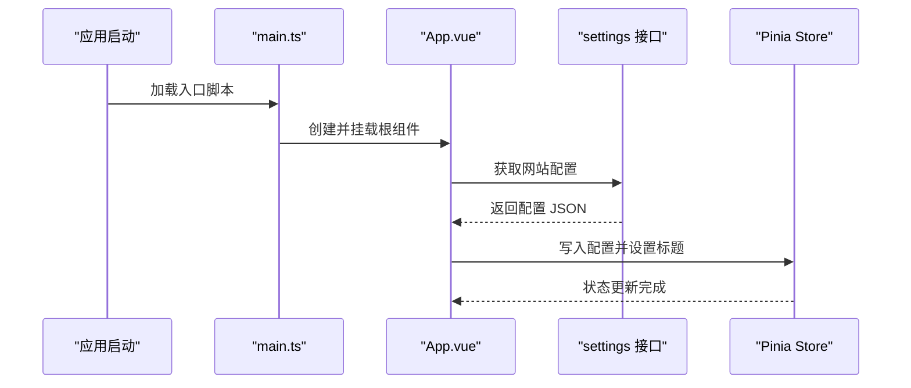
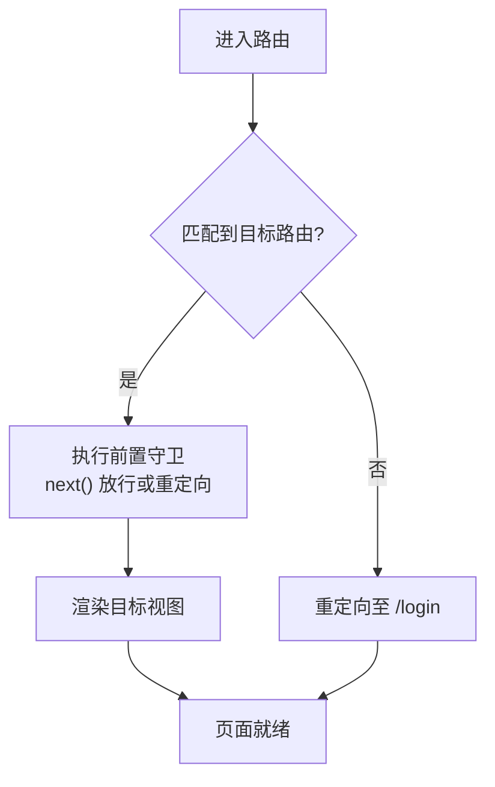
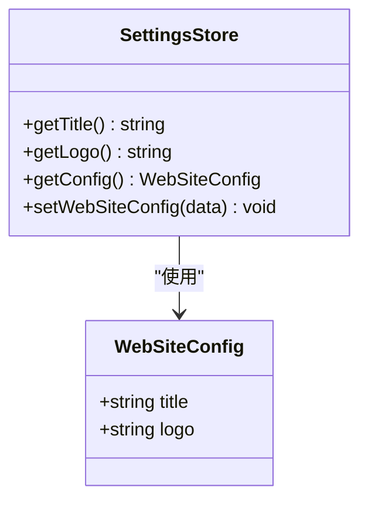
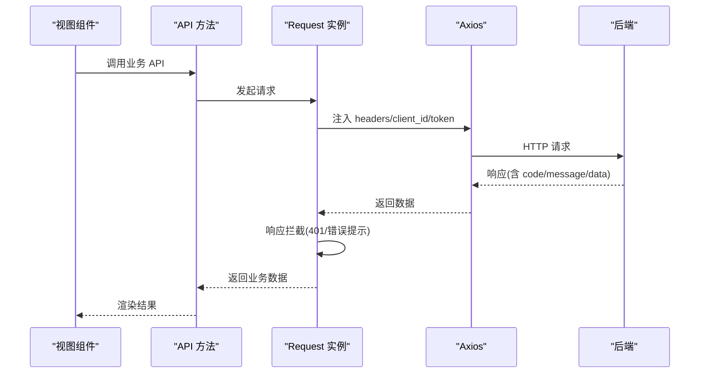
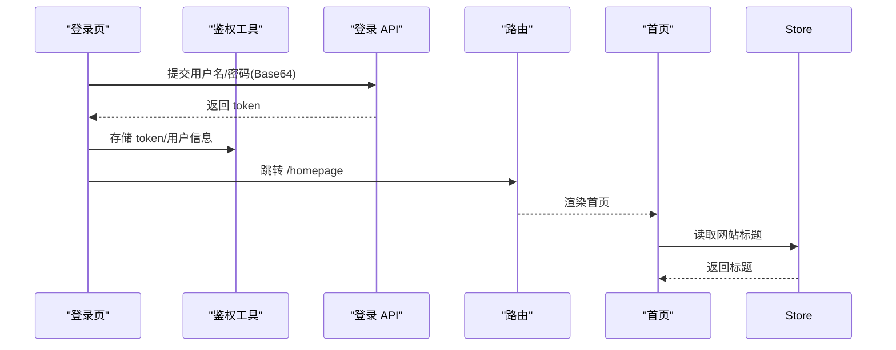
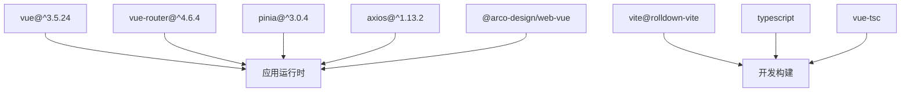

# 架构设计

<cite>
**本文引用的文件**
- [main.ts](file://src/main.ts)
- [App.vue](file://src/App.vue)
- [router/index.ts](file://src/router/index.ts)
- [store/index.ts](file://src/store/index.ts)
- [store/modules/settings/index.ts](file://src/store/modules/settings/index.ts)
- [store/modules/settings/types.ts](file://src/store/modules/settings/types.ts)
- [utils/auth.ts](file://src/utils/auth.ts)
- [utils/request.ts](file://src/utils/request.ts)
- [views/homePage/index.vue](file://src/views/homePage/index.vue)
- [views/login/index.vue](file://src/views/login/index.vue)
- [components/appCategory/appCategory.vue](file://src/components/appCategory/appCategory.vue)
- [api/user.ts](file://src/api/user.ts)
- [package.json](file://package.json)
- [README.md](file://README.md)
- [ISSUES_REPORT.md](file://ISSUES_REPORT.md)
</cite>

## 目录
1. [引言](#引言)
2. [项目结构](#项目结构)
3. [核心组件](#核心组件)
4. [架构总览](#架构总览)
5. [详细组件分析](#详细组件分析)
6. [依赖分析](#依赖分析)
7. [性能考虑](#性能考虑)
8. [故障排查指南](#故障排查指南)
9. [结论](#结论)
10. [附录](#附录)

## 引言
本架构设计文档面向新工作台项目，系统性阐述基于 Vue 3 + TypeScript 的 MVVM 架构与组件化设计原则，覆盖分层架构、状态管理（Pinia）、路由系统（Vue Router）与权限控制机制。文档同时解释模块划分策略、组件间通信与数据流，并给出架构决策的技术考量、性能优化策略与可扩展性设计，辅以架构图与组件关系图，帮助开发者快速理解整体设计。

## 项目结构
项目采用“视图-路由-状态-工具-接口-组件”分层组织，结合按功能域划分的模块目录，形成清晰的职责边界与可维护性。

- 入口与应用根：入口在应用根节点挂载路由视图，全局样式与网站配置在根组件加载。
- 视图层：views 下按业务域划分页面，如登录、首页、应用管理、流程中心等。
- 路由层：集中定义路由表与前置守卫，统一处理鉴权与重定向。
- 状态层：Pinia Store 提供跨组件共享的状态，当前聚焦网站配置。
- 工具层：封装请求、鉴权、环境变量、事件等通用能力。
- 接口层：按领域拆分 API 文件，统一通过请求工具发送 HTTP 请求。
- 组件层：基础 UI 与业务组件分离，支持全局注册与局部引入。



**图表来源**
- [main.ts:1-40](file://src/main.ts#L1-L40)
- [App.vue:1-52](file://src/App.vue#L1-L52)
- [router/index.ts:1-189](file://src/router/index.ts#L1-L189)
- [store/index.ts:1-9](file://src/store/index.ts#L1-L9)
- [store/modules/settings/index.ts:1-53](file://src/store/modules/settings/index.ts#L1-L53)
- [utils/auth.ts:1-20](file://src/utils/auth.ts#L1-L20)
- [utils/request.ts:1-159](file://src/utils/request.ts#L1-L159)
- [views/login/index.vue:1-540](file://src/views/login/index.vue#L1-L540)
- [views/homePage/index.vue:1-102](file://src/views/homePage/index.vue#L1-L102)
- [api/user.ts:1-16](file://src/api/user.ts#L1-L16)

**章节来源**
- [main.ts:1-40](file://src/main.ts#L1-L40)
- [router/index.ts:1-189](file://src/router/index.ts#L1-L189)
- [store/index.ts:1-9](file://src/store/index.ts#L1-L9)
- [store/modules/settings/index.ts:1-53](file://src/store/modules/settings/index.ts#L1-L53)
- [utils/request.ts:1-159](file://src/utils/request.ts#L1-L159)
- [utils/auth.ts:1-20](file://src/utils/auth.ts#L1-L20)
- [views/login/index.vue:1-540](file://src/views/login/index.vue#L1-L540)
- [views/homePage/index.vue:1-102](file://src/views/homePage/index.vue#L1-L102)
- [api/user.ts:1-16](file://src/api/user.ts#L1-L16)

## 核心组件
- 应用入口与插件注册：创建应用实例、全局组件注册、安装 Pinia、Vue Router 与 Arco 主题。
- 根组件：启动时拉取网站配置并写入 Pinia Store，动态设置页面标题。
- 路由系统：集中声明路由表，使用 beforeEach 守卫预留鉴权逻辑。
- 状态管理：Pinia Store 提供网站配置的读取与持久化。
- 请求封装：Axios 封装，统一注入 client_id 与 token，处理 401 重定向与错误提示。
- 登录视图：表单校验、密码 Base64 编码、调用登录 API 并写入本地存储，跳转首页。
- 组件示例：基础 Badge 标签组件，展示属性驱动的简单组件形态。

**章节来源**
- [main.ts:1-40](file://src/main.ts#L1-L40)
- [App.vue:6-16](file://src/App.vue#L6-L16)
- [router/index.ts:177-189](file://src/router/index.ts#L177-L189)
- [store/modules/settings/index.ts:42-50](file://src/store/modules/settings/index.ts#L42-L50)
- [utils/request.ts:26-45](file://src/utils/request.ts#L26-L45)
- [utils/request.ts:47-113](file://src/utils/request.ts#L47-L113)
- [views/login/index.vue:142-161](file://src/views/login/index.vue#L142-L161)
- [components/appCategory/appCategory.vue:12-15](file://src/components/appCategory/appCategory.vue#L12-L15)

## 架构总览
整体采用 MVVM 分层与组件化设计：
- Model：Pinia Store（当前为网站配置），API 返回数据模型由工具层统一封装。
- View：Vue 3 SFC，Composition API + script setup，组件树渲染路由视图。
- ViewModel：通过 Composition API 响应式数据与计算属性，配合 Pinia getter 计算展示值。
- 分层边界：
  - 视图层仅负责渲染与交互，不直接操作网络与存储。
  - 工具层封装网络与鉴权，提供稳定接口。
  - 接口层按领域拆分，统一走请求封装。
  - 状态层集中管理跨组件共享数据。



**图表来源**
- [router/index.ts:1-189](file://src/router/index.ts#L1-L189)
- [store/modules/settings/index.ts:1-53](file://src/store/modules/settings/index.ts#L1-L53)
- [utils/request.ts:1-159](file://src/utils/request.ts#L1-L159)
- [utils/auth.ts:1-20](file://src/utils/auth.ts#L1-L20)

## 详细组件分析

### 应用入口与根组件
- 应用入口负责：
  - 注册全局组件（含动态扫描注册）。
  - 安装 Pinia、Vue Router、Arco Design 插件。
  - 挂载根组件。
- 根组件负责：
  - 启动时调用设置接口，解析配置并写入 Store。
  - 设置 document.title 与主题样式。



**图表来源**
- [main.ts:1-40](file://src/main.ts#L1-L40)
- [App.vue:6-16](file://src/App.vue#L6-L16)
- [store/modules/settings/index.ts:42-49](file://src/store/modules/settings/index.ts#L42-L49)

**章节来源**
- [main.ts:1-40](file://src/main.ts#L1-L40)
- [App.vue:6-16](file://src/App.vue#L6-L16)

### 路由系统与权限控制
- 路由表集中定义，包含登录、首页、应用管理、流程中心、用户/角色/字典、设置、安全中心、任务中心等页面。
- 使用 history 模式，基础路径为 “/wornbench”。
- 预留 beforeEach 守卫，当前为空实现，便于后续接入鉴权逻辑（如检查 token、菜单权限、白名单放行等）。



**图表来源**
- [router/index.ts:4-189](file://src/router/index.ts#L4-L189)

**章节来源**
- [router/index.ts:177-189](file://src/router/index.ts#L177-L189)

### 状态管理（Pinia）
- 当前仅一个 settings 模块，保存网站标题与 Logo，并提供计算属性与动作。
- Getter 优先使用内存值，其次回退到本地存储中的配置；动作负责持久化与标题同步。
- 类型定义集中在 types.ts，确保配置结构明确。



**图表来源**
- [store/modules/settings/types.ts:1-5](file://src/store/modules/settings/types.ts#L1-L5)
- [store/modules/settings/index.ts:42-50](file://src/store/modules/settings/index.ts#L42-L50)

**章节来源**
- [store/index.ts:1-9](file://src/store/index.ts#L1-L9)
- [store/modules/settings/index.ts:1-53](file://src/store/modules/settings/index.ts#L1-L53)
- [store/modules/settings/types.ts:1-5](file://src/store/modules/settings/types.ts#L1-L5)

### 请求封装与鉴权
- Request 类封装 Axios，统一设置 baseURL、超时、headers（client_id、token）。
- 白名单放行特定接口，其余请求自动附加 token。
- 响应拦截处理 401 重定向、错误消息提示与业务失败返回。
- 鉴权工具提供 token 的存取与清理。



**图表来源**
- [utils/request.ts:15-159](file://src/utils/request.ts#L15-L159)
- [utils/auth.ts:1-20](file://src/utils/auth.ts#L1-L20)
- [api/user.ts:1-16](file://src/api/user.ts#L1-L16)

**章节来源**
- [utils/request.ts:26-45](file://src/utils/request.ts#L26-L45)
- [utils/request.ts:47-113](file://src/utils/request.ts#L47-L113)
- [utils/auth.ts:1-20](file://src/utils/auth.ts#L1-L20)
- [api/user.ts:1-16](file://src/api/user.ts#L1-L16)

### 登录流程与数据流
- 登录页使用表单校验，密码经 Base64 编码后提交登录接口。
- 成功后写入 token 与用户信息，跳转首页。
- 首页加载时从 Store 读取网站标题并渲染。



**图表来源**
- [views/login/index.vue:142-161](file://src/views/login/index.vue#L142-L161)
- [utils/auth.ts:11-17](file://src/utils/auth.ts#L11-L17)
- [views/homePage/index.vue:14-16](file://src/views/homePage/index.vue#L14-L16)

**章节来源**
- [views/login/index.vue:142-161](file://src/views/login/index.vue#L142-L161)
- [views/homePage/index.vue:14-16](file://src/views/homePage/index.vue#L14-L16)

### 组件间通信与数据流向
- 父子通信：通过 props 传参，如 appCategory 组件接收 category 属性。
- 跨组件共享：通过 Pinia Store 共享网站配置等状态。
- 视图内状态：使用 Composition API 的 ref/reactive 声明响应式数据。
- 数据流向：自上而下（props），自下而上（事件），跨组件通过 Store。

```mermaid
flowchart LR
Parent["父组件"] --> |props| Child["子组件"]
Child --> |事件| Parent
Store["Pinia Store"] <- --> |getter/action| UI["多个视图组件"]
```

**图表来源**
- [components/appCategory/appCategory.vue:12-15](file://src/components/appCategory/appCategory.vue#L12-L15)
- [store/modules/settings/index.ts:10-40](file://src/store/modules/settings/index.ts#L10-L40)

**章节来源**
- [components/appCategory/appCategory.vue:12-15](file://src/components/appCategory/appCategory.vue#L12-L15)
- [store/modules/settings/index.ts:10-40](file://src/store/modules/settings/index.ts#L10-L40)

## 依赖分析
- 运行时依赖：Vue 3、Vue Router、Pinia、Axios、Arco Design 等。
- 开发依赖：Vite、TypeScript、Vue TS、Sass、测试框架等。
- 项目脚手架：README 指明使用 Vue 3 + TypeScript + Vite 的推荐实践。



**图表来源**
- [package.json:13-43](file://package.json#L13-L43)
- [package.json:44-56](file://package.json#L44-L56)
- [README.md:1-6](file://README.md#L1-L6)

**章节来源**
- [package.json:13-62](file://package.json#L13-L62)
- [README.md:1-6](file://README.md#L1-L6)

## 性能考虑
- 路由懒加载：路由组件采用动态导入，减少首屏体积。
- 组件按需注册：入口对 components 目录进行 glob 扫描注册，避免手动重复注册。
- 请求拦截：统一注入 token 与 client_id，减少重复逻辑与网络往返。
- 状态持久化：Store 中对配置进行本地持久化，避免重复请求。
- 图标与主题：Arco Design 提供图标与主题，减少自定义样式开销。
- 可选优化建议（基于现有 ISSUES 报告）：
  - 增设全局错误处理与错误边界，提升稳定性。
  - 扩展用户态 Store，统一管理 token、用户信息与权限，减少分散状态。
  - 补充 API 统一响应类型定义，增强类型安全与可维护性。

**章节来源**
- [router/index.ts:12-13](file://src/router/index.ts#L12-L13)
- [main.ts:13-34](file://src/main.ts#L13-L34)
- [utils/request.ts:26-45](file://src/utils/request.ts#L26-L45)
- [store/modules/settings/index.ts:42-49](file://src/store/modules/settings/index.ts#L42-L49)
- [ISSUES_REPORT.md:403-493](file://ISSUES_REPORT.md#L403-L493)

## 故障排查指南
- 登录失败或 401：
  - 检查请求拦截器是否正确注入 token 与 client_id。
  - 确认登录接口返回的 token 是否写入 localStorage。
  - 若出现 401，请求拦截器会触发重定向，确认后端地址与白名单配置。
- 网络错误提示：
  - 响应拦截器会根据状态码弹出错误消息，检查网络连通性与后端返回。
- 配置不生效：
  - 确认根组件已调用设置接口并写入 Store，Store 的 getter 是否正确读取本地存储。
- 路由无法访问：
  - 检查路由守卫是否放行，或是否存在 catch-all 重定向逻辑。

**章节来源**
- [utils/request.ts:47-113](file://src/utils/request.ts#L47-L113)
- [utils/request.ts:56-58](file://src/utils/request.ts#L56-L58)
- [views/login/index.vue:148-157](file://src/views/login/index.vue#L148-L157)
- [App.vue:10-14](file://src/App.vue#L10-L14)
- [store/modules/settings/index.ts:10-40](file://src/store/modules/settings/index.ts#L10-L40)
- [router/index.ts:6-8](file://src/router/index.ts#L6-L8)

## 结论
本项目以 Vue 3 + TypeScript 为基础，采用 MVVM 分层与组件化设计，结合 Pinia 管理跨组件状态、Vue Router 提供路由与守卫、Axios 封装统一网络请求。当前架构具备清晰的职责边界与良好的扩展性，建议后续完善全局错误处理、统一用户态 Store 与 API 类型定义，以进一步提升稳定性与可维护性。

## 附录
- 项目脚手架与推荐实践参考 README。
- ISSUES 报告中提出的问题与修复建议，可作为后续演进的参考清单。

**章节来源**
- [README.md:1-6](file://README.md#L1-L6)
- [ISSUES_REPORT.md:403-493](file://ISSUES_REPORT.md#L403-L493)