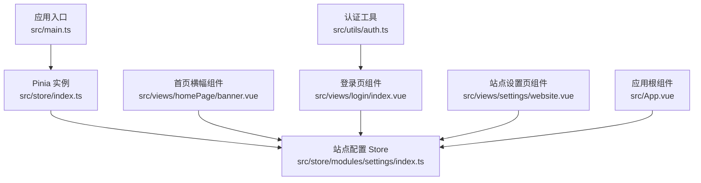
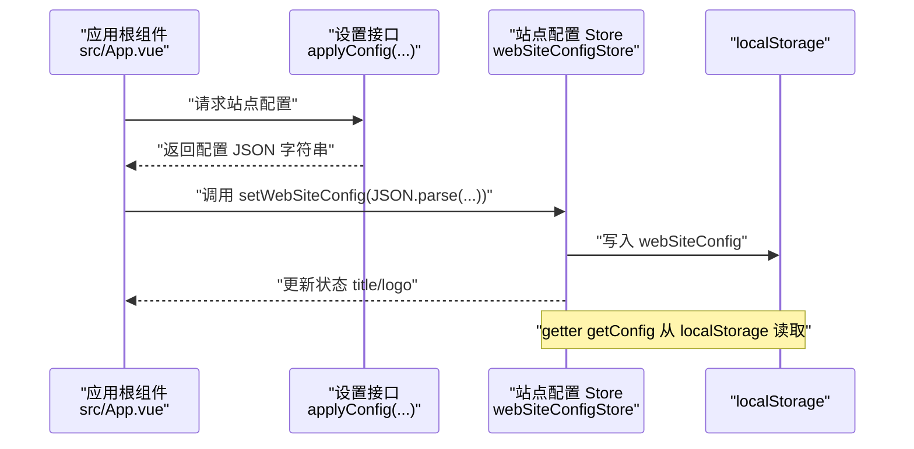
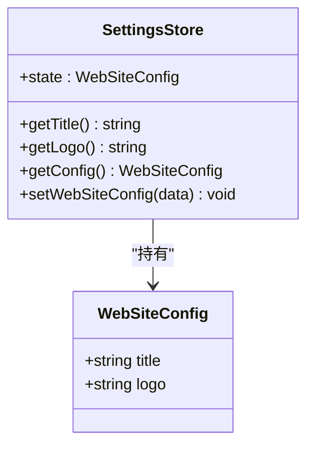
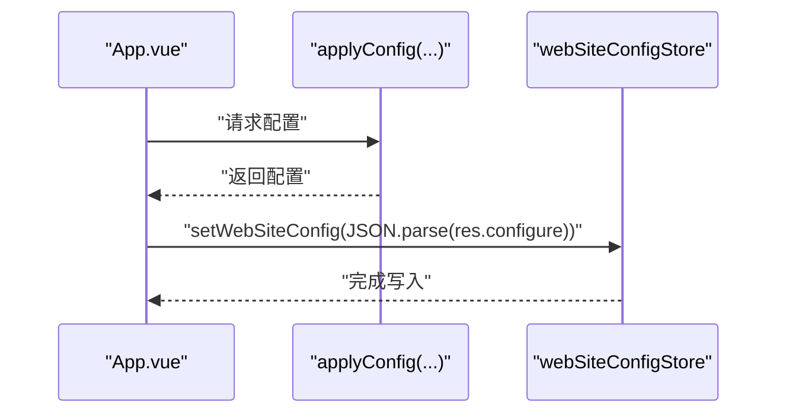
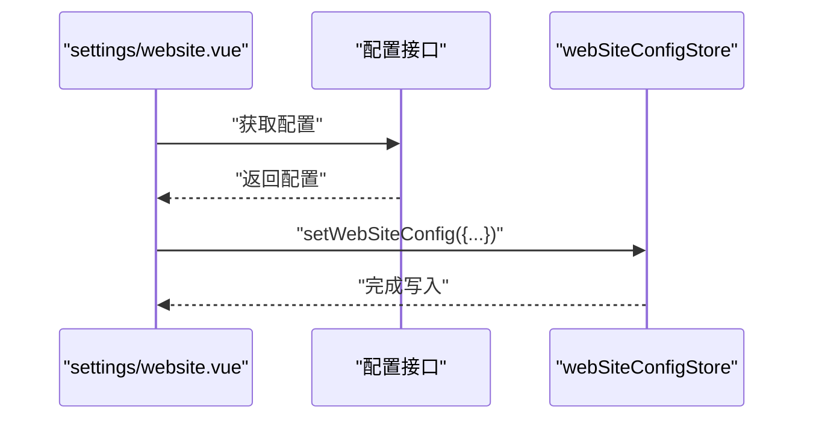
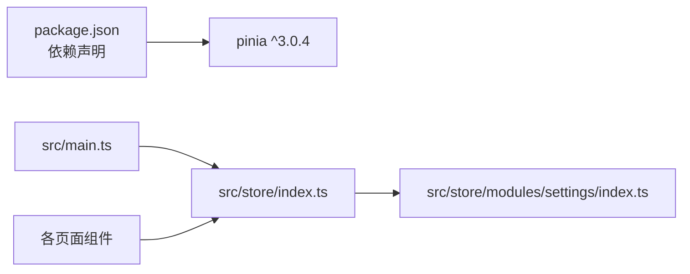

# 状态管理

<cite>
**本文引用的文件**
- [src/store/index.ts](file://src/store/index.ts)
- [src/store/modules/settings/index.ts](file://src/store/modules/settings/index.ts)
- [src/store/modules/settings/types.ts](file://src/store/modules/settings/types.ts)
- [src/main.ts](file://src/main.ts)
- [src/App.vue](file://src/App.vue)
- [src/views/homePage/banner.vue](file://src/views/homePage/banner.vue)
- [src/views/login/index.vue](file://src/views/login/index.vue)
- [src/views/settings/website.vue](file://src/views/settings/website.vue)
- [src/utils/auth.ts](file://src/utils/auth.ts)
- [package.json](file://package.json)
</cite>

## 目录
1. [简介](#简介)
2. [项目结构](#项目结构)
3. [核心组件](#核心组件)
4. [架构总览](#架构总览)
5. [详细组件分析](#详细组件分析)
6. [依赖分析](#依赖分析)
7. [性能考量](#性能考量)
8. [故障排查指南](#故障排查指南)
9. [结论](#结论)
10. [附录](#附录)

## 简介
本文件面向新工作台项目，系统性梳理基于 Pinia 的状态管理架构与最佳实践。当前仓库已实现最小可用的“站点配置”状态模块，采用模块化设计，结合本地持久化与响应式更新，覆盖全局状态与局部状态的划分原则、状态变更触发机制与同步策略，并给出性能优化与内存管理建议，以及调试方法与常见问题排查路径。

## 项目结构
- 应用通过入口在根实例中安装 Pinia，随后在各页面组件中按需引入并使用 Store。
- 当前仅实现 settings 模块，作为全局共享状态的代表；其他业务模块可按相同模式扩展。
- 配置持久化采用 localStorage，配合 Store 的 action 在状态变更时同步写入。

图表来源
- [src/main.ts:35](file://src/main.ts#L35)
- [src/store/index.ts:1-8](file://src/store/index.ts#L1-L8)
- [src/store/modules/settings/index.ts:1-53](file://src/store/modules/settings/index.ts#L1-L53)
- [src/views/homePage/banner.vue:56](file://src/views/homePage/banner.vue#L56)
- [src/views/login/index.vue:112](file://src/views/login/index.vue#L112)
- [src/views/settings/website.vue:81](file://src/views/settings/website.vue#L81)
- [src/App.vue:8](file://src/App.vue#L8)
- [src/utils/auth.ts:1-19](file://src/utils/auth.ts#L1-L19)

章节来源
- [src/main.ts:1-40](file://src/main.ts#L1-L40)
- [src/store/index.ts:1-9](file://src/store/index.ts#L1-L9)

## 核心组件
- Pinia 实例与导出
  - 在 store/index.ts 中创建 Pinia 实例，并导出站点配置 Store 以便全局复用。
- 站点配置 Store（settings）
  - 状态：title、logo
  - Getter：getTitle、getLogo、getConfig
  - Action：setWebSiteConfig
  - 持久化：通过 action 将配置写入 localStorage，并在 getter 中读取
- 应用入口集成
  - 在 main.ts 中安装 Pinia 并挂载到根实例
- 使用方组件
  - App.vue 在启动时拉取远端配置并写入 Store
  - 登录页、设置页等组件直接使用 Store 进行读取与更新

章节来源
- [src/store/index.ts:1-9](file://src/store/index.ts#L1-L9)
- [src/store/modules/settings/index.ts:1-53](file://src/store/modules/settings/index.ts#L1-L53)
- [src/store/modules/settings/types.ts:1-5](file://src/store/modules/settings/types.ts#L1-L5)
- [src/main.ts:35](file://src/main.ts#L35)
- [src/App.vue:7-15](file://src/App.vue#L7-L15)

## 架构总览
下图展示从组件到 Store 再到持久化的整体流程，以及组件如何消费 Store 的 getter。

图表来源
- [src/App.vue:10-14](file://src/App.vue#L10-L14)
- [src/store/modules/settings/index.ts:42-49](file://src/store/modules/settings/index.ts#L42-L49)
- [src/store/modules/settings/index.ts:37-39](file://src/store/modules/settings/index.ts#L37-L39)

## 详细组件分析

### Store：站点配置模块（settings）
- 设计要点
  - 状态字段：title、logo
  - Getter 聚合逻辑：优先使用内存中的 title/logo，否则回退到 localStorage 中的配置；getLogo 会拼接下载地址与 token
  - Action：setWebSiteConfig 接收后端下发的配置对象，更新内存状态并写入 localStorage，同时同步 document.title
- 数据结构与复杂度
  - 状态为简单键值对，读写均为 O(1)
  - localStorage 读写为 O(1)，但同步阻塞主线程，建议在非关键路径或批量更新时使用
- 错误处理与健壮性
  - 当前 getter getConfig 未做异常捕获，若 localStorage 中数据损坏可能抛错；建议增加 try/catch 与默认值兜底
- 可扩展性
  - 可按需新增字段（如 theme、locale），保持 getter 的回退策略
  - 可拆分“运行时状态”与“持久化配置”，避免 getter 直接访问 localStorage

图表来源
- [src/store/modules/settings/types.ts:1-5](file://src/store/modules/settings/types.ts#L1-L5)
- [src/store/modules/settings/index.ts:4-49](file://src/store/modules/settings/index.ts#L4-L49)

章节来源
- [src/store/modules/settings/index.ts:1-53](file://src/store/modules/settings/index.ts#L1-L53)
- [src/store/modules/settings/types.ts:1-5](file://src/store/modules/settings/types.ts#L1-L5)

### 组件使用：App.vue
- 触发机制
  - 页面加载即发起配置拉取，完成后调用 Store 的 action 写入状态
- 响应式更新
  - 组件内未直接消费 Store 的 getter，但其他组件可通过 getter 获取最新标题与图标
- 异步处理
  - Promise 链路清晰，未见重试或超时处理；可在业务需要时增强

图表来源
- [src/App.vue:10-14](file://src/App.vue#L10-L14)
- [src/store/modules/settings/index.ts:42-49](file://src/store/modules/settings/index.ts#L42-L49)

章节来源
- [src/App.vue:7-15](file://src/App.vue#L7-L15)

### 组件使用：登录页（登录成功后）
- 触发机制
  - 登录成功后写入 token 到 localStorage，并读取用户信息
- 与 Store 的关系
  - 该组件未直接使用站点配置 Store；若需要在登录后刷新站点配置，可在登录成功后主动调用配置拉取流程

章节来源
- [src/views/login/index.vue:141-158](file://src/views/login/index.vue#L141-L158)
- [src/utils/auth.ts:1-19](file://src/utils/auth.ts#L1-L19)

### 组件使用：设置页（站点设置）
- 触发机制
  - 读取配置：调用接口获取配置 JSON，解析后填充表单
  - 更新配置：提交后调用接口更新，成功后调用 Store 的 action 写入本地
- 响应式更新
  - 表单字段与 Store 状态解耦，但通过 action 同步，确保跨组件一致

图表来源
- [src/views/settings/website.vue:109-119](file://src/views/settings/website.vue#L109-L119)
- [src/views/settings/website.vue:164-169](file://src/views/settings/website.vue#L164-L169)
- [src/store/modules/settings/index.ts:42-49](file://src/store/modules/settings/index.ts#L42-L49)

章节来源
- [src/views/settings/website.vue:76-172](file://src/views/settings/website.vue#L76-L172)

### 组件使用：首页横幅
- 触发机制
  - 组件内未直接使用站点配置 Store；若需要显示标题/图标，可按相同模式引入 Store 并使用 getter
- 建议
  - 在横幅组件中引入 Store，使用 getter 动态获取标题与图标，保证与全局配置一致

章节来源
- [src/views/homePage/banner.vue:52-116](file://src/views/homePage/banner.vue#L52-L116)

## 依赖分析
- 外部依赖
  - Pinia 版本：^3.0.4
- 内部依赖
  - main.ts 依赖 store/index.ts 导出的 Pinia 实例
  - store/index.ts 依赖 settings 模块
  - 各页面组件依赖 store/index.ts 导出的 Store 实例

图表来源
- [package.json:34](file://package.json#L34)
- [src/main.ts:35](file://src/main.ts#L35)
- [src/store/index.ts:1-8](file://src/store/index.ts#L1-L8)
- [src/store/modules/settings/index.ts:1-53](file://src/store/modules/settings/index.ts#L1-L53)

章节来源
- [package.json:1-63](file://package.json#L1-L63)
- [src/main.ts:1-40](file://src/main.ts#L1-L40)
- [src/store/index.ts:1-9](file://src/store/index.ts#L1-L9)

## 性能考量
- 状态粒度与模块化
  - 将全局配置独立为 settings 模块，避免无关状态污染，降低不必要的响应式追踪开销
- 持久化策略
  - 当前以 localStorage 为主，建议：
    - 将频繁读写的配置拆分为“内存态 + 懒持久化”，仅在必要时机写入
    - 对大体量配置采用分片存储或压缩序列化
- 异步与批处理
  - 批量更新时合并多次 setWebSiteConfig 调用，减少 localStorage 写入次数
- 响应式更新
  - Getter 中尽量避免复杂计算；将昂贵计算放入 action 或使用 computed 缓存结果
- 内存管理
  - 避免在 Store 中保存大型临时对象；及时清理不再使用的数据
- 依赖版本
  - Pinia 3.x 在 Vue 3 生态中具备良好性能与可观测性，建议保持升级路径畅通

## 故障排查指南
- 症状：页面标题未更新
  - 检查是否调用了 Store 的 action 写入配置
  - 检查 document.title 是否被其他逻辑覆盖
- 症状：图标不显示或 401
  - 检查 token 是否存在且有效
  - 检查 getLogo 的拼接逻辑与 dowUrl 配置
- 症状：配置读取为空或报错
  - 检查 localStorage 中 webSiteConfig 的格式与完整性
  - 为 getter getConfig 增加 try/catch 与默认值兜底
- 症状：登录后配置未刷新
  - 在登录成功后主动调用配置拉取流程，并在成功后调用 Store 的 action 写入

章节来源
- [src/store/modules/settings/index.ts:10-49](file://src/store/modules/settings/index.ts#L10-L49)
- [src/views/login/index.vue:141-158](file://src/views/login/index.vue#L141-L158)
- [src/App.vue:10-14](file://src/App.vue#L10-L14)

## 结论
当前项目已建立基于 Pinia 的模块化状态管理骨架，settings 模块承担全局配置的读写与持久化职责。建议在现有基础上完善错误处理、优化持久化策略与响应式更新路径，并逐步扩展更多业务模块，形成统一的状态管理规范与调试手段。

## 附录

### 最佳实践清单
- 状态结构设计
  - 明确“运行时状态”与“持久化配置”的边界，避免 getter 直接副作用
- 异步状态处理
  - 在组件中以 Promise/async 形式处理异步写入，提供加载态与错误提示
- 状态调试
  - 使用浏览器 Vue DevTools/Pinia 插件观察状态变化与 action 调用轨迹
- 性能优化
  - 减少 localStorage 同步频率，合并写入；对大对象采用懒持久化
- 安全与健壮性
  - 为 JSON 解析增加 try/catch 与默认值；对敏感数据避免明文存储

### 使用场景示例（路径指引）
- 在任意组件中引入 Store 并使用 getter 获取标题/图标
  - 引入与实例化：[src/views/settings/website.vue:81](file://src/views/settings/website.vue#L81)
  - 使用 getter：[src/store/modules/settings/index.ts:10-40](file://src/store/modules/settings/index.ts#L10-L40)
- 在应用启动时拉取配置并写入 Store
  - 触发流程：[src/App.vue:10-14](file://src/App.vue#L10-L14)
  - 写入动作：[src/store/modules/settings/index.ts:42-49](file://src/store/modules/settings/index.ts#L42-L49)