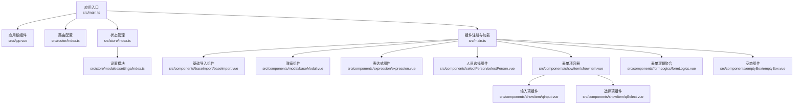
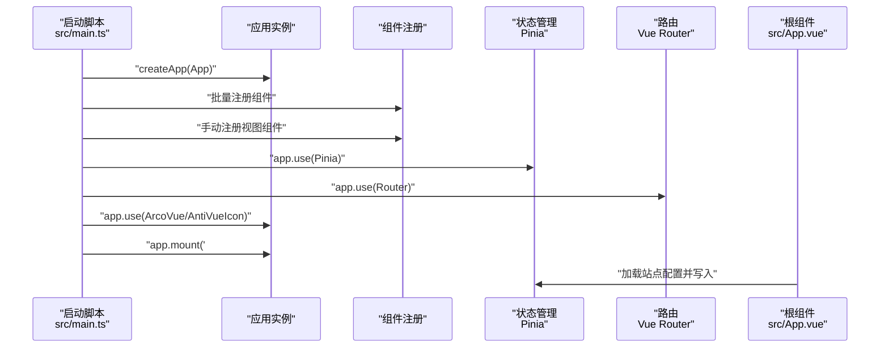
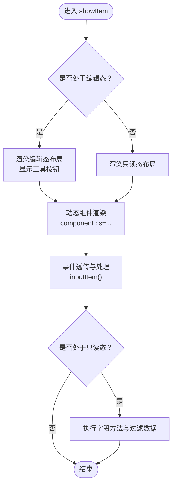
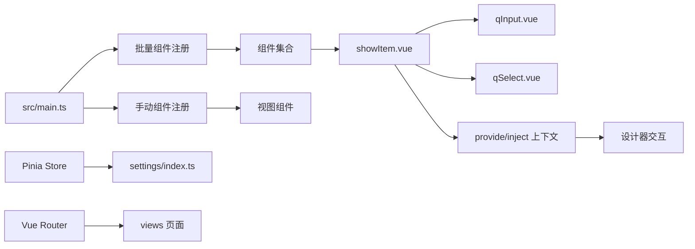

# 组件架构

<cite>
**本文引用的文件**
- [src/main.ts](file://src/main.ts)
- [src/App.vue](file://src/App.vue)
- [package.json](file://package.json)
- [vite.config.ts](file://vite.config.ts)
- [src/router/index.ts](file://src/router/index.ts)
- [src/store/index.ts](file://src/store/index.ts)
- [src/store/modules/settings/index.ts](file://src/store/modules/settings/index.ts)
- [src/utils/event.ts](file://src/utils/event.ts)
- [src/types/form.ts](file://src/types/form.ts)
- [src/components/baseImport/baseImport.vue](file://src/components/baseImport/baseImport.vue)
- [src/components/modal/baseModal.vue](file://src/components/modal/baseModal.vue)
- [src/components/showItem/showItem.vue](file://src/components/showItem/showItem.vue)
- [src/components/expression/expression.vue](file://src/components/expression/expression.vue)
- [src/components/selectPerson/selectPerson.vue](file://src/components/selectPerson/selectPerson.vue)
- [src/components/showItem/qInput.vue](file://src/components/showItem/qInput.vue)
- [src/components/showItem/qSelect.vue](file://src/components/showItem/qSelect.vue)
- [src/components/formLogics/formLogics.vue](file://src/components/formLogics/formLogics.vue)
- [src/components/emptyBox/emptyBox.vue](file://src/components/emptyBox/emptyBox.vue)
</cite>

## 目录
1. [引言](#引言)
2. [项目结构](#项目结构)
3. [核心组件](#核心组件)
4. [架构总览](#架构总览)
5. [组件详解](#组件详解)
6. [依赖关系分析](#依赖关系分析)
7. [性能考量](#性能考量)
8. [故障排查指南](#故障排查指南)
9. [结论](#结论)
10. [附录](#附录)

## 引言
本文件面向新工作台项目的前端组件化架构，系统阐述基于 Vue 3 的组件设计原则与实现策略，覆盖基础组件库、业务组件库与复合组件的设计模式；解释组件注册机制、动态组件加载与组件间通信方式；并从生命周期管理、props 传递、事件处理、插槽使用等维度总结最佳实践，辅以具体组件示例与使用场景，帮助团队在保证组件复用性、可维护性的同时提升整体性能。

## 项目结构
项目采用“按功能域分层 + 组件分类”的组织方式：
- 应用入口与全局配置：应用挂载、组件注册、插件安装、路由与状态管理初始化
- 视图层：views 目录按页面功能划分
- 组件层：components 目录按功能域细分（如基础导入、弹窗、表达式、人员选择、表单项展示等）
- 工具与类型：utils、types 提供通用工具与类型定义
- 状态管理：store 使用 Pinia，模块化管理站点配置等全局状态
- 路由：router 按页面划分懒加载路由

图表来源
- [src/main.ts:1-40](file://src/main.ts#L1-L40)
- [src/App.vue:1-52](file://src/App.vue#L1-L52)
- [src/router/index.ts:1-189](file://src/router/index.ts#L1-L189)
- [src/store/index.ts:1-9](file://src/store/index.ts#L1-L9)
- [src/store/modules/settings/index.ts:1-53](file://src/store/modules/settings/index.ts#L1-L53)
- [src/components/baseImport/baseImport.vue:1-172](file://src/components/baseImport/baseImport.vue#L1-L172)
- [src/components/modal/baseModal.vue:1-104](file://src/components/modal/baseModal.vue#L1-L104)
- [src/components/expression/expression.vue:1-131](file://src/components/expression/expression.vue#L1-L131)
- [src/components/selectPerson/selectPerson.vue:1-115](file://src/components/selectPerson/selectPerson.vue#L1-L115)
- [src/components/showItem/showItem.vue:1-196](file://src/components/showItem/showItem.vue#L1-L196)
- [src/components/showItem/qInput.vue:1-21](file://src/components/showItem/qInput.vue#L1-L21)
- [src/components/showItem/qSelect.vue:1-34](file://src/components/showItem/qSelect.vue#L1-L34)
- [src/components/formLogics/formLogics.vue:1-35](file://src/components/formLogics/formLogics.vue#L1-L35)
- [src/components/emptyBox/emptyBox.vue:1-44](file://src/components/emptyBox/emptyBox.vue#L1-L44)

章节来源
- [src/main.ts:1-40](file://src/main.ts#L1-L40)
- [src/App.vue:1-52](file://src/App.vue#L1-L52)
- [src/router/index.ts:1-189](file://src/router/index.ts#L1-L189)
- [src/store/index.ts:1-9](file://src/store/index.ts#L1-L9)
- [src/store/modules/settings/index.ts:1-53](file://src/store/modules/settings/index.ts#L1-L53)

## 核心组件
本节聚焦基础组件库、业务组件库与复合组件的设计模式与实现要点：

- 基础组件库
  - 表单基础项容器：统一渲染与交互控制，支持编辑态与只读态切换、动态组件渲染、事件透传与工具按钮
  - 输入/选择等基础表单项：封装 Arco 组件行为，暴露 props 与事件
  - 空态组件：统一占位样式与文案
  - 基础导入组件：封装模板下载、文件上传、错误提示与结果反馈流程
  - 弹窗组件：统一弹窗配置、按钮显隐与事件回调

- 业务组件库
  - 表达式组件：集成公式选择器与标签展示，支持更新值与标签
  - 人员选择组件：多选标签展示、关闭与弹窗选择联动

- 复合组件
  - 表单逻辑聚合：根据字段类型动态选择对应逻辑子组件，集中处理校验与联动
  - 设计器容器：注入设计器上下文，统一处理元素选中、复制、删除、上下移动等操作

章节来源
- [src/components/showItem/showItem.vue:1-196](file://src/components/showItem/showItem.vue#L1-L196)
- [src/components/showItem/qInput.vue:1-21](file://src/components/showItem/qInput.vue#L1-L21)
- [src/components/showItem/qSelect.vue:1-34](file://src/components/showItem/qSelect.vue#L1-L34)
- [src/components/emptyBox/emptyBox.vue:1-44](file://src/components/emptyBox/emptyBox.vue#L1-L44)
- [src/components/baseImport/baseImport.vue:1-172](file://src/components/baseImport/baseImport.vue#L1-L172)
- [src/components/modal/baseModal.vue:1-104](file://src/components/modal/baseModal.vue#L1-L104)
- [src/components/expression/expression.vue:1-131](file://src/components/expression/expression.vue#L1-L131)
- [src/components/selectPerson/selectPerson.vue:1-115](file://src/components/selectPerson/selectPerson.vue#L1-L115)
- [src/components/formLogics/formLogics.vue:1-35](file://src/components/formLogics/formLogics.vue#L1-L35)

## 架构总览
应用启动时完成以下关键步骤：
- 创建应用实例并挂载根组件
- 注册全局组件：通过扫描 src/components 下的一级目录组件进行批量注册，同时手动注册部分视图内组件
- 安装插件：ArcoVue、ArcoVueIcon、Vue Router、Pinia
- 初始化站点配置：进入 App.vue 后拉取站点配置并写入 store

图表来源
- [src/main.ts:1-40](file://src/main.ts#L1-L40)
- [src/App.vue:6-16](file://src/App.vue#L6-L16)

章节来源
- [src/main.ts:1-40](file://src/main.ts#L1-L40)
- [src/App.vue:1-52](file://src/App.vue#L1-L52)

## 组件详解

### 基础组件库

#### 表单基础项容器（showItem）
- 设计目标：统一渲染表单项，支持编辑态与只读态、动态组件渲染、工具按钮、事件透传
- 关键点
  - 动态组件渲染：根据 comDes.component 渲染具体表单项
  - 生命周期与状态：通过 provide/inject 注入设计器上下文，处理点击、复制、删除、上下移动等动作
  - 事件处理：inputItem 支持执行字段方法与过滤数据
  - 插槽与属性透传：inheritAttrs 设置为 false，避免属性自动继承到根节点
- 最佳实践
  - 将复杂交互收敛到容器组件，子组件仅关注自身 UI 与数据
  - 使用 provide/inject 降低跨层级通信耦合
  - 对外部事件进行防抖或节流，避免频繁触发

图表来源
- [src/components/showItem/showItem.vue:48-104](file://src/components/showItem/showItem.vue#L48-L104)

章节来源
- [src/components/showItem/showItem.vue:1-196](file://src/components/showItem/showItem.vue#L1-L196)

#### 输入与选择表单项（qInput、qSelect）
- 设计目标：封装 Arco 组件行为，统一 props 与 v-model 绑定
- 关键点
  - qInput：根据 props 控制清空、只读、禁用、字数限制等
  - qSelect：绑定 change 事件，支持字段方法执行
- 最佳实践
  - 子组件不直接处理业务逻辑，仅负责 UI 与数据绑定
  - 对外部传入的 props 进行默认值合并与校验

章节来源
- [src/components/showItem/qInput.vue:1-21](file://src/components/showItem/qInput.vue#L1-L21)
- [src/components/showItem/qSelect.vue:1-34](file://src/components/showItem/qSelect.vue#L1-L34)

#### 空态组件（emptyBox）
- 设计目标：统一空态展示样式与文案
- 关键点
  - 接收 desc 属性，支持自定义文案
  - 内置图片与标题样式
- 最佳实践
  - 在列表、表格、卡片等容器中统一使用，保持视觉一致性

章节来源
- [src/components/emptyBox/emptyBox.vue:1-44](file://src/components/emptyBox/emptyBox.vue#L1-L44)

#### 基础导入组件（baseImport）
- 设计目标：提供导入模板下载、文件上传、错误提示与结果反馈的完整流程
- 关键点
  - 步骤化 UI：模板下载与数据导入两步
  - 文件校验：限制文件类型与数量
  - 成功/失败处理：根据返回结果决定是否下载失败明细并触发关闭事件
- 最佳实践
  - 将业务方法通过 props 注入，便于测试与替换
  - 错误信息使用消息组件提示，避免阻塞用户操作

章节来源
- [src/components/baseImport/baseImport.vue:1-172](file://src/components/baseImport/baseImport.vue#L1-L172)

#### 弹窗组件（baseModal）
- 设计目标：统一弹窗配置、按钮显隐与事件回调
- 关键点
  - 通过 handleClick 暴露配置入口，支持标题、描述、按钮文本、宽度等
  - 通过 v-bind="$attrs" 透传属性给底层弹窗组件
  - 暴露 handleOk 与 handleCancel 事件
- 最佳实践
  - 使用 defineExpose 暴露必要方法，避免过度暴露内部状态
  - 对确认按钮增加 loading 状态，提升交互反馈

章节来源
- [src/components/modal/baseModal.vue:1-104](file://src/components/modal/baseModal.vue#L1-L104)

### 业务组件库

#### 表达式组件（expression）
- 设计目标：提供公式选择与标签展示，支持更新值与标签
- 关键点
  - 通过下拉菜单打开表达式选择器
  - 支持默认插槽与标签展示
  - 通过 update:value 与 update:label 事件向上更新
- 最佳实践
  - 将表达式解析与生成逻辑抽离到独立模块，组件仅负责 UI 与事件

章节来源
- [src/components/expression/expression.vue:1-131](file://src/components/expression/expression.vue#L1-L131)

#### 人员选择组件（selectPerson）
- 设计目标：支持多选人员展示与关闭、弹窗选择联动
- 关键点
  - 使用 v-model 双向绑定
  - 通过 selectModel 弹窗选择数据并回填
  - 支持最多展示前 5 个标签，其余以 +n 形式展示
- 最佳实践
  - 对用户昵称与标签展示进行兼容处理
  - 防止重复选择与数组越界

章节来源
- [src/components/selectPerson/selectPerson.vue:1-115](file://src/components/selectPerson/selectPerson.vue#L1-L115)

### 复合组件

#### 表单逻辑聚合（formLogics）
- 设计目标：根据字段类型动态选择对应逻辑子组件，集中处理校验与联动
- 关键点
  - 通过条件判断渲染不同逻辑组件（输入、单选、多选、数字、日期、时间、地址、用户、部门等）
  - 透传 deptList 等上下文数据
- 最佳实践
  - 将每类逻辑拆分为独立子组件，便于扩展与维护
  - 对复杂逻辑进行模块化，避免单一组件膨胀

章节来源
- [src/components/formLogics/formLogics.vue:1-35](file://src/components/formLogics/formLogics.vue#L1-L35)

#### 设计器容器（showItem）
- 设计目标：作为设计器的容器，统一处理元素选中、复制、删除、上下移动等动作
- 关键点
  - 通过 provide/inject 注入设计器上下文
  - 在编辑态显示工具按钮，点击事件委托给注入的方法
- 最佳实践
  - 将交互逻辑集中在容器组件，子组件专注渲染
  - 对 eval 执行进行安全检查与异常捕获

章节来源
- [src/components/showItem/showItem.vue:65-104](file://src/components/showItem/showItem.vue#L65-L104)

## 依赖关系分析
- 组件注册机制
  - 批量注册：通过 import.meta.glob 遍历 src/components 下的一级目录组件，自动提取文件名作为组件名进行注册
  - 手动注册：对视图内的局部组件（如 nodeWrap、addNode）进行手动注册
- 动态组件加载
  - 通过 component :is 实现运行时动态渲染
  - 表单逻辑聚合根据 inputType 条件渲染对应逻辑组件
- 组件间通信
  - 父子通信：通过 props 与 emit
  - 跨层级通信：通过 provide/inject（如设计器容器与子组件）
  - 全局通信：通过 Pinia store（如站点配置）

图表来源
- [src/main.ts:13-34](file://src/main.ts#L13-L34)
- [src/main.ts:8-12](file://src/main.ts#L8-L12)
- [src/components/showItem/showItem.vue:65-74](file://src/components/showItem/showItem.vue#L65-L74)
- [src/store/modules/settings/index.ts:1-53](file://src/store/modules/settings/index.ts#L1-L53)
- [src/router/index.ts:1-189](file://src/router/index.ts#L1-L189)

章节来源
- [src/main.ts:1-40](file://src/main.ts#L1-L40)
- [src/components/showItem/showItem.vue:1-196](file://src/components/showItem/showItem.vue#L1-L196)
- [src/store/modules/settings/index.ts:1-53](file://src/store/modules/settings/index.ts#L1-L53)
- [src/router/index.ts:1-189](file://src/router/index.ts#L1-L189)

## 性能考量
- 组件注册与打包
  - 批量注册减少手动注册成本，但需注意避免注册过多未使用组件导致包体增大
  - 可结合路由懒加载与组件按需引入进一步优化首屏体积
- 动态组件渲染
  - 使用 component :is 时建议缓存组件映射，避免频繁计算
  - 对高频渲染的列表组件，优先考虑虚拟滚动与懒渲染
- 事件与计算
  - 对输入类组件的 change 事件进行节流/防抖，减少重渲染
  - 计算属性尽量使用 getter，避免在模板中进行复杂计算
- 状态管理
  - Pinia 模块按需加载，避免一次性注入过多模块
  - 对大对象写入本地存储时进行序列化与去重
- 图标与资源
  - 使用 SVG Loader 加载图标，减少 HTTP 请求
  - 对图片与静态资源进行压缩与按需加载

## 故障排查指南
- 组件未注册导致渲染失败
  - 检查 src/main.ts 中的批量注册逻辑与手动注册逻辑
  - 确认组件文件名与导出方式正确
- 动态组件无法渲染
  - 检查 component :is 的值是否与已注册组件名一致
  - 确认条件渲染逻辑（如 formLogics）是否覆盖了目标类型
- 事件未触发或参数异常
  - 检查 emit 事件名与参数是否与父组件监听一致
  - 对 v-model 双向绑定组件，确认 update:modelValue 是否正确触发
- 状态不更新
  - 检查 Pinia Store 的 action 是否被调用
  - 确认响应式数据是否被正确修改
- 资源加载问题
  - 检查 vite.config.ts 中的别名与静态资源配置
  - 确认代理配置是否正确指向后端服务

章节来源
- [src/main.ts:13-34](file://src/main.ts#L13-L34)
- [src/components/formLogics/formLogics.vue:1-35](file://src/components/formLogics/formLogics.vue#L1-L35)
- [src/store/modules/settings/index.ts:42-49](file://src/store/modules/settings/index.ts#L42-L49)
- [vite.config.ts:26-35](file://vite.config.ts#L26-L35)

## 结论
本项目以 Vue 3 为基础，结合 ArcoVue 生态与 Pinia 状态管理，构建了清晰的组件分层与职责边界。通过批量组件注册、动态组件渲染与 provide/inject 通信机制，实现了高复用与低耦合的组件体系。建议在后续迭代中持续完善组件文档、补充单元测试与性能监控，确保组件库的长期可维护性与扩展性。

## 附录
- 开发与构建
  - 启动开发服务器：npm run dev
  - 构建生产包：npm run build
  - 预览生产包：npm run preview
  - 单元测试：npm run test / npm run test:watch
- 依赖说明
  - Vue 3、Vue Router、Pinia、ArcoVue、Element Plus、WangWang Editor、Monaco Editor 等
- 路由与页面
  - 登录、首页、流程中心、应用管理、表单设计器、人员管理、角色管理、字典管理、安全中心、待办中心、任务中心等页面均采用懒加载路由

章节来源
- [package.json:1-63](file://package.json#L1-L63)
- [vite.config.ts:1-37](file://vite.config.ts#L1-L37)
- [src/router/index.ts:1-189](file://src/router/index.ts#L1-L189)