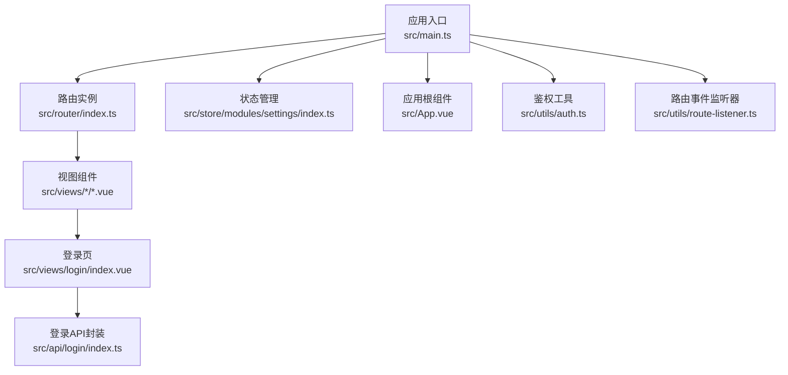
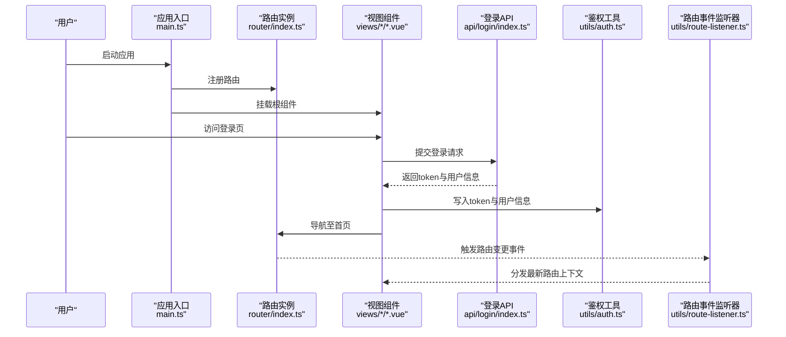
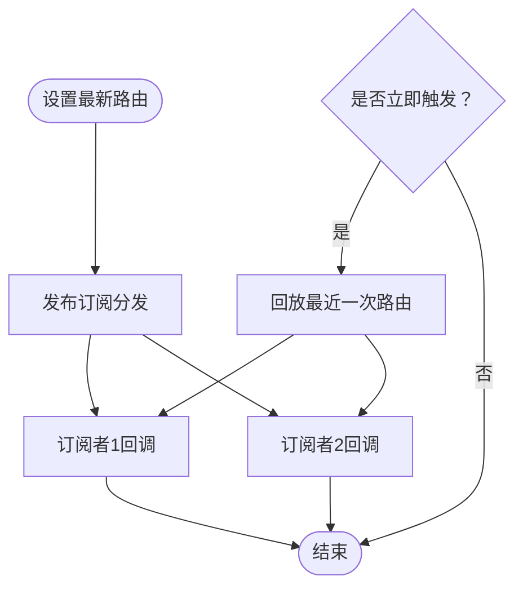
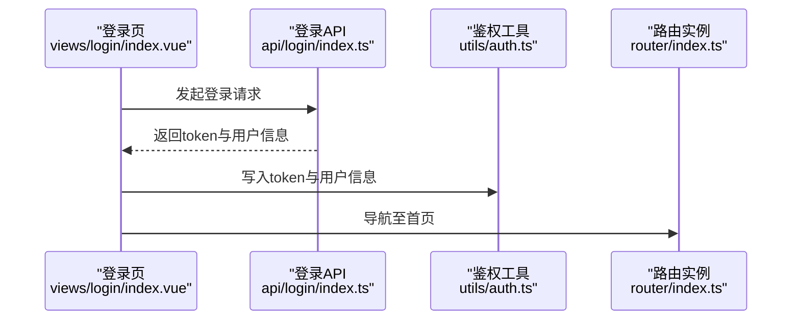
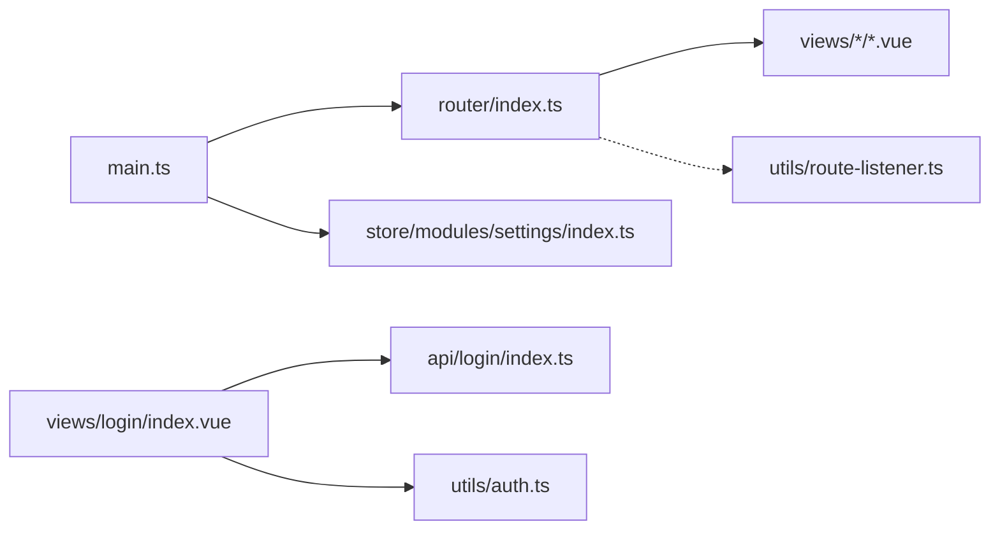

# 路由架构

<cite>
**本文引用的文件**
- [src/router/index.ts](file://src/router/index.ts)
- [src/main.ts](file://src/main.ts)
- [src/App.vue](file://src/App.vue)
- [src/utils/auth.ts](file://src/utils/auth.ts)
- [src/utils/route-listener.ts](file://src/utils/route-listener.ts)
- [src/views/login/index.vue](file://src/views/login/index.vue)
- [src/store/modules/settings/index.ts](file://src/store/modules/settings/index.ts)
- [src/api/login/index.ts](file://src/api/login/index.ts)
- [ISSUES_REPORT.md](file://ISSUES_REPORT.md)
</cite>

## 目录
1. [简介](#简介)
2. [项目结构](#项目结构)
3. [核心组件](#核心组件)
4. [架构总览](#架构总览)
5. [详细组件分析](#详细组件分析)
6. [依赖关系分析](#依赖关系分析)
7. [性能考虑](#性能考虑)
8. [故障排查指南](#故障排查指南)
9. [结论](#结论)
10. [附录](#附录)

## 简介
本文件面向新工作台项目的前端路由与权限体系，系统性梳理 Vue Router 的路由设计、导航守卫与动态路由生成思路，解释路由懒加载、路由元信息与权限验证机制，并覆盖嵌套路由、路由参数传递、路由监听器实现、安全策略、访问控制与用户体验优化方案，以及调试技巧与性能优化建议。

## 项目结构
新工作台采用基于文件系统的路由组织方式：路由在路由模块中集中声明，视图组件按功能域划分到 views 下，配合 Pinia 状态管理与工具函数（如鉴权与路由事件）共同构成前端路由与权限体系。

图表来源
- [src/main.ts:1-40](file://src/main.ts#L1-L40)
- [src/router/index.ts:1-189](file://src/router/index.ts#L1-L189)
- [src/App.vue:1-52](file://src/App.vue#L1-L52)
- [src/utils/auth.ts:1-20](file://src/utils/auth.ts#L1-L20)
- [src/utils/route-listener.ts:1-32](file://src/utils/route-listener.ts#L1-L32)
- [src/views/login/index.vue:1-540](file://src/views/login/index.vue#L1-L540)
- [src/store/modules/settings/index.ts:1-53](file://src/store/modules/settings/index.ts#L1-L53)
- [src/api/login/index.ts:1-61](file://src/api/login/index.ts#L1-L61)

章节来源
- [src/main.ts:1-40](file://src/main.ts#L1-L40)
- [src/router/index.ts:1-189](file://src/router/index.ts#L1-L189)
- [src/App.vue:1-52](file://src/App.vue#L1-L52)

## 核心组件
- 路由模块：集中定义所有静态路由，启用历史模式并设置基础路径，提供全局前置守卫占位。
- 应用入口：注册路由、状态管理、UI 组件库与全局组件，挂载应用。
- 登录流程：登录页发起登录请求，写入本地存储后跳转首页。
- 鉴权工具：提供 token 存取与清理方法。
- 路由事件监听器：基于发布订阅模型的路由变更通知机制。
- 设置与站点配置：通过 API 获取站点配置并注入到全局状态。

章节来源
- [src/router/index.ts:1-189](file://src/router/index.ts#L1-L189)
- [src/main.ts:1-40](file://src/main.ts#L1-L40)
- [src/views/login/index.vue:140-161](file://src/views/login/index.vue#L140-L161)
- [src/utils/auth.ts:1-20](file://src/utils/auth.ts#L1-L20)
- [src/utils/route-listener.ts:1-32](file://src/utils/route-listener.ts#L1-L32)
- [src/store/modules/settings/index.ts:1-53](file://src/store/modules/settings/index.ts#L1-L53)

## 架构总览
下图展示从应用启动到路由守卫、登录认证与路由事件的交互关系：

图表来源
- [src/main.ts:1-40](file://src/main.ts#L1-L40)
- [src/router/index.ts:177-186](file://src/router/index.ts#L177-L186)
- [src/views/login/index.vue:140-161](file://src/views/login/index.vue#L140-L161)
- [src/api/login/index.ts:15-40](file://src/api/login/index.ts#L15-L40)
- [src/utils/auth.ts:11-17](file://src/utils/auth.ts#L11-L17)
- [src/utils/route-listener.ts:14-27](file://src/utils/route-listener.ts#L14-L27)

## 详细组件分析

### 路由配置与懒加载
- 路由以数组形式集中声明，包含登录、首页、流程中心、应用管理、表单设计、字典、角色、用户、设置、安全中心、待办中心、任务中心等页面。
- 所有视图组件均采用异步导入（路由懒加载），以减少首屏包体与提升首屏性能。
- 通配符路由统一重定向到登录页，避免未匹配路径导致的白屏或错误状态。
- 历史模式并设置基础路径，确保部署在子路径时的路由行为一致。

章节来源
- [src/router/index.ts:4-175](file://src/router/index.ts#L4-L175)
- [src/router/index.ts:177-180](file://src/router/index.ts#L177-L180)

### 导航守卫与权限控制
- 当前前置守卫仅保留占位逻辑，未实现鉴权判断，存在安全风险。
- 建议在守卫中实现以下逻辑：
  - 白名单路由（如登录页）直接放行；
  - 若已登录且访问登录页则重定向至首页；
  - 若无 token 则重定向至登录页；
  - 若有 token 则校验有效性，失败则清空缓存并重定向至登录页。
- 登录成功后写入 token 与用户信息，随后导航至首页；退出登录时清理 token。

章节来源
- [src/router/index.ts:182-186](file://src/router/index.ts#L182-L186)
- [src/views/login/index.vue:148-158](file://src/views/login/index.vue#L148-L158)
- [src/utils/auth.ts:11-17](file://src/utils/auth.ts#L11-L17)
- [ISSUES_REPORT.md:175-215](file://ISSUES_REPORT.md#L175-L215)

### 动态路由生成与菜单授权
- 项目当前为静态路由，未见动态路由生成逻辑。
- 建议在登录后根据用户权限拉取菜单树，结合路由表进行动态注入，实现“菜单即路由”。
- 在安全中心可查看与编辑菜单授权，为动态路由注入提供数据基础。

章节来源
- [src/views/securityCenter/menuTree.vue:1-55](file://src/views/securityCenter/menuTree.vue#L1-L55)
- [ISSUES_REPORT.md:175-215](file://ISSUES_REPORT.md#L175-L215)

### 路由懒加载与性能
- 使用异步导入实现按需加载，降低初始包体积。
- 对于高频访问页面可结合预加载策略（如路由级预加载）进一步优化首屏体验。

章节来源
- [src/router/index.ts:12-103](file://src/router/index.ts#L12-L103)

### 路由元信息与权限验证机制
- 当前路由未定义元信息字段（如需要的角色标识）。
- 建议在路由元信息中加入权限标识，守卫中读取并比对用户权限集合，实现细粒度访问控制。

章节来源
- [src/router/index.ts:4-175](file://src/router/index.ts#L4-L175)
- [ISSUES_REPORT.md:175-215](file://ISSUES_REPORT.md#L175-L215)

### 嵌套路由与参数传递
- 项目中存在多级视图（如应用管理、流程设计、任务中心等），但未见明确的嵌套路由配置示例。
- 路由参数可通过 query 或 params 传递，登录页示例展示了 query 的使用方式；组件内部也可通过路由实例读取参数并驱动业务逻辑。

章节来源
- [src/views/role/index.vue:139-143](file://src/views/role/index.vue#L139-L143)
- [src/views/login/index.vue:148-158](file://src/views/login/index.vue#L148-L158)

### 路由监听器实现
- 路由事件监听器采用发布订阅模式，避免每个组件单独监听带来的性能损耗。
- 提供设置最新路由、订阅回调与立即触发最近一次路由的能力，便于跨组件共享路由状态。

图表来源
- [src/utils/route-listener.ts:14-27](file://src/utils/route-listener.ts#L14-L27)

章节来源
- [src/utils/route-listener.ts:1-32](file://src/utils/route-listener.ts#L1-L32)

### 登录流程与令牌管理
- 登录页提交用户名与加密后的密码，成功后写入 token 与用户信息，再导航至首页。
- 鉴权工具提供 token 的读取与清理能力，配合守卫实现登录态校验。

图表来源
- [src/views/login/index.vue:140-161](file://src/views/login/index.vue#L140-L161)
- [src/api/login/index.ts:15-40](file://src/api/login/index.ts#L15-L40)
- [src/utils/auth.ts:11-17](file://src/utils/auth.ts#L11-L17)
- [src/router/index.ts:177-186](file://src/router/index.ts#L177-L186)

章节来源
- [src/views/login/index.vue:140-161](file://src/views/login/index.vue#L140-L161)
- [src/api/login/index.ts:15-40](file://src/api/login/index.ts#L15-L40)
- [src/utils/auth.ts:1-20](file://src/utils/auth.ts#L1-20)

### 设置与站点配置
- 应用根组件在启动时调用站点配置 API，将配置写入 Pinia 并同步到文档标题。
- 设置模块提供 getter 以拼接带 token 的资源链接，保障资源访问的安全性。

章节来源
- [src/App.vue:10-15](file://src/App.vue#L10-L15)
- [src/store/modules/settings/index.ts:10-48](file://src/store/modules/settings/index.ts#L10-L48)

## 依赖关系分析
- 应用入口依赖路由模块、状态管理与 UI 组件库；
- 路由模块依赖各视图组件（异步导入）；
- 登录页依赖登录 API 封装与鉴权工具；
- 路由事件监听器独立于路由模块，通过发布订阅与路由实例解耦。

图表来源
- [src/main.ts:1-40](file://src/main.ts#L1-L40)
- [src/router/index.ts:1-189](file://src/router/index.ts#L1-L189)
- [src/views/login/index.vue:1-540](file://src/views/login/index.vue#L1-L540)
- [src/api/login/index.ts:1-61](file://src/api/login/index.ts#L1-L61)
- [src/utils/auth.ts:1-20](file://src/utils/auth.ts#L1-L20)
- [src/utils/route-listener.ts:1-32](file://src/utils/route-listener.ts#L1-L32)
- [src/store/modules/settings/index.ts:1-53](file://src/store/modules/settings/index.ts#L1-L53)

章节来源
- [src/main.ts:1-40](file://src/main.ts#L1-L40)
- [src/router/index.ts:1-189](file://src/router/index.ts#L1-L189)

## 性能考虑
- 路由懒加载：已采用异步导入，建议对高频页面进行预加载策略优化。
- 路由事件监听：采用发布订阅模型，避免多处监听导致的重复渲染与性能浪费。
- 首屏优化：拆分路由模块与视图组件，结合打包工具的代码分割策略，减少首屏 JS 体积。
- 缓存与持久化：合理使用本地存储保存 token 与用户信息，避免频繁请求。

章节来源
- [src/router/index.ts:12-103](file://src/router/index.ts#L12-L103)
- [src/utils/route-listener.ts:1-32](file://src/utils/route-listener.ts#L1-L32)

## 故障排查指南
- 路由守卫未生效：检查前置守卫是否实现鉴权逻辑，确认白名单与重定向分支正确。
- 登录后仍被重定向：确认登录成功后写入 token 与用户信息，守卫中 token 校验逻辑是否执行。
- 路由重复定义：根据报告提示修正重复路由定义，避免路由冲突。
- 路由监听无效：确认在合适时机调用订阅与移除监听，避免内存泄漏。

章节来源
- [src/router/index.ts:182-186](file://src/router/index.ts#L182-L186)
- [src/views/login/index.vue:148-158](file://src/views/login/index.vue#L148-L158)
- [ISSUES_REPORT.md:175-215](file://ISSUES_REPORT.md#L175-L215)
- [src/utils/route-listener.ts:19-31](file://src/utils/route-listener.ts#L19-L31)

## 结论
当前项目已具备清晰的路由结构与懒加载基础，但在路由守卫与权限控制方面存在明显短板。建议尽快补齐鉴权逻辑、引入路由元信息与动态路由注入机制，并完善路由事件监听器的使用场景，以实现更安全、可维护与高性能的前端路由体系。

## 附录
- 安全策略建议
  - 强制实现路由守卫鉴权，白名单与重定向策略明确；
  - 在守卫中校验 token 有效性，失败则清空缓存并重定向登录；
  - 在路由元信息中标注权限标识，结合用户权限集合进行细粒度控制；
  - 对敏感资源访问增加二次校验与权限拦截。
- 用户体验优化
  - 预加载高频路由，缩短首次进入延迟；
  - 使用路由事件监听器统一处理面包屑、侧边栏状态与页面标题更新；
  - 在登录页与路由守卫中提供明确的错误提示与重试机制。