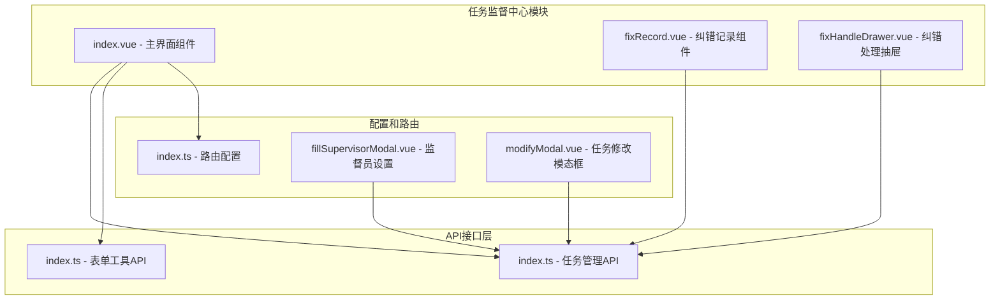
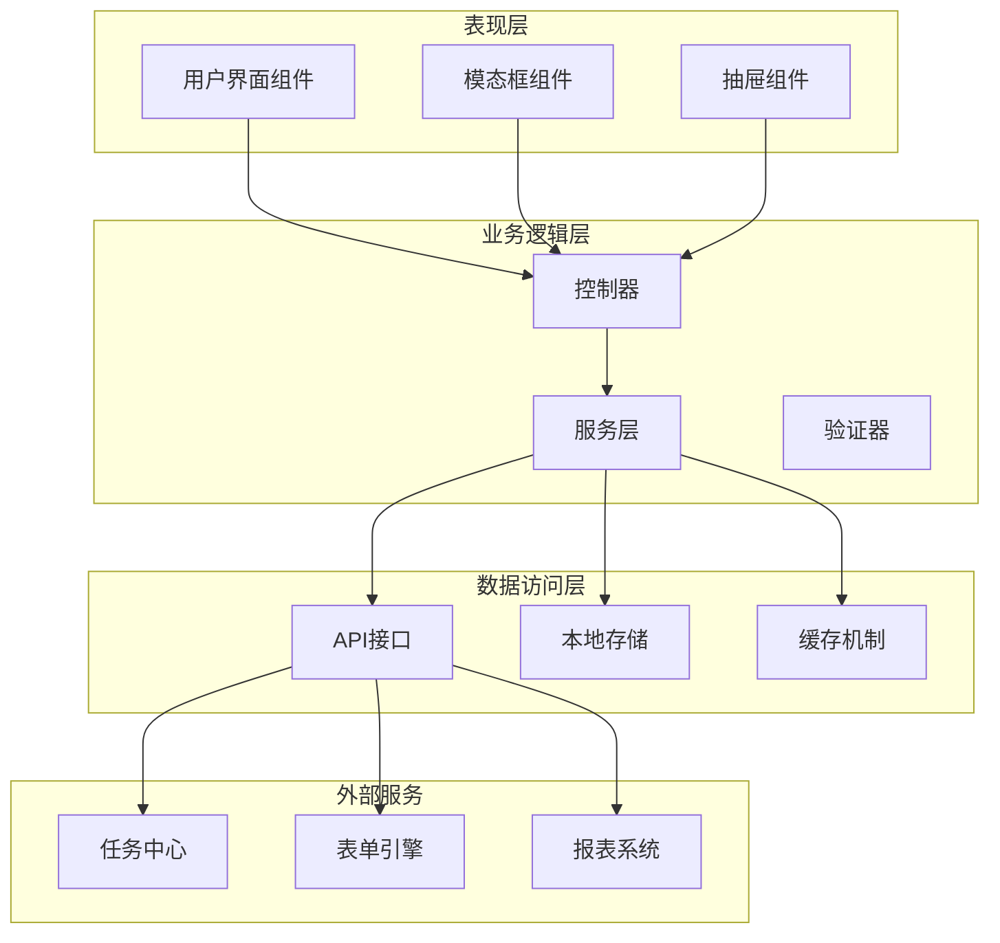
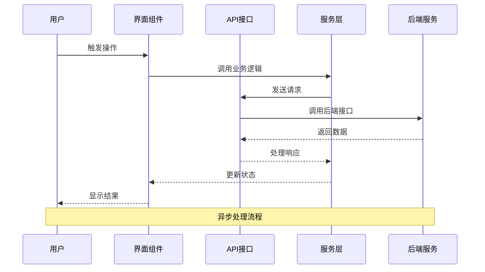
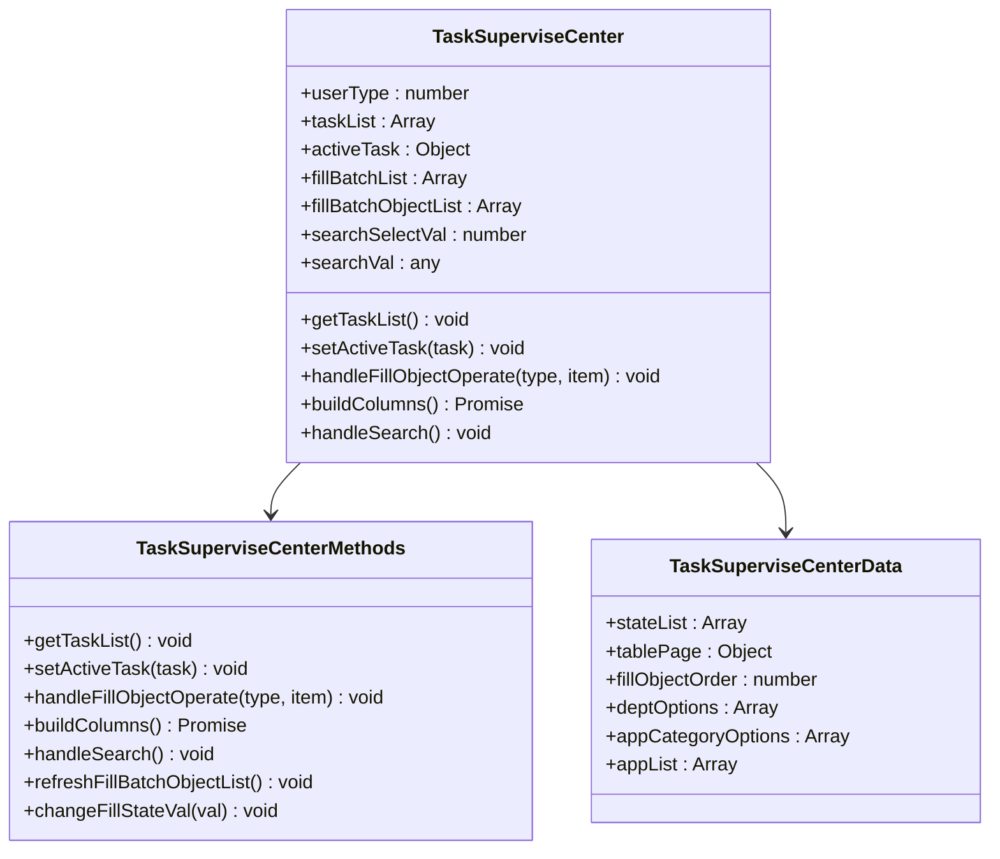
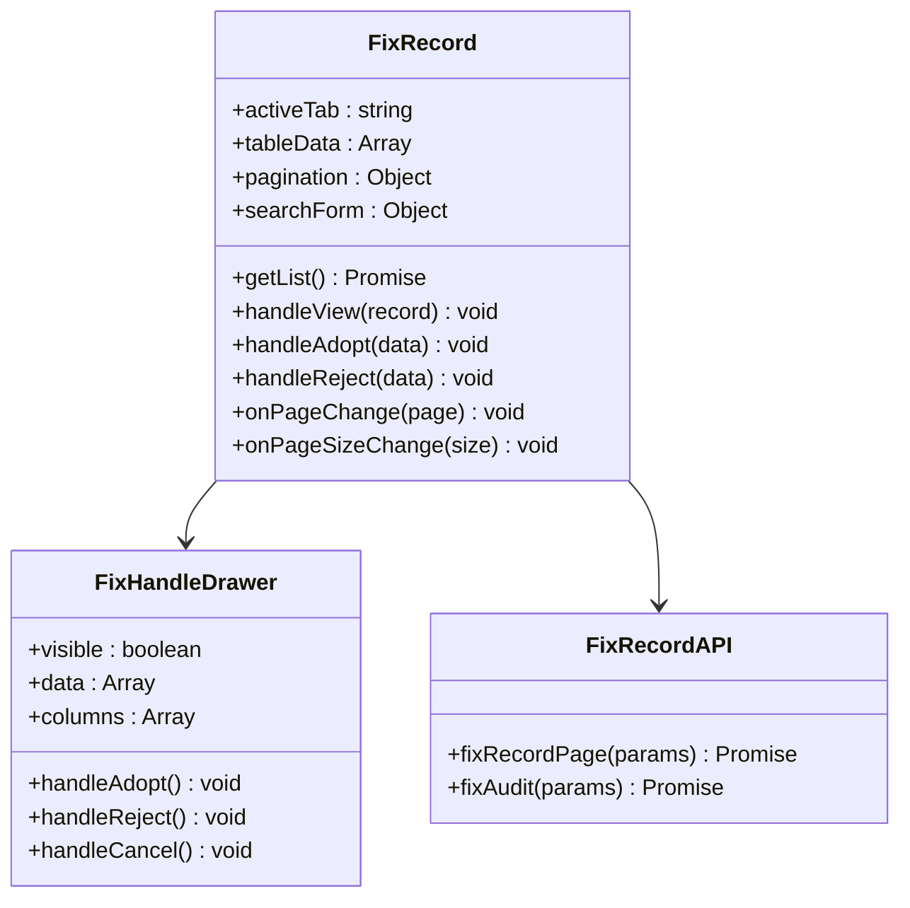
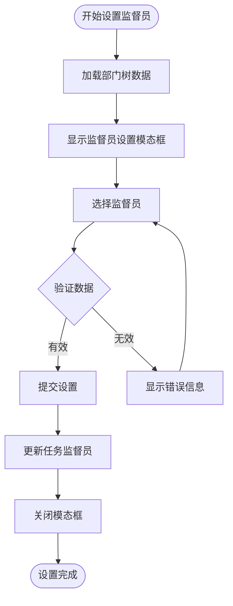
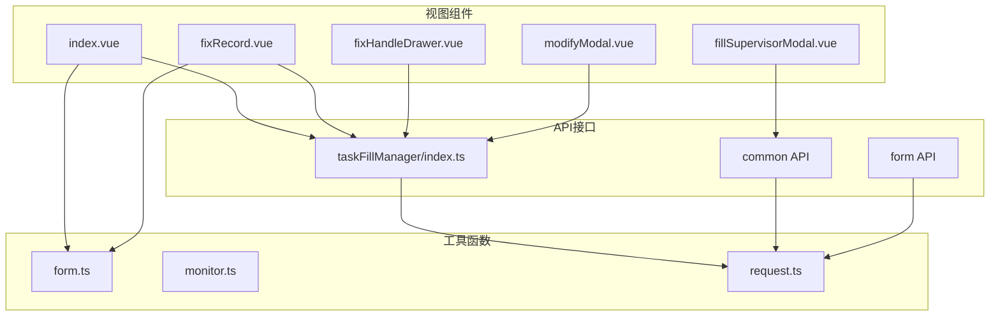

# 任务监督中心

<cite>
**本文档引用的文件**
- [index.vue](file://src/views/taskSuperviseCenter/index.vue)
- [fixHandleDrawer.vue](file://src/views/taskSuperviseCenter/fixHandleDrawer.vue)
- [fixRecord.vue](file://src/views/taskSuperviseCenter/fixRecord.vue)
- [index.ts](file://src/api/taskFillManager/index.ts)
- [index.vue](file://src/views/application/publishTask/components/fillSupervisorModal.vue)
- [index.vue](file://src/views/taskManageCenter/modifyModal.vue)
- [index.ts](file://src/router/index.ts)
- [index.ts](file://src/utils/form.ts)
- [index.vue](file://src/views/taskChartCenter/index.vue)
</cite>

## 目录
1. [简介](#简介)
2. [项目结构](#项目结构)
3. [核心组件](#核心组件)
4. [架构概览](#架构概览)
5. [详细组件分析](#详细组件分析)
6. [依赖关系分析](#依赖关系分析)
7. [性能考虑](#性能考虑)
8. [故障排除指南](#故障排除指南)
9. [结论](#结论)

## 简介

任务监督中心是工作台系统中的核心监管模块，负责对填报任务进行全面的监督和管理。该模块为监督员提供了完整的任务监督解决方案，包括任务监督列表、监督处理、监督记录等功能模块。

系统通过直观的界面设计和完善的API接口，实现了从任务发现到监督处理的全流程管理。监督员可以实时监控任务执行情况，处理填报异常，跟踪纠错记录，并获得详细的统计分析报告。

## 项目结构

任务监督中心主要由以下核心文件组成：

**图表来源**
- [index.vue:1-800](file://src/views/taskSuperviseCenter/index.vue#L1-L800)
- [fixRecord.vue:1-333](file://src/views/taskSuperviseCenter/fixRecord.vue#L1-L333)
- [fixHandleDrawer.vue:1-163](file://src/views/taskSuperviseCenter/fixHandleDrawer.vue#L1-L163)

**章节来源**
- [index.vue:1-800](file://src/views/taskSuperviseCenter/index.vue#L1-L800)
- [index.ts:1-109](file://src/api/taskFillManager/index.ts#L1-L109)

## 核心组件

### 主监督界面组件

主监督界面提供了完整的任务监督功能，包括：

- **任务列表管理**：支持按年份、任务名称、发布部门、应用分类、应用等多种条件筛选
- **批次管理**：实时显示任务批次的填报进度和状态
- **填报对象管理**：支持待填报和已填报两种状态的批量操作
- **催办和重填功能**：提供一键催办和重新填报操作
- **数据导出**：支持Word、PDF、Excel格式的数据导出

### 纠错记录管理系统

纠错记录系统包含两个核心组件：

- **纠错记录模态框**：显示待处理和已处理的纠错申请
- **纠错处理抽屉**：提供详细的字段对比和处理操作

### 监督员管理组件

系统提供了专门的监督员设置功能，允许管理员：

- 选择多个监督员参与任务监督
- 管理监督员的权限和职责范围
- 实时更新监督员信息

**章节来源**
- [index.vue:288-771](file://src/views/taskSuperviseCenter/index.vue#L288-L771)
- [fixRecord.vue:1-333](file://src/views/taskSuperviseCenter/fixRecord.vue#L1-L333)
- [fixHandleDrawer.vue:1-163](file://src/views/taskSuperviseCenter/fixHandleDrawer.vue#L1-L163)

## 架构概览

任务监督中心采用分层架构设计，确保系统的可维护性和扩展性：

**图表来源**
- [index.vue:288-771](file://src/views/taskSuperviseCenter/index.vue#L288-L771)
- [index.ts:1-109](file://src/api/taskFillManager/index.ts#L1-L109)

### 数据流架构

系统采用异步数据流设计，确保用户体验的流畅性：

**图表来源**
- [index.ts:21-33](file://src/api/taskFillManager/index.ts#L21-L33)
- [index.vue:521-557](file://src/views/taskSuperviseCenter/index.vue#L521-L557)

## 详细组件分析

### 主监督界面组件分析

#### 组件结构图

**图表来源**
- [index.vue:288-771](file://src/views/taskSuperviseCenter/index.vue#L288-L771)

#### 核心功能实现

##### 任务列表管理
系统支持多种筛选条件，包括年份、任务名称、发布部门、应用分类和应用等。通过组合这些筛选条件，监督员可以快速定位目标任务。

##### 批次管理功能
系统实时显示每个任务批次的填报进度，包括应填报人数、已完成人数和完成率。监督员可以查看批次详情，了解填报时间安排和状态信息。

##### 填报对象管理
系统提供两种状态的填报对象管理：
- **待填报状态**：支持催办操作，可以单独催办或批量催办
- **已填报状态**：支持重填操作和数据查看

**章节来源**
- [index.vue:1-286](file://src/views/taskSuperviseCenter/index.vue#L1-L286)
- [index.vue:521-771](file://src/views/taskSuperviseCenter/index.vue#L521-L771)

### 纠错记录系统分析

#### 纠错记录组件架构

**图表来源**
- [fixRecord.vue:60-251](file://src/views/taskSuperviseCenter/fixRecord.vue#L60-L251)
- [fixHandleDrawer.vue:44-163](file://src/views/taskSuperviseCenter/fixHandleDrawer.vue#L44-L163)

#### 纠错处理流程

系统提供完整的纠错处理流程：

1. **纠错申请查看**：监督员可以查看待处理和已处理的纠错申请
2. **字段对比**：通过抽屉组件显示原始值和纠错值的详细对比
3. **处理决策**：监督员可以选择采用或不采用纠错申请
4. **状态更新**：系统自动更新纠错记录的状态和处理结果

**章节来源**
- [fixRecord.vue:1-333](file://src/views/taskSuperviseCenter/fixRecord.vue#L1-L333)
- [fixHandleDrawer.vue:1-163](file://src/views/taskSuperviseCenter/fixHandleDrawer.vue#L1-L163)

### 监督员管理组件分析

#### 监督员设置流程

**图表来源**
- [fillSupervisorModal.vue:1-105](file://src/views/application/publishTask/components/fillSupervisorModal.vue#L1-L105)

#### 监督员权限管理

系统支持灵活的监督员权限配置：

- **多监督员支持**：每个任务可以设置多个监督员
- **权限继承**：监督员继承其在组织架构中的权限
- **实时生效**：监督员设置变更立即生效

**章节来源**
- [fillSupervisorModal.vue:1-105](file://src/views/application/publishTask/components/fillSupervisorModal.vue#L1-L105)
- [modifyModal.vue:58-165](file://src/views/taskManageCenter/modifyModal.vue#L58-L165)

## 依赖关系分析

### 组件间依赖关系

**图表来源**
- [index.vue:297-310](file://src/views/taskSuperviseCenter/index.vue#L297-L310)
- [fixRecord.vue:62-65](file://src/views/taskSuperviseCenter/fixRecord.vue#L62-L65)

### 外部依赖分析

系统对外部依赖主要包括：

- **Arco Design UI库**：提供基础的UI组件和样式
- **Vue 3框架**：提供响应式数据绑定和组件化开发
- **Axios HTTP客户端**：处理前后端通信
- **Day.js日期库**：处理日期格式化和计算

**章节来源**
- [index.ts:141-144](file://src/router/index.ts#L141-L144)
- [index.ts:1-109](file://src/api/taskFillManager/index.ts#L1-L109)

## 性能考虑

### 数据加载优化

系统采用了多种性能优化策略：

- **虚拟滚动**：对于大量数据的表格使用虚拟滚动技术
- **懒加载**：组件按需加载，减少初始包大小
- **缓存机制**：常用数据进行本地缓存，减少重复请求
- **分页加载**：大数据量场景下使用分页加载

### 响应式设计

系统采用响应式布局，适配不同屏幕尺寸：

- **移动端适配**：使用弹性布局和媒体查询
- **触摸交互**：优化移动端触摸体验
- **字体缩放**：支持字体大小调整

## 故障排除指南

### 常见问题及解决方案

#### 数据加载失败
**症状**：任务列表无法加载或显示空白
**原因**：网络请求超时或API接口异常
**解决方案**：
1. 检查网络连接状态
2. 验证API接口可用性
3. 查看浏览器控制台错误信息
4. 重新刷新页面

#### 纠错处理异常
**症状**：纠错申请无法处理或状态不更新
**原因**：权限不足或数据验证失败
**解决方案**：
1. 确认用户具有监督员权限
2. 检查纠错数据的完整性
3. 重新登录系统
4. 联系系统管理员

#### 表单渲染问题
**症状**：表单字段显示异常或数据不正确
**原因**：表单配置错误或数据格式问题
**解决方案**：
1. 检查表单配置信息
2. 验证数据格式正确性
3. 清除浏览器缓存
4. 重新加载表单

**章节来源**
- [monitor.ts:1-29](file://src/utils/monitor.ts#L1-L29)

## 结论

任务监督中心作为工作台系统的核心监管模块，通过其完善的功能设计和良好的用户体验，为监督员提供了全面的任务监督解决方案。

### 主要优势

1. **功能完整性**：涵盖了任务监督的各个环节，从任务发现到处理完成
2. **用户体验友好**：直观的界面设计和流畅的操作流程
3. **扩展性强**：模块化的架构设计便于功能扩展和维护
4. **性能优化**：采用多种性能优化策略确保系统响应速度

### 技术特点

- **响应式设计**：适配多种设备和屏幕尺寸
- **异步处理**：采用异步数据流确保用户体验
- **权限控制**：完善的权限管理体系
- **错误处理**：健壮的错误处理和恢复机制

### 发展建议

1. **增强统计分析**：增加更多维度的统计分析功能
2. **移动端优化**：进一步优化移动端用户体验
3. **自动化提醒**：增加智能提醒和预警功能
4. **集成扩展**：支持与其他系统的深度集成

任务监督中心为组织的填报任务管理提供了强有力的技术支撑，通过持续的优化和改进，将成为提升工作效率的重要工具。