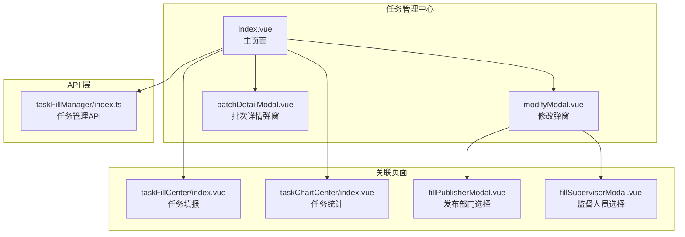
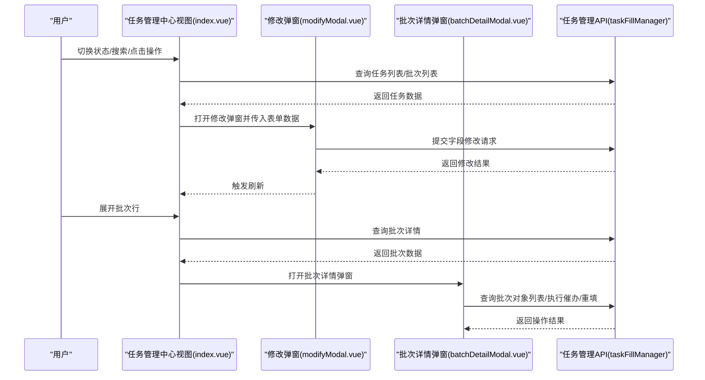
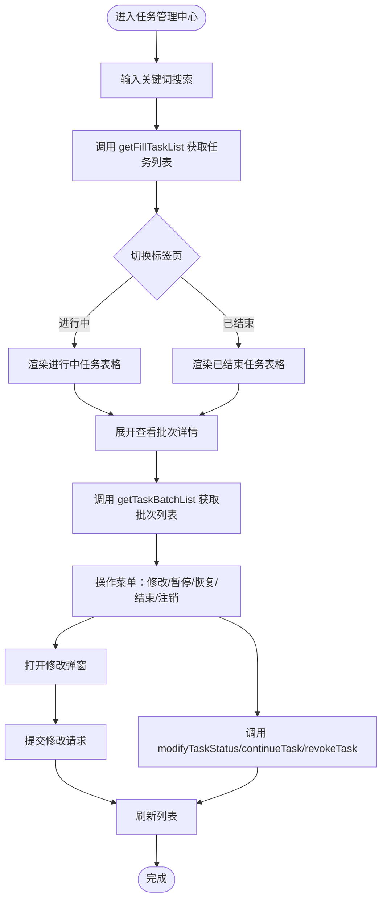
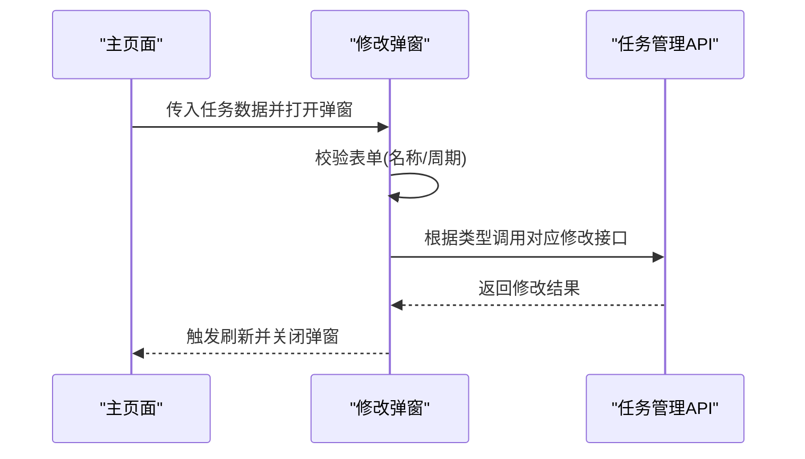
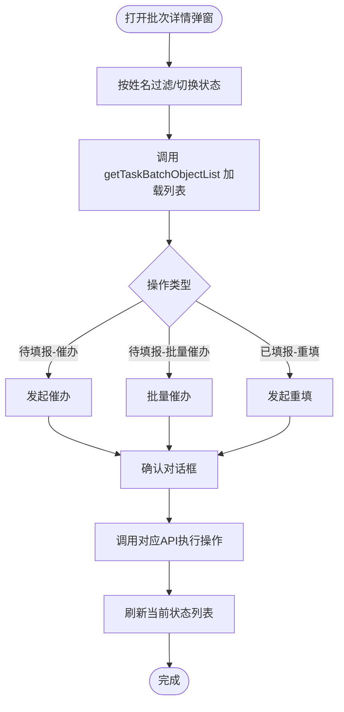
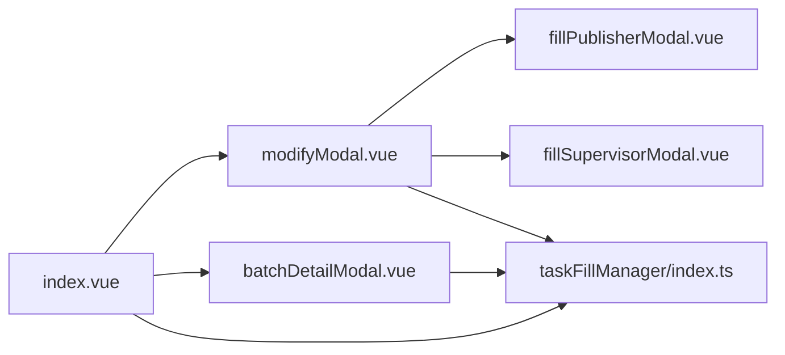

# 任务管理中心

<cite>
**本文档引用的文件**
- [index.vue](file://src/views/taskManageCenter/index.vue)
- [modifyModal.vue](file://src/views/taskManageCenter/modifyModal.vue)
- [batchDetailModal.vue](file://src/views/taskManageCenter/batchDetailModal.vue)
- [index.ts](file://src/api/taskFillManager/index.ts)
- [index.vue](file://src/views/taskFillCenter/index.vue)
- [index.vue](file://src/views/taskChartCenter/index.vue)
- [index.vue](file://src/views/application/publishTask/components/fillPublisherModal.vue)
- [index.vue](file://src/views/application/publishTask/components/fillSupervisorModal.vue)
- [index.ts](file://src/router/index.ts)
</cite>

## 目录
1. [简介](#简介)
2. [项目结构](#项目结构)
3. [核心组件](#核心组件)
4. [架构总览](#架构总览)
5. [详细组件分析](#详细组件分析)
6. [依赖关系分析](#依赖关系分析)
7. [性能考虑](#性能考虑)
8. [故障排除指南](#故障排除指南)
9. [结论](#结论)
10. [附录](#附录)

## 简介
任务管理中心是工作台系统中用于统一管理和监控“填报类”任务的核心模块。它提供任务的批量管理、任务修改、任务详情查看等功能，支持任务状态切换（暂停/恢复/结束）、任务周期调整、发布部门与监督人员的变更，并可查看每个任务批次的填报进度与明细。同时，结合任务统计中心，管理者可以基于数据洞察优化任务策略。

## 项目结构
任务管理中心位于前端视图层的 taskManageCenter 目录，主要由以下文件组成：
- 主页面：负责任务列表展示、状态筛选、分页、展开查看批次详情
- 修改弹窗：封装任务字段修改的表单与交互
- 批次详情弹窗：展示批次内填报对象的待填报/已填报状态及批量操作
- API 层：封装任务管理相关的后端接口调用
- 路由配置：将任务管理中心路由注册到系统导航

**图表来源**
- [index.vue:1-468](file://src/views/taskManageCenter/index.vue#L1-L468)
- [modifyModal.vue:1-242](file://src/views/taskManageCenter/modifyModal.vue#L1-L242)
- [batchDetailModal.vue:1-218](file://src/views/taskManageCenter/batchDetailModal.vue#L1-L218)
- [index.ts:1-109](file://src/api/taskFillManager/index.ts#L1-L109)
- [index.vue:1-482](file://src/views/taskFillCenter/index.vue#L1-L482)
- [index.vue:1-462](file://src/views/taskChartCenter/index.vue#L1-L462)
- [index.vue:1-104](file://src/views/application/publishTask/components/fillPublisherModal.vue#L1-L104)
- [index.vue:1-105](file://src/views/application/publishTask/components/fillSupervisorModal.vue#L1-L105)

**章节来源**
- [index.vue:1-468](file://src/views/taskManageCenter/index.vue#L1-L468)
- [index.ts:1-109](file://src/api/taskFillManager/index.ts#L1-L109)
- [index.ts:146-149](file://src/router/index.ts#L146-L149)

## 核心组件
- 任务列表页（index.vue）：提供任务搜索、状态切换（进行中/已结束）、分页、表格展开查看批次详情；支持批量操作入口（暂停/恢复/结束/注销）与字段修改。
- 修改弹窗（modifyModal.vue）：封装任务名称、发布部门、监督人员、任务周期的修改表单，包含表单校验与提交逻辑。
- 批次详情弹窗（batchDetailModal.vue）：展示批次内填报对象的待填报/已填报状态，支持催办、重填、批量催办等操作。
- API 层（taskFillManager/index.ts）：封装任务管理相关接口，包括任务列表、批次列表、对象列表、状态变更、周期调整、名称/部门/监督人修改等。
- 关联页面：任务填报（taskFillCenter）与任务统计（taskChartCenter），用于前后端联动与数据支撑。

**章节来源**
- [index.vue:1-468](file://src/views/taskManageCenter/index.vue#L1-L468)
- [modifyModal.vue:1-242](file://src/views/taskManageCenter/modifyModal.vue#L1-L242)
- [batchDetailModal.vue:1-218](file://src/views/taskManageCenter/batchDetailModal.vue#L1-L218)
- [index.ts:1-109](file://src/api/taskFillManager/index.ts#L1-L109)

## 架构总览
任务管理中心采用“视图层 + API 层 + 弹窗组件”的分层设计：
- 视图层：index.vue 负责数据获取与展示，modifyModal.vue 和 batchDetailModal.vue 提供交互式修改与详情查看。
- API 层：taskFillManager/index.ts 封装所有任务管理相关的 HTTP 请求，统一参数格式与响应处理。
- 权限与路由：通过路由配置暴露任务管理中心入口，结合通用鉴权工具进行访问控制。

**图表来源**
- [index.vue:310-388](file://src/views/taskManageCenter/index.vue#L310-L388)
- [modifyModal.vue:166-210](file://src/views/taskManageCenter/modifyModal.vue#L166-L210)
- [batchDetailModal.vue:91-173](file://src/views/taskManageCenter/batchDetailModal.vue#L91-L173)
- [index.ts:20-89](file://src/api/taskFillManager/index.ts#L20-L89)

## 详细组件分析

### 主页面（任务列表）
- 功能要点
  - 支持按任务名称搜索与分页展示
  - 通过标签页切换“进行中/已结束”两类任务
  - 行内展开查看批次详情，包含批次时间、应填人数、状态、进度等
  - 操作菜单支持修改任务名称、发布部门、监督人员、任务周期，以及暂停/恢复/结束/注销任务
- 数据流
  - 分页参数与状态筛选通过 getFillTaskList 接口获取数据
  - 展开行时调用 getTaskBatchList 获取批次列表
  - 操作触发 modifyTaskStatus、continueTask、revokeTask 或打开修改弹窗
- 性能与体验
  - 使用本地分页参数控制请求频率
  - 展开行时懒加载批次数据，避免一次性请求过多数据

**图表来源**
- [index.vue:310-388](file://src/views/taskManageCenter/index.vue#L310-L388)
- [index.ts:20-28](file://src/api/taskFillManager/index.ts#L20-L28)

**章节来源**
- [index.vue:20-225](file://src/views/taskManageCenter/index.vue#L20-L225)
- [index.vue:310-388](file://src/views/taskManageCenter/index.vue#L310-L388)

### 修改弹窗（任务字段修改）
- 功能要点
  - 支持修改任务名称、发布部门、监督人员、任务周期
  - 发布部门与监督人员通过独立弹窗选择，支持多选与标签展示
  - 表单校验：任务名称与任务周期必填
  - 提交后触发父组件刷新并关闭弹窗
- 数据结构与流程
  - 表单模型包含任务ID、名称、发布部门数组、监督人员数组、日期范围
  - 不同修改类型映射到不同的 API：modifyTaskName、modifyTaskPublisher、modifyTaskSupervisor、modifyTaskPeriod
- 验证规则
  - 任务名称必填
  - 任务周期必填且格式为起止日期

**图表来源**
- [modifyModal.vue:166-210](file://src/views/taskManageCenter/modifyModal.vue#L166-L210)
- [index.ts:71-89](file://src/api/taskFillManager/index.ts#L71-L89)
- [index.vue:52-82](file://src/views/application/publishTask/components/fillPublisherModal.vue#L52-L82)
- [index.vue:52-82](file://src/views/application/publishTask/components/fillSupervisorModal.vue#L52-L82)

**章节来源**
- [modifyModal.vue:1-242](file://src/views/taskManageCenter/modifyModal.vue#L1-L242)
- [index.vue:1-104](file://src/views/application/publishTask/components/fillPublisherModal.vue#L1-L104)
- [index.vue:1-105](file://src/views/application/publishTask/components/fillSupervisorModal.vue#L1-L105)

### 批次详情弹窗（任务详情查看与批量操作）
- 功能要点
  - 支持按姓名过滤与状态切换（待填报/已填报）
  - 待填报状态下可对单个对象发起催办，或批量催办
  - 已填报状态下可对单个对象发起重填
  - 支持分页查看与刷新
- 数据流
  - 通过 getTaskBatchObjectList 获取批次对象列表
  - 催办/重填通过 fillObjectUrge、fillObjectLaunchReset 执行
- 权限与安全
  - 仅在批次处于进行中时允许催办/重填操作
  - 操作前均弹出确认对话框，防止误操作

**图表来源**
- [batchDetailModal.vue:91-173](file://src/views/taskManageCenter/batchDetailModal.vue#L91-L173)
- [index.ts:30-53](file://src/api/taskFillManager/index.ts#L30-L53)

**章节来源**
- [batchDetailModal.vue:1-218](file://src/views/taskManageCenter/batchDetailModal.vue#L1-L218)

### 任务管理 API（taskFillManager）
- 核心接口
  - 获取任务列表：getFillTaskList(params)
  - 获取任务批次列表：getTaskBatchList(taskId, params)
  - 获取批次对象列表：getTaskBatchObjectList(params)
  - 修改任务状态：modifyTaskStatus(data)
  - 恢复任务：continueTask(taskId)
  - 注销任务：revokeTask(taskId)
  - 修改任务名称：modifyTaskName(data)
  - 修改任务发布部门：modifyTaskPublisher(data)
  - 修改任务监督人：modifyTaskSupervisor(data)
  - 修改任务周期：modifyTaskPeriod(data)
  - 发起催办：fillObjectUrge(data)
  - 发起重填：fillObjectLaunchReset(data)
- 参数与返回
  - 统一使用分页参数 current、size
  - 状态字段：1-进行中、2-暂停中、3-已结束
  - 日期参数统一格式化为 YYYY-MM-DD

**章节来源**
- [index.ts:20-89](file://src/api/taskFillManager/index.ts#L20-L89)

### 路由与导航
- 任务管理中心路由：/taskManageCenter
- 任务统计中心路由：/taskChartCenter
- 任务填报中心路由：/taskFillCenter
- 导航入口：主页面顶部“填报任务统计”按钮跳转至统计中心

**章节来源**
- [index.ts:146-149](file://src/router/index.ts#L146-L149)
- [index.vue:284-286](file://src/views/taskManageCenter/index.vue#L284-L286)

## 依赖关系分析
- 组件耦合
  - 主页面与两个弹窗组件通过事件通信（@refresh）实现数据同步
  - 修改弹窗依赖发布部门与监督人员选择弹窗，形成子组件依赖
- 外部依赖
  - API 层集中管理 HTTP 请求，降低视图层与网络层耦合
  - 日期处理依赖 dayjs，统一格式化
- 可能的循环依赖
  - 未发现直接循环依赖；若后续扩展弹窗间互相调用需谨慎处理

**图表来源**
- [index.vue:248-250](file://src/views/taskManageCenter/index.vue#L248-L250)
- [modifyModal.vue:67-68](file://src/views/taskManageCenter/modifyModal.vue#L67-L68)
- [batchDetailModal.vue:59-61](file://src/views/taskManageCenter/batchDetailModal.vue#L59-L61)

**章节来源**
- [index.vue:248-250](file://src/views/taskManageCenter/index.vue#L248-L250)
- [modifyModal.vue:67-68](file://src/views/taskManageCenter/modifyModal.vue#L67-L68)
- [batchDetailModal.vue:59-61](file://src/views/taskManageCenter/batchDetailModal.vue#L59-L61)

## 性能考虑
- 懒加载与分页
  - 主页面与批次详情均采用分页加载，减少一次性数据量
  - 展开行时才请求批次详情，避免冗余请求
- 表单与弹窗
  - 修改弹窗仅在需要时打开，减少 DOM 与事件绑定数量
  - 表单校验在提交阶段进行，避免频繁校验导致的性能损耗
- 日期处理
  - 使用 dayjs 进行日期格式化，避免复杂计算

[本节为通用建议，无需特定文件来源]

## 故障排除指南
- 无法加载任务列表
  - 检查 getFillTaskList 请求参数（current、size、status、keyword、type）
  - 确认后端接口可用与网络请求状态码
- 批次详情为空
  - 确认批次ID正确且批次处于进行中状态
  - 检查 getTaskBatchObjectList 的分页参数与过滤条件
- 修改失败
  - 校验表单必填项（任务名称、任务周期）
  - 确认 modifyTaskName/modifyTaskPublisher/modifyTaskSupervisor/modifyTaskPeriod 的参数格式
- 催办/重填无效
  - 确认批次状态为进行中
  - 检查用户权限与目标对象是否存在

**章节来源**
- [index.ts:20-89](file://src/api/taskFillManager/index.ts#L20-L89)
- [modifyModal.vue:166-210](file://src/views/taskManageCenter/modifyModal.vue#L166-L210)
- [batchDetailModal.vue:117-163](file://src/views/taskManageCenter/batchDetailModal.vue#L117-L163)

## 结论
任务管理中心通过清晰的视图分层与完善的 API 封装，实现了任务的全生命周期管理：从任务创建后的日常维护（暂停/恢复/结束/注销）、字段修改（名称/部门/监督人/周期），到批次级的填报进度与对象管理（催办/重填）。配合任务统计中心与任务填报中心，形成完整的任务管理闭环。建议在后续迭代中进一步增强权限控制与审计日志能力，以满足更严格的合规要求。

[本节为总结性内容，无需特定文件来源]

## 附录

### 使用场景与操作指南
- 场景一：任务周期调整
  - 在“进行中”任务中选择“修改任务周期”，设置新的起止日期并提交
- 场景二：暂停/恢复/结束/注销任务
  - 在任务操作菜单中选择相应动作，确认后触发状态变更
- 场景三：查看批次详情与批量催办
  - 展开任务行查看批次详情，在“待填报”状态下发起催办或批量催办
- 场景四：重填已填报对象
  - 在“已填报”状态下对单个对象发起重填

**章节来源**
- [index.vue:329-384](file://src/views/taskManageCenter/index.vue#L329-L384)
- [batchDetailModal.vue:117-163](file://src/views/taskManageCenter/batchDetailModal.vue#L117-L163)

### 管理最佳实践
- 定期检查任务状态与批次进度，及时暂停异常任务
- 合理设置任务周期与监督人员，确保任务按时推进
- 使用统计中心观察任务频次与填报趋势，优化任务策略
- 对敏感操作（注销、重填）增加二次确认与审计记录

[本节为通用建议，无需特定文件来源]