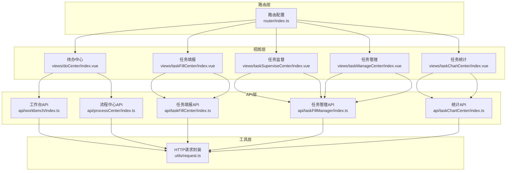
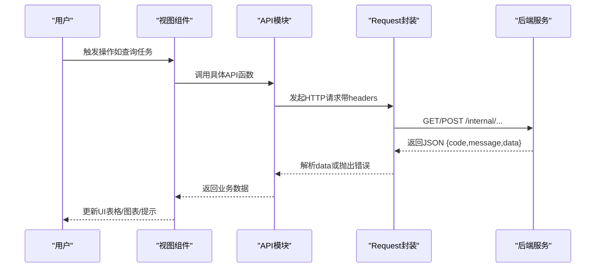
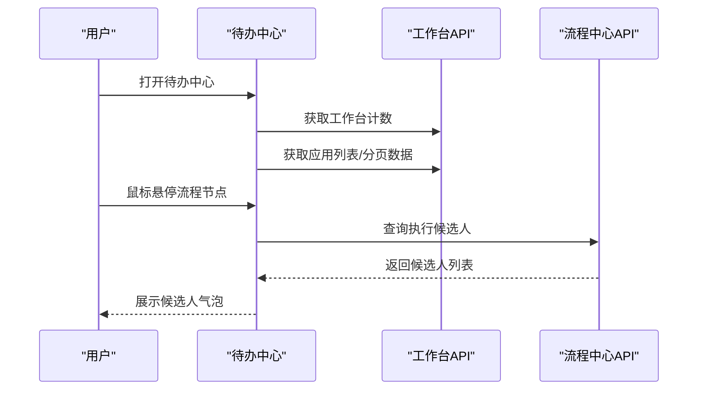
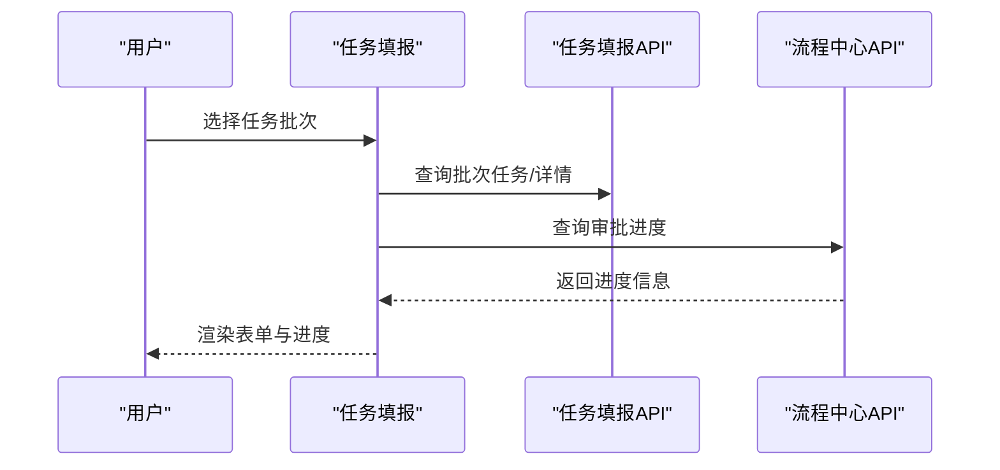
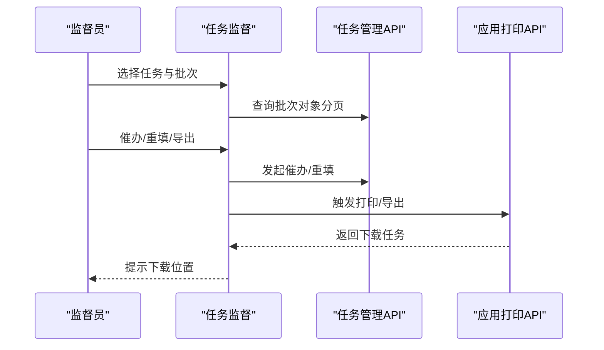
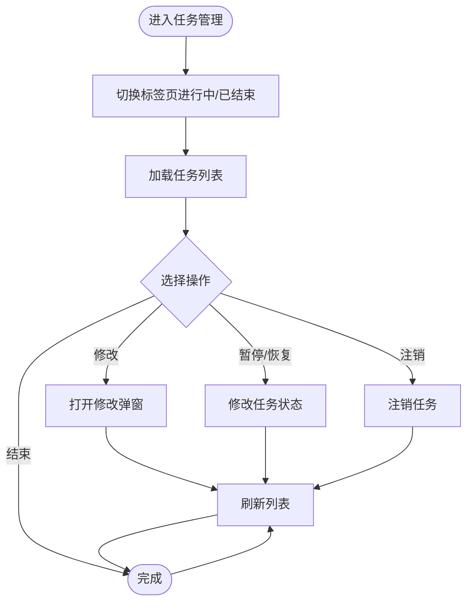
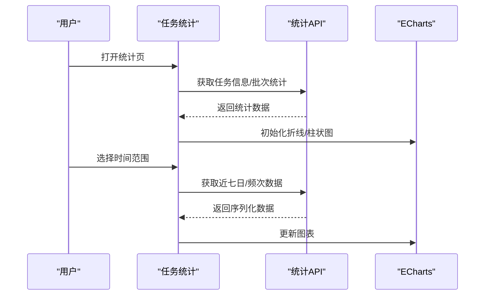
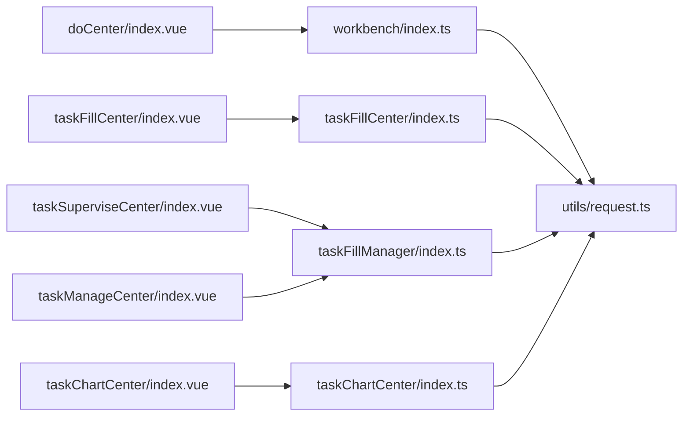

# 任务管理系统

<cite>
**本文档引用的文件**
- [src/api/taskFillCenter/index.ts](file://src/api/taskFillCenter/index.ts)
- [src/api/taskFillManager/index.ts](file://src/api/taskFillManager/index.ts)
- [src/api/taskChartCenter/index.ts](file://src/api/taskChartCenter/index.ts)
- [src/api/processCenter/index.ts](file://src/api/processCenter/index.ts)
- [src/api/workbench/index.ts](file://src/api/workbench/index.ts)
- [src/views/doCenter/index.vue](file://src/views/doCenter/index.vue)
- [src/views/taskFillCenter/index.vue](file://src/views/taskFillCenter/index.vue)
- [src/views/taskSuperviseCenter/index.vue](file://src/views/taskSuperviseCenter/index.vue)
- [src/views/taskManageCenter/index.vue](file://src/views/taskManageCenter/index.vue)
- [src/views/taskChartCenter/index.vue](file://src/views/taskChartCenter/index.vue)
- [src/utils/request.ts](file://src/utils/request.ts)
- [src/router/index.ts](file://src/router/index.ts)
</cite>

## 目录
1. [简介](#简介)
2. [项目结构](#项目结构)
3. [核心组件](#核心组件)
4. [架构总览](#架构总览)
5. [详细组件分析](#详细组件分析)
6. [依赖关系分析](#依赖关系分析)
7. [性能考虑](#性能考虑)
8. [故障排查指南](#故障排查指南)
9. [结论](#结论)
10. [附录](#附录)

## 简介
本任务管理系统围绕“任务分类、任务执行、任务追踪、任务统计”四大核心能力构建，覆盖从任务创建、填报、审批、监督到统计分析的全生命周期。系统提供三大用户视角：
- 待办中心：面向经办人，展示“我的待办、我发起的、我已处理、抄送我的”任务，支持任务转交、加急、撤销等操作。
- 任务填报：面向填报人，展示任务批次、填报进度、审批进度、纠错记录与导出。
- 任务监督：面向监督员，提供任务与批次的进度监控、催办、重填、打印与导出。

同时，系统集成流程中心接口，支持流程审批、转交、退回、终止等操作，并通过统计中心提供多维度报表。

## 项目结构
前端采用 Vue 3 + Arco Design 架构，API 层统一通过封装的 Request 类进行请求与响应拦截，页面通过路由组织，形成清晰的视图层与数据层分离。

**图表来源**
- [src/router/index.ts:1-189](file://src/router/index.ts#L1-L189)
- [src/views/doCenter/index.vue:1-391](file://src/views/doCenter/index.vue#L1-L391)
- [src/views/taskFillCenter/index.vue:1-482](file://src/views/taskFillCenter/index.vue#L1-L482)
- [src/views/taskSuperviseCenter/index.vue:1-1161](file://src/views/taskSuperviseCenter/index.vue#L1-L1161)
- [src/views/taskManageCenter/index.vue:1-468](file://src/views/taskManageCenter/index.vue#L1-L468)
- [src/views/taskChartCenter/index.vue:1-462](file://src/views/taskChartCenter/index.vue#L1-L462)
- [src/api/workbench/index.ts:1-139](file://src/api/workbench/index.ts#L1-L139)
- [src/api/taskFillCenter/index.ts:1-38](file://src/api/taskFillCenter/index.ts#L1-L38)
- [src/api/taskFillManager/index.ts:1-109](file://src/api/taskFillManager/index.ts#L1-L109)
- [src/api/processCenter/index.ts:1-47](file://src/api/processCenter/index.ts#L1-L47)
- [src/api/taskChartCenter/index.ts:1-24](file://src/api/taskChartCenter/index.ts#L1-L24)
- [src/utils/request.ts:1-159](file://src/utils/request.ts#L1-L159)

**章节来源**
- [src/router/index.ts:1-189](file://src/router/index.ts#L1-L189)
- [src/utils/request.ts:1-159](file://src/utils/request.ts#L1-L159)

## 核心组件
- 待办中心：聚合“待办、发起、已处理、抄送”四类任务，支持应用筛选、流程节点候选人查看、任务状态计数刷新。
- 任务填报：展示任务批次列表、批次详情、填报进度、审批进度、纠错记录与导出。
- 任务监督：支持任务与批次筛选、填报对象列表、催办/重填、打印/导出、模板选择。
- 任务管理：任务状态管理（暂停/恢复/结束/注销）、批量批次展开、分页查询。
- 统计中心：任务总数、进行中/已结束、应用数量、批次统计、近七日填报人次、任务频次。
- 流程中心：流程统计、应用流程列表、流程记录、催办、填写、审批通过/拒绝/转交/退回、终止流程。
- 工作台API：待办/发起/已处理/抄送的计数与分页查询、任务转交、加急、撤销、流程详情、候选人查询、导出。

**章节来源**
- [src/views/doCenter/index.vue:1-391](file://src/views/doCenter/index.vue#L1-L391)
- [src/views/taskFillCenter/index.vue:1-482](file://src/views/taskFillCenter/index.vue#L1-L482)
- [src/views/taskSuperviseCenter/index.vue:1-1161](file://src/views/taskSuperviseCenter/index.vue#L1-L1161)
- [src/views/taskManageCenter/index.vue:1-468](file://src/views/taskManageCenter/index.vue#L1-L468)
- [src/views/taskChartCenter/index.vue:1-462](file://src/views/taskChartCenter/index.vue#L1-L462)
- [src/api/workbench/index.ts:1-139](file://src/api/workbench/index.ts#L1-L139)
- [src/api/processCenter/index.ts:1-47](file://src/api/processCenter/index.ts#L1-L47)

## 架构总览
系统采用前后端分离，前端通过统一的 Request 封装进行 HTTP 通信，自动注入客户端标识与令牌，拦截响应并进行统一错误提示与跳转。

**图表来源**
- [src/utils/request.ts:1-159](file://src/utils/request.ts#L1-L159)
- [src/api/workbench/index.ts:1-139](file://src/api/workbench/index.ts#L1-L139)
- [src/api/taskFillCenter/index.ts:1-38](file://src/api/taskFillCenter/index.ts#L1-L38)
- [src/api/taskFillManager/index.ts:1-109](file://src/api/taskFillManager/index.ts#L1-L109)
- [src/api/taskChartCenter/index.ts:1-24](file://src/api/taskChartCenter/index.ts#L1-L24)
- [src/api/processCenter/index.ts:1-47](file://src/api/processCenter/index.ts#L1-L47)

## 详细组件分析

### 待办中心（任务执行与追踪）
- 功能要点
  - 四大标签页：我的待办、我发起的、我已处理、抄送我的。
  - 计数刷新：首次进入与切换标签时调用工作台计数接口。
  - 流程节点候选人：鼠标悬停查看当前流程节点的执行候选人。
  - 任务类型与优先级：区分“填写/审批”，支持“加急”“自动审批”标记。
  - 抄送已读：支持将抄送任务标记为已读。
- 关键交互
  - 通过工作台API获取应用列表与分页数据。
  - 通过流程中心API获取流程候选人信息。
- 最佳实践
  - 首屏懒加载：仅初始化当前激活标签的数据源。
  - 防抖搜索：在应用筛选场景避免频繁请求。

**图表来源**
- [src/views/doCenter/index.vue:158-294](file://src/views/doCenter/index.vue#L158-L294)
- [src/api/workbench/index.ts:1-139](file://src/api/workbench/index.ts#L1-L139)
- [src/api/processCenter/index.ts:1-47](file://src/api/processCenter/index.ts#L1-L47)

**章节来源**
- [src/views/doCenter/index.vue:1-391](file://src/views/doCenter/index.vue#L1-L391)
- [src/api/workbench/index.ts:1-139](file://src/api/workbench/index.ts#L1-L139)

### 任务填报（任务分类与执行）
- 功能要点
  - 任务状态筛选：进行中/已结束。
  - 任务列表：支持搜索、分页加载、选中当前任务。
  - 批次详情：展示周期、发布部门、监督人员、进度条。
  - 表单渲染：根据任务配置动态渲染填报表单。
  - 审批进度：查看审批流程与节点信息。
  - 纠错记录：查看与导出纠错记录。
- 关键交互
  - 通过任务填报API查询批次任务与详情。
  - 通过流程中心API查询审批进度。
  - 通过通用导出接口导出报表。

**图表来源**
- [src/views/taskFillCenter/index.vue:95-208](file://src/views/taskFillCenter/index.vue#L95-L208)
- [src/api/taskFillCenter/index.ts:1-38](file://src/api/taskFillCenter/index.ts#L1-L38)
- [src/api/processCenter/index.ts:1-47](file://src/api/processCenter/index.ts#L1-L47)

**章节来源**
- [src/views/taskFillCenter/index.vue:1-482](file://src/views/taskFillCenter/index.vue#L1-L482)
- [src/api/taskFillCenter/index.ts:1-38](file://src/api/taskFillCenter/index.ts#L1-L38)

### 任务监督（任务监督与催办）
- 功能要点
  - 多维筛选：年份、任务名、发布部门、应用分类、应用。
  - 任务与批次联动：选择任务后加载批次列表，再选择批次加载填报对象。
  - 催办/重填：支持单个/全部催办，已填状态下发起“重新填报”。
  - 纠错管理：查看待处理纠错数量，打开纠错抽屉。
  - 打印/导出：根据模板选择导出 word/pdf/excel。
- 关键交互
  - 通过任务管理API获取任务列表、批次列表、对象分页。
  - 通过通用打印接口触发导出任务。

**图表来源**
- [src/views/taskSuperviseCenter/index.vue:288-770](file://src/views/taskSuperviseCenter/index.vue#L288-L770)
- [src/api/taskFillManager/index.ts:1-109](file://src/api/taskFillManager/index.ts#L1-L109)
- [src/api/application/index.ts:1-200](file://src/api/application/index.ts#L1-L200)

**章节来源**
- [src/views/taskSuperviseCenter/index.vue:1-1161](file://src/views/taskSuperviseCenter/index.vue#L1-L1161)
- [src/api/taskFillManager/index.ts:1-109](file://src/api/taskFillManager/index.ts#L1-L109)

### 任务管理（任务状态管理与维护）
- 功能要点
  - 进行中/已结束双标签页：支持展开查看批次明细。
  - 操作菜单：修改任务名称/发布部门/监督人员/周期；暂停/恢复/结束/注销任务。
  - 分页与搜索：关键词搜索与分页控制。
- 关键交互
  - 通过任务管理API进行状态变更与任务维护。

**图表来源**
- [src/views/taskManageCenter/index.vue:235-403](file://src/views/taskManageCenter/index.vue#L235-L403)
- [src/api/taskFillManager/index.ts:56-89](file://src/api/taskFillManager/index.ts#L56-L89)

**章节来源**
- [src/views/taskManageCenter/index.vue:1-468](file://src/views/taskManageCenter/index.vue#L1-L468)
- [src/api/taskFillManager/index.ts:1-109](file://src/api/taskFillManager/index.ts#L1-L109)

### 任务统计（统计分析与可视化）
- 功能要点
  - 总览卡片：全部任务、进行中、应用数量、已结束、填报人次。
  - 批次统计：进行中/已结束批次。
  - 时间范围选择：最近一周/一月/三月。
  - 图表：折线图（填报数/应用数量/填报人数）、柱状图（任务频次）。
- 关键交互
  - 通过统计API获取数据，使用 ECharts 渲染。

**图表来源**
- [src/views/taskChartCenter/index.vue:81-371](file://src/views/taskChartCenter/index.vue#L81-L371)
- [src/api/taskChartCenter/index.ts:1-24](file://src/api/taskChartCenter/index.ts#L1-L24)

**章节来源**
- [src/views/taskChartCenter/index.vue:1-462](file://src/views/taskChartCenter/index.vue#L1-L462)
- [src/api/taskChartCenter/index.ts:1-24](file://src/api/taskChartCenter/index.ts#L1-L24)

### 流程中心（流程审批与转交）
- 功能要点
  - 流程统计、应用流程列表、流程记录。
  - 催办、填写、审批通过/拒绝/转交/退回、终止流程。
- 关键交互
  - 通过流程中心API提交各类流程操作。

**章节来源**
- [src/api/processCenter/index.ts:1-47](file://src/api/processCenter/index.ts#L1-L47)

### 工作台API（任务状态与候选人）
- 功能要点
  - 待办/发起/已处理/抄送的计数与分页。
  - 任务转交、加急、撤销、终止。
  - 流程详情、执行候选人、打印导出。
- 关键交互
  - 与工作台后端接口对接，统一由 Request 封装处理。

**章节来源**
- [src/api/workbench/index.ts:1-139](file://src/api/workbench/index.ts#L1-L139)
- [src/utils/request.ts:1-159](file://src/utils/request.ts#L1-L159)

## 依赖关系分析
- 组件耦合
  - 视图组件通过各自API模块解耦，降低跨页面耦合。
  - 统一的 Request 封装提供全局拦截器，减少重复逻辑。
- 外部依赖
  - Axios：HTTP 客户端。
  - ECharts：统计图表渲染。
  - Arco Design：UI 组件库。
- 可能的循环依赖
  - API 模块之间无直接互相导入，避免循环依赖风险。

**图表来源**
- [src/views/doCenter/index.vue:158-170](file://src/views/doCenter/index.vue#L158-L170)
- [src/views/taskFillCenter/index.vue:98-103](file://src/views/taskFillCenter/index.vue#L98-L103)
- [src/views/taskSuperviseCenter/index.vue:297-307](file://src/views/taskSuperviseCenter/index.vue#L297-L307)
- [src/views/taskManageCenter/index.vue:241-250](file://src/views/taskManageCenter/index.vue#L241-L250)
- [src/views/taskChartCenter/index.vue:86-91](file://src/views/taskChartCenter/index.vue#L86-L91)
- [src/api/workbench/index.ts:1-139](file://src/api/workbench/index.ts#L1-L139)
- [src/api/taskFillCenter/index.ts:1-38](file://src/api/taskFillCenter/index.ts#L1-L38)
- [src/api/taskFillManager/index.ts:1-109](file://src/api/taskFillManager/index.ts#L1-L109)
- [src/api/taskChartCenter/index.ts:1-24](file://src/api/taskChartCenter/index.ts#L1-L24)
- [src/utils/request.ts:1-159](file://src/utils/request.ts#L1-L159)

**章节来源**
- [src/router/index.ts:1-189](file://src/router/index.ts#L1-L189)
- [src/utils/request.ts:1-159](file://src/utils/request.ts#L1-L159)

## 性能考虑
- 分页与懒加载
  - 任务列表与批次对象均采用分页加载，避免一次性传输大量数据。
- 首屏优化
  - 仅初始化当前激活标签的数据源，减少初始渲染压力。
- 图表性能
  - 图表在窗口 resize 时重绘，避免布局抖动；卸载时释放实例。
- 请求拦截
  - 统一注入 token 与 client_id，减少重复配置；对 blob/arraybuffer 类型直接透传，避免额外解析。

**章节来源**
- [src/views/doCenter/index.vue:237-247](file://src/views/doCenter/index.vue#L237-L247)
- [src/views/taskSuperviseCenter/index.vue:350-370](file://src/views/taskSuperviseCenter/index.vue#L350-L370)
- [src/utils/request.ts:26-114](file://src/utils/request.ts#L26-L114)

## 故障排查指南
- 登录态失效
  - 当后端返回 401 或 code=401 时，自动跳转至登录入口。
- 接口异常
  - 统一错误提示：根据响应 message 弹出消息；网络错误映射为标准提示。
- 常见问题定位
  - 若出现“未授权/拒绝访问”，检查本地 token 是否存在且有效。
  - 若导出/打印无响应，确认后端返回的下载任务是否已生成。

**章节来源**
- [src/utils/request.ts:47-114](file://src/utils/request.ts#L47-L114)

## 结论
本任务管理系统以清晰的视图分层与统一的 API 封装为基础，实现了从任务创建、填报、审批、监督到统计分析的完整闭环。通过流程中心与工作台 API 的协同，系统支持多样化的任务执行与追踪场景；借助统计中心的可视化能力，管理者可快速掌握任务运行态势。建议在后续迭代中进一步增强任务提醒与通知机制，并持续优化大数据量下的分页与渲染性能。

## 附录
- 路由概览：系统包含登录、首页、流程中心、应用管理、表单设计、流程路径、部门/岗位/角色/用户/字典/领导、分类、访客/管理员、开发者、图标库、设置、安全中心、待办中心、任务填报、任务监督、任务管理、任务统计、连接器、输出管理、报表等路由。
- 最佳实践
  - 任务状态管理：使用统一的状态字典与操作按钮，确保一致性。
  - 任务监督：对“催办/重填/导出”等高频操作提供明确反馈与二次确认。
  - 统计分析：提供时间范围选择与图表自适应，提升可读性。
  - 错误处理：统一拦截器与错误提示，保障用户体验。

**章节来源**
- [src/router/index.ts:1-189](file://src/router/index.ts#L1-L189)