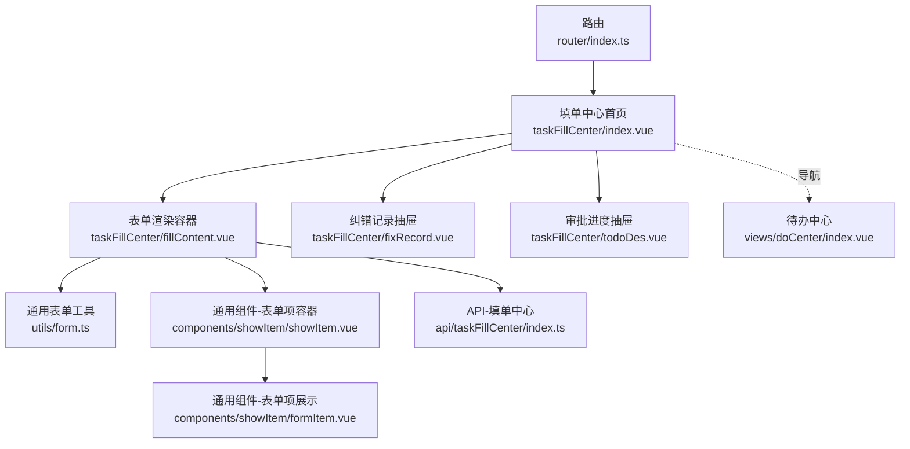
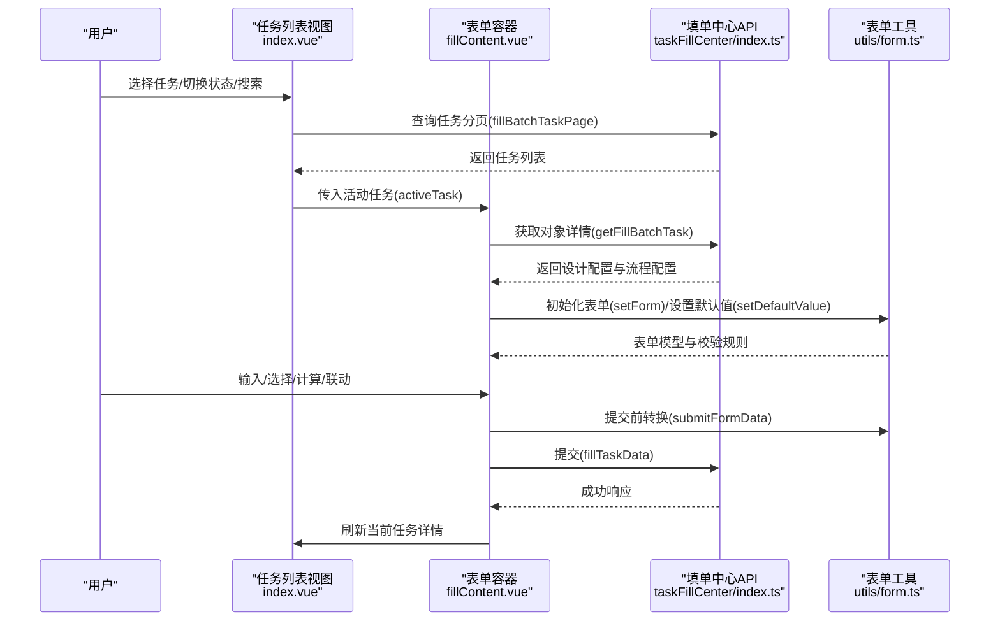
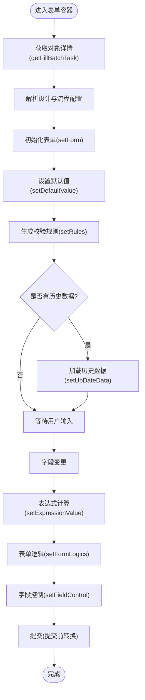
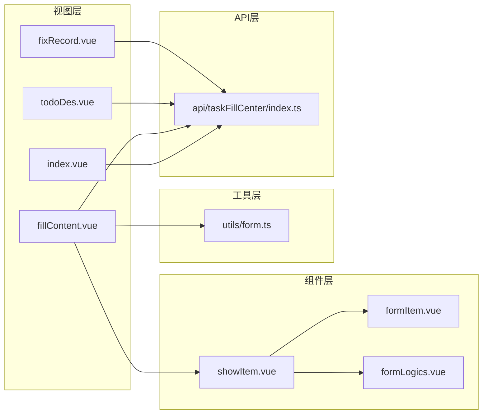

# 填单中心

<cite>
**本文引用的文件**
- [index.vue](file://src/views/taskFillCenter/index.vue)
- [fillContent.vue](file://src/views/taskFillCenter/fillContent.vue)
- [todoDes.vue](file://src/views/taskFillCenter/todoDes.vue)
- [fixRecord.vue](file://src/views/taskFillCenter/fixRecord.vue)
- [index.ts](file://src/api/taskFillCenter/index.ts)
- [form.ts](file://src/utils/form.ts)
- [showItem.vue](file://src/components/showItem/showItem.vue)
- [formItem.vue](file://src/components/showItem/formItem.vue)
- [index.ts](file://src/router/index.ts)
- [index.vue](file://src/views/doCenter/index.vue)
- [formLogics.vue](file://src/components/formLogics/formLogics.vue)
- [form.ts](file://src/types/form.ts)
</cite>

## 目录
1. [简介](#简介)
2. [项目结构](#项目结构)
3. [核心组件](#核心组件)
4. [架构总览](#架构总览)
5. [详细组件分析](#详细组件分析)
6. [依赖关系分析](#依赖关系分析)
7. [性能考量](#性能考量)
8. [故障排查指南](#故障排查指南)
9. [结论](#结论)
10. [附录](#附录)

## 简介
填单中心是工作台中的“任务填报”功能模块，面向用户展示待填任务、支持任务详情查看、表单渲染与填写、纠错记录与审批进度查看，并提供打印与导出能力。其设计理念围绕“任务驱动 + 动态表单 + 流程可视化”的闭环体验，强调：
- 任务生命周期管理：进行中/已结束筛选与分页加载
- 表单即配置：通过后端下发的表单与流程配置动态渲染
- 数据校验与联动：基于字段控制与表单逻辑的实时生效
- 用户体验：简洁直观的左右布局、底部按钮区、抽屉式详情与纠错记录

## 项目结构
填单中心位于 views/taskFillCenter 目录，配合通用 API、工具函数与通用组件协同工作。

图表来源
- [index.ts:136-139](file://src/router/index.ts#L136-L139)
- [index.vue:1-482](file://src/views/taskFillCenter/index.vue#L1-L482)
- [fillContent.vue:1-464](file://src/views/taskFillCenter/fillContent.vue#L1-L464)
- [fixRecord.vue:1-135](file://src/views/taskFillCenter/fixRecord.vue#L1-L135)
- [todoDes.vue:1-112](file://src/views/taskFillCenter/todoDes.vue#L1-L112)
- [form.ts:1-1341](file://src/utils/form.ts#L1-L1341)
- [showItem.vue:1-196](file://src/components/showItem/showItem.vue#L1-L196)
- [formItem.vue:1-122](file://src/components/showItem/formItem.vue#L1-L122)
- [index.ts:1-38](file://src/api/taskFillCenter/index.ts#L1-L38)
- [index.vue:1-391](file://src/views/doCenter/index.vue#L1-L391)

章节来源
- [index.ts:136-139](file://src/router/index.ts#L136-L139)
- [index.vue:1-482](file://src/views/taskFillCenter/index.vue#L1-L482)

## 核心组件
- 任务列表与筛选：左侧任务列表支持“进行中/已结束”切换、关键词搜索、分页加载与激活任务高亮
- 表单渲染容器：右侧根据任务对象获取设计配置，动态生成表单并绑定数据模型
- 表单项容器：统一包装表单项，负责交互事件、联动计算与字段控制
- 抽屉式详情：纠错记录与审批进度以抽屉形式展示，避免页面跳转
- API 适配：统一封装填单中心相关接口，包括任务分页、对象详情、导出与纠错记录

章节来源
- [index.vue:1-482](file://src/views/taskFillCenter/index.vue#L1-L482)
- [fillContent.vue:1-464](file://src/views/taskFillCenter/fillContent.vue#L1-L464)
- [showItem.vue:1-196](file://src/components/showItem/showItem.vue#L1-L196)
- [index.ts:1-38](file://src/api/taskFillCenter/index.ts#L1-L38)

## 架构总览
填单中心采用“视图层 + 工具层 + 组件层 + API 层”的分层架构，数据流从后端配置到前端渲染再到提交闭环。

图表来源
- [index.vue:140-207](file://src/views/taskFillCenter/index.vue#L140-L207)
- [fillContent.vue:252-287](file://src/views/taskFillCenter/fillContent.vue#L252-L287)
- [index.ts:11-20](file://src/api/taskFillCenter/index.ts#L11-L20)
- [form.ts:578-599](file://src/utils/form.ts#L578-L599)

## 详细组件分析

### 任务列表与筛选（index.vue）
- 功能要点
  - 支持“进行中/已结束”状态切换，清空分页游标并重新加载
  - 关键词搜索触发分页重置
  - 滚动触底加载更多，避免一次性拉取全部数据
  - 激活任务高亮，支持从路由参数预选任务
- 性能与体验
  - 使用禁用态避免重复请求
  - 列表项点击切换活动任务，减少页面刷新

章节来源
- [index.vue:127-207](file://src/views/taskFillCenter/index.vue#L127-L207)

### 表单渲染容器（fillContent.vue）
- 功能要点
  - 获取应用描述与对象详情，解析设计配置与流程配置
  - 初始化表单模型、默认值、校验规则与字段控制
  - 支持草稿/提交按钮、重填/纠错/打印/下载等操作
  - 通过 provide/inject 向子组件暴露字段操作方法
- 数据流
  - 设计配置 → setForm/setDefaultValue/setRules
  - 表单值变更 → setExpressionValue/setFieldControl/setFormLogics
  - 提交前 → submitFormData 转换为后端期望格式

图表来源
- [fillContent.vue:252-398](file://src/views/taskFillCenter/fillContent.vue#L252-L398)
- [form.ts:578-599](file://src/utils/form.ts#L578-L599)
- [form.ts:853-892](file://src/utils/form.ts#L853-L892)
- [form.ts:1065-1140](file://src/utils/form.ts#L1065-L1140)

章节来源
- [fillContent.vue:1-464](file://src/views/taskFillCenter/fillContent.vue#L1-L464)
- [form.ts:1-1341](file://src/utils/form.ts#L1-L1341)

### 表单项容器（showItem.vue 与 formItem.vue）
- 功能要点
  - 包装任意表单项，统一处理必填、描述、按钮区等
  - 在编辑模式下提供上移/下移/复制/删除等操作
  - 将字段变更事件向上抛出，由父容器统一处理联动与校验
- 交互设计
  - 点击激活当前项，显示操作按钮
  - 支持方法注入（provide/inject），便于设计器与运行态复用

章节来源
- [showItem.vue:1-196](file://src/components/showItem/showItem.vue#L1-L196)
- [formItem.vue:1-122](file://src/components/showItem/formItem.vue#L1-L122)

### 抽屉式详情与纠错记录（todoDes.vue、fixRecord.vue）
- 审批进度抽屉
  - 打开时按需加载流程实例日志，解析评论与处理层级
  - 以标签页方式展示“节点信息/流程图”
- 纠错记录抽屉
  - 分页加载纠错记录，渲染纠错人、时间与处理结果状态色

章节来源
- [todoDes.vue:1-112](file://src/views/taskFillCenter/todoDes.vue#L1-L112)
- [fixRecord.vue:1-135](file://src/views/taskFillCenter/fixRecord.vue#L1-L135)

### API 适配（taskFillCenter/index.ts）
- 接口职责
  - 任务分页：fillBatchTaskPage
  - 对象详情：getFillBatchTask
  - 填报提交：fillTaskData
  - 纠错记录：fixRecordObjectPage
  - 导出：exportData（支持 word/pdf）
  - 审批进度：getApprovalProgress
- 响应体
  - 统一使用 Request 封装，支持分页 records/total 与 blob 导出

章节来源
- [index.ts:1-38](file://src/api/taskFillCenter/index.ts#L1-L38)

### 表单工具函数（utils/form.ts）
- 关键能力
  - 表单初始化：setForm（示例文件、子表单占位等）
  - 默认值与更新：setDefaultValue、setUpDateData、setUpDateSubFormData
  - 校验规则：setRules（内置多种类型校验）
  - 表达式与联动：setExpressionValue、setFormLogics
  - 字段控制：setFieldControl（基于流程节点字段控制）
  - 提交转换：submitFormData（多选/关联/子表单等归一化）
  - 列表渲染辅助：convertToColumns/renderMap（附件/图片/子表单列渲染）

章节来源
- [form.ts:578-599](file://src/utils/form.ts#L578-L599)
- [form.ts:853-892](file://src/utils/form.ts#L853-L892)
- [form.ts:1065-1140](file://src/utils/form.ts#L1065-L1140)
- [form.ts:723-851](file://src/utils/form.ts#L723-L851)
- [form.ts:918-1020](file://src/utils/form.ts#L918-L1020)
- [form.ts:452-577](file://src/utils/form.ts#L452-L577)
- [form.ts:1286-1341](file://src/utils/form.ts#L1286-L1341)

### 类型定义（types/form.ts）
- Appdes：应用描述（图标、名称、分类、表单ID等）
- FormConfs：表单配置（表单ID/名称/分类、字段列表、逻辑、宽度、标题样式、草稿/提交文案等）
- FlowInfo：流程动作（通过/拒绝/委托/退回等）

章节来源
- [form.ts:1-45](file://src/types/form.ts#L1-L45)

## 依赖关系分析
- 视图层依赖
  - index.vue 依赖 taskFillCenter API 与用户横幅组件
  - fillContent.vue 依赖通用表单工具、showItem 容器、应用描述 API、打印与导出 API
  - todoDes.vue/fixRecord.vue 依赖工作台与填单中心 API
- 组件层依赖
  - showItem.vue 通过 provide/inject 与父容器通信
  - formLogics.vue 根据字段类型分发到具体逻辑组件
- 工具层依赖
  - form.ts 依赖字段工具、关系数据 API、表达式计算模块

图表来源
- [index.vue:1-482](file://src/views/taskFillCenter/index.vue#L1-L482)
- [fillContent.vue:1-464](file://src/views/taskFillCenter/fillContent.vue#L1-L464)
- [showItem.vue:1-196](file://src/components/showItem/showItem.vue#L1-L196)
- [formItem.vue:1-122](file://src/components/showItem/formItem.vue#L1-L122)
- [formLogics.vue:1-35](file://src/components/formLogics/formLogics.vue#L1-L35)
- [index.ts:1-38](file://src/api/taskFillCenter/index.ts#L1-L38)
- [form.ts:1-1341](file://src/utils/form.ts#L1-L1341)

## 性能考量
- 列表懒加载
  - 使用分页参数与“是否还有更多”标记，避免一次性加载全部任务
- 表单渲染优化
  - 仅在需要时解析与设置默认值，避免不必要的深拷贝
  - 子表单与关联数据按需加载，减少首屏压力
- 校验与联动
  - 仅对变更字段触发表达式与逻辑计算，降低计算开销
- 导出与打印
  - 模板选择弹窗避免重复请求，Blob 下载与打印窗口复用

章节来源
- [index.vue:140-207](file://src/views/taskFillCenter/index.vue#L140-L207)
- [fillContent.vue:134-251](file://src/views/taskFillCenter/fillContent.vue#L134-L251)
- [form.ts:723-851](file://src/utils/form.ts#L723-L851)

## 故障排查指南
- 无法加载任务列表
  - 检查网络请求与分页参数；确认“禁用态”未阻止加载
  - 参考：[index.vue:140-207](file://src/views/taskFillCenter/index.vue#L140-L207)
- 表单为空或字段缺失
  - 确认对象详情接口返回设计配置与流程配置
  - 检查 setForm/setDefaultValue 是否执行
  - 参考：[fillContent.vue:252-287](file://src/views/taskFillCenter/fillContent.vue#L252-L287)，[form.ts:578-599](file://src/utils/form.ts#L578-L599)
- 校验不生效或报错
  - 检查 setRules 是否覆盖目标字段类型
  - 特别关注 ADDRESS/PHONE/ID_CARD/EMAIL/URL 的自定义校验
  - 参考：[form.ts:1065-1140](file://src/utils/form.ts#L1065-L1140)
- 字段联动/表达式异常
  - 确认变更字段是否触发 setExpressionValue 与 setFormLogics
  - 参考：[form.ts:723-851](file://src/utils/form.ts#L723-L851)，[form.ts:918-1020](file://src/utils/form.ts#L918-L1020)
- 导出/打印失败
  - 检查模板数量与选择；确认 responseType: blob 与 blobDownload
  - 参考：[fillContent.vue:134-251](file://src/views/taskFillCenter/fillContent.vue#L134-L251)，[index.ts:34-38](file://src/api/taskFillCenter/index.ts#L34-L38)
- 纠错记录/审批进度为空
  - 确认 objectId/formId 与分页参数正确
  - 参考：[fixRecord.vue:79-91](file://src/views/taskFillCenter/fixRecord.vue#L79-L91)，[todoDes.vue:44-70](file://src/views/taskFillCenter/todoDes.vue#L44-L70)

## 结论
填单中心以“任务 + 表单 + 流程”为核心，通过配置驱动与工具函数实现高扩展性与易维护性。其交互设计简洁直观，结合抽屉式详情与纠错记录，有效提升用户效率与可观测性。建议后续在以下方面持续优化：
- 表单草稿持久化与离线提示
- 更细粒度的字段级权限控制
- 表单渲染性能监控与告警

## 附录
- 与其他中心的关系
  - 待办中心提供任务入口与流程候选人信息，填单中心承接具体填报
  - 参考：[index.vue:1-391](file://src/views/doCenter/index.vue#L1-L391)