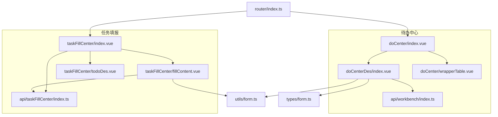
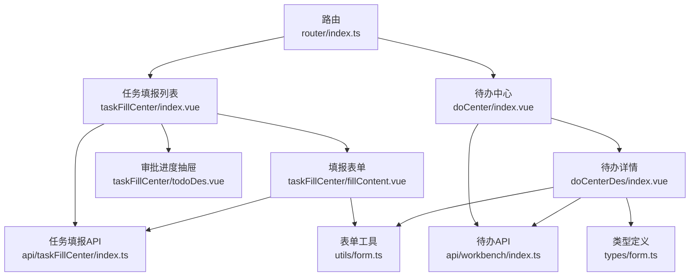
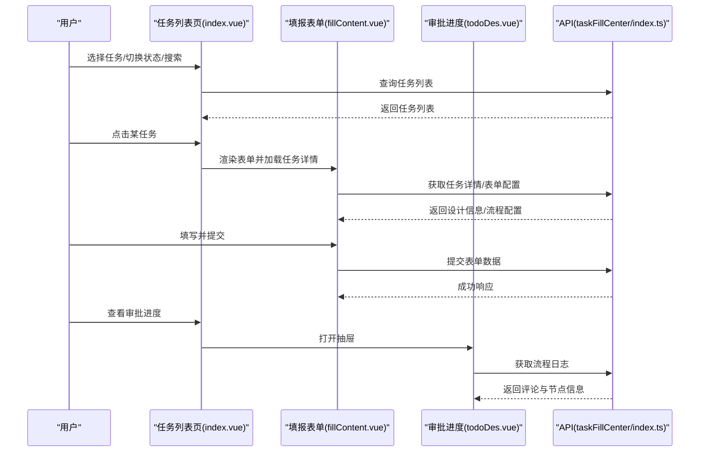
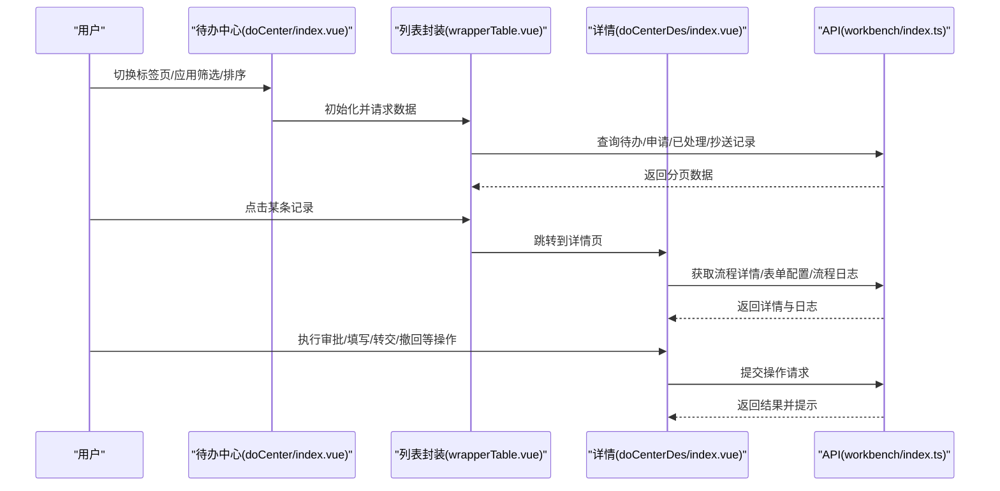
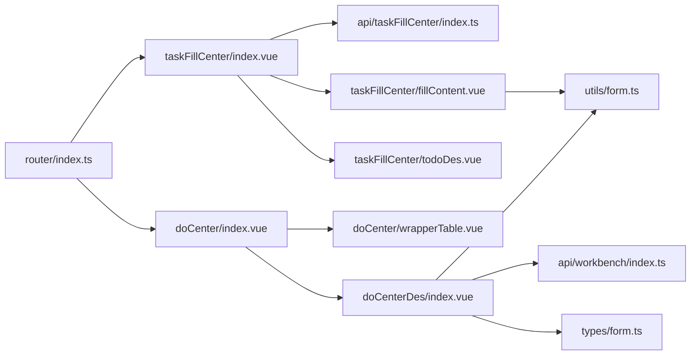

# 我的待办

<cite>
**本文引用的文件**
- [src/views/taskFillCenter/index.vue](file://src/views/taskFillCenter/index.vue)
- [src/views/taskFillCenter/todoDes.vue](file://src/views/taskFillCenter/todoDes.vue)
- [src/views/taskFillCenter/fillContent.vue](file://src/views/taskFillCenter/fillContent.vue)
- [src/views/doCenter/index.vue](file://src/views/doCenter/index.vue)
- [src/views/doCenterDes/index.vue](file://src/views/doCenterDes/index.vue)
- [src/views/doCenter/wrapperTable.vue](file://src/views/doCenter/wrapperTable.vue)
- [src/api/taskFillCenter/index.ts](file://src/api/taskFillCenter/index.ts)
- [src/api/workbench/index.ts](file://src/api/workbench/index.ts)
- [src/router/index.ts](file://src/router/index.ts)
- [src/utils/form.ts](file://src/utils/form.ts)
- [src/types/form.ts](file://src/types/form.ts)
</cite>

## 目录
1. [简介](#简介)
2. [项目结构](#项目结构)
3. [核心组件](#核心组件)
4. [架构总览](#架构总览)
5. [详细组件分析](#详细组件分析)
6. [依赖关系分析](#依赖关系分析)
7. [性能考量](#性能考量)
8. [故障排查指南](#故障排查指南)
9. [结论](#结论)
10. [附录](#附录)

## 简介
“我的待办”是工作台中的核心功能模块之一，覆盖两类主要场景：
- 任务填报：面向需要按周期填报数据的用户，支持任务列表、任务详情、表单填写、导出打印、纠错记录等。
- 待办中心：面向所有类型的流程任务（待处理、我发起、我已处理、抄送），提供统一的任务列表、任务详情、审批/填写操作、流程图与评论联动。

本模块以“任务生命周期”为主线，贯穿任务检索、状态流转、评论沟通、流程可视化与导出打印，形成闭环体验。

## 项目结构
围绕“我的待办”的前端目录组织如下：
- 任务填报：taskFillCenter
  - 列表页：index.vue
  - 填报表单：fillContent.vue
  - 审批进度/节点信息抽屉：todoDes.vue
  - API：taskFillCenter/index.ts
- 待办中心：doCenter
  - 中心页：index.vue
  - 详情页：doCenterDes/index.vue
  - 列表封装：doCenter/wrapperTable.vue
  - API：workbench/index.ts
- 路由：router/index.ts
- 表单工具：utils/form.ts
- 类型定义：types/form.ts

图表来源
- [src/router/index.ts:126-139](file://src/router/index.ts#L126-L139)
- [src/views/taskFillCenter/index.vue:1-482](file://src/views/taskFillCenter/index.vue#L1-L482)
- [src/views/taskFillCenter/fillContent.vue:1-464](file://src/views/taskFillCenter/fillContent.vue#L1-L464)
- [src/views/taskFillCenter/todoDes.vue:1-112](file://src/views/taskFillCenter/todoDes.vue#L1-L112)
- [src/views/doCenter/index.vue:1-391](file://src/views/doCenter/index.vue#L1-L391)
- [src/views/doCenterDes/index.vue:1-690](file://src/views/doCenterDes/index.vue#L1-L690)
- [src/views/doCenter/wrapperTable.vue:1-218](file://src/views/doCenter/wrapperTable.vue#L1-L218)
- [src/api/taskFillCenter/index.ts:1-38](file://src/api/taskFillCenter/index.ts#L1-L38)
- [src/api/workbench/index.ts:1-139](file://src/api/workbench/index.ts#L1-L139)
- [src/utils/form.ts:1-800](file://src/utils/form.ts#L1-L800)
- [src/types/form.ts:1-45](file://src/types/form.ts#L1-L45)

章节来源
- [src/router/index.ts:126-139](file://src/router/index.ts#L126-L139)
- [src/views/taskFillCenter/index.vue:1-482](file://src/views/taskFillCenter/index.vue#L1-L482)
- [src/views/doCenter/index.vue:1-391](file://src/views/doCenter/index.vue#L1-L391)

## 核心组件
- 任务填报列表页
  - 支持按任务状态（进行中/已结束）筛选、关键词搜索、分页加载、任务激活切换。
  - 集成“纠错记录”“审批进度”入口。
- 填报表单页
  - 动态表单渲染、字段控制、表达式计算、提交与纠错、导出打印。
- 审批进度/节点信息抽屉
  - 展示流程评论与节点信息，支持流程图可视化。
- 待办中心页
  - 四大标签页：我的待办、我发起、我已处理、抄送我的；支持应用筛选、时间排序、刷新、分页。
- 待办详情页
  - 表单展示、流程图与节点状态、操作按钮（通过/拒绝/退回/转交/撤回/终止/加急/打印/下载/变更记录）。
- 列表封装组件
  - 封装应用筛选、排序、分页、点击跳转等通用能力。

章节来源
- [src/views/taskFillCenter/index.vue:1-482](file://src/views/taskFillCenter/index.vue#L1-L482)
- [src/views/taskFillCenter/fillContent.vue:1-464](file://src/views/taskFillCenter/fillContent.vue#L1-L464)
- [src/views/taskFillCenter/todoDes.vue:1-112](file://src/views/taskFillCenter/todoDes.vue#L1-L112)
- [src/views/doCenter/index.vue:1-391](file://src/views/doCenter/index.vue#L1-L391)
- [src/views/doCenterDes/index.vue:1-690](file://src/views/doCenterDes/index.vue#L1-L690)
- [src/views/doCenter/wrapperTable.vue:1-218](file://src/views/doCenter/wrapperTable.vue#L1-L218)

## 架构总览
整体采用“页面组件 + API 模块 + 工具库”的分层设计：
- 页面组件负责交互与状态管理（Vue 组合式 API + 路由跳转）。
- API 模块封装后端接口，统一请求与响应格式。
- 工具库提供表单解析、字段控制、表达式计算、提交序列化等能力。
- 类型定义确保表单配置、流程信息等数据结构清晰。

图表来源
- [src/views/taskFillCenter/index.vue:95-208](file://src/views/taskFillCenter/index.vue#L95-L208)
- [src/views/taskFillCenter/fillContent.vue:56-399](file://src/views/taskFillCenter/fillContent.vue#L56-L399)
- [src/views/taskFillCenter/todoDes.vue:26-75](file://src/views/taskFillCenter/todoDes.vue#L26-L75)
- [src/views/doCenter/index.vue:158-294](file://src/views/doCenter/index.vue#L158-L294)
- [src/views/doCenterDes/index.vue:105-598](file://src/views/doCenterDes/index.vue#L105-L598)
- [src/api/taskFillCenter/index.ts:1-38](file://src/api/taskFillCenter/index.ts#L1-L38)
- [src/api/workbench/index.ts:1-139](file://src/api/workbench/index.ts#L1-L139)
- [src/router/index.ts:126-139](file://src/router/index.ts#L126-L139)
- [src/utils/form.ts:1-800](file://src/utils/form.ts#L1-L800)
- [src/types/form.ts:1-45](file://src/types/form.ts#L1-L45)

## 详细组件分析

### 任务填报模块（taskFillCenter）
- 列表页
  - 状态筛选：进行中/已结束
  - 关键词搜索：支持回车触发
  - 分页加载：触底加载更多
  - 任务激活：点击列表项切换右侧表单
  - 入口：纠错记录、审批进度
- 填报表单
  - 动态表单：根据设计配置渲染
  - 字段控制：基于流程节点字段控制
  - 表达式计算：动态字段值
  - 提交与纠错：区分首次提交与纠错
  - 导出打印：多模板选择、下载/打印
- 审批进度抽屉
  - 节点信息：评论与审批历史
  - 流程图：节点状态可视化

图表来源
- [src/views/taskFillCenter/index.vue:140-207](file://src/views/taskFillCenter/index.vue#L140-L207)
- [src/views/taskFillCenter/fillContent.vue:252-287](file://src/views/taskFillCenter/fillContent.vue#L252-L287)
- [src/views/taskFillCenter/todoDes.vue:44-70](file://src/views/taskFillCenter/todoDes.vue#L44-L70)
- [src/api/taskFillCenter/index.ts:11-20](file://src/api/taskFillCenter/index.ts#L11-L20)

章节来源
- [src/views/taskFillCenter/index.vue:1-482](file://src/views/taskFillCenter/index.vue#L1-L482)
- [src/views/taskFillCenter/fillContent.vue:1-464](file://src/views/taskFillCenter/fillContent.vue#L1-L464)
- [src/views/taskFillCenter/todoDes.vue:1-112](file://src/views/taskFillCenter/todoDes.vue#L1-L112)
- [src/api/taskFillCenter/index.ts:1-38](file://src/api/taskFillCenter/index.ts#L1-L38)

### 待办中心模块（doCenter）
- 中心页
  - 四大标签页：我的待办、我发起、我已处理、抄送我的
  - 应用筛选：按应用过滤
  - 排序：最新/最旧
  - 分页：每页条数可选
  - 刷新：一键重置筛选与分页
- 详情页
  - 表单展示与字段控制
  - 流程图与节点状态
  - 操作按钮：通过/拒绝/退回/转交/撤回/终止/加急/打印/下载/变更记录
  - 评论与流程日志联动

图表来源
- [src/views/doCenter/index.vue:158-294](file://src/views/doCenter/index.vue#L158-L294)
- [src/views/doCenter/wrapperTable.vue:122-161](file://src/views/doCenter/wrapperTable.vue#L122-L161)
- [src/views/doCenterDes/index.vue:392-598](file://src/views/doCenterDes/index.vue#L392-L598)
- [src/api/workbench/index.ts:107-139](file://src/api/workbench/index.ts#L107-L139)

章节来源
- [src/views/doCenter/index.vue:1-391](file://src/views/doCenter/index.vue#L1-L391)
- [src/views/doCenter/wrapperTable.vue:1-218](file://src/views/doCenter/wrapperTable.vue#L1-L218)
- [src/views/doCenterDes/index.vue:1-690](file://src/views/doCenterDes/index.vue#L1-L690)
- [src/api/workbench/index.ts:1-139](file://src/api/workbench/index.ts#L1-L139)

### 表单工具与类型定义
- 表单工具
  - 动态表单渲染、字段控制、表达式计算、提交序列化、关联查询、上传文件处理等。
- 类型定义
  - Appdes、FormConfs、FlowInfo 等接口，确保前后端数据结构一致。

章节来源
- [src/utils/form.ts:1-800](file://src/utils/form.ts#L1-L800)
- [src/types/form.ts:1-45](file://src/types/form.ts#L1-L45)

## 依赖关系分析
- 组件耦合
  - 列表页与详情页通过路由参数传递任务/流程实例 ID，解耦数据加载与展示。
  - 填报表单与工具库强耦合，用于表单解析与提交。
- 外部依赖
  - API 层统一管理后端接口，避免页面直接依赖具体 URL。
  - 路由集中管理页面入口，便于扩展与维护。

图表来源
- [src/router/index.ts:126-139](file://src/router/index.ts#L126-L139)
- [src/views/taskFillCenter/index.vue:95-110](file://src/views/taskFillCenter/index.vue#L95-L110)
- [src/views/doCenter/index.vue:173-174](file://src/views/doCenter/index.vue#L173-L174)
- [src/views/doCenterDes/index.vue:109-117](file://src/views/doCenterDes/index.vue#L109-L117)
- [src/api/taskFillCenter/index.ts:1-38](file://src/api/taskFillCenter/index.ts#L1-L38)
- [src/api/workbench/index.ts:1-139](file://src/api/workbench/index.ts#L1-L139)
- [src/utils/form.ts:1-800](file://src/utils/form.ts#L1-L800)
- [src/types/form.ts:1-45](file://src/types/form.ts#L1-L45)

章节来源
- [src/router/index.ts:126-139](file://src/router/index.ts#L126-L139)
- [src/views/taskFillCenter/index.vue:95-110](file://src/views/taskFillCenter/index.vue#L95-L110)
- [src/views/doCenter/index.vue:173-174](file://src/views/doCenter/index.vue#L173-L174)
- [src/views/doCenterDes/index.vue:109-117](file://src/views/doCenterDes/index.vue#L109-L117)

## 性能考量
- 列表懒加载
  - 使用“触底加载”减少初始渲染压力，结合“是否还有更多”标志位避免重复请求。
- 表单渲染
  - 动态表单仅在任务激活后加载，减少不必要的 DOM 与网络请求。
- 图表与评论
  - 抽屉/详情按需拉取流程日志，避免一次性加载全部数据。
- 本地存储
  - 标签页状态与路由参数缓存，提升二次访问体验。

[本节为通用指导，无需特定文件引用]

## 故障排查指南
- 无法加载任务列表
  - 检查网络请求与分页参数；确认“是否还有更多”与“加载中”状态逻辑。
- 表单提交失败
  - 校验必填字段与规则；检查提交序列化逻辑与后端返回错误。
- 流程日志为空
  - 确认传入的流程实例 ID 正确；检查日志接口权限。
- 模板下载/打印异常
  - 确认模板数量与选择；检查 Blob 下载与打印窗口打开逻辑。

章节来源
- [src/views/taskFillCenter/index.vue:140-175](file://src/views/taskFillCenter/index.vue#L140-L175)
- [src/views/taskFillCenter/fillContent.vue:331-355](file://src/views/taskFillCenter/fillContent.vue#L331-L355)
- [src/views/doCenterDes/index.vue:317-349](file://src/views/doCenterDes/index.vue#L317-L349)

## 结论
“我的待办”模块通过清晰的页面分层与稳定的 API 抽象，实现了从任务检索、表单填写、流程操作到可视化呈现的完整闭环。其可扩展性体现在：
- 列表封装组件可复用到不同场景；
- 表单工具库支撑复杂表单与逻辑；
- 路由与类型定义保证了开发与维护效率。

[本节为总结，无需特定文件引用]

## 附录
- 使用场景
  - 任务填报：周期性数据收集、审批流程参与。
  - 待办中心：统一处理各类流程任务，提升协作效率。
- 操作流程
  - 任务填报：选择任务 → 填写表单 → 提交/纠错 → 导出/打印。
  - 待办中心：筛选应用/排序 → 点击进入详情 → 执行相应操作 → 查看流程图与评论。
- 用户体验优化建议
  - 增加加载骨架屏与空状态提示；
  - 优化移动端布局与交互；
  - 提供快捷操作与批量处理入口（如适用）。

[本节为概念性内容，无需特定文件引用]