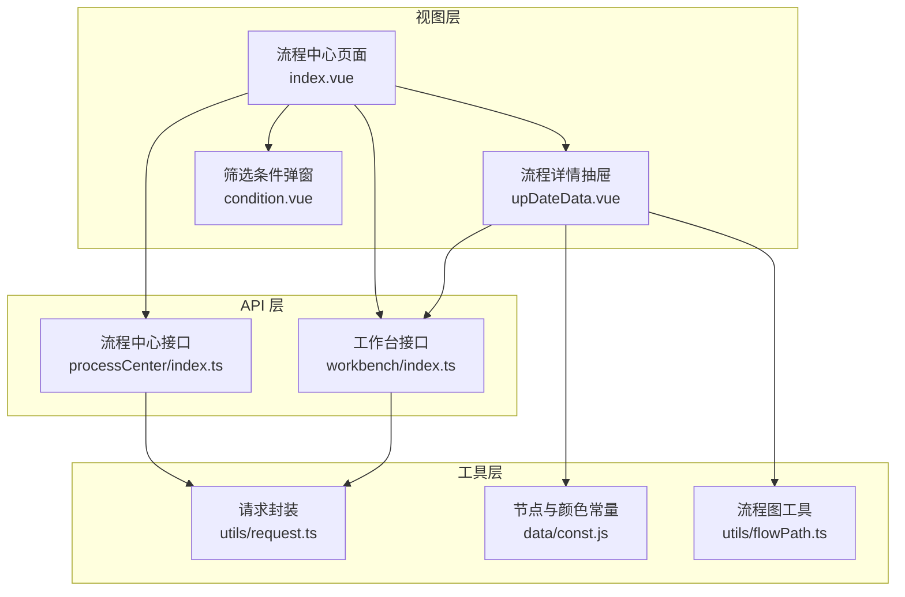
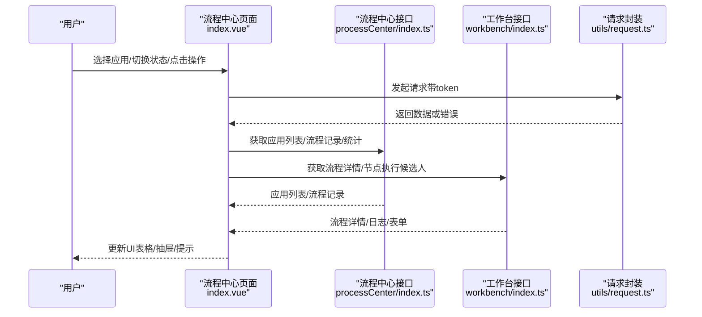
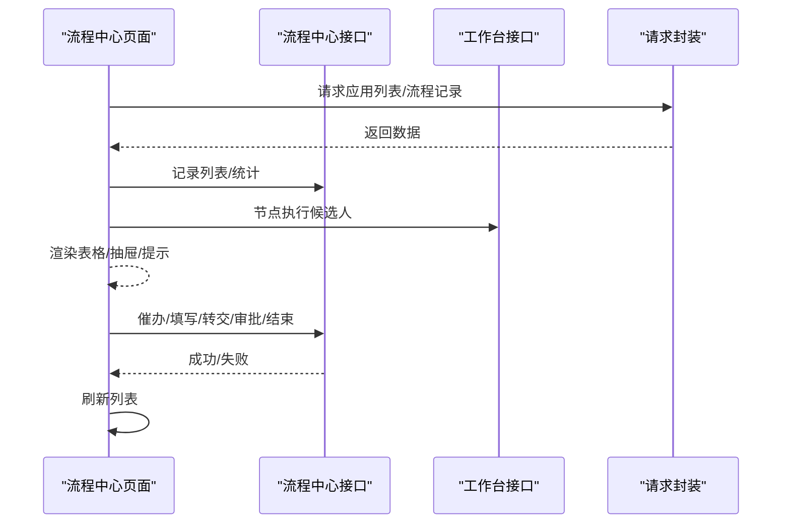
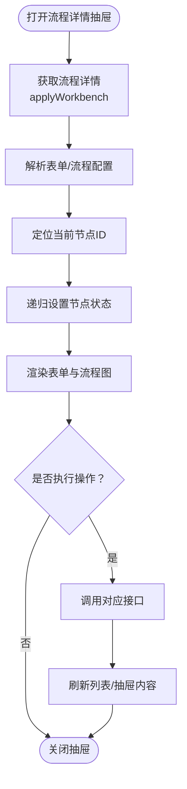
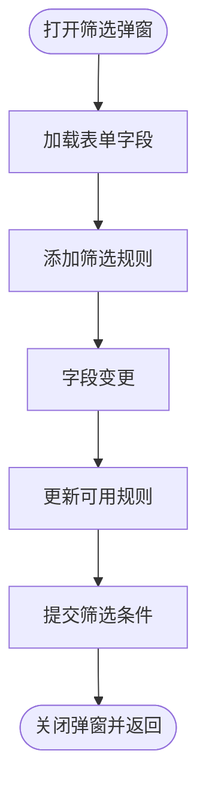
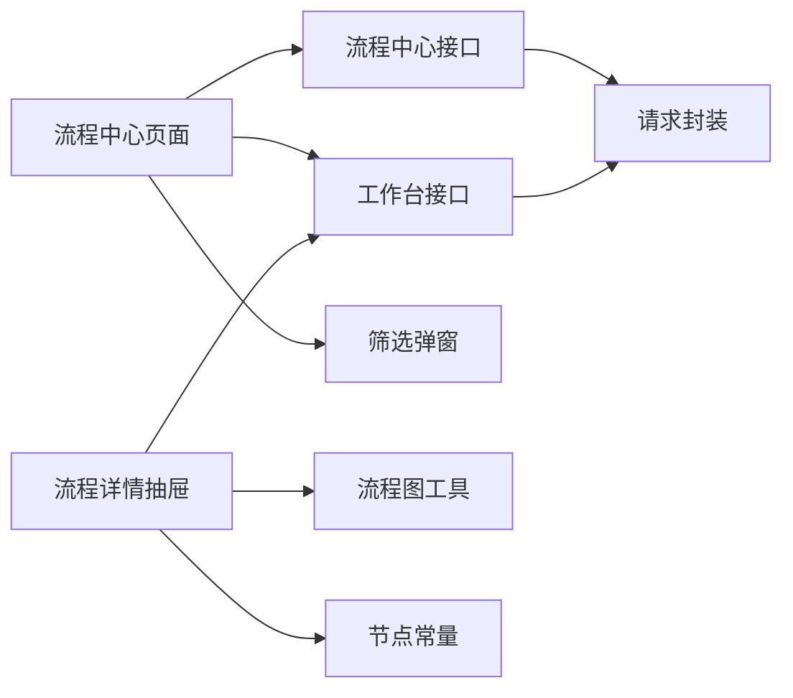

# 流程中心

<cite>
**本文引用的文件**
- [index.vue](file://src/views/processCenter/index.vue)
- [upDateData.vue](file://src/views/processCenter/upDateData.vue)
- [index.ts](file://src/api/processCenter/index.ts)
- [index.ts](file://src/api/workbench/index.ts)
- [request.ts](file://src/utils/request.ts)
- [condition.vue](file://src/views/application/original/condition.vue)
- [const.js](file://src/data/const.js)
- [flowPath.ts](file://src/utils/flowPath.ts)
- [index.vue](file://src/views/doCenter/index.vue)
</cite>

## 目录
1. [简介](#简介)
2. [项目结构](#项目结构)
3. [核心组件](#核心组件)
4. [架构总览](#架构总览)
5. [详细组件分析](#详细组件分析)
6. [依赖关系分析](#依赖关系分析)
7. [性能考量](#性能考量)
8. [故障排查指南](#故障排查指南)
9. [结论](#结论)
10. [附录](#附录)

## 简介
流程中心是工作台中的一个关键模块，负责展示与管理流程实例的生命周期：应用列表展示、流程状态管理、节点执行监控、流程筛选与统计、以及各类流程操作（催办、转交、审批等）。它通过统一的 API 接口与后端交互，结合前端表单与流程图渲染能力，为用户提供从“查看流程”到“执行操作”的完整闭环体验。

## 项目结构
流程中心主要由以下部分组成：
- 视图层：左侧应用列表与右侧流程表格，支持筛选、刷新、分页与操作菜单
- 交互层：流程详情抽屉（含表单与流程图）、节点执行候选人弹窗
- API 层：流程中心与工作台相关的接口封装
- 工具层：通用请求封装、表单工具、流程图工具、常量定义

图表来源
- [index.vue:1-892](file://src/views/processCenter/index.vue#L1-L892)
- [upDateData.vue:1-395](file://src/views/processCenter/upDateData.vue#L1-L395)
- [index.ts:1-47](file://src/api/processCenter/index.ts#L1-L47)
- [index.ts:1-139](file://src/api/workbench/index.ts#L1-L139)
- [request.ts:1-159](file://src/utils/request.ts#L1-L159)
- [condition.vue:1-307](file://src/views/application/original/condition.vue#L1-L307)
- [const.js:1-475](file://src/data/const.js#L1-L475)
- [flowPath.ts:1-322](file://src/utils/flowPath.ts#L1-L322)

章节来源
- [index.vue:1-892](file://src/views/processCenter/index.vue#L1-L892)
- [upDateData.vue:1-395](file://src/views/processCenter/upDateData.vue#L1-L395)
- [index.ts:1-47](file://src/api/processCenter/index.ts#L1-L47)
- [index.ts:1-139](file://src/api/workbench/index.ts#L1-L139)
- [request.ts:1-159](file://src/utils/request.ts#L1-L159)
- [condition.vue:1-307](file://src/views/application/original/condition.vue#L1-L307)
- [const.js:1-475](file://src/data/const.js#L1-L475)
- [flowPath.ts:1-322](file://src/utils/flowPath.ts#L1-L322)

## 核心组件
- 应用列表与流程表格：左侧应用列表按“进行中/已完成”切换；右侧展示流程记录，包含流程状态、提交人、提交时间、当前节点、耗时与操作按钮
- 流程详情抽屉：支持查看流程表单、节点信息与流程图，并在抽屉内直接执行催办、填写、转交、审批、结束流程等操作
- 筛选条件弹窗：基于表单字段生成筛选规则，支持“全部/任一”匹配策略
- 请求封装：统一封装 token 注入、响应拦截与错误提示

章节来源
- [index.vue:1-892](file://src/views/processCenter/index.vue#L1-L892)
- [upDateData.vue:1-395](file://src/views/processCenter/upDateData.vue#L1-L395)
- [condition.vue:1-307](file://src/views/application/original/condition.vue#L1-L307)
- [request.ts:1-159](file://src/utils/request.ts#L1-L159)

## 架构总览
流程中心采用“视图-接口-工具”三层架构：
- 视图层负责用户交互与数据展示
- 接口层封装与后端的通信协议
- 工具层提供通用能力（请求、表单、流程图）

图表来源
- [index.vue:1-892](file://src/views/processCenter/index.vue#L1-L892)
- [index.ts:1-47](file://src/api/processCenter/index.ts#L1-L47)
- [index.ts:1-139](file://src/api/workbench/index.ts#L1-L139)
- [request.ts:1-159](file://src/utils/request.ts#L1-L159)

## 详细组件分析

### 组件A：流程中心页面（index.vue）
- 功能要点
  - 应用列表展示与搜索
  - “进行中/已完成”双标签切换
  - 流程记录表格与分页
  - 筛选条件弹窗与刷新
  - 节点执行候选人悬浮查看
  - 流程操作：催办、填写、转交、审批（通过/拒绝/转交/退回）、结束流程
  - 流程图查看（抽屉内）

- 关键数据结构
  - 应用列表：包含应用图标、名称、总数
  - 流程记录：包含流程实例ID、当前节点、提交人、提交时间、耗时、状态等
  - 筛选条件：match（全部/任一）、conditions（字段、规则、值）

- 状态流转机制
  - 通过“processFinish”参数控制“进行中/已完成”
  - 操作完成后刷新表格数据

- 典型调用链
  - 获取应用列表 -> 选择应用 -> 获取流程记录 -> 操作 -> 刷新

图表来源
- [index.vue:1-892](file://src/views/processCenter/index.vue#L1-L892)
- [index.ts:1-47](file://src/api/processCenter/index.ts#L1-L47)
- [index.ts:1-139](file://src/api/workbench/index.ts#L1-L139)
- [request.ts:1-159](file://src/utils/request.ts#L1-L159)

章节来源
- [index.vue:1-892](file://src/views/processCenter/index.vue#L1-L892)

### 组件B：流程详情抽屉（upDateData.vue）
- 功能要点
  - 展示流程表单与节点信息（含审批日志）
  - 流程图可视化（根据当前节点高亮）
  - 在抽屉内直接执行流程操作（与页面一致）

- 关键逻辑
  - 获取流程详情（applyWorkbench），解析表单配置与流程配置
  - 解析当前节点ID，设置流程图节点状态（已执行/执行中/未执行）
  - 加载节点日志（processInstanceIdLog）

- 流程图渲染
  - 通过节点配置与当前节点ID，递归设置节点状态
  - 使用颜色常量区分不同状态

图表来源
- [upDateData.vue:1-395](file://src/views/processCenter/upDateData.vue#L1-L395)
- [index.ts:103-121](file://src/api/workbench/index.ts#L103-L121)
- [const.js:14-18](file://src/data/const.js#L14-L18)
- [flowPath.ts:180-228](file://src/utils/flowPath.ts#L180-L228)

章节来源
- [upDateData.vue:1-395](file://src/views/processCenter/upDateData.vue#L1-L395)
- [index.ts:103-121](file://src/api/workbench/index.ts#L103-L121)
- [const.js:14-18](file://src/data/const.js#L14-L18)
- [flowPath.ts:180-228](file://src/utils/flowPath.ts#L180-L228)

### 组件C：筛选条件弹窗（condition.vue）
- 功能要点
  - 基于表单字段动态生成筛选项
  - 支持多种规则（等于、不等于、为空、不为空、区间等）
  - 支持“全部/任一”匹配策略
  - 将筛选结果以标准格式返回给父组件

- 关键数据结构
  - conditions：字段编码、规则、值
  - match：true=全部，false=任一

图表来源
- [condition.vue:1-307](file://src/views/application/original/condition.vue#L1-L307)

章节来源
- [condition.vue:1-307](file://src/views/application/original/condition.vue#L1-L307)

### 组件D：API 接口设计（processCenter/index.ts）
- 主要接口
  - 流程统计：processTotal
  - 应用流程列表：appList
  - 流程记录列表：recordList
  - 催办：urgent
  - 填写：input
  - 填写任务转交：inputAssign
  - 审批通过：approvePass
  - 审批拒绝：approveRefuse
  - 审批转交：approveAssign
  - 审批退回：approveBack
  - 结束流程：stopProcessCenter

- 参数与返回
  - 统一通过 Request 类封装，自动注入 token
  - 返回数据遵循约定的 Result 结构（code/message/data）

章节来源
- [index.ts:1-47](file://src/api/processCenter/index.ts#L1-L47)
- [request.ts:1-159](file://src/utils/request.ts#L1-L159)

### 组件E：API 接口设计（workbench/index.ts）
- 主要接口
  - 流程详情（待办/发起/已办/抄送）：pendingWorkbench/applyWorkbench/handlerWorkbench/noticeWorkbench
  - 流程日志：processInstanceIdLog
  - 节点执行候选人：executionCandidates

- 用途
  - 流程中心详情抽屉使用这些接口加载表单与流程图数据

章节来源
- [index.ts:103-129](file://src/api/workbench/index.ts#L103-L129)

### 组件F：请求封装（utils/request.ts）
- 特性
  - 自动注入 client_id 与 token
  - 统一响应拦截与错误提示
  - 支持 Blob 下载场景

- 错误处理
  - 401 跳转登录
  - 非 success 提示 message 并 reject

章节来源
- [request.ts:1-159](file://src/utils/request.ts#L1-L159)

## 依赖关系分析
- 视图层依赖接口层与工具层
- 抽屉组件依赖工作台接口与流程图工具
- 筛选弹窗与流程中心页面解耦，通过事件回调传递筛选结果
- 流程图渲染依赖节点常量与流程路径工具

图表来源
- [index.vue:1-892](file://src/views/processCenter/index.vue#L1-L892)
- [upDateData.vue:1-395](file://src/views/processCenter/upDateData.vue#L1-L395)
- [index.ts:1-47](file://src/api/processCenter/index.ts#L1-L47)
- [index.ts:1-139](file://src/api/workbench/index.ts#L1-L139)
- [request.ts:1-159](file://src/utils/request.ts#L1-L159)
- [condition.vue:1-307](file://src/views/application/original/condition.vue#L1-L307)
- [const.js:1-475](file://src/data/const.js#L1-L475)
- [flowPath.ts:1-322](file://src/utils/flowPath.ts#L1-L322)

章节来源
- [index.vue:1-892](file://src/views/processCenter/index.vue#L1-L892)
- [upDateData.vue:1-395](file://src/views/processCenter/upDateData.vue#L1-L395)
- [index.ts:1-47](file://src/api/processCenter/index.ts#L1-L47)
- [index.ts:1-139](file://src/api/workbench/index.ts#L1-L139)
- [request.ts:1-159](file://src/utils/request.ts#L1-L159)
- [condition.vue:1-307](file://src/views/application/original/condition.vue#L1-L307)
- [const.js:1-475](file://src/data/const.js#L1-L475)
- [flowPath.ts:1-322](file://src/utils/flowPath.ts#L1-L322)

## 性能考量
- 列表分页与懒加载
  - 使用分页参数控制每页数量，减少一次性渲染压力
  - 建议在大数据量场景下固定分页大小并启用虚拟滚动（如组件支持）
- 请求去抖与缓存
  - 对频繁触发的筛选与刷新，可在前端增加防抖
  - 对流程图与表单配置可做本地缓存（参考流程图工具的本地存储）
- 图标与资源
  - 应用图标通过后端接口拼接 token，避免重复请求
- 错误与重试
  - 统一错误提示与重试策略，避免用户多次点击导致重复请求

## 故障排查指南
- 登录态失效
  - 现象：出现 401 或跳转登录
  - 处理：检查 token 是否存在与有效，必要时重新登录
- 请求失败
  - 现象：Message 提示错误
  - 处理：查看网络面板与后端返回 message，确认参数与权限
- 节点执行候选人为空
  - 现象：悬浮提示无数据
  - 处理：确认 processInstanceId 与 executionId 正确，检查后端接口返回
- 流程图不显示或状态异常
  - 现象：流程图空白或节点状态不正确
  - 处理：确认流程配置与当前节点 ID，检查 setFlowDatas 逻辑

章节来源
- [request.ts:47-113](file://src/utils/request.ts#L47-L113)
- [index.ts:122-129](file://src/api/workbench/index.ts#L122-L129)
- [upDateData.vue:180-228](file://src/views/processCenter/upDateData.vue#L180-L228)

## 结论
流程中心模块通过清晰的视图-接口-工具分层，实现了从应用列表到流程详情、从筛选统计到操作执行的完整流程。其数据结构与 API 设计简洁明确，配合流程图与表单工具，能够满足日常流程管理需求。建议在后续迭代中进一步优化大数据量下的渲染性能与交互体验。

## 附录

### 使用示例
- 查看流程详情
  - 在流程记录行点击“管理”->“查看流程”，在抽屉中查看表单与流程图
- 执行审批操作
  - 在“进行中”状态下，针对审批节点选择“通过/拒绝/转交/退回”，并按需填写意见
- 转交任务
  - 选择“转交”，在弹窗中选择接收人后提交
- 催办流程
  - 在“进行中”状态下，选择“催办”确认后发送提醒
- 结束流程
  - 在“进行中”状态下，选择“结束流程”确认后终止流程

### 最佳实践
- 合理使用筛选条件，避免全量查询
- 对高频操作（催办、审批）增加二次确认
- 对流程图与表单配置进行本地缓存，提升加载速度
- 统一错误提示与日志记录，便于问题追踪