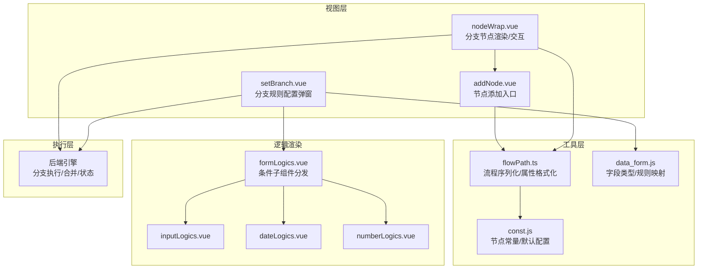
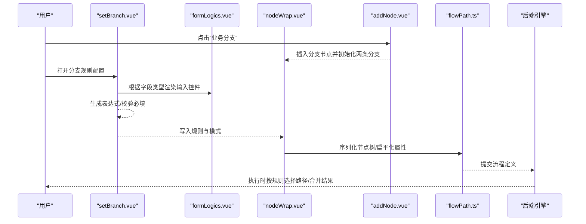
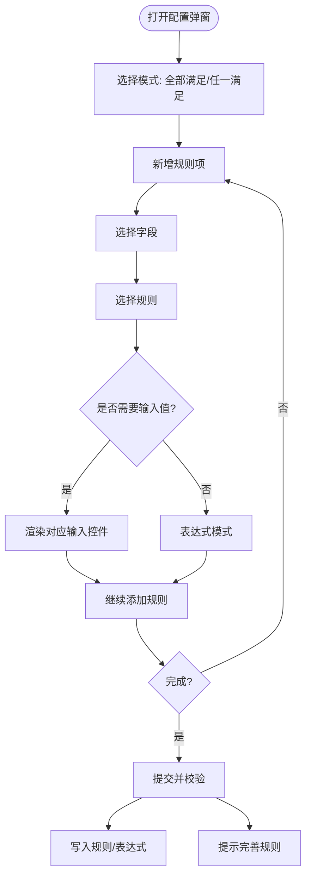
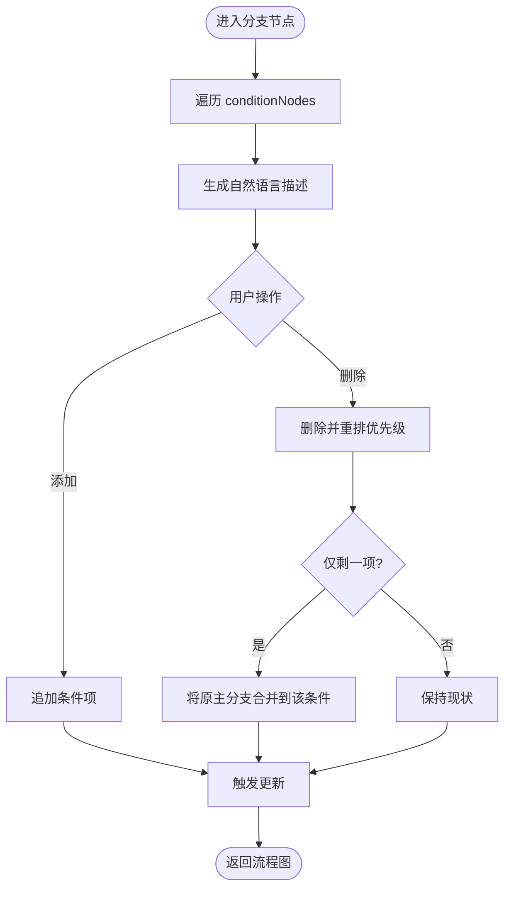
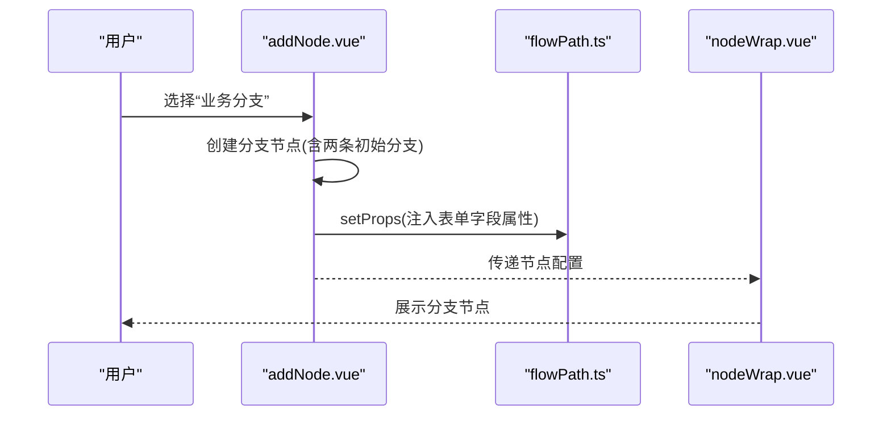
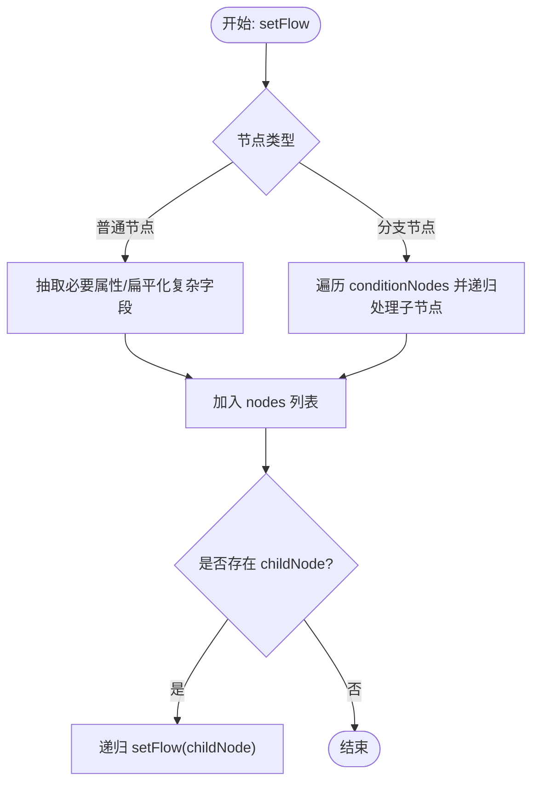
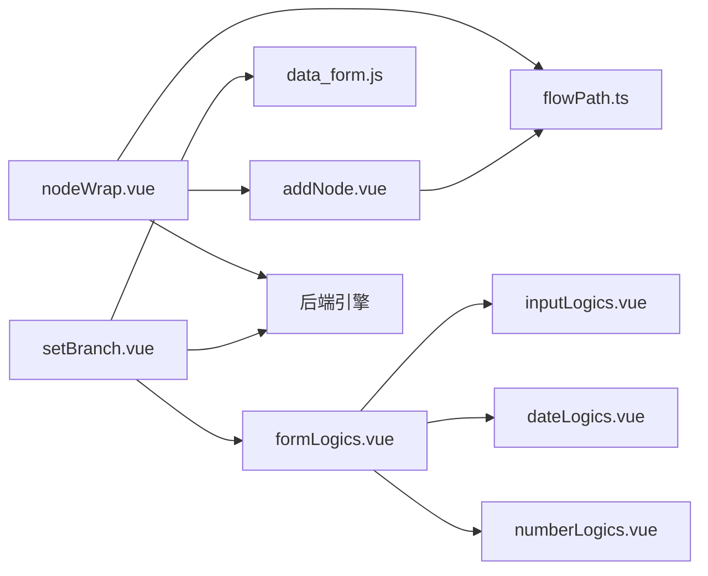

# 分支控制

<cite>
**本文引用的文件**
- [setBranch.vue](file://src/views/flowPath/components/setBranch.vue)
- [nodeWrap.vue](file://src/views/flowPath/components/nodeWrap.vue)
- [addNode.vue](file://src/views/flowPath/components/addNode.vue)
- [flowPath.ts](file://src/utils/flowPath.ts)
- [const.js](file://src/data/const.js)
- [data_form.js](file://src/data/data_form.js)
- [formLogics.vue](file://src/components/formLogics/formLogics.vue)
- [inputLogics.vue](file://src/components/formLogics/inputLogics.vue)
- [dateLogics.vue](file://src/components/formLogics/dateLogics.vue)
- [numberLogics.vue](file://src/components/formLogics/numberLogics.vue)
- [field.js](file://src/utils/field.js)
</cite>

## 目录
1. [简介](#简介)
2. [项目结构](#项目结构)
3. [核心组件](#核心组件)
4. [架构总览](#架构总览)
5. [详细组件分析](#详细组件分析)
6. [依赖关系分析](#依赖关系分析)
7. [性能考量](#性能考量)
8. [故障排查指南](#故障排查指南)
9. [结论](#结论)
10. [附录](#附录)

## 简介
本文件系统性阐述工作流设计器中的“分支控制”机制，覆盖分支节点的设计原理、条件判断逻辑、分支路径选择算法、分支配置界面实现与校验、分支权重与优先级处理、分支执行时序控制、分支合并机制、分支状态跟踪与监控，以及最佳实践与性能优化建议。目标是帮助开发者与产品人员在不深入源码的前提下，理解并正确使用分支控制能力。

## 项目结构
分支控制主要由以下模块协同完成：
- 视图层组件：分支配置弹窗、分支节点渲染与交互、节点添加入口
- 工具层：流程序列化与持久化、节点属性格式化
- 数据层：表单字段类型与规则映射、逻辑条件渲染子组件
- 执行层：条件表达式生成与运行时判断（由后端引擎负责）

**图表来源**
- [setBranch.vue:1-358](file://src/views/flowPath/components/setBranch.vue#L1-L358)
- [nodeWrap.vue:1-323](file://src/views/flowPath/components/nodeWrap.vue#L1-L323)
- [addNode.vue:1-290](file://src/views/flowPath/components/addNode.vue#L1-L290)
- [flowPath.ts:1-322](file://src/utils/flowPath.ts#L1-L322)
- [const.js:353-362](file://src/data/const.js#L353-L362)
- [data_form.js:596-800](file://src/data/data_form.js#L596-L800)
- [formLogics.vue:1-35](file://src/components/formLogics/formLogics.vue#L1-L35)
- [inputLogics.vue:1-28](file://src/components/formLogics/inputLogics.vue#L1-L28)
- [dateLogics.vue:1-45](file://src/components/formLogics/dateLogics.vue#L1-L45)
- [numberLogics.vue:1-50](file://src/components/formLogics/numberLogics.vue#L1-L50)

**章节来源**
- [setBranch.vue:1-358](file://src/views/flowPath/components/setBranch.vue#L1-L358)
- [nodeWrap.vue:1-323](file://src/views/flowPath/components/nodeWrap.vue#L1-L323)
- [addNode.vue:1-290](file://src/views/flowPath/components/addNode.vue#L1-L290)
- [flowPath.ts:1-322](file://src/utils/flowPath.ts#L1-L322)
- [const.js:353-362](file://src/data/const.js#L353-L362)
- [data_form.js:596-800](file://src/data/data_form.js#L596-L800)
- [formLogics.vue:1-35](file://src/components/formLogics/formLogics.vue#L1-L35)
- [inputLogics.vue:1-28](file://src/components/formLogics/inputLogics.vue#L1-L28)
- [dateLogics.vue:1-45](file://src/components/formLogics/dateLogics.vue#L1-L45)
- [numberLogics.vue:1-50](file://src/components/formLogics/numberLogics.vue#L1-L50)

## 核心组件
- 分支规则配置弹窗（setBranch.vue）
  - 提供“全部满足/任一满足”的模式选择
  - 支持字段选择、规则选择、值输入/选择、表达式编辑
  - 将规则转换为统一表达式并进行基础校验
- 分支节点渲染与交互（nodeWrap.vue）
  - 渲染分支节点，展示每个条件的自然语言描述
  - 支持添加/删除条件项，维护优先级顺序
  - 连接各条件分支与主分支节点
- 节点添加入口（addNode.vue）
  - 在拖拽/点击时插入分支节点，并初始化两条分支
  - 将表单字段属性注入到分支节点中
- 流程序列化与属性格式化（flowPath.ts）
  - 将节点树扁平化为可提交的数据结构
  - 对候选人、超时计划等复杂字段进行扁平化处理
  - 记录父子关系（pid）以便后续构建树
- 字段类型与规则映射（data_form.js）
  - 定义各类字段支持的比较运算符与方法名
  - 提供规则选项、默认值、格式化等
- 条件子组件分发（formLogics.vue 及其子组件）
  - 根据字段类型渲染对应的输入控件（文本、数值、日期区间、用户/部门等）
  - 协助用户直观地构造条件值

**章节来源**
- [setBranch.vue:1-358](file://src/views/flowPath/components/setBranch.vue#L1-L358)
- [nodeWrap.vue:1-323](file://src/views/flowPath/components/nodeWrap.vue#L1-L323)
- [addNode.vue:1-290](file://src/views/flowPath/components/addNode.vue#L1-L290)
- [flowPath.ts:119-244](file://src/utils/flowPath.ts#L119-L244)
- [data_form.js:596-800](file://src/data/data_form.js#L596-L800)
- [formLogics.vue:1-35](file://src/components/formLogics/formLogics.vue#L1-L35)

## 架构总览
分支控制从“配置—序列化—执行”三个层面协作：
- 配置阶段：setBranch.vue 与 formLogics 子组件共同完成规则编辑与校验
- 序列化阶段：flowPath.ts 将节点树与分支规则转换为后端可识别的结构
- 执行阶段：后端引擎根据规则表达式与运行时数据决定分支路径与合并策略

**图表来源**
- [addNode.vue:85-119](file://src/views/flowPath/components/addNode.vue#L85-L119)
- [nodeWrap.vue:42-74](file://src/views/flowPath/components/nodeWrap.vue#L42-L74)
- [setBranch.vue:124-218](file://src/views/flowPath/components/setBranch.vue#L124-L218)
- [formLogics.vue:1-35](file://src/components/formLogics/formLogics.vue#L1-L35)
- [flowPath.ts:119-244](file://src/utils/flowPath.ts#L119-L244)

## 详细组件分析

### 分支规则配置弹窗（setBranch.vue）
- 模式选择
  - “全部满足(all)”：AND 逻辑
  - “任一满足(any)”：OR 逻辑
- 字段与规则
  - 字段来源：表单字段列表
  - 规则来源：依据字段类型映射（字符串、数值、日期、集合、地址、用户/部门等）
  - 表达式：支持自定义表达式，保存时进行特殊字符清理
- 值输入与渲染
  - 文本/数字/日期/地址/用户/部门等分别渲染对应控件
  - 数值范围、日期区间、动态范围等特殊规则进行统一转换
- 校验与提交
  - 必填校验：非空规则需提供值
  - 提交时将规则转换为统一表达式并触发父组件更新

**图表来源**
- [setBranch.vue:15-113](file://src/views/flowPath/components/setBranch.vue#L15-L113)
- [setBranch.vue:124-218](file://src/views/flowPath/components/setBranch.vue#L124-L218)
- [data_form.js:596-800](file://src/data/data_form.js#L596-L800)
- [formLogics.vue:1-35](file://src/components/formLogics/formLogics.vue#L1-L35)
- [inputLogics.vue:1-28](file://src/components/formLogics/inputLogics.vue#L1-L28)
- [dateLogics.vue:1-45](file://src/components/formLogics/dateLogics.vue#L1-L45)
- [numberLogics.vue:1-50](file://src/components/formLogics/numberLogics.vue#L1-L50)

**章节来源**
- [setBranch.vue:1-358](file://src/views/flowPath/components/setBranch.vue#L1-L358)
- [data_form.js:596-800](file://src/data/data_form.js#L596-L800)
- [formLogics.vue:1-35](file://src/components/formLogics/formLogics.vue#L1-L35)
- [inputLogics.vue:1-28](file://src/components/formLogics/inputLogics.vue#L1-L28)
- [dateLogics.vue:1-45](file://src/components/formLogics/dateLogics.vue#L1-L45)
- [numberLogics.vue:1-50](file://src/components/formLogics/numberLogics.vue#L1-L50)

### 分支节点渲染与交互（nodeWrap.vue）
- 条件展示
  - 将规则数组转换为自然语言描述，便于用户核对
  - 支持“且/或”连接词与字段名称替换
- 条件管理
  - 添加条件：向 conditionNodes 追加新项
  - 删除条件：删除后重排优先级与名称
  - 合并场景：当仅剩一个条件时，自动将原主分支合并到该条件分支
- 路径连接
  - 每个条件项可独立挂载子节点
  - 主分支节点作为兜底路径

**图表来源**
- [nodeWrap.vue:186-243](file://src/views/flowPath/components/nodeWrap.vue#L186-L243)
- [nodeWrap.vue:244-281](file://src/views/flowPath/components/nodeWrap.vue#L244-L281)

**章节来源**
- [nodeWrap.vue:1-323](file://src/views/flowPath/components/nodeWrap.vue#L1-L323)

### 节点添加入口（addNode.vue）
- 插入分支节点
  - 当选择“业务分支”时，创建一个 type=7 的分支节点
  - 初始化两条空分支，便于用户快速编辑
- 注入表单字段属性
  - 通过 setProps 将表单字段的可见性、编辑权限等注入到节点
  - 保证分支节点与表单一致

**图表来源**
- [addNode.vue:85-119](file://src/views/flowPath/components/addNode.vue#L85-L119)
- [flowPath.ts:4-76](file://src/utils/flowPath.ts#L4-L76)

**章节来源**
- [addNode.vue:1-290](file://src/views/flowPath/components/addNode.vue#L1-L290)
- [flowPath.ts:1-118](file://src/utils/flowPath.ts#L1-L118)

### 流程序列化与属性格式化（flowPath.ts）
- 节点扁平化
  - 递归遍历节点树，剥离 childNode 引用，保留必要属性
  - 对候选人、超时计划等复杂字段进行扁平化（如将对象数组的 id 抽取为纯数组）
- 父子关系记录
  - 使用 pid 记录路径，便于后端重建树结构
- 分支节点处理
  - 遍历 conditionNodes，将每条分支作为独立节点输出
  - 递归处理每条分支下的子节点

**图表来源**
- [flowPath.ts:119-244](file://src/utils/flowPath.ts#L119-L244)

**章节来源**
- [flowPath.ts:1-322](file://src/utils/flowPath.ts#L1-L322)

### 字段类型与规则映射（data_form.js）
- 规则映射
  - 为不同字段类型提供可用规则（等于、不等于、范围、包含、为空等）
  - 映射规则到统一的方法名（如 eqStr、between、dynamicBetween 等），用于表达式生成
- 动态范围
  - 支持“动态范围”（如 N 天/月/年），用于日期类规则
- 默认值与格式
  - 为集合、地址、时间等字段提供默认选项与格式化信息

**章节来源**
- [data_form.js:596-800](file://src/data/data_form.js#L596-L800)

### 条件子组件分发（formLogics.vue 及子组件）
- 分发逻辑
  - 根据字段类型渲染对应输入控件（文本、数值、日期区间、用户/部门等）
- 子组件职责
  - inputLogics：文本/电话/邮箱等简单输入
  - numberLogics：数值输入或范围输入
  - dateLogics：日期/时间选择或区间选择，支持动态范围
- 与规则配置的配合
  - 子组件负责收集用户输入，setBranch.vue 统一转换为表达式

**章节来源**
- [formLogics.vue:1-35](file://src/components/formLogics/formLogics.vue#L1-L35)
- [inputLogics.vue:1-28](file://src/components/formLogics/inputLogics.vue#L1-L28)
- [dateLogics.vue:1-45](file://src/components/formLogics/dateLogics.vue#L1-L45)
- [numberLogics.vue:1-50](file://src/components/formLogics/numberLogics.vue#L1-L50)

## 依赖关系分析
- 组件耦合
  - nodeWrap.vue 与 addNode.vue 通过事件与双向绑定协同，形成“插入—渲染—编辑”的闭环
  - setBranch.vue 依赖 data_form.js 与 formLogics 子组件，完成规则编辑与渲染
  - flowPath.ts 为所有节点提供统一的序列化与属性格式化能力
- 外部集成
  - 分支规则最终由后端引擎执行，前端负责生成表达式与可视化展示
- 潜在风险
  - 删除条件后未及时合并主分支可能导致流程图冗余
  - 表达式生成与后端解析不一致会导致执行异常

**图表来源**
- [nodeWrap.vue:1-323](file://src/views/flowPath/components/nodeWrap.vue#L1-L323)
- [addNode.vue:1-290](file://src/views/flowPath/components/addNode.vue#L1-L290)
- [flowPath.ts:1-322](file://src/utils/flowPath.ts#L1-L322)
- [setBranch.vue:1-358](file://src/views/flowPath/components/setBranch.vue#L1-L358)
- [data_form.js:596-800](file://src/data/data_form.js#L596-L800)
- [formLogics.vue:1-35](file://src/components/formLogics/formLogics.vue#L1-L35)

**章节来源**
- [nodeWrap.vue:1-323](file://src/views/flowPath/components/nodeWrap.vue#L1-L323)
- [addNode.vue:1-290](file://src/views/flowPath/components/addNode.vue#L1-L290)
- [flowPath.ts:1-322](file://src/utils/flowPath.ts#L1-L322)
- [setBranch.vue:1-358](file://src/views/flowPath/components/setBranch.vue#L1-L358)
- [data_form.js:596-800](file://src/data/data_form.js#L596-L800)
- [formLogics.vue:1-35](file://src/components/formLogics/formLogics.vue#L1-L35)

## 性能考量
- 渲染优化
  - 分支节点数量较多时，建议限制默认展开层级，避免一次性渲染大量子节点
  - 条件描述生成应缓存字段标题映射，减少重复查找
- 序列化优化
  - 扁平化过程中尽量避免深拷贝，必要时使用浅拷贝+选择性删除
  - 对候选人、超时计划等大对象进行增量更新，减少内存占用
- 表达式生成
  - 将规则映射与默认值预加载到内存，避免频繁 IO
  - 对动态范围等复杂规则，采用延迟计算策略

[本节为通用指导，无需特定文件引用]

## 故障排查指南
- 规则未生效
  - 检查规则是否完整（必填字段是否填写）
  - 确认表达式生成是否成功，后端是否支持对应方法名
- 分支路径错误
  - 核对“全部满足/任一满足”模式是否符合预期
  - 检查条件优先级与名称是否被误删或重排
- 执行异常
  - 核对候选人的扁平化处理是否正确（id 数组 vs 对象数组）
  - 检查超时计划等复杂字段的序列化是否遗漏
- 运行时判断
  - 前端提供基础判断逻辑参考（如 isNull/isNotNull 等），具体以后端引擎为准

**章节来源**
- [setBranch.vue:211-218](file://src/views/flowPath/components/setBranch.vue#L211-L218)
- [flowPath.ts:175-206](file://src/utils/flowPath.ts#L175-L206)
- [field.js:38-72](file://src/utils/field.js#L38-L72)

## 结论
分支控制通过“配置—序列化—执行”三层协作，实现了灵活而可控的流程分支能力。前端提供了完善的规则编辑体验与可视化展示，工具层确保了数据结构的一致性与可移植性，后端引擎承担了真正的分支判断与合并职责。遵循本文的最佳实践与优化建议，可在保证易用性的同时提升系统的稳定性与性能。

[本节为总结，无需特定文件引用]

## 附录

### 分支节点设计要点
- 设计原则
  - 以“自然语言描述”辅助用户理解规则
  - 以“优先级顺序”明确分支选择次序
  - 以“主分支兜底”保障流程不会无路可走
- 权重与优先级
  - 优先级即条件顺序，顺序不可跳过
  - 若存在权重需求，建议通过规则组合或后端扩展实现
- 分支合并
  - 删除条件后自动合并主分支，避免流程图冗余
  - 合并时注意保留原主分支的子节点引用

**章节来源**
- [nodeWrap.vue:244-281](file://src/views/flowPath/components/nodeWrap.vue#L244-L281)

### 分支执行时序控制
- 时序模型
  - 依次评估各条件，按模式（AND/OR）决定是否继续
  - 匹配到的第一个分支作为执行路径
- 超时与兜底
  - 可结合超时计划与主分支兜底，提升健壮性

**章节来源**
- [const.js:146-146](file://src/data/const.js#L146-L146)
- [flowPath.ts:175-206](file://src/utils/flowPath.ts#L175-L206)

### 分支状态跟踪与监控
- 建议
  - 在流程实例层面记录每个分支节点的命中次数与耗时
  - 对表达式异常与规则缺失进行告警
  - 对分支合并与删除操作进行审计

[本节为通用指导，无需特定文件引用]