# 工作流引擎

<cite>
**本文引用的文件**
- [README.md](file://README.md)
- [src/views/flowPath/index.vue](file://src/views/flowPath/index.vue)
- [src/views/flowPath/components/nodeWrap.vue](file://src/views/flowPath/components/nodeWrap.vue)
- [src/views/flowPath/components/addNode.vue](file://src/views/flowPath/components/addNode.vue)
- [src/views/flowPath/components/rightPannel.vue](file://src/views/flowPath/components/rightPannel.vue)
- [src/views/flowPath/components/leftPannel.vue](file://src/views/flowPath/components/leftPannel.vue)
- [src/views/taskFillCenter/todoDes.vue](file://src/views/taskFillCenter/todoDes.vue)
- [src/utils/flowPath.ts](file://src/utils/flowPath.ts)
- [src/data/const.js](file://src/data/const.js)
- [src/api/processCenter/index.ts](file://src/api/processCenter/index.ts)
- [src/views/processCenter/upDateData.vue](file://src/views/processCenter/upDateData.vue)
- [src/components/timeLine/nodeWraps.vue](file://src/components/timeLine/nodeWraps.vue)
- [src/components/timeLine/addNodes.vue](file://src/components/timeLine/addNodes.vue)
</cite>

## 目录
1. [简介](#简介)
2. [项目结构](#项目结构)
3. [核心组件](#核心组件)
4. [架构总览](#架构总览)
5. [详细组件分析](#详细组件分析)
6. [依赖关系分析](#依赖关系分析)
7. [性能考虑](#性能考虑)
8. [故障排除指南](#故障排除指南)
9. [结论](#结论)
10. [附录](#附录)

## 简介
本技术文档围绕工作流引擎的前端设计与执行体系展开，重点覆盖流程设计原理、节点类型管理、流程控制机制、序列化与反序列化、节点属性配置、分支控制逻辑、流程执行引擎、权限分配策略以及通知机制等核心能力。文档以可视化流程设计器为入口，结合工具函数与常量配置，形成从“设计—保存—执行—监控”的完整闭环，并提供最佳实践、性能优化与故障排除建议。

## 项目结构
该仓库采用 Vue 3 + TypeScript + Vite 技术栈，前端工程以页面与组件为中心进行组织。工作流相关的关键模块包括：
- 流程设计器：负责节点增删改、分支编辑、属性配置与流程序列化
- 执行与监控：任务中心、流程实例日志、节点详情展示
- 工具与配置：流程序列化/反序列化、节点默认配置、权限与字段控制

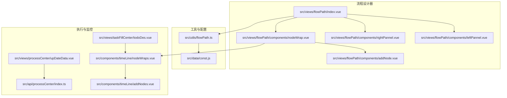

图表来源
- [src/views/flowPath/index.vue:1-192](file://src/views/flowPath/index.vue#L1-L192)
- [src/views/flowPath/components/nodeWrap.vue:1-323](file://src/views/flowPath/components/nodeWrap.vue#L1-L323)
- [src/views/flowPath/components/addNode.vue:1-130](file://src/views/flowPath/components/addNode.vue#L1-L130)
- [src/views/flowPath/components/rightPannel.vue:1-109](file://src/views/flowPath/components/rightPannel.vue#L1-L109)
- [src/views/flowPath/components/leftPannel.vue:1-91](file://src/views/flowPath/components/leftPannel.vue#L1-L91)
- [src/utils/flowPath.ts:1-322](file://src/utils/flowPath.ts#L1-L322)
- [src/data/const.js:1-475](file://src/data/const.js#L1-L475)
- [src/views/taskFillCenter/todoDes.vue:1-44](file://src/views/taskFillCenter/todoDes.vue#L1-L44)
- [src/views/processCenter/upDateData.vue:63-92](file://src/views/processCenter/upDateData.vue#L63-L92)
- [src/api/processCenter/index.ts:37-47](file://src/api/processCenter/index.ts#L37-L47)
- [src/components/timeLine/nodeWraps.vue:26-54](file://src/components/timeLine/nodeWraps.vue#L26-L54)
- [src/components/timeLine/addNodes.vue:50-87](file://src/components/timeLine/addNodes.vue#L50-L87)

章节来源
- [README.md:1-6](file://README.md#L1-L6)
- [src/views/flowPath/index.vue:1-192](file://src/views/flowPath/index.vue#L1-L192)

## 核心组件
- 流程设计器主视图：负责加载表单配置、渲染节点树、收集流程配置并提交到后端；同时维护角色/部门/岗位列表与流程版本历史。
- 节点包装组件：根据节点类型渲染不同样式与交互，支持分支节点的条件编辑与父子链路联动。
- 添加节点组件：提供节点类型选择与插入，支持在普通节点后追加新节点或在分支节点下生成两条分支。
- 右侧面板：属性配置与扩展配置（消息通道、节点时限、插件管理等）。
- 左侧面板：流程版本列表，支持一键切换到某个历史版本的起始节点。
- 工具函数：负责字段控制映射、流程序列化（节点与连线）、流程树缓存、流程ID生成等。
- 常量配置：定义节点类型、默认属性、颜色与占位符、权限选择模式等。
- 执行与监控：任务详情抽屉、流程实例日志、审批中心操作（转交、退回、终止）。

章节来源
- [src/views/flowPath/index.vue:39-144](file://src/views/flowPath/index.vue#L39-L144)
- [src/views/flowPath/components/nodeWrap.vue:7-140](file://src/views/flowPath/components/nodeWrap.vue#L7-L140)
- [src/views/flowPath/components/addNode.vue:1-130](file://src/views/flowPath/components/addNode.vue#L1-L130)
- [src/views/flowPath/components/rightPannel.vue:1-109](file://src/views/flowPath/components/rightPannel.vue#L1-L109)
- [src/views/flowPath/components/leftPannel.vue:14-38](file://src/views/flowPath/components/leftPannel.vue#L14-L38)
- [src/utils/flowPath.ts:4-322](file://src/utils/flowPath.ts#L4-L322)
- [src/data/const.js:8-475](file://src/data/const.js#L8-L475)
- [src/views/taskFillCenter/todoDes.vue:26-44](file://src/views/taskFillCenter/todoDes.vue#L26-L44)
- [src/views/processCenter/upDateData.vue:77-92](file://src/views/processCenter/upDateData.vue#L77-L92)
- [src/api/processCenter/index.ts:37-47](file://src/api/processCenter/index.ts#L37-L47)

## 架构总览
工作流引擎从前端设计器到后端执行的整体流程如下：

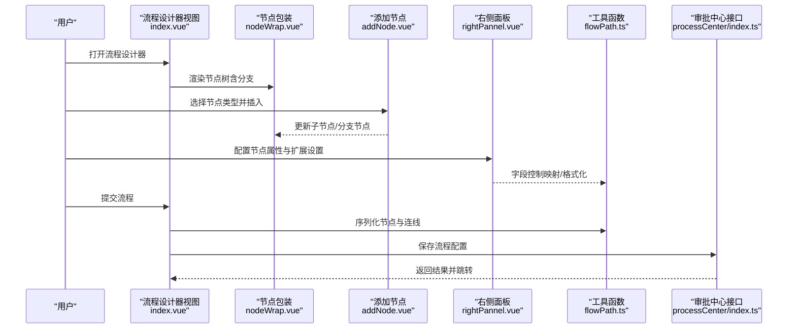

图表来源
- [src/views/flowPath/index.vue:76-116](file://src/views/flowPath/index.vue#L76-L116)
- [src/views/flowPath/components/nodeWrap.vue:126-135](file://src/views/flowPath/components/nodeWrap.vue#L126-L135)
- [src/views/flowPath/components/addNode.vue:10-118](file://src/views/flowPath/components/addNode.vue#L10-L118)
- [src/views/flowPath/components/rightPannel.vue:14-33](file://src/views/flowPath/components/rightPannel.vue#L14-L33)
- [src/utils/flowPath.ts:4-76](file://src/utils/flowPath.ts#L4-L76)
- [src/api/processCenter/index.ts:37-47](file://src/api/processCenter/index.ts#L37-L47)

## 详细组件分析

### 流程设计器主视图（index.vue）
- 负责加载表单配置与流程缓存，初始化节点树，提供上一步/提交按钮。
- 并行拉取部门/角色/岗位列表与流程历史，用于节点权限配置与版本切换。
- 提交时将节点树扁平化为节点数组与连线数组，拼装为流程配置对象，调用后端保存。

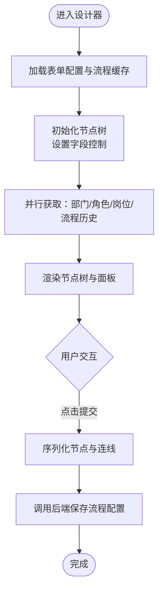

图表来源
- [src/views/flowPath/index.vue:57-116](file://src/views/flowPath/index.vue#L57-L116)

章节来源
- [src/views/flowPath/index.vue:39-144](file://src/views/flowPath/index.vue#L39-L144)

### 节点包装组件（nodeWrap.vue）
- 支持普通节点与分支节点两种渲染路径。
- 普通节点：展示节点标题、候选人摘要、删除按钮；提供添加子节点入口。
- 分支节点：支持动态增删条件项，计算条件字符串用于展示；当仅剩一条分支时，允许将剩余分支合并到父节点的默认出口。
- 条件编辑：通过注入的设计器状态处理点击事件，打开右侧面板进行规则配置。

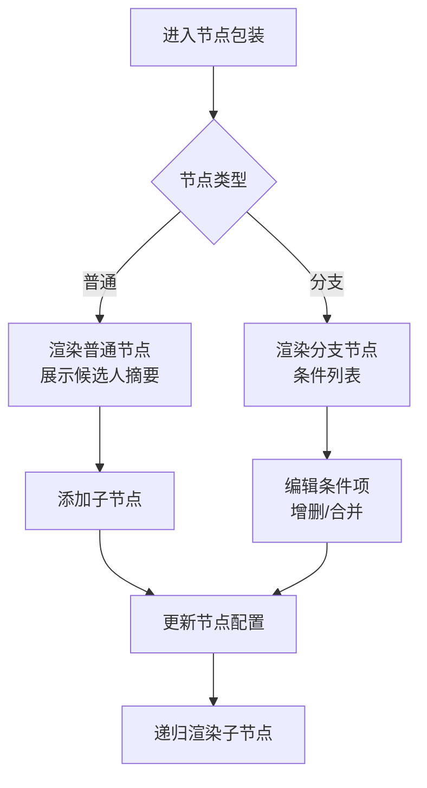

图表来源
- [src/views/flowPath/components/nodeWrap.vue:8-77](file://src/views/flowPath/components/nodeWrap.vue#L8-L77)
- [src/views/flowPath/components/nodeWrap.vue:126-135](file://src/views/flowPath/components/nodeWrap.vue#L126-L135)
- [src/views/flowPath/components/nodeWrap.vue:244-281](file://src/views/flowPath/components/nodeWrap.vue#L244-L281)

章节来源
- [src/views/flowPath/components/nodeWrap.vue:7-140](file://src/views/flowPath/components/nodeWrap.vue#L7-L140)

### 添加节点组件（addNode.vue）
- 提供节点类型选择菜单，支持在当前节点后插入普通节点或分支节点。
- 插入分支节点时，默认生成两条分支节点，便于快速搭建多条件分支。

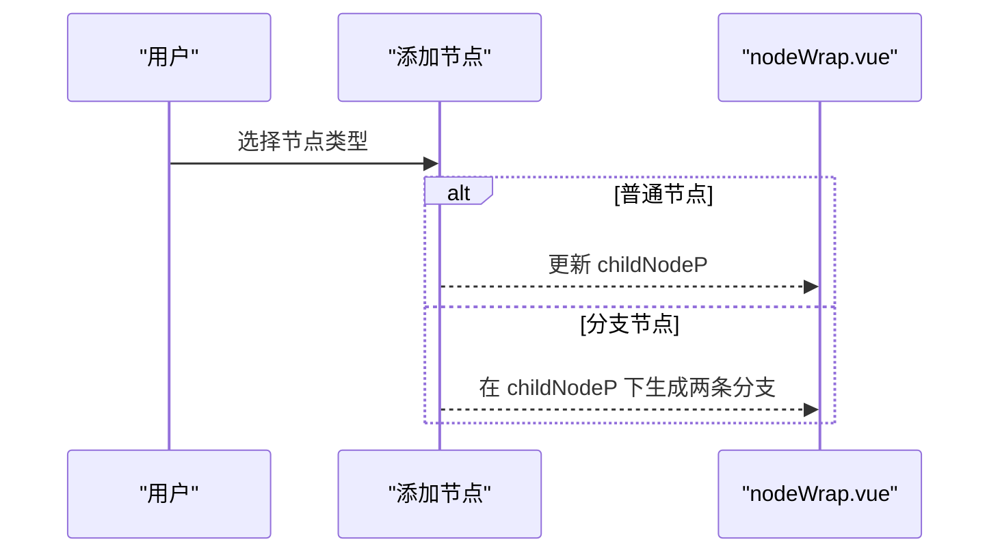

图表来源
- [src/views/flowPath/components/addNode.vue:10-118](file://src/views/flowPath/components/addNode.vue#L10-L118)

章节来源
- [src/views/flowPath/components/addNode.vue:1-130](file://src/views/flowPath/components/addNode.vue#L1-L130)

### 右侧面板（rightPannel.vue）
- 属性配置区：根据节点类型渲染对应属性控件（如候选人、下载/打印/日志/撤回、字段控制等）。
- 扩展配置区：按节点类型显示消息通道、节点时限、插件管理等。

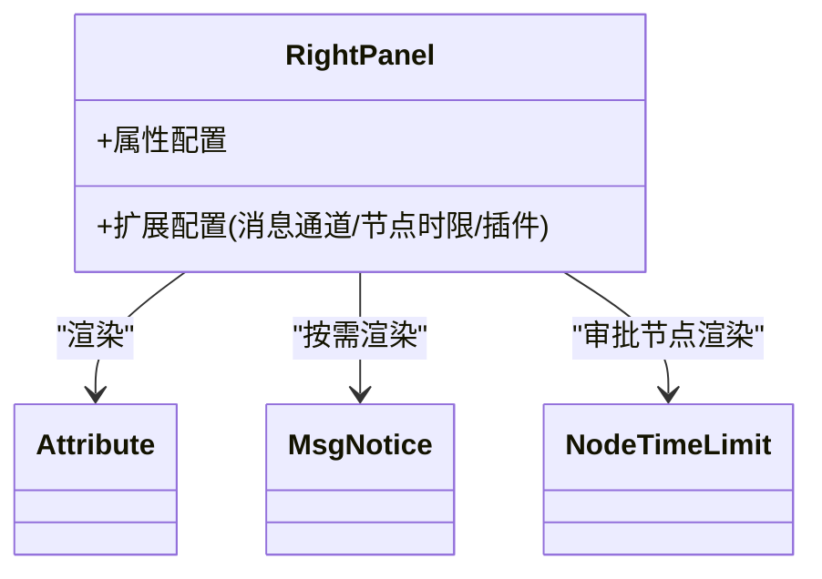

图表来源
- [src/views/flowPath/components/rightPannel.vue:14-33](file://src/views/flowPath/components/rightPannel.vue#L14-L33)

章节来源
- [src/views/flowPath/components/rightPannel.vue:1-109](file://src/views/flowPath/components/rightPannel.vue#L1-L109)

### 左侧面板（leftPannel.vue）
- 展示流程历史版本列表，支持一键切换到某版本的起始节点，便于回滚或复用。

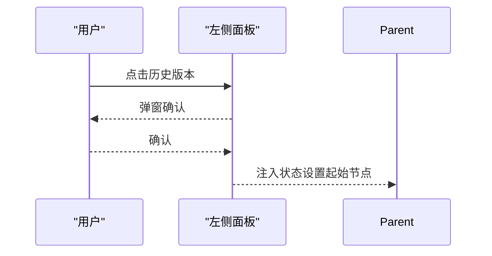

图表来源
- [src/views/flowPath/components/leftPannel.vue:21-36](file://src/views/flowPath/components/leftPannel.vue#L21-L36)

章节来源
- [src/views/flowPath/components/leftPannel.vue:14-38](file://src/views/flowPath/components/leftPannel.vue#L14-L38)

### 工具函数（flowPath.ts）
- 字段控制映射：将表单字段与节点字段控制进行匹配，生成统一的字段控制清单，支持编辑/查看/推送等维度。
- 流程序列化：遍历节点树，剥离冗余字段，抽取候选者ID列表，生成节点数组与连线数组。
- 流程树缓存：基于本地存储保存/读取流程树，支持按ID管理。
- 流程树构建：将流程配置转换为可编辑的节点树，用于首次渲染。

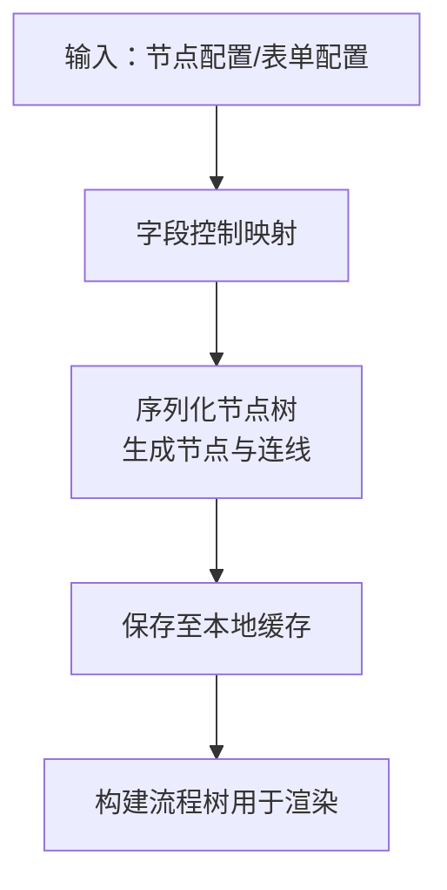

图表来源
- [src/utils/flowPath.ts:4-76](file://src/utils/flowPath.ts#L4-L76)
- [src/utils/flowPath.ts:119-244](file://src/utils/flowPath.ts#L119-L244)
- [src/utils/flowPath.ts:265-279](file://src/utils/flowPath.ts#L265-L279)
- [src/utils/flowPath.ts:281-322](file://src/utils/flowPath.ts#L281-L322)

章节来源
- [src/utils/flowPath.ts:1-322](file://src/utils/flowPath.ts#L1-L322)

### 常量配置（const.js）
- 节点类型与默认属性：定义开始/结束/填写/审批/抄送/分支/连接器等节点的默认值与属性列表。
- 视觉与交互：定义节点背景色、占位符文案、权限选择模式、运算符等。
- 节点模板：提供节点默认属性结构，作为新建节点的模板来源。

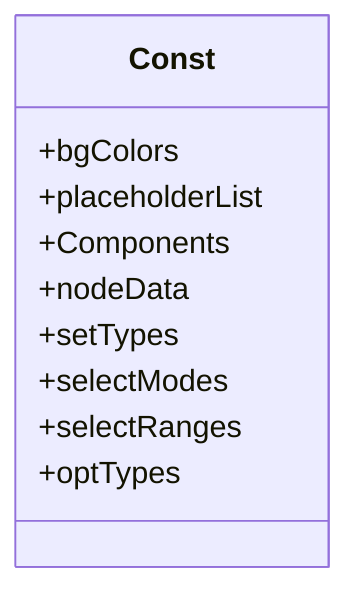

图表来源
- [src/data/const.js:8-475](file://src/data/const.js#L8-L475)

章节来源
- [src/data/const.js:1-475](file://src/data/const.js#L1-L475)

### 执行与监控
- 任务详情抽屉：展示节点信息与流程图缩略，便于查看流程实例状态。
- 审批中心：提供转交、退回、终止等操作接口，配合流程引擎后端执行。
- 时间线组件：在只读模式下展示节点名称与候选人摘要，支持在分支场景下展示条件描述。

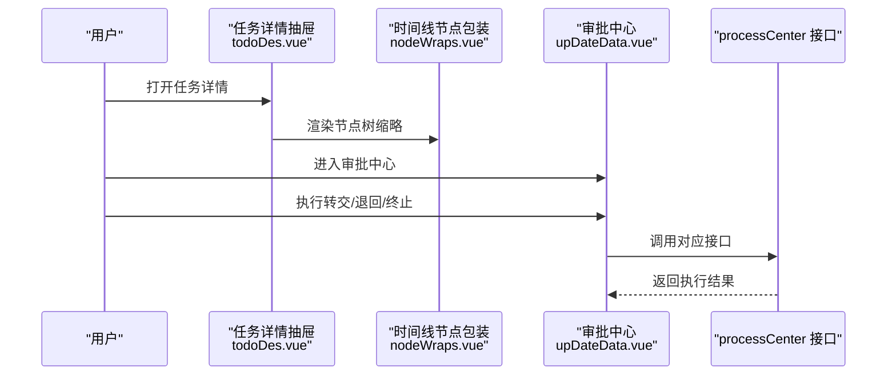

图表来源
- [src/views/taskFillCenter/todoDes.vue:26-44](file://src/views/taskFillCenter/todoDes.vue#L26-L44)
- [src/components/timeLine/nodeWraps.vue:26-54](file://src/components/timeLine/nodeWraps.vue#L26-L54)
- [src/views/processCenter/upDateData.vue:77-92](file://src/views/processCenter/upDateData.vue#L77-L92)
- [src/api/processCenter/index.ts:37-47](file://src/api/processCenter/index.ts#L37-L47)

章节来源
- [src/views/taskFillCenter/todoDes.vue:1-44](file://src/views/taskFillCenter/todoDes.vue#L1-L44)
- [src/views/processCenter/upDateData.vue:63-92](file://src/views/processCenter/upDateData.vue#L63-L92)
- [src/api/processCenter/index.ts:37-47](file://src/api/processCenter/index.ts#L37-L47)
- [src/components/timeLine/nodeWraps.vue:26-54](file://src/components/timeLine/nodeWraps.vue#L26-L54)

## 依赖关系分析
- 组件耦合
  - index.vue 作为根容器，依赖 nodeWrap.vue、rightPannel.vue、leftPannel.vue 与工具函数 flowPath.ts。
  - nodeWrap.vue 与 addNode.vue 通过 v-model 与 emit 实现双向数据绑定与事件传播。
  - rightPannel.vue 动态渲染 attribute/msgNotice/nodeTimeLimit，受节点类型影响。
- 外部依赖
  - 并行请求部门/角色/岗位/流程历史，减少首屏等待。
  - 使用 Arco Design 的弹窗与折叠面板组件，提升交互体验。
- 数据流
  - 表单配置与流程配置通过 JSON 字符串传递给后端，避免复杂对象跨层传递带来的耦合。

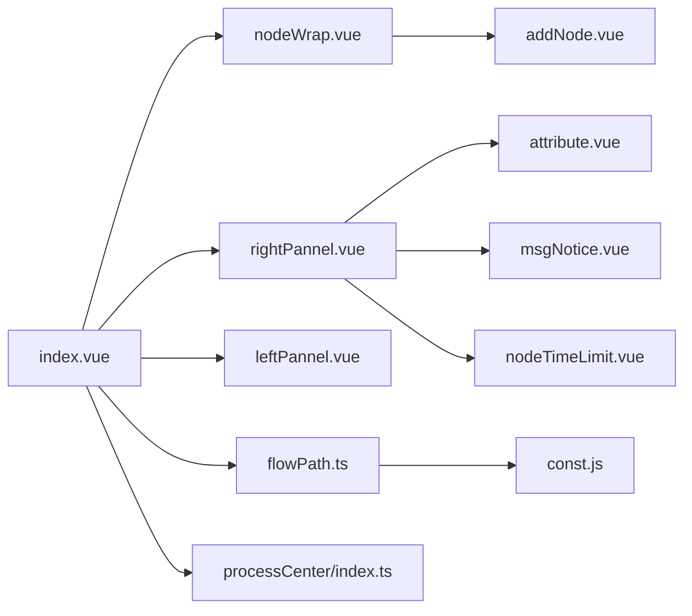

图表来源
- [src/views/flowPath/index.vue:40-49](file://src/views/flowPath/index.vue#L40-L49)
- [src/views/flowPath/components/nodeWrap.vue:80-124](file://src/views/flowPath/components/nodeWrap.vue#L80-L124)
- [src/views/flowPath/components/rightPannel.vue:14-33](file://src/views/flowPath/components/rightPannel.vue#L14-L33)
- [src/views/flowPath/components/leftPannel.vue:15-20](file://src/views/flowPath/components/leftPannel.vue#L15-L20)
- [src/utils/flowPath.ts:1-322](file://src/utils/flowPath.ts#L1-L322)
- [src/data/const.js:1-475](file://src/data/const.js#L1-L475)
- [src/api/processCenter/index.ts:37-47](file://src/api/processCenter/index.ts#L37-L47)

章节来源
- [src/views/flowPath/index.vue:40-49](file://src/views/flowPath/index.vue#L40-L49)
- [src/views/flowPath/components/nodeWrap.vue:80-124](file://src/views/flowPath/components/nodeWrap.vue#L80-L124)
- [src/views/flowPath/components/rightPannel.vue:14-33](file://src/views/flowPath/components/rightPannel.vue#L14-L33)
- [src/views/flowPath/components/leftPannel.vue:15-20](file://src/views/flowPath/components/leftPannel.vue#L15-L20)
- [src/utils/flowPath.ts:1-322](file://src/utils/flowPath.ts#L1-L322)
- [src/data/const.js:1-475](file://src/data/const.js#L1-L475)
- [src/api/processCenter/index.ts:37-47](file://src/api/processCenter/index.ts#L37-L47)

## 性能考虑
- 渲染优化
  - 使用 v-if/v-show 控制分支节点渲染，避免不必要的 DOM 结构。
  - 对长列表使用虚拟滚动（如部门/角色/岗位列表）以降低重排压力。
- 数据处理
  - 字段控制映射与格式化在工具函数中集中处理，避免重复计算。
  - 序列化时批量剥离冗余字段，减少传输体积。
- 请求优化
  - 并行拉取多源数据，缩短首屏等待时间。
  - 本地缓存流程树，减少重复加载。
- 交互优化
  - 使用轻量级弹窗与折叠面板，避免频繁路由跳转带来的性能损耗。

## 故障排除指南
- 提交失败
  - 检查节点树是否包含无效字段或缺失必要属性（如候选人、分支条件）。
  - 确认表单配置中的字段格式与规则是否正确。
- 分支逻辑异常
  - 确认分支节点的条件项数量与优先级顺序是否合理。
  - 若仅剩一条分支，检查是否已正确合并到默认出口。
- 权限配置不生效
  - 核对候选人ID列表是否已正确提取（部门/岗位/角色/用户）。
  - 检查动态候选人的层级与字段映射是否正确。
- 执行阶段问题
  - 审批中心操作（转交/退回/终止）需确保后端接口返回成功。
  - 查看流程实例日志，定位具体节点与错误原因。

章节来源
- [src/views/flowPath/components/nodeWrap.vue:244-281](file://src/views/flowPath/components/nodeWrap.vue#L244-L281)
- [src/utils/flowPath.ts:119-244](file://src/utils/flowPath.ts#L119-L244)
- [src/api/processCenter/index.ts:37-47](file://src/api/processCenter/index.ts#L37-L47)

## 结论
本工作流引擎通过“可视化设计器 + 工具函数 + 常量配置 + 执行监控”的组合，实现了从流程设计到执行落地的闭环。其核心优势在于：
- 明确的节点类型与默认属性，便于快速搭建各类流程。
- 灵活的分支控制与字段控制，满足复杂业务规则。
- 清晰的序列化与缓存机制，保障数据一致性与性能。
- 与审批中心接口的解耦设计，便于后续扩展与集成。

## 附录
- 最佳实践
  - 设计前先梳理业务规则，明确分支条件与候选人策略。
  - 合理使用“逐级审批”与“常规审批”，避免过长审批链。
  - 为关键节点配置消息通道与节点时限，提升可观测性。
- 性能优化建议
  - 对超大流程采用分页/懒加载渲染。
  - 缓存常用配置（部门/角色/岗位），减少重复请求。
  - 在工具函数中增加防抖与节流，避免频繁更新导致的重绘。
- 故障排查清单
  - 节点树序列化是否完整。
  - 分支条件是否覆盖所有分支。
  - 候选人ID列表是否正确提取。
  - 审批中心接口调用是否成功。