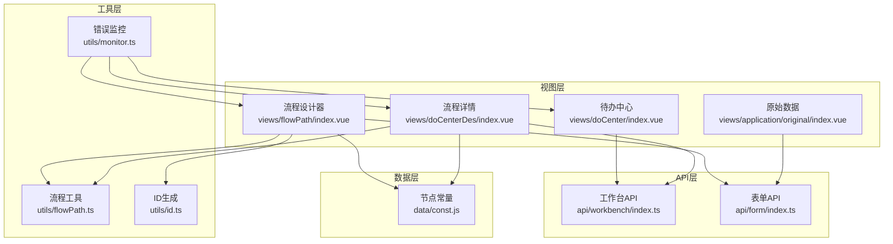
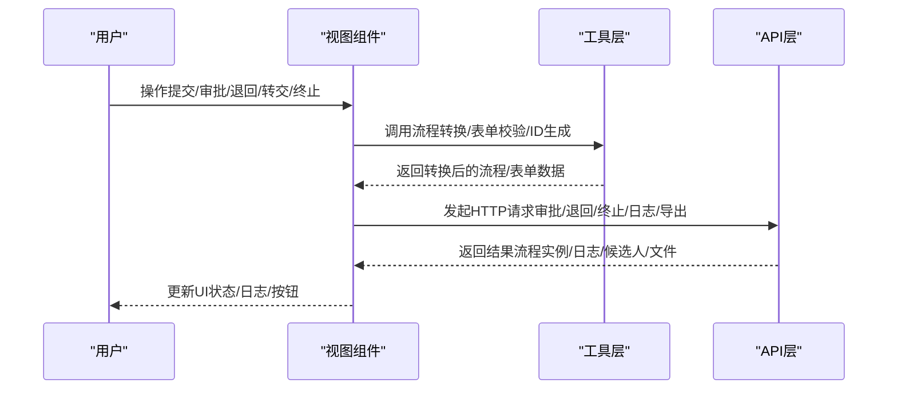
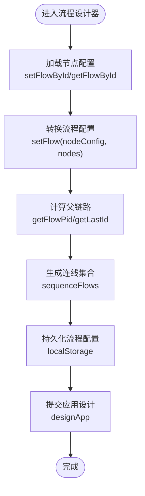
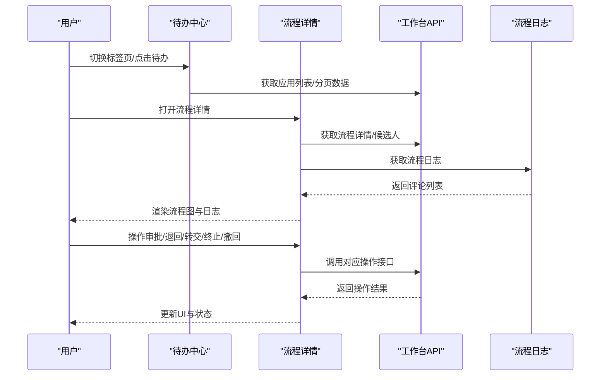
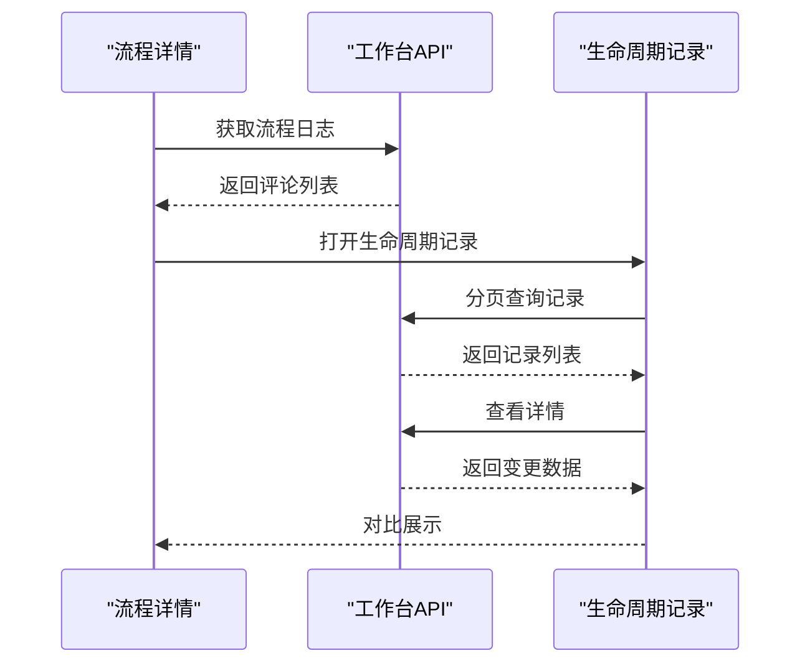
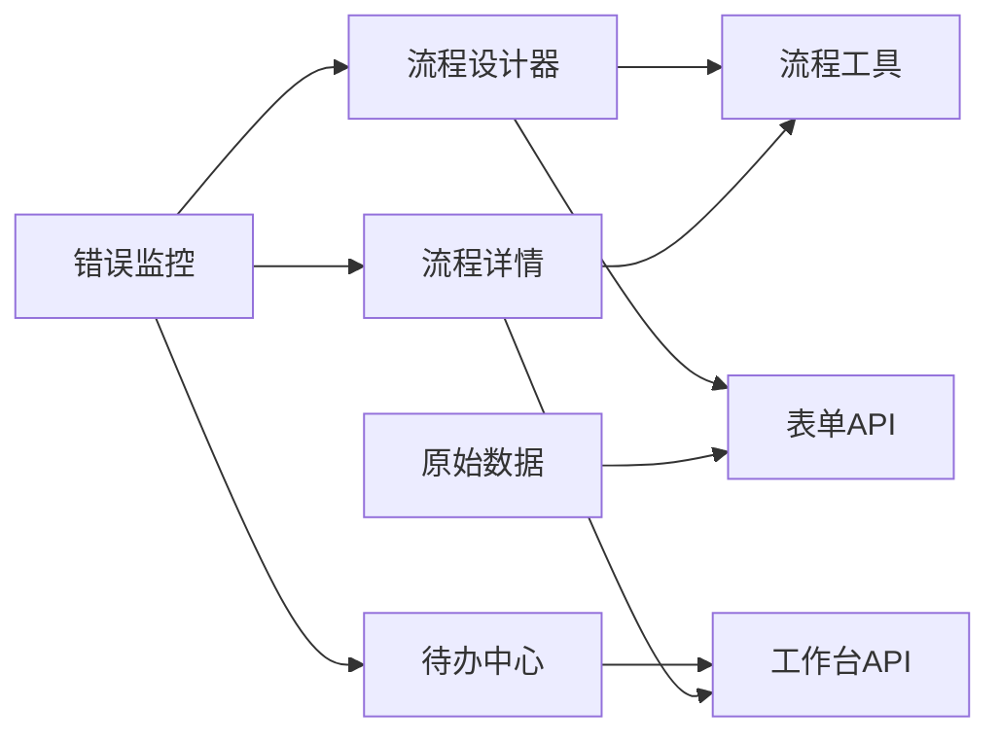

# 执行引擎

<cite>
**本文引用的文件**
- [README.md](file://README.md)
- [flowPath.ts](file://src/utils/flowPath.ts)
- [flowPath/index.vue](file://src/views/flowPath/index.vue)
- [timeLine.vue](file://src/components/timeLine/timeLine.vue)
- [doCenter/index.vue](file://src/views/doCenter/index.vue)
- [workbench/index.ts](file://src/api/workbench/index.ts)
- [form/index.ts](file://src/api/form/index.ts)
- [const.js](file://src/data/const.js)
- [id.ts](file://src/utils/id.ts)
- [doCenterDes/index.vue](file://src/views/doCenterDes/index.vue)
- [doCenterDes/lifeCycle.vue](file://src/views/doCenterDes/lifeCycle.vue)
- [application/original/index.vue](file://src/views/application/original/index.vue)
- [monitor.ts](file://src/utils/monitor.ts)
</cite>

## 目录
1. [简介](#简介)
2. [项目结构](#项目结构)
3. [核心组件](#核心组件)
4. [架构总览](#架构总览)
5. [详细组件分析](#详细组件分析)
6. [依赖分析](#依赖分析)
7. [性能考虑](#性能考虑)
8. [故障排查指南](#故障排查指南)
9. [结论](#结论)
10. [附录](#附录)

## 简介
本技术文档围绕“工作流执行引擎”的前端实现进行系统化梳理，重点覆盖以下方面：
- 流程执行的核心算法与节点执行顺序的确定
- 流程状态的跟踪机制与可视化呈现
- 流程实例的创建与销毁（基于表单与流程配置）
- 节点执行生命周期管理（填写/审批/抄送/分支/连接器等）
- 异常处理与错误恢复机制
- 并发执行支持与性能优化策略
- 执行日志与审计功能
- 扩展接口与自定义执行逻辑的实现方法

本仓库为前端工程，后端接口由 API 层提供，前端通过 API 调用完成流程实例的创建、推进、终止、回退、转交、打印/导出、日志与审计等能力。

## 项目结构
前端采用 Vue 3 + TypeScript + Vite 架构，核心模块包括：
- 视图层：流程设计器、待办中心、流程详情、原始数据等页面
- 工具层：流程配置转换、ID 生成、表单逻辑、监控等
- API 层：工作台、流程、表单、原始数据等接口封装
- 数据层：流程节点常量、默认节点配置等

图表来源
- [flowPath/index.vue:1-192](file://src/views/flowPath/index.vue#L1-L192)
- [flowPath.ts:1-322](file://src/utils/flowPath.ts#L1-L322)
- [workbench/index.ts:1-139](file://src/api/workbench/index.ts#L1-L139)
- [form/index.ts:1-31](file://src/api/form/index.ts#L1-L31)
- [const.js:1-475](file://src/data/const.js#L1-L475)
- [id.ts:1-26](file://src/utils/id.ts#L1-L26)
- [monitor.ts:1-29](file://src/utils/monitor.ts#L1-L29)

章节来源
- [README.md:1-6](file://README.md#L1-L6)
- [flowPath/index.vue:1-192](file://src/views/flowPath/index.vue#L1-L192)
- [flowPath.ts:1-322](file://src/utils/flowPath.ts#L1-L322)
- [workbench/index.ts:1-139](file://src/api/workbench/index.ts#L1-L139)
- [form/index.ts:1-31](file://src/api/form/index.ts#L1-L31)
- [const.js:1-475](file://src/data/const.js#L1-L475)
- [id.ts:1-26](file://src/utils/id.ts#L1-L26)
- [monitor.ts:1-29](file://src/utils/monitor.ts#L1-L29)

## 核心组件
- 流程设计器与流程树构建：将流程配置转换为节点数组与连线集合，并持久化到本地存储；提交时将节点与连线序列化为后端可识别的结构。
- 待办中心与流程详情：拉取流程实例、节点候选人、流程日志，支持审批、拒绝、退回、转交、终止、撤回、打印/导出、生命周期记录等。
- 日志与审计：流程日志按时间轴展示，支持多节点聚合日志查看；原始数据表格支持生命周期记录查看与字段管理。
- 错误监控：全局错误上报，便于定位前端异常。

章节来源
- [flowPath/index.vue:76-116](file://src/views/flowPath/index.vue#L76-L116)
- [flowPath.ts:119-244](file://src/utils/flowPath.ts#L119-L244)
- [doCenter/index.vue:158-294](file://src/views/doCenter/index.vue#L158-L294)
- [doCenterDes/index.vue:392-571](file://src/views/doCenterDes/index.vue#L392-L571)
- [timeLine.vue:1-199](file://src/components/timeLine/timeLine.vue#L1-L199)
- [application/original/index.vue:107-424](file://src/views/application/original/index.vue#L107-L424)
- [monitor.ts:4-28](file://src/utils/monitor.ts#L4-L28)

## 架构总览
前端通过视图组件驱动工具层与 API 层，形成“视图-工具-接口”三层协作：
- 视图层负责交互与状态展示
- 工具层负责流程配置转换、ID 生成、表单逻辑等
- API 层负责与后端交互，返回流程实例、日志、候选人等数据

图表来源
- [flowPath/index.vue:88-116](file://src/views/flowPath/index.vue#L88-L116)
- [doCenterDes/index.vue:148-205](file://src/views/doCenterDes/index.vue#L148-L205)
- [workbench/index.ts:1-139](file://src/api/workbench/index.ts#L1-L139)

## 详细组件分析

### 组件A：流程设计器与流程树构建
- 功能要点
  - 将流程配置（含开始/结束/填写/审批/抄送/分支/连接器等节点）转换为扁平节点数组与连线集合
  - 计算每个节点的父节点链路（pid），用于后续连线生成
  - 将流程配置与表单配置合并并持久化到本地存储
  - 提交时将节点与连线序列化为后端可识别的结构
- 关键算法
  - setFlow：递归遍历流程树，剥离冗余属性，规范化候选人字段，收集节点与父链路
  - getFlowPid/getLastId：计算分支节点的最终父链路
  - setProps/setCildProps：根据表单字段动态生成节点字段控制配置
- 生命周期
  - 初始化：从本地存储或默认配置加载节点数据
  - 编辑：更新节点属性、字段控制、分支条件
  - 提交：序列化流程与表单配置，调用应用设计接口保存

图表来源
- [flowPath.ts:119-244](file://src/utils/flowPath.ts#L119-L244)
- [flowPath.ts:246-263](file://src/utils/flowPath.ts#L246-L263)
- [flowPath.ts:4-76](file://src/utils/flowPath.ts#L4-L76)
- [flowPath/index.vue:76-116](file://src/views/flowPath/index.vue#L76-L116)

章节来源
- [flowPath.ts:1-322](file://src/utils/flowPath.ts#L1-L322)
- [flowPath/index.vue:1-192](file://src/views/flowPath/index.vue#L1-L192)
- [const.js:392-442](file://src/data/const.js#L392-L442)

### 组件B：流程执行与状态跟踪（待办中心/流程详情）
- 功能要点
  - 拉取流程实例、节点候选人、流程日志
  - 支持审批（通过/拒绝）、退回、转交、终止、撤回、打印/导出、生命周期记录
  - 流程图状态可视化：已执行/执行中/未执行
- 关键流程
  - 获取流程详情：根据 taskId 或 processInstanceId 拉取对应视图数据
  - 设置节点状态：根据 currentNodesIds 标记当前执行节点
  - 日志渲染：processInstanceIdLog 接口返回评论列表，按时间轴展示
  - 表单提交：校验后调用审批/退回/转交/终止/撤回等接口

图表来源
- [doCenter/index.vue:158-294](file://src/views/doCenter/index.vue#L158-L294)
- [doCenterDes/index.vue:392-571](file://src/views/doCenterDes/index.vue#L392-L571)
- [workbench/index.ts:1-139](file://src/api/workbench/index.ts#L1-L139)
- [timeLine.vue:1-199](file://src/components/timeLine/timeLine.vue#L1-L199)

章节来源
- [doCenter/index.vue:1-391](file://src/views/doCenter/index.vue#L1-L391)
- [doCenterDes/index.vue:1-690](file://src/views/doCenterDes/index.vue#L1-L690)
- [workbench/index.ts:1-139](file://src/api/workbench/index.ts#L1-L139)
- [timeLine.vue:1-199](file://src/components/timeLine/timeLine.vue#L1-L199)

### 组件C：日志与审计（流程日志/生命周期记录）
- 功能要点
  - 流程日志：按节点与时间轴展示审批/退回/转交/抄送等操作
  - 生命周期记录：原始数据变更记录的分页查看与详情对比
- 关键实现
  - 流程日志：processInstanceIdLog 接口返回评论列表，前端解析并渲染
  - 生命周期：lifeCycle 模态框分页加载，点击“查看”获取变更详情

图表来源
- [doCenterDes/index.vue:517-571](file://src/views/doCenterDes/index.vue#L517-L571)
- [doCenterDes/lifeCycle.vue:105-137](file://src/views/doCenterDes/lifeCycle.vue#L105-L137)
- [application/original/index.vue:223-238](file://src/views/application/original/index.vue#L223-L238)

章节来源
- [doCenterDes/index.vue:1-690](file://src/views/doCenterDes/index.vue#L1-L690)
- [doCenterDes/lifeCycle.vue:1-156](file://src/views/doCenterDes/lifeCycle.vue#L1-L156)
- [application/original/index.vue:1-572](file://src/views/application/original/index.vue#L1-L572)

### 组件D：异常处理与错误监控
- 全局错误上报：通过 errorHandler 将错误信息上报至监控服务
- 建议实践：在开发阶段开启严格模式，结合浏览器调试与后端日志定位问题

章节来源
- [monitor.ts:4-28](file://src/utils/monitor.ts#L4-L28)

## 依赖分析
- 视图组件依赖工具层与 API 层
- 流程设计器依赖流程工具与表单工具
- 流程详情依赖工作台 API 与流程工具
- 错误监控作为横切关注点注入全局

图表来源
- [flowPath/index.vue:39-144](file://src/views/flowPath/index.vue#L39-L144)
- [doCenter/index.vue:158-294](file://src/views/doCenter/index.vue#L158-L294)
- [doCenterDes/index.vue:105-138](file://src/views/doCenterDes/index.vue#L105-L138)
- [monitor.ts:4-28](file://src/utils/monitor.ts#L4-L28)

章节来源
- [flowPath/index.vue:1-192](file://src/views/flowPath/index.vue#L1-L192)
- [doCenter/index.vue:1-391](file://src/views/doCenter/index.vue#L1-L391)
- [doCenterDes/index.vue:1-690](file://src/views/doCenterDes/index.vue#L1-L690)
- [monitor.ts:1-29](file://src/utils/monitor.ts#L1-L29)

## 性能考虑
- 渲染优化
  - 使用虚拟滚动与分页：原始数据表格与生命周期记录均采用分页与滚动条优化
  - 按需渲染：流程详情中的流程图与日志仅在打开详情时加载
- 请求优化
  - 并发请求：待办中心初始化时使用 Promise.all 并发拉取部门树、角色列表、岗位列表与流程历史
  - 缓存策略：流程配置在本地存储中缓存，减少重复加载
- 计算优化
  - 流程树构建采用递归与扁平化，避免深层嵌套导致的重复计算
  - 字段控制与规则在表单初始化时一次性生成，减少运行时开销

章节来源
- [doCenter/index.vue:76-82](file://src/views/doCenter/index.vue#L76-L82)
- [flowPath.ts:265-279](file://src/utils/flowPath.ts#L265-L279)
- [application/original/index.vue:289-329](file://src/views/application/original/index.vue#L289-L329)

## 故障排查指南
- 常见问题
  - 流程提交失败：检查流程配置是否完整（开始/结束节点、连线、字段控制）
  - 审批/退回/转交无效：确认 taskId/processInstanceId 是否正确，接口返回状态码与消息
  - 日志不显示：确认 processInstanceId 是否传入正确，后端是否返回评论列表
  - 打印/导出失败：确认模板是否存在，文件类型与文件 ID 是否匹配
- 排查步骤
  - 打开浏览器开发者工具，查看网络面板与控制台错误
  - 在全局错误处理器中查看上报的错误信息
  - 核对后端接口返回的数据结构与字段映射
- 建议
  - 在开发环境启用严格模式与断言
  - 对关键接口增加重试与降级策略
  - 对大列表采用懒加载与分页

章节来源
- [monitor.ts:4-28](file://src/utils/monitor.ts#L4-L28)
- [workbench/index.ts:1-139](file://src/api/workbench/index.ts#L1-L139)
- [doCenterDes/index.vue:148-205](file://src/views/doCenterDes/index.vue#L148-L205)

## 结论
本执行引擎通过“视图-工具-接口”三层架构，实现了流程设计、实例执行、状态跟踪、日志审计与错误监控的完整闭环。流程树构建与状态可视化为用户提供了清晰的执行路径，而并发请求与分页渲染提升了整体性能。建议在实际部署中结合后端能力完善异常处理与审计留痕，确保流程执行的可靠性与可追溯性。

## 附录
- 扩展接口与自定义执行逻辑
  - 节点类型扩展：在节点常量中新增节点类型与属性定义，配合流程工具与视图组件进行渲染与交互
  - 自定义节点：如连接器节点，可在流程设计器中配置连接器与场景，并在流程详情中触发外部执行
  - 字段控制与规则：通过字段控制与表单规则动态影响节点行为与渲染
- 执行性能优化建议
  - 对流程图与日志采用虚拟滚动与懒加载
  - 对大体量数据采用分页与增量加载
  - 对热点接口增加缓存与去抖策略

章节来源
- [const.js:353-390](file://src/data/const.js#L353-L390)
- [flowPath.ts:1-322](file://src/utils/flowPath.ts#L1-L322)
- [doCenterDes/index.vue:1-690](file://src/views/doCenterDes/index.vue#L1-L690)