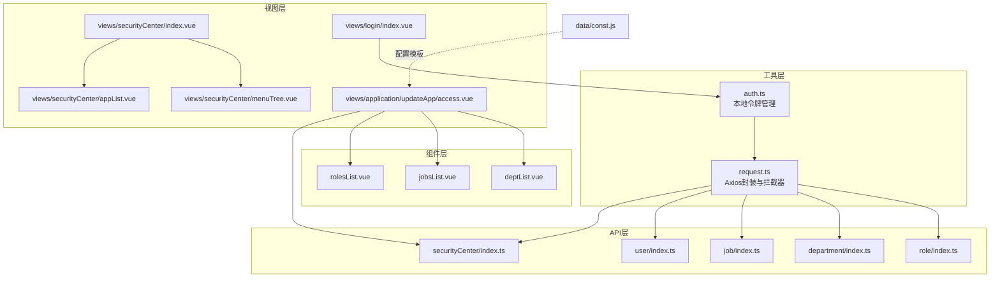
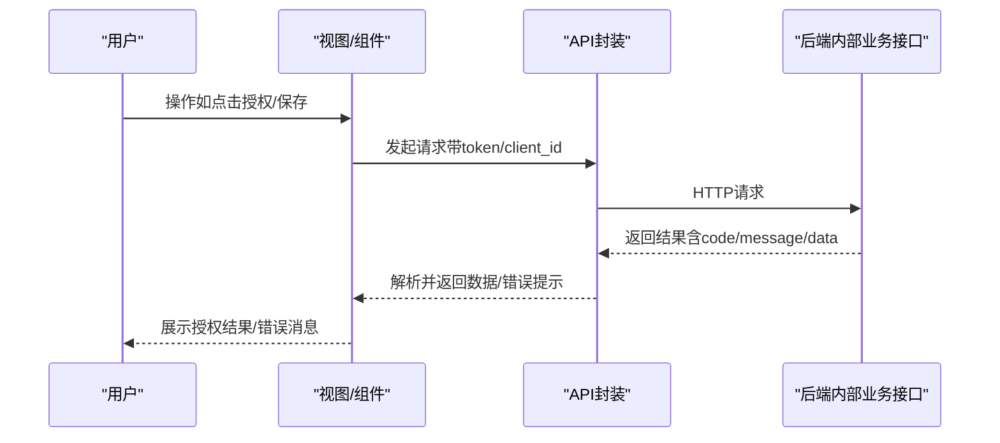
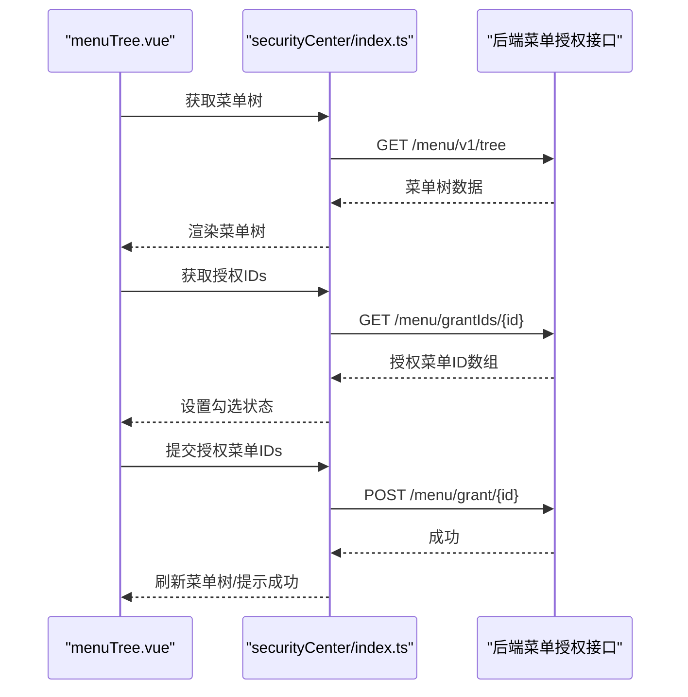
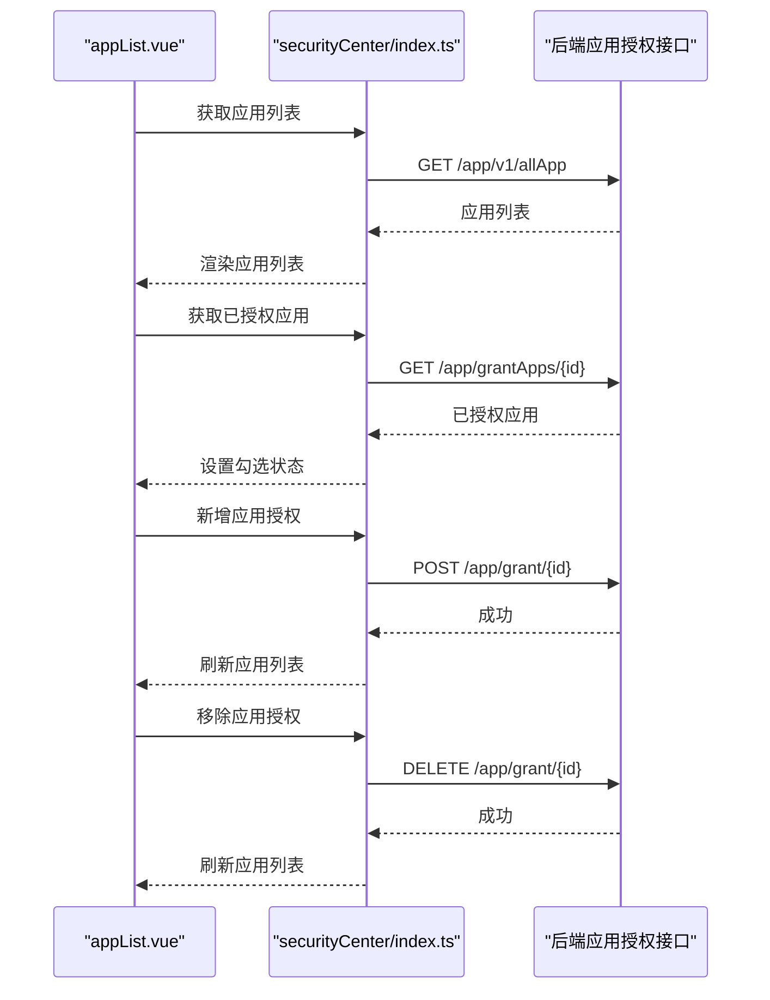
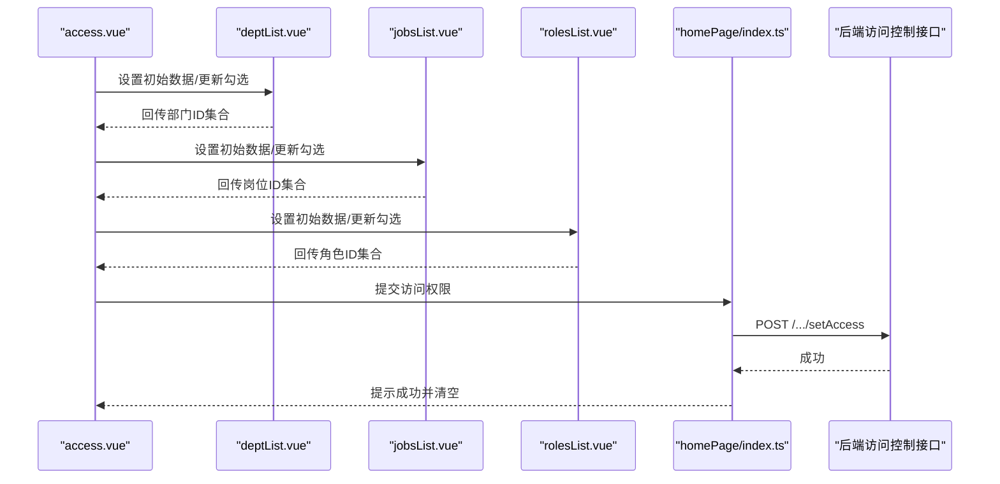
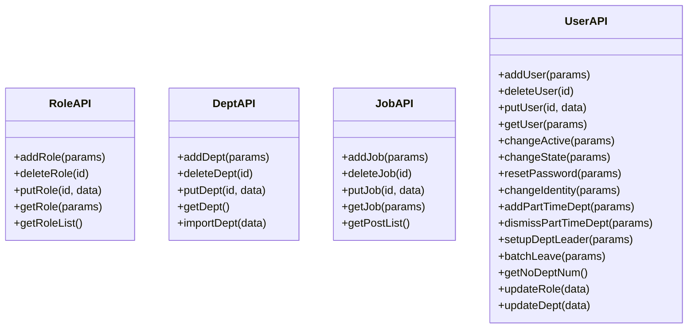
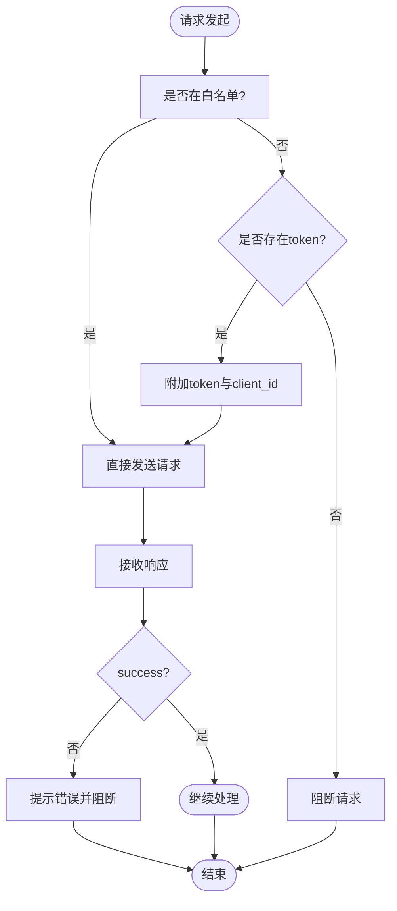
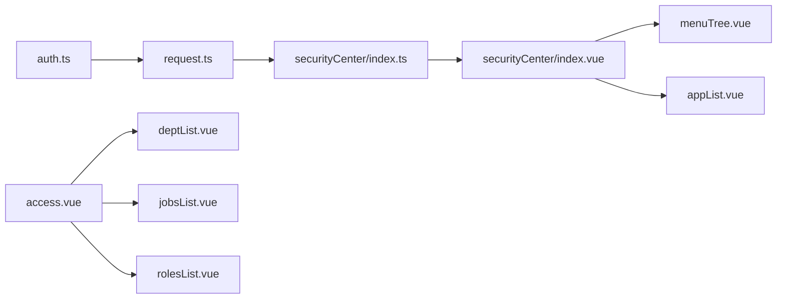

# 权限分配

<cite>
**本文引用的文件**
- [src/utils/auth.ts](file://src/utils/auth.ts)
- [src/utils/request.ts](file://src/utils/request.ts)
- [src/router/index.ts](file://src/router/index.ts)
- [src/api/role/index.ts](file://src/api/role/index.ts)
- [src/api/department/index.ts](file://src/api/department/index.ts)
- [src/api/job/index.ts](file://src/api/job/index.ts)
- [src/api/user/index.ts](file://src/api/user/index.ts)
- [src/api/securityCenter/index.ts](file://src/api/securityCenter/index.ts)
- [src/views/securityCenter/index.vue](file://src/views/securityCenter/index.vue)
- [src/views/securityCenter/menuTree.vue](file://src/views/securityCenter/menuTree.vue)
- [src/views/securityCenter/appList.vue](file://src/views/securityCenter/appList.vue)
- [src/views/application/updateApp/access.vue](file://src/views/application/updateApp/access.vue)
- [src/components/selectPerson/components/deptList.vue](file://src/components/selectPerson/components/deptList.vue)
- [src/components/selectPerson/components/jobsList.vue](file://src/components/selectPerson/components/jobsList.vue)
- [src/components/selectPerson/components/rolesList.vue](file://src/components/selectPerson/components/rolesList.vue)
- [src/data/const.js](file://src/data/const.js)
- [src/views/login/index.vue](file://src/views/login/index.vue)
</cite>

## 目录
1. [引言](#引言)
2. [项目结构](#项目结构)
3. [核心组件](#核心组件)
4. [架构总览](#架构总览)
5. [详细组件分析](#详细组件分析)
6. [依赖关系分析](#依赖关系分析)
7. [性能考量](#性能考量)
8. [故障排查指南](#故障排查指南)
9. [结论](#结论)
10. [附录](#附录)

## 引言
本文件面向权限分配系统，围绕“流程权限”“权限模型”“权限继承与覆盖”“角色/部门/岗位权限配置与管理”“权限验证执行时机与算法”“权限变更通知机制”等主题，结合前端代码实现，给出可操作的技术说明与最佳实践建议。系统采用前后端分离架构：前端通过统一请求封装发送业务请求，后端提供内部业务接口（如角色、部门、岗位、用户、安全组、菜单与应用授权等），前端在多个视图中完成权限配置与授权落地。

## 项目结构
权限相关的前端模块主要分布在以下区域：
- 工具层：认证令牌管理与HTTP请求封装
- API层：角色、部门、岗位、用户、安全中心（菜单/应用授权）等业务接口
- 视图层：安全中心（功能授权/应用授权）、应用访问控制配置、登录页等
- 组件层：人员选择器（部门/岗位/角色/人员）等复用组件
- 数据常量：权限配置模板与动态审批字段结构

图表来源
- [src/utils/auth.ts:1-20](file://src/utils/auth.ts#L1-L20)
- [src/utils/request.ts:1-159](file://src/utils/request.ts#L1-L159)
- [src/api/role/index.ts:1-25](file://src/api/role/index.ts#L1-L25)
- [src/api/department/index.ts:1-23](file://src/api/department/index.ts#L1-L23)
- [src/api/job/index.ts:1-25](file://src/api/job/index.ts#L1-L25)
- [src/api/user/index.ts:1-63](file://src/api/user/index.ts#L1-L63)
- [src/api/securityCenter/index.ts:1-90](file://src/api/securityCenter/index.ts#L1-L90)
- [src/views/securityCenter/index.vue:1-125](file://src/views/securityCenter/index.vue#L1-L125)
- [src/views/securityCenter/menuTree.vue:1-114](file://src/views/securityCenter/menuTree.vue#L1-L114)
- [src/views/securityCenter/appList.vue:88-145](file://src/views/securityCenter/appList.vue#L88-L145)
- [src/views/application/updateApp/access.vue:1-263](file://src/views/application/updateApp/access.vue#L1-L263)
- [src/components/selectPerson/components/deptList.vue:1-70](file://src/components/selectPerson/components/deptList.vue#L1-L70)
- [src/components/selectPerson/components/jobsList.vue:1-71](file://src/components/selectPerson/components/jobsList.vue#L1-L71)
- [src/components/selectPerson/components/rolesList.vue:1-70](file://src/components/selectPerson/components/rolesList.vue#L1-L70)
- [src/data/const.js:150-185](file://src/data/const.js#L150-L185)
- [src/views/login/index.vue:158-205](file://src/views/login/index.vue#L158-L205)

章节来源
- [src/utils/auth.ts:1-20](file://src/utils/auth.ts#L1-L20)
- [src/utils/request.ts:1-159](file://src/utils/request.ts#L1-L159)
- [src/router/index.ts:1-189](file://src/router/index.ts#L1-L189)

## 核心组件
- 认证与令牌
  - 本地令牌键名与读写清理：用于识别登录态与携带鉴权头
  - 登录页对令牌的处理：根据路由参数设置令牌并跳转首页
- 请求封装与拦截器
  - 自动注入client_id与token请求头
  - 统一响应处理与错误提示
  - 白名单接口放行
- 路由守卫
  - 占位的全局前置守卫，当前未启用具体鉴权逻辑
- 权限配置视图
  - 安全中心：功能授权（菜单树）与应用授权（应用列表）
  - 应用访问控制：按部门/岗位/角色/人员维度配置访问对象
- 人员选择器组件
  - 部门树勾选、岗位多选、角色多选，联动表单数据

章节来源
- [src/utils/auth.ts:1-20](file://src/utils/auth.ts#L1-L20)
- [src/views/login/index.vue:158-205](file://src/views/login/index.vue#L158-L205)
- [src/utils/request.ts:26-45](file://src/utils/request.ts#L26-L45)
- [src/utils/request.ts:47-113](file://src/utils/request.ts#L47-L113)
- [src/router/index.ts:182-186](file://src/router/index.ts#L182-L186)
- [src/views/securityCenter/index.vue:1-125](file://src/views/securityCenter/index.vue#L1-L125)
- [src/views/application/updateApp/access.vue:1-263](file://src/views/application/updateApp/access.vue#L1-L263)
- [src/components/selectPerson/components/deptList.vue:1-70](file://src/components/selectPerson/components/deptList.vue#L1-L70)
- [src/components/selectPerson/components/jobsList.vue:1-71](file://src/components/selectPerson/components/jobsList.vue#L1-L71)
- [src/components/selectPerson/components/rolesList.vue:1-70](file://src/components/selectPerson/components/rolesList.vue#L1-L70)

## 架构总览
系统采用“视图-组件-API-工具-后端接口”的分层结构。前端通过统一请求封装向后端发起内部业务接口调用，完成角色、部门、岗位、用户与安全组的增删改查以及菜单/应用授权。安全中心与应用访问控制视图负责权限配置与展示；登录页负责令牌注入与页面跳转。

图表来源
- [src/utils/request.ts:26-45](file://src/utils/request.ts#L26-L45)
- [src/utils/request.ts:47-113](file://src/utils/request.ts#L47-L113)
- [src/api/securityCenter/index.ts:1-90](file://src/api/securityCenter/index.ts#L1-L90)
- [src/api/role/index.ts:1-25](file://src/api/role/index.ts#L1-L25)
- [src/api/department/index.ts:1-23](file://src/api/department/index.ts#L1-L23)
- [src/api/job/index.ts:1-25](file://src/api/job/index.ts#L1-L25)
- [src/api/user/index.ts:1-63](file://src/api/user/index.ts#L1-L63)

## 详细组件分析

### 安全中心：功能授权（菜单树）
- 功能点
  - 加载菜单树与已授权菜单ID集合
  - 勾选菜单后提交授权
  - 成功后刷新菜单树与授权状态
- 关键交互
  - 获取菜单树、获取授权IDs、提交授权菜单IDs
  - 提交成功后提示并刷新
- 数据流
  - 视图组件维护当前安全组与勾选菜单ID集合
  - 通过API封装调用后端接口

图表来源
- [src/views/securityCenter/menuTree.vue:1-114](file://src/views/securityCenter/menuTree.vue#L1-L114)
- [src/api/securityCenter/index.ts:27-43](file://src/api/securityCenter/index.ts#L27-L43)
- [src/api/securityCenter/index.ts:31-37](file://src/api/securityCenter/index.ts#L31-L37)

章节来源
- [src/views/securityCenter/menuTree.vue:1-114](file://src/views/securityCenter/menuTree.vue#L1-L114)
- [src/api/securityCenter/index.ts:27-43](file://src/api/securityCenter/index.ts#L27-L43)
- [src/api/securityCenter/index.ts:31-37](file://src/api/securityCenter/index.ts#L31-L37)

### 安全中心：应用授权
- 功能点
  - 加载所有应用列表与当前安全组已授权应用
  - 新增/移除应用授权
  - 支持图标URL拼接与令牌参数
- 关键交互
  - 获取应用列表、获取已授权应用、新增/移除授权
  - 移除前弹窗确认
- 数据流
  - 视图组件维护当前安全组、已授权ID集合与应用列表
  - 通过API封装调用后端接口

图表来源
- [src/views/securityCenter/appList.vue:88-145](file://src/views/securityCenter/appList.vue#L88-L145)
- [src/api/securityCenter/index.ts:70-89](file://src/api/securityCenter/index.ts#L70-L89)

章节来源
- [src/views/securityCenter/appList.vue:88-145](file://src/views/securityCenter/appList.vue#L88-L145)
- [src/api/securityCenter/index.ts:70-89](file://src/api/securityCenter/index.ts#L70-L89)

### 应用访问控制：按部门/岗位/角色/人员配置
- 功能点
  - 以标签形式展示已选访问对象（部门/岗位/角色/人员）
  - 通过Tab切换不同维度进行选择
  - 提交时将各维度ID集合转换为后端所需格式
- 关键交互
  - 各维度组件分别维护勾选/多选状态，并通过provide/inject回传给父级表单
  - 提交时统一序列化并调用后端接口保存
- 数据流
  - 父视图维护表单数据，子组件更新对应字段
  - 保存时调用后端“设置访问权限”接口

图表来源
- [src/views/application/updateApp/access.vue:1-263](file://src/views/application/updateApp/access.vue#L1-L263)
- [src/components/selectPerson/components/deptList.vue:1-70](file://src/components/selectPerson/components/deptList.vue#L1-L70)
- [src/components/selectPerson/components/jobsList.vue:1-71](file://src/components/selectPerson/components/jobsList.vue#L1-L71)
- [src/components/selectPerson/components/rolesList.vue:1-70](file://src/components/selectPerson/components/rolesList.vue#L1-L70)

章节来源
- [src/views/application/updateApp/access.vue:1-263](file://src/views/application/updateApp/access.vue#L1-L263)
- [src/components/selectPerson/components/deptList.vue:1-70](file://src/components/selectPerson/components/deptList.vue#L1-L70)
- [src/components/selectPerson/components/jobsList.vue:1-71](file://src/components/selectPerson/components/jobsList.vue#L1-L71)
- [src/components/selectPerson/components/rolesList.vue:1-70](file://src/components/selectPerson/components/rolesList.vue#L1-L70)

### 权限模型与继承/覆盖机制（基于现有实现的解读）
- 权限模型
  - 系统通过“安全组”承载授权主体，围绕“菜单授权”和“应用授权”两大维度进行授权
  - 应用访问控制则以“部门/岗位/角色/人员”作为访问对象维度
- 继承与覆盖
  - 当前实现未直接体现“继承链”或“优先级叠加”的复杂规则
  - 从数据结构看，存在“动态审批”字段（如部门领导、分管领导、流程人员等），可用于表达更细粒度的运行期决策，但其解析与执行不在前端代码中体现
- 建议
  - 在后端明确“继承/覆盖”策略（如：岗位继承部门、角色覆盖岗位等）
  - 前端仅负责收集与提交，不参与复杂判定

章节来源
- [src/api/securityCenter/index.ts:1-90](file://src/api/securityCenter/index.ts#L1-L90)
- [src/views/application/updateApp/access.vue:1-263](file://src/views/application/updateApp/access.vue#L1-L263)
- [src/data/const.js:150-185](file://src/data/const.js#L150-L185)

### 角色/部门/岗位/用户的配置与管理
- 角色管理
  - 提供新增、删除、修改、分页查询、列表查询接口
- 部门管理
  - 提供新增、删除、修改、树形查询、导入接口
- 岗位管理
  - 提供新增、删除、修改、分页查询、列表查询接口
- 用户管理
  - 提供新增、删除、修改、分页查询、在职状态/登录状态/密码重置/身份变更、兼任部门/免职、设置部门负责人、批量离职、更新角色/部门等接口

图表来源
- [src/api/role/index.ts:1-25](file://src/api/role/index.ts#L1-L25)
- [src/api/department/index.ts:1-23](file://src/api/department/index.ts#L1-L23)
- [src/api/job/index.ts:1-25](file://src/api/job/index.ts#L1-L25)
- [src/api/user/index.ts:1-63](file://src/api/user/index.ts#L1-L63)

章节来源
- [src/api/role/index.ts:1-25](file://src/api/role/index.ts#L1-L25)
- [src/api/department/index.ts:1-23](file://src/api/department/index.ts#L1-L23)
- [src/api/job/index.ts:1-25](file://src/api/job/index.ts#L1-L25)
- [src/api/user/index.ts:1-63](file://src/api/user/index.ts#L1-L63)

### 权限验证的执行时机与算法实现
- 执行时机
  - 请求拦截器在发送请求前自动附加token与client_id
  - 响应拦截器统一处理401跳转与错误提示
  - 路由守卫占位，当前未启用具体鉴权逻辑
- 算法要点
  - 请求阶段：白名单放行，其余请求统一注入token
  - 响应阶段：非success统一提示并阻断后续处理
  - 登录页：根据路由参数设置令牌并跳转首页
- 注意
  - 该实现为“传输层鉴权”，具体的业务权限校验（如菜单可见性、按钮级权限）需由后端配合或在前端路由/菜单层面进一步扩展

图表来源
- [src/utils/request.ts:26-45](file://src/utils/request.ts#L26-L45)
- [src/utils/request.ts:47-113](file://src/utils/request.ts#L47-L113)
- [src/views/login/index.vue:158-205](file://src/views/login/index.vue#L158-L205)
- [src/router/index.ts:182-186](file://src/router/index.ts#L182-L186)

章节来源
- [src/utils/request.ts:26-45](file://src/utils/request.ts#L26-L45)
- [src/utils/request.ts:47-113](file://src/utils/request.ts#L47-L113)
- [src/views/login/index.vue:158-205](file://src/views/login/index.vue#L158-L205)
- [src/router/index.ts:182-186](file://src/router/index.ts#L182-L186)

### 权限变更的通知机制
- 现状
  - 前端在授权成功后通过消息提示反馈结果
  - 未见专门的“权限变更事件广播/订阅”机制
- 建议
  - 在授权成功后触发全局事件或使用状态管理推送变更
  - 前端可主动拉取最新权限树/菜单/应用授权列表，确保UI与后端一致

章节来源
- [src/views/securityCenter/menuTree.vue:52-60](file://src/views/securityCenter/menuTree.vue#L52-L60)
- [src/views/securityCenter/appList.vue:122-138](file://src/views/securityCenter/appList.vue#L122-L138)

## 依赖关系分析
- 组件耦合
  - 视图组件依赖API封装与后端接口
  - 人员选择器组件通过provide/inject与父级表单通信
- 外部依赖
  - Axios用于HTTP请求
  - Arco Design用于UI组件与消息提示
- 潜在风险
  - 路由守卫未启用，存在未鉴权访问风险
  - 白名单与token注入策略需与后端保持一致

图表来源
- [src/utils/auth.ts:1-20](file://src/utils/auth.ts#L1-L20)
- [src/utils/request.ts:1-159](file://src/utils/request.ts#L1-L159)
- [src/api/securityCenter/index.ts:1-90](file://src/api/securityCenter/index.ts#L1-L90)
- [src/views/securityCenter/index.vue:1-125](file://src/views/securityCenter/index.vue#L1-L125)
- [src/views/securityCenter/menuTree.vue:1-114](file://src/views/securityCenter/menuTree.vue#L1-L114)
- [src/views/securityCenter/appList.vue:88-145](file://src/views/securityCenter/appList.vue#L88-L145)
- [src/views/application/updateApp/access.vue:1-263](file://src/views/application/updateApp/access.vue#L1-L263)
- [src/components/selectPerson/components/deptList.vue:1-70](file://src/components/selectPerson/components/deptList.vue#L1-L70)
- [src/components/selectPerson/components/jobsList.vue:1-71](file://src/components/selectPerson/components/jobsList.vue#L1-L71)
- [src/components/selectPerson/components/rolesList.vue:1-70](file://src/components/selectPerson/components/rolesList.vue#L1-L70)

章节来源
- [src/utils/request.ts:1-159](file://src/utils/request.ts#L1-L159)
- [src/api/securityCenter/index.ts:1-90](file://src/api/securityCenter/index.ts#L1-L90)
- [src/views/securityCenter/index.vue:1-125](file://src/views/securityCenter/index.vue#L1-L125)
- [src/views/application/updateApp/access.vue:1-263](file://src/views/application/updateApp/access.vue#L1-L263)

## 性能考量
- 请求拦截器统一注入token与client_id，避免重复逻辑
- 响应拦截器集中处理错误与401跳转，减少重复判断
- 大列表渲染采用虚拟列表（岗位/角色列表组件），提升滚动性能
- 建议
  - 对频繁调用的接口增加缓存策略（如菜单树、应用列表）
  - 对授权操作增加防抖/节流，避免重复提交

## 故障排查指南
- 无法登录/401跳转
  - 检查本地令牌是否正确设置
  - 检查请求拦截器是否注入token与client_id
  - 检查后端是否返回401并触发跳转
- 授权失败/提示错误
  - 查看响应拦截器中的错误提示
  - 确认提交的授权IDs格式与后端期望一致
- 菜单树/应用列表未刷新
  - 确认授权成功回调中是否调用了刷新逻辑
  - 检查是否有异常被吞掉导致未刷新

章节来源
- [src/views/login/index.vue:158-205](file://src/views/login/index.vue#L158-L205)
- [src/utils/request.ts:47-113](file://src/utils/request.ts#L47-L113)
- [src/views/securityCenter/menuTree.vue:52-60](file://src/views/securityCenter/menuTree.vue#L52-L60)
- [src/views/securityCenter/appList.vue:122-138](file://src/views/securityCenter/appList.vue#L122-L138)

## 结论
本权限系统在前端侧实现了“菜单授权/应用授权/应用访问控制”的可视化配置能力，并通过统一请求封装完成鉴权头注入与错误处理。当前路由守卫未启用，建议尽快完善前端路由级鉴权与白名单策略。对于复杂的权限继承/覆盖与运行期权限判定，建议在后端明确规则并通过接口返回，前端仅负责呈现与提交。同时，建议引入权限变更后的通知与刷新机制，确保界面与后端状态一致。

## 附录
- 安全建议
  - 严格区分白名单与需要鉴权的接口
  - 对敏感操作（删除/修改/授权）增加二次确认
  - 对令牌存储与传输加强安全防护（如HttpOnly、CSP等，若后端支持）
- 最佳实践
  - 将权限判定逻辑下沉至后端，前端只做展示与提交
  - 对授权操作增加幂等性与事务性保障
  - 对大列表与树形结构使用虚拟化与懒加载优化