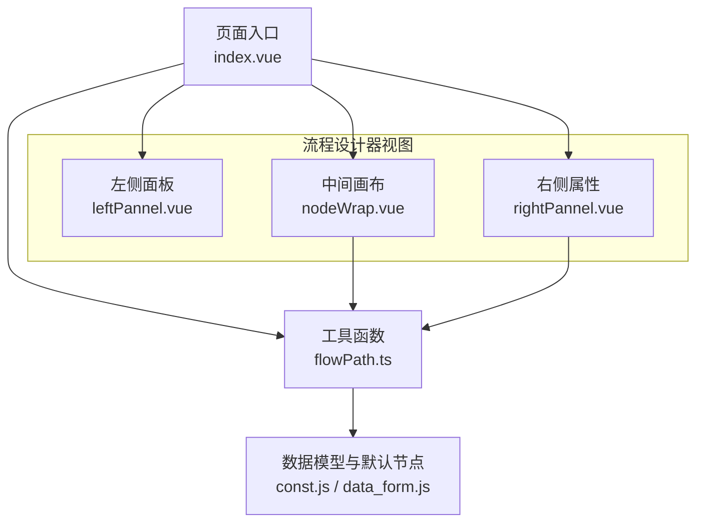
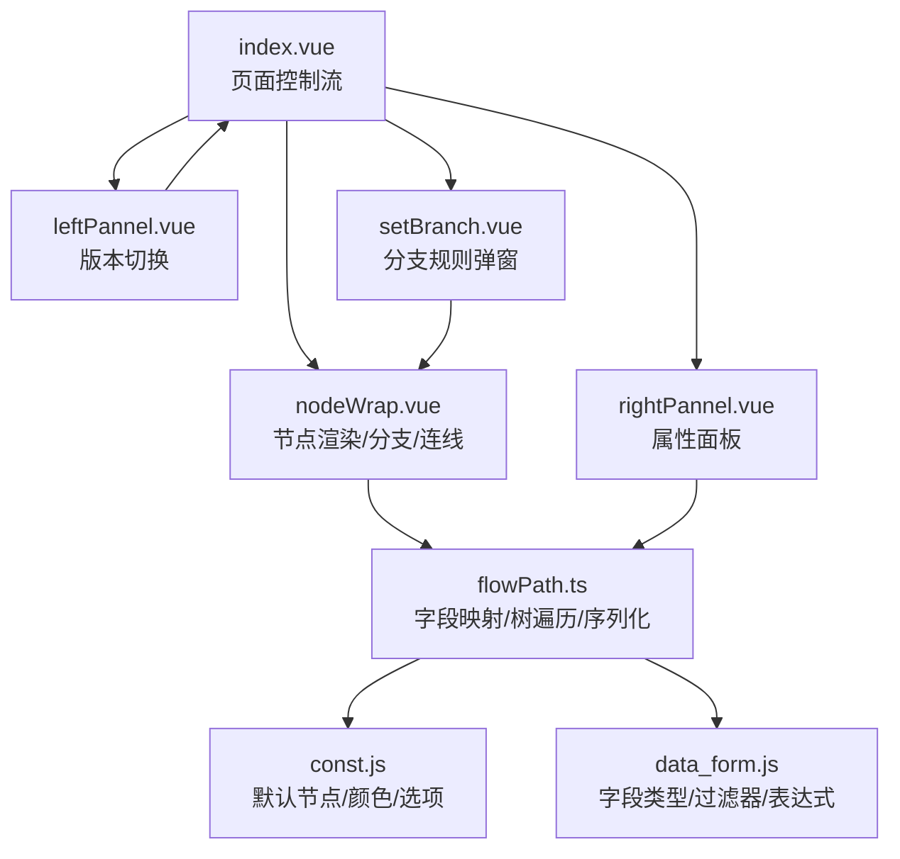
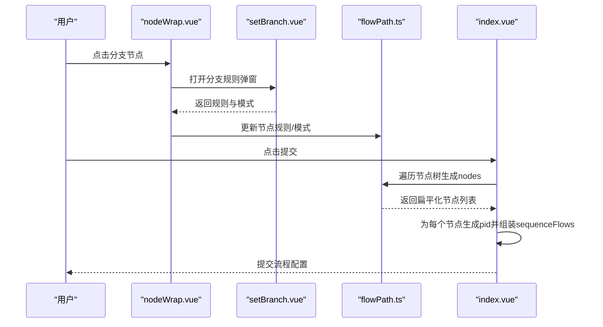
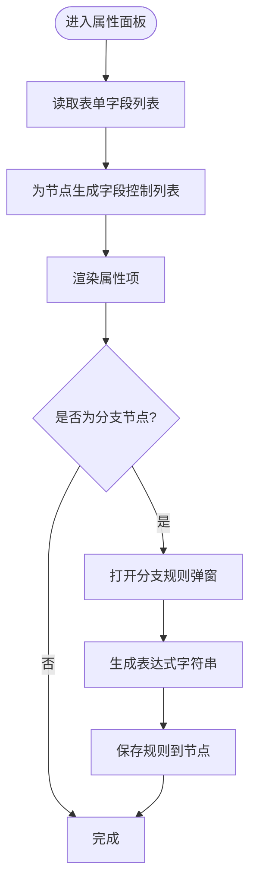
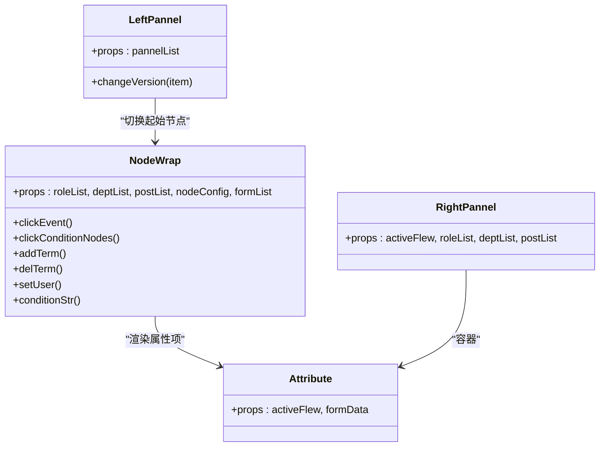
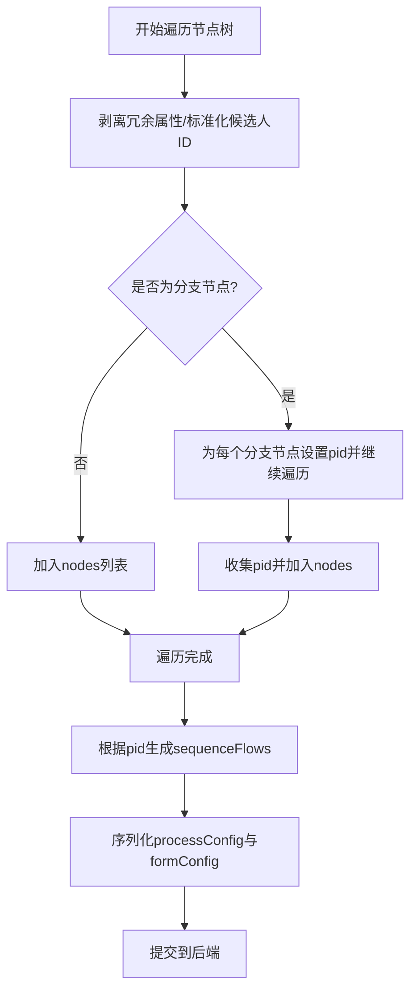
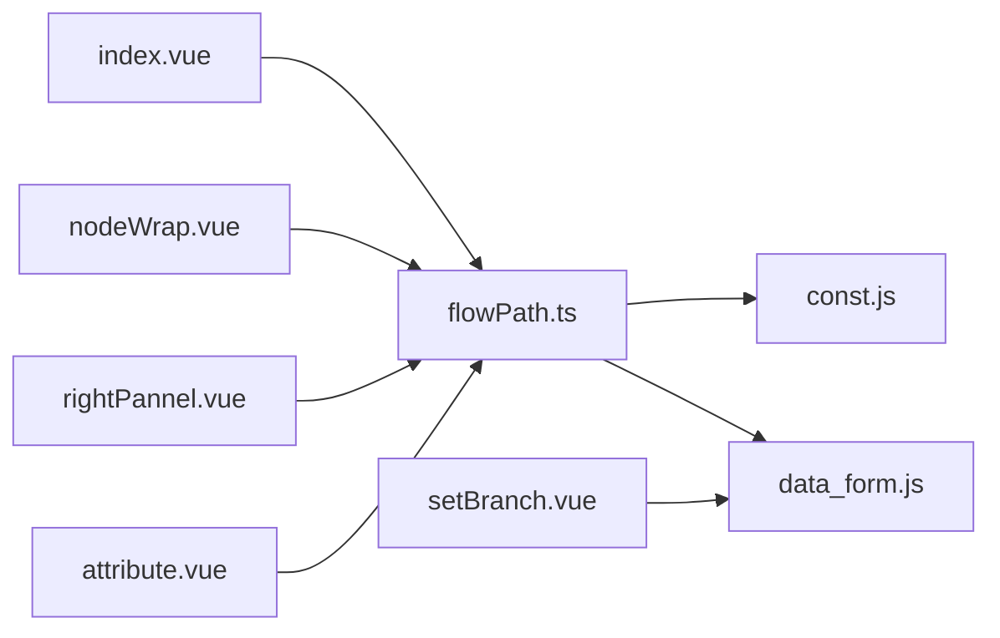

# 流程设计原理

<cite>
**本文引用的文件**
- [flowPath.ts](file://src/utils/flowPath.ts)
- [index.vue](file://src/views/flowPath/index.vue)
- [nodeWrap.vue](file://src/views/flowPath/components/nodeWrap.vue)
- [leftPannel.vue](file://src/views/flowPath/components/leftPannel.vue)
- [rightPannel.vue](file://src/views/flowPath/components/rightPannel.vue)
- [setBranch.vue](file://src/views/flowPath/components/setBranch.vue)
- [attribute.vue](file://src/views/flowPath/components/attribute.vue)
- [const.js](file://src/data/const.js)
- [data_form.js](file://src/data/data_form.js)
</cite>

## 目录
1. [引言](#引言)
2. [项目结构](#项目结构)
3. [核心组件](#核心组件)
4. [架构总览](#架构总览)
5. [详细组件分析](#详细组件分析)
6. [依赖分析](#依赖分析)
7. [性能考虑](#性能考虑)
8. [故障排查指南](#故障排查指南)
9. [结论](#结论)
10. [附录](#附录)

## 引言
本文件系统性阐述流程设计系统的原理与实现，覆盖节点模型、属性配置、分支规则、连线生成、序列化与持久化、渲染与交互等关键环节。文档以代码为依据，结合可视化图表，帮助读者快速理解从“节点创建—连接关系—流程图渲染—序列化提交”的完整闭环。

## 项目结构
流程设计器位于 views/flowPath 目录下，采用三栏布局：左侧版本面板、中间画布区、右侧属性面板；核心逻辑集中在页面入口与工具函数中，数据模型与默认节点定义在 data 目录。

**图表来源**
- [index.vue:1-192](file://src/views/flowPath/index.vue#L1-L192)
- [nodeWrap.vue:1-323](file://src/views/flowPath/components/nodeWrap.vue#L1-L323)
- [leftPannel.vue:1-91](file://src/views/flowPath/components/leftPannel.vue#L1-L91)
- [rightPannel.vue:1-109](file://src/views/flowPath/components/rightPannel.vue#L1-L109)
- [flowPath.ts:1-322](file://src/utils/flowPath.ts#L1-L322)
- [const.js:1-475](file://src/data/const.js#L1-L475)
- [data_form.js:1-800](file://src/data/data_form.js#L1-L800)

**章节来源**
- [index.vue:1-192](file://src/views/flowPath/index.vue#L1-L192)
- [flowPath.ts:1-322](file://src/utils/flowPath.ts#L1-L322)
- [const.js:1-475](file://src/data/const.js#L1-L475)
- [data_form.js:1-800](file://src/data/data_form.js#L1-L800)

## 核心组件
- 页面入口与控制流：负责加载表单配置、初始化节点树、收集流程配置并提交。
- 画布节点渲染：递归渲染起止节点、普通节点与分支节点，支持点击选中、删除、条件分支增删。
- 左侧版本面板：展示历史版本，支持切换到某个版本的起始节点。
- 右侧属性面板：按节点类型动态渲染属性项，支持字段可见性、按钮配置、审批规则、超时计划等。
- 分支规则弹窗：基于表单字段构建条件表达式，支持“全部满足/任一满足”，并生成表达式字符串。
- 工具函数：负责字段映射、节点树扁平化、父子路径记录、本地缓存、流程配置序列化。

**章节来源**
- [index.vue:39-144](file://src/views/flowPath/index.vue#L39-L144)
- [nodeWrap.vue:7-78](file://src/views/flowPath/components/nodeWrap.vue#L7-L78)
- [leftPannel.vue:14-38](file://src/views/flowPath/components/leftPannel.vue#L14-L38)
- [rightPannel.vue:14-36](file://src/views/flowPath/components/rightPannel.vue#L14-L36)
- [setBranch.vue:51-123](file://src/views/flowPath/components/setBranch.vue#L51-L123)
- [flowPath.ts:4-244](file://src/utils/flowPath.ts#L4-L244)

## 架构总览
流程设计器采用“视图层 + 工具层 + 数据层”的分层架构：
- 视图层：Vue 组件负责渲染与交互。
- 工具层：工具函数封装流程树遍历、字段映射、序列化等通用逻辑。
- 数据层：默认节点模板、表单字段类型与过滤器定义。

**图表来源**
- [index.vue:39-144](file://src/views/flowPath/index.vue#L39-L144)
- [nodeWrap.vue:79-140](file://src/views/flowPath/components/nodeWrap.vue#L79-L140)
- [leftPannel.vue:20-36](file://src/views/flowPath/components/leftPannel.vue#L20-L36)
- [rightPannel.vue:38-49](file://src/views/flowPath/components/rightPannel.vue#L38-L49)
- [setBranch.vue:51-123](file://src/views/flowPath/components/setBranch.vue#L51-L123)
- [flowPath.ts:4-244](file://src/utils/flowPath.ts#L4-L244)
- [const.js:8-475](file://src/data/const.js#L8-L475)
- [data_form.js:596-800](file://src/data/data_form.js#L596-L800)

## 详细组件分析

### 流程节点创建与连接机制
- 节点类型与默认模板：通过常量定义不同节点类型（开始、结束、填写、审批、抄送、分支、连接器），并提供默认属性与字段控制列表。
- 画布渲染：根据节点类型渲染节点框与图标，支持删除子节点、展开分支节点、递归渲染子树。
- 连线生成：遍历节点树，为每个节点记录其父链（pid），最终由页面入口组装为“源节点 → 目标节点”的连线集合。

**图表来源**
- [nodeWrap.vue:126-135](file://src/views/flowPath/components/nodeWrap.vue#L126-L135)
- [setBranch.vue:94-123](file://src/views/flowPath/components/setBranch.vue#L94-L123)
- [flowPath.ts:119-244](file://src/utils/flowPath.ts#L119-L244)
- [index.vue:88-116](file://src/views/flowPath/index.vue#L88-L116)

**章节来源**
- [const.js:20-442](file://src/data/const.js#L20-L442)
- [nodeWrap.vue:38-78](file://src/views/flowPath/components/nodeWrap.vue#L38-L78)
- [flowPath.ts:246-263](file://src/utils/flowPath.ts#L246-L263)
- [index.vue:88-116](file://src/views/flowPath/index.vue#L88-L116)

### 字段映射与属性配置
- 字段映射：根据表单字段列表，为节点生成“字段控制”列表，决定哪些字段在节点内可编辑/可查看/推送。
- 属性面板：按节点类型动态渲染属性项，如候选人选择、按钮配置、审批规则、自动审批、空审处理等。
- 表达式与规则：分支规则弹窗根据字段类型生成规则选项与默认值，并将规则转换为表达式字符串。

**图表来源**
- [flowPath.ts:4-76](file://src/utils/flowPath.ts#L4-L76)
- [attribute.vue:14-92](file://src/views/flowPath/components/attribute.vue#L14-L92)
- [setBranch.vue:79-218](file://src/views/flowPath/components/setBranch.vue#L79-L218)
- [data_form.js:596-800](file://src/data/data_form.js#L596-L800)

**章节来源**
- [flowPath.ts:4-76](file://src/utils/flowPath.ts#L4-L76)
- [attribute.vue:94-144](file://src/views/flowPath/components/attribute.vue#L94-L144)
- [setBranch.vue:79-218](file://src/views/flowPath/components/setBranch.vue#L79-L218)
- [data_form.js:596-800](file://src/data/data_form.js#L596-L800)

### 流程图渲染原理
- 递归渲染：nodeWrap.vue 对不同类型节点进行差异化渲染，分支节点以“条件盒子”形式展示，支持增删条件与子节点。
- 选中高亮：通过 provide/inject 在组件间传递选中状态，点击节点触发高亮与右侧属性面板联动。
- 版本切换：左侧面板读取历史版本配置，解析其中的起始节点并注入到画布。

**图表来源**
- [nodeWrap.vue:79-282](file://src/views/flowPath/components/nodeWrap.vue#L79-L282)
- [leftPannel.vue:17-38](file://src/views/flowPath/components/leftPannel.vue#L17-L38)
- [rightPannel.vue:38-49](file://src/views/flowPath/components/rightPannel.vue#L38-L49)
- [attribute.vue:101-107](file://src/views/flowPath/components/attribute.vue#L101-L107)

**章节来源**
- [nodeWrap.vue:79-282](file://src/views/flowPath/components/nodeWrap.vue#L79-L282)
- [leftPannel.vue:17-38](file://src/views/flowPath/components/leftPannel.vue#L17-L38)
- [rightPannel.vue:38-49](file://src/views/flowPath/components/rightPannel.vue#L38-L49)
- [attribute.vue:101-107](file://src/views/flowPath/components/attribute.vue#L101-L107)

### 序列化与持久化机制
- 节点扁平化：遍历节点树，剥离冗余属性，统一候选人 ID 结构，生成 nodes 列表。
- 连线生成：为每个节点收集其父链（pid），用于生成 sequenceFlows。
- 本地缓存：支持按流程 ID 存取临时流程配置，便于编辑过程中断恢复。
- 提交流程：将 processConfig 与 formConfig 序列化后提交至后端。

**图表来源**
- [flowPath.ts:119-244](file://src/utils/flowPath.ts#L119-L244)
- [index.vue:88-116](file://src/views/flowPath/index.vue#L88-L116)

**章节来源**
- [flowPath.ts:119-244](file://src/utils/flowPath.ts#L119-L244)
- [index.vue:88-116](file://src/views/flowPath/index.vue#L88-L116)

### 流程验证规则
- 分支规则完整性：提交前校验每条规则的值是否完整（排除空值但允许 IS_NULL/NOT_NULL）。
- 表达式安全：对表达式进行字符清理，避免非法字符影响执行。
- 日期格式：统一日期/时间格式，确保前后端一致。

**章节来源**
- [setBranch.vue:124-218](file://src/views/flowPath/components/setBranch.vue#L124-L218)
- [index.vue:105-110](file://src/views/flowPath/index.vue#L105-L110)

## 依赖分析
- 组件耦合：页面入口与工具函数双向依赖，节点渲染组件依赖工具函数与数据模型；属性面板依赖工具函数与数据模型。
- 外部依赖：使用 Vue 生态组件（如 Arco Design 的 Select、Checkbox、Collapse 等）。
- 数据依赖：默认节点模板与字段类型定义来自 data 目录，分支规则与表达式生成来自 data_form.js。

**图表来源**
- [index.vue:43-44](file://src/views/flowPath/index.vue#L43-L44)
- [nodeWrap.vue:83-84](file://src/views/flowPath/components/nodeWrap.vue#L83-L84)
- [rightPannel.vue:40-42](file://src/views/flowPath/components/rightPannel.vue#L40-L42)
- [attribute.vue:96-99](file://src/views/flowPath/components/attribute.vue#L96-L99)
- [setBranch.vue:53](file://src/views/flowPath/components/setBranch.vue#L53)
- [flowPath.ts:1-3](file://src/utils/flowPath.ts#L1-L3)
- [const.js:8-18](file://src/data/const.js#L8-L18)
- [data_form.js:596-613](file://src/data/data_form.js#L596-L613)

**章节来源**
- [index.vue:43-44](file://src/views/flowPath/index.vue#L43-L44)
- [nodeWrap.vue:83-84](file://src/views/flowPath/components/nodeWrap.vue#L83-L84)
- [rightPannel.vue:40-42](file://src/views/flowPath/components/rightPannel.vue#L40-L42)
- [attribute.vue:96-99](file://src/views/flowPath/components/attribute.vue#L96-L99)
- [setBranch.vue:53](file://src/views/flowPath/components/setBranch.vue#L53)
- [flowPath.ts:1-3](file://src/utils/flowPath.ts#L1-L3)
- [const.js:8-18](file://src/data/const.js#L8-L18)
- [data_form.js:596-613](file://src/data/data_form.js#L596-L613)

## 性能考虑
- 渲染优化：节点树采用递归渲染，建议在大型流程中限制一次性渲染层级，或引入虚拟滚动。
- 遍历效率：节点树遍历与 pid 收集为 O(N)，注意避免重复计算；分支节点的条件盒子数量应受控。
- 序列化成本：序列化前尽量减少不必要的深拷贝，必要时采用浅拷贝+选择性复制。
- 本地缓存：localStorage 写入需节流，避免频繁 IO 影响交互流畅度。

## 故障排查指南
- 分支规则为空：检查规则值是否为空且非 IS_NULL/NOT_NULL，确保必填项完整。
- 表达式异常：确认表达式字符串已清理特殊字符，字段 ID 与标题映射正确。
- 候选人 ID 不一致：确认候选人 ID 结构已标准化（数组元素提取 id），避免后端解析错误。
- 版本切换失败：确认历史版本配置中的节点类型为 START，且存在对应 nodes。

**章节来源**
- [setBranch.vue:124-218](file://src/views/flowPath/components/setBranch.vue#L124-L218)
- [flowPath.ts:119-244](file://src/utils/flowPath.ts#L119-L244)
- [leftPannel.vue:21-36](file://src/views/flowPath/components/leftPannel.vue#L21-L36)

## 结论
流程设计器通过清晰的组件分层与工具函数封装，实现了从节点创建、分支规则、连线生成到序列化的完整闭环。默认节点模板与字段类型体系保证了配置的一致性与可扩展性。建议在复杂流程场景下加强渲染与遍历性能优化，并完善规则校验与表达式安全策略。

## 附录
- 最佳实践
  - 使用默认节点模板作为起点，按需调整属性与字段控制。
  - 分支规则尽量简洁，避免过多条件导致维护困难。
  - 合理组织字段类型与过滤器，确保表达式可读与可维护。
- 设计模式应用
  - 组件职责分离：视图层、工具层、数据层明确分工。
  - 依赖注入：通过 provide/inject 实现跨层级状态共享。
  - 模板方法：默认节点模板与字段类型定义遵循统一接口。