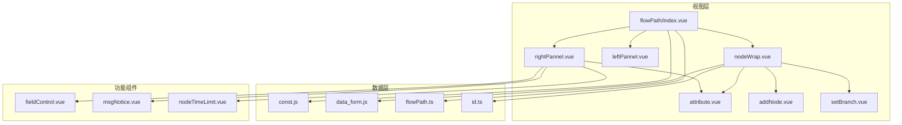
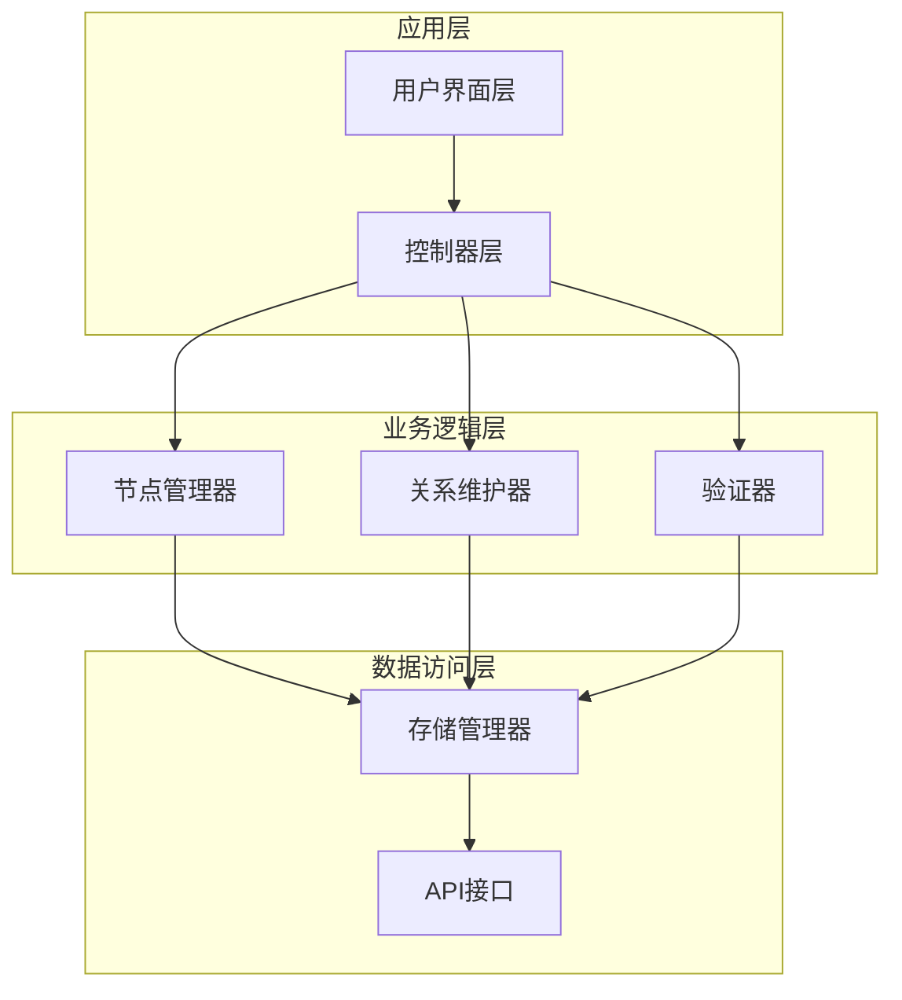
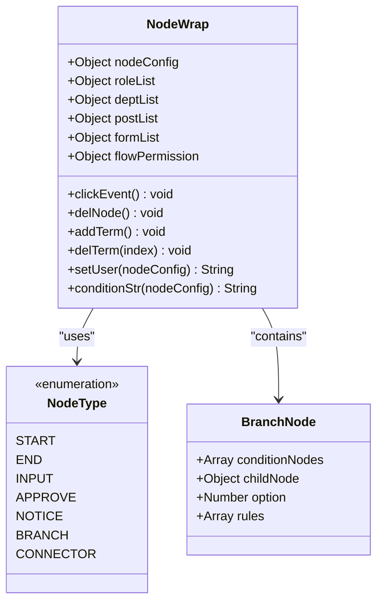
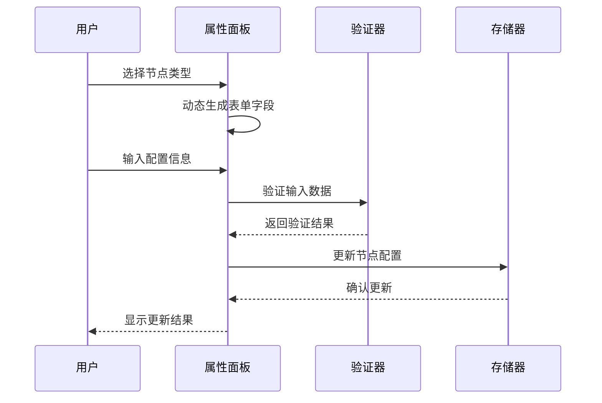
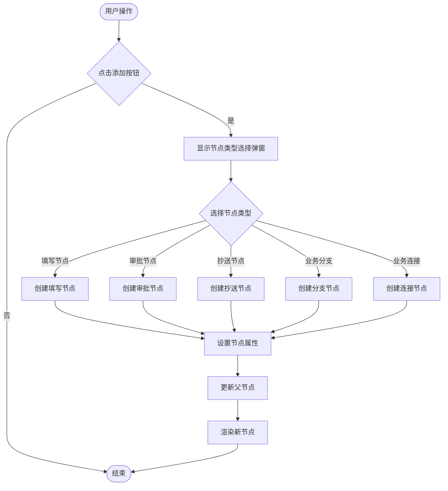
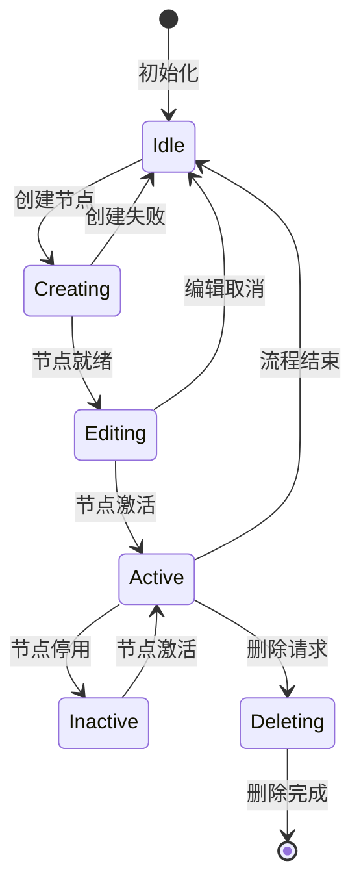
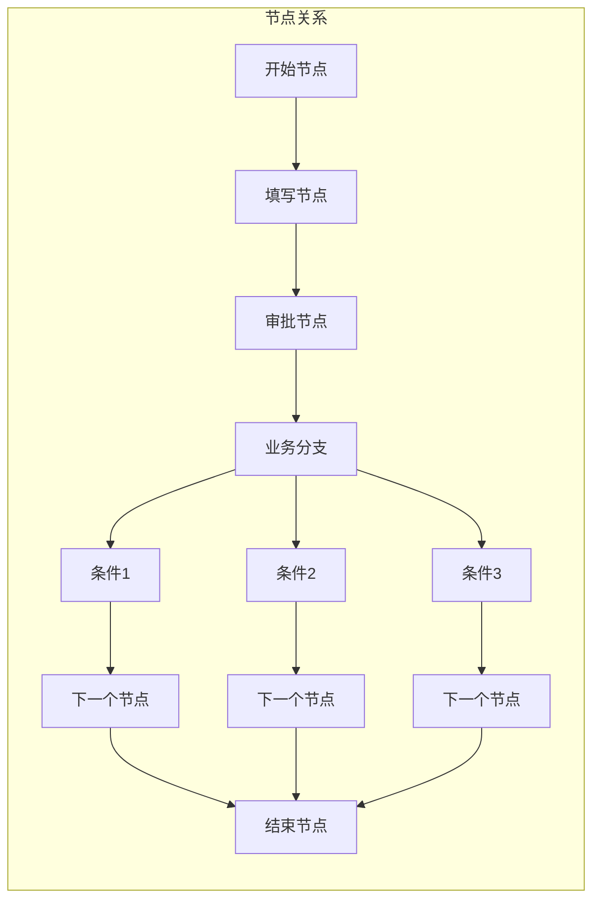
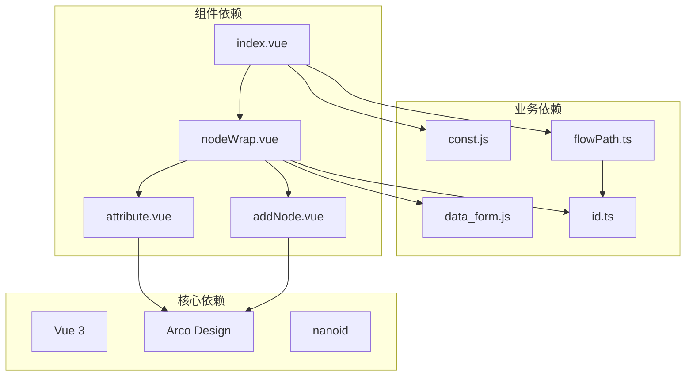

# 节点管理系统

<cite>
**本文档引用的文件**
- [index.vue](file://src/views/flowPath/index.vue)
- [nodeWrap.vue](file://src/views/flowPath/components/nodeWrap.vue)
- [attribute.vue](file://src/views/flowPath/components/attribute.vue)
- [addNode.vue](file://src/views/flowPath/components/addNode.vue)
- [leftPannel.vue](file://src/views/flowPath/components/leftPannel.vue)
- [rightPannel.vue](file://src/views/flowPath/components/rightPannel.vue)
- [setBranch.vue](file://src/views/flowPath/components/setBranch.vue)
- [const.js](file://src/data/const.js)
- [flowPath.ts](file://src/utils/flowPath.ts)
- [data_form.js](file://src/data/data_form.js)
- [fieldControl.vue](file://src/views/flowPath/components/fieldControl.vue)
- [msgNotice.vue](file://src/views/flowPath/components/msgNotice.vue)
- [nodeTimeLimit.vue](file://src/views/flowPath/components/nodeTimeLimit.vue)
- [id.ts](file://src/utils/id.ts)
</cite>

## 目录
1. [简介](#简介)
2. [项目结构](#项目结构)
3. [核心组件](#核心组件)
4. [架构概览](#架构概览)
5. [详细组件分析](#详细组件分析)
6. [依赖关系分析](#依赖关系分析)
7. [性能考虑](#性能考虑)
8. [故障排除指南](#故障排除指南)
9. [结论](#结论)

## 简介

节点管理系统是一个基于Vue 3的可视化流程设计器，专门用于设计和管理业务流程中的各种节点。该系统提供了完整的节点生命周期管理，包括节点的创建、编辑、删除、状态管理和节点间关系维护。

系统支持多种节点类型，包括开始节点、结束节点、填写节点、审批节点、抄送节点、业务分支和业务连接等。每个节点都具有丰富的属性配置选项，支持复杂的业务逻辑和用户交互。

## 项目结构

节点管理系统采用模块化的Vue 3架构设计，主要由以下核心部分组成：

**图表来源**
- [index.vue:1-192](file://src/views/flowPath/index.vue#L1-L192)
- [nodeWrap.vue:1-323](file://src/views/flowPath/components/nodeWrap.vue#L1-L323)
- [const.js:1-475](file://src/data/const.js#L1-L475)

**章节来源**
- [index.vue:1-192](file://src/views/flowPath/index.vue#L1-L192)
- [const.js:1-475](file://src/data/const.js#L1-L475)

## 核心组件

### 节点类型系统

系统定义了七种核心节点类型，每种类型都有其特定的功能和属性配置：

| 节点类型 | 类型标识 | 功能描述 | 默认属性 |
|---------|----------|----------|----------|
| 开始节点 | START | 流程起始点，不可删除 | 下载、打印、流程日志、撤回 |
| 结束节点 | END | 流程结束点 | 下载、打印、流程日志、撤回 |
| 填写节点 | INPUT | 用户填写表单数据 | 填写人、下载、打印、字段控制 |
| 审批节点 | APPROVE | 审批流程节点 | 审批规则、审批人、自动审批 |
| 抄送节点 | NOTICE | 通知相关节点 | 抄送人、下载、打印、字段控制 |
| 业务分支 | BRANCH | 条件分支节点 | 分支规则、条件判断 |
| 业务连接 | CONNECTOR | 连接外部系统 | 连接器配置 |

### 节点属性配置

每个节点都支持丰富的属性配置，主要包括：

- **基础属性**：节点名称、权限控制
- **参与者配置**：部门、岗位、角色、用户的动态选择
- **字段控制**：读写权限、推送设置
- **扩展功能**：消息通知、节点时限、自动审批

**章节来源**
- [const.js:8-475](file://src/data/const.js#L8-L475)
- [nodeWrap.vue:140-282](file://src/views/flowPath/components/nodeWrap.vue#L140-L282)

## 架构概览

节点管理系统采用分层架构设计，实现了清晰的关注点分离：

**图表来源**
- [index.vue:39-144](file://src/views/flowPath/index.vue#L39-L144)
- [flowPath.ts:1-322](file://src/utils/flowPath.ts#L1-L322)

系统的核心控制流通过provide/inject模式实现组件间的通信，确保了良好的解耦性。

**章节来源**
- [index.vue:39-144](file://src/views/flowPath/index.vue#L39-L144)
- [nodeWrap.vue:120-140](file://src/views/flowPath/components/nodeWrap.vue#L120-L140)

## 详细组件分析

### 节点包装器组件

节点包装器是系统的核心组件，负责渲染和管理所有类型的节点：

**图表来源**
- [nodeWrap.vue:79-282](file://src/views/flowPath/components/nodeWrap.vue#L79-L282)
- [const.js:20-390](file://src/data/const.js#L20-L390)

节点包装器实现了递归渲染机制，支持嵌套节点的无限层级展示。

**章节来源**
- [nodeWrap.vue:1-323](file://src/views/flowPath/components/nodeWrap.vue#L1-L323)

### 节点属性面板

属性面板提供了节点的详细配置界面，支持动态表单生成：

**图表来源**
- [attribute.vue:94-144](file://src/views/flowPath/components/attribute.vue#L94-L144)
- [fieldControl.vue:42-170](file://src/views/flowPath/components/fieldControl.vue#L42-L170)

属性面板支持多种输入类型，包括文本输入、下拉选择、复选框、人员选择等。

**章节来源**
- [attribute.vue:1-203](file://src/views/flowPath/components/attribute.vue#L1-L203)
- [fieldControl.vue:1-213](file://src/views/flowPath/components/fieldControl.vue#L1-L213)

### 节点创建机制

节点创建系统提供了直观的拖拽和点击操作：

**图表来源**
- [addNode.vue:50-120](file://src/views/flowPath/components/addNode.vue#L50-L120)
- [create.vue:20-127](file://src/views/flowPath/components/create.vue#L20-L127)

**章节来源**
- [addNode.vue:1-290](file://src/views/flowPath/components/addNode.vue#L1-L290)
- [create.vue:1-127](file://src/views/flowPath/components/create.vue#L1-L127)

### 节点状态管理

系统实现了完整的节点状态管理机制：

节点状态包括：空闲、创建中、编辑中、激活、停用、删除中等状态。

**章节来源**
- [nodeWrap.vue:126-140](file://src/views/flowPath/components/nodeWrap.vue#L126-L140)
- [index.vue:120-140](file://src/views/flowPath/index.vue#L120-L140)

### 节点关系维护

系统支持复杂的节点关系维护，包括父子关系、兄弟关系和条件分支：

**图表来源**
- [flowPath.ts:119-244](file://src/utils/flowPath.ts#L119-L244)
- [nodeWrap.vue:244-282](file://src/views/flowPath/components/nodeWrap.vue#L244-L282)

**章节来源**
- [flowPath.ts:1-322](file://src/utils/flowPath.ts#L1-L322)

## 依赖关系分析

节点管理系统的关键依赖关系如下：

**图表来源**
- [index.vue:39-50](file://src/views/flowPath/index.vue#L39-L50)
- [nodeWrap.vue:80-85](file://src/views/flowPath/components/nodeWrap.vue#L80-L85)

**章节来源**
- [index.vue:39-50](file://src/views/flowPath/index.vue#L39-L50)
- [nodeWrap.vue:80-85](file://src/views/flowPath/components/nodeWrap.vue#L80-L85)

## 性能考虑

系统在设计时充分考虑了性能优化：

### 渲染优化
- 使用虚拟滚动技术处理大量节点
- 实现节点懒加载机制
- 采用防抖和节流优化用户交互

### 内存管理
- 节点对象的及时释放
- 大数据量的分页处理
- 图片和资源的按需加载

### 数据处理
- 采用增量更新策略
- 优化JSON序列化和反序列化
- 实现数据压缩和缓存机制

## 故障排除指南

### 常见问题及解决方案

**节点无法创建**
- 检查节点类型配置是否正确
- 验证表单字段的必填项
- 确认权限配置的完整性

**节点属性丢失**
- 检查localStorage存储状态
- 验证节点配置的数据结构
- 确认数据转换函数的正确性

**分支条件不生效**
- 检查条件表达式的语法
- 验证字段映射的准确性
- 确认条件计算逻辑

**章节来源**
- [setBranch.vue:124-218](file://src/views/flowPath/components/setBranch.vue#L124-L218)
- [flowPath.ts:265-279](file://src/utils/flowPath.ts#L265-L279)

## 结论

节点管理系统提供了一个完整、灵活且可扩展的节点管理解决方案。系统通过模块化的设计和清晰的架构，实现了节点的全生命周期管理。

主要特点包括：
- 支持七种不同类型的节点
- 提供丰富的属性配置选项
- 实现了完整的节点关系维护
- 具备良好的扩展性和自定义能力
- 采用现代化的Vue 3技术栈

系统为业务流程设计提供了强大的技术支持，能够满足复杂的企业级应用需求。