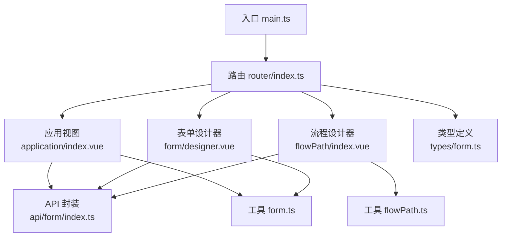
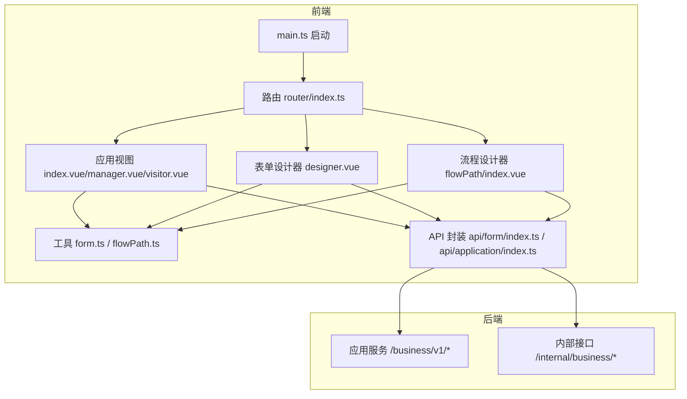
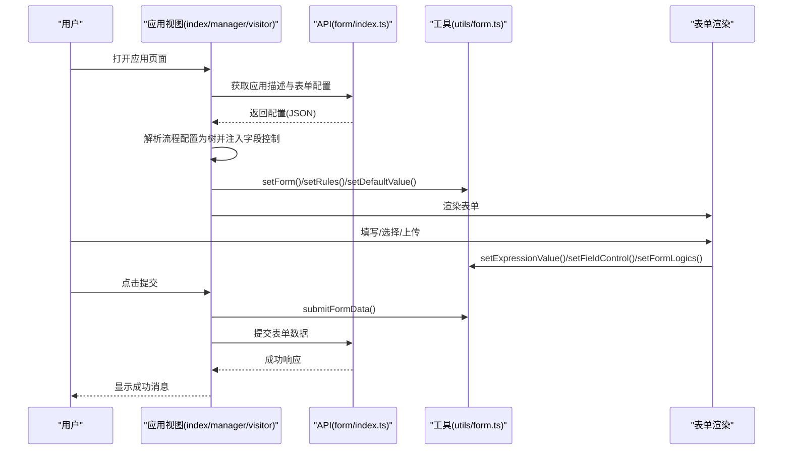
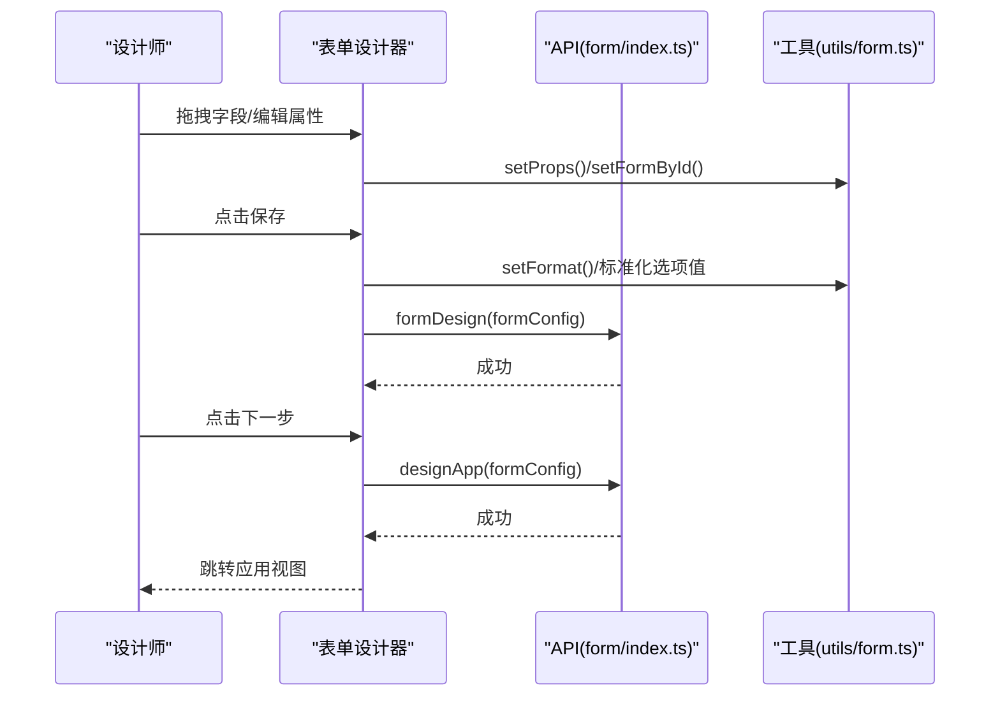
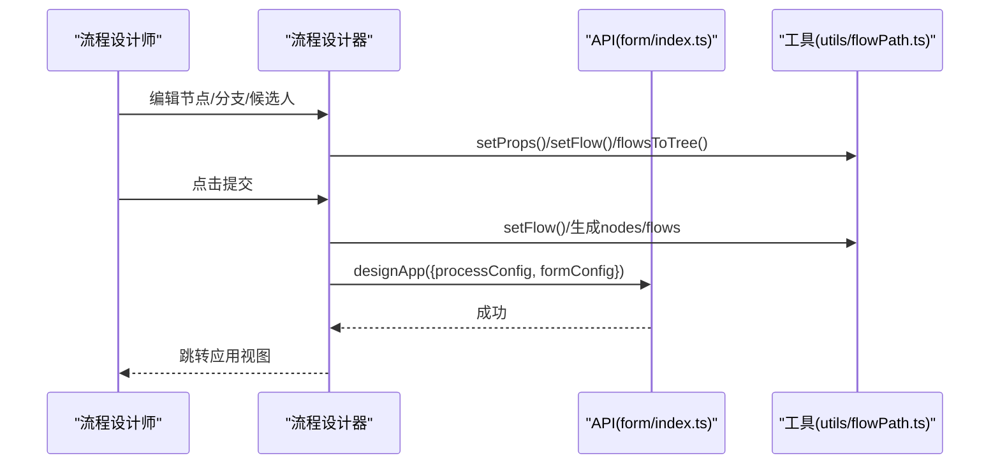
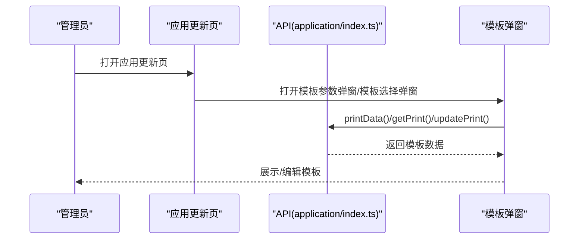
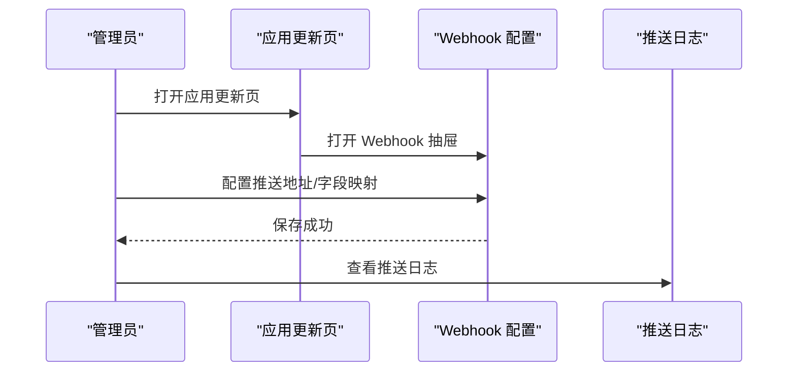
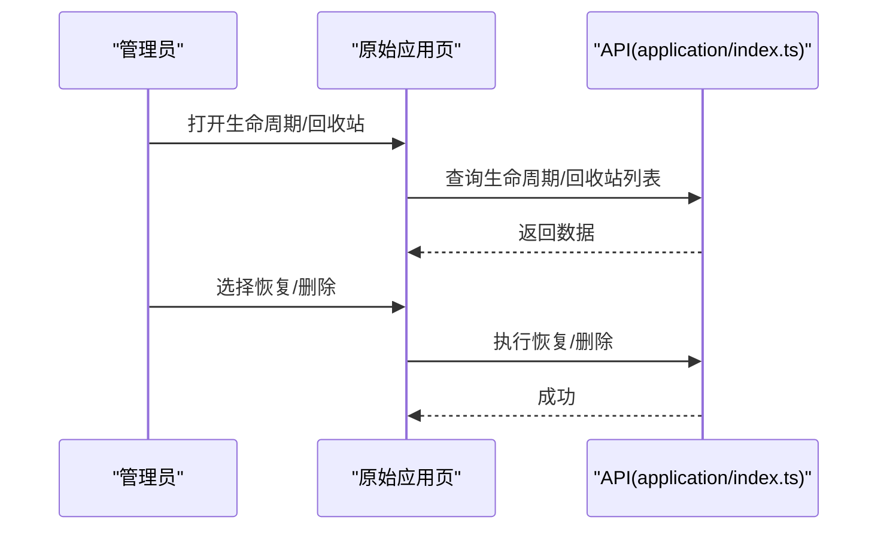
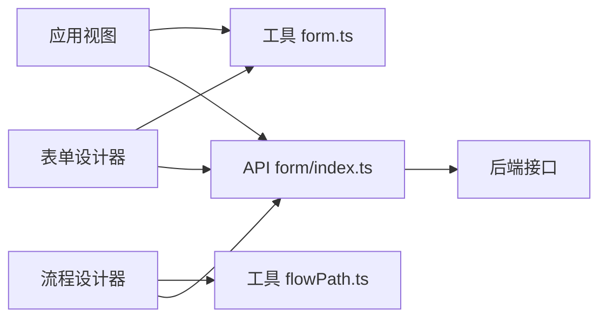

# 应用管理系统

<cite>
**本文档引用的文件**
- [README.md](file://README.md)
- [package.json](file://package.json)
- [src/main.ts](file://src/main.ts)
- [src/router/index.ts](file://src/router/index.ts)
- [src/store/index.ts](file://src/store/index.ts)
- [src/views/application/index.vue](file://src/views/application/index.vue)
- [src/views/application/manager.vue](file://src/views/application/manager.vue)
- [src/views/application/visitor.vue](file://src/views/application/visitor.vue)
- [src/views/application/updateApp/index.vue](file://src/views/application/updateApp/index.vue)
- [src/views/application/updateApp/baseMsg.vue](file://src/views/application/updateApp/baseMsg.vue)
- [src/views/application/updateApp/access.vue](file://src/views/application/updateApp/access.vue)
- [src/views/application/updateApp/templateParamsModal.vue](file://src/views/application/updateApp/templateParamsModal.vue)
- [src/views/application/updateApp/appTemplateModal.vue](file://src/views/application/updateApp/appTemplateModal.vue)
- [src/views/application/updateApp/model.vue](file://src/views/application/updateApp/model.vue)
- [src/views/application/updateApp/share.vue](file://src/views/application/updateApp/share.vue)
- [src/views/application/updateApp/webhook.vue](file://src/views/application/updateApp/webhook.vue)
- [src/views/application/updateApp/webhookMapping.vue](file://src/views/application/updateApp/webhookMapping.vue)
- [src/views/application/original/index.vue](file://src/views/application/original/index.vue)
- [src/views/application/original/lifeCycle.vue](file://src/views/application/original/lifeCycle.vue)
- [src/views/application/original/recycle.vue](file://src/views/application/original/recycle.vue)
- [src/views/application/original/upDateData.vue](file://src/views/application/original/upDateData.vue)
- [src/views/application/publishTask/index.vue](file://src/views/application/publishTask/index.vue)
- [src/views/application/publishTask/components/fillPersonModal.vue](file://src/views/application/publishTask/components/fillPersonModal.vue)
- [src/views/application/publishTask/components/fillPublisherModal.vue](file://src/views/application/publishTask/components/fillPublisherModal.vue)
- [src/views/application/publishTask/components/fillSupervisorModal.vue](file://src/views/application/publishTask/components/fillSupervisorModal.vue)
- [src/views/form/designer.vue](file://src/views/form/designer.vue)
- [src/views/flowPath/index.vue](file://src/views/flowPath/index.vue)
- [src/api/application/index.ts](file://src/api/application/index.ts)
- [src/api/form/index.ts](file://src/api/form/index.ts)
- [src/utils/form.ts](file://src/utils/form.ts)
- [src/utils/flowPath.ts](file://src/utils/flowPath.ts)
- [src/times/form.ts](file://src/types/form.ts)
</cite>

## 目录
1. [简介](#简介)
2. [项目结构](#项目结构)
3. [核心组件](#核心组件)
4. [架构总览](#架构总览)
5. [详细组件分析](#详细组件分析)
6. [依赖关系分析](#依赖关系分析)
7. [性能考虑](#性能考虑)
8. [故障排查指南](#故障排查指南)
9. [结论](#结论)
10. [附录](#附录)

## 简介
本应用管理系统基于 Vue 3 + TypeScript + Vite 构建，提供应用全生命周期管理能力，涵盖应用创建、表单与流程设计、权限控制、模板管理、发布与回收、以及运行时数据处理与校验。系统通过统一的表单配置模型与流程图可视化编辑器，实现“所见即所得”的应用搭建体验；并通过权限与字段控制机制，确保不同角色在不同节点对字段的可见性与可编辑性可控。

## 项目结构
前端采用模块化组织方式，按功能域划分目录：
- 路由层：集中定义页面级路由与跳转规则
- 视图层：应用管理、表单设计器、流程设计器、权限与设置等页面
- API 层：封装业务接口调用
- 工具层：表单序列化/反序列化、表达式计算、流程树转换等
- 类型层：统一的数据结构定义
- 样式层：主题与工作流样式

**图表来源**
- [src/main.ts:1-40](file://src/main.ts#L1-L40)
- [src/router/index.ts:1-189](file://src/router/index.ts#L1-L189)
- [src/views/application/index.vue:1-194](file://src/views/application/index.vue#L1-L194)
- [src/views/form/designer.vue:1-444](file://src/views/form/designer.vue#L1-L444)
- [src/views/flowPath/index.vue:1-192](file://src/views/flowPath/index.vue#L1-L192)
- [src/api/form/index.ts:1-31](file://src/api/form/index.ts#L1-L31)
- [src/utils/form.ts:1-800](file://src/utils/form.ts#L1-L800)
- [src/utils/flowPath.ts:1-322](file://src/utils/flowPath.ts#L1-L322)
- [src/types/form.ts:1-45](file://src/types/form.ts#L1-L45)

**章节来源**
- [src/main.ts:1-40](file://src/main.ts#L1-L40)
- [src/router/index.ts:1-189](file://src/router/index.ts#L1-L189)
- [package.json:1-63](file://package.json#L1-L63)

## 核心组件
- 应用视图组件：面向“创建者/管理者/访客”三种角色，分别加载不同的应用描述与表单设计，支持表单渲染、字段默认值设置、表达式计算、字段联动与规则校验。
- 表单设计器：拖拽式布局、属性面板、字段复制/删除、格式化处理、表单配置持久化。
- 流程设计器：节点增删改、分支条件、候选人与动态领导层级、超时策略、流程树生成与序列化。
- 工具函数：表单数据序列化/反序列化、字段控制、表达式求值、关联查询、流程节点映射。
- API 封装：应用设计与提交、流程历史、模板配置、模块管理等。

**章节来源**
- [src/views/application/index.vue:1-194](file://src/views/application/index.vue#L1-L194)
- [src/views/application/manager.vue:1-195](file://src/views/application/manager.vue#L1-L195)
- [src/views/application/visitor.vue:1-192](file://src/views/application/visitor.vue#L1-L192)
- [src/views/form/designer.vue:1-444](file://src/views/form/designer.vue#L1-L444)
- [src/views/flowPath/index.vue:1-192](file://src/views/flowPath/index.vue#L1-L192)
- [src/utils/form.ts:1-800](file://src/utils/form.ts#L1-L800)
- [src/utils/flowPath.ts:1-322](file://src/utils/flowPath.ts#L1-L322)
- [src/api/form/index.ts:1-31](file://src/api/form/index.ts#L1-L31)

## 架构总览
系统采用前后端分离架构，前端负责应用与流程的可视化设计与运行时交互，后端提供 REST 接口支撑应用元数据、表单配置、流程配置、模板与权限等能力。

**图表来源**
- [src/main.ts:1-40](file://src/main.ts#L1-L40)
- [src/router/index.ts:1-189](file://src/router/index.ts#L1-L189)
- [src/views/application/index.vue:1-194](file://src/views/application/index.vue#L1-L194)
- [src/views/form/designer.vue:1-444](file://src/views/form/designer.vue#L1-L444)
- [src/views/flowPath/index.vue:1-192](file://src/views/flowPath/index.vue#L1-L192)
- [src/api/form/index.ts:1-31](file://src/api/form/index.ts#L1-L31)
- [src/api/application/index.ts:1-78](file://src/api/application/index.ts#L1-L78)

## 详细组件分析

### 应用视图组件（创建者/管理者/访客）
- 功能职责
  - 加载应用描述与图标
  - 拉取表单配置与流程配置，构建表单渲染树
  - 设置默认值、字段规则、字段控制与表单逻辑
  - 提交表单数据前进行序列化与校验
- 关键流程
  - 获取应用描述与表单配置
  - 解析流程配置为树形结构并注入字段控制
  - 初始化表单模型与校验规则
  - 表单变更时触发表达式计算与字段联动
  - 提交时将复杂字段（如用户/部门/子表单/关联数据）标准化后再发送

**图表来源**
- [src/views/application/index.vue:61-86](file://src/views/application/index.vue#L61-L86)
- [src/views/application/manager.vue:66-88](file://src/views/application/manager.vue#L66-L88)
- [src/views/application/visitor.vue:63-84](file://src/views/application/visitor.vue#L63-L84)
- [src/api/form/index.ts:13-27](file://src/api/form/index.ts#L13-L27)
- [src/utils/form.ts:452-577](file://src/utils/form.ts#L452-L577)

**章节来源**
- [src/views/application/index.vue:1-194](file://src/views/application/index.vue#L1-L194)
- [src/views/application/manager.vue:1-195](file://src/views/application/manager.vue#L1-L195)
- [src/views/application/visitor.vue:1-192](file://src/views/application/visitor.vue#L1-L192)
- [src/api/form/index.ts:1-31](file://src/api/form/index.ts#L1-L31)
- [src/utils/form.ts:1-800](file://src/utils/form.ts#L1-L800)

### 表单设计器
- 功能职责
  - 可视化拖拽布局，支持字段复制/删除/上下移动
  - 属性面板实时更新字段配置
  - 日期格式标准化、选项值唯一化、子表单/关联字段处理
  - 保存与下一步：分别持久化表单配置或进入流程设计
- 关键流程
  - 加载部门树与默认值
  - 保存时对日期格式与选项值进行规范化
  - 下一步时将表单配置提交到后端并跳转流程设计器

**图表来源**
- [src/views/form/designer.vue:120-177](file://src/views/form/designer.vue#L120-L177)
- [src/api/form/index.ts:5-11](file://src/api/form/index.ts#L5-L11)
- [src/utils/form.ts:132-139](file://src/utils/form.ts#L132-L139)

**章节来源**
- [src/views/form/designer.vue:1-444](file://src/views/form/designer.vue#L1-L444)
- [src/api/form/index.ts:1-31](file://src/api/form/index.ts#L1-L31)
- [src/utils/form.ts:1-800](file://src/utils/form.ts#L1-L800)

### 流程设计器
- 功能职责
  - 节点增删改、分支条件、候选人与动态领导层级、超时策略
  - 字段控制映射：将表单字段与各节点的可见/可编辑/推送权限绑定
  - 流程树生成与序列化：将流程图转换为节点与连线列表
  - 提交：将流程配置与表单配置一并保存
- 关键流程
  - 初始化流程数据与字段控制映射
  - 生成节点与连线列表
  - 提交时将流程配置与表单配置合并后保存

**图表来源**
- [src/views/flowPath/index.vue:88-116](file://src/views/flowPath/index.vue#L88-L116)
- [src/utils/flowPath.ts:4-76](file://src/utils/flowPath.ts#L4-L76)
- [src/utils/flowPath.ts:119-244](file://src/utils/flowPath.ts#L119-L244)
- [src/utils/flowPath.ts:281-322](file://src/utils/flowPath.ts#L281-L322)

**章节来源**
- [src/views/flowPath/index.vue:1-192](file://src/views/flowPath/index.vue#L1-L192)
- [src/utils/flowPath.ts:1-322](file://src/utils/flowPath.ts#L1-L322)

### 应用模板与参数管理
- 功能职责
  - 配置应用模板、获取模板、修改模板
  - 在应用更新页中支持模板参数弹窗与模板选择弹窗
- 关键流程
  - 通过内部接口进行模板的增删改查
  - 在应用更新页中打开模板弹窗进行参数配置

**图表来源**
- [src/views/application/updateApp/templateParamsModal.vue](file://src/views/application/updateApp/templateParamsModal.vue)
- [src/views/application/updateApp/appTemplateModal.vue](file://src/views/application/updateApp/appTemplateModal.vue)
- [src/api/application/index.ts:66-77](file://src/api/application/index.ts#L66-L77)

**章节来源**
- [src/views/application/updateApp/templateParamsModal.vue](file://src/views/application/updateApp/templateParamsModal.vue)
- [src/views/application/updateApp/appTemplateModal.vue](file://src/views/application/updateApp/appTemplateModal.vue)
- [src/api/application/index.ts:1-78](file://src/api/application/index.ts#L1-L78)

### Webhook 集成
- 功能职责
  - 在应用更新页中配置 Webhook 推送与字段映射
  - 支持打开推送抽屉、查看日志
- 关键流程
  - 打开 Webhook 配置抽屉
  - 配置字段映射后保存
  - 查看推送日志

**图表来源**
- [src/views/application/updateApp/webhook.vue](file://src/views/application/updateApp/webhook.vue)
- [src/views/application/updateApp/webhookMapping.vue](file://src/views/application/updateApp/webhookMapping.vue)
- [src/views/webHook/index.vue](file://src/views/webHook/index.vue)

**章节来源**
- [src/views/application/updateApp/webhook.vue](file://src/views/application/updateApp/webhook.vue)
- [src/views/application/updateApp/webhookMapping.vue](file://src/views/application/updateApp/webhookMapping.vue)
- [src/views/webHook/index.vue](file://src/views/webHook/index.vue)

### 生命周期与回收站
- 功能职责
  - 查看应用生命周期记录
  - 回收站列表与恢复/彻底删除
- 关键流程
  - 查询生命周期记录
  - 对应用执行恢复或彻底删除操作

**图表来源**
- [src/views/application/original/lifeCycle.vue](file://src/views/application/original/lifeCycle.vue)
- [src/views/application/original/recycle.vue](file://src/views/application/original/recycle.vue)
- [src/api/application/index.ts:51-62](file://src/api/application/index.ts#L51-L62)

**章节来源**
- [src/views/application/original/lifeCycle.vue](file://src/views/application/original/lifeCycle.vue)
- [src/views/application/original/recycle.vue](file://src/views/application/original/recycle.vue)
- [src/api/application/index.ts:1-78](file://src/api/application/index.ts#L1-L78)

## 依赖关系分析
- 组件耦合
  - 视图组件通过 provide/inject 与工具函数解耦，便于复用与测试
  - 设计器与流程设计器共享字段控制与流程转换逻辑
- 外部依赖
  - UI 框架：Arco Design
  - 表单与流程：Epic Designer、Vue Draggable Next
  - 图表与编辑器：ECharts、wangEditor、Monaco Editor
- 数据流
  - 表单配置与流程配置通过本地存储与后端接口双向同步
  - 字段控制与表达式计算贯穿表单渲染与提交阶段

**图表来源**
- [src/views/application/index.vue:1-194](file://src/views/application/index.vue#L1-L194)
- [src/views/form/designer.vue:1-444](file://src/views/form/designer.vue#L1-L444)
- [src/views/flowPath/index.vue:1-192](file://src/views/flowPath/index.vue#L1-L192)
- [src/utils/form.ts:1-800](file://src/utils/form.ts#L1-L800)
- [src/utils/flowPath.ts:1-322](file://src/utils/flowPath.ts#L1-L322)
- [src/api/form/index.ts:1-31](file://src/api/form/index.ts#L1-L31)

**章节来源**
- [package.json:13-44](file://package.json#L13-L44)
- [src/main.ts:1-40](file://src/main.ts#L1-L40)

## 性能考虑
- 渲染优化
  - 使用虚拟滚动与懒加载减少大表单渲染压力
  - 表单字段联动与表达式计算采用节流/防抖策略
- 数据处理
  - 关联查询与远程数据拉取使用并发 Promise 并缓存结果
  - 子表单与多选字段在提交前进行批量序列化，避免多次遍历
- 存储与同步
  - 流程与表单配置使用本地存储暂存，减少重复请求
  - 提交前进行格式化与校验，降低后端错误率

## 故障排查指南
- 表单提交失败
  - 检查字段规则与必填项是否满足
  - 确认复杂字段（用户/部门/子表单/关联数据）是否已正确序列化
- 流程保存异常
  - 确认节点与连线映射是否完整
  - 检查候选人与动态领导层级配置是否有效
- 字段控制不生效
  - 核对字段控制列表中的字段编码与表单字段一致
  - 确认流程节点类型与字段控制范围匹配
- 权限与模板问题
  - 检查模板参数是否正确配置
  - 确认 Webhook 地址与字段映射是否有效

**章节来源**
- [src/utils/form.ts:452-577](file://src/utils/form.ts#L452-L577)
- [src/utils/flowPath.ts:119-244](file://src/utils/flowPath.ts#L119-L244)
- [src/views/application/updateApp/webhook.vue](file://src/views/application/updateApp/webhook.vue)

## 结论
该应用管理系统以“表单+流程”为核心，结合字段控制与表达式计算，实现了从应用创建到发布的全链路管理。通过模块化的视图组件与工具函数，系统具备良好的扩展性与可维护性。建议在后续迭代中进一步完善模板版本管理、Webhook 日志审计与流程回滚能力，以提升系统的稳定性与可观测性。

## 附录
- 最佳实践
  - 设计器阶段尽量完成字段规则与表达式的配置，减少运行期计算压力
  - 流程节点的候选人与动态领导层级应明确边界，避免权限混乱
  - 模板参数与 Webhook 映射需定期校验，确保数据一致性
- 常见问题
  - 字段联动未触发：检查字段控制与表单逻辑配置
  - 子表单提交为空：确认子表单序列化逻辑与列表结构
  - 流程分支条件无效：核对分支节点与条件字段的映射关系