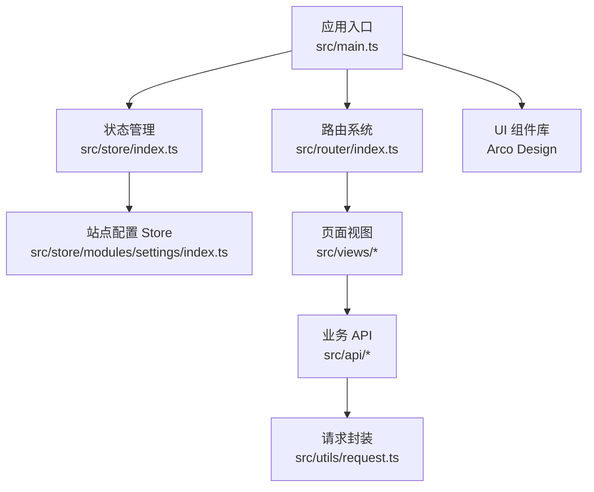
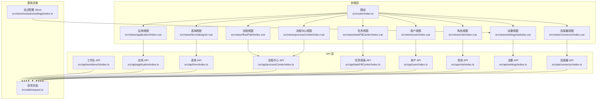
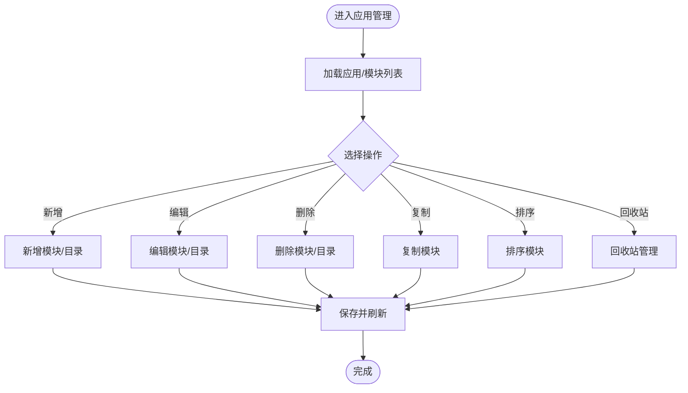
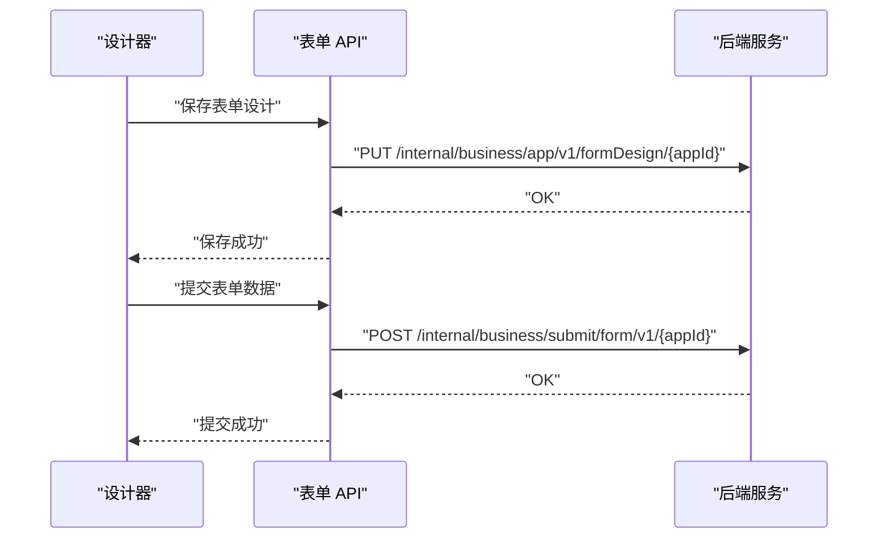
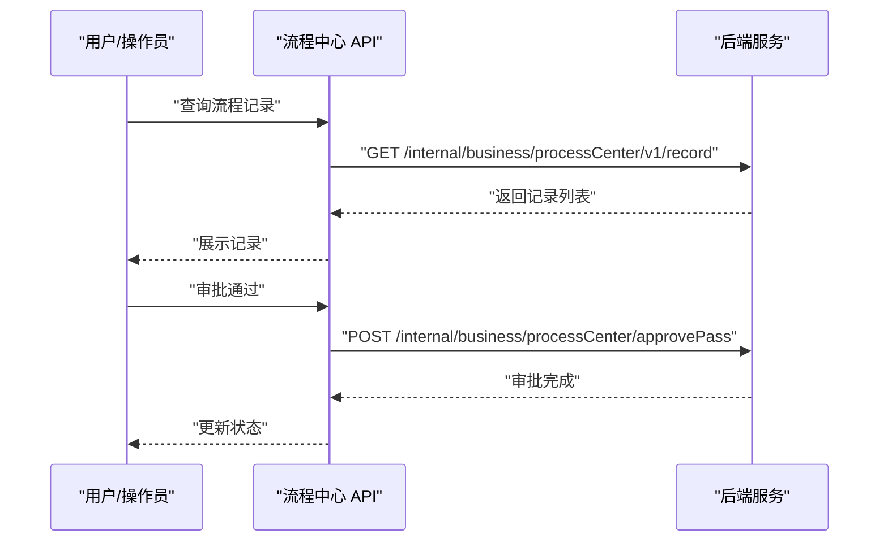
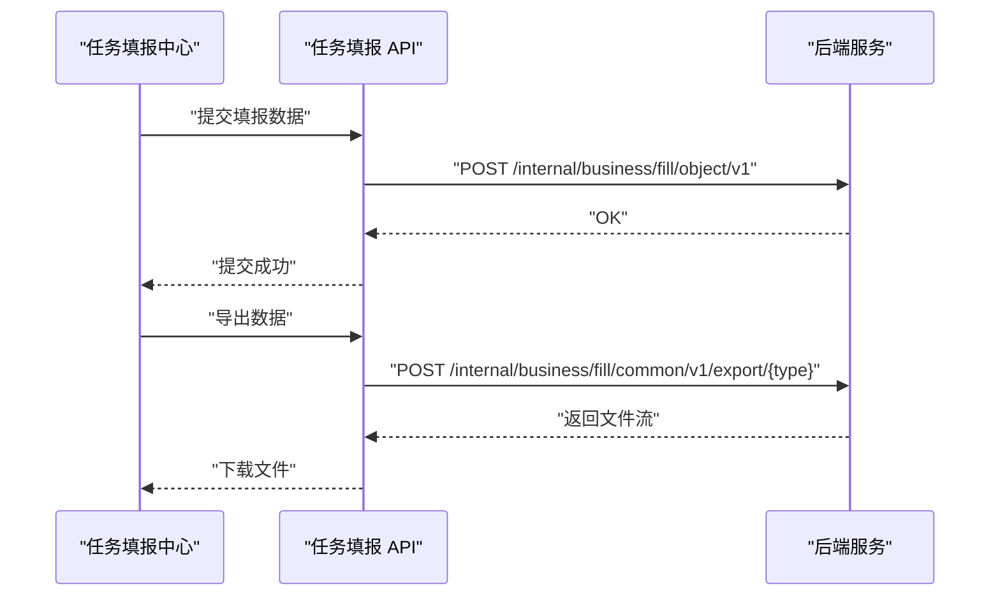
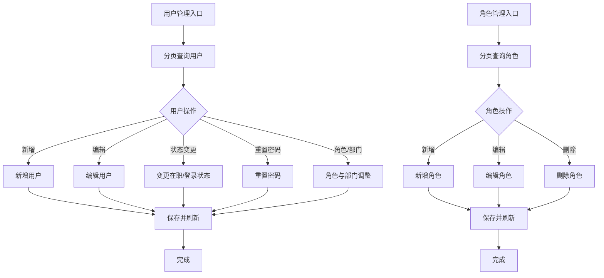
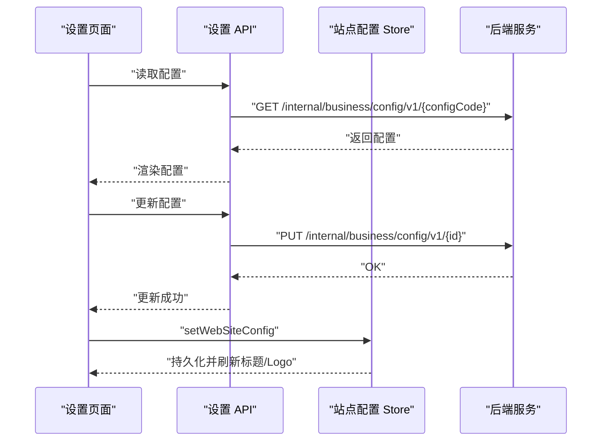
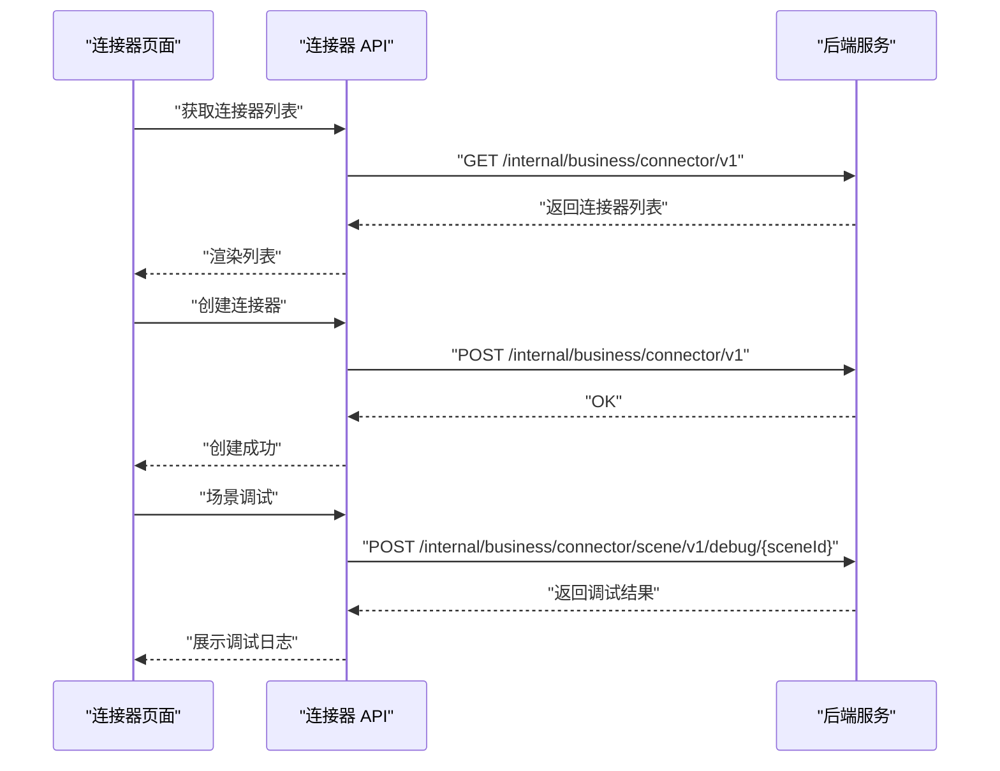
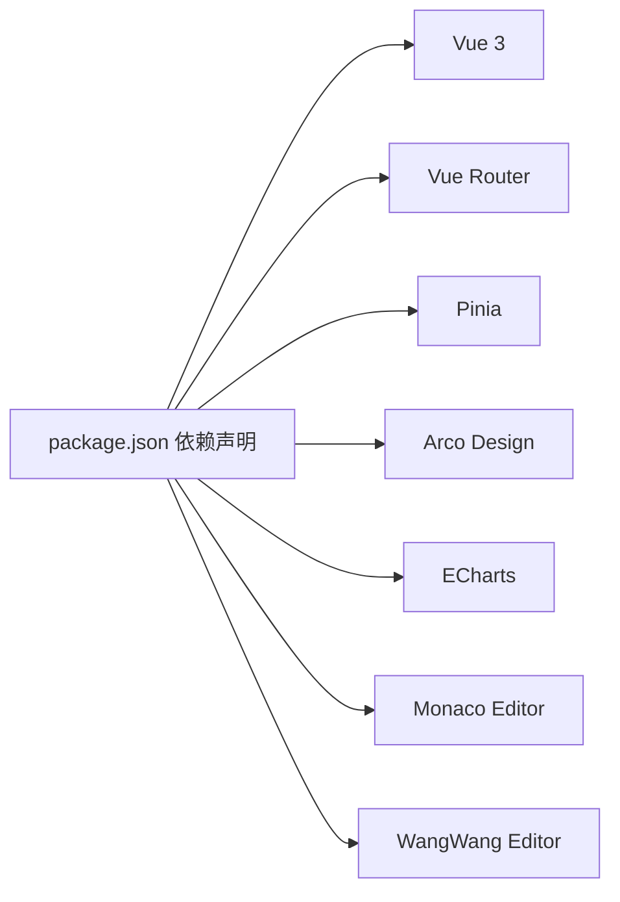

# 核心功能模块

<cite>
**本文引用的文件**
- [README.md](file://README.md)
- [package.json](file://package.json)
- [src/main.ts](file://src/main.ts)
- [src/router/index.ts](file://src/router/index.ts)
- [src/store/index.ts](file://src/store/index.ts)
- [src/store/modules/settings/index.ts](file://src/store/modules/settings/index.ts)
- [src/utils/request.ts](file://src/utils/request.ts)
- [src/api/workbench/index.ts](file://src/api/workbench/index.ts)
- [src/api/application/index.ts](file://src/api/application/index.ts)
- [src/api/form/index.ts](file://src/api/form/index.ts)
- [src/api/processCenter/index.ts](file://src/api/processCenter/index.ts)
- [src/api/taskFillCenter/index.ts](file://src/api/taskFillCenter/index.ts)
- [src/api/connector/index.ts](file://src/api/connector/index.ts)
- [src/api/user/index.ts](file://src/api/user/index.ts)
- [src/api/role/index.ts](file://src/api/role/index.ts)
- [src/api/settings/index.ts](file://src/api/settings/index.ts)
- [src/views/application/index.vue](file://src/views/application/index.vue)
- [src/views/form/designer.vue](file://src/views/form/designer.vue)
- [src/views/flowPath/index.vue](file://src/views/flowPath/index.vue)
- [src/views/connector/index.vue](file://src/views/connector/index.vue)
- [src/views/settings/website.vue](file://src/views/settings/website.vue)
- [src/views/user/index.vue](file://src/views/user/index.vue)
- [src/views/role/index.vue](file://src/views/role/index.vue)
- [src/views/taskFillCenter/index.vue](file://src/views/taskFillCenter/index.vue)
- [src/views/processCenter/index.vue](file://src/views/processCenter/index.vue)
- [src/views/webHook/index.vue](file://src/views/webHook/index.vue)
- [src/views/homePage/index.vue](file://src/views/homePage/index.vue)
</cite>

## 目录
1. [简介](#简介)
2. [项目结构](#项目结构)
3. [核心组件](#核心组件)
4. [架构总览](#架构总览)
5. [详细组件分析](#详细组件分析)
6. [依赖分析](#依赖分析)
7. [性能考虑](#性能考虑)
8. [故障排查指南](#故障排查指南)
9. [结论](#结论)
10. [附录](#附录)

## 简介
本文件面向开发者与架构师，系统化梳理新工作台项目的核心功能模块：应用管理、表单设计、工作流引擎、任务管理、用户权限、系统设置、连接器等。文档从设计理念、业务逻辑、技术实现、模块协作与数据流转等方面进行深入解析，并给出配置项、扩展机制与自定义能力说明，帮助读者快速掌握业务架构与开发要点。

## 项目结构
项目采用前端单页应用（SPA）架构，基于 Vue 3 + TypeScript + Vite 技术栈，使用路由驱动页面组织，Pinia 管理全局状态，Axios 封装网络请求，Arco Design 提供 UI 组件库。

- 应用入口与全局注册
  - 入口文件负责挂载应用、注册全局组件、安装路由与状态管理。
- 路由体系
  - 通过路由表集中声明页面路径与懒加载组件，覆盖工作台、应用、表单、流程、任务、用户、角色、设置、连接器、报表等模块。
- 状态管理
  - 使用 Pinia 创建站点配置 Store，持久化站点标题与 Logo，并在 Getter 中统一拼接下载地址与令牌。
- API 层
  - 按模块拆分 API 文件，统一通过请求封装类发起 HTTP 请求，便于维护与扩展。

图表来源
- [src/main.ts:1-40](file://src/main.ts#L1-L40)
- [src/router/index.ts:1-189](file://src/router/index.ts#L1-L189)
- [src/store/index.ts:1-9](file://src/store/index.ts#L1-L9)
- [src/store/modules/settings/index.ts:1-53](file://src/store/modules/settings/index.ts#L1-L53)

章节来源
- [src/main.ts:1-40](file://src/main.ts#L1-L40)
- [src/router/index.ts:1-189](file://src/router/index.ts#L1-L189)
- [src/store/index.ts:1-9](file://src/store/index.ts#L1-L9)
- [src/store/modules/settings/index.ts:1-53](file://src/store/modules/settings/index.ts#L1-L53)

## 核心组件
- 应用管理
  - 功能：应用目录树、模块增删改查、复制、排序、回收站、附件上传、打印模板配置与查询。
  - 关键 API：应用查询、模块增删改查、复制、回收站、附件上传、打印模板配置。
- 表单设计
  - 功能：应用级表单设计、保存、预览、提交数据、流程历史。
  - 关键 API：设计保存、表单设计、提交数据、流程历史。
- 工作流引擎
  - 功能：流程统计、应用与记录查询、催办、填写、审批、终止、日志查询。
  - 关键 API：流程统计、应用列表、记录列表、催办、填写、审批、终止。
- 任务管理
  - 功能：任务填报、批次任务分页、审批进度、导出、纠错记录。
  - 关键 API：填报数据、批次任务分页、审批进度、导出。
- 用户权限
  - 功能：用户增删改、分页查询、在职/登录状态变更、重置密码、角色与部门调整、部门负责人设置、批量离职。
  - 角色管理：角色增删改、分页查询、角色列表。
- 系统设置
  - 功能：站点配置读取与更新、多配置项管理。
  - 关键 API：配置读取、配置更新。
- 连接器
  - 功能：连接器 CRUD、场景分页、通信配置、鉴权开关、回调开关、上架开关、同步/异步切换、场景配置、日志分页与流程下拉、调试。
  - 关键 API：连接器列表、场景分页、场景配置、日志分页、调试。

章节来源
- [src/api/application/index.ts:1-78](file://src/api/application/index.ts#L1-L78)
- [src/api/form/index.ts:1-31](file://src/api/form/index.ts#L1-L31)
- [src/api/processCenter/index.ts:1-47](file://src/api/processCenter/index.ts#L1-L47)
- [src/api/taskFillCenter/index.ts:1-38](file://src/api/taskFillCenter/index.ts#L1-L38)
- [src/api/user/index.ts:1-63](file://src/api/user/index.ts#L1-L63)
- [src/api/role/index.ts:1-25](file://src/api/role/index.ts#L1-L25)
- [src/api/settings/index.ts:1-19](file://src/api/settings/index.ts#L1-L19)
- [src/api/connector/index.ts:1-104](file://src/api/connector/index.ts#L1-L104)

## 架构总览
整体采用“路由 + 页面视图 + API 层 + 请求封装”的分层架构。页面视图通过 API 层调用后端服务，API 层统一使用请求封装类进行 HTTP 交互；状态管理用于站点配置等全局状态。

图表来源
- [src/router/index.ts:1-189](file://src/router/index.ts#L1-L189)
- [src/api/workbench/index.ts:1-139](file://src/api/workbench/index.ts#L1-L139)
- [src/api/application/index.ts:1-78](file://src/api/application/index.ts#L1-L78)
- [src/api/form/index.ts:1-31](file://src/api/form/index.ts#L1-L31)
- [src/api/processCenter/index.ts:1-47](file://src/api/processCenter/index.ts#L1-L47)
- [src/api/taskFillCenter/index.ts:1-38](file://src/api/taskFillCenter/index.ts#L1-L38)
- [src/api/user/index.ts:1-63](file://src/api/user/index.ts#L1-L63)
- [src/api/role/index.ts:1-25](file://src/api/role/index.ts#L1-L25)
- [src/api/settings/index.ts:1-19](file://src/api/settings/index.ts#L1-L19)
- [src/api/connector/index.ts:1-104](file://src/api/connector/index.ts#L1-L104)
- [src/utils/request.ts](file://src/utils/request.ts)
- [src/store/modules/settings/index.ts:1-53](file://src/store/modules/settings/index.ts#L1-L53)

## 详细组件分析

### 应用管理模块
- 设计理念
  - 以“应用”为中心的模块化组织，支持目录树、模块复制、排序与回收站管理，满足复杂业务系统的分类与复用需求。
- 核心功能
  - 应用与模块的增删改查、复制、排序、回收站恢复与删除。
  - 附件上传与打印模板配置。
- 数据模型（概念）
  - 应用、模块、目录、回收站条目、打印模板。
- 处理流程（概念）
  - 列表加载 → 操作（增删改查/复制/排序/回收） → 后端持久化 → 列表刷新。
- 配置与扩展
  - 支持通过模块复制快速生成新模块，支持排序与父子关系调整。
- 自定义能力
  - 打印模板配置与查询，适配不同输出场景。

章节来源
- [src/api/application/index.ts:1-78](file://src/api/application/index.ts#L1-L78)
- [src/views/application/index.vue](file://src/views/application/index.vue)

### 表单设计模块
- 设计理念
  - 以“应用级表单设计”为核心，支持设计保存、预览、提交与流程历史查询，形成从设计到执行的闭环。
- 核心功能
  - 设计保存、表单设计、预览、提交数据、流程历史。
- 数据模型（概念）
  - 表单设计元数据、字段定义、提交数据、流程实例。
- 处理流程（概念）
  - 设计阶段 → 保存设计 → 预览校验 → 提交数据 → 流程推进。
- 配置与扩展
  - 支持按应用维度进行设计与版本管理。
- 自定义能力
  - 预览模式与提交接口解耦，便于扩展不同提交策略。

图表来源
- [src/api/form/index.ts:1-31](file://src/api/form/index.ts#L1-L31)

章节来源
- [src/api/form/index.ts:1-31](file://src/api/form/index.ts#L1-L31)
- [src/views/form/designer.vue](file://src/views/form/designer.vue)

### 工作流引擎模块
- 设计理念
  - 以“流程中心”为核心枢纽，提供流程统计、记录查询、催办、填写、审批、终止与日志查询，支撑全流程可视化与可追溯。
- 核心功能
  - 流程统计、应用列表、记录列表、催办、填写、审批（通过/拒绝/转交/退回）、终止。
- 数据模型（概念）
  - 流程实例、任务节点、审批意见、候选人、日志。
- 处理流程（概念）
  - 查询流程记录 → 催办/填写 → 审批动作（通过/拒绝/转交/退回） → 日志归档。
- 配置与扩展
  - 支持候选人查询、节点时限配置、分支条件等。
- 自定义能力
  - 通过审批动作扩展点接入外部审批系统或规则引擎。

图表来源
- [src/api/processCenter/index.ts:1-47](file://src/api/processCenter/index.ts#L1-L47)

章节来源
- [src/api/processCenter/index.ts:1-47](file://src/api/processCenter/index.ts#L1-L47)
- [src/views/processCenter/index.vue](file://src/views/processCenter/index.vue)

### 任务管理模块
- 设计理念
  - 以“任务填报中心”为核心，提供任务填报、批次任务分页、审批进度查询、导出与纠错记录，支撑大规模任务协同。
- 核心功能
  - 填报数据、批次任务分页、审批进度、导出、纠错记录。
- 数据模型（概念）
  - 填报对象、批次任务、审批进度、导出任务、纠错记录。
- 处理流程（概念）
  - 加载批次任务 → 填报数据 → 导出/纠错 → 查看审批进度。
- 配置与扩展
  - 支持多种导出类型与分页参数。
- 自定义能力
  - 可扩展导出格式与纠错策略。

图表来源
- [src/api/taskFillCenter/index.ts:1-38](file://src/api/taskFillCenter/index.ts#L1-L38)

章节来源
- [src/api/taskFillCenter/index.ts:1-38](file://src/api/taskFillCenter/index.ts#L1-L38)
- [src/views/taskFillCenter/index.vue](file://src/views/taskFillCenter/index.vue)

### 用户权限模块
- 设计理念
  - 以“用户与角色”为核心，提供用户全生命周期管理与角色授权，支撑精细化权限控制。
- 核心功能
  - 用户增删改、分页查询、在职/登录状态变更、重置密码、角色与部门调整、部门负责人设置、批量离职。
  - 角色增删改、分页查询、角色列表。
- 数据模型（概念）
  - 用户、角色、部门、岗位、身份信息。
- 处理流程（概念）
  - 用户信息维护 → 角色分配 → 部门/岗位调整 → 状态变更。
- 配置与扩展
  - 支持批量操作与状态开关。
- 自定义能力
  - 可扩展身份类型与部门负责人策略。

章节来源
- [src/api/user/index.ts:1-63](file://src/api/user/index.ts#L1-L63)
- [src/api/role/index.ts:1-25](file://src/api/role/index.ts#L1-L25)
- [src/views/user/index.vue](file://src/views/user/index.vue)
- [src/views/role/index.vue](file://src/views/role/index.vue)

### 系统设置模块
- 设计理念
  - 以“站点配置”为核心，提供多配置项读取与更新，结合 Pinia Store 实现全局状态持久化与动态标题/Logo。
- 核心功能
  - 配置读取、配置更新、站点标题与 Logo 设置。
- 数据模型（概念）
  - 站点配置对象（title、logo 等）。
- 处理流程（概念）
  - 读取配置 → 更新配置 → 写入本地存储 → 刷新页面标题与资源链接。
- 配置与扩展
  - 支持多配置码读取与按 ID 更新。
- 自定义能力
  - 可扩展更多配置项与校验规则。

图表来源
- [src/api/settings/index.ts:1-19](file://src/api/settings/index.ts#L1-L19)
- [src/store/modules/settings/index.ts:1-53](file://src/store/modules/settings/index.ts#L1-L53)
- [src/views/settings/website.vue](file://src/views/settings/website.vue)

章节来源
- [src/api/settings/index.ts:1-19](file://src/api/settings/index.ts#L1-L19)
- [src/store/modules/settings/index.ts:1-53](file://src/store/modules/settings/index.ts#L1-L53)

### 连接器模块
- 设计理念
  - 以“连接器与场景”为核心，提供连接器 CRUD、场景配置、通信与鉴权开关、回调与上架控制、同步/异步切换、日志与调试能力，支撑多系统集成。
- 核心功能
  - 连接器列表、创建/修改/删除、场景分页、场景配置、通信配置、鉴权开关、回调开关、上架开关、同步/异步切换、日志分页、调试。
- 数据模型（概念）
  - 连接器、场景、通信配置、鉴权配置、日志记录。
- 处理流程（概念）
  - 创建连接器 → 配置场景 → 开启鉴权/回调/上架 → 同步/异步切换 → 调试与日志追踪。
- 配置与扩展
  - 支持按场景维度配置与开关控制。
- 自定义能力
  - 可扩展新的通信协议与鉴权方式。

图表来源
- [src/api/connector/index.ts:1-104](file://src/api/connector/index.ts#L1-L104)
- [src/views/connector/index.vue](file://src/views/connector/index.vue)

章节来源
- [src/api/connector/index.ts:1-104](file://src/api/connector/index.ts#L1-L104)
- [src/views/connector/index.vue](file://src/views/connector/index.vue)

## 依赖分析
- 组件耦合
  - 页面视图对 API 层存在直接依赖；API 层统一依赖请求封装类；站点配置 Store 仅依赖本地存储与 Getter 计算。
- 外部依赖
  - Vue 3、Vue Router、Pinia、Arco Design、Element Plus、ECharts、Monaco Editor、WangWang Editor 等。
- 潜在风险
  - 路由守卫未启用鉴权逻辑，建议在 beforeEach 中增加令牌校验与权限拦截。

图表来源
- [package.json:1-62](file://package.json#L1-L62)

章节来源
- [package.json:1-62](file://package.json#L1-L62)
- [src/router/index.ts:182-186](file://src/router/index.ts#L182-L186)

## 性能考虑
- 路由懒加载
  - 通过动态导入减少首屏体积，提升初始加载速度。
- 组件按需注册
  - 全局组件注册时过滤 index 文件，避免重复注册。
- 状态持久化
  - 站点配置 Store 使用本地存储，减少重复请求。
- 请求缓存与并发
  - 建议在请求封装中引入缓存策略与并发限制，避免重复请求与风暴效应。
- 图表与编辑器
  - ECharts 与编辑器组件按需加载，避免不必要的资源占用。

## 故障排查指南
- 登录与路由
  - 当前路由守卫未做鉴权，若出现未登录访问问题，应在 beforeEach 中增加令牌校验与白名单判断。
- 网络请求
  - 若接口 401/403，请检查请求封装中的令牌注入与刷新逻辑；确认后端 CORS 与跨域配置。
- 站点配置
  - 若标题/Logo 不生效，检查 Store 的 Getter 计算与本地存储内容是否正确写入。
- 连接器调试
  - 若调试无响应，检查场景 ID 是否正确、后端是否开启调试接口、网络连通性与超时设置。
- 表单与流程
  - 若表单提交失败，检查提交数据结构与后端字段映射；流程审批异常，查看流程日志与候选人配置。

章节来源
- [src/router/index.ts:182-186](file://src/router/index.ts#L182-L186)
- [src/store/modules/settings/index.ts:42-49](file://src/store/modules/settings/index.ts#L42-L49)
- [src/api/connector/index.ts:95-98](file://src/api/connector/index.ts#L95-L98)
- [src/api/form/index.ts:24-27](file://src/api/form/index.ts#L24-L27)

## 结论
本项目围绕“应用管理、表单设计、工作流引擎、任务管理、用户权限、系统设置、连接器”七大模块构建了完整的业务闭环。通过清晰的分层架构、模块化的 API 设计与可扩展的配置体系，既满足日常运营需求，也为后续业务演进提供了良好的扩展空间。建议在路由守卫中完善鉴权逻辑，并在请求层引入缓存与并发控制，进一步提升稳定性与性能。

## 附录
- 快速入口
  - 应用管理：/application
  - 表单设计：/form
  - 流程中心：/processCenter
  - 任务填报中心：/taskFillCenter
  - 用户管理：/user
  - 角色管理：/role
  - 连接器：/connector
  - 系统设置：/website
- 常用 API
  - 工作台：待办/申请/已办/抄送查询与操作
  - 应用：模块增删改查、复制、排序、回收站
  - 表单：设计保存、提交数据、流程历史
  - 流程中心：统计、记录、催办、审批
  - 任务填报：数据提交、导出、纠错、进度
  - 用户/角色：增删改查、状态变更、角色分配
  - 连接器：列表、场景、调试、日志
  - 设置：配置读取与更新