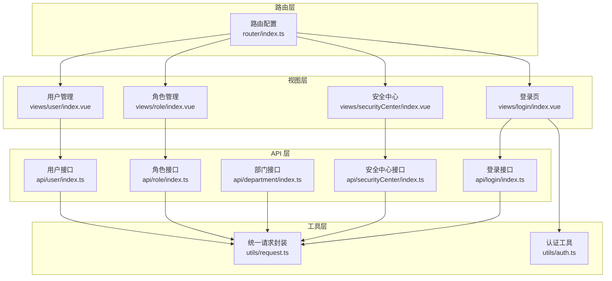
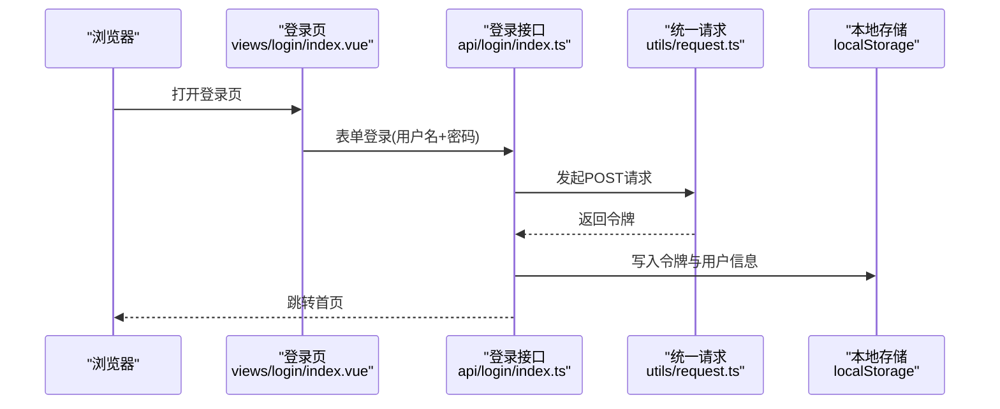
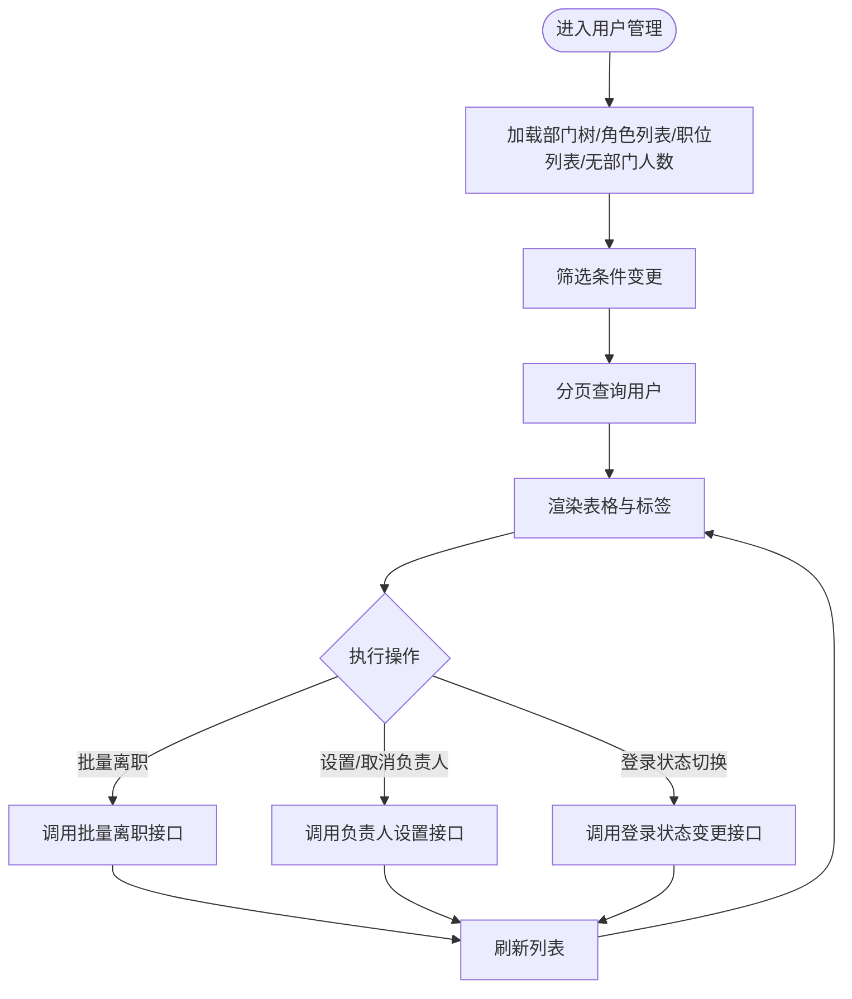
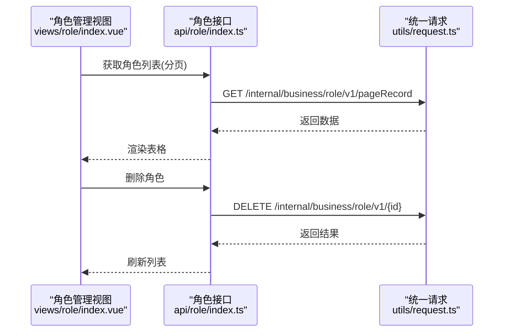
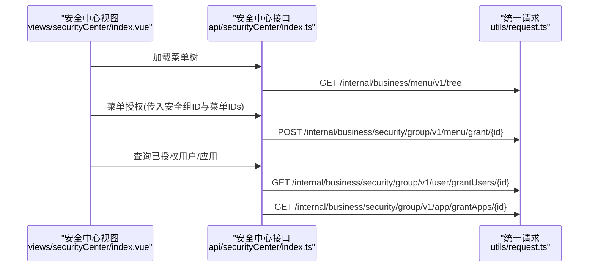
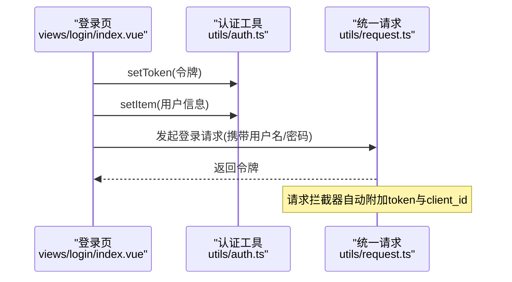
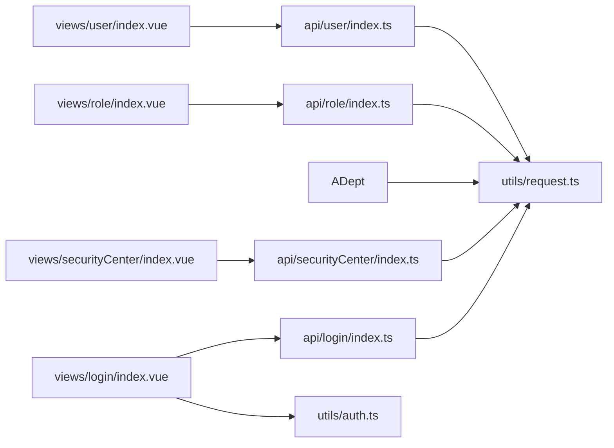

# 用户权限系统

<cite>
**本文引用的文件**
- [src/api/user/index.ts](file://src/api/user/index.ts)
- [src/api/role/index.ts](file://src/api/role/index.ts)
- [src/api/department/index.ts](file://src/api/department/index.ts)
- [src/api/securityCenter/index.ts](file://src/api/securityCenter/index.ts)
- [src/api/login/index.ts](file://src/api/login/index.ts)
- [src/utils/request.ts](file://src/utils/request.ts)
- [src/utils/auth.ts](file://src/utils/auth.ts)
- [src/views/user/index.vue](file://src/views/user/index.vue)
- [src/views/role/index.vue](file://src/views/role/index.vue)
- [src/views/securityCenter/index.vue](file://src/views/securityCenter/index.vue)
- [src/router/index.ts](file://src/router/index.ts)
- [src/views/login/index.vue](file://src/views/login/index.vue)
</cite>

## 目录
1. [引言](#引言)
2. [项目结构](#项目结构)
3. [核心组件](#核心组件)
4. [架构总览](#架构总览)
5. [详细组件分析](#详细组件分析)
6. [依赖关系分析](#依赖关系分析)
7. [性能考量](#性能考量)
8. [故障排查指南](#故障排查指南)
9. [结论](#结论)
10. [附录](#附录)

## 引言
本文件面向“用户权限系统”的设计与实现，围绕用户管理、角色管理、权限控制（含菜单与应用授权）、部门管理等模块，系统化梳理前端交互、API 接口、认证与会话、路由守卫以及安全中心的授权流程。文档同时给出基于角色的权限控制模型、权限继承规则、访问控制策略、组织架构与最佳实践建议，帮助开发者与运维人员快速理解与维护权限体系。

## 项目结构
权限相关能力主要分布在以下层次：
- 视图层：用户管理、角色管理、安全中心（菜单与应用授权）
- API 层：用户、角色、部门、安全组、登录等接口封装
- 工具层：统一请求封装、认证令牌管理
- 路由层：页面路由与前置守卫

图表来源
- [src/views/user/index.vue](file://src/views/user/index.vue)
- [src/views/role/index.vue](file://src/views/role/index.vue)
- [src/views/securityCenter/index.vue](file://src/views/securityCenter/index.vue)
- [src/views/login/index.vue](file://src/views/login/index.vue)
- [src/api/user/index.ts](file://src/api/user/index.ts)
- [src/api/role/index.ts](file://src/api/role/index.ts)
- [src/api/department/index.ts](file://src/api/department/index.ts)
- [src/api/securityCenter/index.ts](file://src/api/securityCenter/index.ts)
- [src/api/login/index.ts](file://src/api/login/index.ts)
- [src/utils/request.ts](file://src/utils/request.ts)
- [src/utils/auth.ts](file://src/utils/auth.ts)
- [src/router/index.ts](file://src/router/index.ts)

章节来源
- [src/router/index.ts:1-189](file://src/router/index.ts#L1-L189)
- [src/utils/request.ts:1-159](file://src/utils/request.ts#L1-L159)
- [src/utils/auth.ts:1-20](file://src/utils/auth.ts#L1-L20)

## 核心组件
- 用户管理：提供用户增删改查、在职状态变更、登录状态变更、重置密码、兼任部门、部门负责人设置、批量离职、按条件分页查询等功能。
- 角色管理：提供角色增删改查、分页查询、角色列表获取。
- 部门管理：提供部门增删改、部门树、导入。
- 安全中心：提供安全组（系统管理组）的菜单授权、应用授权、用户授权等能力。
- 登录与认证：提供多种登录方式、用户信息获取、角色/部门/职位信息查询、令牌存储与清理。
- 统一请求与认证工具：统一封装请求头、白名单、401跳转、错误提示；本地存储令牌与登录态判断。

章节来源
- [src/api/user/index.ts:1-63](file://src/api/user/index.ts#L1-L63)
- [src/api/role/index.ts:1-25](file://src/api/role/index.ts#L1-L25)
- [src/api/department/index.ts:1-23](file://src/api/department/index.ts#L1-L23)
- [src/api/securityCenter/index.ts:1-90](file://src/api/securityCenter/index.ts#L1-L90)
- [src/api/login/index.ts:1-61](file://src/api/login/index.ts#L1-L61)
- [src/utils/request.ts:1-159](file://src/utils/request.ts#L1-L159)
- [src/utils/auth.ts:1-20](file://src/utils/auth.ts#L1-L20)

## 架构总览
权限系统采用前后端分离模式，前端通过统一请求封装向后端发起业务请求，并在请求头注入令牌与客户端标识。登录成功后将令牌写入本地存储，后续请求自动携带令牌。路由层提供页面级入口，安全中心负责菜单与应用授权，用户/角色/部门管理为权限治理的基础数据。

图表来源
- [src/views/login/index.vue:114-205](file://src/views/login/index.vue#L114-L205)
- [src/api/login/index.ts:14-21](file://src/api/login/index.ts#L14-L21)
- [src/utils/request.ts:26-45](file://src/utils/request.ts#L26-L45)

## 详细组件分析

### 用户管理模块
- 功能要点
  - 分页查询用户，支持按部门、角色、在职状态、用户类型、姓名过滤
  - 在职状态变更、登录状态变更、重置密码
  - 兼任部门管理、部门负责人设置、批量离职
  - 在职无部门人数统计
- 数据流
  - 视图层收集筛选条件，调用用户接口分页查询，渲染表格与标签展示
  - 操作按钮触发对应接口（如批量离职、设置/取消部门负责人、登录状态切换）

图表来源
- [src/views/user/index.vue:363-547](file://src/views/user/index.vue#L363-L547)
- [src/api/user/index.ts:16-63](file://src/api/user/index.ts#L16-L63)

章节来源
- [src/views/user/index.vue:1-679](file://src/views/user/index.vue#L1-L679)
- [src/api/user/index.ts:1-63](file://src/api/user/index.ts#L1-L63)

### 角色管理模块
- 功能要点
  - 角色增删改查、分页查询、角色列表
  - 支持角色名称筛选与分页
- 数据流
  - 视图层加载角色列表，支持新增/编辑/删除操作
  - 删除前弹窗确认，调用删除接口后刷新列表

图表来源
- [src/views/role/index.vue:128-134](file://src/views/role/index.vue#L128-L134)
- [src/api/role/index.ts:16-24](file://src/api/role/index.ts#L16-L24)
- [src/utils/request.ts:117-154](file://src/utils/request.ts#L117-L154)

章节来源
- [src/views/role/index.vue:1-236](file://src/views/role/index.vue#L1-L236)
- [src/api/role/index.ts:1-25](file://src/api/role/index.ts#L1-L25)

### 部门管理模块
- 功能要点
  - 部门增删改、部门树、导入
- 数据流
  - 视图层加载部门树，支持新增/编辑/删除操作
  - 导入接口用于批量导入部门

章节来源
- [src/api/department/index.ts:1-23](file://src/api/department/index.ts#L1-L23)

### 安全中心（菜单与应用授权）
- 功能要点
  - 安全组（系统管理组）的新增/修改/删除
  - 菜单树与菜单授权、授权菜单ID查询
  - 用户授权（授权/未授权用户查询）、应用授权（授权/未授权应用查询）
- 数据流
  - 视图层选择安全组后，加载用户列表、菜单树、应用列表
  - 对菜单树进行勾选授权，对用户/应用进行授权或移除授权

图表来源
- [src/views/securityCenter/index.vue:44-53](file://src/views/securityCenter/index.vue#L44-L53)
- [src/api/securityCenter/index.ts:27-89](file://src/api/securityCenter/index.ts#L27-L89)
- [src/utils/request.ts:117-154](file://src/utils/request.ts#L117-L154)

章节来源
- [src/views/securityCenter/index.vue:1-125](file://src/views/securityCenter/index.vue#L1-L125)
- [src/api/securityCenter/index.ts:1-90](file://src/api/securityCenter/index.ts#L1-L90)

### 登录与认证机制
- 认证流程
  - 登录页收集用户名与密码，密码经编码后提交登录接口
  - 登录成功后写入令牌与用户信息至本地存储，跳转首页
  - 统一请求拦截器在非白名单路径自动附加令牌与客户端标识
  - 401响应触发跳转至统一认证地址
- 令牌管理
  - 提供 isLogin/getToken/setToken/clearToken 方法
  - 登录页在登录成功后设置令牌与用户信息

图表来源
- [src/views/login/index.vue:142-161](file://src/views/login/index.vue#L142-L161)
- [src/utils/auth.ts:11-17](file://src/utils/auth.ts#L11-L17)
- [src/utils/request.ts:26-45](file://src/utils/request.ts#L26-L45)

章节来源
- [src/views/login/index.vue:114-205](file://src/views/login/index.vue#L114-L205)
- [src/utils/auth.ts:1-20](file://src/utils/auth.ts#L1-L20)
- [src/utils/request.ts:1-159](file://src/utils/request.ts#L1-L159)

### 路由与页面入口
- 路由配置包含用户、角色、部门、安全中心等管理页面
- 路由守卫预留鉴权扩展点

章节来源
- [src/router/index.ts:1-189](file://src/router/index.ts#L1-L189)

## 依赖关系分析
- 视图层依赖 API 层提供的接口函数
- API 层依赖统一请求封装，统一处理请求头、拦截器与错误处理
- 登录页依赖认证工具与统一请求
- 路由层提供页面入口，便于权限控制扩展

图表来源
- [src/views/user/index.vue](file://src/views/user/index.vue)
- [src/views/role/index.vue](file://src/views/role/index.vue)
- [src/views/securityCenter/index.vue](file://src/views/securityCenter/index.vue)
- [src/views/login/index.vue](file://src/views/login/index.vue)
- [src/api/user/index.ts](file://src/api/user/index.ts)
- [src/api/role/index.ts](file://src/api/role/index.ts)
- [src/api/department/index.ts](file://src/api/department/index.ts)
- [src/api/securityCenter/index.ts](file://src/api/securityCenter/index.ts)
- [src/api/login/index.ts](file://src/api/login/index.ts)
- [src/utils/request.ts](file://src/utils/request.ts)
- [src/utils/auth.ts](file://src/utils/auth.ts)

## 性能考量
- 请求并发：用户管理页在初始化时并行拉取部门树、角色列表、无部门人数与职位列表，减少首屏等待时间
- 分页查询：用户与角色均支持分页查询，避免一次性传输大量数据
- 本地存储：令牌与用户信息存于本地存储，减少重复登录成本
- 错误处理：统一请求拦截器对401进行跳转，避免无效请求堆积

章节来源
- [src/views/user/index.vue:363-374](file://src/views/user/index.vue#L363-L374)
- [src/api/user/index.ts:16-18](file://src/api/user/index.ts#L16-L18)
- [src/api/role/index.ts:16-18](file://src/api/role/index.ts#L16-L18)
- [src/utils/request.ts:47-113](file://src/utils/request.ts#L47-L113)

## 故障排查指南
- 登录失败或频繁跳转
  - 检查登录接口返回与本地存储令牌是否正确写入
  - 确认请求拦截器是否正确附加 token 与 client_id
- 401未授权
  - 统一请求拦截器会根据响应码跳转至认证地址，检查后端认证地址配置
- 授权不生效
  - 确认安全中心菜单授权/用户授权/应用授权接口调用参数与目标ID
  - 检查授权后的刷新与缓存更新逻辑

章节来源
- [src/views/login/index.vue:142-161](file://src/views/login/index.vue#L142-L161)
- [src/utils/request.ts:47-113](file://src/utils/request.ts#L47-L113)
- [src/api/securityCenter/index.ts:31-89](file://src/api/securityCenter/index.ts#L31-L89)

## 结论
本权限系统以“用户-角色-部门”为核心数据模型，结合“安全组（系统管理组）”实现菜单与应用层面的授权控制。前端通过统一请求封装与认证工具，确保登录态与请求安全；视图层提供完善的管理界面与交互体验。建议在生产环境中进一步完善路由守卫与后端鉴权策略，强化令牌生命周期管理与审计日志，持续提升安全性与可维护性。

## 附录

### 基于角色的权限控制模型与继承规则
- 模型概述
  - 用户拥有多个角色，角色拥有多个权限（菜单/应用），用户通过角色间接获得权限
  - 支持“直接授权”（用户直接绑定权限）与“间接授权”（通过角色继承）
- 权限继承
  - 用户的最终权限集合 = 直接权限 ∪ 角色继承权限
  - 当角色被撤销或更新时，用户权限随之变化
- 访问控制策略
  - 页面级：路由守卫可结合用户角色/权限进行访问控制
  - 功能级：菜单树与应用授权决定用户可见与可操作范围
  - 数据级：后端应配合业务接口进行数据范围控制

### 设计原则与最佳实践
- 最小权限原则：仅授予完成工作所需的最小权限集合
- 权责分离：管理员、审批人、使用者职责分离，避免权限过度集中
- 可追溯性：所有授权变更记录审计日志，定期复核
- 安全传输：密码与敏感字段加密传输，令牌有效期与刷新策略明确
- 易维护性：权限命名规范、角色粒度适中、授权界面直观