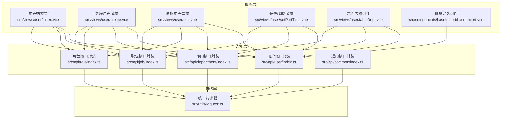
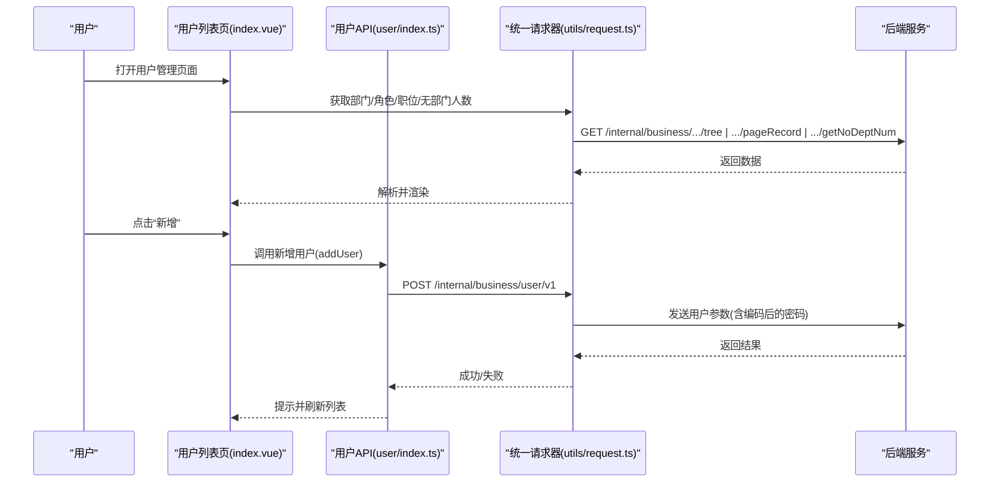
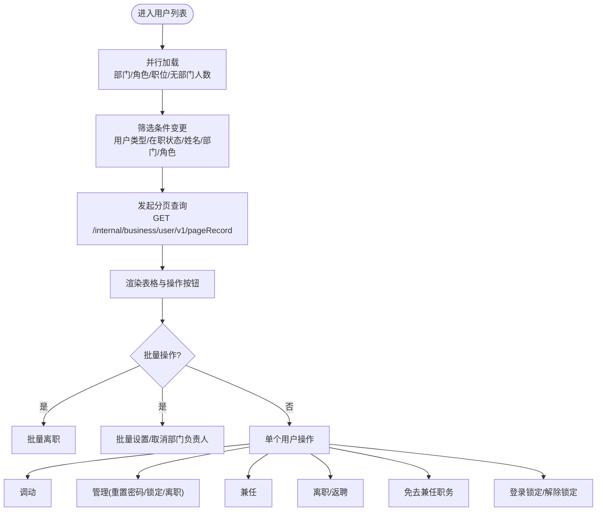
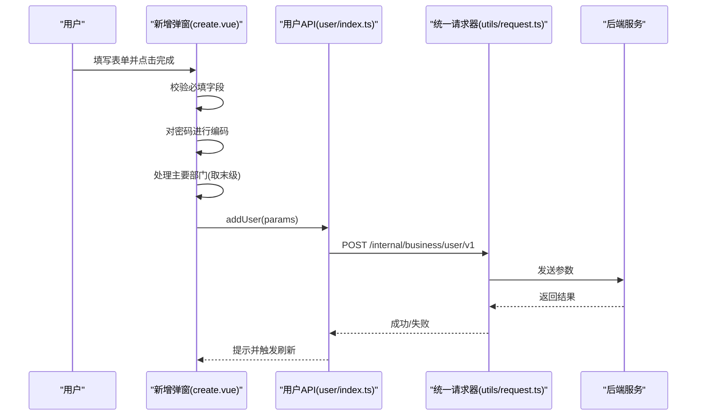
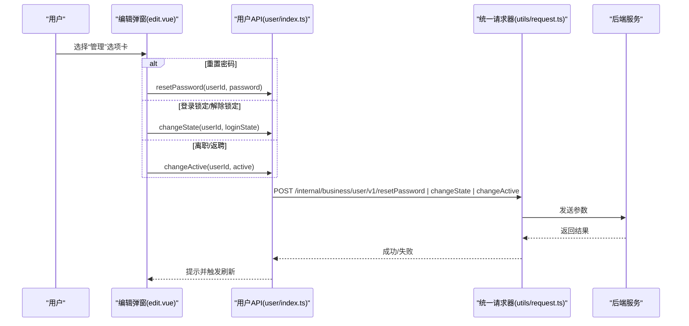
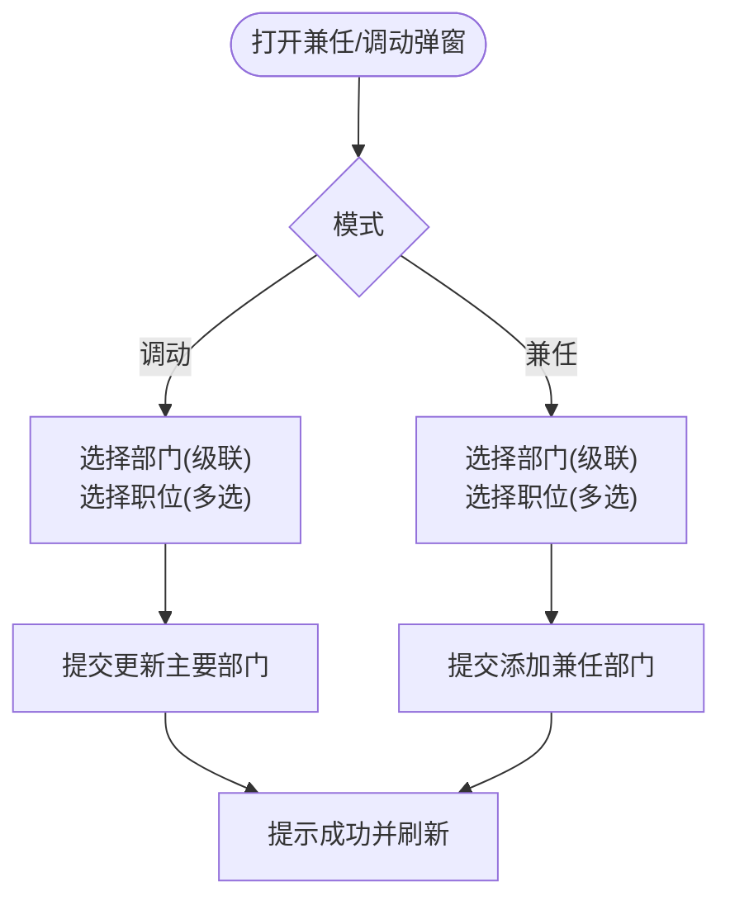
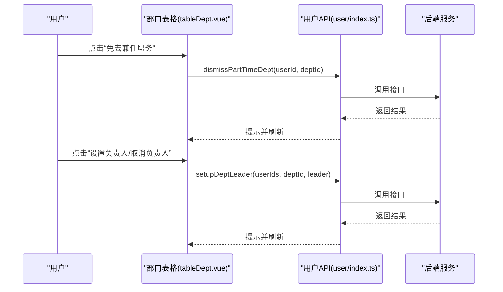
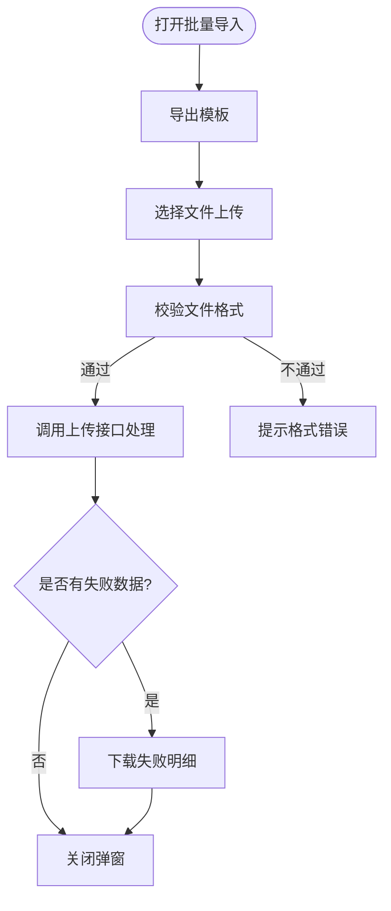
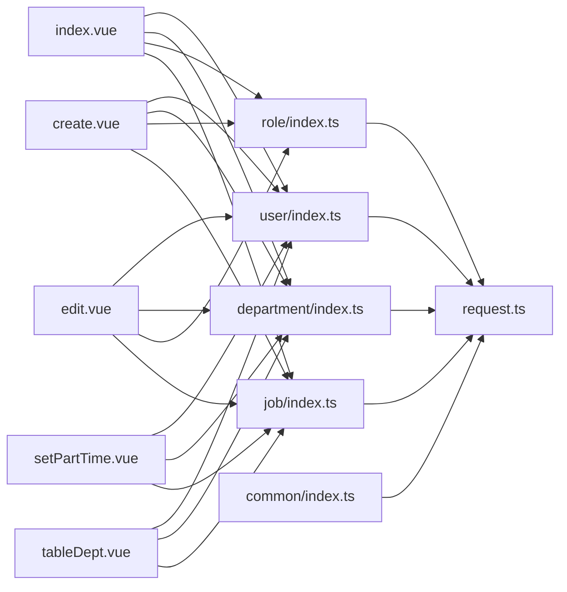

# 用户管理

<cite>
**本文引用的文件**
- [src/api/user/index.ts](file://src/api/user/index.ts)
- [src/views/user/index.vue](file://src/views/user/index.vue)
- [src/views/user/create.vue](file://src/views/user/create.vue)
- [src/views/user/edit.vue](file://src/views/user/edit.vue)
- [src/views/user/setPartTime.vue](file://src/views/user/setPartTime.vue)
- [src/views/user/tableDept.vue](file://src/views/user/tableDept.vue)
- [src/api/department/index.ts](file://src/api/department/index.ts)
- [src/api/role/index.ts](file://src/api/role/index.ts)
- [src/api/job/index.ts](file://src/api/job/index.ts)
- [src/api/common/index.ts](file://src/api/common/index.ts)
- [src/utils/request.ts](file://src/utils/request.ts)
- [src/components/baseImport/baseImport.vue](file://src/components/baseImport/baseImport.vue)
</cite>

## 目录
1. [简介](#简介)
2. [项目结构](#项目结构)
3. [核心组件](#核心组件)
4. [架构总览](#架构总览)
5. [详细组件分析](#详细组件分析)
6. [依赖关系分析](#依赖关系分析)
7. [性能考量](#性能考量)
8. [故障排查指南](#故障排查指南)
9. [结论](#结论)
10. [附录](#附录)

## 简介
本文件面向“用户管理”模块，系统化梳理用户信息管理、用户状态控制、用户组织架构管理的前端实现与交互流程。重点覆盖以下能力：
- 用户创建、编辑、删除、调动、离职等全生命周期操作
- 用户类型区分（内部用户、外部用户）
- 在职状态管理与登录状态控制
- 兼任管理与部门负责人设置
- 用户查询筛选、批量操作、权限分配（角色）的技术实现
- 最佳实践与安全注意事项

## 项目结构
用户管理功能由视图层（页面与弹窗组件）、API 层（用户/部门/角色/职位/通用接口封装）以及网络请求层（统一请求器）构成。

图表来源
- [src/views/user/index.vue:1-679](file://src/views/user/index.vue#L1-L679)
- [src/views/user/create.vue:1-296](file://src/views/user/create.vue#L1-L296)
- [src/views/user/edit.vue:1-428](file://src/views/user/edit.vue#L1-L428)
- [src/views/user/setPartTime.vue:1-141](file://src/views/user/setPartTime.vue#L1-L141)
- [src/views/user/tableDept.vue:1-153](file://src/views/user/tableDept.vue#L1-L153)
- [src/api/user/index.ts:1-63](file://src/api/user/index.ts#L1-L63)
- [src/api/department/index.ts:1-23](file://src/api/department/index.ts#L1-L23)
- [src/api/role/index.ts:1-25](file://src/api/role/index.ts#L1-L25)
- [src/api/job/index.ts:1-25](file://src/api/job/index.ts#L1-L25)
- [src/api/common/index.ts:1-68](file://src/api/common/index.ts#L1-L68)
- [src/utils/request.ts:1-159](file://src/utils/request.ts#L1-L159)
- [src/components/baseImport/baseImport.vue:1-172](file://src/components/baseImport/baseImport.vue#L1-L172)

章节来源
- [src/views/user/index.vue:1-679](file://src/views/user/index.vue#L1-L679)
- [src/api/user/index.ts:1-63](file://src/api/user/index.ts#L1-L63)
- [src/utils/request.ts:1-159](file://src/utils/request.ts#L1-L159)

## 核心组件
- 用户列表页：负责部门树筛选、角色筛选、用户类型与在职状态筛选、姓名过滤、分页、批量离职、部门负责人设置、无部门人数展示、用户查询与操作入口。
- 新增用户弹窗：表单收集用户基本信息、证件类型、主要部门、关联角色、关联职位；提交时对密码进行编码并调用新增接口。
- 编辑用户弹窗：支持用户信息修改、部门单位（查看/操作）、角色分配、管理（重置密码、登录锁定/解除锁定、离职/返聘）。
- 兼任/调动弹窗：支持主要部门变更（调动）与添加兼任部门，选择部门与职位。
- 部门表格组件：展示用户在各组织中的部门、职位、是否兼任、是否负责人，并提供对应操作。
- 统一请求器：封装 axios，统一注入客户端标识与令牌、处理响应状态与错误提示。
- 批量导入组件：提供模板下载、文件上传、失败数据回传与下载。

章节来源
- [src/views/user/index.vue:1-679](file://src/views/user/index.vue#L1-L679)
- [src/views/user/create.vue:1-296](file://src/views/user/create.vue#L1-L296)
- [src/views/user/edit.vue:1-428](file://src/views/user/edit.vue#L1-L428)
- [src/views/user/setPartTime.vue:1-141](file://src/views/user/setPartTime.vue#L1-L141)
- [src/views/user/tableDept.vue:1-153](file://src/views/user/tableDept.vue#L1-L153)
- [src/utils/request.ts:1-159](file://src/utils/request.ts#L1-L159)
- [src/components/baseImport/baseImport.vue:1-172](file://src/components/baseImport/baseImport.vue#L1-L172)

## 架构总览
用户管理采用“视图组件 + API 封装 + 统一请求”的分层架构。视图组件通过 API 封装调用后端接口，统一请求器负责鉴权头注入与错误处理，确保交互一致性和安全性。

图表来源
- [src/views/user/index.vue:363-375](file://src/views/user/index.vue#L363-L375)
- [src/views/user/create.vue:265-285](file://src/views/user/create.vue#L265-L285)
- [src/api/user/index.ts:5-7](file://src/api/user/index.ts#L5-L7)
- [src/utils/request.ts:26-66](file://src/utils/request.ts#L26-L66)

## 详细组件分析

### 用户列表页（index.vue）
- 功能要点
  - 部门树勾选筛选、角色多选筛选、用户类型与在职状态筛选、姓名过滤、无部门人数显示
  - 分页查询用户列表，支持勾选批量离职、批量设置/取消部门负责人
  - 每行操作按钮：调动、管理、兼任、离职/返聘、免去兼任职务、登录锁定/解除锁定
- 关键交互
  - 并行加载部门树、角色列表、无部门人数、职位列表
  - 查询参数包含：用户名、在职状态、无部门、用户类型、当前页、每页大小、勾选的部门ID集合、勾选的角色ID集合
  - 批量离职与批量负责人设置通过调用对应的用户接口实现
- 数据展示
  - 用户类型：内部/外部
  - 性别：未知/男/女
  - 部门与职位：以标签形式展示，支持多职位
  - 标记：兼职、负责人

图表来源
- [src/views/user/index.vue:363-501](file://src/views/user/index.vue#L363-L501)
- [src/api/user/index.ts:17-18](file://src/api/user/index.ts#L17-L18)
- [src/api/user/index.ts:48-51](file://src/api/user/index.ts#L48-L51)
- [src/api/user/index.ts:44-51](file://src/api/user/index.ts#L44-L51)

章节来源
- [src/views/user/index.vue:1-679](file://src/views/user/index.vue#L1-L679)
- [src/api/user/index.ts:1-63](file://src/api/user/index.ts#L1-L63)

### 新增用户（create.vue）
- 表单字段
  - 用户类型、账号、密码、昵称、性别、手机号、邮箱、证件类型与号码、关联角色、主要部门（级联选择）、关联职位（多选）
- 提交流程
  - 校验必填项
  - 对密码进行编码
  - 主要部门取最后一级值
  - 调用新增用户接口
- 安全注意
  - 密码在前端进行编码后再传输，避免明文泄露风险

图表来源
- [src/views/user/create.vue:265-285](file://src/views/user/create.vue#L265-L285)
- [src/api/user/index.ts:5-7](file://src/api/user/index.ts#L5-L7)
- [src/utils/request.ts:26-66](file://src/utils/request.ts#L26-L66)

章节来源
- [src/views/user/create.vue:1-296](file://src/views/user/create.vue#L1-L296)
- [src/api/user/index.ts:1-63](file://src/api/user/index.ts#L1-L63)

### 编辑用户（edit.vue）
- 选项卡功能
  - 用户信息：修改用户类型、昵称、性别、手机号、邮箱、证件类型与号码
  - 部门单位：仅内部用户可见，使用子组件展示与操作
  - 角色：修改角色列表
  - 管理：根据当前状态动态显示操作项（重置密码、登录锁定/解除锁定、离职/返聘）
- 提交流程
  - 用户信息修改：PUT 更新用户信息
  - 角色修改：更新角色
  - 管理操作：重置密码、切换登录状态、切换在职状态

图表来源
- [src/views/user/edit.vue:374-411](file://src/views/user/edit.vue#L374-L411)
- [src/api/user/index.ts:28-31](file://src/api/user/index.ts#L28-L31)
- [src/api/user/index.ts:24-27](file://src/api/user/index.ts#L24-L27)
- [src/api/user/index.ts:20-23](file://src/api/user/index.ts#L20-L23)

章节来源
- [src/views/user/edit.vue:1-428](file://src/views/user/edit.vue#L1-L428)
- [src/api/user/index.ts:1-63](file://src/api/user/index.ts#L1-L63)

### 兼任/调动（setPartTime.vue）
- 功能
  - 调动：支持将用户的主要部门变更为所选部门，并可选择职位
  - 兼任：为用户添加兼任部门与职位
- 流程
  - 校验部门必填
  - 调动：更新主要部门
  - 兼任：添加兼任部门

图表来源
- [src/views/user/setPartTime.vue:103-131](file://src/views/user/setPartTime.vue#L103-L131)
- [src/api/user/index.ts:60-63](file://src/api/user/index.ts#L60-L63)
- [src/api/user/index.ts:36-43](file://src/api/user/index.ts#L36-L43)

章节来源
- [src/views/user/setPartTime.vue:1-141](file://src/views/user/setPartTime.vue#L1-L141)
- [src/api/user/index.ts:1-63](file://src/api/user/index.ts#L1-L63)

### 部门表格（tableDept.vue）
- 功能
  - 展示用户在各组织中的部门、职位、是否兼任、是否负责人
  - 支持对单条记录进行：调动、免去兼任职务、设置/取消部门负责人
- 流程
  - 兼任：打开弹窗添加
  - 调动：打开弹窗进行主要部门变更
  - 免去兼任：调用免去兼任接口
  - 设置/取消负责人：调用设置部门负责人接口

图表来源
- [src/views/user/tableDept.vue:89-143](file://src/views/user/tableDept.vue#L89-L143)
- [src/api/user/index.ts:44-47](file://src/api/user/index.ts#L44-L47)
- [src/api/user/index.ts:40-43](file://src/api/user/index.ts#L40-L43)

章节来源
- [src/views/user/tableDept.vue:1-153](file://src/views/user/tableDept.vue#L1-L153)
- [src/api/user/index.ts:1-63](file://src/api/user/index.ts#L1-L63)

### 批量导入（baseImport.vue）
- 功能
  - 下载模板、上传文件（限制 .xlsx/.zip）、失败数据回传与下载
- 流程
  - 导出模板 -> 上传文件 -> 处理返回结果 -> 成功则关闭模型，失败则下载失败明细

图表来源
- [src/components/baseImport/baseImport.vue:74-129](file://src/components/baseImport/baseImport.vue#L74-L129)

章节来源
- [src/components/baseImport/baseImport.vue:1-172](file://src/components/baseImport/baseImport.vue#L1-L172)

## 依赖关系分析
- 视图组件依赖 API 封装，API 封装依赖统一请求器
- 列表页依赖部门、角色、职位、通用缓存接口
- 新增/编辑/兼任/调动页依赖用户、部门、角色、职位接口
- 统一请求器负责注入 client_id 与 token，处理 401 与业务错误

图表来源
- [src/views/user/index.vue:244-255](file://src/views/user/index.vue#L244-L255)
- [src/views/user/create.vue:144-153](file://src/views/user/create.vue#L144-L153)
- [src/views/user/edit.vue:161-171](file://src/views/user/edit.vue#L161-L171)
- [src/views/user/setPartTime.vue:25-33](file://src/views/user/setPartTime.vue#L25-L33)
- [src/views/user/tableDept.vue:39-49](file://src/views/user/tableDept.vue#L39-L49)
- [src/api/user/index.ts:1-63](file://src/api/user/index.ts#L1-L63)
- [src/api/department/index.ts:1-23](file://src/api/department/index.ts#L1-L23)
- [src/api/role/index.ts:1-25](file://src/api/role/index.ts#L1-L25)
- [src/api/job/index.ts:1-25](file://src/api/job/index.ts#L1-L25)
- [src/api/common/index.ts:1-68](file://src/api/common/index.ts#L1-L68)
- [src/utils/request.ts:1-159](file://src/utils/request.ts#L1-L159)

章节来源
- [src/views/user/index.vue:1-679](file://src/views/user/index.vue#L1-L679)
- [src/api/user/index.ts:1-63](file://src/api/user/index.ts#L1-L63)
- [src/utils/request.ts:1-159](file://src/utils/request.ts#L1-L159)

## 性能考量
- 并行初始化：列表页在进入时并行加载部门树、角色列表、无部门人数与职位列表，减少首屏等待
- 分页查询：列表页使用分页接口，避免一次性加载大量数据
- 表格滚动：列表页表格设置纵向滚动，提升大数据量下的渲染性能
- 模态弹窗：新增/编辑/兼任/调动弹窗按需打开，避免常驻 DOM

章节来源
- [src/views/user/index.vue:363-375](file://src/views/user/index.vue#L363-L375)
- [src/views/user/index.vue:89-98](file://src/views/user/index.vue#L89-L98)

## 故障排查指南
- 接口鉴权失败（401）
  - 检查本地 token 是否存在，确认请求拦截器已注入 token
  - 若后端返回 401，统一请求器会跳转至登录页
- 业务错误提示
  - 统一请求器在响应中非成功状态时会弹出错误消息，检查后端返回的 message 字段
- 文件上传失败
  - 批量导入组件限制文件格式为 .xlsx/.zip，若格式不符会提示错误
  - 失败数据回传时可下载失败明细文件，核对失败原因

章节来源
- [src/utils/request.ts:47-113](file://src/utils/request.ts#L47-L113)
- [src/components/baseImport/baseImport.vue:88-100](file://src/components/baseImport/baseImport.vue#L88-L100)

## 结论
用户管理模块通过清晰的分层设计与完善的交互流程，实现了从用户创建、编辑、删除、调动、离职到兼任管理与部门负责人设置的全链路能力。配合查询筛选、批量操作与权限分配，满足了日常组织管理需求。建议在后续迭代中进一步完善字段校验、错误回滚与审计日志能力，持续提升用户体验与系统稳定性。

## 附录
- 用户类型
  - 内部用户：1
  - 外部用户：2
- 在职状态
  - 在职：1
  - 离职：0
- 性别
  - 未知：0
  - 男：1
  - 女：2