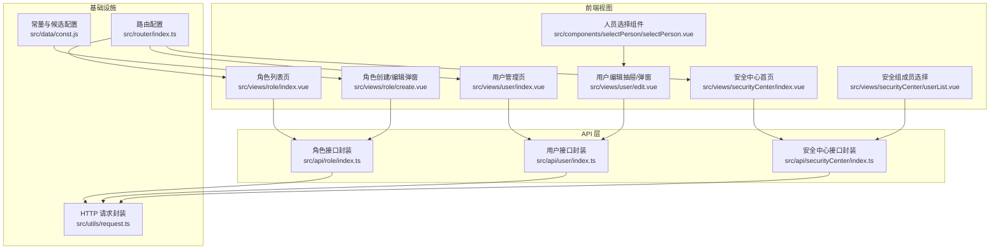
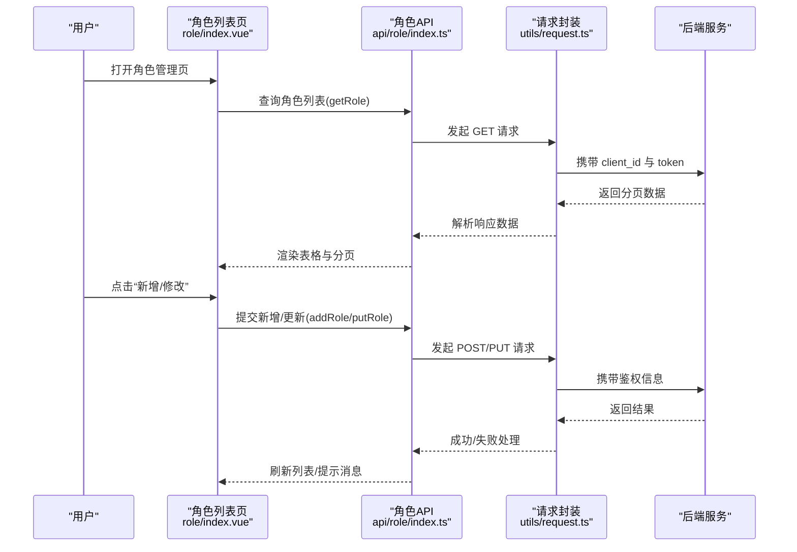
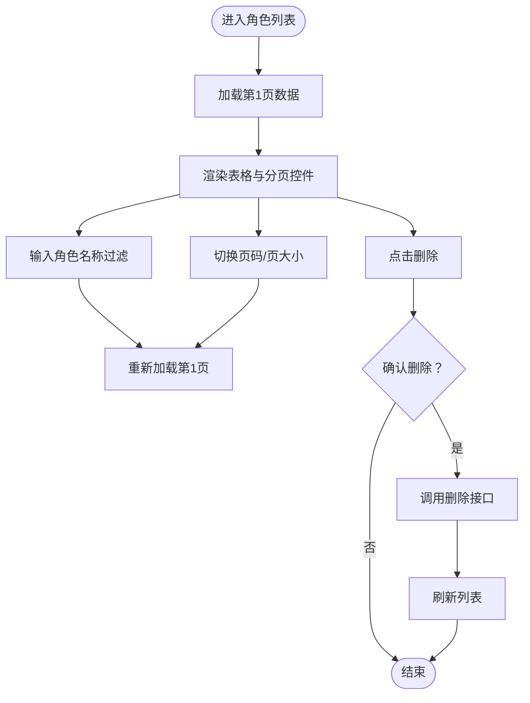
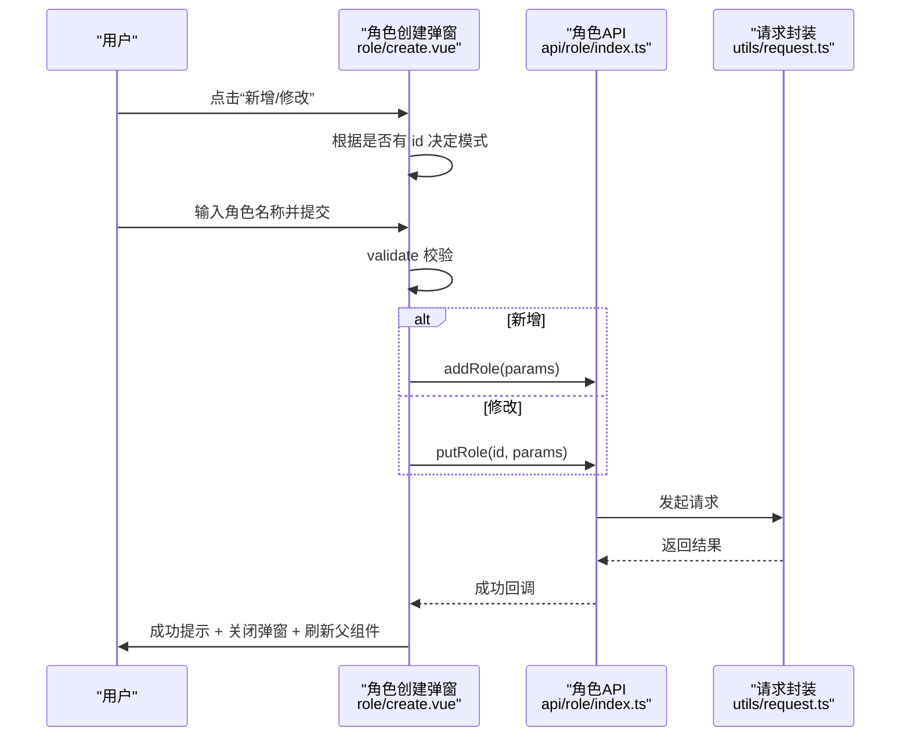
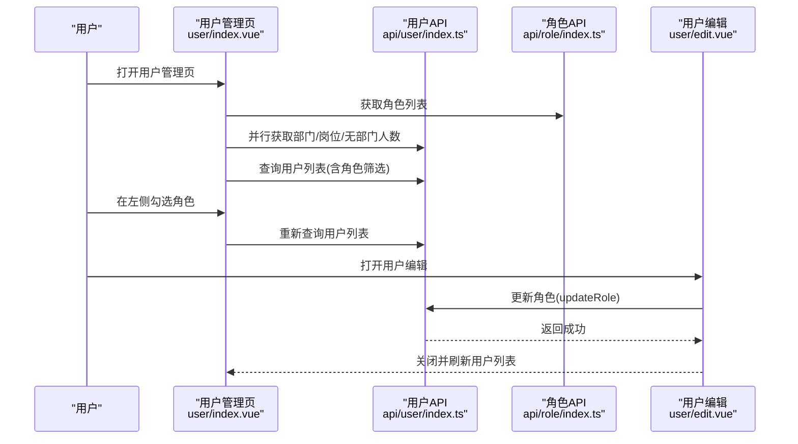
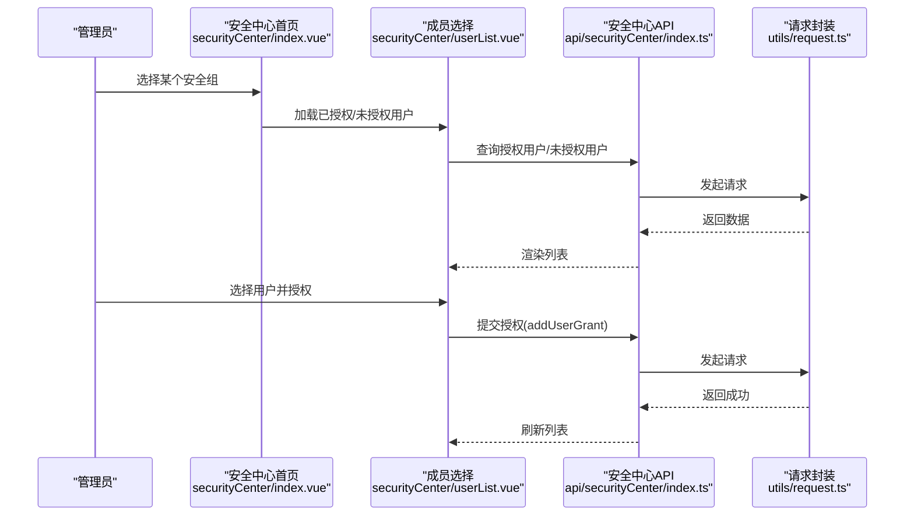
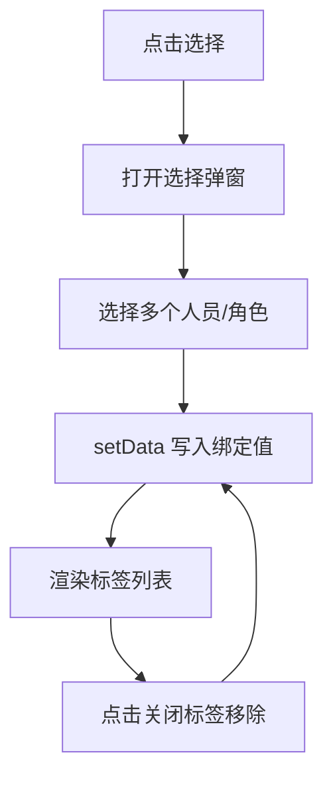
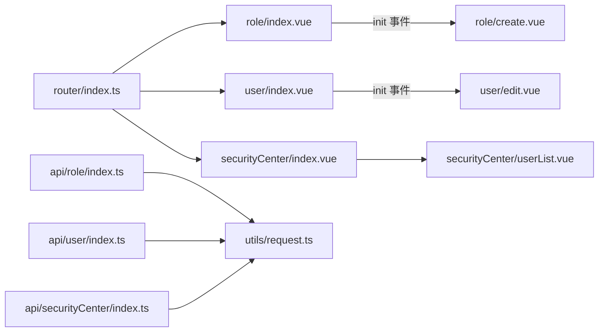

# 角色管理

<cite>
**本文引用的文件**
- [src/api/role/index.ts](file://src/api/role/index.ts)
- [src/views/role/index.vue](file://src/views/role/index.vue)
- [src/views/role/create.vue](file://src/views/role/create.vue)
- [src/api/user/index.ts](file://src/api/user/index.ts)
- [src/views/user/index.vue](file://src/views/user/index.vue)
- [src/views/user/edit.vue](file://src/views/user/edit.vue)
- [src/api/securityCenter/index.ts](file://src/api/securityCenter/index.ts)
- [src/views/securityCenter/index.vue](file://src/views/securityCenter/index.vue)
- [src/views/securityCenter/userList.vue](file://src/views/securityCenter/userList.vue)
- [src/components/selectPerson/selectPerson.vue](file://src/components/selectPerson/selectPerson.vue)
- [src/router/index.ts](file://src/router/index.ts)
- [src/utils/request.ts](file://src/utils/request.ts)
- [src/data/const.js](file://src/data/const.js)
</cite>

## 目录
1. [简介](#简介)
2. [项目结构](#项目结构)
3. [核心组件](#核心组件)
4. [架构总览](#架构总览)
5. [详细组件分析](#详细组件分析)
6. [依赖分析](#依赖分析)
7. [性能考虑](#性能考虑)
8. [故障排查指南](#故障排查指南)
9. [结论](#结论)
10. [附录](#附录)

## 简介
本文件系统化梳理角色管理模块的完整架构与实现细节，覆盖角色定义、角色权限分配、角色层级管理、角色与用户的关联关系、角色继承机制以及权限矩阵设计。文档同时提供角色创建、编辑、删除、权限配置等操作流程，并总结设计原则与权限控制策略，帮助开发者与产品人员快速理解与扩展角色管理体系。

## 项目结构
角色管理模块由前端页面、API 接口层与工具层组成，采用“视图组件 + API 封装 + 请求拦截器”的分层设计，路由与权限中心协同工作，支撑角色与用户、应用、菜单的授权关系维护。

图表来源
- [src/views/role/index.vue:1-236](file://src/views/role/index.vue#L1-L236)
- [src/views/role/create.vue:1-109](file://src/views/role/create.vue#L1-L109)
- [src/views/user/index.vue:1-679](file://src/views/user/index.vue#L1-L679)
- [src/views/user/edit.vue:107-380](file://src/views/user/edit.vue#L107-L380)
- [src/views/securityCenter/index.vue:1-125](file://src/views/securityCenter/index.vue#L1-L125)
- [src/views/securityCenter/userList.vue:1-218](file://src/views/securityCenter/userList.vue#L1-L218)
- [src/components/selectPerson/selectPerson.vue:1-115](file://src/components/selectPerson/selectPerson.vue#L1-L115)
- [src/api/role/index.ts:1-25](file://src/api/role/index.ts#L1-L25)
- [src/api/user/index.ts:1-63](file://src/api/user/index.ts#L1-L63)
- [src/api/securityCenter/index.ts:1-90](file://src/api/securityCenter/index.ts#L1-L90)
- [src/router/index.ts:1-189](file://src/router/index.ts#L1-L189)
- [src/utils/request.ts:1-159](file://src/utils/request.ts#L1-L159)
- [src/data/const.js:150-185](file://src/data/const.js#L150-L185)

章节来源
- [src/views/role/index.vue:1-236](file://src/views/role/index.vue#L1-L236)
- [src/views/role/create.vue:1-109](file://src/views/role/create.vue#L1-L109)
- [src/views/user/index.vue:1-679](file://src/views/user/index.vue#L1-L679)
- [src/views/user/edit.vue:107-380](file://src/views/user/edit.vue#L107-L380)
- [src/views/securityCenter/index.vue:1-125](file://src/views/securityCenter/index.vue#L1-L125)
- [src/views/securityCenter/userList.vue:1-218](file://src/views/securityCenter/userList.vue#L1-L218)
- [src/components/selectPerson/selectPerson.vue:1-115](file://src/components/selectPerson/selectPerson.vue#L1-L115)
- [src/api/role/index.ts:1-25](file://src/api/role/index.ts#L1-L25)
- [src/api/user/index.ts:1-63](file://src/api/user/index.ts#L1-L63)
- [src/api/securityCenter/index.ts:1-90](file://src/api/securityCenter/index.ts#L1-L90)
- [src/router/index.ts:1-189](file://src/router/index.ts#L1-L189)
- [src/utils/request.ts:1-159](file://src/utils/request.ts#L1-L159)
- [src/data/const.js:150-185](file://src/data/const.js#L150-L185)

## 核心组件
- 角色列表与分页查询：负责展示角色列表、分页参数与删除操作入口。
- 角色创建/编辑弹窗：提供角色名称输入与提交校验，支持新增与更新。
- 用户管理与角色关联：在用户管理页中勾选角色，支持批量筛选与角色变更。
- 安全中心与权限矩阵：通过安全组维度，将用户、菜单、应用授权进行集中管理。
- 人员选择组件：为角色与安全组成员选择提供复用的交互组件。
- 请求封装与路由：统一处理请求头、鉴权与响应拦截，路由导航至各管理页。

章节来源
- [src/views/role/index.vue:60-135](file://src/views/role/index.vue#L60-L135)
- [src/views/role/create.vue:29-106](file://src/views/role/create.vue#L29-L106)
- [src/views/user/index.vue:240-548](file://src/views/user/index.vue#L240-L548)
- [src/views/securityCenter/index.vue:29-54](file://src/views/securityCenter/index.vue#L29-L54)
- [src/views/securityCenter/userList.vue:84-202](file://src/views/securityCenter/userList.vue#L84-L202)
- [src/components/selectPerson/selectPerson.vue:28-64](file://src/components/selectPerson/selectPerson.vue#L28-L64)
- [src/utils/request.ts:15-159](file://src/utils/request.ts#L15-L159)
- [src/router/index.ts:54-63](file://src/router/index.ts#L54-L63)

## 架构总览
角色管理的前端架构围绕“视图组件 + API 封装 + 工具层”展开，数据流从视图组件触发，经 API 封装调用 HTTP 请求，统一通过请求拦截器注入鉴权信息并处理响应；路由负责页面导航与权限入口。

图表来源
- [src/views/role/index.vue:117-134](file://src/views/role/index.vue#L117-L134)
- [src/views/role/create.vue:77-103](file://src/views/role/create.vue#L77-L103)
- [src/api/role/index.ts:5-24](file://src/api/role/index.ts#L5-L24)
- [src/utils/request.ts:26-114](file://src/utils/request.ts#L26-L114)

## 详细组件分析

### 组件一：角色列表与分页查询
- 功能要点
  - 支持按角色名称过滤与分页切换。
  - 提供“修改/删除”操作入口，删除前二次确认。
  - 通过 API 获取分页数据并渲染表格。
- 关键流程
  - 初始化加载：进入页面即拉取第一页数据。
  - 分页切换：变更页码或每页条数时重新请求。
  - 删除流程：弹出确认对话框，确认后调用删除接口并刷新列表。

图表来源
- [src/views/role/index.vue:117-134](file://src/views/role/index.vue#L117-L134)
- [src/views/role/index.vue:93-110](file://src/views/role/index.vue#L93-L110)

章节来源
- [src/views/role/index.vue:60-135](file://src/views/role/index.vue#L60-L135)

### 组件二：角色创建/编辑弹窗
- 功能要点
  - 表单字段：角色名称（必填，长度限制）。
  - 编辑模式：根据传入的记录填充表单，标题与按钮文案动态调整。
  - 提交逻辑：校验通过后分别调用新增或更新接口，成功后关闭弹窗并刷新列表。
- 关键流程
  - 显示弹窗：根据是否传入记录判断“新增/修改”模式。
  - 校验与提交：validate 校验通过后构造参数，调用对应 API。
  - 结果反馈：成功提示、关闭弹窗、触发父组件刷新。

图表来源
- [src/views/role/create.vue:43-103](file://src/views/role/create.vue#L43-L103)
- [src/api/role/index.ts:5-15](file://src/api/role/index.ts#L5-L15)
- [src/utils/request.ts:117-155](file://src/utils/request.ts#L117-L155)

章节来源
- [src/views/role/create.vue:29-106](file://src/views/role/create.vue#L29-L106)

### 组件三：用户管理与角色关联
- 功能要点
  - 在左侧部门树与右侧角色多选框中筛选用户。
  - 用户列表展示角色标签，支持批量操作（如离职、设置/取消部门负责人、重置密码等）。
  - 用户编辑抽屉中可变更角色集合，调用用户角色更新接口。
- 关键流程
  - 加载数据：并行获取部门树、角色列表、无部门人数、岗位列表。
  - 筛选与查询：根据部门、角色、状态、类型、姓名等条件查询用户。
  - 角色变更：在用户编辑中选择角色集合，提交更新角色接口。

图表来源
- [src/views/user/index.vue:363-375](file://src/views/user/index.vue#L363-L375)
- [src/views/user/index.vue:486-501](file://src/views/user/index.vue#L486-L501)
- [src/views/user/edit.vue:339-373](file://src/views/user/edit.vue#L339-L373)
- [src/api/user/index.ts:57-59](file://src/api/user/index.ts#L57-L59)
- [src/api/role/index.ts:22](file://src/api/role/index.ts#L22)

章节来源
- [src/views/user/index.vue:240-548](file://src/views/user/index.vue#L240-L548)
- [src/views/user/edit.vue:107-380](file://src/views/user/edit.vue#L107-L380)
- [src/api/user/index.ts:1-63](file://src/api/user/index.ts#L1-L63)
- [src/api/role/index.ts:1-25](file://src/api/role/index.ts#L1-L25)

### 组件四：安全中心与权限矩阵
- 功能要点
  - 安全中心首页：左侧安全组列表，右侧为“功能授权/应用授权”切换。
  - 成员选择：通过“安全组成员选择”组件，支持多选用户并进行授权/撤销授权。
  - 菜单树与应用列表：分别承载菜单授权与应用授权的授权/撤销操作。
- 关键流程
  - 选择安全组：加载已授权用户、未授权用户、菜单树、应用列表。
  - 成员授权：选择用户后提交授权，成功后刷新列表。
  - 应用授权：选择应用后提交授权，成功后刷新应用数量。

图表来源
- [src/views/securityCenter/index.vue:44-49](file://src/views/securityCenter/index.vue#L44-L49)
- [src/views/securityCenter/userList.vue:118-126](file://src/views/securityCenter/userList.vue#L118-L126)
- [src/views/securityCenter/userList.vue:166-179](file://src/views/securityCenter/userList.vue#L166-L179)
- [src/api/securityCenter/index.ts:58-69](file://src/api/securityCenter/index.ts#L58-L69)
- [src/utils/request.ts:117-155](file://src/utils/request.ts#L117-L155)

章节来源
- [src/views/securityCenter/index.vue:1-125](file://src/views/securityCenter/index.vue#L1-L125)
- [src/views/securityCenter/userList.vue:84-202](file://src/views/securityCenter/userList.vue#L84-L202)
- [src/api/securityCenter/index.ts:1-90](file://src/api/securityCenter/index.ts#L1-L90)

### 组件五：人员选择组件与角色/用户关联
- 功能要点
  - 复用的“人员选择”组件，支持占位符、标签展示、关闭标签等交互。
  - 在用户编辑场景中，作为角色选择的输入控件使用。
- 关键流程
  - 打开选择：点击触发弹窗选择。
  - 设置数据：将所选用户/角色集合写入绑定值。
  - 关闭标签：支持移除已选项。

图表来源
- [src/components/selectPerson/selectPerson.vue:55-63](file://src/components/selectPerson/selectPerson.vue#L55-L63)
- [src/views/user/edit.vue:107-114](file://src/views/user/edit.vue#L107-L114)

章节来源
- [src/components/selectPerson/selectPerson.vue:28-64](file://src/components/selectPerson/selectPerson.vue#L28-L64)
- [src/views/user/edit.vue:107-114](file://src/views/user/edit.vue#L107-L114)

## 依赖分析
- 组件耦合
  - 角色列表页与角色创建弹窗通过事件通信实现刷新联动。
  - 用户管理页与用户编辑抽屉通过事件通信实现列表刷新。
  - 安全中心成员选择与安全中心 API 存在直接依赖。
- 外部依赖
  - 路由配置提供角色管理、用户管理、安全中心的入口。
  - 请求封装统一处理 token 注入与响应拦截，保障接口一致性。
- 循环依赖
  - 当前模块未发现循环依赖迹象，职责边界清晰。

图表来源
- [src/views/role/index.vue:56](file://src/views/role/index.vue#L56)
- [src/views/role/create.vue:35](file://src/views/role/create.vue#L35)
- [src/views/user/index.vue:224-237](file://src/views/user/index.vue#L224-L237)
- [src/views/user/edit.vue:35](file://src/views/user/edit.vue#L35)
- [src/views/securityCenter/index.vue:5-6](file://src/views/securityCenter/index.vue#L5-L6)
- [src/views/securityCenter/userList.vue:28-32](file://src/views/securityCenter/userList.vue#L28-L32)
- [src/api/role/index.ts:1](file://src/api/role/index.ts#L1)
- [src/api/user/index.ts:1](file://src/api/user/index.ts#L1)
- [src/api/securityCenter/index.ts:1](file://src/api/securityCenter/index.ts#L1)
- [src/router/index.ts:54-63](file://src/router/index.ts#L54-L63)

章节来源
- [src/router/index.ts:54-63](file://src/router/index.ts#L54-L63)
- [src/utils/request.ts:15-159](file://src/utils/request.ts#L15-L159)

## 性能考虑
- 列表分页与筛选
  - 使用分页参数避免一次性加载大量数据，降低前端渲染压力。
  - 针对角色与用户列表，建议结合关键词与多维筛选减少无效渲染。
- 并行加载
  - 用户管理页采用并行请求部门树、角色列表、无部门人数、岗位列表，缩短首屏等待时间。
- 请求拦截
  - 统一注入 token 与 client_id，减少重复配置；对 401 统一跳转登录，避免无效重试。
- 组件复用
  - 人员选择组件在多处复用，减少重复开发与维护成本。

## 故障排查指南
- 登录态异常
  - 现象：出现 401 或统一跳转登录。
  - 排查：检查本地 token 是否存在，请求拦截器是否正确注入 token 与 client_id。
- 接口返回失败
  - 现象：弹出错误提示或 Promise 被拒绝。
  - 排查：查看响应拦截器中的错误消息映射，定位具体错误码并核对后端返回结构。
- 删除确认
  - 现象：删除后列表未刷新。
  - 排查：确认删除操作是否触发 init 事件并调用列表刷新函数。
- 角色更新不生效
  - 现象：用户角色变更后未体现。
  - 排查：确认用户编辑中提交的角色集合是否正确，调用更新角色接口后是否刷新用户列表。

章节来源
- [src/utils/request.ts:47-114](file://src/utils/request.ts#L47-L114)
- [src/views/role/index.vue:93-110](file://src/views/role/index.vue#L93-L110)
- [src/views/user/edit.vue:364-373](file://src/views/user/edit.vue#L364-L373)

## 结论
角色管理模块以清晰的分层设计实现了角色定义、角色与用户的关联、以及基于安全中心的权限矩阵管理。通过统一的请求封装与路由导航，模块具备良好的可维护性与扩展性。建议后续在以下方面持续优化：
- 引入角色层级与继承机制的可视化设计与持久化存储。
- 完善权限矩阵的细粒度控制与审计日志。
- 增强角色与菜单/应用授权的批量操作与导入导出能力。

## 附录
- 设计原则
  - 单一职责：视图组件仅负责交互与数据展示，业务逻辑下沉至 API 封装。
  - 可复用性：将通用交互（如人员选择）抽象为独立组件。
  - 一致性：统一请求拦截与错误处理，保证用户体验一致。
- 权限控制策略
  - 基于安全组的集中授权，支持用户、菜单、应用三层授权。
  - 角色与用户的关系通过用户角色更新接口维护，确保最小权限原则。
  - 对关键操作（删除、批量离职、登录锁定/解锁）增加二次确认与提示。