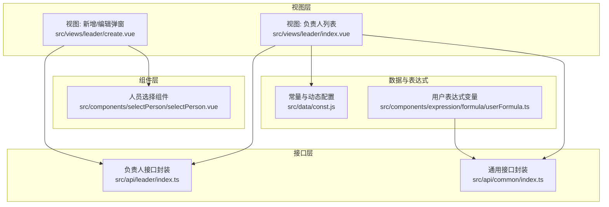
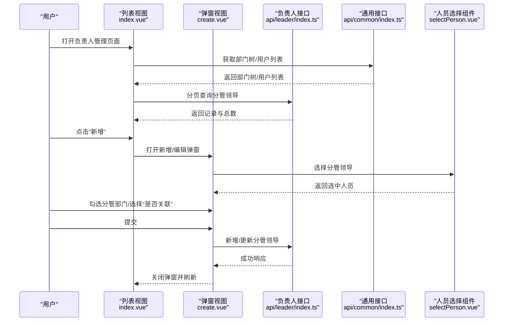
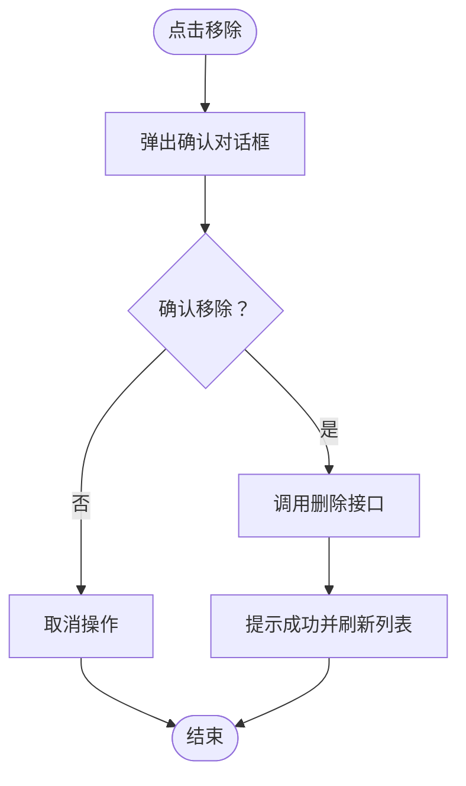
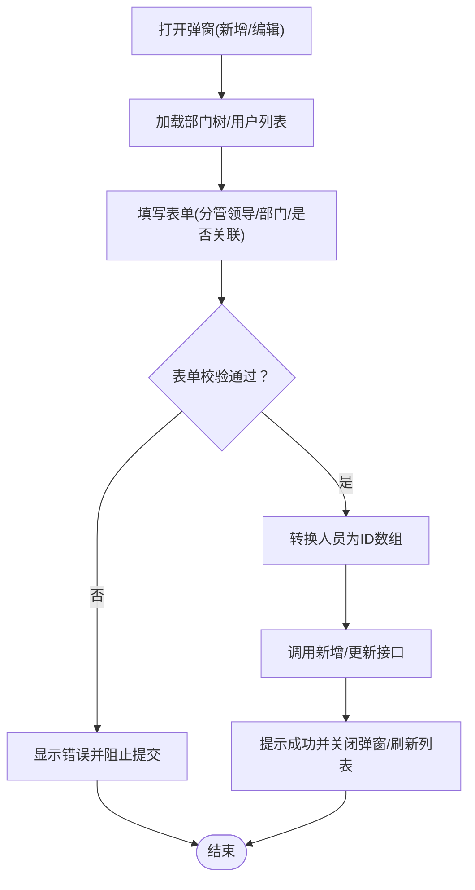
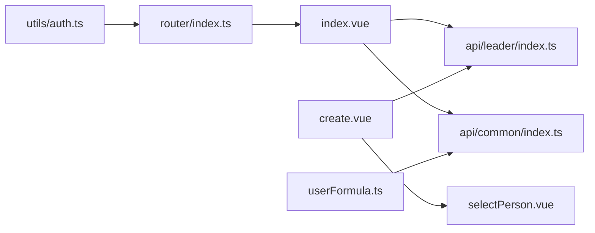

# 负责人管理

<cite>
**本文引用的文件**
- [src/api/leader/index.ts](file://src/api/leader/index.ts)
- [src/views/leader/index.vue](file://src/views/leader/index.vue)
- [src/views/leader/create.vue](file://src/views/leader/create.vue)
- [src/api/common/index.ts](file://src/api/common/index.ts)
- [src/components/selectPerson/selectPerson.vue](file://src/components/selectPerson/selectPerson.vue)
- [src/data/const.js](file://src/data/const.js)
- [src/components/expression/formula/userFormula.ts](file://src/components/expression/formula/userFormula.ts)
- [src/router/index.ts](file://src/router/index.ts)
- [src/utils/auth.ts](file://src/utils/auth.ts)
</cite>

## 目录
1. [简介](#简介)
2. [项目结构](#项目结构)
3. [核心组件](#核心组件)
4. [架构总览](#架构总览)
5. [详细组件分析](#详细组件分析)
6. [依赖分析](#依赖分析)
7. [性能考虑](#性能考虑)
8. [故障排查指南](#故障排查指南)
9. [结论](#结论)
10. [附录](#附录)

## 简介
本文件系统化梳理“负责人管理”模块的设计与实现，覆盖以下关键主题：
- 部门负责人设置：支持为部门配置分管领导，支持“是否关联”选项以控制权限范围。
- 负责人权限管理：通过表达式变量与后端接口联动，判断当前用户是否为负责人或分管领导。
- 负责人变更流程：提供新增、编辑、移除分管领导的完整流程；支持分页查询与搜索。
- 负责人角色定义与权限范围：明确“分管领导”与“部门负责人”的差异与边界；结合“是否关联”实现灵活的权限继承策略。
- 批量设置与变更记录：前端提供批量勾选部门与负责人，后端接口支持批量提交；变更记录通过调用历史接口体现。
- 安全策略与权限控制：基于路由守卫与本地令牌校验，确保访问控制与会话安全。

## 项目结构
负责人管理模块由三层组成：
- 视图层：负责展示与交互，包括列表页与新增/编辑弹窗。
- 接口层：封装与后端的业务接口调用。
- 组件层：复用的人员选择器与部门树组件，支撑负责人与部门的多选与联动。

**图表来源**
- [src/views/leader/index.vue:1-223](file://src/views/leader/index.vue#L1-L223)
- [src/views/leader/create.vue:1-169](file://src/views/leader/create.vue#L1-L169)
- [src/api/leader/index.ts:1-15](file://src/api/leader/index.ts#L1-L15)
- [src/api/common/index.ts:1-68](file://src/api/common/index.ts#L1-L68)
- [src/components/selectPerson/selectPerson.vue:1-115](file://src/components/selectPerson/selectPerson.vue#L1-L115)
- [src/data/const.js:170-369](file://src/data/const.js#L170-L369)
- [src/components/expression/formula/userFormula.ts:1-200](file://src/components/expression/formula/userFormula.ts#L1-L200)

**章节来源**
- [src/views/leader/index.vue:1-223](file://src/views/leader/index.vue#L1-L223)
- [src/views/leader/create.vue:1-169](file://src/views/leader/create.vue#L1-L169)
- [src/api/leader/index.ts:1-15](file://src/api/leader/index.ts#L1-L15)
- [src/api/common/index.ts:1-68](file://src/api/common/index.ts#L1-L68)
- [src/components/selectPerson/selectPerson.vue:1-115](file://src/components/selectPerson/selectPerson.vue#L1-L115)
- [src/data/const.js:170-369](file://src/data/const.js#L170-L369)
- [src/components/expression/formula/userFormula.ts:1-200](file://src/components/expression/formula/userFormula.ts#L1-L200)

## 核心组件
- 列表页组件：负责加载部门树与用户列表，分页查询分管领导记录，支持搜索与移除操作。
- 弹窗组件：负责新增/编辑分管领导，支持部门树勾选与“是否关联”策略选择。
- 接口封装：提供分管领导分页查询、新增、移除等能力。
- 人员选择组件：提供多选人员展示与选择弹窗，支持标签化显示与清空。
- 表达式变量：提供“是否为负责人/分管领导”的表达式函数，用于流程与字段控制。

**章节来源**
- [src/views/leader/index.vue:66-184](file://src/views/leader/index.vue#L66-L184)
- [src/views/leader/create.vue:57-162](file://src/views/leader/create.vue#L57-L162)
- [src/api/leader/index.ts:4-15](file://src/api/leader/index.ts#L4-L15)
- [src/components/selectPerson/selectPerson.vue:28-64](file://src/components/selectPerson/selectPerson.vue#L28-L64)
- [src/components/expression/formula/userFormula.ts:19-50](file://src/components/expression/formula/userFormula.ts#L19-L50)

## 架构总览
负责人管理采用前后端分离架构，前端通过接口封装调用后端业务接口，后端提供分管领导的分页查询、新增与移除能力。权限判断通过表达式变量与后端接口联动实现。

**图表来源**
- [src/views/leader/index.vue:133-162](file://src/views/leader/index.vue#L133-L162)
- [src/views/leader/create.vue:141-159](file://src/views/leader/create.vue#L141-L159)
- [src/api/leader/index.ts:4-15](file://src/api/leader/index.ts#L4-L15)
- [src/api/common/index.ts:4-68](file://src/api/common/index.ts#L4-L68)
- [src/components/selectPerson/selectPerson.vue:28-64](file://src/components/selectPerson/selectPerson.vue#L28-L64)

## 详细组件分析

### 列表页组件（负责人管理）
职责与行为：
- 初始化加载部门树与用户列表，供弹窗选择使用。
- 支持按用户名搜索与分页查询分管领导。
- 提供“管理/移除”操作入口，其中“移除”触发二次确认与后端删除请求。
- 使用表格列渲染用户类型、性别、分管部门数量等信息。

关键交互流程（移除分管领导）：

**图表来源**
- [src/views/leader/index.vue:166-183](file://src/views/leader/index.vue#L166-L183)
- [src/api/leader/index.ts:12-15](file://src/api/leader/index.ts#L12-L15)

**章节来源**
- [src/views/leader/index.vue:66-184](file://src/views/leader/index.vue#L66-L184)
- [src/api/leader/index.ts:4-15](file://src/api/leader/index.ts#L4-L15)

### 弹窗组件（新增/编辑分管领导）
职责与行为：
- 支持两种模式：新增（显示“分管领导”输入）与编辑（仅展示已选人员与部门）。
- 使用部门树进行多选，支持“是否关联”选项以控制权限范围。
- 表单校验：分管领导与分管部门必填。
- 提交时将人员对象转换为ID数组，调用新增/更新接口。

关键交互流程（新增/编辑提交）：

**图表来源**
- [src/views/leader/create.vue:97-119](file://src/views/leader/create.vue#L97-L119)
- [src/views/leader/create.vue:121-136](file://src/views/leader/create.vue#L121-L136)
- [src/views/leader/create.vue:141-159](file://src/views/leader/create.vue#L141-L159)
- [src/api/leader/index.ts:8-11](file://src/api/leader/index.ts#L8-L11)

**章节来源**
- [src/views/leader/create.vue:57-162](file://src/views/leader/create.vue#L57-L162)
- [src/api/leader/index.ts:8-11](file://src/api/leader/index.ts#L8-L11)

### 接口封装（负责人）
- 分页查询分管领导：pageRecord(params)
- 新增分管领导：charge(params)
- 移除分管领导：putUser(userId)

参数与返回：
- 分页查询：传入用户名、页码、每页条数；返回总条数与记录列表。
- 新增/更新：传入分管部门ID数组与分管领导ID数组；返回成功状态。
- 移除：传入用户ID；返回成功状态。

**章节来源**
- [src/api/leader/index.ts:4-15](file://src/api/leader/index.ts#L4-L15)

### 人员选择组件
- 支持多选人员展示，标签化显示前N个人员，超出部分以“+ 数量”显示。
- 提供关闭单个标签与清空全部的能力。
- 与弹窗组件配合，作为“分管领导”字段的输入控件。

**章节来源**
- [src/components/selectPerson/selectPerson.vue:28-64](file://src/components/selectPerson/selectPerson.vue#L28-L64)

### 权限判断与表达式变量
- 表达式变量提供“是否为负责人/分管领导”的判断函数，结合后端接口返回的部门列表进行过滤。
- 可在流程节点属性中使用该变量，实现基于“是否分管领导”的条件控制。

**章节来源**
- [src/components/expression/formula/userFormula.ts:19-50](file://src/components/expression/formula/userFormula.ts#L19-L50)
- [src/api/common/index.ts:44-54](file://src/api/common/index.ts#L44-L54)

### 动态配置与“分管领导”字段
- 在常量配置中存在“chargeLeader”相关字段，用于描述“分管领导”的部门字段、用户字段、是否应用于用户以及层级等动态配置。
- 该配置可用于后续扩展“分管领导”的字段映射与层级策略。

**章节来源**
- [src/data/const.js:181-188](file://src/data/const.js#L181-L188)

## 依赖分析
- 列表页依赖：
  - 负责人接口封装：分页查询与移除。
  - 通用接口封装：部门树与用户列表。
- 弹窗依赖：
  - 负责人接口封装：新增/更新。
  - 人员选择组件：多选人员输入。
- 表达式变量依赖：
  - 通用接口封装：用户部门/岗位信息查询。
- 路由与安全：
  - 路由配置：提供“负责人管理”页面路由。
  - 认证工具：提供登录状态与令牌读取/写入/清除。

**图表来源**
- [src/views/leader/index.vue:68-70](file://src/views/leader/index.vue#L68-L70)
- [src/views/leader/create.vue:58-60](file://src/views/leader/create.vue#L58-L60)
- [src/api/leader/index.ts:1-15](file://src/api/leader/index.ts#L1-L15)
- [src/api/common/index.ts:1-68](file://src/api/common/index.ts#L1-L68)
- [src/components/selectPerson/selectPerson.vue:30](file://src/components/selectPerson/selectPerson.vue#L30)
- [src/components/expression/formula/userFormula.ts:2-6](file://src/components/expression/formula/userFormula.ts#L2-L6)
- [src/router/index.ts:75-78](file://src/router/index.ts#L75-L78)
- [src/utils/auth.ts:1-20](file://src/utils/auth.ts#L1-L20)

**章节来源**
- [src/router/index.ts:75-78](file://src/router/index.ts#L75-L78)
- [src/utils/auth.ts:1-20](file://src/utils/auth.ts#L1-L20)

## 性能考虑
- 列表加载优化：在列表页初始化时并行获取部门树与用户列表，减少等待时间。
- 表单提交优化：在提交前清理无效字段（如将人员对象转换为ID数组），降低后端处理负担。
- 部门树渲染：使用虚拟列表属性提升大量部门树的渲染性能。
- 分页查询：合理设置每页大小，避免一次性加载过多数据。

[本节为通用建议，不直接分析具体文件]

## 故障排查指南
常见问题与定位思路：
- 新增/编辑失败
  - 检查表单校验是否通过，确认“分管领导”与“分管部门”均非空。
  - 查看提交参数是否正确转换为ID数组。
  - 参考：[src/views/leader/create.vue:121-136](file://src/views/leader/create.vue#L121-L136)，[src/views/leader/create.vue:141-159](file://src/views/leader/create.vue#L141-L159)
- 移除失败
  - 确认删除接口调用是否成功，检查网络请求与返回状态。
  - 参考：[src/views/leader/index.vue:166-183](file://src/views/leader/index.vue#L166-L183)，[src/api/leader/index.ts:12-15](file://src/api/leader/index.ts#L12-L15)
- 权限判断异常
  - 确认当前用户是否具备相应部门的负责人/分管领导身份。
  - 参考：[src/components/expression/formula/userFormula.ts:19-50](file://src/components/expression/formula/userFormula.ts#L19-L50)，[src/api/common/index.ts:44-54](file://src/api/common/index.ts#L44-L54)
- 页面无数据
  - 检查分页查询参数与后端返回，确认用户名搜索与分页参数传递正确。
  - 参考：[src/views/leader/index.vue:151-161](file://src/views/leader/index.vue#L151-L161)

**章节来源**
- [src/views/leader/create.vue:121-136](file://src/views/leader/create.vue#L121-L136)
- [src/views/leader/create.vue:141-159](file://src/views/leader/create.vue#L141-L159)
- [src/views/leader/index.vue:151-161](file://src/views/leader/index.vue#L151-L161)
- [src/api/leader/index.ts:12-15](file://src/api/leader/index.ts#L12-L15)
- [src/components/expression/formula/userFormula.ts:19-50](file://src/components/expression/formula/userFormula.ts#L19-L50)
- [src/api/common/index.ts:44-54](file://src/api/common/index.ts#L44-L54)

## 结论
负责人管理模块通过清晰的视图-接口-组件分层，实现了分管领导的新增、编辑、移除与权限判断功能。结合“是否关联”策略与表达式变量，能够灵活地控制权限范围与流程条件。建议在后续迭代中补充批量设置与变更记录的后端支持，并完善权限继承与层级策略的可视化配置。

[本节为总结性内容，不直接分析具体文件]

## 附录

### 路由与页面入口
- 负责人管理页面路由：/leader
- 页面组件：index.vue

**章节来源**
- [src/router/index.ts:75-78](file://src/router/index.ts#L75-L78)

### 安全策略与权限控制要点
- 登录状态与令牌管理：通过认证工具读取/写入/清除令牌，确保会话安全。
- 路由守卫：预留路由守卫位置，可在进入页面前进行权限校验。
- 表达式变量：提供“是否为负责人/分管领导”的判断，便于在流程中进行条件控制。

**章节来源**
- [src/utils/auth.ts:1-20](file://src/utils/auth.ts#L1-L20)
- [src/router/index.ts:182-186](file://src/router/index.ts#L182-L186)
- [src/components/expression/formula/userFormula.ts:19-50](file://src/components/expression/formula/userFormula.ts#L19-L50)