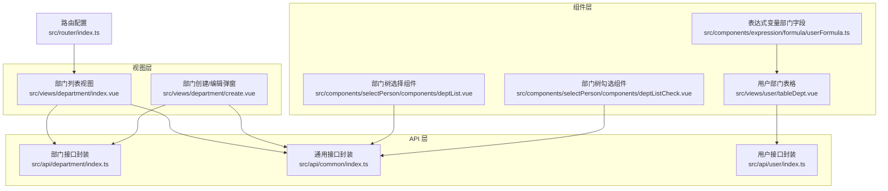
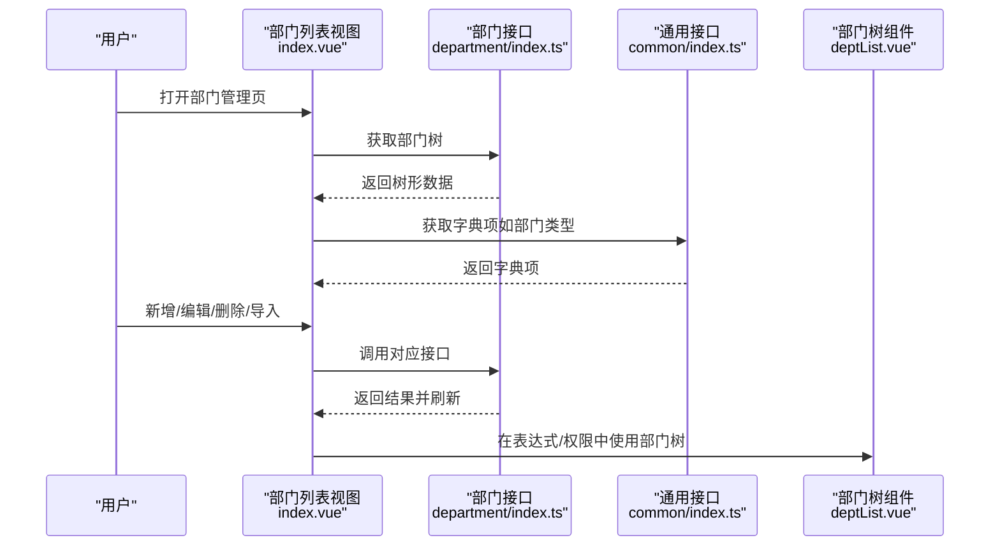
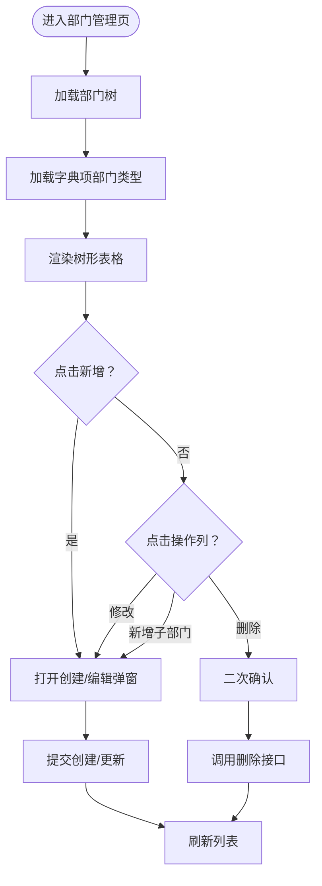
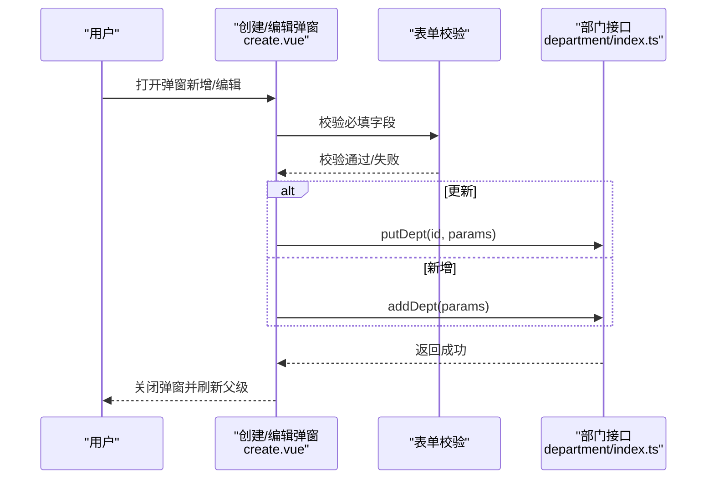
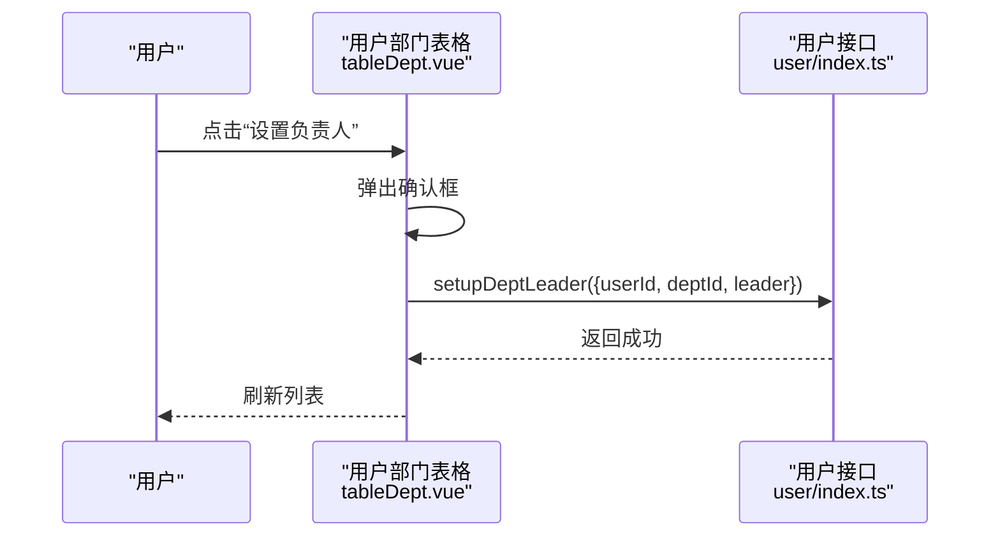
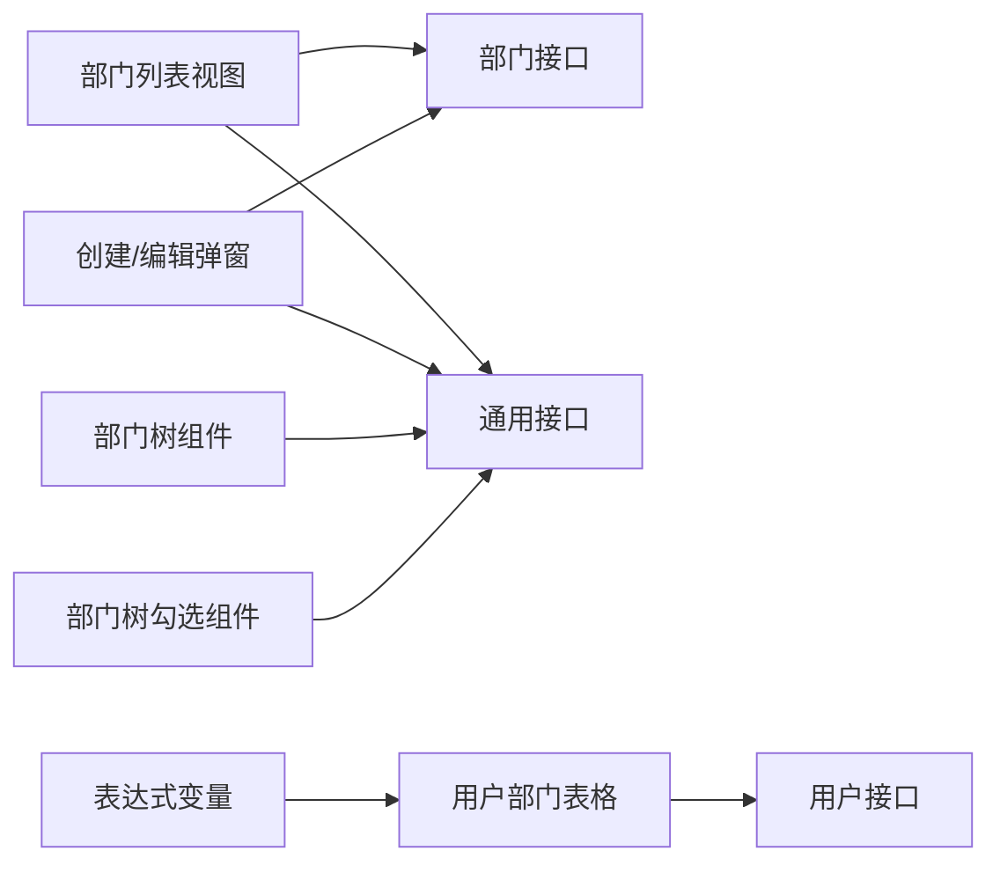

# 部门管理

<cite>
**本文引用的文件**
- [src/api/department/index.ts](file://src/api/department/index.ts)
- [src/views/department/index.vue](file://src/views/department/index.vue)
- [src/views/department/create.vue](file://src/views/department/create.vue)
- [src/api/common/index.ts](file://src/api/common/index.ts)
- [src/components/selectPerson/components/deptList.vue](file://src/components/selectPerson/components/deptList.vue)
- [src/components/selectPerson/components/deptListCheck.vue](file://src/components/selectPerson/components/deptListCheck.vue)
- [src/views/user/tableDept.vue](file://src/views/user/tableDept.vue)
- [src/api/user/index.ts](file://src/api/user/index.ts)
- [src/components/expression/formula/userFormula.ts](file://src/components/expression/formula/userFormula.ts)
- [src/router/index.ts](file://src/router/index.ts)
- [src/data/const.js](file://src/data/const.js)
- [src/utils/auth.ts](file://src/utils/auth.ts)
</cite>

## 目录
1. [简介](#简介)
2. [项目结构](#项目结构)
3. [核心组件](#核心组件)
4. [架构总览](#架构总览)
5. [详细组件分析](#详细组件分析)
6. [依赖分析](#依赖分析)
7. [性能考虑](#性能考虑)
8. [故障排查指南](#故障排查指南)
9. [结论](#结论)
10. [附录](#附录)

## 简介
本文件系统化梳理“部门管理”模块的设计与实现，覆盖组织架构与层级关系、部门负责人管理、部门创建/编辑/删除/导入、部门树形展示、部门与用户的关联以及权限控制要点。文档以代码为依据，结合可视化图示，帮助读者快速理解前后端交互、数据流与关键流程，并提供最佳实践建议。

## 项目结构
部门管理功能由三层构成：
- 视图层：部门列表页与创建/编辑弹窗
- API 层：部门与通用接口封装
- 组件层：树形选择、表达式变量、用户部门表格等复用组件

图表来源
- [src/views/department/index.vue:1-262](file://src/views/department/index.vue#L1-L262)
- [src/views/department/create.vue:1-196](file://src/views/department/create.vue#L1-L196)
- [src/api/department/index.ts:1-23](file://src/api/department/index.ts#L1-L23)
- [src/api/common/index.ts:1-68](file://src/api/common/index.ts#L1-L68)
- [src/api/user/index.ts:1-63](file://src/api/user/index.ts#L1-L63)
- [src/components/selectPerson/components/deptList.vue:1-70](file://src/components/selectPerson/components/deptList.vue#L1-L70)
- [src/components/selectPerson/components/deptListCheck.vue:1-86](file://src/components/selectPerson/components/deptListCheck.vue#L1-L86)
- [src/views/user/tableDept.vue:1-153](file://src/views/user/tableDept.vue#L1-L153)
- [src/components/expression/formula/userFormula.ts:196-289](file://src/components/expression/formula/userFormula.ts#L196-L289)
- [src/router/index.ts:1-189](file://src/router/index.ts#L1-L189)

章节来源
- [src/views/department/index.vue:1-262](file://src/views/department/index.vue#L1-L262)
- [src/views/department/create.vue:1-196](file://src/views/department/create.vue#L1-L196)
- [src/api/department/index.ts:1-23](file://src/api/department/index.ts#L1-L23)
- [src/api/common/index.ts:1-68](file://src/api/common/index.ts#L1-L68)
- [src/api/user/index.ts:1-63](file://src/api/user/index.ts#L1-L63)
- [src/components/selectPerson/components/deptList.vue:1-70](file://src/components/selectPerson/components/deptList.vue#L1-L70)
- [src/components/selectPerson/components/deptListCheck.vue:1-86](file://src/components/selectPerson/components/deptListCheck.vue#L1-L86)
- [src/views/user/tableDept.vue:1-153](file://src/views/user/tableDept.vue#L1-L153)
- [src/components/expression/formula/userFormula.ts:196-289](file://src/components/expression/formula/userFormula.ts#L196-L289)
- [src/router/index.ts:1-189](file://src/router/index.ts#L1-L189)

## 核心组件
- 部门接口封装：提供新增、删除、修改、树形查询、导入等能力
- 部门列表视图：负责渲染树形表格、操作入口、导入模板下载与批量导入
- 部门创建/编辑弹窗：负责表单校验、父子级选择、提交与刷新
- 通用接口封装：提供部门树、按用户/ID 查询部门、缓存字典等
- 用户部门表格：负责用户在部门中的“是否负责人”“是否兼任”“调动/免去”等操作
- 表达式变量：暴露部门相关变量，供流程/公式使用
- 路由配置：提供部门管理页面路由

章节来源
- [src/api/department/index.ts:1-23](file://src/api/department/index.ts#L1-L23)
- [src/views/department/index.vue:1-262](file://src/views/department/index.vue#L1-L262)
- [src/views/department/create.vue:1-196](file://src/views/department/create.vue#L1-L196)
- [src/api/common/index.ts:1-68](file://src/api/common/index.ts#L1-L68)
- [src/views/user/tableDept.vue:1-153](file://src/views/user/tableDept.vue#L1-L153)
- [src/components/expression/formula/userFormula.ts:196-289](file://src/components/expression/formula/userFormula.ts#L196-L289)
- [src/router/index.ts:1-189](file://src/router/index.ts#L1-L189)

## 架构总览
部门管理采用“视图-接口-组件”分层，数据从后端接口获取，前端以树形表格与弹窗交互方式完成 CRUD 操作；同时通过通用接口支持按用户或ID范围查询部门，用于权限与表达式场景。

图表来源
- [src/views/department/index.vue:60-101](file://src/views/department/index.vue#L60-L101)
- [src/api/department/index.ts:5-23](file://src/api/department/index.ts#L5-L23)
- [src/api/common/index.ts:25-27](file://src/api/common/index.ts#L25-L27)
- [src/components/selectPerson/components/deptList.vue:12-42](file://src/components/selectPerson/components/deptList.vue#L12-L42)

## 详细组件分析

### 部门列表视图（index.vue）
职责与流程
- 初始化加载部门树与字典项
- 提供新增（单个/批量导入）、编辑、删除入口
- 渲染树形表格，包含部门名称、编码、类型、操作列
- 支持导入模板下载与上传导入

关键交互
- 新增：打开创建弹窗，传入父级上下文
- 编辑：打开创建弹窗，回填当前记录
- 删除：二次确认后调用删除接口
- 导入：打开导入弹窗，下载模板、上传文件并提交

图表来源
- [src/views/department/index.vue:60-177](file://src/views/department/index.vue#L60-L177)

章节来源
- [src/views/department/index.vue:1-262](file://src/views/department/index.vue#L1-L262)

### 部门创建/编辑弹窗（create.vue）
职责与流程
- 表单字段：部门名称、编码、类型、父级部门（级联选择）
- 校验规则：必填校验
- 提交逻辑：区分新增与更新，处理 parentId（取末级值），调用接口并刷新父级

图表来源
- [src/views/department/create.vue:128-189](file://src/views/department/create.vue#L128-L189)
- [src/api/department/index.ts:5-15](file://src/api/department/index.ts#L5-L15)

章节来源
- [src/views/department/create.vue:1-196](file://src/views/department/create.vue#L1-L196)

### 通用接口与部门树（common/index.ts）
- 部门树：提供树形结构查询
- 按用户查询部门：支持主部门/兼部门/下级范围
- 按ID批量查询部门：用于权限/表达式场景
- 字典缓存：部门类型等枚举项

章节来源
- [src/api/common/index.ts:1-68](file://src/api/common/index.ts#L1-L68)

### 部门树选择组件（deptList.vue / deptListCheck.vue）
- 功能：在表单/权限/表达式中选择部门树
- deptList：勾选后通过 provide/inject 向上层传递选中部门集合
- deptListCheck：支持按当前用户/下级/自定义范围过滤部门树

章节来源
- [src/components/selectPerson/components/deptList.vue:1-70](file://src/components/selectPerson/components/deptList.vue#L1-L70)
- [src/components/selectPerson/components/deptListCheck.vue:1-86](file://src/components/selectPerson/components/deptListCheck.vue#L1-L86)

### 用户部门表格与负责人管理（tableDept.vue + user 接口）
职责与流程
- 展示用户所在部门、职位、是否兼任、是否负责人
- 支持“设置/取消负责人”“调动/免去兼任”
- 负责人设置通过用户接口完成

图表来源
- [src/views/user/tableDept.vue:116-143](file://src/views/user/tableDept.vue#L116-L143)
- [src/api/user/index.ts:44-47](file://src/api/user/index.ts#L44-L47)

章节来源
- [src/views/user/tableDept.vue:1-153](file://src/views/user/tableDept.vue#L1-L153)
- [src/api/user/index.ts:1-63](file://src/api/user/index.ts#L1-L63)

### 表达式变量与部门字段（userFormula.ts）
- 提供“部门/主要部门/兼任部门”的变量，包括 ID、名称、是否负责人
- 用于流程/公式中按用户维度读取部门信息

章节来源
- [src/components/expression/formula/userFormula.ts:196-289](file://src/components/expression/formula/userFormula.ts#L196-L289)

### 路由与权限控制
- 路由：部门管理页路由已注册
- 权限：项目内存在“动态部门负责人/分管负责人”配置结构，可用于流程/审批策略

章节来源
- [src/router/index.ts:50-53](file://src/router/index.ts#L50-L53)
- [src/data/const.js:173-188](file://src/data/const.js#L173-L188)

## 依赖分析
- 视图层依赖接口层：列表页依赖部门树与字典，创建弹窗依赖新增/更新接口
- 组件层依赖通用接口：树组件依赖按用户/ID 查询部门能力
- 用户模块依赖用户接口：负责人设置、兼任管理等
- 表达式模块依赖用户部门表格：读取部门变量

图表来源
- [src/views/department/index.vue:60-101](file://src/views/department/index.vue#L60-L101)
- [src/views/department/create.vue:64-96](file://src/views/department/create.vue#L64-L96)
- [src/api/department/index.ts:1-23](file://src/api/department/index.ts#L1-L23)
- [src/api/common/index.ts:1-68](file://src/api/common/index.ts#L1-L68)
- [src/views/user/tableDept.vue:40-82](file://src/views/user/tableDept.vue#L40-L82)
- [src/api/user/index.ts:1-63](file://src/api/user/index.ts#L1-L63)
- [src/components/expression/formula/userFormula.ts:196-289](file://src/components/expression/formula/userFormula.ts#L196-L289)

## 性能考虑
- 部门树渲染：使用虚拟滚动与懒加载，避免一次性渲染超大树
- 表单提交：在提交前进行本地校验，减少无效请求
- 批量导入：后端应支持断点续传与错误行导出，前端提供进度反馈
- 缓存字典：字典项一次性加载并缓存，避免重复请求
- 权限筛选：按用户/下级范围查询部门时，尽量缩小查询范围

## 故障排查指南
- 新增/编辑失败
  - 检查必填字段是否填写完整
  - 父级部门选择是否正确（需取末级 ID）
  - 接口返回错误码与提示
- 删除失败
  - 确认是否存在子部门或用户关联
  - 查看后端返回的具体原因
- 导入失败
  - 模板格式是否正确
  - 错误文件是否下载并修正后再试
- 负责人设置失败
  - 确认用户是否在目标部门
  - 检查接口参数（deptId、leader）

章节来源
- [src/views/department/create.vue:128-189](file://src/views/department/create.vue#L128-L189)
- [src/views/department/index.vue:160-177](file://src/views/department/index.vue#L160-L177)
- [src/views/department/index.vue:80-91](file://src/views/department/index.vue#L80-L91)
- [src/views/user/tableDept.vue:116-143](file://src/views/user/tableDept.vue#L116-L143)

## 结论
部门管理模块以清晰的分层设计实现了组织架构的可视化与可操作性，配合通用接口与表达式变量，满足了多场景下的权限与流程需求。建议在后续迭代中进一步完善导入错误定位、树形搜索与权限范围的细粒度控制。

## 附录
- 最佳实践
  - 父子级关系维护：新增/移动部门时，确保 parentId 正确指向父节点
  - 负责人管理：仅允许已在部门内的用户被设置为负责人
  - 数据一致性：删除部门前检查是否有用户或子部门关联
  - 表达式使用：优先使用“主要部门/兼任部门”变量，避免硬编码
  - 安全控制：结合路由守卫与后端权限，限制敏感操作

章节来源
- [src/router/index.ts:182-186](file://src/router/index.ts#L182-L186)
- [src/utils/auth.ts:1-20](file://src/utils/auth.ts#L1-L20)
- [src/data/const.js:173-188](file://src/data/const.js#L173-L188)