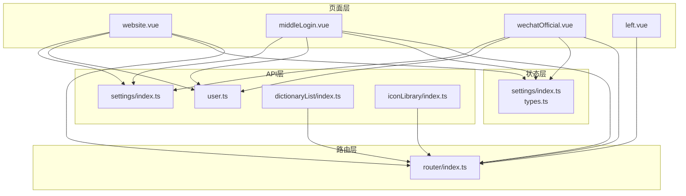
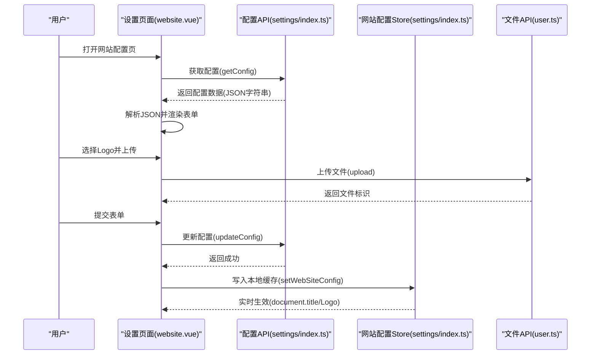
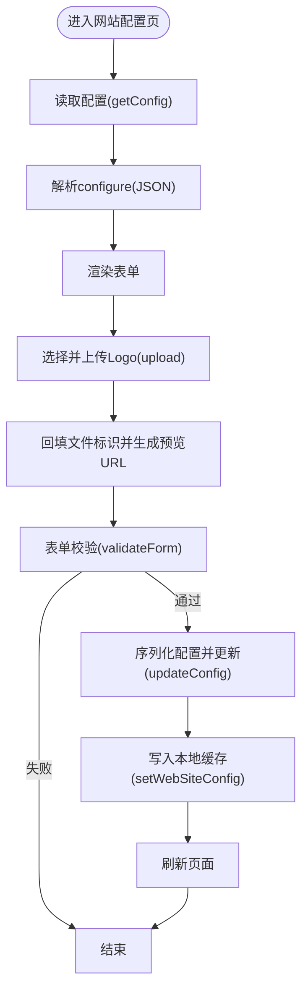
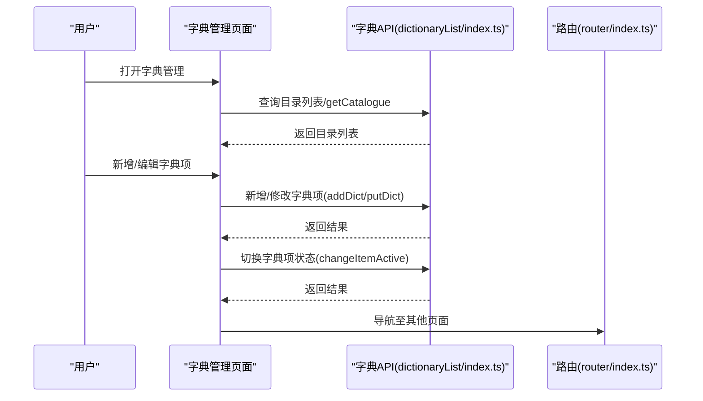
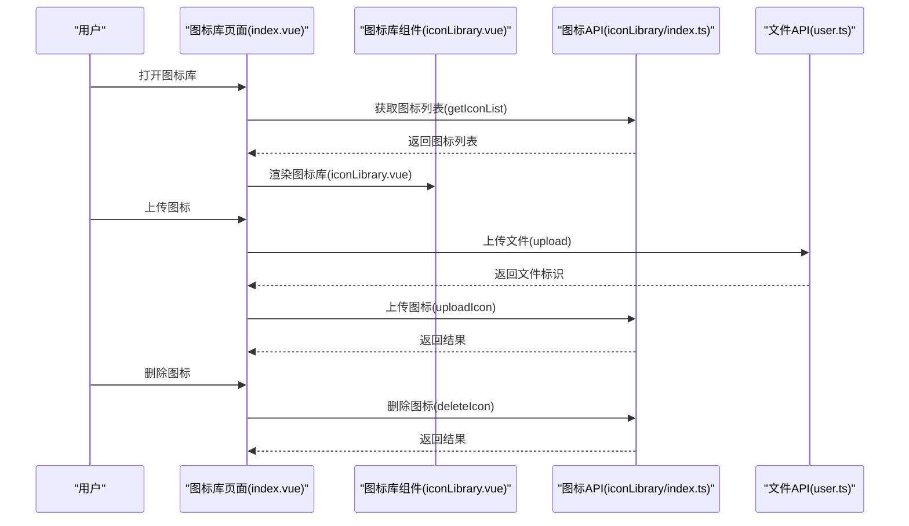
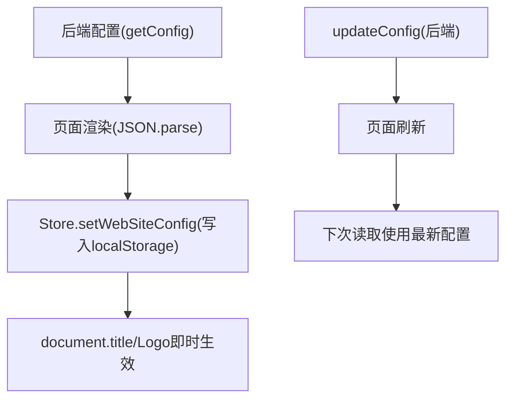
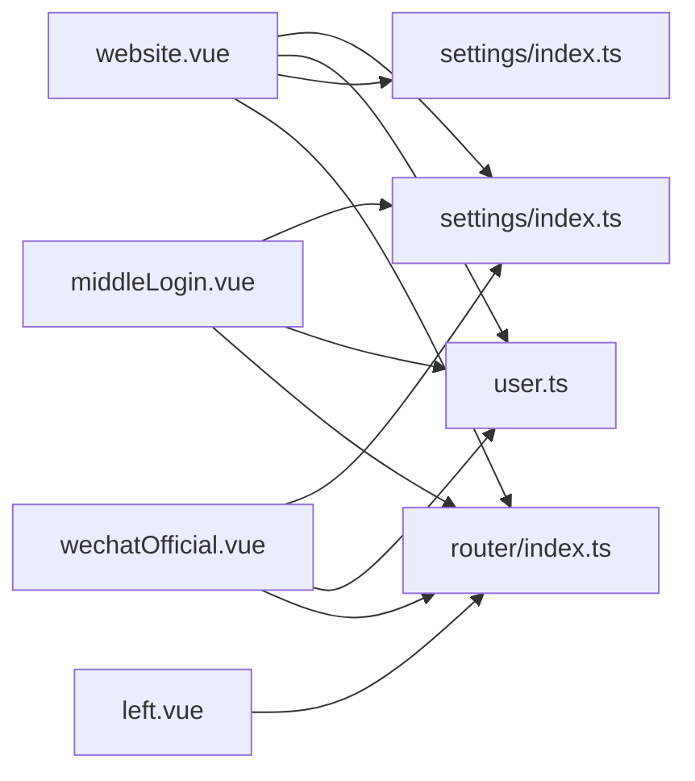

# 系统设置模块

<cite>
**本文档引用的文件**
- [src/api/settings/index.ts](file://src/api/settings/index.ts)
- [src/store/modules/settings/index.ts](file://src/store/modules/settings/index.ts)
- [src/store/modules/settings/types.ts](file://src/store/modules/settings/types.ts)
- [src/views/settings/website.vue](file://src/views/settings/website.vue)
- [src/views/settings/left.vue](file://src/views/settings/left.vue)
- [src/views/settings/middleLogin.vue](file://src/views/settings/middleLogin.vue)
- [src/views/settings/wechatOfficial.vue](file://src/views/settings/wechatOfficial.vue)
- [src/api/user.ts](file://src/api/user.ts)
- [src/utils/request.ts](file://src/utils/request.ts)
- [src/router/index.ts](file://src/router/index.ts)
- [src/api/dictionaryList/index.ts](file://src/api/dictionaryList/index.ts)
- [src/views/dictionaryList/create.vue](file://src/views/dictionaryList/create.vue)
- [src/components/iconLibrary/iconLibrary.vue](file://src/components/iconLibrary/iconLibrary.vue)
- [src/views/iconLibrary/index.vue](file://src/views/iconLibrary/index.vue)
- [src/api/iconLibrary/index.ts](file://src/api/iconLibrary/index.ts)
</cite>

## 目录
1. [简介](#简介)
2. [项目结构](#项目结构)
3. [核心组件](#核心组件)
4. [架构总览](#架构总览)
5. [详细组件分析](#详细组件分析)
6. [依赖关系分析](#依赖关系分析)
7. [性能考虑](#性能考虑)
8. [故障排除指南](#故障排除指南)
9. [结论](#结论)
10. [附录](#附录)

## 简介
本文件为系统设置模块的综合技术文档，覆盖网站配置、字典管理、图标库管理、系统参数设置等能力。重点阐述配置的存储机制（本地存储与后端配置）、配置项的验证规则、配置变更的生效流程，并扩展到多租户配置、配置备份恢复、配置导入导出等高级主题。同时提供最佳实践与维护指导，帮助开发与运维人员高效、安全地管理平台配置。

## 项目结构
系统设置模块由前端页面、API 接口、状态管理与路由组成，形成“页面 -> API -> 后端”的清晰分层：

- 页面层：网站配置、服务中台认证、微信服务号认证三个设置页
- API 层：配置读取/更新、文件上传下载、字典管理、图标库管理
- 状态层：网站配置的本地缓存与实时生效
- 路由层：统一导航与页面跳转

图表来源
- [src/views/settings/website.vue:1-249](file://src/views/settings/website.vue#L1-L249)
- [src/views/settings/middleLogin.vue:1-189](file://src/views/settings/middleLogin.vue#L1-L189)
- [src/views/settings/wechatOfficial.vue:1-195](file://src/views/settings/wechatOfficial.vue#L1-L195)
- [src/views/settings/left.vue:1-68](file://src/views/settings/left.vue#L1-L68)
- [src/api/settings/index.ts:1-19](file://src/api/settings/index.ts#L1-L19)
- [src/api/user.ts:1-16](file://src/api/user.ts#L1-L16)
- [src/store/modules/settings/index.ts:1-53](file://src/store/modules/settings/index.ts#L1-L53)
- [src/store/modules/settings/types.ts:1-5](file://src/store/modules/settings/types.ts#L1-L5)
- [src/router/index.ts:105-119](file://src/router/index.ts#L105-L119)

章节来源
- [src/views/settings/website.vue:1-249](file://src/views/settings/website.vue#L1-L249)
- [src/views/settings/left.vue:1-68](file://src/views/settings/left.vue#L1-L68)
- [src/api/settings/index.ts:1-19](file://src/api/settings/index.ts#L1-L19)
- [src/store/modules/settings/index.ts:1-53](file://src/store/modules/settings/index.ts#L1-L53)
- [src/router/index.ts:105-119](file://src/router/index.ts#L105-L119)

## 核心组件
- 配置 API 模块：提供配置读取、应用、更新接口，统一通过内部业务路径访问
- 网站配置 Store：封装网站标题与 Logo 的本地缓存与实时生效逻辑
- 设置页面：网站配置、服务中台认证、微信服务号认证三类配置页
- 文件上传 API：统一处理图片上传与下载
- 路由与菜单：左侧导航与页面跳转

章节来源
- [src/api/settings/index.ts:1-19](file://src/api/settings/index.ts#L1-L19)
- [src/store/modules/settings/index.ts:1-53](file://src/store/modules/settings/index.ts#L1-L53)
- [src/views/settings/website.vue:1-249](file://src/views/settings/website.vue#L1-L249)
- [src/views/settings/middleLogin.vue:1-189](file://src/views/settings/middleLogin.vue#L1-L189)
- [src/views/settings/wechatOfficial.vue:1-195](file://src/views/settings/wechatOfficial.vue#L1-L195)
- [src/api/user.ts:1-16](file://src/api/user.ts#L1-L16)
- [src/router/index.ts:105-119](file://src/router/index.ts#L105-L119)

## 架构总览
系统设置模块采用“页面 -> API -> 后端”的分层设计，页面通过 API 获取与更新配置；配置更新后，网站配置 Store 会同步写入本地存储并即时生效；文件上传通过独立的上传接口完成。

图表来源
- [src/views/settings/website.vue:76-171](file://src/views/settings/website.vue#L76-L171)
- [src/api/settings/index.ts:10-18](file://src/api/settings/index.ts#L10-L18)
- [src/store/modules/settings/index.ts:42-49](file://src/store/modules/settings/index.ts#L42-L49)
- [src/api/user.ts:10-12](file://src/api/user.ts#L10-L12)

## 详细组件分析

### 网站配置模块
- 功能概述：支持设置网站名称与 Logo，包含表单校验、文件上传、配置更新与本地缓存同步
- 数据流：
  - 初始化：调用配置读取接口，解析返回的 JSON 字符串，填充表单
  - Logo 上传：构造上传参数，调用上传接口，回填文件标识并生成预览 URL
  - 提交：对必填字段进行校验，序列化配置对象，调用更新接口，成功后刷新页面并写入本地缓存
- 本地缓存：Store 中保存标题与 Logo，优先使用 Store 值，否则回退到本地存储中的配置对象；更新后同步写入本地存储并设置 document.title

图表来源
- [src/views/settings/website.vue:109-169](file://src/views/settings/website.vue#L109-L169)
- [src/store/modules/settings/index.ts:42-49](file://src/store/modules/settings/index.ts#L42-L49)

章节来源
- [src/views/settings/website.vue:1-249](file://src/views/settings/website.vue#L1-L249)
- [src/store/modules/settings/index.ts:1-53](file://src/store/modules/settings/index.ts#L1-L53)
- [src/store/modules/settings/types.ts:1-5](file://src/store/modules/settings/types.ts#L1-L5)

### 服务中台认证模块
- 功能概述：控制是否启用服务中台认证以及认证地址
- 表单规则：当启用开关打开时，认证地址为必填
- 数据流：读取配置 -> 渲染表单 -> 校验 -> 更新配置 -> 刷新

章节来源
- [src/views/settings/middleLogin.vue:1-189](file://src/views/settings/middleLogin.vue#L1-L189)

### 微信服务号认证模块
- 功能概述：控制是否启用微信认证及 appid、appSecret 的配置
- 表单规则：启用时 appid 与 appSecret 必填
- 数据流：读取配置 -> 渲染表单 -> 校验 -> 更新配置 -> 刷新

章节来源
- [src/views/settings/wechatOfficial.vue:1-195](file://src/views/settings/wechatOfficial.vue#L1-L195)

### 字典管理模块
- 功能概述：支持字典目录与字典项的增删改查、状态切换
- 关键接口：
  - 新增/修改字典目录
  - 目录列表查询
  - 新增/修改字典项
  - 字典项列表查询
  - 更改字典项状态

图表来源
- [src/api/dictionaryList/index.ts:1-31](file://src/api/dictionaryList/index.ts#L1-L31)
- [src/router/index.ts:70-73](file://src/router/index.ts#L70-L73)

章节来源
- [src/api/dictionaryList/index.ts:1-31](file://src/api/dictionaryList/index.ts#L1-L31)
- [src/views/dictionaryList/create.vue:1-49](file://src/views/dictionaryList/create.vue#L1-L49)
- [src/router/index.ts:70-73](file://src/router/index.ts#L70-L73)

### 图标库管理模块
- 功能概述：展示图标库、上传新图标、删除图标
- 关键接口：
  - 获取图标缓存列表
  - 获取图标列表
  - 上传图标
  - 删除图标
- 组件交互：图标库组件负责展示与选择，页面负责上传与删除操作

图表来源
- [src/views/iconLibrary/index.vue:1-49](file://src/views/iconLibrary/index.vue#L1-L49)
- [src/components/iconLibrary/iconLibrary.vue:1-69](file://src/components/iconLibrary/iconLibrary.vue#L1-L69)
- [src/api/iconLibrary/index.ts:1-24](file://src/api/iconLibrary/index.ts#L1-L24)
- [src/api/user.ts:10-12](file://src/api/user.ts#L10-L12)

章节来源
- [src/views/iconLibrary/index.vue:1-49](file://src/views/iconLibrary/index.vue#L1-L49)
- [src/components/iconLibrary/iconLibrary.vue:1-69](file://src/components/iconLibrary/iconLibrary.vue#L1-L69)
- [src/api/iconLibrary/index.ts:1-24](file://src/api/iconLibrary/index.ts#L1-L24)
- [src/api/user.ts:1-16](file://src/api/user.ts#L1-L16)

### 配置存储与生效机制
- 存储位置：
  - 后端配置：通过配置 API 读取与更新
  - 本地缓存：网站配置 Store 将标题与 Logo 写入本地存储，页面优先从 Store 读取，回退到本地存储
- 生效方式：
  - 网站配置：更新成功后立即写入本地缓存并设置 document.title，Logo 通过带 token 的下载地址拼接
  - 其他配置：更新成功后刷新页面以确保 UI 与后端一致

图表来源
- [src/views/settings/website.vue:109-169](file://src/views/settings/website.vue#L109-L169)
- [src/store/modules/settings/index.ts:42-49](file://src/store/modules/settings/index.ts#L42-L49)

章节来源
- [src/store/modules/settings/index.ts:1-53](file://src/store/modules/settings/index.ts#L1-L53)
- [src/views/settings/website.vue:1-249](file://src/views/settings/website.vue#L1-L249)

### 配置验证规则
- 网站配置：网站名称必填
- 服务中台认证：启用时认证地址必填
- 微信服务号认证：启用时 appid 与 appSecret 必填
- 字典管理：目录名称、目录编码、排序号等字段存在长度与范围限制

章节来源
- [src/views/settings/website.vue:96-103](file://src/views/settings/website.vue#L96-L103)
- [src/views/settings/middleLogin.vue:67-74](file://src/views/settings/middleLogin.vue#L67-L74)
- [src/views/settings/wechatOfficial.vue:62-75](file://src/views/settings/wechatOfficial.vue#L62-L75)
- [src/views/dictionaryList/create.vue:17-44](file://src/views/dictionaryList/create.vue#L17-L44)

### 多租户配置、备份恢复与导入导出（扩展建议）
- 多租户配置
  - 在后端按租户维度隔离配置键空间，前端在读取/更新时携带租户标识或通过路由参数区分
  - Store 可按租户维度拆分或增加租户上下文标识
- 配置备份与恢复
  - 备份：导出当前所有配置为 JSON 文件，包含配置码、配置内容与元数据
  - 恢复：批量导入 JSON 文件，按配置码写入后端，失败时回滚并提示
- 配置导入导出
  - 支持全量导出与增量导出；导入时进行配置码与版本兼容性校验
  - 导入失败时保留现有配置，记录错误日志并允许用户重试

说明：上述为基于现有 API 的扩展建议，具体实现需结合后端接口与权限控制策略。

## 依赖关系分析
- 页面依赖 API：设置页依赖配置 API，文件页依赖文件 API
- Store 依赖：网站配置 Store 仅在网站配置页使用，避免跨模块耦合
- 路由依赖：左侧导航与页面路由强绑定，保证导航一致性

图表来源
- [src/views/settings/website.vue:76-83](file://src/views/settings/website.vue#L76-L83)
- [src/views/settings/middleLogin.vue:50-55](file://src/views/settings/middleLogin.vue#L50-L55)
- [src/views/settings/wechatOfficial.vue:43-48](file://src/views/settings/wechatOfficial.vue#L43-L48)
- [src/api/settings/index.ts:1-19](file://src/api/settings/index.ts#L1-L19)
- [src/api/user.ts:1-16](file://src/api/user.ts#L1-L16)
- [src/store/modules/settings/index.ts:1-53](file://src/store/modules/settings/index.ts#L1-L53)
- [src/views/settings/left.vue:16-31](file://src/views/settings/left.vue#L16-L31)
- [src/router/index.ts:105-119](file://src/router/index.ts#L105-L119)

章节来源
- [src/views/settings/left.vue:1-68](file://src/views/settings/left.vue#L1-L68)
- [src/router/index.ts:105-119](file://src/router/index.ts#L105-L119)

## 性能考虑
- 配置读取：首次进入页面时仅拉取当前配置，避免不必要的请求
- 本地缓存：网站配置 Store 缓存关键字段，减少重复解析与 DOM 更新
- 图标加载：图标库组件按需加载，避免一次性渲染过多图片
- 文件上传：上传前进行简单校验，减少无效请求

## 故障排除指南
- 登录态失效
  - 现象：请求返回 401 或自动跳转登录
  - 处理：检查本地 token 是否存在，确认拦截器是否正确注入 token
- 配置更新失败
  - 现象：更新接口返回错误消息
  - 处理：查看错误提示，确认表单校验通过且配置内容格式正确
- Logo 预览失败
  - 现象：Logo 显示异常或无法加载
  - 处理：确认上传成功返回的标识有效，下载地址拼接包含 token

章节来源
- [src/utils/request.ts:47-113](file://src/utils/request.ts#L47-L113)
- [src/views/settings/website.vue:121-143](file://src/views/settings/website.vue#L121-L143)

## 结论
系统设置模块通过清晰的页面、API 与状态管理分层，实现了网站配置、认证配置、字典管理与图标库管理的完整闭环。其本地缓存与后端配置协同机制确保了配置的快速生效与一致性。建议在后续迭代中完善多租户隔离、配置备份恢复与导入导出能力，进一步提升系统的可维护性与可运营性。

## 附录
- 最佳实践
  - 配置项命名规范化，避免硬编码
  - 表单校验前置，减少无效请求
  - 配置更新后及时刷新页面，确保 UI 与后端一致
  - 图标与文件上传统一走上传接口，便于权限与容量管控
- 维护指导
  - 新增配置项时，同步完善前端校验与后端校验规则
  - 定期清理无用图标与字典项，保持系统整洁
  - 记录配置变更日志，便于审计与回溯