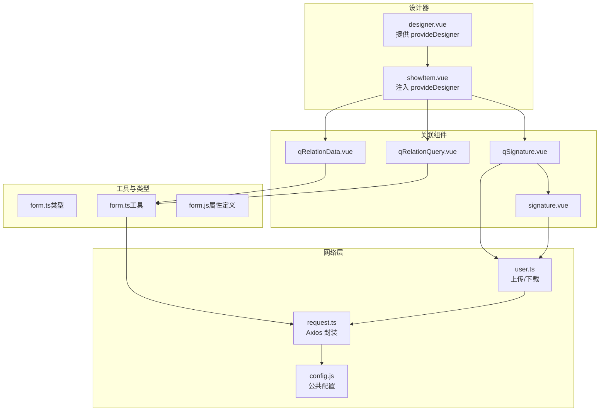
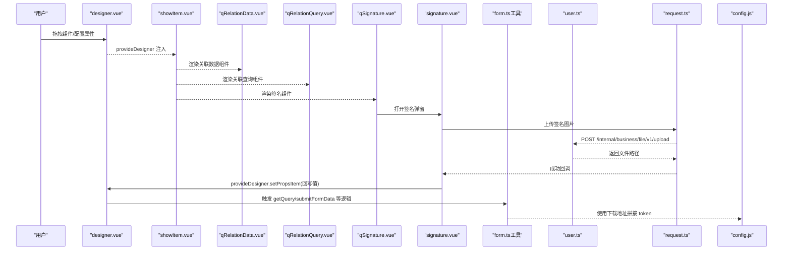
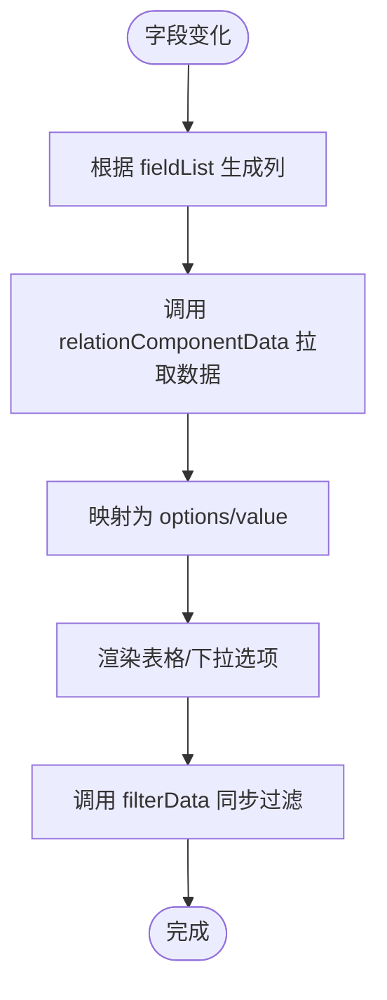
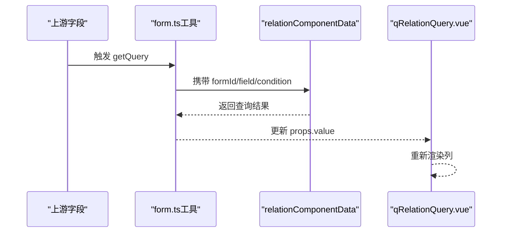
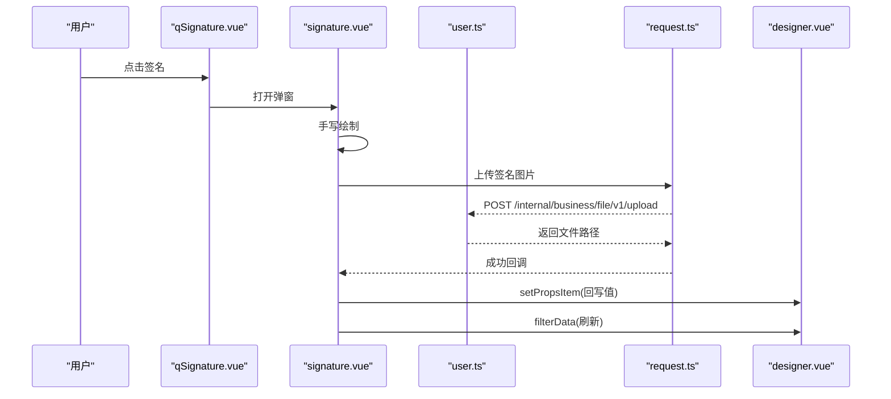
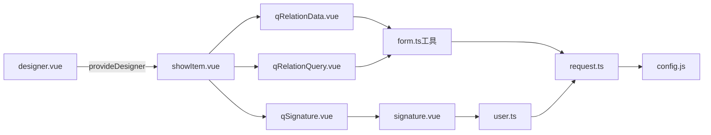

# 关联组件

<cite>
**本文引用的文件**
- [qRelationData.vue](file://src/components/showItem/qRelationData.vue)
- [qRelationQuery.vue](file://src/components/showItem/qRelationQuery.vue)
- [qSignature.vue](file://src/components/showItem/qSignature.vue)
- [signature.vue](file://src/components/signature/signature.vue)
- [user.ts](file://src/api/user.ts)
- [request.ts](file://src/utils/request.ts)
- [config.js](file://public/config.js)
- [form.js](file://src/data/form.js)
- [designer.vue](file://src/views/form/designer.vue)
- [showItem.vue](file://src/components/showItem/showItem.vue)
- [form.ts](file://src/types/form.ts)
- [form.ts（工具）](file://src/utils/form.ts)
</cite>

## 目录
1. [引言](#引言)
2. [项目结构](#项目结构)
3. [核心组件](#核心组件)
4. [架构总览](#架构总览)
5. [详细组件分析](#详细组件分析)
6. [依赖关系分析](#依赖关系分析)
7. [性能考量](#性能考量)
8. [故障排查指南](#故障排查指南)
9. [结论](#结论)
10. [附录](#附录)

## 引言
本文件聚焦于表单设计器中的“关联组件”体系，包括：
- 关联数据组件（qRelationData）
- 关联查询组件（qRelationQuery）
- 电子签名组件（qSignature）
- 签名弹窗组件（signature）

内容涵盖组件的数据关联机制、级联更新逻辑、远程数据获取、缓存策略；查询条件配置、过滤规则设置、排序方式定义；复杂关联场景下的使用示例、性能优化方案、数据一致性保证；以及安全性考虑、权限控制、审计日志记录。

## 项目结构
围绕关联组件的关键文件组织如下：
- 组件层：qRelationData.vue、qRelationQuery.vue、qSignature.vue、signature.vue
- 工具与类型：form.ts（类型）、form.ts（工具函数）
- 设计器入口：designer.vue（提供 provideDesigner 注入）
- 属性与默认值：form.js（组件属性定义）
- 请求封装：request.ts（统一拦截器、token 注入）
- 接口封装：user.ts（上传/下载）
- 公共配置：config.js（后端 API 基址、下载地址等）

图表来源
- [designer.vue:283-287](file://src/views/form/designer.vue#L283-L287)
- [showItem.vue:65-74](file://src/components/showItem/showItem.vue#L65-L74)
- [qRelationData.vue:1-186](file://src/components/showItem/qRelationData.vue#L1-L186)
- [qRelationQuery.vue:1-115](file://src/components/showItem/qRelationQuery.vue#L1-L115)
- [qSignature.vue:1-61](file://src/components/showItem/qSignature.vue#L1-L61)
- [signature.vue:1-121](file://src/components/signature/signature.vue#L1-L121)
- [form.ts（工具）:602-722](file://src/utils/form.ts#L602-L722)
- [user.ts:1-16](file://src/api/user.ts#L1-L16)
- [request.ts:1-159](file://src/utils/request.ts#L1-L159)
- [config.js:1-11](file://public/config.js#L1-L11)

章节来源
- [designer.vue:1-444](file://src/views/form/designer.vue#L1-L444)
- [showItem.vue:38-75](file://src/components/showItem/showItem.vue#L38-L75)
- [qRelationData.vue:1-186](file://src/components/showItem/qRelationData.vue#L1-L186)
- [qRelationQuery.vue:1-115](file://src/components/showItem/qRelationQuery.vue#L1-L115)
- [qSignature.vue:1-61](file://src/components/showItem/qSignature.vue#L1-L61)
- [signature.vue:1-121](file://src/components/signature/signature.vue#L1-L121)
- [form.ts（工具）:602-722](file://src/utils/form.ts#L602-L722)
- [user.ts:1-16](file://src/api/user.ts#L1-L16)
- [request.ts:1-159](file://src/utils/request.ts#L1-L159)
- [config.js:1-11](file://public/config.js#L1-L11)

## 核心组件
- 关联数据组件（qRelationData）
  - 功能：在表单中展示“关联表”的字段列表，并将远程查询结果映射为可读的显示项（含图片、附件、用户/部门等）。
  - 关键点：根据 fieldList 的类型动态渲染列；对 SIGNATURE、USER、DEPT、ATTACH 等类型进行特殊处理；支持单选/多选模式下的值解析与表格展示。
- 关联查询组件（qRelationQuery）
  - 功能：作为“查询条件”组件，基于上游字段联动，拉取目标表的行数据并在表格中展示。
  - 关键点：监听 fieldList 变化生成列；对多种字段类型进行标签化渲染；直接绑定 props.value 作为表格数据源。
- 电子签名组件（qSignature）
  - 功能：点击触发签名弹窗（signature），支持手写绘制、撤销、清屏、保存；保存成功后回写到组件值。
  - 关键点：通过 provideDesigner 注入的 setPropsItem 回写值；调用上传接口返回文件路径；渲染时拼接下载地址与 token。
- 签名弹窗组件（signature）
  - 功能：模态框内集成手写板，保存为 PNG 并上传，上传成功后通过 provideDesigner 回写值并刷新过滤。
  - 关键点：base64 转 File；构造 fileProfile JSON；上传后调用 provideState.setPropsItem 或 provideItem.setPropsItem；必要时触发 filterData。

章节来源
- [qRelationData.vue:1-186](file://src/components/showItem/qRelationData.vue#L1-L186)
- [qRelationQuery.vue:1-115](file://src/components/showItem/qRelationQuery.vue#L1-L115)
- [qSignature.vue:1-61](file://src/components/showItem/qSignature.vue#L1-L61)
- [signature.vue:1-121](file://src/components/signature/signature.vue#L1-L121)

## 架构总览
下图展示“设计器 -> 组件 -> 工具函数 -> 网络层”的整体调用链路，以及签名组件的上传与回写流程。

图表来源
- [designer.vue:283-287](file://src/views/form/designer.vue#L283-L287)
- [showItem.vue:65-74](file://src/components/showItem/showItem.vue#L65-L74)
- [qRelationData.vue:1-186](file://src/components/showItem/qRelationData.vue#L1-L186)
- [qRelationQuery.vue:1-115](file://src/components/showItem/qRelationQuery.vue#L1-L115)
- [qSignature.vue:1-61](file://src/components/showItem/qSignature.vue#L1-L61)
- [signature.vue:50-78](file://src/components/signature/signature.vue#L50-L78)
- [form.ts（工具）:602-722](file://src/utils/form.ts#L602-L722)
- [user.ts:10-12](file://src/api/user.ts#L10-L12)
- [request.ts:26-66](file://src/utils/request.ts#L26-L66)
- [config.js:8-10](file://public/config.js#L8-L10)

## 详细组件分析

### 关联数据组件（qRelationData）
- 数据关联机制
  - 通过 props.comDes.props.fieldList 决定列渲染；对不同字段类型（如 SIGNATURE、USER、DEPT、ATTACH 等）进行标签化或图片/链接渲染。
  - 当组件值存在时，根据 selectType（single/multiple）解析为数组并赋给内部 data，同时调用 provideDesigner.filterData 同步过滤状态。
- 级联更新逻辑
  - 监听 props.comDes.props.fieldList 与 props.comDes.props.value，即时重建列与数据。
- 远程数据获取与缓存策略
  - 远程数据由工具函数 getQuery 在上游字段变化时触发，调用 relationComponentData 获取关联表数据，再将结果映射为 options/value。
  - 缓存：组件本身不维护本地缓存；数据一致性由上游字段变更驱动，避免重复请求。
- 查询条件配置与过滤规则
  - 条件来源于 props.comDes.props.conditionList，按字段名从表单上下文取值；过滤规则在后端完成，前端仅负责展示。
- 排序方式定义
  - 排序由后端接口控制；前端不做二次排序。
- 使用示例（复杂场景）
  - 场景：A 表单字段变化 → 触发关联查询 → 在 qRelationData 中展示多行数据并允许选择 → 选择后回写到表单值。
  - 关键点：确保 fieldList 与 selectType 正确配置；注意多选时值的序列化/反序列化。
- 性能优化
  - 列渲染采用按需生成，避免不必要的计算；减少深层 JSON 解析次数。
- 数据一致性
  - 通过 watch 同步 value 与 data；filterData 通知设计器刷新其他相关组件。

图表来源
- [qRelationData.vue:26-172](file://src/components/showItem/qRelationData.vue#L26-L172)
- [form.ts（工具）:602-722](file://src/utils/form.ts#L602-L722)

章节来源
- [qRelationData.vue:1-186](file://src/components/showItem/qRelationData.vue#L1-L186)
- [form.ts（工具）:602-722](file://src/utils/form.ts#L602-L722)

### 关联查询组件（qRelationQuery）
- 数据关联机制
  - 直接使用 props.comDes.props.value 作为表格数据源；列渲染逻辑与 qRelationData 类似，但更侧重“查询结果展示”。
- 级联更新逻辑
  - 通过 getQuery 在上游字段变化时刷新 value。
- 远程数据获取与缓存策略
  - 同样由 getQuery 调用 relationComponentData 获取；组件不缓存，依赖上游触发。
- 查询条件配置与过滤规则
  - 条件配置同上，过滤规则在后端执行。
- 使用示例（复杂场景）
  - 场景：多条件筛选 → 后端返回结果 → 在表格中展示；支持多选/单选切换。
- 性能优化
  - 列渲染按需；避免对大数组进行重复映射。
- 数据一致性
  - 依赖设计器提供的 filterData 保持联动一致。

图表来源
- [qRelationQuery.vue:19-106](file://src/components/showItem/qRelationQuery.vue#L19-L106)
- [form.ts（工具）:602-722](file://src/utils/form.ts#L602-L722)

章节来源
- [qRelationQuery.vue:1-115](file://src/components/showItem/qRelationQuery.vue#L1-L115)
- [form.ts（工具）:602-722](file://src/utils/form.ts#L602-L722)

### 电子签名组件（qSignature）与签名弹窗（signature）
- 数据关联机制
  - qSignature 作为入口，点击后打开 signature 弹窗；signature 保存后通过 provideDesigner.setPropsItem 回写值。
- 级联更新逻辑
  - 保存成功后，若非编辑态，调用 filterData 刷新其他组件。
- 远程数据获取与缓存策略
  - 渲染签名图片时，使用下载地址与 token 拼接；上传签名图片走 /internal/business/file/v1/upload。
- 查询条件配置与过滤规则
  - 签名组件不参与查询条件配置。
- 使用示例（复杂场景）
  - 场景：在审批流程中，要求填写人手写签名；签名完成后自动回写并刷新相关组件。
- 性能优化
  - 仅在保存时触发上传；base64 转 File 时注意内存占用。
- 数据一致性
  - 通过 provideDesigner.setPropsItem 保证值写入一致性；filterData 保障联动刷新。

图表来源
- [qSignature.vue:24-30](file://src/components/showItem/qSignature.vue#L24-L30)
- [signature.vue:50-78](file://src/components/signature/signature.vue#L50-L78)
- [user.ts:10-12](file://src/api/user.ts#L10-L12)
- [request.ts:26-66](file://src/utils/request.ts#L26-L66)
- [designer.vue:283-287](file://src/views/form/designer.vue#L283-L287)

章节来源
- [qSignature.vue:1-61](file://src/components/showItem/qSignature.vue#L1-L61)
- [signature.vue:1-121](file://src/components/signature/signature.vue#L1-L121)
- [user.ts:1-16](file://src/api/user.ts#L1-L16)
- [request.ts:1-159](file://src/utils/request.ts#L1-L159)
- [designer.vue:283-287](file://src/views/form/designer.vue#L283-L287)

## 依赖关系分析
- 组件间依赖
  - qRelationData 与 qRelationQuery 依赖工具函数 form.ts（工具）中的 getQuery、relationComponentData 等。
  - qSignature 与 signature 依赖 provideDesigner 注入的 setPropsItem/filterData。
  - signature 依赖 user.ts 的 upload 接口。
- 外部依赖
  - request.ts 提供统一拦截器、token 注入、响应处理。
  - config.js 提供下载地址、上传大小限制等公共配置。
- 设计器注入
  - designer.vue 提供 provideDesigner，包含 setPropsItem、filterData、getPropsItem 等方法，供子组件调用。

图表来源
- [qRelationData.vue:1-186](file://src/components/showItem/qRelationData.vue#L1-L186)
- [qRelationQuery.vue:1-115](file://src/components/showItem/qRelationQuery.vue#L1-L115)
- [qSignature.vue:1-61](file://src/components/showItem/qSignature.vue#L1-L61)
- [signature.vue:1-121](file://src/components/signature/signature.vue#L1-L121)
- [form.ts（工具）:602-722](file://src/utils/form.ts#L602-L722)
- [user.ts:1-16](file://src/api/user.ts#L1-L16)
- [request.ts:1-159](file://src/utils/request.ts#L1-L159)
- [config.js:1-11](file://public/config.js#L1-L11)
- [designer.vue:283-287](file://src/views/form/designer.vue#L283-L287)
- [showItem.vue:65-74](file://src/components/showItem/showItem.vue#L65-L74)

章节来源
- [designer.vue:283-287](file://src/views/form/designer.vue#L283-L287)
- [showItem.vue:65-74](file://src/components/showItem/showItem.vue#L65-L74)
- [form.ts（工具）:602-722](file://src/utils/form.ts#L602-L722)
- [user.ts:1-16](file://src/api/user.ts#L1-L16)
- [request.ts:1-159](file://src/utils/request.ts#L1-L159)
- [config.js:1-11](file://public/config.js#L1-L11)

## 性能考量
- 列渲染优化
  - 仅在 fieldList 变化时重建列，避免重复渲染。
- 数据映射优化
  - 对多选/用户/部门等类型，尽量使用批量 ID 查询接口（如 getUsersByIds/getDeptsByIds），减少多次请求。
- 上传与渲染
  - 签名图片上传采用一次性 FormData，避免多次请求；渲染时拼接 token，减少额外鉴权请求。
- 请求拦截与白名单
  - request.ts 中对特定接口放行（如配置接口），避免重复注入 token，降低请求体积。
- 建议
  - 对频繁联动的关联查询，建议在后端增加分页/限制返回条数；前端对大数组进行虚拟滚动或分页展示。

## 故障排查指南
- 401 未授权
  - 现象：请求返回 401，页面跳转至登录。
  - 排查：检查 localStorage 中 wornbench_token 是否存在；确认 request.ts 的拦截器是否正确注入 token。
- 上传失败
  - 现象：签名保存后未回写或报错。
  - 排查：确认上传接口返回的文件路径是否正确；检查签名弹窗保存逻辑与 provideDesigner.setPropsItem 调用。
- 关联数据不刷新
  - 现象：上游字段变化后，qRelationData/qRelationQuery 未更新。
  - 排查：确认 getQuery 是否被触发；检查 conditionList 是否正确；确保 filterData 已调用。
- 图片/附件无法显示
  - 现象：签名图片或附件链接无效。
  - 排查：确认下载地址与 token 拼接是否正确；检查后端权限与文件是否存在。

章节来源
- [request.ts:47-66](file://src/utils/request.ts#L47-L66)
- [signature.vue:50-78](file://src/components/signature/signature.vue#L50-L78)
- [form.ts（工具）:602-722](file://src/utils/form.ts#L602-L722)
- [config.js:8-10](file://public/config.js#L8-L10)

## 结论
关联组件通过“设计器注入 + 工具函数 + 网络层”的协作，实现了灵活的表单级联与远程数据展示；签名组件则提供了完整的手写签名能力。整体架构清晰、职责分离明确，具备良好的扩展性与可维护性。建议在复杂场景中结合后端分页与前端虚拟化策略进一步提升性能，并完善异常处理与审计日志。

## 附录
- 组件属性与默认值参考
  - 关联数据/查询组件的属性定义与默认值可参考 form.js 中 RELATION_DATA/RELATION_QUERY 的 props 与 attribute。
- 类型定义
  - 表单与应用相关类型定义参考 form.ts（类型）。

章节来源
- [form.js:2100-2223](file://src/data/form.js#L2100-L2223)
- [form.ts（类型）:1-44](file://src/types/form.ts#L1-L44)