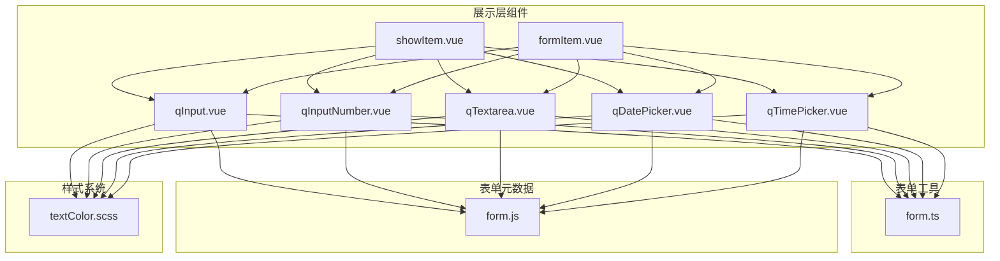
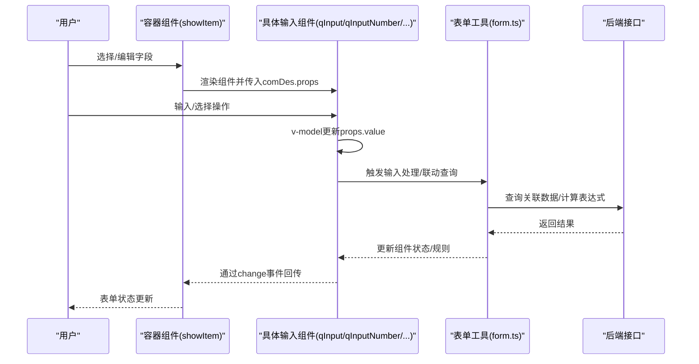
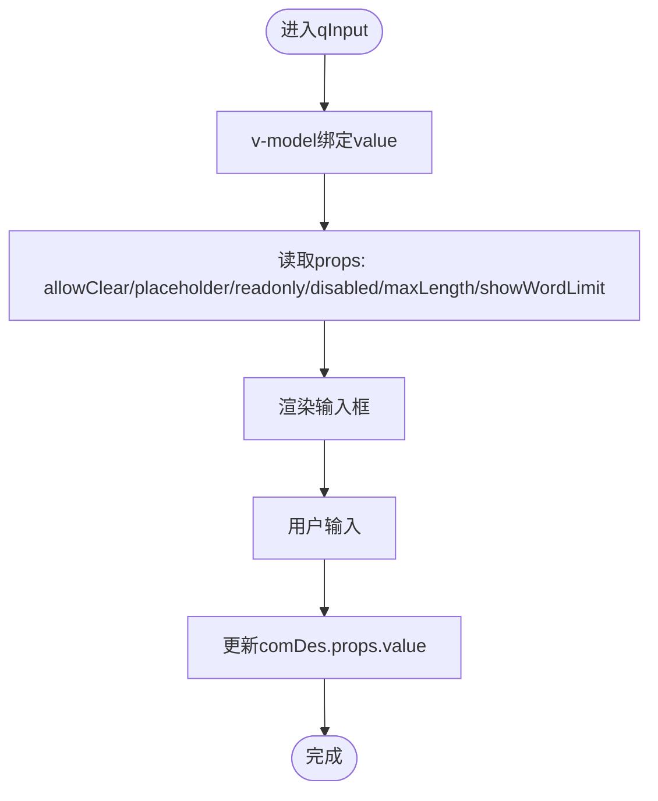
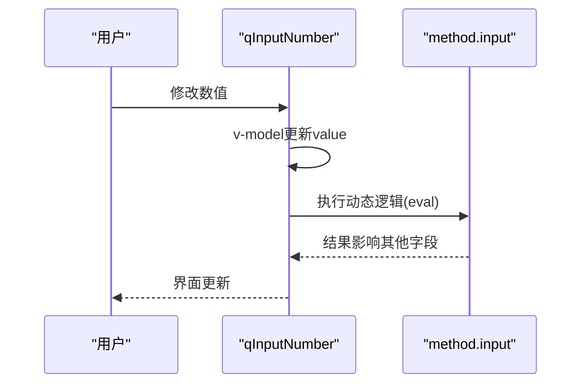
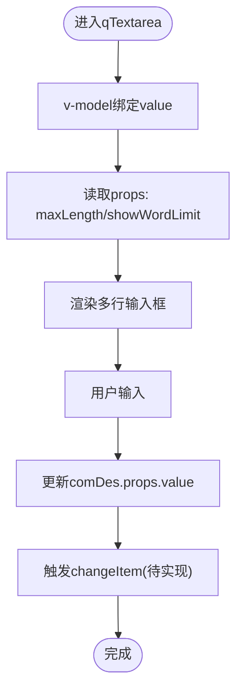
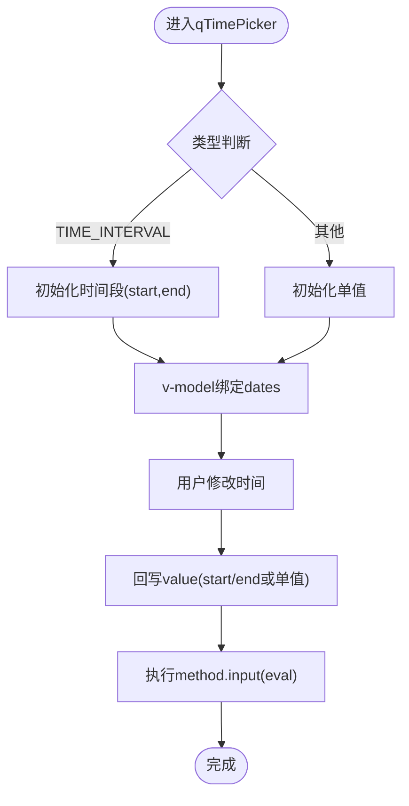
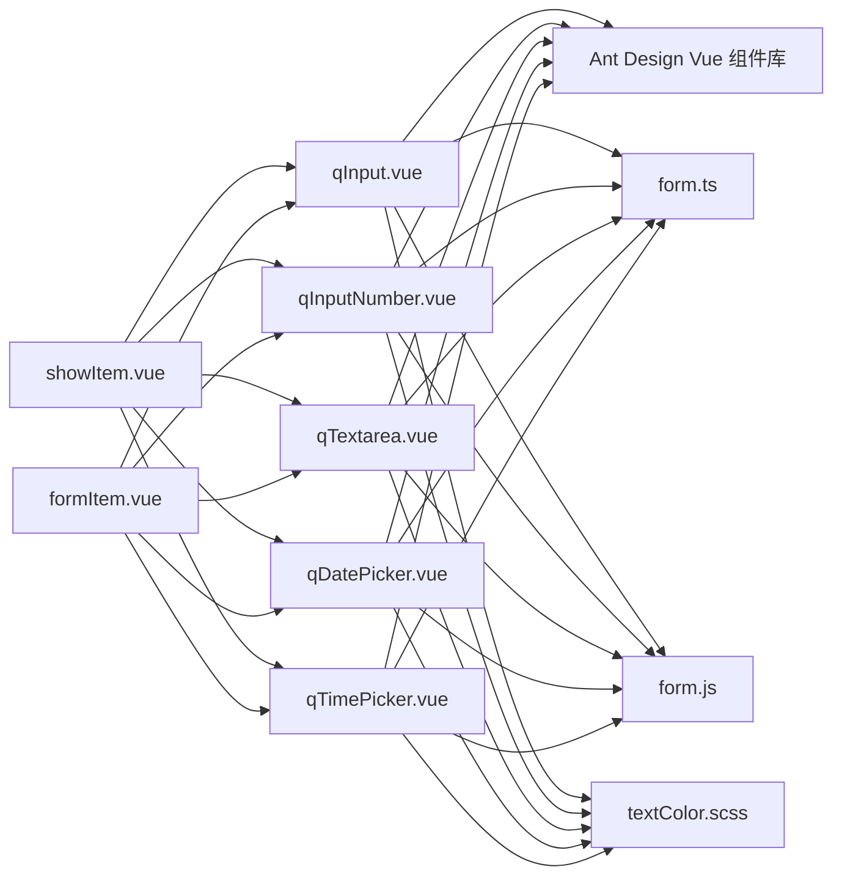

# 基础输入组件

<cite>
**本文引用的文件**
- [qInput.vue](file://src/components/showItem/qInput.vue)
- [qInputNumber.vue](file://src/components/showItem/qInputNumber.vue)
- [qTextarea.vue](file://src/components/showItem/qTextarea.vue)
- [qDatePicker.vue](file://src/components/showItem/qDatePicker.vue)
- [qTimePicker.vue](file://src/components/showItem/qTimePicker.vue)
- [showItem.vue](file://src/components/showItem/showItem.vue)
- [formItem.vue](file://src/components/showItem/formItem.vue)
- [form.ts](file://src/utils/form.ts)
- [form.js](file://src/data/form.js)
- [textColor.scss](file://src/styles/textColor.scss)
- [formLogics.vue](file://src/components/formLogics/formLogics.vue)
- [inputLogics.vue](file://src/components/formLogics/inputLogics.vue)
</cite>

## 目录
1. [简介](#简介)
2. [项目结构](#项目结构)
3. [核心组件](#核心组件)
4. [架构总览](#架构总览)
5. [详细组件分析](#详细组件分析)
6. [依赖关系分析](#依赖关系分析)
7. [性能考量](#性能考量)
8. [故障排查指南](#故障排查指南)
9. [结论](#结论)
10. [附录](#附录)

## 简介
本文件聚焦于基础输入类组件：文本输入框（qInput）、数字输入框（qInputNumber）、多行文本框（qTextarea）、日期选择器（qDatePicker）、时间选择器（qTimePicker）。文档从组件职责、属性与事件、数据绑定、校验规则、样式定制、响应式适配、组件联动与表单集成、渲染原理与DOM结构、CSS样式系统等方面进行系统化说明，并提供可视化图示帮助理解。

## 项目结构
基础输入组件位于展示层组件目录下，统一通过通用容器组件进行渲染与表单集成；表单工具模块负责数据初始化、提交、联动查询与规则生成；表单元数据定义了组件属性与默认值；样式系统通过SCSS模块化管理主题色与通用样式。

**图表来源**
- [showItem.vue:1-15](file://src/components/showItem/showItem.vue#L1-L15)
- [formItem.vue:1-26](file://src/components/showItem/formItem.vue#L1-L26)
- [qInput.vue:1-21](file://src/components/showItem/qInput.vue#L1-L21)
- [qInputNumber.vue:1-31](file://src/components/showItem/qInputNumber.vue#L1-L31)
- [qTextarea.vue:1-20](file://src/components/showItem/qTextarea.vue#L1-L20)
- [qDatePicker.vue:1-31](file://src/components/showItem/qDatePicker.vue#L1-L31)
- [qTimePicker.vue:1-49](file://src/components/showItem/qTimePicker.vue#L1-L49)
- [form.ts:1-1341](file://src/utils/form.ts#L1-L1341)
- [form.js:150-349](file://src/data/form.js#L150-L349)
- [textColor.scss:1-91](file://src/styles/textColor.scss#L1-L91)

**章节来源**
- [showItem.vue:1-15](file://src/components/showItem/showItem.vue#L1-L15)
- [formItem.vue:1-26](file://src/components/showItem/formItem.vue#L1-L26)
- [qInput.vue:1-21](file://src/components/showItem/qInput.vue#L1-L21)
- [qInputNumber.vue:1-31](file://src/components/showItem/qInputNumber.vue#L1-L31)
- [qTextarea.vue:1-20](file://src/components/showItem/qTextarea.vue#L1-L20)
- [qDatePicker.vue:1-31](file://src/components/showItem/qDatePicker.vue#L1-L31)
- [qTimePicker.vue:1-49](file://src/components/showItem/qTimePicker.vue#L1-L49)
- [form.ts:1-1341](file://src/utils/form.ts#L1-L1341)
- [form.js:150-349](file://src/data/form.js#L150-L349)
- [textColor.scss:1-91](file://src/styles/textColor.scss#L1-L91)

## 核心组件
- 文本输入框（qInput）：基于输入组件封装，支持清空、占位符、只读、禁用、字数统计与最大长度控制。
- 数字输入框（qInputNumber）：基于数字输入组件封装，支持数值变更时的动态逻辑执行。
- 多行文本框（qTextarea）：基于多行输入组件封装，支持字数统计与最大长度控制。
- 日期选择器（qDatePicker）：基于日期选择组件封装，支持日期变更时的动态逻辑执行。
- 时间选择器（qTimePicker）：基于时间选择组件封装，支持单值与时间段模式的双向绑定与格式化。

这些组件均通过统一容器组件注入属性与事件，参与表单渲染与校验流程。

**章节来源**
- [qInput.vue:1-21](file://src/components/showItem/qInput.vue#L1-L21)
- [qInputNumber.vue:1-31](file://src/components/showItem/qInputNumber.vue#L1-L31)
- [qTextarea.vue:1-20](file://src/components/showItem/qTextarea.vue#L1-L20)
- [qDatePicker.vue:1-31](file://src/components/showItem/qDatePicker.vue#L1-L31)
- [qTimePicker.vue:1-49](file://src/components/showItem/qTimePicker.vue#L1-L49)
- [showItem.vue:38-44](file://src/components/showItem/showItem.vue#L38-L44)
- [formItem.vue:6-13](file://src/components/showItem/formItem.vue#L6-L13)

## 架构总览
基础输入组件在表单中的工作流如下：容器组件根据字段类型渲染对应组件，组件内部通过v-model与comDes.props.value双向绑定；当用户交互触发变更时，组件调用统一的输入处理逻辑；表单工具模块负责初始化数据、提交序列化、联动查询与规则生成。

**图表来源**
- [showItem.vue:38-44](file://src/components/showItem/showItem.vue#L38-L44)
- [qInputNumber.vue:12-22](file://src/components/showItem/qInputNumber.vue#L12-L22)
- [qDatePicker.vue:12-22](file://src/components/showItem/qDatePicker.vue#L12-L22)
- [qTimePicker.vue:27-39](file://src/components/showItem/qTimePicker.vue#L27-L39)
- [form.ts:602-722](file://src/utils/form.ts#L602-L722)

**章节来源**
- [showItem.vue:38-44](file://src/components/showItem/showItem.vue#L38-L44)
- [qInputNumber.vue:12-22](file://src/components/showItem/qInputNumber.vue#L12-L22)
- [qDatePicker.vue:12-22](file://src/components/showItem/qDatePicker.vue#L12-L22)
- [qTimePicker.vue:27-39](file://src/components/showItem/qTimePicker.vue#L27-L39)
- [form.ts:602-722](file://src/utils/form.ts#L602-L722)

## 详细组件分析

### 文本输入框（qInput）
- 数据绑定：通过v-model绑定comDes.props.value，支持清空、占位符、只读、禁用、字数统计与最大长度控制。
- 属性与事件：
  - 属性：allowClear、placeholder、readonly、disabled、maxLength、showWordLimit、value。
  - 事件：由底层组件触发，当前模板未显式监听。
- 样式：宽度100%，使用主题色样式模块。
- 使用场景：普通文本输入、搜索框、描述性文本等。

**图表来源**
- [qInput.vue:1-21](file://src/components/showItem/qInput.vue#L1-L21)

**章节来源**
- [qInput.vue:1-21](file://src/components/showItem/qInput.vue#L1-L21)
- [textColor.scss:18-21](file://src/styles/textColor.scss#L18-L21)

### 数字输入框（qInputNumber）
- 数据绑定：通过v-model绑定comDes.props.value。
- 动态逻辑：在值变更时执行comDes.method.input中定义的动态代码（eval），用于联动或计算。
- 属性与事件：透传comDes.props至底层组件，监听change事件。
- 使用场景：金额、数量、百分比等数值输入。

**图表来源**
- [qInputNumber.vue:12-22](file://src/components/showItem/qInputNumber.vue#L12-L22)

**章节来源**
- [qInputNumber.vue:1-31](file://src/components/showItem/qInputNumber.vue#L1-L31)
- [textColor.scss:27-30](file://src/styles/textColor.scss#L27-L30)

### 多行文本框（qTextarea）
- 数据绑定：通过v-model绑定comDes.props.value。
- 事件：模板中预留changeItem回调，当前未实现具体逻辑。
- 属性与事件：支持maxLength与showWordLimit，透传其余属性至底层组件。
- 使用场景：长文本输入、富文本片段、备注说明等。

**图表来源**
- [qTextarea.vue:1-20](file://src/components/showItem/qTextarea.vue#L1-L20)

**章节来源**
- [qTextarea.vue:1-20](file://src/components/showItem/qTextarea.vue#L1-L20)

### 日期选择器（qDatePicker）
- 数据绑定：通过v-model绑定comDes.props.value。
- 动态逻辑：在值变更时执行comDes.method.input中定义的动态代码（eval）。
- 属性与事件：透传comDes.props至底层组件，监听change事件。
- 使用场景：生日、截止日期、计划时间等日期输入。

**图表来源**
- [qDatePicker.vue:12-22](file://src/components/showItem/qDatePicker.vue#L12-L22)

**章节来源**
- [qDatePicker.vue:1-31](file://src/components/showItem/qDatePicker.vue#L1-L31)
- [textColor.scss:27-30](file://src/styles/textColor.scss#L27-L30)

### 时间选择器（qTimePicker）
- 数据绑定：通过ref与v-model绑定，支持单值与时间段模式（start/end）。
- 初始化逻辑：根据组件类型（如TIME_INTERVAL）对初始值进行拆分与合并。
- 动态逻辑：在值变更时执行comDes.method.input中定义的动态代码（eval）。
- 属性与事件：透传comDes.props至底层组件，监听change事件。
- 使用场景：开始/结束时间、工时统计、排班时间等。

**图表来源**
- [qTimePicker.vue:14-39](file://src/components/showItem/qTimePicker.vue#L14-L39)

**章节来源**
- [qTimePicker.vue:1-49](file://src/components/showItem/qTimePicker.vue#L1-L49)
- [textColor.scss:45-48](file://src/styles/textColor.scss#L45-L48)

## 依赖关系分析
- 组件依赖：各输入组件依赖Ant Design Vue组件库（a-input、a-input-number、a-textarea、a-date-picker、a-time-picker）。
- 容器依赖：容器组件（showItem.vue、formItem.vue）负责表单项包装与必填标识。
- 工具依赖：表单工具模块负责数据初始化、提交序列化、联动查询与规则生成。
- 元数据依赖：表单元数据定义组件默认属性、属性面板与默认值。
- 样式依赖：SCSS模块化主题色与通用样式。

**图表来源**
- [showItem.vue:38-44](file://src/components/showItem/showItem.vue#L38-L44)
- [formItem.vue:6-13](file://src/components/showItem/formItem.vue#L6-L13)
- [qInput.vue:1-21](file://src/components/showItem/qInput.vue#L1-L21)
- [qInputNumber.vue:1-31](file://src/components/showItem/qInputNumber.vue#L1-L31)
- [qTextarea.vue:1-20](file://src/components/showItem/qTextarea.vue#L1-L20)
- [qDatePicker.vue:1-31](file://src/components/showItem/qDatePicker.vue#L1-L31)
- [qTimePicker.vue:1-49](file://src/components/showItem/qTimePicker.vue#L1-L49)
- [form.ts:1-1341](file://src/utils/form.ts#L1-L1341)
- [form.js:150-349](file://src/data/form.js#L150-L349)
- [textColor.scss:1-91](file://src/styles/textColor.scss#L1-L91)

**章节来源**
- [showItem.vue:38-44](file://src/components/showItem/showItem.vue#L38-L44)
- [formItem.vue:6-13](file://src/components/showItem/formItem.vue#L6-L13)
- [form.ts:1-1341](file://src/utils/form.ts#L1-L1341)
- [form.js:150-349](file://src/data/form.js#L150-L349)
- [textColor.scss:1-91](file://src/styles/textColor.scss#L1-L91)

## 性能考量
- 变更触发：数字输入框与日期/时间选择器在值变更时执行动态逻辑（eval），应避免复杂计算与频繁调用，必要时进行节流或防抖。
- 联动查询：表单工具模块在字段变更后触发联动查询，建议对查询参数进行去重与缓存，减少重复请求。
- 字数统计：开启字数统计时注意maxLength与showWordLimit的配合，避免不必要的DOM更新。
- 渲染优化：容器组件统一处理表单项包装与必填标识，减少重复渲染；对于大量字段的表单，建议按需渲染与懒加载。

[本节为通用性能建议，不直接分析具体文件]

## 故障排查指南
- 动态逻辑报错：数字输入框与日期/时间选择器在执行method.input时使用eval，若语法错误会抛出异常。请检查动态代码语法与变量作用域。
- 时间区间初始化：时间选择器在时间段模式下需要正确初始化start与end字段，否则可能显示为空。
- 联动查询延迟：联动查询依赖异步接口返回，若数据未及时更新，检查网络请求与接口返回格式。
- 校验规则缺失：若表单未生成必填规则，请确认表单元数据中required字段与规则生成逻辑。

**章节来源**
- [qInputNumber.vue:16-20](file://src/components/showItem/qInputNumber.vue#L16-L20)
- [qDatePicker.vue:16-20](file://src/components/showItem/qDatePicker.vue#L16-L20)
- [qTimePicker.vue:14-26](file://src/components/showItem/qTimePicker.vue#L14-L26)
- [form.ts:602-722](file://src/utils/form.ts#L602-L722)

## 结论
基础输入组件以统一容器与属性传递为核心，结合表单工具模块实现了数据初始化、联动查询、规则生成与提交序列化。通过合理的属性配置、事件处理与样式定制，能够满足多样化的表单输入需求。建议在实际使用中关注动态逻辑的性能与稳定性，并充分利用联动与校验机制提升用户体验。

[本节为总结性内容，不直接分析具体文件]

## 附录

### 组件属性与默认值参考（来自表单元数据）
- 文本输入框（INPUT）：默认属性包括占位符、最大长度、字数统计、清空按钮、只读、禁用、可见性、默认值、联动配置等。
- 数字输入框（NUMBER/MONEY/RATE）：在文本输入基础上增加数字精度precision等属性。
- 日期/时间相关：支持格式化、区间模式等。

**章节来源**
- [form.js:150-349](file://src/data/form.js#L150-L349)

### 表单验证规则生成（来自表单工具）
- 必填规则：根据字段required生成必填校验。
- 日期格式：根据字段类型自动设置日期/时间格式。
- 条件规则：根据条件逻辑生成复合规则。

**章节来源**
- [form.ts:1116-1182](file://src/utils/form.ts#L1116-L1182)

### 组件间联动与表单集成
- 容器组件：统一渲染与事件绑定，支持编辑态与展示态切换。
- 表单逻辑组件：根据字段类型渲染对应的逻辑输入组件，支持多种输入类型。

**章节来源**
- [showItem.vue:1-15](file://src/components/showItem/showItem.vue#L1-L15)
- [formLogics.vue:1-35](file://src/components/formLogics/formLogics.vue#L1-L35)
- [inputLogics.vue:1-28](file://src/components/formLogics/inputLogics.vue#L1-L28)