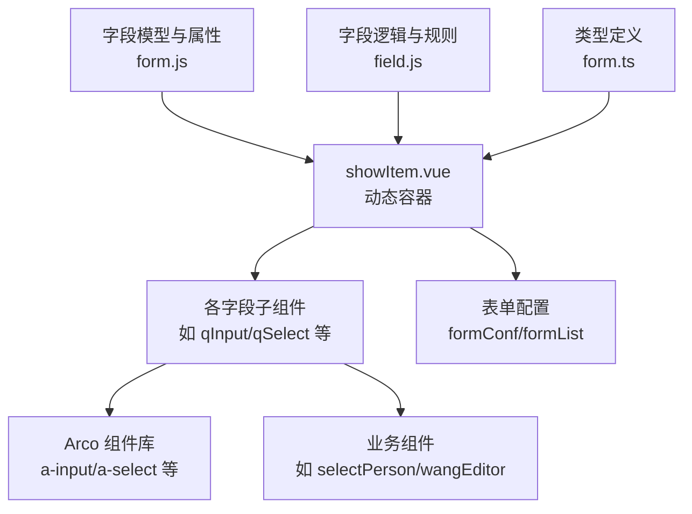
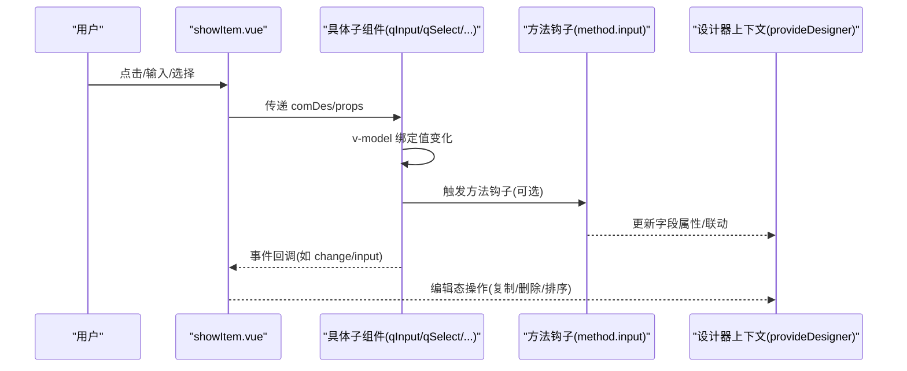
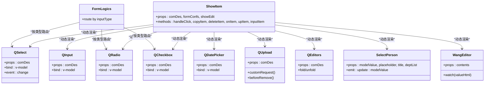

# 字段组件库

<cite>
**本文引用的文件**
- [showItem.vue](file://src/components/showItem/showItem.vue)
- [qInput.vue](file://src/components/showItem/qInput.vue)
- [qTextarea.vue](file://src/components/showItem/qTextarea.vue)
- [qSelect.vue](file://src/components/showItem/qSelect.vue)
- [qRadio.vue](file://src/components/showItem/qRadio.vue)
- [qCheckbox.vue](file://src/components/showItem/qCheckbox.vue)
- [qDatePicker.vue](file://src/components/showItem/qDatePicker.vue)
- [qUpload.vue](file://src/components/showItem/qUpload.vue)
- [qEditors.vue](file://src/components/showItem/qEditors.vue)
- [selectPerson.vue](file://src/components/selectPerson/selectPerson.vue)
- [wangEditor.vue](file://src/components/wangEditor/wangEditor.vue)
- [formLogics.vue](file://src/components/formLogics/formLogics.vue)
- [form.js](file://src/data/form.js)
- [field.js](file://src/utils/field.js)
- [form.ts](file://src/types/form.ts)
</cite>

## 目录
1. [简介](#简介)
2. [项目结构](#项目结构)
3. [核心组件](#核心组件)
4. [架构总览](#架构总览)
5. [详细组件分析](#详细组件分析)
6. [依赖关系分析](#依赖关系分析)
7. [性能与可维护性](#性能与可维护性)
8. [故障排查指南](#故障排查指南)
9. [结论](#结论)
10. [附录：扩展与自定义](#附录扩展与自定义)

## 简介
本文件面向“字段组件库”的使用者与二次开发者，系统梳理了表单字段组件体系，覆盖输入类（文本/数字/日期）、选择类（下拉/单选/多选）、高级类（富文本/文件上传/人员选择器）等，并深入说明组件属性配置、事件处理、数据绑定机制、渲染原理、样式系统与响应式设计要点。同时提供使用示例路径、参数说明、常见问题与扩展开发指南。

## 项目结构
字段组件库以“动态渲染 + 组件分发”为核心：顶层容器根据字段描述动态挂载具体子组件；子组件负责与 Arco 或第三方库对接，完成输入、校验与交互；逻辑层通过统一的字段模型与规则引擎实现联动与校验。

图表来源
- [showItem.vue:1-196](file://src/components/showItem/showItem.vue#L1-L196)
- [form.js:1-800](file://src/data/form.js#L1-L800)
- [field.js:1-207](file://src/utils/field.js#L1-L207)
- [form.ts:1-45](file://src/types/form.ts#L1-L45)

章节来源
- [showItem.vue:1-196](file://src/components/showItem/showItem.vue#L1-L196)
- [form.js:1-800](file://src/data/form.js#L1-L800)

## 核心组件
- 动态容器：根据 comDes.type 决定是否包裹 a-form-item，支持编辑态与展示态两套渲染分支，统一注入设计器上下文，处理拖拽、复制、删除等操作。
- 输入类：单行文本、多行文本、日期选择、数字输入（含金额/评分等类型在逻辑侧映射）。
- 选择类：下拉单选/多选、单选按钮组、多选按钮组。
- 高级类：富文本编辑器、文件上传（附件/图片/视频/音频/压缩包）、人员选择器（支持多选、标签化展示、移除）。
- 逻辑与联动：基于字段类型路由到对应逻辑组件，结合规则引擎进行联动与校验。

章节来源
- [showItem.vue:1-196](file://src/components/showItem/showItem.vue#L1-L196)
- [formLogics.vue:1-35](file://src/components/formLogics/formics.vue#L1-L35)
- [form.js:1-800](file://src/data/form.js#L1-L800)

## 架构总览
字段组件库采用“描述驱动 + 组件分发”的架构：
- 描述层：form.js 定义表单配置与字段属性模板，包含默认值、校验、联动、方法钩子等。
- 渲染层：showItem.vue 根据 comDes.type 动态渲染具体子组件，绑定 v-model 实现双向数据绑定。
- 交互层：子组件内部通过事件回调触发方法钩子（method.input），并与设计器上下文通信。
- 逻辑层：formLogics.vue 按字段类型路由到对应逻辑组件；field.js 提供规则匹配能力（数值范围、字符串包含、时间区间等）。

图表来源
- [showItem.vue:75-103](file://src/components/showItem/showItem.vue#L75-L103)
- [qInput.vue:1-21](file://src/components/showItem/qInput.vue#L1-L21)
- [qSelect.vue:13-24](file://src/components/showItem/qSelect.vue#L13-L24)

章节来源
- [showItem.vue:1-196](file://src/components/showItem/showItem.vue#L1-L196)
- [formLogics.vue:1-35](file://src/components/formLogics/formLogics.vue#L1-L35)
- [field.js:1-207](file://src/utils/field.js#L1-L207)

## 详细组件分析

### 输入类组件
- 单行文本（qInput）
  - 属性要点：占位符、只读/禁用、字数统计与最大长度、清空按钮。
  - 数据绑定：v-model 绑定到 comDes.props.value。
  - 事件：无显式事件绑定，依赖外部容器触发方法钩子。
  - 使用示例路径：[qInput.vue:1-21](file://src/components/showItem/qInput.vue#L1-L21)

- 多行文本（qTextarea）
  - 属性要点：最大长度、字数统计、v-bind 合并传入。
  - 数据绑定：v-model 绑定到 comDes.props.value。
  - 使用示例路径：[qTextarea.vue:1-20](file://src/components/showItem/qTextarea.vue#L1-L20)

- 日期选择（qDatePicker）
  - 属性要点：v-bind 合并传入，支持多种日期格式。
  - 数据绑定：v-model 绑定到 comDes.props.value。
  - 使用示例路径：[qDatePicker.vue:1-31](file://src/components/showItem/qDatePicker.vue#L1-L31)

- 数字/金额/评分（映射到通用输入）
  - 说明：在逻辑侧按字段类型映射为 NUMBER/MONEY/RATE 等，渲染仍由通用输入组件承担。

章节来源
- [qInput.vue:1-21](file://src/components/showItem/qInput.vue#L1-L21)
- [qTextarea.vue:1-20](file://src/components/showItem/qTextarea.vue#L1-L20)
- [qDatePicker.vue:1-31](file://src/components/showItem/qDatePicker.vue#L1-L31)
- [formLogics.vue:7-9](file://src/components/formLogics/formLogics.vue#L7-L9)

### 选择类组件
- 下拉选择（qSelect）
  - 属性要点：数据源类型（自定义/其他表单字段）、默认值、占位符、多选模式。
  - 数据绑定：v-model 绑定到 comDes.props.value。
  - 事件：change 回调中可触发方法钩子。
  - 使用示例路径：[qSelect.vue:1-34](file://src/components/showItem/qSelect.vue#L1-L34)

- 单选按钮组（qRadio）
  - 属性要点：选项列表、排列方向、图片/文字模式切换。
  - 数据绑定：v-model 绑定到 comDes.props.value。
  - 使用示例路径：[qRadio.vue:1-33](file://src/components/showItem/qRadio.vue#L1-L33)

- 多选按钮组（qCheckbox）
  - 属性要点：选项列表、排列方向、图片/文字模式切换。
  - 数据绑定：v-model 绑定到 comDes.props.value。
  - 使用示例路径：[qCheckbox.vue:1-33](file://src/components/showItem/qCheckbox.vue#L1-L33)

章节来源
- [qSelect.vue:1-34](file://src/components/showItem/qSelect.vue#L1-L34)
- [qRadio.vue:1-33](file://src/components/showItem/qRadio.vue#L1-L33)
- [qCheckbox.vue:1-33](file://src/components/showItem/qCheckbox.vue#L1-L33)
- [form.js:475-620](file://src/data/form.js#L475-L620)

### 高级组件
- 富文本编辑器（qEditors）
  - 属性要点：折叠/展开、描述内容、折叠后显示片段。
  - 交互：点击展开/收起，内部使用 v-html 渲染。
  - 使用示例路径：[qEditors.vue:1-50](file://src/components/showItem/qEditors.vue#L1-L50)

- 文件上传（qUpload）
  - 属性要点：文件类型（图片/视频/音频/文档/压缩包）、示例文件、大小限制、数量限制。
  - 上传流程：自定义上传请求，拼装文件信息，回写到 comDes.props.value。
  - 删除控制：示例文件不可删除。
  - 使用示例路径：[qUpload.vue:1-88](file://src/components/showItem/qUpload.vue#L1-L88)

- 人员选择器（selectPerson）
  - 属性要点：占位符、标题、部门树数据。
  - 交互：标签化展示已选人员，支持移除；点击弹出选择面板。
  - 使用示例路径：[selectPerson.vue:1-115](file://src/components/selectPerson/selectPerson.vue#L1-L115)

- 富文本编辑器（wangEditor）
  - 属性要点：工具栏配置、编辑器默认配置、图片/视频上传策略。
  - 交互：监听内容变化，向上游提供更新。
  - 使用示例路径：[wangEditor.vue:1-121](file://src/components/wangEditor/wangEditor.vue#L1-L121)

章节来源
- [qEditors.vue:1-50](file://src/components/showItem/qEditors.vue#L1-L50)
- [qUpload.vue:1-88](file://src/components/showItem/qUpload.vue#L1-L88)
- [selectPerson.vue:1-115](file://src/components/selectPerson/selectPerson.vue#L1-L115)
- [wangEditor.vue:1-121](file://src/components/wangEditor/wangEditor.vue#L1-L121)

### 字段逻辑与联动
- 类型路由：按字段类型将逻辑组件注入到 formLogics.vue，实现不同类型的校验与联动。
- 规则引擎：field.js 提供多种比较运算（等于/不等/范围/包含/时间区间等），用于联动条件判断。
- 使用示例路径：[formLogics.vue:1-35](file://src/components/formLogics/formLogics.vue#L1-L35), [field.js:1-207](file://src/utils/field.js#L1-L207)

章节来源
- [formLogics.vue:1-35](file://src/components/formLogics/formLogics.vue#L1-L35)
- [field.js:1-207](file://src/utils/field.js#L1-L207)

## 依赖关系分析
- 组件耦合
  - showItem.vue 作为统一容器，依赖 comDes 描述对象与设计器上下文，耦合度适中。
  - 子组件仅依赖自身属性与外部传入的 comDes.props，内聚性高。
- 外部依赖
  - Arco 组件库（a-input/a-select/a-radio-group/a-checkbox-group/a-date-picker/a-upload 等）。
  - 第三方编辑器（wangEditor）。
  - 规则引擎（field.js）。
- 类型与配置
  - form.ts 定义表单配置接口，确保类型安全。
  - form.js 提供字段属性模板与默认值，降低重复配置成本。

图表来源
- [showItem.vue:1-196](file://src/components/showItem/showItem.vue#L1-L196)
- [qInput.vue:1-21](file://src/components/showItem/qInput.vue#L1-L21)
- [qSelect.vue:1-34](file://src/components/showItem/qSelect.vue#L1-L34)
- [qRadio.vue:1-33](file://src/components/showItem/qRadio.vue#L1-L33)
- [qCheckbox.vue:1-33](file://src/components/showItem/qCheckbox.vue#L1-L33)
- [qDatePicker.vue:1-31](file://src/components/showItem/qDatePicker.vue#L1-L31)
- [qUpload.vue:1-88](file://src/components/showItem/qUpload.vue#L1-L88)
- [qEditors.vue:1-50](file://src/components/showItem/qEditors.vue#L1-L50)
- [selectPerson.vue:1-115](file://src/components/selectPerson/selectPerson.vue#L1-L115)
- [wangEditor.vue:1-121](file://src/components/wangEditor/wangEditor.vue#L1-L121)
- [formLogics.vue:1-35](file://src/components/formLogics/formLogics.vue#L1-L35)

章节来源
- [showItem.vue:1-196](file://src/components/showItem/showItem.vue#L1-L196)
- [form.ts:1-45](file://src/types/form.ts#L1-L45)
- [form.js:1-800](file://src/data/form.js#L1-L800)

## 性能与可维护性
- 渲染性能
  - 动态组件渲染与 v-if/v-else 分支控制，建议在大数据量场景下避免不必要的重渲染，可通过 key 与计算属性优化。
  - 上传组件自定义请求，注意并发与超时控制，避免阻塞 UI。
- 绑定与事件
  - v-model 双向绑定简洁高效；事件回调中尽量减少同步计算，必要时使用防抖/节流。
- 可维护性
  - 字段属性集中在 form.js 模板中，便于统一管理与复用。
  - 方法钩子（method.input）集中于子组件，便于扩展与调试。
  - 类型定义（form.ts）提升开发体验与错误预防。

[本节为通用建议，无需特定文件引用]

## 故障排查指南
- 上传失败或无法回写
  - 检查自定义上传请求与回写逻辑，确认文件信息字段与后端一致。
  - 确认示例文件标记与删除拦截逻辑生效。
  - 参考路径：[qUpload.vue:59-84](file://src/components/showItem/qUpload.vue#L59-L84)

- 富文本内容未更新
  - 确认监听内容变化的 watch 是否触发，以及向上游提供的更新方法是否正确。
  - 参考路径：[wangEditor.vue:82-98](file://src/components/wangEditor/wangEditor.vue#L82-L98)

- 选择类组件默认值不生效
  - 检查 comDes.props.defaultValue 与 v-model 绑定是否一致，确认数据类型匹配（数组/字符串）。
  - 参考路径：[qSelect.vue:1-34](file://src/components/showItem/qSelect.vue#L1-L34), [qRadio.vue:1-33](file://src/components/showItem/qRadio.vue#L1-L33), [qCheckbox.vue:1-33](file://src/components/showItem/qCheckbox.vue#L1-L33)

- 联动逻辑不触发
  - 检查字段类型路由与规则表达式，确认规则引擎符号与输入值格式一致。
  - 参考路径：[formLogics.vue:1-35](file://src/components/formLogics/formLogics.vue#L1-L35), [field.js:1-207](file://src/utils/field.js#L1-L207)

章节来源
- [qUpload.vue:59-84](file://src/components/showItem/qUpload.vue#L59-L84)
- [wangEditor.vue:82-98](file://src/components/wangEditor/wangEditor.vue#L82-L98)
- [qSelect.vue:1-34](file://src/components/showItem/qSelect.vue#L1-L34)
- [qRadio.vue:1-33](file://src/components/showItem/qRadio.vue#L1-L33)
- [qCheckbox.vue:1-33](file://src/components/showItem/qCheckbox.vue#L1-L33)
- [formLogics.vue:1-35](file://src/components/formLogics/formLogics.vue#L1-L35)
- [field.js:1-207](file://src/utils/field.js#L1-L207)

## 结论
字段组件库以“描述驱动 + 组件分发”实现高度可配置的表单字段体系，覆盖输入、选择与高级场景，并通过逻辑路由与规则引擎支撑复杂联动。建议在实际项目中：
- 统一使用 form.js 模板管理字段属性；
- 在子组件中谨慎使用方法钩子，确保可追踪与可测试；
- 对上传与富文本等异步场景做好错误兜底与状态反馈。

[本节为总结，无需特定文件引用]

## 附录：扩展与自定义
- 新增字段组件步骤
  - 在 form.js 中新增组件模板（component/title/type/props/attribute/method）。
  - 在 showItem.vue 中增加类型分支或复用现有分支。
  - 在子组件中实现 v-model 绑定与必要的事件回调。
  - 如需联动，完善 formLogics.vue 的类型路由或规则引擎表达式。
  - 参考路径：[form.js:1-800](file://src/data/form.js#L1-L800), [showItem.vue:1-196](file://src/components/showItem/showItem.vue#L1-L196), [formLogics.vue:1-35](file://src/components/formLogics/formLogics.vue#L1-L35), [field.js:1-207](file://src/utils/field.js#L1-L207)

- 自定义样式与主题
  - 使用 scoped 样式覆盖组件局部样式；全局主题变量可参考 textColor.scss。
  - 注意 ::v-deep 与样式穿透的兼容性与稳定性。

- 响应式设计建议
  - 使用 Arco 原生栅格与尺寸属性，配合表单配置中的宽度与布局策略。
  - 对移动端输入场景，建议开启合适的键盘行为与输入限制。

[本节为实践指南，无需特定文件引用]