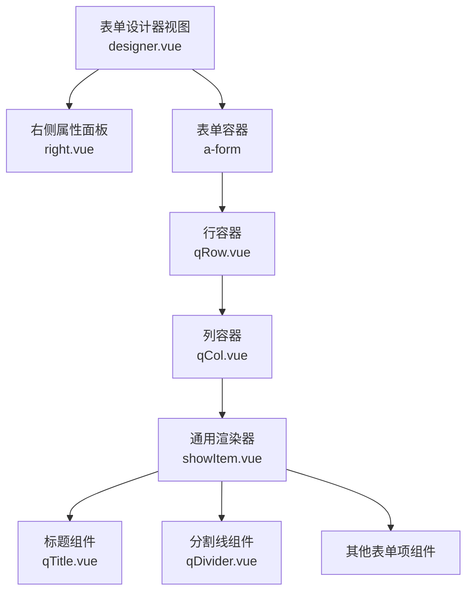
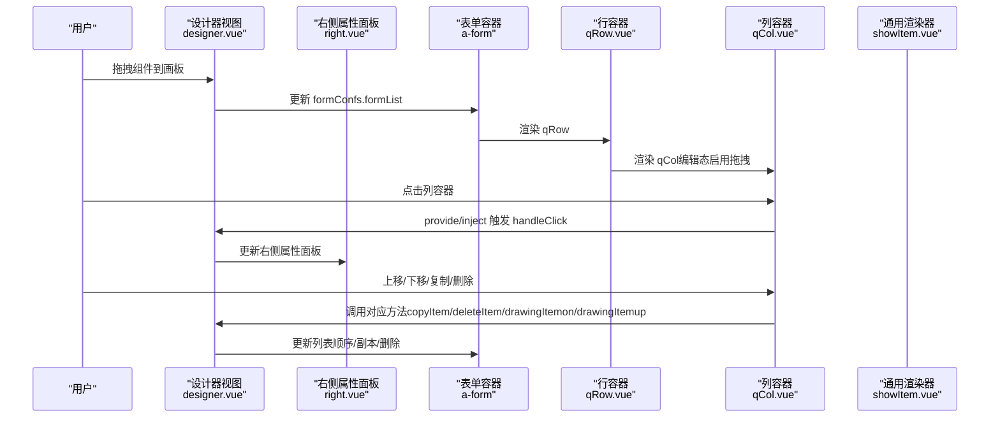
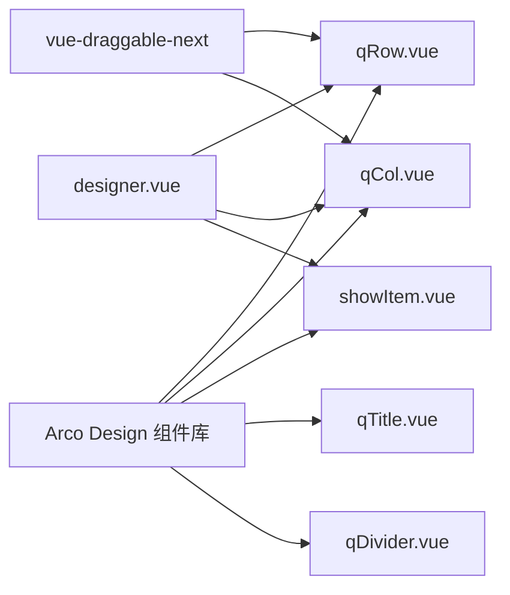

# 布局展示组件

<cite>
**本文档引用的文件**
- [qRow.vue](file://src/components/showItem/qRow.vue)
- [qCol.vue](file://src/components/showItem/qCol.vue)
- [qTitle.vue](file://src/components/showItem/qTitle.vue)
- [qDivider.vue](file://src/components/showItem/qDivider.vue)
- [showItem.vue](file://src/components/showItem/showItem.vue)
- [designer.vue](file://src/views/form/designer.vue)
- [right.vue](file://src/views/form/right.vue)
- [form.ts](file://src/types/form.ts)
- [form.js](file://src/data/form.js)
- [form.ts（工具）](file://src/utils/form.ts)
</cite>

## 目录
1. [简介](#简介)
2. [项目结构](#项目结构)
3. [核心组件](#核心组件)
4. [架构总览](#架构总览)
5. [详细组件分析](#详细组件分析)
6. [依赖关系分析](#依赖关系分析)
7. [性能与可维护性](#性能与可维护性)
8. [故障排查指南](#故障排查指南)
9. [结论](#结论)
10. [附录：使用与定制建议](#附录使用与定制建议)

## 简介
本文件面向“布局展示组件”的综合技术文档，重点覆盖以下组件与能力：
- 行容器 qRow：用于承载栅格列容器 qCol 的布局容器，支持拖拽排序与编辑态高亮。
- 列容器 qCol：栅格列单元，支持子项拖拽、激活态样式、上下移动、复制、删除等操作。
- 标题组件 qTitle：用于在表单中渲染不同层级的标题文本，支持字号映射。
- 分割线组件 qDivider：用于分隔区块，支持高度与样式配置。
- 水平线 qSplitLine：在数据定义中作为 SPLIT_LINE 类型出现，用于分隔区域。
- 表单设计器集成：通过 provide/inject 在设计器中实现统一的交互行为（点击、复制、删除、上下移动）。
- 响应式与栅格：基于 Arco Design 的栅格体系，结合表单配置实现宽度、标题位置等响应式布局。

本文件同时提供复杂表单布局设计示例思路、响应式适配方案、样式定制与主题适配建议，并补充无障碍访问要点。

## 项目结构
布局展示组件位于组件目录的 showItem 子模块中，配合表单设计器视图与右侧属性面板协同工作。整体结构如下：

图表来源
- [designer.vue:1-444](file://src/views/form/designer.vue#L1-L444)
- [right.vue:1-217](file://src/views/form/right.vue#L1-L217)
- [qRow.vue:1-36](file://src/components/showItem/qRow.vue#L1-L36)
- [qCol.vue:1-184](file://src/components/showItem/qCol.vue#L1-L184)
- [showItem.vue:1-196](file://src/components/showItem/showItem.vue#L1-L196)
- [qTitle.vue:1-22](file://src/components/showItem/qTitle.vue#L1-L22)
- [qDivider.vue:1-38](file://src/components/showItem/qDivider.vue#L1-L38)

章节来源
- [designer.vue:1-444](file://src/views/form/designer.vue#L1-L444)
- [right.vue:1-217](file://src/views/form/right.vue#L1-L217)

## 核心组件
本节从职责、属性、事件与交互四个方面梳理核心布局组件。

- 行容器 qRow
  - 职责：包裹列容器 qCol，提供拖拽排序与编辑态渲染。
  - 关键属性：comDes.props（透传至 a-row），支持 v-bind 绑定。
  - 编辑态：使用 vue-draggable-next 对 qCol 进行拖拽；非编辑态直接渲染。
  - 样式：绘制“画板”容器，flex 布局，wrap 换行，align-items 起始对齐。
  - 依赖：Arco Design 的 a-row，拖拽库 vue-draggable-next。

- 列容器 qCol
  - 职责：栅格列单元，承载子项 showItem；提供激活态样式与操作按钮。
  - 关键属性：comDes.props（透传至 a-col），支持 v-bind 绑定。
  - 编辑态：内部可拖拽子项，支持克隆与跨组拖拽；提供上下移动、复制、删除等操作。
  - 交互：通过 provide/inject 获取设计器提供的统一方法（点击、复制、删除、上下移动）。
  - 样式：带边框、内边距、占位最小高度；激活态高亮；右侧悬浮操作条。
  - 依赖：Arco Design 的 a-col，拖拽库 vue-draggable-next。

- 标题组件 qTitle
  - 职责：根据 fontSize 属性映射渲染不同层级标题（H1-H6）。
  - 关键属性：comDes.props.fontSize（字符串枚举），comDes.title（显示文本）。
  - 样式：默认字号与权重，底部留白。

- 分割线组件 qDivider
  - 职责：渲染 Arco Design 的分割线，支持高度与样式配置。
  - 关键属性：comDes.props（如 size、type），支持 v-bind 透传。
  - 样式：深度作用选择器重置外边距，保证与布局贴合。

- 通用渲染器 showItem
  - 职责：根据 comDes.type 渲染不同组件或容器；在编辑态提供统一的点击、复制、删除、上下移动操作。
  - 关键逻辑：对 ROW/TITLE/SPLIT_LINE/HR 等特殊类型进行特殊处理（如去除外层内边距）。
  - 交互：通过 provide/inject 注入的方法统一管理表单元素的交互行为。

章节来源
- [qRow.vue:1-36](file://src/components/showItem/qRow.vue#L1-L36)
- [qCol.vue:1-184](file://src/components/showItem/qCol.vue#L1-L184)
- [qTitle.vue:1-22](file://src/components/showItem/qTitle.vue#L1-L22)
- [qDivider.vue:1-38](file://src/components/showItem/qDivider.vue#L1-L38)
- [showItem.vue:1-196](file://src/components/showItem/showItem.vue#L1-L196)

## 架构总览
表单设计器通过 provide/inject 将统一的状态与方法注入到各组件，形成“集中控制、分散渲染”的架构。设计器视图负责表单配置与交互，右侧面板负责属性编辑，左侧画板负责布局渲染与拖拽。

图表来源
- [designer.vue:286-286](file://src/views/form/designer.vue#L286-L286)
- [qCol.vue:50-88](file://src/components/showItem/qCol.vue#L50-L88)
- [showItem.vue:75-89](file://src/components/showItem/showItem.vue#L75-L89)

章节来源
- [designer.vue:67-287](file://src/views/form/designer.vue#L67-L287)
- [right.vue:102-135](file://src/views/form/right.vue#L102-L135)

## 详细组件分析

### 行容器 qRow
- 设计要点
  - 使用 Arco Design 的 a-row 容器，支持 props 透传，便于与栅格系统对齐。
  - 编辑态启用拖拽，允许在行内重新排列列容器。
  - 非编辑态直接渲染列容器，避免不必要的交互开销。
- 样式与主题
  - 采用 scoped SCSS，绘制“画板”容器，flex-wrap 实现换行。
  - 主题色通过全局变量注入，激活态高亮由父级 provide/inject 控制。
- 可扩展性
  - 可通过 comDes.props 扩展栅格参数（如 gutter、wrap 等）。
  - 支持响应式断点配置（结合表单配置中的 widthType/width）。

章节来源
- [qRow.vue:12-36](file://src/components/showItem/qRow.vue#L12-L36)

### 列容器 qCol
- 设计要点
  - 内部使用 vue-draggable-next 实现子项拖拽，支持跨组拖拽（group）。
  - 提供统一的交互按钮（上移、下移、复制、删除），通过 provide/inject 调用设计器方法。
  - 激活态样式（边框、背景）由父级 provide/inject 控制，确保一致性。
- 数据处理
  - 在新增/复制时，递归修正 id 与 field，保证唯一性与表单字段映射正确。
  - 对子项 children 进行遍历，避免 SUBFORM 类型重复处理。
- 可扩展性
  - 可通过 props 透传 a-col 的栅格属性（如 span、offset、pull、push）。
  - 支持嵌套 qCol，实现多级栅格布局。

章节来源
- [qCol.vue:33-92](file://src/components/showItem/qCol.vue#L33-L92)
- [designer.vue:178-223](file://src/views/form/designer.vue#L178-L223)

### 标题组件 qTitle
- 设计要点
  - 根据 fontSize 属性映射到 H1-H6，支持多级标题层次。
  - 文本来自 comDes.title，适合在表单中作为分区标题使用。
- 可扩展性
  - 可增加对颜色、对齐、字重等样式的配置项。
  - 可与 qDivider 组合，形成“标题 + 分割线”的常见布局。

章节来源
- [qTitle.vue:6-22](file://src/components/showItem/qTitle.vue#L6-L22)
- [form.js:2600-2616](file://src/data/form.js#L2600-L2616)

### 分割线组件 qDivider
- 设计要点
  - 直接透传 props 至 Arco Design 的分割线组件，支持高度与样式配置。
  - 通过深度作用选择器重置外边距，确保与布局贴合。
- 可扩展性
  - 可增加对颜色、粗细、间距的配置项。
  - 可与 qTitle 组合，形成“标题 + 分割线 + 内容”的结构化布局。

章节来源
- [qDivider.vue:7-38](file://src/components/showItem/qDivider.vue#L7-L38)
- [form.js:2617-2651](file://src/data/form.js#L2617-L2651)

### 通用渲染器 showItem
- 设计要点
  - 根据 comDes.type 动态渲染组件或容器，对特殊类型（ROW/TITLE/SPLIT_LINE/HR）进行差异化处理。
  - 在编辑态提供统一的交互按钮与事件绑定，简化组件开发成本。
  - 透传表单项属性（如 required、hide-label），并与 a-form-item 结合使用。
- 可扩展性
  - 可通过 comDes.component 动态切换任意表单项组件。
  - 可增加对描述文本、帮助信息、校验提示的统一渲染。

章节来源
- [showItem.vue:48-104](file://src/components/showItem/showItem.vue#L48-L104)

## 依赖关系分析
- 组件间依赖
  - qRow 依赖 qCol；qCol 依赖 showItem；showItem 动态渲染 qTitle/qDivider 等。
  - qCol 与 showItem 通过 provide/inject 与设计器交互。
- 外部依赖
  - Arco Design 的 a-row/a-col/a-form/a-form-item/a-divider 等组件。
  - vue-draggable-next 用于拖拽排序与克隆。
- 数据流
  - 表单配置（formConfs.formList）驱动渲染树；设计器方法更新该树并持久化。

图表来源
- [qRow.vue:13-13](file://src/components/showItem/qRow.vue#L13-L13)
- [qCol.vue:35-35](file://src/components/showItem/qCol.vue#L35-L35)
- [designer.vue:68-68](file://src/views/form/designer.vue#L68-L68)

章节来源
- [qRow.vue:12-36](file://src/components/showItem/qRow.vue#L12-L36)
- [qCol.vue:33-92](file://src/components/showItem/qCol.vue#L33-L92)
- [designer.vue:67-287](file://src/views/form/designer.vue#L67-L287)

## 性能与可维护性
- 性能
  - 编辑态仅在需要时渲染拖拽与操作按钮，减少 DOM 开销。
  - 通过 provide/inject 避免深层事件冒泡与重复计算。
  - 对子项 id 与 field 的递归修正在新增/复制时一次性完成，避免运行时重复处理。
- 可维护性
  - 统一的交互接口（copyItem/deleteItem/drawingItemon/drawingItemup）降低耦合度。
  - 通过 comDes.props 透传属性，保持与 Arco Design 的一致体验。
  - 样式采用 scoped SCSS，避免全局污染。

[本节为通用指导，无需特定文件引用]

## 故障排查指南
- 拖拽无效
  - 检查 vue-draggable-next 是否正确安装与引入。
  - 确认 qRow/qCol 中的 draggable 配置与 group 设置一致。
- 激活态样式不生效
  - 检查 provide/inject 的 provideDesigner 是否正确注入。
  - 确认 handleClick 是否被调用且 activeForm.id 与当前组件匹配。
- 子项复制后 id 冲突
  - 检查 setId 与 copyItem 中的 id 生成逻辑，确保唯一性。
- 分割线样式异常
  - 检查 ::v-deep 选择器是否正确重置外边距。
- 响应式布局不生效
  - 检查表单配置中的 widthType/width 与 a-form 的 v-bind 绑定。

章节来源
- [designer.vue:178-223](file://src/views/form/designer.vue#L178-L223)
- [qCol.vue:50-88](file://src/components/showItem/qCol.vue#L50-L88)
- [qDivider.vue:29-33](file://src/components/showItem/qDivider.vue#L29-L33)

## 结论
布局展示组件以 qRow/qCol 为核心，结合 showItem 与 qTitle/qDivider，构建了灵活、可拖拽、可配置的表单布局体系。通过 provide/inject 与表单配置，实现了编辑态与展示态的一致体验。配合右侧属性面板与 Arco Design 的栅格系统，能够快速搭建复杂表单布局，并支持响应式与主题适配。

[本节为总结，无需特定文件引用]

## 附录：使用与定制建议

### 响应式与栅格配置
- 页面宽度与标题位置
  - 通过右侧属性面板设置 widthType（固定/百分比）、width 数值、titleStyle（左/上/隐藏）。
  - 设计器视图根据配置动态绑定到 a-form，实现响应式布局。
- 栅格列配置
  - 在 qCol 中通过 comDes.props 透传 a-col 的栅格属性（如 span、offset、pull、push）。
  - qRow 作为 a-row 容器，支持栅格断点与换行策略。

章节来源
- [right.vue:17-44](file://src/views/form/right.vue#L17-L44)
- [designer.vue:7-11](file://src/views/form/designer.vue#L7-L11)
- [qCol.vue:36-44](file://src/components/showItem/qCol.vue#L36-L44)
- [qRow.vue:15-23](file://src/components/showItem/qRow.vue#L15-L23)

### 复杂表单布局设计示例思路
- 分区标题 + 分割线 + 表单项
  - 使用 qTitle 作为分区标题，qDivider 作为分隔线，随后放置表单项。
- 多列栅格布局
  - 在 qRow 中放置多个 qCol，分别设置不同的 span，实现左右/上下分栏。
- 嵌套子表单
  - 在 qCol 中放置 qSubform（如存在），实现子表单的嵌套布局。
- 条件分组
  - 使用 showItem 的条件渲染与逻辑规则，按需显示/隐藏分组。

章节来源
- [showItem.vue:1-196](file://src/components/showItem/showItem.vue#L1-L196)
- [qTitle.vue:1-22](file://src/components/showItem/qTitle.vue#L1-L22)
- [qDivider.vue:1-38](file://src/components/showItem/qDivider.vue#L1-L38)

### 样式定制与主题适配
- 主题色与背景
  - qCol 的激活态边框与背景色通过全局变量注入，可在全局样式中统一修改。
- 字体与字号
  - qTitle 的 fontSize 通过枚举控制，可在数据定义中扩展更多层级。
- 分割线样式
  - qDivider 的 size 与 type 通过属性面板配置，支持实线/虚线/点线。

章节来源
- [qCol.vue:174-177](file://src/components/showItem/qCol.vue#L174-L177)
- [qTitle.vue:16-21](file://src/components/showItem/qTitle.vue#L16-L21)
- [qDivider.vue:29-33](file://src/components/showItem/qDivider.vue#L29-L33)
- [form.js:2600-2651](file://src/data/form.js#L2600-L2651)

### 无障碍访问支持建议
- 标题层级
  - 使用语义化的标题层级（H1-H6），避免跳级。
- 分割线
  - 为分割线添加 aria-orientation 或 role="separator"，提升读屏器可理解性。
- 操作按钮
  - 为复制/删除/上下移动按钮提供可读的 aria-label，避免仅依赖图标。
- 键盘导航
  - 确保拖拽操作可通过键盘触发，必要时提供快捷键提示。

[本节为通用指导，无需特定文件引用]