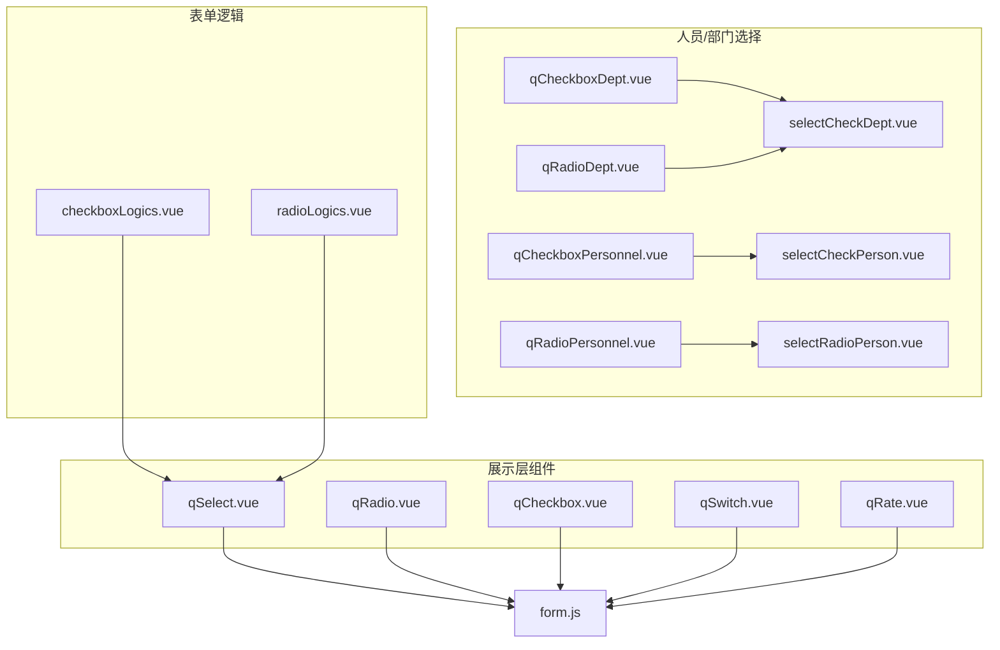
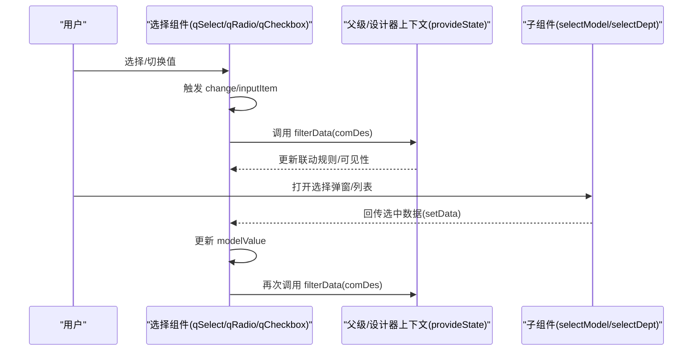
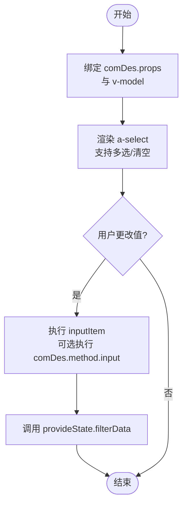
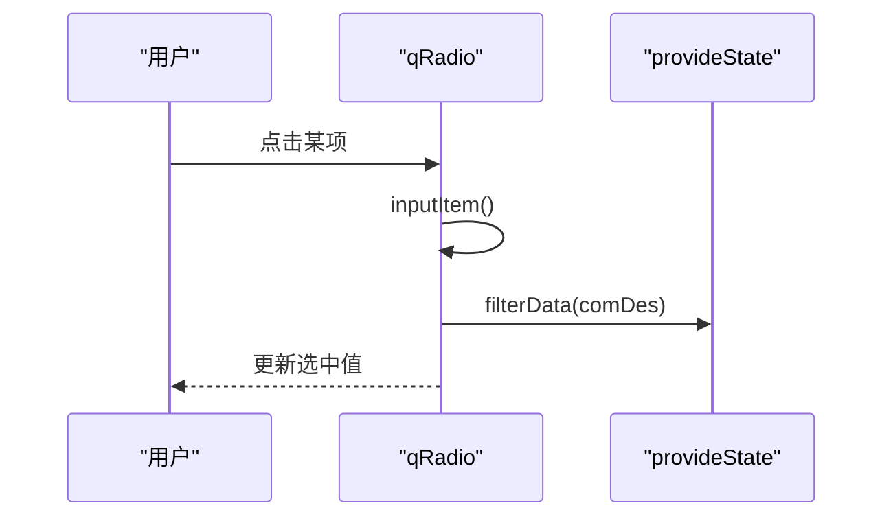
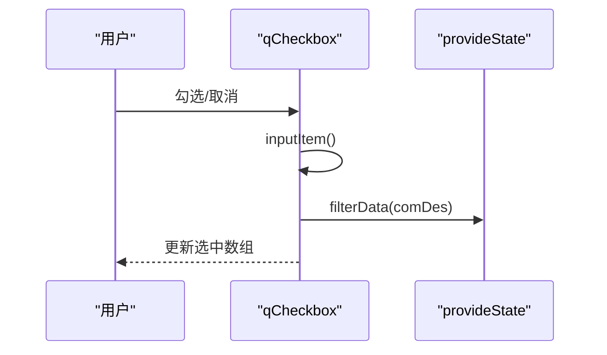
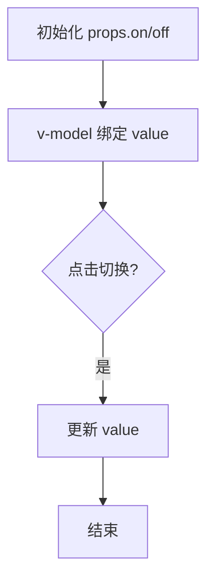
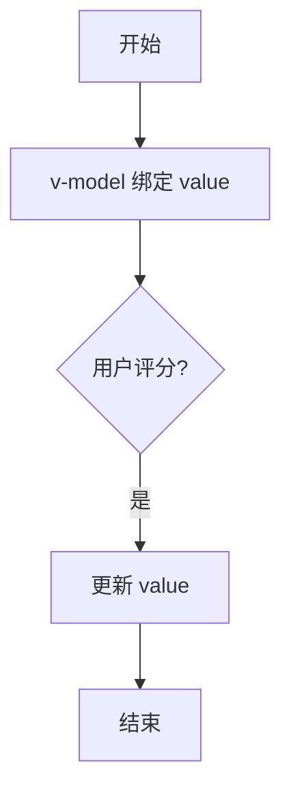
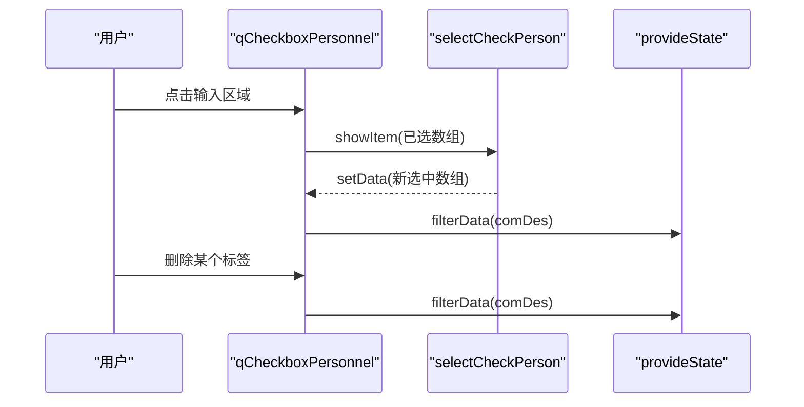
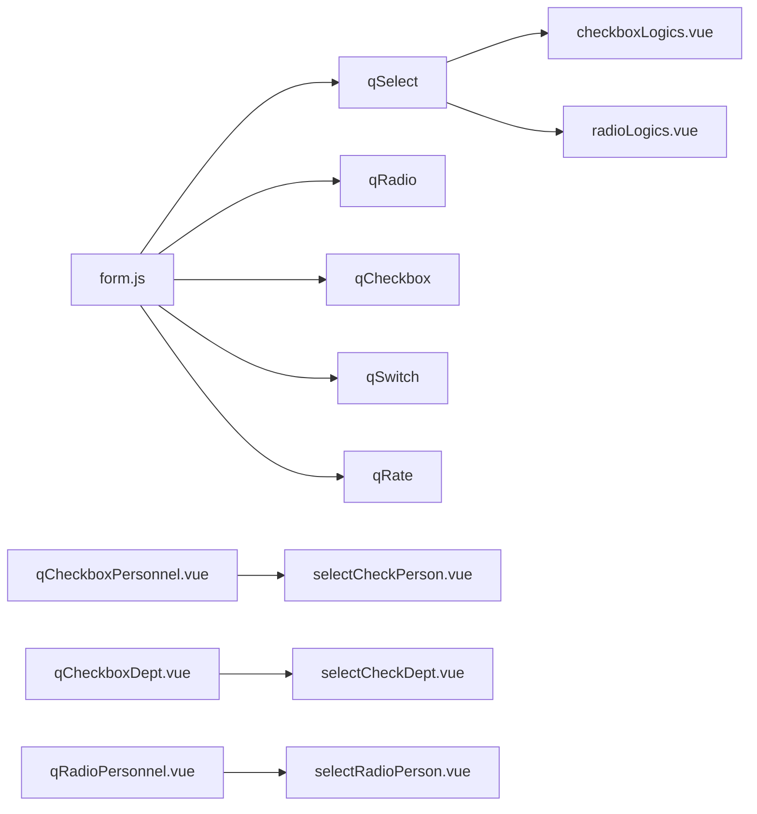

# 选择类组件

<cite>
**本文引用的文件**
- [qSelect.vue](file://src/components/showItem/qSelect.vue)
- [qRadio.vue](file://src/components/showItem/qRadio.vue)
- [qCheckbox.vue](file://src/components/showItem/qCheckbox.vue)
- [qSwitch.vue](file://src/components/showItem/qSwitch.vue)
- [qRate.vue](file://src/components/showItem/qRate.vue)
- [qCheckboxDept.vue](file://src/components/showItem/qCheckboxDept.vue)
- [qCheckboxPersonnel.vue](file://src/components/showItem/qCheckboxPersonnel.vue)
- [qRadioDept.vue](file://src/components/showItem/qRadioDept.vue)
- [qRadioPersonnel.vue](file://src/components/showItem/qRadioPersonnel.vue)
- [selectCheckDept.vue](file://src/components/selectPerson/selectCheckDept.vue)
- [selectCheckPerson.vue](file://src/components/selectPerson/selectCheckPerson.vue)
- [selectRadioPerson.vue](file://src/components/selectPerson/selectRadioPerson.vue)
- [checkboxLogics.vue](file://src/components/formLogics/checkboxLogics.vue)
- [radioLogics.vue](file://src/components/formLogics/radioLogics.vue)
- [form.js](file://src/data/form.js)
</cite>

## 目录
1. [简介](#简介)
2. [项目结构](#项目结构)
3. [核心组件](#核心组件)
4. [架构概览](#架构概览)
5. [详细组件分析](#详细组件分析)
6. [依赖关系分析](#依赖关系分析)
7. [性能考虑](#性能考虑)
8. [故障排查指南](#故障排查指南)
9. [结论](#结论)
10. [附录](#附录)

## 简介
本文件系统性梳理并说明选择类组件，包括下拉选择器（qSelect）、单选按钮组（qRadio）、多选框组（qCheckbox）、开关（qSwitch）、评分（qRate），以及与之配套的部门/人员选择组件（qCheckboxDept、qCheckboxPersonnel、qRadioDept、qRadioPersonnel）。内容涵盖：
- 数据源配置与选项渲染机制
- 值绑定方式与事件回调处理
- 多选模式、禁用状态、只读模式、清空功能
- 动态选项加载、远程搜索、分组显示等高级用法
- 样式定制、主题适配与无障碍访问支持

## 项目结构
选择类组件主要位于 src/components/showItem 与 src/components/selectPerson 两个目录中，并通过 src/data/form.js 提供组件的默认属性与数据源配置模板。

图表来源
- [qSelect.vue:1-34](file://src/components/showItem/qSelect.vue#L1-L34)
- [qRadio.vue:1-33](file://src/components/showItem/qRadio.vue#L1-L33)
- [qCheckbox.vue:1-33](file://src/components/showItem/qCheckbox.vue#L1-L33)
- [qSwitch.vue:1-22](file://src/components/showItem/qSwitch.vue#L1-L22)
- [qRate.vue:1-16](file://src/components/showItem/qRate.vue#L1-L16)
- [qCheckboxDept.vue:1-20](file://src/components/showItem/qCheckboxDept.vue#L1-L20)
- [qCheckboxPersonnel.vue:1-20](file://src/components/showItem/qCheckboxPersonnel.vue#L1-L20)
- [qRadioDept.vue:1-21](file://src/components/showItem/qRadioDept.vue#L1-L21)
- [qRadioPersonnel.vue:1-20](file://src/components/showItem/qRadioPersonnel.vue#L1-L20)
- [selectCheckDept.vue:1-118](file://src/components/selectPerson/selectCheckDept.vue#L1-L118)
- [selectCheckPerson.vue:1-117](file://src/components/selectPerson/selectCheckPerson.vue#L1-L117)
- [selectRadioPerson.vue:1-127](file://src/components/selectPerson/selectRadioPerson.vue#L1-L127)
- [checkboxLogics.vue:1-27](file://src/components/formLogics/checkboxLogics.vue#L1-L27)
- [radioLogics.vue:1-27](file://src/components/formLogics/radioLogics.vue#L1-L27)
- [form.js:475-620](file://src/data/form.js#L475-L620)

章节来源
- [qSelect.vue:1-34](file://src/components/showItem/qSelect.vue#L1-L34)
- [qRadio.vue:1-33](file://src/components/showItem/qRadio.vue#L1-L33)
- [qCheckbox.vue:1-33](file://src/components/showItem/qCheckbox.vue#L1-L33)
- [qSwitch.vue:1-22](file://src/components/showItem/qSwitch.vue#L1-L22)
- [qRate.vue:1-16](file://src/components/showItem/qRate.vue#L1-L16)
- [qCheckboxDept.vue:1-20](file://src/components/showItem/qCheckboxDept.vue#L1-L20)
- [qCheckboxPersonnel.vue:1-20](file://src/components/showItem/qCheckboxPersonnel.vue#L1-L20)
- [qRadioDept.vue:1-21](file://src/components/showItem/qRadioDept.vue#L1-L21)
- [qRadioPersonnel.vue:1-20](file://src/components/showItem/qRadioPersonnel.vue#L1-L20)
- [selectCheckDept.vue:1-118](file://src/components/selectPerson/selectCheckDept.vue#L1-L118)
- [selectCheckPerson.vue:1-117](file://src/components/selectPerson/selectCheckPerson.vue#L1-L117)
- [selectRadioPerson.vue:1-127](file://src/components/selectPerson/selectRadioPerson.vue#L1-L127)
- [checkboxLogics.vue:1-27](file://src/components/formLogics/checkboxLogics.vue#L1-L27)
- [radioLogics.vue:1-27](file://src/components/formLogics/radioLogics.vue#L1-L27)
- [form.js:475-620](file://src/data/form.js#L475-L620)

## 核心组件
本节概述各组件的关键职责与共性特征：
- qSelect：基于下拉选择器的通用选择组件，支持单选与多选、清空、动态数据源与远程搜索。
- qRadio：单选按钮组，支持横向/纵向排列、图片/文字两种形态。
- qCheckbox：多选框组，支持横向/纵向排列、图片/文字两种形态。
- qSwitch：开关组件，支持自定义“开/关”文案。
- qRate：评分组件，用于打分选择。
- 部门/人员选择组件：在 qCheckboxDept/qRadioDept/qCheckboxPersonnel/qRadioPersonnel 的基础上，封装了标签化展示与交互，便于多选场景下的可视化反馈。

章节来源
- [qSelect.vue:1-34](file://src/components/showItem/qSelect.vue#L1-L34)
- [qRadio.vue:1-33](file://src/components/showItem/qRadio.vue#L1-L33)
- [qCheckbox.vue:1-33](file://src/components/showItem/qCheckbox.vue#L1-L33)
- [qSwitch.vue:1-22](file://src/components/showItem/qSwitch.vue#L1-L22)
- [qRate.vue:1-16](file://src/components/showItem/qRate.vue#L1-L16)
- [qCheckboxDept.vue:1-20](file://src/components/showItem/qCheckboxDept.vue#L1-L20)
- [qCheckboxPersonnel.vue:1-20](file://src/components/showItem/qCheckboxPersonnel.vue#L1-L20)
- [qRadioDept.vue:1-21](file://src/components/showItem/qRadioDept.vue#L1-L21)
- [qRadioPersonnel.vue:1-20](file://src/components/showItem/qRadioPersonnel.vue#L1-L20)

## 架构概览
选择类组件采用“配置驱动 + 事件回调”的设计模式：
- 组件通过 comDes.props 接收配置（如 label、placeholder、options、disabled、readonly、multiple 等）。
- 通过 v-model 实现双向绑定，值变更时触发 inputItem 或内部方法，进而调用 provideState.filterData 进行联动过滤。
- 对于部门/人员选择，使用 selectModel/selectDept 等子组件承载复杂交互与数据管理。

图表来源
- [qSelect.vue:13-24](file://src/components/showItem/qSelect.vue#L13-L24)
- [qRadio.vue:13-24](file://src/components/showItem/qRadio.vue#L13-L24)
- [qCheckbox.vue:13-24](file://src/components/showItem/qCheckbox.vue#L13-L24)
- [selectCheckDept.vue:50-66](file://src/components/selectPerson/selectCheckDept.vue#L50-L66)
- [selectCheckPerson.vue:50-67](file://src/components/selectPerson/selectCheckPerson.vue#L50-L67)
- [selectRadioPerson.vue:58-75](file://src/components/selectPerson/selectRadioPerson.vue#L58-L75)

## 详细组件分析

### 下拉选择器 qSelect
- 数据源配置
  - 支持“自定义”和“其他表单数据”两类数据源；多选模式通过 multiple 控制。
  - 默认属性定义位于 form.js 中，包含字段如 dataSourceType、sourceFormCode、sourceFieldCode、options、placeholder、disabled、readonly、visible 等。
- 选项渲染机制
  - 使用 a-select 渲染，v-bind 将 comDes.props 透传给底层组件，确保 placeholder、allowClear、size 等属性生效。
- 值绑定与事件
  - v-model 绑定 comDes.props.value；change 事件触发 inputItem，若存在 comDes.method.input 则执行。
- 高级用法
  - 动态选项加载：通过 comDes.props.options 动态更新；远程搜索：结合外部搜索接口更新 options。
  - 分组显示：可将 options 设计为分组结构以满足分组渲染需求。
- 禁用/只读/清空
  - disabled/readonly 由 props 控制；allowClear 控制是否显示清空按钮。

图表来源
- [qSelect.vue:2-24](file://src/components/showItem/qSelect.vue#L2-L24)
- [form.js:475-620](file://src/data/form.js#L475-L620)

章节来源
- [qSelect.vue:1-34](file://src/components/showItem/qSelect.vue#L1-L34)
- [form.js:475-620](file://src/data/form.js#L475-L620)

### 单选按钮组 qRadio
- 数据源与渲染
  - 使用 a-radio-group，支持 horizontal/vertical 排列与图片/文字两种形态（pic）。
- 值绑定与事件
  - v-model 绑定 comDes.props.value；change 事件触发 inputItem，支持 comDes.method.input。
- 高级用法
  - 图片形态：通过 pic=true 启用图片展示；横向/纵向通过 direction 控制。
- 禁用/只读/清空
  - disabled/readonly 控制交互；单选不支持清空。

图表来源
- [qRadio.vue:2-24](file://src/components/showItem/qRadio.vue#L2-L24)

章节来源
- [qRadio.vue:1-33](file://src/components/showItem/qRadio.vue#L1-L33)
- [form.js:212-292](file://src/data/form.js#L212-L292)

### 多选框组 qCheckbox
- 数据源与渲染
  - 使用 a-checkbox-group，支持 horizontal/vertical 排列与图片/文字两种形态（pic）。
- 值绑定与事件
  - v-model 绑定 comDes.props.value；change 事件触发 inputItem，支持 comDes.method.input。
- 高级用法
  - 图片形态与排列方式同单选；多选值为数组。
- 禁用/只读/清空
  - disabled/readonly 控制交互；多选不支持清空。

图表来源
- [qCheckbox.vue:2-24](file://src/components/showItem/qCheckbox.vue#L2-L24)

章节来源
- [qCheckbox.vue:1-33](file://src/components/showItem/qCheckbox.vue#L1-L33)
- [form.js:293-373](file://src/data/form.js#L293-L373)

### 开关 qSwitch
- 文案定制
  - 通过插槽 #checked/#unchecked 定义“开/关”文案，对应 comDes.props.on/comDes.props.off。
- 值绑定
  - v-model 绑定 comDes.props.value；支持 checked-value/unchecked-value。
- 禁用/只读/清空
  - disabled/readonly 控制交互；开关不支持清空。

图表来源
- [qSwitch.vue:2-9](file://src/components/showItem/qSwitch.vue#L2-L9)

章节来源
- [qSwitch.vue:1-22](file://src/components/showItem/qSwitch.vue#L1-L22)
- [form.js:374-474](file://src/data/form.js#L374-L474)

### 评分 qRate
- 值绑定
  - v-model 绑定 comDes.props.value；支持只读模式（readonly）。
- 禁用/只读/清空
  - disabled/readonly 控制交互；评分不支持清空。

图表来源
- [qRate.vue:2](file://src/components/showItem/qRate.vue#L2)

章节来源
- [qRate.vue:1-16](file://src/components/showItem/qRate.vue#L1-L16)

### 部门/人员选择组件
这些组件在 qCheckboxDept/qRadioDept/qCheckboxPersonnel/qRadioPersonnel 的基础上，封装了标签化展示与交互，便于多选场景下的可视化反馈。

- qCheckboxDept/qCheckboxPersonnel
  - 通过 selectCheckDept/selectCheckPerson 承载选择弹窗与数据回填；支持多选标签展示与删除。
  - 关闭标签时调用 provideState.filterData 以刷新联动。
- qRadioDept/qRadioPersonnel
  - 通过 selectRadioDept/selectRadioModel 承载单选弹窗；setData 会将结果包装为数组并触发联动。

图表来源
- [qCheckboxPersonnel.vue:2](file://src/components/showItem/qCheckboxPersonnel.vue#L2)
- [selectCheckPerson.vue:50-67](file://src/components/selectPerson/selectCheckPerson.vue#L50-L67)

章节来源
- [qCheckboxDept.vue:1-20](file://src/components/showItem/qCheckboxDept.vue#L1-L20)
- [qCheckboxPersonnel.vue:1-20](file://src/components/showItem/qCheckboxPersonnel.vue#L1-L20)
- [qRadioDept.vue:1-21](file://src/components/showItem/qRadioDept.vue#L1-L21)
- [qRadioPersonnel.vue:1-20](file://src/components/showItem/qRadioPersonnel.vue#L1-L20)
- [selectCheckDept.vue:1-118](file://src/components/selectPerson/selectCheckDept.vue#L1-L118)
- [selectCheckPerson.vue:1-117](file://src/components/selectPerson/selectCheckPerson.vue#L1-L117)
- [selectRadioPerson.vue:1-127](file://src/components/selectPerson/selectRadioPerson.vue#L1-L127)

## 依赖关系分析
- 组件到配置
  - 所有选择类组件均依赖 comDes.props 作为配置入口，props 来源于 form.js 中的组件默认属性定义。
- 组件到联动
  - 通过 provideState.filterData 实现与其他字段的联动过滤，贯穿多个组件。
- 表单逻辑组件
  - checkboxLogics.vue/radioLogics.vue 作为逻辑条件下的选择控件，根据条件动态决定是否多选或启用。

图表来源
- [form.js:475-620](file://src/data/form.js#L475-L620)
- [checkboxLogics.vue:3-7](file://src/components/formLogics/checkboxLogics.vue#L3-L7)
- [radioLogics.vue:3-7](file://src/components/formLogics/radioLogics.vue#L3-L7)
- [qCheckboxPersonnel.vue:2](file://src/components/showItem/qCheckboxPersonnel.vue#L2)
- [qCheckboxDept.vue:2](file://src/components/showItem/qCheckboxDept.vue#L2)
- [qRadioPersonnel.vue:2](file://src/components/showItem/qRadioPersonnel.vue#L2)

章节来源
- [form.js:475-620](file://src/data/form.js#L475-L620)
- [checkboxLogics.vue:1-27](file://src/components/formLogics/checkboxLogics.vue#L1-L27)
- [radioLogics.vue:1-27](file://src/components/formLogics/radioLogics.vue#L1-L27)

## 性能考虑
- 大量选项渲染
  - 对于长列表，建议启用虚拟滚动或分页加载，避免一次性渲染过多节点。
- 动态选项与远程搜索
  - 使用防抖策略减少请求频率；缓存最近查询结果，避免重复请求。
- 多选标签展示
  - 当选中数量较多时，仅展示前 N 个标签并以“+剩余数量”形式呈现，降低 DOM 负担。
- 值变更与联动
  - 频繁触发 filterData 会增加计算压力，建议在批量更新时合并多次变更后再统一触发。

## 故障排查指南
- 无法清空
  - 检查 comDes.props.allowClear 是否开启；部分组件（如单选/开关）不支持清空。
- 选项不更新
  - 确认 comDes.props.options 已正确更新；对于远程搜索，检查请求链路与缓存策略。
- 联动无效
  - 确认 provideState.filterData 是否被调用；检查 comDes.id 与联动字段配置是否一致。
- 多选标签无法删除
  - 检查 disabled 状态；确认 closeItem 流程未被中断。
- 事件未触发
  - 确认 comDes.method.input 是否存在语法错误；当前实现使用 eval 执行，需保证字符串合法。

章节来源
- [qSelect.vue:13-24](file://src/components/showItem/qSelect.vue#L13-L24)
- [qRadio.vue:13-24](file://src/components/showItem/qRadio.vue#L13-L24)
- [qCheckbox.vue:13-24](file://src/components/showItem/qCheckbox.vue#L13-L24)
- [selectCheckDept.vue:50-66](file://src/components/selectPerson/selectCheckDept.vue#L50-L66)
- [selectCheckPerson.vue:50-67](file://src/components/selectPerson/selectCheckPerson.vue#L50-L67)
- [selectRadioPerson.vue:58-75](file://src/components/selectPerson/selectRadioPerson.vue#L58-L75)

## 结论
选择类组件通过统一的配置模型与事件机制，实现了从基础单选/多选到复杂部门/人员选择的完整覆盖。借助联动过滤与灵活的数据源配置，能够满足多样化的业务场景。建议在实际使用中关注性能优化与错误处理，确保用户体验与稳定性。

## 附录
- 样式定制与主题适配
  - 组件样式通过 scoped SCSS 引入统一颜色变量，便于主题切换；可通过覆盖变量或引入主题样式文件实现全局适配。
- 无障碍访问支持
  - 建议为每个选择组件提供明确的 label 与 aria-* 属性，确保屏幕阅读器可识别；对键盘导航与焦点管理进行完善。