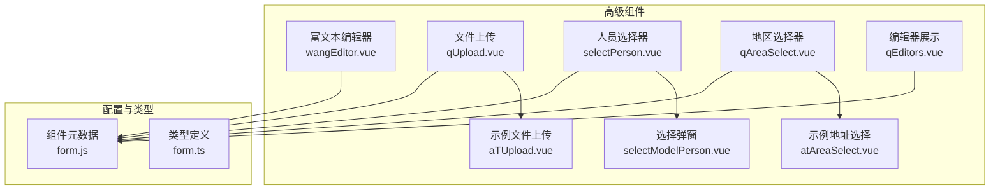
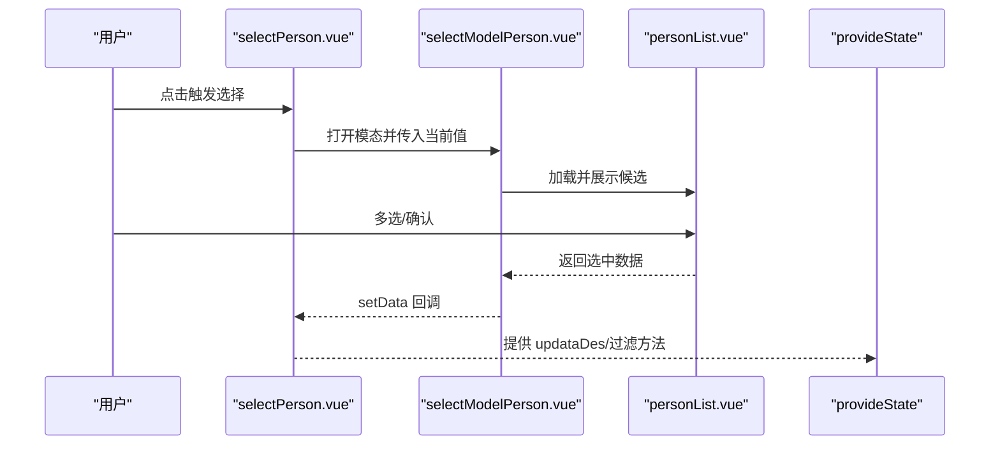
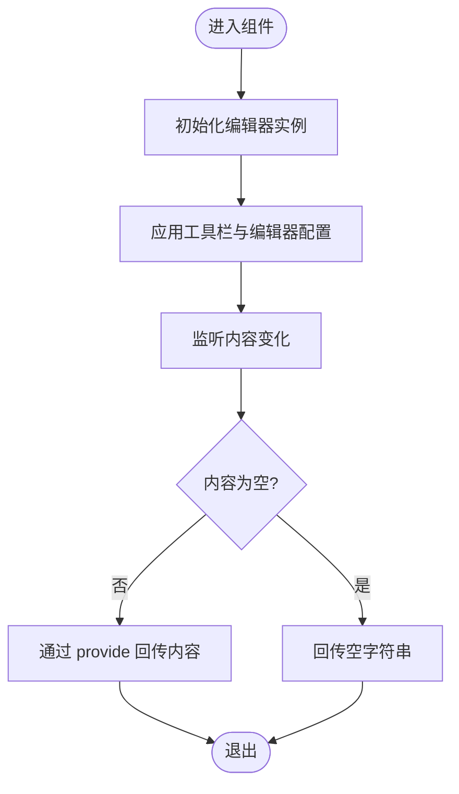
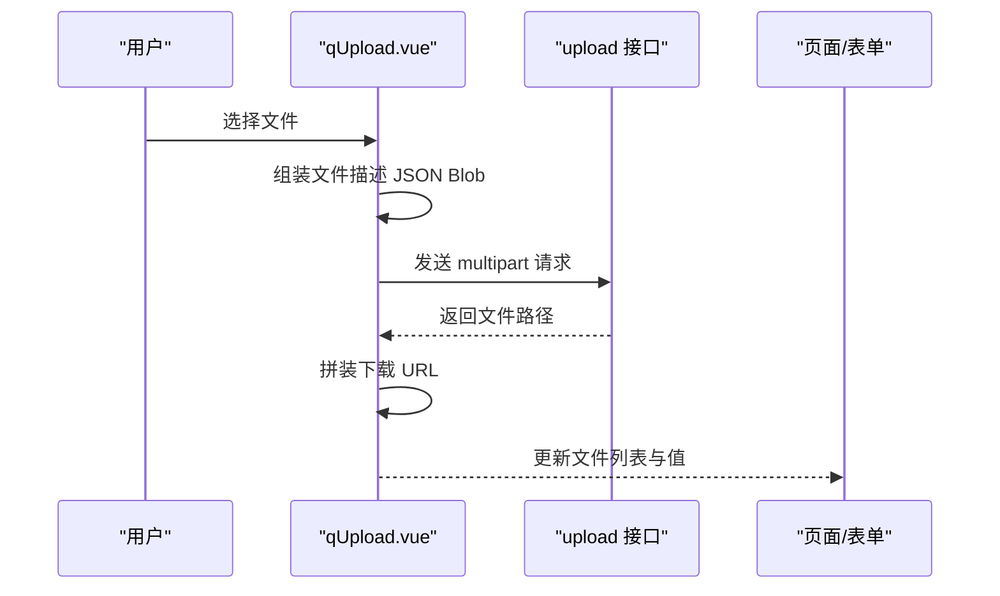
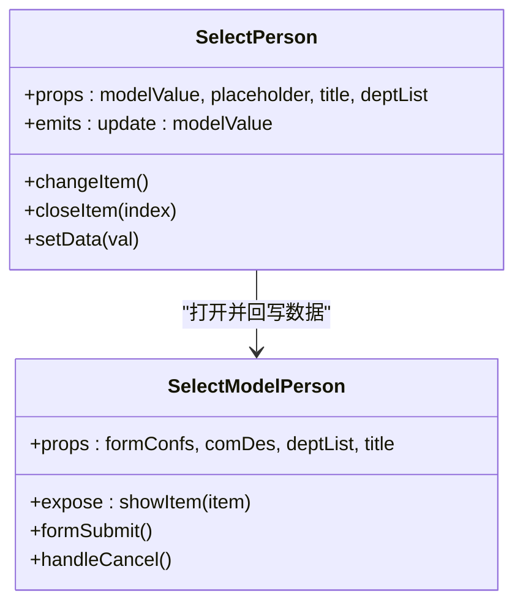
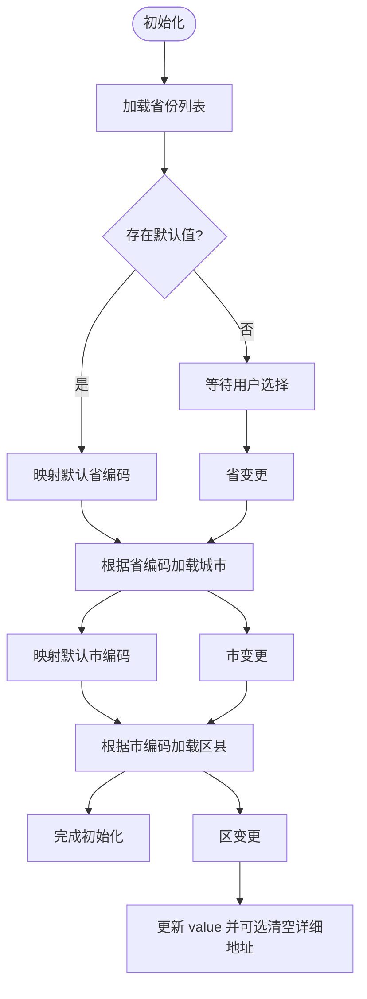
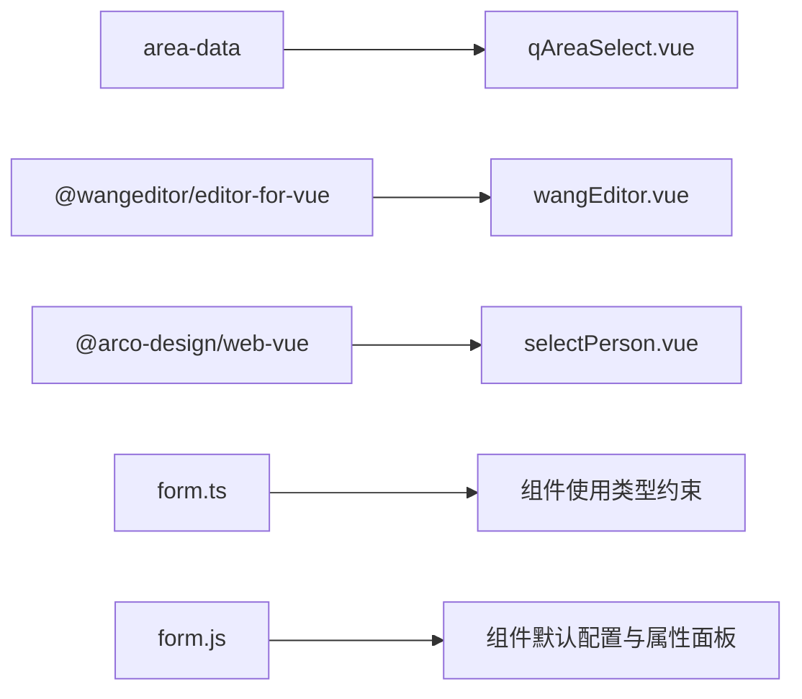

# 高级组件

<cite>
**本文引用的文件**
- [wangEditor.vue](file://src/components/wangEditor/wangEditor.vue)
- [qUpload.vue](file://src/components/showItem/qUpload.vue)
- [selectPerson.vue](file://src/components/selectPerson/selectPerson.vue)
- [selectModelPerson.vue](file://src/components/selectPerson/components/selectModelPerson.vue)
- [qAreaSelect.vue](file://src/components/showItem/qAreaSelect.vue)
- [qEditors.vue](file://src/components/showItem/qEditors.vue)
- [aTUpload.vue](file://src/components/showItem/aTUpload.vue)
- [atAreaSelect.vue](file://src/components/showItem/atAreaSelect.vue)
- [form.js](file://src/data/form.js)
- [form.ts](file://src/types/form.ts)
</cite>

## 目录
1. [简介](#简介)
2. [项目结构](#项目结构)
3. [核心组件](#核心组件)
4. [架构总览](#架构总览)
5. [详细组件分析](#详细组件分析)
6. [依赖分析](#依赖分析)
7. [性能考虑](#性能考虑)
8. [故障排查指南](#故障排查指南)
9. [结论](#结论)
10. [附录](#附录)

## 简介
本文件聚焦于高级组件的系统化文档，覆盖富文本编辑器（wangEditor）、文件上传（qUpload）、人员选择器（selectPerson）、地区选择器（qAreaSelect）、编辑器组件（qEditors）等。文档从架构与数据流入手，逐项解析组件的复杂配置、插槽使用、事件处理、数据格式化、扩展性与第三方集成能力，并给出在复杂业务场景下的使用建议、性能优化策略与错误处理方案，同时涵盖国际化支持、主题定制与移动端适配要点。

## 项目结构
高级组件主要分布在以下位置：
- 富文本：src/components/wangEditor/wangEditor.vue
- 文件上传：src/components/showItem/qUpload.vue、src/components/showItem/aTUpload.vue
- 人员选择：src/components/selectPerson/selectPerson.vue、src/components/selectPerson/components/selectModelPerson.vue
- 地区选择：src/components/showItem/qAreaSelect.vue、src/components/showItem/atAreaSelect.vue
- 编辑器展示：src/components/showItem/qEditors.vue
- 组件元数据与默认配置：src/data/form.js
- 类型定义：src/types/form.ts

图表来源
- [wangEditor.vue:1-121](file://src/components/wangEditor/wangEditor.vue#L1-L121)
- [qUpload.vue:1-88](file://src/components/showItem/qUpload.vue#L1-L88)
- [selectPerson.vue:1-115](file://src/components/selectPerson/selectPerson.vue#L1-L115)
- [selectModelPerson.vue:1-81](file://src/components/selectPerson/components/selectModelPerson.vue#L1-L81)
- [qAreaSelect.vue:1-148](file://src/components/showItem/qAreaSelect.vue#L1-L148)
- [qEditors.vue:1-50](file://src/components/showItem/qEditors.vue#L1-L50)
- [aTUpload.vue:1-78](file://src/components/showItem/aTUpload.vue#L1-L78)
- [atAreaSelect.vue:1-127](file://src/components/showItem/atAreaSelect.vue#L1-L127)
- [form.js:1-2657](file://src/data/form.js#L1-L2657)
- [form.ts:1-45](file://src/types/form.ts#L1-L45)

章节来源
- [wangEditor.vue:1-121](file://src/components/wangEditor/wangEditor.vue#L1-L121)
- [qUpload.vue:1-88](file://src/components/showItem/qUpload.vue#L1-L88)
- [selectPerson.vue:1-115](file://src/components/selectPerson/selectPerson.vue#L1-L115)
- [selectModelPerson.vue:1-81](file://src/components/selectPerson/components/selectModelPerson.vue#L1-L81)
- [qAreaSelect.vue:1-148](file://src/components/showItem/qAreaSelect.vue#L1-L148)
- [qEditors.vue:1-50](file://src/components/showItem/qEditors.vue#L1-L50)
- [aTUpload.vue:1-78](file://src/components/showItem/aTUpload.vue#L1-L78)
- [atAreaSelect.vue:1-127](file://src/components/showItem/atAreaSelect.vue#L1-L127)
- [form.js:1-2657](file://src/data/form.js#L1-L2657)
- [form.ts:1-45](file://src/types/form.ts#L1-L45)

## 核心组件
- 富文本编辑器（wangEditor）
  - 功能：基于 wangeditor 的可视化编辑器，支持工具栏自定义、图片/视频上传配置、占位符与基础样式。
  - 关键点：通过注入上下文将内容变更回传给设计器；默认配置包含上传图片/视频的请求头、超时、类型限制与自定义插入逻辑。
- 文件上传（qUpload）
  - 功能：通用附件上传组件，根据配置的附件类型动态生成 accept 规则，支持示例文件上传与下载链接拼装。
  - 关键点：自定义上传请求，构造文件描述 JSON Blob，上传成功后更新文件列表与下载 URL。
- 人员选择器（selectPerson）
  - 功能：多选人员标签展示与选择弹窗，支持标签关闭、最多展示 N 个标签并显示余量。
  - 关键点：通过子组件 selectModelPerson.vue 打开模态，选择完成后回写父组件的 modelValue。
- 地区选择器（qAreaSelect）
  - 功能：省市区三级联动，支持不同精度（省/市/区或省/市/区/详细地址），并提供“输入函数”扩展。
  - 关键点：基于 area-data 数据源构建选项，变更时同步更新 value 与城市/区县列表。
- 编辑器展示（qEditors）
  - 功能：用于展示富文本内容，支持折叠/展开切换，渲染 HTML 内容。
  - 关键点：通过 v-html 渲染，控制折叠状态与折叠文案。

章节来源
- [wangEditor.vue:1-121](file://src/components/wangEditor/wangEditor.vue#L1-L121)
- [qUpload.vue:1-88](file://src/components/showItem/qUpload.vue#L1-L88)
- [selectPerson.vue:1-115](file://src/components/selectPerson/selectPerson.vue#L1-L115)
- [selectModelPerson.vue:1-81](file://src/components/selectPerson/components/selectModelPerson.vue#L1-L81)
- [qAreaSelect.vue:1-148](file://src/components/showItem/qAreaSelect.vue#L1-L148)
- [qEditors.vue:1-50](file://src/components/showItem/qEditors.vue#L1-L50)

## 架构总览
高级组件围绕“配置驱动 + 组件封装 + 事件回传”的模式组织：
- 配置驱动：组件元数据（form.js）定义组件类型、默认 props、属性面板与方法入口。
- 组件封装：各高级组件对第三方库进行二次封装，统一接口与行为。
- 事件回传：通过 provide/inject 或事件回调将状态变化回传至上层设计器或业务容器。

图表来源
- [selectPerson.vue:1-115](file://src/components/selectPerson/selectPerson.vue#L1-L115)
- [selectModelPerson.vue:1-81](file://src/components/selectPerson/components/selectModelPerson.vue#L1-L81)

## 详细组件分析

### 富文本编辑器（wangEditor）
- 配置要点
  - 工具栏：toolbarKeys 自定义菜单项，excludeKeys 控制隐藏项。
  - 编辑器：placeholder、MENU_CONF.uploadImage/video 的服务器地址、请求头、超时、类型限制、大小限制与自定义插入。
  - 样式：scoped 样式覆盖 wangeditor 的容器与占位符样式。
- 插槽与事件
  - 使用 Editor/Toolbar 组件，通过 v-model 绑定内容，监听 onCreated 获取编辑器实例。
- 数据格式化
  - 初始值与双向绑定值为 HTML 字符串；watch 监听变更并通过 provide 注入的方法回传。
- 扩展与第三方集成
  - 支持自定义上传处理器（customInsert），可对接任意后端存储。
  - 可通过 headers 注入 token 实现鉴权。
- 使用建议
  - 在复杂表单中，结合设计器的“输入函数”动态计算默认值或联动。
  - 注意图片/视频大小限制与超时设置，避免大文件导致失败。

图表来源
- [wangEditor.vue:1-121](file://src/components/wangEditor/wangEditor.vue#L1-L121)

章节来源
- [wangEditor.vue:1-121](file://src/components/wangEditor/wangEditor.vue#L1-L121)

### 文件上传（qUpload）
- 配置要点
  - 附件类型：支持图片、视频、音频、文档、压缩包，动态生成 accept。
  - 上传参数：自定义请求头、文件描述 JSON Blob、上传成功后的文件对象结构（含路径、URL、状态）。
- 插槽与事件
  - 通过 v-bind 绑定原生 a-upload 属性，自定义上传与移除逻辑。
- 数据格式化
  - 上传成功后更新 fileList，拼接下载 URL 并写入组件值。
- 扩展与第三方集成
  - 可替换 upload 接口以对接不同后端；支持自定义 headers 与超时。
- 使用建议
  - 结合“示例文件上传”组件实现预览与校验；注意文件大小与类型限制。

图表来源
- [qUpload.vue:1-88](file://src/components/showItem/qUpload.vue#L1-L88)
- [aTUpload.vue:1-78](file://src/components/showItem/aTUpload.vue#L1-L78)

章节来源
- [qUpload.vue:1-88](file://src/components/showItem/qUpload.vue#L1-L88)
- [aTUpload.vue:1-78](file://src/components/showItem/aTUpload.vue#L1-L78)

### 人员选择器（selectPerson）
- 配置要点
  - 支持 placeholder、标题、部门列表传入；通过 modelValue 双向绑定。
  - 标签展示：最多展示 N 个标签并显示余量；支持点击关闭单个标签。
- 插槽与事件
  - 通过 selectModelPerson.vue 打开模态，setData 事件回写选中值。
- 数据格式化
  - 标签显示优先使用 nickname，否则回退到 label；内部维护 userList 数组。
- 扩展与第三方集成
  - 可替换为其他选择器（如部门/角色）；通过注入的 provideState 进行联动。
- 使用建议
  - 在复杂权限场景下，结合“当前用户所在部门/下级部门”等范围配置。

图表来源
- [selectPerson.vue:1-115](file://src/components/selectPerson/selectPerson.vue#L1-L115)
- [selectModelPerson.vue:1-81](file://src/components/selectPerson/components/selectModelPerson.vue#L1-L81)

章节来源
- [selectPerson.vue:1-115](file://src/components/selectPerson/selectPerson.vue#L1-L115)
- [selectModelPerson.vue:1-81](file://src/components/selectPerson/components/selectModelPerson.vue#L1-L81)

### 地区选择器（qAreaSelect）
- 配置要点
  - 支持省/市/区三级联动，可选“省/市/区/详细地址”精度。
  - 默认值与联动：根据 defaultValue 初始化选项，变更时同步更新 value 与列表。
- 插槽与事件
  - 通过 changeProvince/changeCity/changeDist 更新状态；支持“输入函数”扩展。
- 数据格式化
  - 将编码映射为标签文本，保持 value 与列表一致。
- 扩展与第三方集成
  - 可替换 area-data 数据源；支持禁用与只读。
- 使用建议
  - 在需要精确到门牌号的场景启用“详细地址”。

图表来源
- [qAreaSelect.vue:1-148](file://src/components/showItem/qAreaSelect.vue#L1-L148)
- [atAreaSelect.vue:1-127](file://src/components/showItem/atAreaSelect.vue#L1-L127)

章节来源
- [qAreaSelect.vue:1-148](file://src/components/showItem/qAreaSelect.vue#L1-L148)
- [atAreaSelect.vue:1-127](file://src/components/showItem/atAreaSelect.vue#L1-L127)

### 编辑器展示（qEditors）
- 配置要点
  - 支持折叠/展开，折叠时展示 foldContext，展开时展示 desc。
  - 通过 v-html 渲染 HTML 内容，控制最大宽度与行高。
- 插槽与事件
  - 无插槽；通过点击切换状态。
- 数据格式化
  - 输入为 HTML 字符串，输出为渲染后的 DOM 片段。
- 扩展与第三方集成
  - 可配合富文本编辑器组件使用，作为只读展示层。
- 使用建议
  - 在详情页或审批页中作为只读内容展示，避免误编辑。

章节来源
- [qEditors.vue:1-50](file://src/components/showItem/qEditors.vue#L1-L50)

## 依赖分析
- 组件间耦合
  - 人员选择器依赖选择弹窗组件；地区选择器依赖外部数据源；富文本编辑器依赖第三方编辑器库。
- 外部依赖
  - area-data：地区联动数据源。
  - @wangeditor/editor-for-vue：富文本编辑器。
  - @arco-design/web-vue：UI 组件库（如 Modal、Tabs、Select 等）。
- 类型与配置
  - form.ts 定义了表单与流程相关类型；form.js 提供组件元数据与默认配置。

图表来源
- [qAreaSelect.vue:1-148](file://src/components/showItem/qAreaSelect.vue#L1-L148)
- [wangEditor.vue:1-121](file://src/components/wangEditor/wangEditor.vue#L1-L121)
- [selectPerson.vue:1-115](file://src/components/selectPerson/selectPerson.vue#L1-L115)
- [form.ts:1-45](file://src/types/form.ts#L1-L45)
- [form.js:1-2657](file://src/data/form.js#L1-L2657)

章节来源
- [form.ts:1-45](file://src/types/form.ts#L1-L45)
- [form.js:1-2657](file://src/data/form.js#L1-L2657)

## 性能考虑
- 图片/视频上传
  - 合理设置最大文件大小与超时时间，避免阻塞 UI。
  - 对大图进行前端压缩或缩略图策略，减少传输与渲染压力。
- 地区联动
  - 预加载常用省份列表，按需加载城市/区县，避免一次性渲染过多节点。
- 富文本
  - 控制工具栏菜单数量，仅保留必要功能；避免频繁重渲染。
- 人员选择
  - 分页/搜索加载候选人员，避免一次性渲染大量标签。
- 编辑器展示
  - 对长内容采用懒加载或分页展示，避免一次性渲染造成卡顿。

## 故障排查指南
- 上传失败
  - 检查 headers 中 token 是否正确；确认后端允许的文件类型与大小。
  - 查看自定义上传请求是否正确拼装 JSON Blob 与文件字段。
- 地区联动异常
  - 确认 defaultValue 编码与 area-data 数据源一致；检查 onChange 流程是否清空下级列表。
- 富文本内容未回传
  - 确认 provide 注入的 updataDes 方法是否存在；检查 watcher 条件与空内容处理。
- 人员选择标签不更新
  - 检查 modelValue 双向绑定是否生效；确认 setData 事件是否正确回写。
- 编辑器展示空白
  - 确认传入的 HTML 字符串非空；检查 v-html 渲染与样式覆盖。

章节来源
- [qUpload.vue:1-88](file://src/components/showItem/qUpload.vue#L1-L88)
- [qAreaSelect.vue:1-148](file://src/components/showItem/qAreaSelect.vue#L1-L148)
- [wangEditor.vue:1-121](file://src/components/wangEditor/wangEditor.vue#L1-L121)
- [selectPerson.vue:1-115](file://src/components/selectPerson/selectPerson.vue#L1-L115)
- [qEditors.vue:1-50](file://src/components/showItem/qEditors.vue#L1-L50)

## 结论
高级组件通过“配置驱动 + 组件封装 + 事件回传”的架构，实现了富文本、文件上传、人员与地区选择、编辑器展示等复杂业务场景的统一接入。在实际使用中，应关注上传性能、联动数据一致性、富文本安全与渲染效率，并结合设计器的“输入函数”与“方法”扩展能力，实现更灵活的业务逻辑。

## 附录
- 国际化支持
  - 工具栏按钮与占位符文案可通过配置项本地化；建议在多语言环境下统一管理文案资源。
- 主题定制
  - 通过 scoped 样式覆盖第三方组件容器与占位符；结合 CSS 变量实现主题切换。
- 移动端适配
  - 上传组件建议使用移动端友好的 accept 与尺寸；富文本工具栏可精简为移动端常用功能；地区选择器在移动端建议使用 Picker 替代 Select。