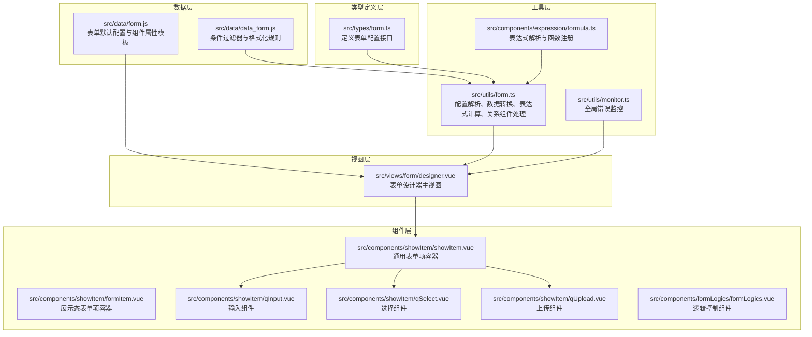
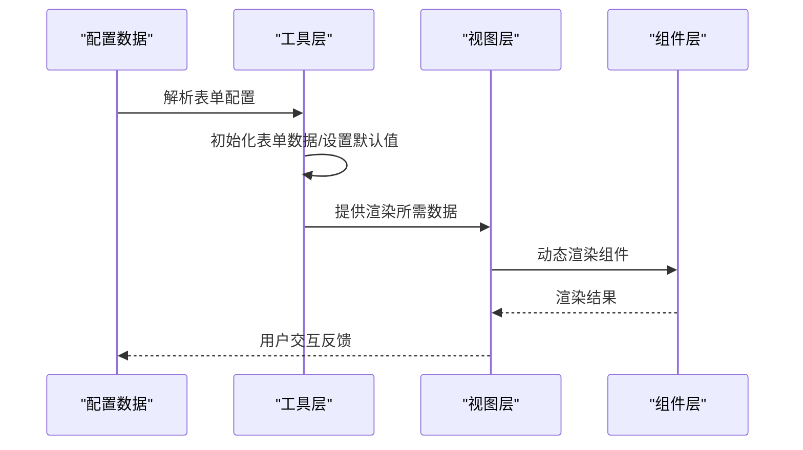
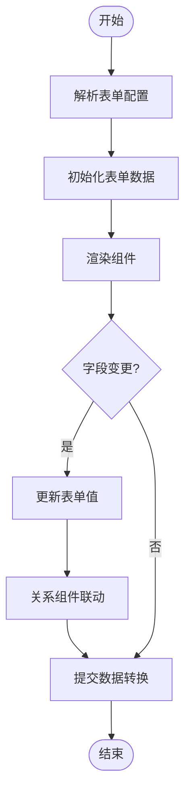
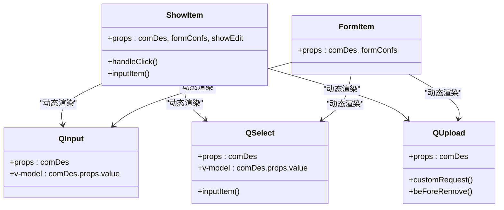
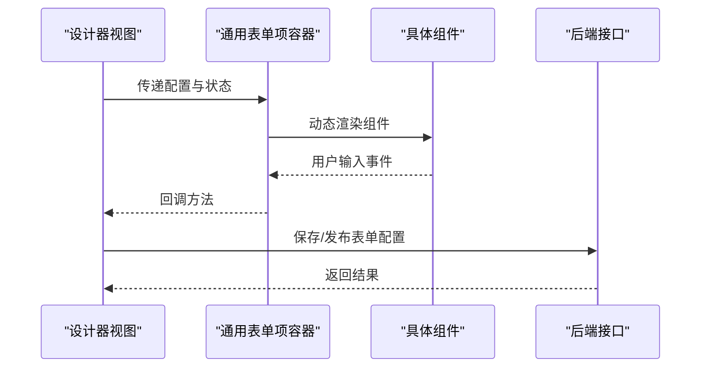
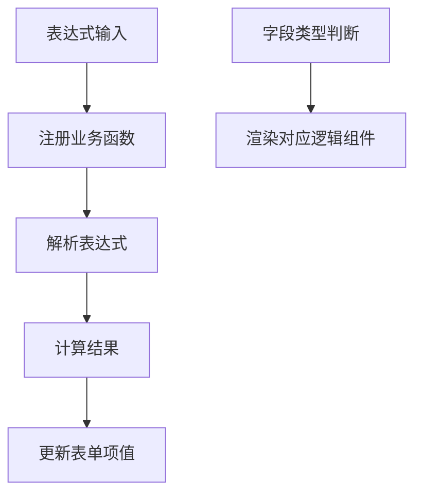
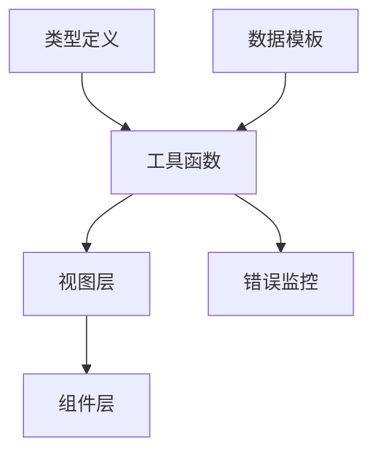

# 表单渲染引擎

<cite>
**本文档引用的文件**
- [src/types/form.ts](file://src/types/form.ts)
- [src/utils/form.ts](file://src/utils/form.ts)
- [src/data/form.js](file://src/data/form.js)
- [src/components/showItem/showItem.vue](file://src/components/showItem/showItem.vue)
- [src/components/showItem/formItem.vue](file://src/components/showItem/formItem.vue)
- [src/components/showItem/qInput.vue](file://src/components/showItem/qInput.vue)
- [src/components/showItem/qSelect.vue](file://src/components/showItem/qSelect.vue)
- [src/components/showItem/qUpload.vue](file://src/components/showItem/qUpload.vue)
- [src/views/form/designer.vue](file://src/views/form/designer.vue)
- [src/data/data_form.js](file://src/data/data_form.js)
- [src/utils/monitor.ts](file://src/utils/monitor.ts)
- [src/components/expression/formula.ts](file://src/components/expression/formula.ts)
- [src/components/formLogics/formLogics.vue](file://src/components/formLogics/formLogics.vue)
</cite>

## 目录
1. [简介](#简介)
2. [项目结构](#项目结构)
3. [核心组件](#核心组件)
4. [架构概览](#架构概览)
5. [详细组件分析](#详细组件分析)
6. [依赖关系分析](#依赖关系分析)
7. [性能考虑](#性能考虑)
8. [故障排除指南](#故障排除指南)
9. [结论](#结论)
10. [附录](#附录)

## 简介
本技术文档深入解析该表单渲染引擎从配置到最终渲染的完整流程，涵盖配置解析、组件映射、DOM生成、事件绑定等核心环节。文档详细说明渲染引擎的数据结构设计、配置项解析机制、组件实例化过程，并提供渲染性能优化策略（如虚拟DOM、懒加载、缓存机制）、扩展接口与自定义渲染器开发指南，以及渲染错误处理、调试工具使用和性能监控等实用技巧。

## 项目结构
该表单渲染引擎围绕Vue 3 + TypeScript构建，采用模块化设计，主要由以下层次组成：
- 类型定义层：定义表单配置、应用描述、流程信息等接口，确保配置结构的强类型约束。
- 数据层：提供表单默认配置、组件属性模板、过滤器规则等静态数据。
- 工具层：负责表单配置解析、数据转换、表达式计算、关系组件联动、上传处理等核心逻辑。
- 视图层：提供设计器视图与展示视图，通过动态组件机制将配置映射为实际UI。
- 组件层：封装具体表单项组件（输入、选择、上传等），统一处理事件与状态。

**图表来源**
- [src/types/form.ts:1-45](file://src/types/form.ts#L1-L45)
- [src/data/form.js:1-21](file://src/data/form.js#L1-L21)
- [src/data/data_form.js:740-800](file://src/data/data_form.js#L740-L800)
- [src/utils/form.ts:1-1341](file://src/utils/form.ts#L1-L1341)
- [src/utils/monitor.ts:1-29](file://src/utils/monitor.ts#L1-L29)
- [src/components/expression/formula.ts:1-96](file://src/components/expression/formula.ts#L1-L96)
- [src/views/form/designer.vue:1-444](file://src/views/form/designer.vue#L1-L444)
- [src/components/showItem/showItem.vue:1-196](file://src/components/showItem/showItem.vue#L1-L196)
- [src/components/showItem/formItem.vue:1-122](file://src/components/showItem/formItem.vue#L1-L122)
- [src/components/showItem/qInput.vue:1-21](file://src/components/showItem/qInput.vue#L1-L21)
- [src/components/showItem/qSelect.vue:1-34](file://src/components/showItem/qSelect.vue#L1-L34)
- [src/components/showItem/qUpload.vue:1-88](file://src/components/showItem/qUpload.vue#L1-L88)
- [src/components/formLogics/formLogics.vue:1-35](file://src/components/formLogics/formLogics.vue#L1-L35)

**章节来源**
- [src/types/form.ts:1-45](file://src/types/form.ts#L1-L45)
- [src/data/form.js:1-21](file://src/data/form.js#L1-L21)
- [src/data/data_form.js:740-800](file://src/data/data_form.js#L740-L800)
- [src/utils/form.ts:1-1341](file://src/utils/form.ts#L1-L1341)
- [src/utils/monitor.ts:1-29](file://src/utils/monitor.ts#L1-L29)
- [src/components/expression/formula.ts:1-96](file://src/components/expression/formula.ts#L1-L96)
- [src/views/form/designer.vue:1-444](file://src/views/form/designer.vue#L1-L444)
- [src/components/showItem/showItem.vue:1-196](file://src/components/showItem/showItem.vue#L1-L196)
- [src/components/showItem/formItem.vue:1-122](file://src/components/showItem/formItem.vue#L1-L122)
- [src/components/showItem/qInput.vue:1-21](file://src/components/showItem/qInput.vue#L1-L21)
- [src/components/showItem/qSelect.vue:1-34](file://src/components/showItem/qSelect.vue#L1-L34)
- [src/components/showItem/qUpload.vue:1-88](file://src/components/showItem/qUpload.vue#L1-L88)
- [src/components/formLogics/formLogics.vue:1-35](file://src/components/formLogics/formLogics.vue#L1-L35)

## 核心组件
- 表单配置接口：定义表单配置、应用描述、流程信息等结构，确保配置在编译期具备类型安全。
- 表单默认配置与组件属性模板：提供表单布局、尺寸、按钮位置、禁用状态、标签样式等默认值，以及各组件的属性模板与属性面板配置。
- 表单工具函数：负责表单配置解析、表单数据初始化与更新、表单提交数据转换、关系组件联动查询、表达式计算、上传处理等。
- 表达式引擎：基于expr-eval解析器，注册多种业务函数（用户、日期、随机、通用、字符串、数组、金额、业务），支持在表单中进行复杂计算。
- 视图与容器组件：设计器视图负责拖拽布局与属性编辑；通用表单项容器根据配置动态渲染具体组件；展示态容器用于只读场景。
- 上传组件：封装上传逻辑，支持多种文件类型与示例文件预览，提供自定义请求钩子。
- 错误监控：全局错误处理器，上报错误信息至服务端，便于问题追踪与修复。

**章节来源**
- [src/types/form.ts:12-24](file://src/types/form.ts#L12-L24)
- [src/data/form.js:2-21](file://src/data/form.js#L2-L21)
- [src/utils/form.ts:1-1341](file://src/utils/form.ts#L1-L1341)
- [src/components/expression/formula.ts:1-96](file://src/components/expression/formula.ts#L1-L96)
- [src/views/form/designer.vue:67-287](file://src/views/form/designer.vue#L67-L287)
- [src/components/showItem/showItem.vue:1-196](file://src/components/showItem/showItem.vue#L1-L196)
- [src/components/showItem/qUpload.vue:1-88](file://src/components/showItem/qUpload.vue#L1-L88)
- [src/utils/monitor.ts:1-29](file://src/utils/monitor.ts#L1-L29)

## 架构概览
表单渲染引擎采用“配置驱动 + 动态组件”的架构模式。配置通过类型系统保证结构正确性，工具层负责解析与转换，视图层通过动态组件将配置映射为UI，组件层封装具体交互逻辑。

**图表来源**
- [src/utils/form.ts:578-601](file://src/utils/form.ts#L578-L601)
- [src/views/form/designer.vue:87-90](file://src/views/form/designer.vue#L87-L90)
- [src/components/showItem/showItem.vue:10-14](file://src/components/showItem/showItem.vue#L10-L14)

## 详细组件分析

### 配置解析与数据转换
- 表单配置解析：工具函数负责遍历表单配置树，提取字段列表、子表单结构、关系组件数据等，支持按需展开或折叠。
- 表单数据初始化：根据配置设置默认值、禁用状态、示例文件等，确保首次渲染符合预期。
- 表单数据更新：监听字段变更，实时更新表单值，处理用户、部门、上传等特殊类型的数据转换。
- 表单提交数据转换：将前端展示值转换为后端期望格式，处理用户/部门ID、子表单数组、关系组件JSON等。
- 关系组件联动：根据触发字段变化，调用后端接口获取关联数据，动态更新选项或值。
- 表达式计算：在表单中嵌入表达式，解析并计算结果，支持函数注册与变量访问。

**图表来源**
- [src/utils/form.ts:578-601](file://src/utils/form.ts#L578-L601)
- [src/utils/form.ts:602-722](file://src/utils/form.ts#L602-L722)
- [src/utils/form.ts:723-800](file://src/utils/form.ts#L723-L800)
- [src/utils/form.ts:452-577](file://src/utils/form.ts#L452-L577)

**章节来源**
- [src/utils/form.ts:1-1341](file://src/utils/form.ts#L1-L1341)

### 组件映射与动态渲染
- 通用表单项容器：根据配置决定是否包裹表单项容器，支持编辑态与展示态切换，动态渲染具体组件。
- 展示态容器：仅渲染组件，不包裹表单项容器，适用于只读场景。
- 具体组件：输入、选择、上传等组件通过动态组件机制渲染，统一处理v-model与事件回调。

**图表来源**
- [src/components/showItem/showItem.vue:1-196](file://src/components/showItem/showItem.vue#L1-L196)
- [src/components/showItem/formItem.vue:1-122](file://src/components/showItem/formItem.vue#L1-L122)
- [src/components/showItem/qInput.vue:1-21](file://src/components/showItem/qInput.vue#L1-L21)
- [src/components/showItem/qSelect.vue:1-34](file://src/components/showItem/qSelect.vue#L1-L34)
- [src/components/showItem/qUpload.vue:1-88](file://src/components/showItem/qUpload.vue#L1-L88)

**章节来源**
- [src/components/showItem/showItem.vue:1-196](file://src/components/showItem/showItem.vue#L1-L196)
- [src/components/showItem/formItem.vue:1-122](file://src/components/showItem/formItem.vue#L1-L122)
- [src/components/showItem/qInput.vue:1-21](file://src/components/showItem/qInput.vue#L1-L21)
- [src/components/showItem/qSelect.vue:1-34](file://src/components/showItem/qSelect.vue#L1-L34)
- [src/components/showItem/qUpload.vue:1-88](file://src/components/showItem/qUpload.vue#L1-L88)

### 表单设计器工作流
- 设计器视图：提供拖拽布局、属性编辑、保存与下一步操作，通过provide/inject注入设计器状态与方法。
- 属性面板：根据组件类型显示对应属性，支持描述富文本、必填校验、默认值、方法等。
- 保存与发布：序列化表单配置，调用后端接口保存或跳转到流程配置页面。

**图表来源**
- [src/views/form/designer.vue:67-287](file://src/views/form/designer.vue#L67-L287)
- [src/components/showItem/showItem.vue:75-103](file://src/components/showItem/showItem.vue#L75-L103)

**章节来源**
- [src/views/form/designer.vue:1-444](file://src/views/form/designer.vue#L1-L444)
- [src/components/showItem/showItem.vue:1-196](file://src/components/showItem/showItem.vue#L1-L196)

### 表达式引擎与逻辑控制
- 表达式解析：基于expr-eval解析器，注册多种业务函数，支持在表单中进行复杂计算。
- 逻辑控制：根据字段类型动态渲染对应的逻辑组件（输入、单选、多选、数值、日期、时间、地址、用户、部门等）。

**图表来源**
- [src/components/expression/formula.ts:1-96](file://src/components/expression/formula.ts#L1-L96)
- [src/components/formLogics/formLogics.vue:1-35](file://src/components/formLogics/formLogics.vue#L1-L35)

**章节来源**
- [src/components/expression/formula.ts:1-96](file://src/components/expression/formula.ts#L1-L96)
- [src/components/formLogics/formLogics.vue:1-35](file://src/components/formLogics/formLogics.vue#L1-L35)

## 依赖关系分析
- 类型系统：类型定义文件为整个引擎提供类型约束，确保配置结构与运行时行为一致。
- 数据模板：默认配置与组件属性模板为设计器与渲染提供基础数据，减少重复配置。
- 工具函数：集中处理配置解析、数据转换、表达式计算、关系组件联动等，降低视图层复杂度。
- 视图与组件：通过动态组件机制解耦配置与UI，提升可维护性与扩展性。
- 错误监控：全局错误处理器统一上报错误，便于问题定位与修复。

**图表来源**
- [src/types/form.ts:1-45](file://src/types/form.ts#L1-L45)
- [src/data/form.js:1-21](file://src/data/form.js#L1-L21)
- [src/utils/form.ts:1-1341](file://src/utils/form.ts#L1-L1341)
- [src/utils/monitor.ts:1-29](file://src/utils/monitor.ts#L1-L29)
- [src/views/form/designer.vue:1-444](file://src/views/form/designer.vue#L1-L444)
- [src/components/showItem/showItem.vue:1-196](file://src/components/showItem/showItem.vue#L1-L196)

**章节来源**
- [src/types/form.ts:1-45](file://src/types/form.ts#L1-L45)
- [src/data/form.js:1-21](file://src/data/form.js#L1-L21)
- [src/utils/form.ts:1-1341](file://src/utils/form.ts#L1-L1341)
- [src/utils/monitor.ts:1-29](file://src/utils/monitor.ts#L1-L29)
- [src/views/form/designer.vue:1-444](file://src/views/form/designer.vue#L1-L444)
- [src/components/showItem/showItem.vue:1-196](file://src/components/showItem/showItem.vue#L1-L196)

## 性能考虑
- 虚拟DOM与响应式更新：利用Vue 3的响应式系统，仅在配置或数据变化时触发局部更新，减少不必要的重绘。
- 懒加载与延迟初始化：对于复杂组件（如上传、关系组件），在需要时再发起网络请求或初始化，避免首屏阻塞。
- 缓存机制：对关系组件的查询结果进行缓存，减少重复请求；对表达式计算结果进行缓存，提升交互流畅度。
- 事件节流与防抖：对高频事件（如输入、滚动）进行节流/防抖处理，降低计算压力。
- 列表渲染优化：使用稳定key、合理拆分组件、避免深层嵌套，提升列表渲染性能。
- 图片与文件处理：上传组件支持示例文件预览与自定义请求，减少不必要的DOM操作。

[本节为通用性能指导，无需特定文件引用]

## 故障排除指南
- 全局错误监控：通过全局错误处理器上报错误信息，便于快速定位问题。
- 表达式解析错误：表达式引擎捕获解析异常并提示用户，同时在控制台输出错误日志。
- 关系组件联动失败：检查触发字段与查询参数是否正确，确认后端接口返回格式。
- 上传组件异常：检查文件类型、大小限制与自定义请求逻辑，确保路径与令牌有效。
- 表单验证失败：检查必填字段与校验规则，确保表单数据结构符合预期。

**章节来源**
- [src/utils/monitor.ts:1-29](file://src/utils/monitor.ts#L1-L29)
- [src/components/expression/formula.ts:91-95](file://src/components/expression/formula.ts#L91-L95)
- [src/utils/form.ts:602-722](file://src/utils/form.ts#L602-L722)
- [src/components/showItem/qUpload.vue:59-84](file://src/components/showItem/qUpload.vue#L59-L84)

## 结论
该表单渲染引擎以配置驱动为核心，结合Vue 3的响应式系统与动态组件机制，实现了从配置到渲染的完整闭环。通过类型系统、工具函数与组件层的清晰分工，系统具备良好的可维护性与扩展性。配合表达式引擎、关系组件联动与错误监控，能够满足复杂业务场景下的表单需求。建议在实际使用中关注性能优化与错误处理，持续完善扩展接口与自定义渲染器能力。

[本节为总结性内容，无需特定文件引用]

## 附录
- 扩展接口与自定义渲染器开发指南
  - 扩展组件：在组件层新增自定义组件，遵循现有组件的props与事件规范，确保与通用容器兼容。
  - 注册表达式函数：在表达式引擎中注册新的业务函数，支持在表单中进行复杂计算。
  - 自定义渲染器：通过工具层的渲染函数扩展，实现自定义渲染逻辑，如表格渲染、富文本渲染等。
- 调试工具使用
  - 使用浏览器开发者工具查看组件树与状态变化，结合全局错误处理器定位问题。
  - 在表达式引擎中启用日志输出，观察表达式解析与计算过程。
- 性能监控
  - 集成性能监控埋点，记录关键渲染耗时与错误率，持续优化用户体验。

[本节为通用指导内容，无需特定文件引用]